# Account Lock and Suspension Threat Model

This model covers ThunderID account lockout, administrative suspension, governance enforcement, runtime policy, and associated status reads.

## Overview

ThunderID protects identities from repeated failed authentication and allows authorized administrators to suspend users, agents, and applications. Governance checks are enforced across authentication, session, token, application, and management flows, with suspension also containing existing access through token and session revocation.

Key entry points include authentication and challenge APIs, `/flow/execute`, OAuth endpoints, the AuthZEN access evaluation endpoints, identity management APIs, and `/server-config/accountAccess`.

Cross-cutting concerns covered elsewhere: OAuth grant processing, token signing and resource-server validation (`docs-internals/oauth/authorization-and-core-grants/threat-model.md`), and logout-token delivery to relying parties (`docs-internals/back-channel-logout/threat-model.md`). Credential verification, recovery-proof strength, flow execution and authorization, notification delivery and infrastructure security have no companion model yet. These are referenced here as trust inputs, not re-analysed.

## Scope

This model covers:

- Linking failed proofs to identities and counting; threshold, escalation, reset, expiry and authentication method selection.
- Authentication admission (P1), session/subject admission (P2), token containment and refresh admission (P3), and application admission (P4).
- The subject's suspension in AuthZEN access decisions (05.5).
- Challenge suppression, recovery release, credential changes and administrative suspend/unsuspend/unlock flows.
- Runtime state integrity, deployment isolation and concurrent writes.
- Effective-status reads, reserved attributes, runtime policy changes and optional SDK governance.
- Optional last-login recording and its effect on access decisions (Interaction 10).
- The lock notification the feature sends, including its recipient choice (Interaction 11), and the best-effort suspend, unsuspend and unlock notices the shipped administration flows send (Interaction 03).

Out of scope (see the referenced companion models; owners without one are listed under [External Dependencies](#external-dependencies-not-owned)):

- General OAuth protocol, signing-key management and resource-server validation, covered by `docs-internals/oauth/authorization-and-core-grants/threat-model.md`. Governance admission, the token subject and containment limits remain in scope.
- Logout-token delivery to relying parties, including for sessions a suspension ends, covered by `docs-internals/back-channel-logout/threat-model.md`.
- Recovery-proof sufficiency, owned by the flow engine, which has no companion model yet. Infrastructure compromise and privacy/legal compliance determinations.
- Notification transport, provider security and contact assurance, which have no companion model yet. Delivery is not an enforcement control.
- Future lifecycle states, OU policy inheritance, contact verification and background lock-event flows.
- Scheduled suspension. A hold takes effect when the administration flow runs; nothing schedules a future one.
- SCIM provisioning. SCIM neither reads nor sets suspension; lifecycle operations use the administration flows.

## Architecture

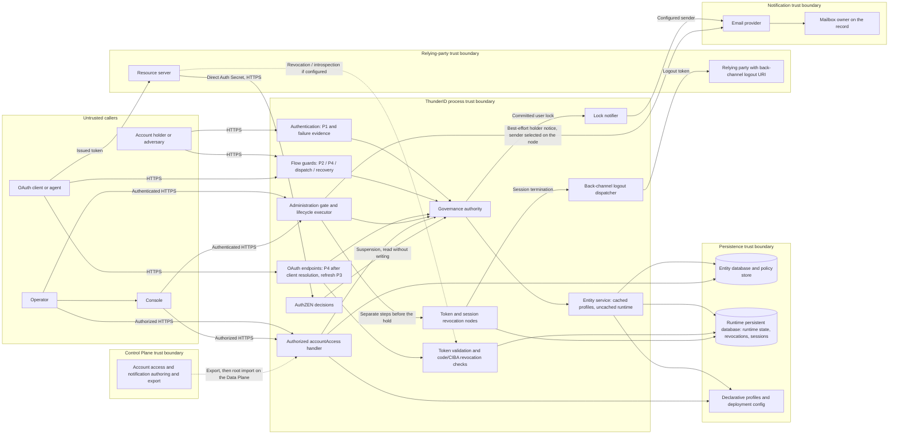

The process boundary marks trusted server code, not unrestricted executor privileges. Access checks need no caller authorization; lifecycle commands retain operator context, and self-service release elevates only its recorded-subject unlock call. Governance owns state; separate nodes revoke tokens and sessions. Stores, caches and deployment files need their own access controls. The Console is a client of the same management APIs and adds no authority. The Control Plane enforces nothing; a Data Plane takes its policy only through a root import (Interaction 08). An embedded host replaces the server boundary and supplies or omits the governance provider (Design baseline).

### Design baseline

L1 is an authentication lock; L2 is suspension. A method lock affects one authentication method; the reserved `account` entry affects every method of a user or agent. Authentication methods identify mechanisms, not individual fields: password, PIN and secret-answer comparisons share `credential`. Applications support suspension only.

| Area | Design position |
| --- | --- |
| State | `ACTIVE` and `SUSPENDED` are stored; `LOCKED` is derived. Public effective precedence: `SUSPENDED > LOCKED > ACTIVE`; expiry needs no state flip |
| Runtime authority | `ENTITY_RUNTIME_DATA.STATE` and `RUNTIME_ATTRIBUTES.accessState` are separate from profiles and credentials, in the runtime persistent database beside revocation records and SSO sessions. Enforcement/status reads bypass profile caches; profile-only reads omit runtime state. Database-backed, declarative and read-only profiles use the same writable runtime store. Initialization and write ordering are covered in Interaction 07. |
| Suspension | State and suspension details change atomically. Either `SUSPENDED` or recorded suspension details refuses access; other stored states, including empty or undefined values, impose no hold. Half-applied transitions do not satisfy this contract. |
| Release | Admitted steps outside a recovery flow clear their method entry; completed sign-in clears only a non-live account entry (expired lock or count-only entry). Recovery/operator unlock clears all locks, never suspension; credential writes alone release nothing. User unsuspend atomically replaces lock history with a permanent account-wide hold. Agent/application unsuspend adds no hold; existing agent locks can remain. Proof binding and revision guards are covered in Interactions 04 and 07. |
| Lockable methods | Only `credential` and `otp` are lockable. `system_credential` failures are not counted. Policy cannot make passkey, federation, magic link or OpenID4VP lockable. No counting while the effective method or whole account is live-locked |
| Token containment | Suspend checks the target, revokes tokens, ends sessions, then writes the hold. Release does not undo revocation. OAuth enforcement requires `oauth.token_revocation.enabled: true`; native APIs require `server.security.token_revocation.enabled: true`. OAuth-off can store criteria without enforcing them. Cutoff, retention and consumer limits are covered in Interaction 05. |
| Embedded engine | Governance can be omitted; checks admit, activity is not recorded, and lifecycle operations are unavailable. The engine logs this at debug level at startup. Supplied-authority admission errors refuse. Custom authentication providers own P1 and do not inherit default-provider counting. |
| Disabled governance port | `identity_governance_provider.type: disabled` is deployment configuration, so only an operator sets it. The flow engine and OAuth then admit every check and refuse lifecycle operations (`IGP-1001`); a recovery flow completes and releases nothing. The authentication provider, the direct endpoints, AuthZEN and status reads still use governance, so counting and locks there continue while no lock can be released early. A non-expiring lock (the consecutive-failure ceiling or a zero duration), which anyone who knows an identifier can form, then stays until the operator reverts the setting. The documented configuration therefore requires an operator who disables the port to disable the lock policy of every category as well; nothing enforces the pairing. |

### Access-plane contract

“Admit” means governance permits access; proof, grant, client and endpoint authorization still apply. A runtime read failure gets the same error as an entity read failure on that path, never a hold or wrong-credential response. OAuth client authentication uses `invalid_client` (401), as ThunderID already answers an unreadable client. The contract applies after a caller resolves a local entity ID; external subjects and identities not yet provisioned are not automatically local accounts.

| Plane | Active | Live method lock | Live account-wide lock | Suspended |
| --- | --- | --- | --- | --- |
| Authentication admission (P1) | Admit | Refuse matching enabled lockable method | Refuse every method | Refuse |
| Authentication challenge dispatch | Admit | Suppress matching method | Suppress every method | Suppress |
| Session/subject admission (P2) | Admit | Admit | Admit | Refuse |
| Tokens (P3): refresh, exchange, code/CIBA redemption, validation | Admit | Admit | Admit | Reject artifacts established at or before the applicable containment cutoff (a code at its creation time, a CIBA request at the later of its authentication and authorization times); refresh also refuses while suspension is currently active |
| Self-service recovery | Admit | Admit, except a password or client secret proof meets its own lock | Admit, except a password or client secret proof | Refuse |
| Application admission (P4) | Admit | Admit | Admit | Refuse suspended application/actor |
| AuthZEN decision about a subject | Decide by roles | Decide by roles | Decide by roles | Deny, stating the suspension |

P3 is artifact revocation plus a live refresh check, not a live check on every token path. Enforcement switches, retention and consumer limits still apply (Interaction 05).

Locks affect only P1 and flow challenge dispatch in either granularity; account granularity adds methods, not planes. Existing sessions/grants and recovery remain usable: inside a recovery flow, every verified proof is submitted at the recovery plane, where a lock gives way to every method except a password or client secret, and a suspension refuses. A failure is counted only where the lock applies, so a wrong recovery code is not counted and a wrong password is (04.7). Direct SMS OTP sending is excluded (02.5).

### Components

| Component | Task |
| --- | --- |
| Default authentication provider | Verifies proof, selects dispatch and authentication method once, counts failures tied to an identity once, calls P1; governance resets after admission |
| Governance service | Reads trusted entity/category and resolves the effective policy from the `accountAccess` section over the deployment base; owns plane decisions, refusal reasons, ladder and transitions |
| Entity service, stores and caches | Reads current runtime state separately from cached profiles; performs targeted writes bound to deployment and entity |
| Flow guards and direct authentication | Enforce P2, recovery and dispatch; `AdmitSignIn` completes sign-in |
| Token/grant handlers | Enforce boundary revocation; refresh adds a live P3 check |
| OAuth service and flow execution | Enforce P4 at OAuth client authentication, the authorization endpoint, the CIBA callback and UserInfo, whatever actor provider the host supplies, and at application-bound flow start/continuation |
| AuthZEN service | Denies a suspended subject before its roles are evaluated, from a runtime read that writes nothing |
| Administration gate and lifecycle executors | Require root system permission; preserve caller context. Bind containment and suspension to the same authorized target |
| Revocation nodes | Revoke tokens and end sessions in separate steps before the hold is written |
| Server-config handler | Decode, validate and merge the `accountAccess` layers; the API security middleware authorizes the write and the server-config service persists it |
| Status projection and Console | Derive status for authorized readers; UI availability is not authorization |

### Actors

#### Actors

| Actor | Description | Roles or permissions |
| --- | --- | --- |
| Anonymous adversary | Submits guesses, requests challenges, observes refusals, or distributes requests across nodes | Public authentication/flow entry points only |
| Account holder | Authenticates, uses a session/grant, or completes a recovery flow | Proof and endpoint-specific permissions; ownership alone does not authorize lifecycle commands |
| Root operator | Runs administration flows and configures security behavior | Authenticated subject with root system permission; flow permission nodes add checks |
| User/agent viewer or manager | Reads or manages users/agents within the permitted OU | View-only or management permission for the resource type; management includes viewing but does not authorize lifecycle flows. Application management requires root permission. |
| Application or agent | Client actor, subject, or both depending on the flow | Client authentication and grant authority; subject and application holds are distinct |
| Deployment/embedding administrator | Controls files, flow definitions, providers, database and transport configuration | Trusted configuration authority; can disable optional governance intentionally |
| Runtime service | Performs internal checks and limited state changes | Runtime privilege for internal operations; lifecycle administration retains the caller context |
| Holder of a stolen session or token | Uses a session, access token or refresh token issued to someone else's account; the actor suspension is meant to stop | What the artifact grants, until revocation is enforced for it (Interaction 05) |
| Contact-address controller | Receives lock notices and recovery codes sent to the email address or phone on the record; may not be the account holder | None of its own; a recovery proof it completes acts for the account (Interactions 02, 04 and 11) |
| Federated identity provider | Asserts the subject that signs in to a linked local account | Trusted through its configured connection; its assertion is the proof for the `federated` method |
| Configuration importer | Imports resources, including the `accountAccess` section, into a Data Plane | Root permission on `POST /import`; the import writes through the same validation and audit as an API write (Interaction 08) |

#### Entitlement matrix

`[Yes]` means authorized subject to the stated checks, not unconditional access while held. Viewer and manager below describe granted permissions, not built-in roles. User/agent view permissions are `system:user:view` and `system:agent:view`; management permissions are `system:user` and `system:agent` and include viewing. These names gain the configured system resource-server handle prefix when one is set. Non-root access to other users/agents is limited to the caller’s OU. Application APIs require root permission. A caller can hold several permissions.

| Actor | Attempt authentication / challenge | Read another identity's status | Edit another profile | Run lifecycle flow | Change account policy |
| --- | --- | --- | --- | --- | --- |
| Anonymous caller | [Yes] | [No] | [No] | [No] | [No] |
| Account holder without admin permissions | [Yes] | [No] | [No] | [No] | [No] |
| User/agent viewer (view-only permission) | [Yes] | [Yes] for permitted user/agent type in own OU | [No] | [No] | [No] |
| User/agent manager (management permission) | [Yes] | [Yes] for permitted user/agent type in own OU | [Yes] for permitted user/agent type in own OU | [No] | [No] |
| Root operator | [Yes] | [Yes] | [Yes] | [Yes] | [Yes] |
| Application/agent without management grant | [Yes] through its supported mechanism | [No] | [No] | [No] | [No] |

A holder of a stolen session or token has the entitlements of the account it was issued to until revocation is enforced for that artifact. A contact-address controller, a federated identity provider and a configuration importer gain no row of their own: the first two act through the account's proofs, and the importer holds root permission.

### External Dependencies (not owned)

| Dependency | Responsibility |
| --- | --- |
| Authentication validators | Verify proofs, prevent replay and identify the subject of failed verification. |
| OAuth, sessions and resource servers | Validate grants, sign tokens and enforce revocation. Offline validation cannot ensure immediate revocation. Companion model: `docs-internals/oauth/authorization-and-core-grants/threat-model.md`. |
| Back-channel logout | Deliver logout tokens to relying parties when a session ends, including sessions a suspension ends. Companion model: `docs-internals/back-channel-logout/threat-model.md`. |
| Flow engine and management authorization | Protect flow execution, establish recovery proof and enforce API permissions. No companion model covers flow execution yet. |
| Database, host, caches and clock | Operators secure storage and hosts, restore databases consistently and synchronize clocks. Multi-node deployments use shared Redis caching, as required by the [production guidelines](https://thunderid.dev/docs/deployment/production-guidelines/#configure-caching); per-node in-memory caches are unsuitable because their entries do not invalidate across nodes. Runtime state needs read-after-write consistency, so its reads must not go to an asynchronously replicated replica. |
| Notification services | Secure delivery and verify contact ownership; notifications do not enforce holds. No companion model covers notification delivery yet. |
| Operations and release tooling | Collect and protect logs, set retention, configure alerts, run security scans and manage migrations. |

## Threats and mitigations

### Out-of-scope interactions and risks

This model covers how governance uses the services below, not their internal security controls.

- Proof verification, replay protection and recovery-proof strength: authentication validators and the flow engine (External Dependencies).
- General OAuth protocol, token signing and resource-server validation: `docs-internals/oauth/authorization-and-core-grants/threat-model.md`.
- Logout-token delivery to relying parties: `docs-internals/back-channel-logout/threat-model.md`.
- Token revocation: revocation record storage, cache synchronization and enforcement at token and grant validation. This model covers only the revocation a suspension requests and what it leaves usable (Interactions 03 and 05). No companion model covers token revocation yet.
- Infrastructure protection, notification delivery and contact assurance, and privacy/legal compliance: the deployment and the dependencies above.
- Recovery attempt limiting. A lock gives way to a recovery proof such as a one-time code by design, so it does not limit recovery attempts made with one, and a wrong recovery code is not counted toward the sign-in lock; a password in a recovery flow still meets its lock. ThunderID has no recovery attempt limit of its own: a one-time code is bounded only by its expiry and the flow's limit on codes sent. This feature neither introduces nor changes that; deployments limit recovery attempts with rate limiting in front of ThunderID, as the [production guidelines](https://thunderid.dev/docs/deployment/production-guidelines/#configure-rate-limiting) describe (Residual risks).

### Interactions

#### [01]: Authentication, failure attribution and automatic locking

**Description**

The default authentication provider picks the authentication method once per request. A failure counts only when internal evidence names the subject that was compared; bad requests, unknown or ambiguous identities, expired OTPs and method faults count nothing, so a request identifier alone cannot target a victim. A failure tied to a subject goes to `RecordFailure`. For a method a lock limits, at a plane where the lock applies, it decides the attempt from the same read it counts from: a held account is refused with the stated hold and nothing is counted, so a wrong and a correct password or one-time password get the same answer during a lock or a suspension. A wrong client secret (never counted) and a wrong recovery code that the lock gives way to are not read and keep the ordinary failure; only a correct proof states the hold there. Both outcomes run the comparison, which dominates the timing, but a correct proof does one more profile read, so their timing is not equal. Outside a recovery flow, a successful proof reaches `AdmitAuthenticationStep` at P1 before the reset; in a recovery flow it is evaluated at the recovery plane and clears nothing. Governance owns admission and reset; the provider owns evidence and public errors. A credential lock does not hide failures on a separate OTP method. A counter write that fails is logged and leaves that attempt uncounted; the caller still gets the ordinary failure. A read that fails refuses the attempt with a server error, as it refuses a correct proof.

Each counted failure also adds to a consecutive count that neither the failure window nor a lapsed lock resets; a success with that method, a completed recovery or an unlock clears it, as does a user's unsuspend, which leaves a non-expiring hold anyway. Under account-wide locking it counts password and one-time password failures together, and a completed sign-in clears it. At `maxConsecutiveFailures` (50 for users and agents as shipped) the method is locked without expiry, so guessing paced under the threshold, or waiting out each lock, ends after that many attempts per method between the holder's successes. This follows the 100-attempt upper bound in NIST SP 800-63B-4 §3.2.2.

**Assets involved**

| Initiator | Intermediate | Target |
| --- | --- | --- |
| Caller and presented proof | Authentication method and its derivation, internal failure evidence | Account availability, counters, locks and authentication result |

**Data flow**

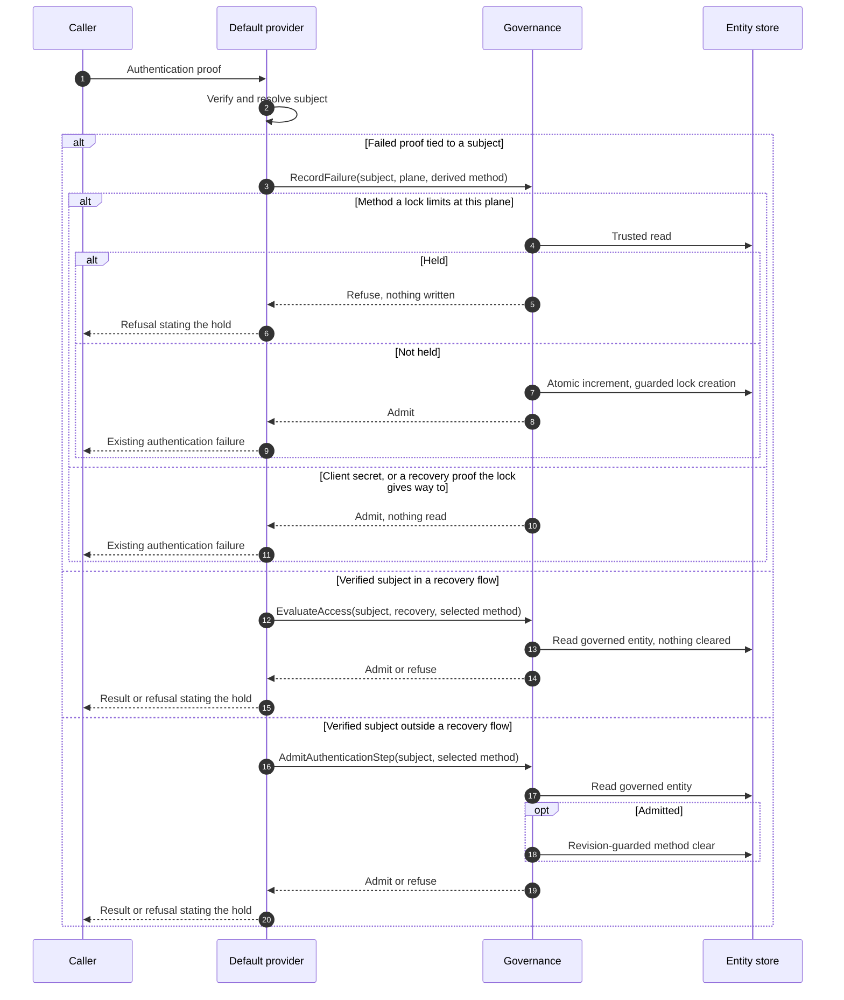

**Security considerations**

| Area | Response | Comments |
| --- | --- | --- |
| Data confidentiality | [C-High] | Credentials and identity-linked failure evidence |
| Communication medium | [M-NT], [M-IN], [M-DB] | Request, internal call, persisted counters |
| Transport security | [TLS] required at public boundary | Deployment responsibility |
| Authentication | Proof verified before P1 admission; a failed proof's subject is checked before counting | Failed attempts are intentionally unauthenticated |
| Accessibility | [Public] | Runtime write APIs are internal |
| Authorization and Access Control | Trusted authentication method evidence and runtime context | Target, category and authentication method are server-derived |

**Threat assessment**

| ID | Category | Threat | Materializable | Mitigation / comment |
| --- | --- | --- | --- | --- |
| 01.1 | [Denial of Service] | Wrong-secret attempts lock a victim and interrupt sign-in. | [Yes] | Bounded. Per-method locking, finite shipped rungs for users and agents, and recovery reduce impact. Locks preserve sessions/grants (05.3). Operator accounts are locked like any other: per-method locking leaves their other enrolled methods usable, account granularity does not, and a root operator can still unlock or suspend through an existing session. The consecutive ceiling lets anyone who knows an identifier make one method's lock non-expiring with 50 failures; with the shipped rungs that takes about seven hours of waiting out locks for a user, and recovery releases it. Residual: targeted denial of service against a known identifier, operators included. |
| 01.2 | [Information Disclosure] | Sign-in, recovery and dispatch responses reveal that an account is locked or suspended, and passkey enrolment responses that it is suspended. | [Yes] | Accepted. Disclosure is fixed in code and no setting changes it: with the built-in governance provider a refusal of a held account always states the lock or the suspension, and where a lock limits guessing it does so whatever password or one-time password is presented (01.5). Anyone who knows an identifier therefore learns whether the account is locked or suspended with one attempt and no secret; on a held account that attempt is not counted, and on an unheld one it counts as any wrong secret does. Sign-in and recovery already answer an unknown identifier with the existing not-found answer, so the existence of the account is not what this reveals, and the holder learns why they are refused. A stated refusal never names the method, attempts remaining or lift time, never exposes the operator note, and an unknown identifier is never stated as held; a refusal reason a caller does not map gets the wrong-secret response. Out of scope: normalizing the existing unknown-account answers and letting a flow choose how it presents a refusal, the stated hold included. Both belong to the flow executors' authentication error handling, which is to handle them in future (tracking: [#5937](https://github.com/thunder-id/thunderid/issues/5937)). |
| 01.3 | [Elevation of Privilege] | A federated sign-in to a linked local account bypasses an account-wide lock or a suspension. | [No] | Every federated path is admitted. A federated sign-in that resolves to one local account through its recorded link is checked at P1 under the `federated` method. When several local accounts hold the link, the account the user picks at sign-in, and the one a registration or invitation completes as, is bound through the default provider with a credential it admits at P1 under the `federated` method, as for a single holder. An identity with no link reaches a local account only after that account verifies through an ordinary sign-in step, which is itself checked at P1. An account-wide lock or a suspension refuses it. A lock on a single other method, such as password, does not, because federated sign-in does not use that method. |
| 01.4 | [Repudiation] | Locks formed by repeated failures leave no audit record. | [No] | Each committed lock is logged once at debug level with the masked target, its category, the authentication method, the lock count and the unlock time, and, when observability is enabled, published once as `IDENTITY_LOCKED` with no actor, since failed sign-ins trigger it; a live lock, its method and its expiry are also visible on authorized status reads. A lock that lapses writes and publishes nothing, because expiry is a comparison with the stored unlock time made at the next attempt and nothing runs when that time passes; the formation event's `unlock_at` already gives it. An early release publishes `IDENTITY_SELF_UNLOCKED` (recovery) or `IDENTITY_UNLOCKED` (operator). A policy change publishes `SERVER_CONFIG_UPDATED` and changes no stored lock, so it has no per-identity event. Lifecycle operations log at debug level too, so the events are the record. Lock, lifecycle and policy events are published only when observability is enabled, so a deployment that needs the record enables it, and retention is the deployment's (residual 08.2). |
| 01.5 | [Information Disclosure] | During a lock or a suspension, a wrong secret and the correct one get different answers, so the stated hold confirms a guessed secret, and attempts a live lock does not count give unlimited guesses. | [No] | Both outcomes are checked after the comparison: a verified proof at admission, and a failed proof tied to a subject by `RecordFailure` from the read it counts from. Wherever a lock limits guessing (a password or one-time password, at a plane where the lock applies), the proof gets the same stated refusal whether it is right or wrong, and nothing is counted while the hold lasts. A wrong client secret is never counted, so a hold does not change its guessing budget, and a recovery code the lock gives way to cannot be obtained by a suspended account; both keep the ordinary failure, and only a correct one states the hold. The comparison dominates the timing, but a correct proof does one more profile read, so timing is not equal. Proofs whose failures name no subject (passkey, magic link, federated, verifiable presentation) have no guessable secret. |
| 01.6 | [Spoofing] | A caller guesses a secret slowly to sign in as the identity, keeping under the threshold or waiting out each lock, so no lock ever stops the guessing. | [No] | The consecutive count is not reset by time or a lapsed lock, and at `maxConsecutiveFailures` (50 as shipped) the method is locked until a completed recovery or an operator unlock. A deployment that sets it to `0` removes the ceiling and accepts unbounded paced guessing (about 96 a day per user method with the shipped window). |
| 01.7 | [Spoofing] | A caller makes the counter write fail, so wrong guesses are answered but never counted toward a lock. | [Yes] | Bounded. The read that decides an attempt comes first and fails closed; only a counting transaction that fails after that read succeeded leaves the attempt uncounted, and the caller still gets the ordinary failure, so a correct guess in that window signs in. A caller cannot cause this directly: on PostgreSQL, which production deployments use, the increment is one single-row statement that waits for a competing write rather than failing, and a caller who drops the connection to abort it loses the answer too. It needs the runtime database to serve reads while rejecting writes, for example when it is out of space, read-only during a failover or failing intermittently, and every guess in that window is uncounted. Each failed write is logged at error level, so operations can alert on it, and front-door rate limiting bounds the guesses as it does without lockout. |

#### [02]: Challenge dispatch and self-service recovery

**Description**

Dispatch checks the trusted subject and the challenge's authentication method before a flow delivers a challenge; it never counts failures. A withheld dispatch sends nothing and fails the step with the hold stated (02.3); the built-in governance provider names the hold on every refusal. Only a refusal that names no hold, which a custom governance provider may return, leaves the hold unstated: a one-time password is generated but not delivered, so the step answers as a sent code does; the magic-link step completes without delivery, as for an unknown user; and the passkey step fails as for a user with no registered passkey. The direct SMS OTP send endpoint is not a dispatch check (02.5). Trusted flow type selects the plane: a challenge in a recovery or registration flow is checked at the recovery plane, and a challenge in every other flow type (authentication, administration, user onboarding and sign-out) at the dispatch plane, where every automatic lock applies. Verification is narrower: only a proof verified in a recovery flow takes the recovery plane, so a code verified in a registration flow is checked and counted as at sign-in. Recovery identification and credential-write guards enforce the [Access-plane contract](#access-plane-contract); governance does not replace or re-verify recovery proof.

**Assets involved**

| Initiator | Intermediate | Target |
| --- | --- | --- |
| Caller requesting challenge/recovery | Flow context, challenge service, access guard | Mailbox/phone, recovery proof, credential and lock state |

**Data flow**

```mermaid
sequenceDiagram
  autonumber
  participant U as Caller
  participant F as Challenge or recovery executor
  participant G as Governance
  participant D as Delivery or credential service
  U->>F: Challenge or recovery request
  F->>G: Check trusted subject and correct plane
  alt Refused
    F-->>U: No delivery; refusal stating the hold, or a custom provider's unnamed refusal answered per executor
  else Admitted
    F->>D: Dispatch challenge or authorized credential update
    F-->>U: Existing response
  end
```

**Security considerations**

| Area | Response | Comments |
| --- | --- | --- |
| Data confidentiality | [C-High] | Recovery proof and contact data |
| Communication medium | [M-NT], [M-IN], [M-DB] | Public API and delivery side effects |
| Transport security | [TLS] required | Delivery-channel protection separately configured |
| Authentication | Challenge request may be anonymous; credential replacement needs proof | Recovery proof remains a trust input |
| Accessibility | [Public] | Internal guards and write callbacks |
| Authorization and Access Control | Plane selected from trusted flow type | Trusted flow type; proof still required |

**Threat assessment**

| ID | Category | Threat | Materializable | Mitigation / comment |
| --- | --- | --- | --- | --- |
| 02.1 | [Denial of Service] | Challenge requests increment a victim’s lock counter. | [No] | Dispatch checks only; counting requires failed verification. |
| 02.2 | [Elevation of Privilege] | Suspended subject regains access through recovery. | [No] | Recovery identification/credential-write guards enforce L2, and so does the recovery-plane admission of a verified recovery code; L1 permits proven recovery, except a password or client-secret proof (04.7). The recovery mark comes from the flow type, not from the flow definition. |
| 02.3 | [Information Disclosure] | Suppressed delivery adds a hold-specific response. | [Yes] | Accepted as part of 01.2. A withheld one-time password, magic link or passkey challenge fails the step with the hold stated, as every refusal from the built-in governance provider names its hold, so the holder is not left waiting for a code. A custom provider's refusal that names no hold adds no hold-specific response (Interaction 02). Direct SMS sending adds no hold-specific response (02.5). |
| 02.4 | [Elevation of Privilege] | Pre-hold or usernameless challenge bypasses later admission. | [No] | Resolved default-provider subjects reach P1; session/assertion joins add P2, and the assertion fails closed on a subject it cannot resolve and signs only the subject it checked; recovery rechecks before credential write. A request already admitted while a suspension is being written is covered by 05.6, and a custom authentication provider owns its own P1 (Design baseline). |
| 02.5 | [Denial of Service] | A held account's phone receives one-time codes from the direct SMS OTP send endpoint. | [Yes] | Bounded. Direct SMS sending accepts any well-formed number without an account check. It is a direct authentication API, so the caller must present the deployment's direct authentication secret; with no secret configured every direct call is refused. P1 refuses verification for an account held for one-time codes; flow dispatch remains guarded. ThunderID does not rate-limit direct API endpoints, so deployments control delivery volume and cost by rate-limiting OTP delivery under `/auth/otp/**` at the gateway or front door, as the [production guidelines](https://thunderid.dev/docs/deployment/production-guidelines/#configure-rate-limiting) describe. |
| 02.6 | [Denial of Service] | Repeated challenge requests flood an active account's phone or mailbox, or run up delivery cost. | [Yes] | Bounded. The dispatch check stops delivery only to a held identity; it is not a rate limit, and dispatch never counts (02.1). A one-time-password step sends at most three codes per flow execution by default, but nothing limits new executions per identity or destination. Deployments rate-limit flow entry points and set delivery-provider quotas, as the [production guidelines](https://thunderid.dev/docs/deployment/production-guidelines/#configure-rate-limiting) describe. |

#### [03]: Administrative suspension, release and containment

**Description**

Administration start/continuation requires an authenticated root caller; shipped flows add permission checks. Trusted entity reads supply target category and organization unit (OU). Server authorization checks user/agent update permission in that OU, rejects self-targeting and refuses uncertain authorization. Applications rely on the root gate; delegation is unsupported.

Suspend follows: permission check → pre-suspend authorization and trusted plan → token revocation → session termination → atomic hold write → best-effort notification. Pre-check refusal publishes no plan and revokes nothing. The hold write authorizes again; a refusal there, possible only if the caller's authority changes during the flow, comes after containment and leaves an active account with its covered tokens revoked and sessions ended. The hold write takes its subject from the executor-only plan, ignores target input and fails without a plan. Failures and retries are covered in 03.3 and 03.6. Suspending an already suspended account through the administration flow API (the Console offers no Suspend on a suspended account) uses a new revocation cutoff but keeps the existing hold and operator note. The note is at most 100 characters, since it is stored on the runtime record every access check reads; the pre-check refuses a longer one, so it revokes nothing. Suspended profiles remain editable and keep their identifiers, so a suspended account's unique attributes and a suspended application's client ID stay taken. Unsuspend works only on a suspended account. A user comes out of suspension still locked on every sign-in method until unlocked; agents and applications come out with no new lock (see Release in the Design baseline). The Console also offers users Unsuspend and unlock, which runs the unlock flow straight after the unsuspend. The only lifecycle action that can run outside an administration flow is `unlock`, which a self-service recovery flow performs (Interaction 04); flow validation refuses to save `suspend` or `unsuspend` in any other flow type.

The shipped user flows email the holder after suspend, unsuspend and unlock, and the agent and application suspend flows after suspend; these notices are separate from the lock notifier (Interaction 11). Each is a best-effort email node: the shipped nodes name no notification sender, so nothing is sent until an operator selects one on the node, and a failed notice never fails the operation. The flow reports `emailSent` as `false` and the Console tells the operator no email was sent; a server-side render or send failure is also logged as a warning, while a missing provider or recipient is not logged. The recipient is the record's `email` attribute unless the flow's data or the operator's inputs already carry an `email` value; agents and applications usually have none.

Lifecycle events are `IDENTITY_SUSPENDED`, `IDENTITY_UNSUSPENDED` and `IDENTITY_UNLOCKED`, with `IDENTITY_SUSPENSION_FAILED`, `IDENTITY_UNSUSPENSION_FAILED` and `IDENTITY_UNLOCK_FAILED` carrying the failure class. Logs/events include actor, target, category and outcome, including pre-check refusals; a self-service release from a recovery flow is published as `IDENTITY_SELF_UNLOCKED` or `IDENTITY_SELF_UNLOCK_FAILED` in the authentication category, with no operator. They record only whether an operator note was provided, never its text. Events require observability to be enabled; output retention and retrieval are deployment controls.

**Assets involved**

| Initiator | Intermediate | Target |
| --- | --- | --- |
| Root operator | Authenticated flow, target input, pre-suspend node, lifecycle executor, trusted revocation plan | Suspension, sessions, grants, optional operator note and post-suspension lock |

**Data flow**

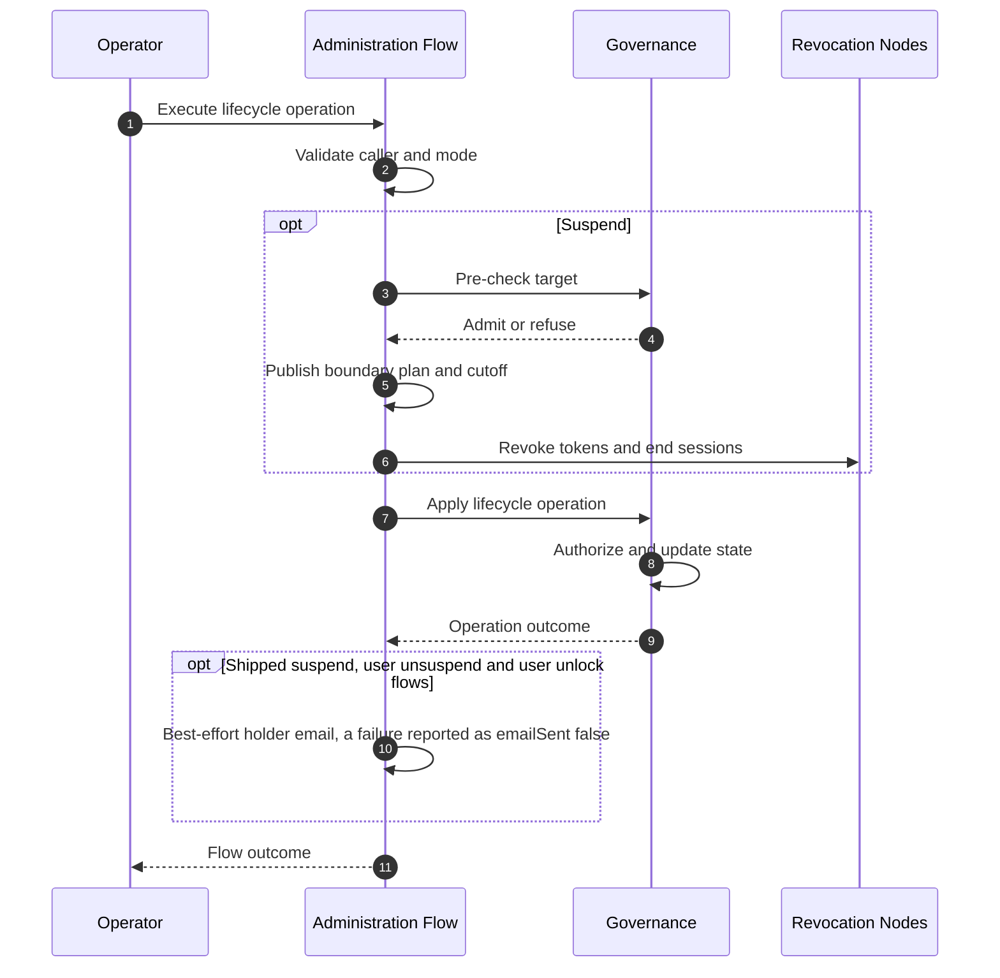

**Security considerations**

| Area | Response | Comments |
| --- | --- | --- |
| Data confidentiality | [C-High] | Operator note can contain sensitive incident information |
| Communication medium | [M-NT], [M-IN], [M-DB] | Authenticated management operation |
| Transport security | [TLS] required | Protect operator credentials and flow continuation |
| Authentication | Authenticated subject; runtime/anonymous context rejected | Root system permission checked at execution boundary |
| Accessibility | [Restricted] | Public route does not make administration public |
| Authorization and Access Control | Root gate, flow permissions, trusted OU | Lifecycle calls preserve caller context |

**Threat assessment**

| ID | Category | Threat | Materializable | Mitigation / comment |
| --- | --- | --- | --- | --- |
| 03.1 | [Elevation of Privilege] | Anonymous caller or ordinary owner performs administrative unlock/unsuspend. | [No] | Independent root administration gate prevents owner shortcuts from authorizing these flows. Proof-bound recovery unlock is a separate path (04.2, 04.3), not owner permission. |
| 03.2 | [Tampering] | Caller forges automatic lock creation or changes containment target/scope, or holds a different identity from the one contained. | [No] | Lock creation is internal; the pre-suspend node publishes an executor-only trusted runtime plan, and the suspend node takes its target from that plan's subject, ignores any target input and faults without a plan. The operator note cannot select authority or behavior. |
| 03.3 | [Operational Risk] | A failed suspension may partially revoke access while leaving the account active. | [Yes] | Accepted: containment and the hold write are separate steps. If any step fails before the hold is written, the flow reports failure and the account stays active, though some tokens or sessions may already be revoked; the operator retries Suspend. |
| 03.4 | [Elevation of Privilege] | Caller performs an unauthorized user, agent or application lifecycle operation. | [No] | Root permission gates flow start/continuation. User/agent operations also check trusted OU, reject self-targeting and refuse uncertain authorization; Suspend checks again at the hold write. Applications have no delegated lifecycle permission and require root. Embedded hosts must supply authorization. The root gate is what keeps a user flow from naming an application or agent: below it, the lifecycle node takes its target from input without binding the target's category to the flow, and the service has no application permission check. Any future delegation needs both before the gate is loosened. |
| 03.5 | [Tampering] | Non-administration flow exposes suspend/unsuspend. | [No] | Trusted engine flow type restricts non-administration execution to `unlock`; other modes fault. The pre-suspend node is offered to administration flows only. |
| 03.6 | [Operational Risk] | A revocation or session store outage stops an operator from suspending a compromised account. | [Yes] | Accepted: token/session store failure prevents suspension. Causes include database unavailability, connection-pool exhaustion and failed transactions; it becomes a denial of service only where a caller can induce the outage. These stores share the runtime persistent database with hold state, so outages often affect all three. Revocation writes log/publish `TOKEN_REVOCATION_FAILED` with reason and target; session failures publish a flow-node failure. Alert on both; retry after recovery. |
| 03.7 | [Elevation of Privilege] | A suspended operator keeps using an existing token for administration. | [Yes] | Bounded. The administration gate checks the caller's permissions, not the caller's own hold. Suspension revokes the operator's tokens; native APIs, which administration flows and policy writes use, enforce that after their revocation cache next synchronizes (`server.security.token_revocation.sync_interval_seconds`, 60 seconds by default), and with native enforcement off the token works until it expires. Self-targeting is rejected, so the operator cannot lift their own hold. Accepted: no per-request check of the caller's own hold, which would add a read to every management call; a deployment that needs a shorter window lowers the sync interval. |
| 03.8 | [Elevation of Privilege] | Unsuspend returns an account to an attacker who changed its contacts or credentials while in control. | [Yes] | Accepted. Unsuspend verifies nothing about the record. A user comes out still locked and releases the lock through recovery, which proves control of the contact now on the record, so the operator must check and repair contact attributes and credentials before unsuspending. The Console's Unsuspend and unlock action, offered for users, also clears that lock at once, so no recovery proof is asked for and the operator's check is the only safeguard. A suspension notice goes to the `email` attribute on the record, so an attacker who changed it learns the account is contained. Agents and applications come out with no lock, so their secrets must be rotated first. |
| 03.9 | [Denial of Service] | Suspending the Console's own application cuts off administration through the Console. | [Yes] | Accepted. It takes root permission, and the operator chooses the target. The Console offers no lifecycle actions on its own application, but the server does not refuse the operation, so a flow execution through the API can still suspend it. As for any application, the suspension refuses sign-in through the Console and revokes the tokens issued through it. Recovery runs the application unsuspend flow with a root token obtained through another application; the Console is the only application that ships, so a deployment with no other root-capable client clears the hold in the runtime persistent database. |

#### [04]: Successful authentication and recovery release

**Description**

After admission, method reset clears the presented method and history even when current policy ignores that entry. `AdmitSignIn`, at assertion or atomic endpoint completion, clears only a non-live account entry, so a first factor cannot reset counters fed by a second factor. Admission and reset are separate operations. Both clears use the revision guards in Interaction 07; neither conflicts nor logged clear errors reverse admission.

Recovery requires an explicit `IdentityGovernanceExecutor` node in `unlock` mode after `CredentialSetter`. Flow validation accepts that node only in administration and recovery flows, on API writes and declarative loads alike, so a registration or authentication flow cannot release locks. Shipped flows and authoring examples include it; its placement within a custom recovery flow is documented, not validated (04.5). Operator unlock has the same release of every lock entry under administrative authorization.

After a successful credential write, `CredentialSetter` records `provenSubject` in executor-only runtime data. This identifies the subject; trusted earlier flow steps must prove ownership. The release node ignores target input, fails without `provenSubject`, and elevates only its `Unlock` call for that subject. Credential write and release are separate operations (04.6); unlock preserves suspension and unrelated runtime fields.

**Assets involved**

| Initiator | Intermediate | Target |
| --- | --- | --- |
| Authenticated holder, recovery-flow completer, or operator | Flow engine, credential writer, shared runtime data, release node, governance authority | New credential, recorded proof, appropriate lock entries |

**Data flow**

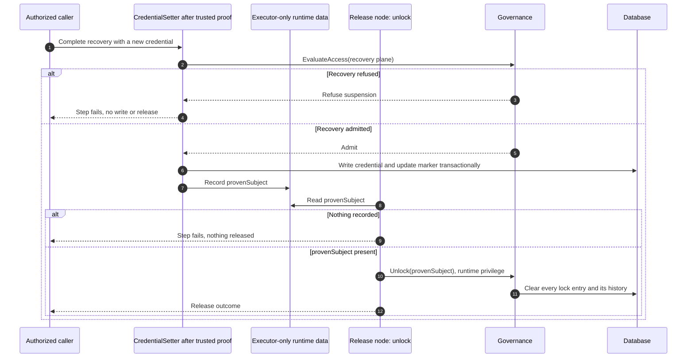

**Security considerations**

| Area | Response | Comments |
| --- | --- | --- |
| Data confidentiality | [C-High] | Credentials and reset proof |
| Communication medium | [M-NT], [M-IN], [M-DB] | Flow transport and the credential path |
| Transport security | [TLS] required | Database transport is deployment-specific |
| Authentication | Valid sign-in, a recorded proof of control, or management authorization | Credential write alone cannot release |
| Accessibility | [Restricted] | Recovery has a public start but protected completion |
| Authorization and Access Control | `provenSubject` or caller permissions/OU | What a release clears follows the design baseline |

**Threat assessment**

| ID | Category | Threat | Materializable | Mitigation / comment |
| --- | --- | --- | --- | --- |
| 04.1 | [Elevation of Privilege] | Credential change, registration or profile edit lifts a live lock. | [No] | Credential writes never clear locks, including post-unsuspend holds. Explicit recovery release and separately authorized operator unlock do. |
| 04.2 | [Elevation of Privilege] | Caller releases another identity's locks or releases locks before proof. | [No] | Target input is ignored. Only `CredentialSetter` records executor-only `provenSubject` after a successful credential write; without it, release fails. Trusted earlier flow steps must establish ownership, and custom-graph proof strength/order is not validated here. |
| 04.3 | [Elevation of Privilege] | Release-node runtime privilege reaches unauthorized operations. | [No] | Privilege applies to one `Unlock` call on the recorded subject. Suspend/unsuspend fault outside administration before elevation. |
| 04.4 | [Elevation of Privilege] | Recovery clears suspension along with locks. | [No] | `Unlock` changes locks only; recovery guards refuse suspended subjects before credential write. |
| 04.5 | [Denial of Service] | Custom recovery omits release and strands locked subjects. | [Yes] | Accepted. Shipped flows include explicit release, and flow-authoring documentation and its sample recovery flow show where the release node goes. Placement in custom flows is the author's responsibility; it is documented. An operator unlock remains available. |
| 04.6 | [Denial of Service] | Release fails after the credential write, leaving a new credential and a live lock. | [Yes] | Accepted. The release step fails, so the holder is told recovery did not complete; running recovery again rewrites the credential and clears the locks. A lock does not block recovery, except a password or client-secret proof (04.7). A non-expiring lock needs an operator unlock if the holder does not retry. |
| 04.7 | [Spoofing] | A recovery flow with a password step becomes a way to guess the password past its lock. | [No] | Every authentication step may run in a recovery flow. At the recovery plane governance keeps the lock on a password or client secret, the methods that are reused at every sign-in and can be guessed, so the correct password is still refused while locked and a wrong one is still counted. Other methods get past a lock there, since recovery is how a locked account gets out; their failures are not counted, as the lock would not stop them. Governance classifies every registered method for the recovery plane, and a test fails when one is not classified. The recovery mark comes from the running flow's type, set by the engine, including a called flow. |

#### [05]: Existing sessions, grants and token issuance

**Description**

Locks leave existing sessions and grants usable. P2 checks the subject when a session or flow admits it and refuses a suspension. P3 checks token and grant revocation; refresh also checks the subject's current suspension state. Token builders do not make a separate governance check.

Suspension records an `identity_suspended` revocation criterion for the entity ID and, for an application or an agent with an OAuth client, its client ID. The cutoff is the pre-suspend check time plus `jwt.leeway`. Matching tokens and grants established at or before that cutoff are rejected. The leeway covers ordinary flow duration, concurrent signing and clock differences; work that finishes beyond it is outside the cutoff's guarantee (05.6). Once the hold exists, P2 refuses a new session even if it began after session termination. Ending a session notifies the back-channel logout dispatcher, which sends a logout token to each participating relying party that registered a back-channel logout URI (`oauth.logout.backchannel.enabled`, on by default); delivery is best effort and its limits are in the back-channel logout model.

Unsuspend does not erase revocation criteria or restore ended sessions and grants. If the cutoff is still in the future, a newly created grant or token in that interval can also be rejected; the holder retries after the cutoff passes.

For a token ThunderID issued, revocation compares the token's own `iat` with the cutoff, rather than its original authentication time. A subject criterion matches its `sub` or, for a refresh token, `access_token_sub`; local subjects always use the entity ID. An application criterion matches access-token `client_id` or refresh-token `sub`. External tokens follow their issuer's validation and do not select a local entity for this check.

Authorization-code and CIBA redemption go through the OAuth criteria revocation enforcement (`excludeRevokedScopes` over `EnsureNotRevoked`), matching the subject ID and client ID. A code is checked at its creation time and a CIBA request at the later of its authentication and authorization times. A code issued after the cutoff cannot exist for a held subject, because issuance refuses it. Issuance relies on admission or grant checks before signing, and refresh makes a fresh suspension check. If the OAuth revocation store cannot be read, the request is refused. Native APIs use a separate revocation cache whose synchronization interval is set by the deployment.

An application that keeps its own session can ask the AuthZEN API whether the subject may act. A single evaluation and every evaluation for that subject in a batch deny a suspended subject, whatever its roles allow, with the reason `Subject is suspended`, and an action search returns no actions. A single evaluation and an action search check the suspension once the subject resolves, before the resource and action; a batch item with a missing field, an unknown resource or an invalid subject keeps that error context. The read behind this decision writes nothing: a missing runtime row reads as the starting state (Interaction 07). A lock is not a denial, and a failed read fails the request. The decision covers only the subject; it does not authenticate it.

Retention follows 05.2; offline enforcement follows 05.1. Application and agent suspension cover the client and its bound artifacts (06.4); an agent named only as an actor is outside it (06.6). Both enforcement switches are in the Design baseline.

**Assets involved**

| Initiator | Intermediate | Target |
| --- | --- | --- |
| Holder of session or grant | Session join, grant handler, explicit subject ID, token builder | Continued access and newly issued tokens |
| Resource server with its own session | AuthZEN service | Access decision about the subject |

**Data flow**

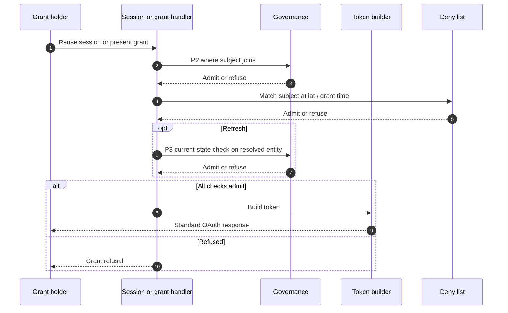

**Security considerations**

| Area | Response | Comments |
| --- | --- | --- |
| Data confidentiality | [C-High] | Sessions, grants and tokens |
| Communication medium | [M-NT], [M-IN], [M-DB] | Protocol requests and internal authority reads |
| Transport security | [TLS] required | Token confidentiality depends on deployment |
| Authentication | Existing session/grant and applicable client authentication; the Direct Auth Secret for AuthZEN calls | Governance is an additional check |
| Accessibility | [Public] endpoints with authenticated proof | Internal builder not directly exposed |
| Authorization and Access Control | Subject identity plus plane decision | Token `sub` is the local entity identifier |

**Threat assessment**

| ID | Category | Threat | Materializable | Mitigation / comment |
| --- | --- | --- | --- | --- |
| 05.1 | [Lateral Movement] | Issued token remains usable at an offline resource server, or an application keeps its own login session. | [Yes] | Accepted. Server checks cannot force offline consumers to recheck. An application with its own session is signalled only through back-channel logout, when it registered for it; otherwise it keeps the user signed in until it next consults ThunderID, for example through an AuthZEN decision (05.5). Token lifetime bounds, revocation/introspection integration and back-channel logout registration remain deployment obligations. |
| 05.2 | [Elevation of Privilege] | Revocation expires before an old grant, allowing reuse after release. | [Yes] | Accepted: every suspension keeps its record for the longer of one week and the configured revocation lifetime, currently the deployment refresh-token validity; suspending an application or an agent also keeps it at least as long as its OAuth client's artifact lifetime. Expiry counts from the later of the write and cutoff, plus JWT leeway. No maximum token lifetime is enforced, so a user's token issued through a client whose validity is longer than both can outlive the user's suspension record; after release and record expiry it is accepted again. Keep token validities within a week where this matters. |
| 05.3 | [Denial of Service] | Failed sign-ins terminate sessions or block valid refresh/exchange. | [No] | Locks affect only P1/dispatch in both granularities (Access-plane contract); token validity, grant authorization and suspension remain independent. |
| 05.4 | [Denial of Service] | A token issued by exchange or JWT bearer grant for an external subject whose `sub` equals a local entity ID is refused when that local identity is suspended or deleted. | [Yes] | Accepted. Validation matches subject revocation on `sub` alone, as user deletion already does. Denial only, and it needs a trusted external issuer to assert a `sub` equal to a local entity ID. |
| 05.5 | [Elevation of Privilege] | A resource server asks the AuthZEN API whether a suspended subject may act, and is permitted because the subject's roles allow it. | [No] | The AuthZEN service asks governance before it evaluates roles, so a suspended subject is denied in single and batch evaluations and has no allowed actions in an action search. Either stored representation of the suspension denies. A lock is not a denial, so failed sign-ins cannot cut off a subject's authorizations. A failed runtime read fails the request rather than permitting it. |
| 05.6 | [Elevation of Privilege] | A sign-in or grant admitted before the hold is written issues a token after the containment cutoff, so the token survives the suspension. | [Yes] | Bounded. The cutoff is the pre-suspend check time plus `jwt.leeway`, which covers ordinary flow duration; only work that passes its last check before the hold is written and issues after the cutoff escapes it, so the window is how long containment runs beyond the leeway. Once the hold exists, P1 and P2 refuse new sign-ins and sessions, and refresh refuses while the suspension is active. An access token from that window lasts until it expires; a refresh token from that window is not revoked, so after an unsuspend it refreshes again, even while a user's post-suspension lock is live, and with renewal on grant it keeps rotating. Suspending the account again sets a new cutoff that covers it. |
| 05.7 | [Elevation of Privilege] | With revocation enforcement turned off, a suspension succeeds but the holder's issued access tokens keep working. | [Yes] | Accepted. Suspend records the revocation criteria whatever the switches say; `oauth.token_revocation.enabled` and `server.security.token_revocation.enabled` decide only whether they are checked, and both are on by default. With the OAuth switch off, introspection, token exchange and code and CIBA redemption do not check them; with the native switch off, ThunderID's own APIs accept a revoked token. Either way the suspension still refuses new sign-ins and sessions (P1, P2), ends existing sessions, refuses refresh through its live check and refuses a suspended application (P4), so the exposure is the remaining lifetime of access tokens already issued. Neither the suspend result nor the Console says that enforcement is off. |

#### [06]: Applications and agents as actors or subjects

**Description**

P4 checks applications in the OAuth service, at client authentication, the authorization endpoint, the CIBA callback and UserInfo, and at direct-flow start/continuation. Resolving the client, through whatever actor provider the host supplies, makes no governance check; each OAuth site asks governance once it holds the client. Client authentication asks after the credentials verify, so token, PAR, introspection, revocation and the CIBA request answer a held client with `invalid_client`; the authorization endpoint shows the application as unavailable without redirecting, the CIBA callback answers `unauthorized_client`, and UserInfo answers `invalid_token`. A failed governance read refuses: `invalid_client` at client authentication and a server error elsewhere. At the CIBA callback and UserInfo a failed client lookup is a server error too, so the check is never skipped; the CIBA callback also fails the pending request once an assertion bound to that request verifies, so the polling client is not left waiting, unless the deployment does not report server errors. A client that no longer exists has nothing to govern and is admitted. OpenID4VCI, flow metadata and logout do not check P4; suspension revocation covers a held client's tokens, the flow refuses at start, and logout grants nothing. Subject checks remain separate (P1/P2/P3). Agents receive default credential/OTP locking; client-secret failures never count or form locks. Private-key client authentication does not use default-provider P1. When agent activity recording is enabled, a `client_credentials` token records the agent's `lastLoginAt` after the token is built; an application is never recorded.

**Assets involved**

| Initiator | Intermediate | Target |
| --- | --- | --- |
| Client application, agent, acting user | OAuth client authentication and endpoint checks, flow start/continuation, subject resolution, P4/P1/P2/P3 | Application availability, agent authority, user grants |

**Data flow**

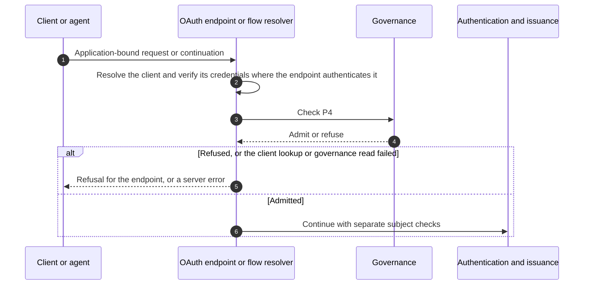

**Security considerations**

| Area | Response | Comments |
| --- | --- | --- |
| Data confidentiality | [C-High] | Client secrets and delegated authority |
| Communication medium | [M-NT], [M-IN] | OAuth and direct flow paths |
| Transport security | [TLS] required | Client authentication remains separate |
| Authentication | Client credential or subject proof as applicable | Distinguish agent-as-subject from client-as-actor |
| Accessibility | [Public] | No unauthenticated management rights |
| Authorization and Access Control | Separate application and subject checks | An application hold is not charged to the user counter |

**Threat assessment**

| ID | Category | Threat | Materializable | Mitigation / comment |
| --- | --- | --- | --- | --- |
| 06.1 | [Elevation of Privilege] | Suspended application bypasses P4 through direct-flow continuation, or through an OAuth endpoint whose client lookup fails. | [No] | P4 reads current authority at direct-flow start/continuation as well as at client authentication, the authorization endpoint, the CIBA callback and UserInfo. A failed client lookup or governance read refuses, so a fault never skips the check; only a client that no longer exists is admitted, since nothing is left to govern. |
| 06.2 | [Denial of Service] | Client-secret guesses lock an application and its users. | [No] | `system_credential` failures never count or form locks, so a client retrying with a stale secret cannot take itself offline; policy cannot promote this class. Guessing a client secret is bounded by the secret's length and randomness and by rate limiting on the token endpoint, as the [production guidelines](https://thunderid.dev/docs/deployment/production-guidelines/#configure-rate-limiting) describe, not by lockout. |
| 06.3 | [Information Disclosure] | A caller can distinguish a suspended application from an unknown client ID at browser `/authorize`. | [Yes] | Accepted. A suspended application gets “This application is currently unavailable”; an unknown client ID gets “Invalid client_id”. This disclosure helps a person following a sign-in link understand why it failed. Both errors render on ThunderID's page and never redirect to a client-supplied URI. Machine client authentication returns `invalid_client` for either case. |
| 06.4 | [Operational Risk] | A token exchanged into another client's ID before application suspension remains outside that application's revocation. | [Yes] | Bounded. Suspension uses the same client-ID boundary as application deletion: it revokes tokens whose subject is the application or whose client ID is its own. ThunderID token exchange can issue a new token under the requesting client's ID; if that differs, the new token is not matched by the suspended application's criterion. A revoked source token cannot be exchanged again. Offline consumers have the limit in 05.1. |
| 06.5 | [Denial of Service] | Agent guesses or broken rollout interrupt an agent's subject authentication. | [Yes] | Bounded. Shipped agent rungs are finite (1, 5 then 15 minutes, the last repeating), so a lock lapses without an operator until the 50th failure with no success in between, which holds the method until an operator unlocks it; a broken client retrying in a loop reaches that in about two hours. A deployment that configures a `0` rung, or keeps the ceiling, takes on operator release. Per-method locking preserves other methods and grants; client secrets cannot form locks. Monitoring remains necessary; agent locks send no email by design. |
| 06.6 | [Elevation of Privilege] | A delegated token that names a suspended agent only as its actor (`act`), bound to another client, survives the agent's suspension. | [Yes] | Bounded. Agent suspension revokes tokens whose subject is the agent and tokens bound to its own client ID, which covers what the agent obtained as a client, and P4 refuses the agent's client at once. Revocation does not match the actor claim, so a token issued to another client with the agent as actor stays valid until it expires. Offline consumers have the limit in 05.1. |
| 06.7 | [Denial of Service] | Repeated `client_credentials` requests drive runtime writes. | [No] | With agent recording on, each token request runs one guarded update that changes the row at most once per resolution window (one hour by default); the request was already authenticated and admitted. A failed write never fails the token response. Recording is off by default. A resolution of `0`, which an administrator can set, writes on every grant. |
| 06.8 | [Elevation of Privilege] | Agents owned by a suspended user keep acting. | [Yes] | Accepted. Suspension contains the suspended identity and its own client; it does not follow ownership. An owned agent is a separate principal with its own credentials and tokens, so the operator reviews the user's agents and suspends or reassigns them separately. Disabling and signing out a user's personal agents with their owner is tracked in [#5871](https://github.com/thunder-id/thunderid/issues/5871). |

#### [07]: Runtime storage, concurrent writes and cached reads

**Description**

Every runtime write targets an entity ID within the server-selected deployment. Authentication method names are validated before they become SQL JSON paths. A failed attempt is counted and any resulting lock written in one runtime transaction. The increment holds the row until commit, so no other writer changes it in between, and the lock event and email follow only a committed lock. If any step fails, including a lock write that updates nothing, both roll back and the attempt is uncounted (01.7). Counter updates also check for live method or account-wide locks, so a lock placed after the first read still prevents another failure from being counted. Comparisons run outside the transaction, so a concurrent burst can see a few more than the threshold; those that finish after the lock is written reveal nothing, because a wrong and a correct proof then get the same stated refusal (01.5).

Reads that need governance state fetch the runtime row directly; profile-only reads do not fetch it (Design baseline). If a database-backed entity has no runtime row, a read reports `ACTIVE` with empty attributes; a declarative entity reports the initial state from its file, or `ACTIVE` if the file omits it. Only the exact value `SUSPENDED` holds; a value that differs only by case or surrounding spaces is loaded as written and logged as a warning when the file loads. A state longer than 50 characters, the width of the runtime state column, stops the file from loading. Management reads write nothing. The governance read that comes before every runtime write creates the row with that same starting state. Once a runtime row exists, it wins over the file, including after a release. The runtime row keys an entity by an identifier of at most 36 characters, the width of entity identifiers elsewhere; on PostgreSQL a longer declarative identifier cannot get a runtime row, so every governed read of that entity fails closed. During concurrent initialization, the service re-reads the row so a competing initialization or hold wins; an uncommitted seed is never treated as current state. A failed initialization or read returns the same error that path uses for a failed entity read.

Creation inserts and commits the entity, then resets its runtime row. If the runtime reset fails, the error is logged and the entity stays; its missing row reads as `ACTIVE` until the first governance read creates it. A duplicate entity ID is rejected before runtime reset. Deletion commits entity removal before deleting its runtime row. If runtime deletion fails, the error is logged and an orphan row remains; creating an entity with that ID later resets it when that create's runtime write succeeds. This order preserves a hold if entity deletion fails. Restore requirements are in 07.7.

Automatic clears after an admitted authentication step or completed sign-in use the runtime revision read during admission. If another write changes that revision first, the clear is skipped: the newer state remains, and admission is not reversed. Recovery and operator unlock clear locks without a revision guard. Admission and a concurrent suspension remain separate operations. Every runtime write changes the revision, last-login recording included (Interaction 10), so concurrent activity on one identity can skip a clear.

The runtime table is part of the schema upgrade: the supported upgrade stops every node, updates both databases and restarts, with no mixed-version operation and rollback only through coordinated pre-upgrade backups (07.9).

**Assets involved**

| Initiator | Intermediate | Target |
| --- | --- | --- |
| Authentication, profile or lifecycle operation | Entity service, configured cache, deployment-bound SQL | Counter integrity, suspension, lock history and profile attributes |

**Data flow**

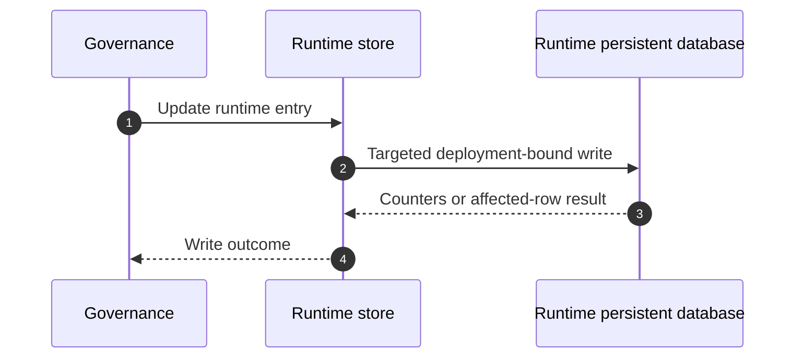

**Security considerations**

| Area | Response | Comments |
| --- | --- | --- |
| Data confidentiality | [C-High] | Identity state and operator note |
| Communication medium | [M-IN], [M-DB], [M-FS] | Database and declarative sources |
| Transport security | [Not Encrypted] in process; DB deployment-specific | At-rest encryption not established |
| Authentication | Server database identity / trusted process | Not caller-chosen database credentials |
| Accessibility | [Internal] | Store APIs not public |
| Authorization and Access Control | Deployment binding and server-owned runtime paths | Profile read-only status does not prohibit runtime writes |

**Threat assessment**

| ID | Category | Threat | Materializable | Mitigation / comment |
| --- | --- | --- | --- | --- |
| 07.1 | [Tampering] | A crafted authentication method alters JSON paths or targets another deployment. | [No] | Registry validation precedes query construction; SQL binds server-selected deployment. Direct DB compromise is excluded. |
| 07.2 | [Tampering] | Stale profile update overwrites counters or suspension. | [No] | Separate runtime authority and targeted statements prevent profile snapshots replacing runtime data or unrelated fields. |
| 07.3 | [Elevation of Privilege] | Warm profile cache admits using obsolete runtime state. | [No] | Fresh runtime reads replace cached status; a read failure refuses with the answer that path gives for an unreadable entity, never as a hold (Access-plane contract). |
| 07.4 | [Operational Risk] | Read-only profile disables failure accounting. | [No] | Independent writable runtime storage serves database-backed and declarative profiles, including read-only profiles. Runtime-store write permission remains required. |
| 07.5 | [Elevation of Privilege] | Invalid runtime JSON admits as ACTIVE. | [No] | Decoding errors fail authority reads and status reports held. A stored state other than `SUSPENDED` without suspension details is deliberately not a hold; governance writes only `ACTIVE` and `SUSPENDED`. Runtime attributes are written only by governance, so a value that decodes but is wrong, such as an impossible timestamp, needs direct database access, which is out of scope (07.1). |
| 07.6 | [Tampering] | Automatic clear overwrites newer runtime changes. | [No] | An automatic clear runs only if the runtime revision still matches the one read during admission. A conflict skips the clear but does not undo successful admission; a clear error also leaves admission intact. Recovery and operator unlock do not use this revision guard and preserve suspension and activity data. |
| 07.7 | [Operational Risk] | Restoring runtime data to an older point than the entity database can silently remove a hold or bring back a released one. | [Yes] | Accepted. Entity and runtime databases need a consistent restore point. A missing runtime row starts `ACTIVE` for a database-backed identity, and the server does not detect rollback. |
| 07.8 | [Elevation of Privilege] | A configuration import lifts a hold, or places one outside the suspension sequence, by carrying account state. | [No] | Exports carry no state. The import API ignores the `state` of a user, agent or application document and says so in that document's result message: a created user starts `ACTIVE`, and an update leaves the runtime row unchanged. A suspension therefore does not move with an exported account; the operator suspends it again in the target environment (Residual risks). |
| 07.9 | [Operational Risk] | An incomplete upgrade, or an old-version node on the new databases, changes who can sign in. | [Yes] | Accepted. A missing runtime table fails governed reads closed, so held and unheld identities alike are refused where governance is wired. The supported upgrade stops all nodes and updates both databases before restart; operators keep coordinated backups for rollback. |

#### [08]: Runtime policy, flow definitions and optional provider wiring

**Description**

Account-access policy has product defaults, deployment overrides and either a declarative or writable server-config layer. A declarative resource blocks API writes to that section. If a section read fails, resolution uses the base policy for that request. Policy changes never remove a stored suspension. In a split deployment the Control Plane serves the same section for authoring; it enforces nothing, and a Data Plane takes the policy only through an import. `POST /import` requires root permission and writes the section through the same validation, layer rules and audit as an API write, so an authorized import can turn automatic locking off where the section is writable. A write invalidates the cached section through the configured cache backend. With shared Redis, this removes the shared entry used by all nodes. Per-node in-memory caches would leave other nodes on the older policy until their entries expire (the server cache TTL, 3600 seconds by default), which is why production guidance requires Redis for multi-node deployments. Suspension and lock state are never read through this cache. Concurrent policy writes are last-write-wins: a save does not detect an edit made after its page loaded.

Only user and agent lockout policies are accepted, one policy per category that every sign-in method uses. Per-method policies exist only in code; no layer accepts one, and a per-method block, such as a `scopes` key, is rejected as an unknown field, as is a lock email recipient key: the recipient is always the user type's primary email. Validation rejects unknown fields, invalid values and incomplete enabled policies before they take effect, and the deployment base is checked on its own at startup (08.1). Authorized policy writes log the operator and publish which section was written; failed writes publish an error code. The value is not recorded, since a section may hold secrets. Flow definitions and provider wiring remain trusted deployment controls, with no approval workflow for their changes (08.2).

Turning off automatic locking bypasses the failure locks it governs, per-method or account-wide, but does not erase them; a later policy change can make them apply again. It does not bypass a suspension or a user's post-suspension hold. Account granularity likewise stops a method lock from applying without erasing it.

An embedded host can omit governance; its checks are then skipped and lifecycle operations are unavailable (Design baseline).

**Assets involved**

| Initiator | Intermediate | Target |
| --- | --- | --- |
| Authorized operator or deployment administrator | API authorization, section validator, writable store | Thresholds, granularity, flow behavior and provider wiring |

**Data flow**

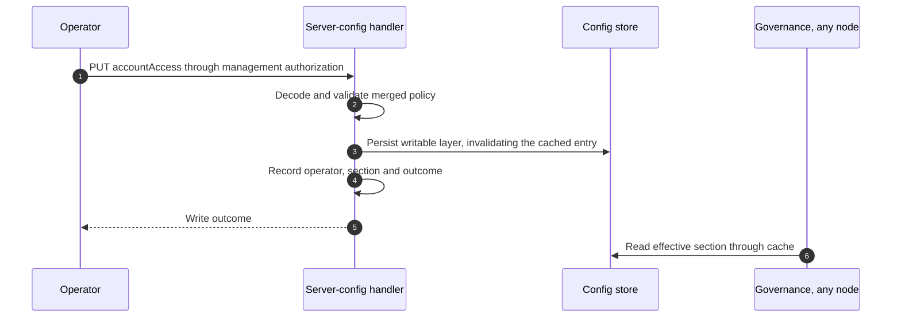

**Security considerations**

| Area | Response | Comments |
| --- | --- | --- |
| Data confidentiality | [C-Medium] | Security policy and flow structure |
| Communication medium | [M-NT], [M-IN], [M-DB], [M-FS] | API edits and declarative server-config resources |
| Transport security | [TLS] required for API | Protect file write permissions separately |
| Authentication | Management API authentication or trusted deployment access | API middleware supplies authorization |
| Accessibility | [Restricted] | Inherited API middleware authorization must remain intact |
| Authorization and Access Control | Privileged policy/flow administration | Capabilities do not grant permissions |

**Threat assessment**

| ID | Category | Threat | Materializable | Mitigation / comment |
| --- | --- | --- | --- | --- |
| 08.1 | [Tampering] | An invalid account-access policy weakens lockout enforcement. | [No] | Validation rejects unknown fields, application policies and incomplete enabled policies. The deployment base is checked by the same rules at startup and must be complete on its own; an invalid base stops the server. Every duration has a bound, and a value that reaches resolution unchecked is clamped before use. |
| 08.2 | [Process Risk] | A trusted administrator disables lockout or removes containment by changing policy or flows. | [Yes] | Accepted. Root permission limits who can make these changes but does not prevent trusted misuse. Policy writes record the operator and the section, not the values. Flow-definition changes are outside this feature's audit; deployments must restrict and review them. No approval workflow is built in, and nothing stops one root operator from suspending the others, so deployments need an emergency administrator procedure. |
| 08.3 | [Tampering] | A policy change applies unevenly across nodes, or a failed section read applies a weaker policy. | [Yes] | Bounded. Multi-node deployments use shared Redis caching under the production guidelines (External Dependencies), so a policy write invalidates the shared section entry. Per-node in-memory caching would leave other nodes enforcing the older policy until cache expiry and does not meet those guidelines. A failed section read still uses the validated deployment base for that request, which can be weaker than a tightened writable layer. Neither path touches stored holds. Operations keep the deployment base at the minimum acceptable policy. |
| 08.4 | [Operational Risk] | An embedded host that omits governance silently stops enforcing stored holds. | [Yes] | Accepted. Omitting governance is an embedding choice: every check admits, including identities with a stored suspension or lock. The engine logs the omission only at debug level at startup, health output does not report it, and nothing checks for stored holds. The embedding host supplies governance wherever holds must be enforced. |

#### [09]: Status reads, profile edits and operator note

**Description**

Authorized record reads and updates derive status from current runtime state and effective policy. Suspension takes precedence over locks. User and agent reads expose hold details, including an optional suspension note; application reads expose only `ACTIVE` or `SUSPENDED`.

Profile edits cannot change runtime holds (09.1). The operator note is explanatory text, not an access rule. Authorized record readers can see it; the holder's own reads never carry it (09.2). Consumers must render it as text (09.3).

**Assets involved**

| Initiator | Intermediate | Target |
| --- | --- | --- |
| Authorized reader/editor | Management API and Console projection | Effective status, user/agent suspension note, profile and reserved attributes. Application status exposes only its value. |

**Data flow**

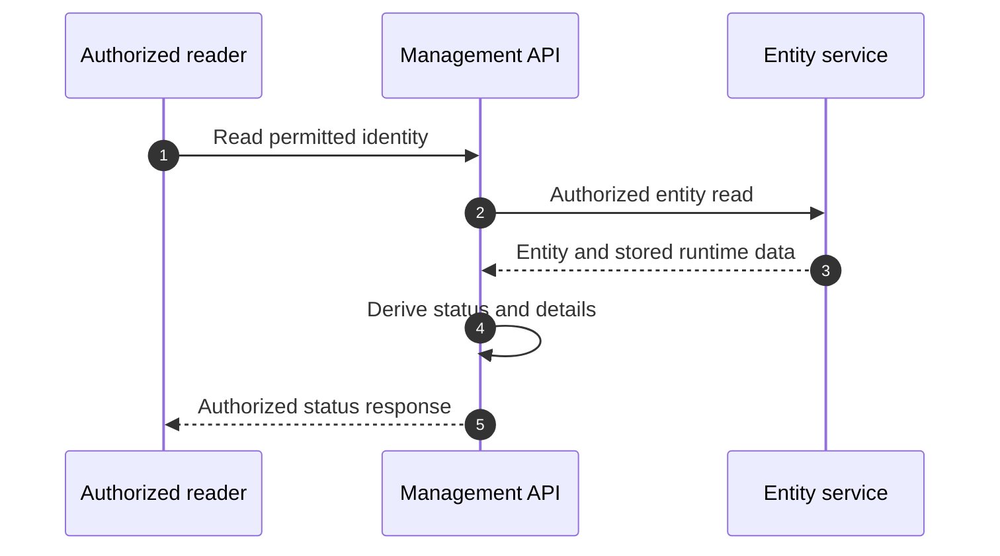

**Security considerations**

| Area | Response | Comments |
| --- | --- | --- |
| Data confidentiality | [C-High] | Status and free-text investigation details |
| Communication medium | [M-NT], [M-IN], [M-DB] | Management read/update |
| Transport security | [TLS] required | Render operator text as text |
| Authentication | Management API principal | Read permissions may include authorized owner reads |
| Accessibility | [Restricted] | Details excluded from public refusals |
| Authorization and Access Control | Resource read/update permissions | Record-read rights include non-security readers |

**Threat assessment**

| ID | Category | Threat | Materializable | Mitigation / comment |
| --- | --- | --- | --- | --- |
| 09.1 | [Tampering] | A profile edit creates a lock or removes a suspension. | [No] | Holds live in the separate runtime record. A profile `accessState` value has no governance effect, including when a runtime row is first created; only authentication failures, which form locks, and lifecycle operations, the recovery release included, change holds. |
| 09.2 | [Privacy Risk] | An operator note exposes incident details to the holder or other record readers. | [No] | Record-view permission exposes the note by design. The holder's own reads (`GET` and `PUT /users/me`) never carry it, so an old token that still reaches them does not expose it. Release deletes the note; operators must keep it minimal and free of unrelated personal data and secrets. |
| 09.3 | [Tampering] | Malicious text in an operator note executes in Console. | [No] | Console renders the note as text, not HTML. Other clients and exports must also escape it before display (Residual risks). |

#### [10]: Last-login recording

**Description**

Recording is off for users and agents by default and is enabled per category. When enabled, `lastLoginAt` is recorded after access is granted by a sign-in that completes at the assertion node, a session reuse that passes it, a successful call to the direct authentication API (credentials, OTP, federated or passkey), and, for agents, a `client_credentials` token. One guarded update writes at most once per resolution window (one hour by default; `0` writes on every grant), so most requests write nothing. A failed write is logged and never refuses access, and no access decision reads the timestamp. Authorized status reads return it. The write changes the runtime revision (Interaction 07).

**Assets involved**

| Initiator | Intermediate | Target |
| --- | --- | --- |
| Admitted sign-in, session reuse or agent token request | Assertion node, authentication API or token handler, governance | `lastLoginAt` on the runtime row |

**Data flow**

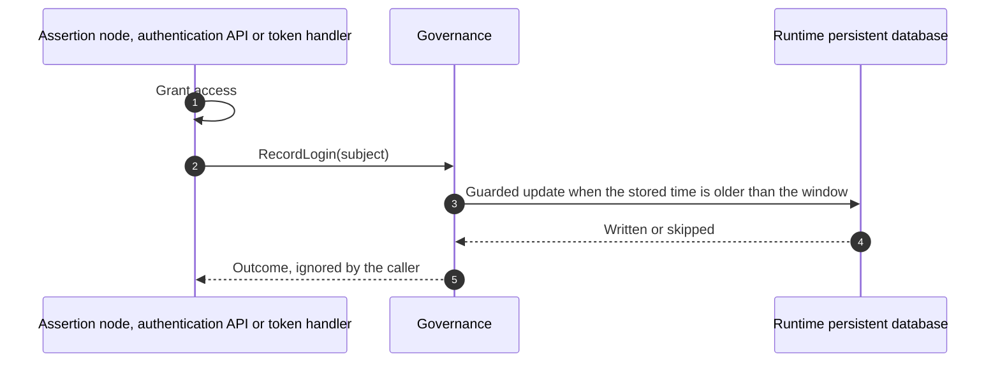

**Security considerations**

| Area | Response | Comments |
| --- | --- | --- |
| Data confidentiality | [C-Medium] | Behavioural personal data |
| Communication medium | [M-IN], [M-DB] | Internal call and runtime write |
| Transport security | [Not Encrypted] in process; DB deployment-specific | Same store as other runtime state |
| Authentication | Recorded only after access was granted | Never an admission input |
| Accessibility | [Internal] | Read through authorized status reads |
| Authorization and Access Control | Runtime context for the write | Readers need record-view permission |

**Threat assessment**

| ID | Category | Threat | Materializable | Mitigation / comment |
| --- | --- | --- | --- | --- |
| 10.1 | [Denial of Service] | A recording write makes an automatic clear skip, so counters reset less often. | [Yes] | Bounded. A sign-in's own clears run before its recording, so only a concurrent request on the same identity can change the revision first. A skipped clear leaves the count until the failure window passes or the next admitted step clears it. |
| 10.2 | [Denial of Service] | A failed or overloaded recording write blocks sign-in. | [No] | The write runs after the grant, its error is ignored, and the resolution window limits writes to one per identity per window. A resolution of `0`, which an administrator can set, writes on every grant. |
| 10.3 | [Privacy Risk] | Last-login time is behavioural personal data. | [Yes] | Accepted. Off by default. Stored only on the runtime row, shown on authorized status reads, deleted with the identity, with no separate retention limit (privacy considerations). |

#### [11]: Lock notification

**Description**

When a user lock forms, the request that wins the formation guard queues one email notice, so each lock episode sends at most one. Agents get none. Two workers deliver queued notices through the `notification` section's default email sender. That section refuses an unknown field. The sender is resolved for each notice, so one that does not exist or does not send email fails the delivery. At delivery the notifier re-reads the settings and the profile and sends only to the user type's primary email; a user type without one, or a record with no value for it, gets no notice. The template the `accountAccess` section names for the lock (the bootstrap sets `authentication-method-locked` for a lock on one sign-in method and `account-locked` for a lock on every sign-in method, each with a `-permanent` form for a lock that does not expire, and a template can be set per method) names the sign-in method that locked as an identifier, states the lock duration and, for a finite lock, the UTC unlock time, and carries no secret. Naming a template is an administrator's server-config write, as editing its text already is; a section with no template for a lock sends nothing and logs a warning. The queue holds 256 notices: a full queue drops the notice and nothing is retried. A full queue, an invalid address, a missing sender or template, or a notice dropped at shutdown is logged as a warning, and a failed profile or user type read, a template that fails to render and a failed send as errors; a record with no primary email mapping or value is logged only at debug level. None of them sends anything. At shutdown the notifier waits at most two seconds, then cancels sends in progress and drops queued notices. The notice is informational and enforces nothing; this feature does not verify that the address belongs to the holder. Suspend, unsuspend and unlock notices come from the administration flows' email nodes, not from this notifier (Interaction 03).

**Assets involved**

| Initiator | Intermediate | Target |
| --- | --- | --- |
| Lock formation, which any caller who can submit failed proofs can trigger | Notice queue, notifier workers, email sender | Holder's mailbox, provider quota |

**Data flow**

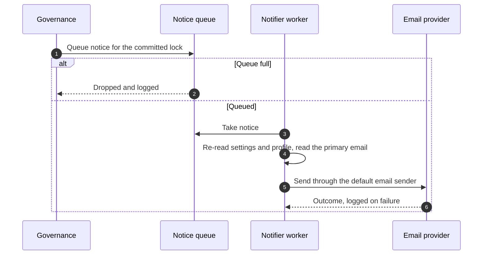

**Security considerations**

| Area | Response | Comments |
| --- | --- | --- |
| Data confidentiality | [C-Medium] | Lock duration and unlock time |
| Communication medium | [M-IN], [M-NT] | Internal queue, then the provider connection |
| Transport security | Provider connection settings | Deployment responsibility |
| Authentication | Sender credentials in the notification section | Not caller-controlled |
| Accessibility | [Internal] | No API sends a notice |
| Authorization and Access Control | Runtime context for the record read | Recipient comes from the stored record, not the request |

**Threat assessment**

| ID | Category | Threat | Materializable | Mitigation / comment |
| --- | --- | --- | --- | --- |
| 11.1 | [Denial of Service] | A caller who can form locks floods the holder's mailbox or exhausts the provider quota. | [Yes] | Bounded by the lock durations: one notice per episode and lockable method, so with the shipped user rungs at most one every 5, 15, 30 and then 60 minutes per method. The 50th consecutive failure forms a lock that does not expire, so a method sends at most ten notices between a success, a recovery or an unlock. If lock notices share a provider quota with recovery and one-time-password mail, exhausting it delays those too; deployments size or separate quotas and rate-limit sign-in, as the [production guidelines](https://thunderid.dev/docs/deployment/production-guidelines/#configure-rate-limiting) describe. The notice asks a holder who did not try to sign in to report it to their administrator. |
| 11.2 | [Information Disclosure] | A notice reaches someone other than the holder. | [Yes] | Accepted. The address on the record is not verified by this feature, and an attacker who changed it earlier receives the notice instead. The notice reveals only that the account is locked and until when. Contact assurance is out of scope. |
| 11.3 | [Operational Risk] | Notices are lost. | [Yes] | Accepted. A full queue, a missing sender or address, an unreadable profile or user type and a failed send are logged and not retried. Notices dropped at shutdown are lost the same way. The lock is unaffected; notices are not an enforcement or audit control (01.4). |

## Security Review Checklist

A review aid that complements this model and the self-assessment, following the [OWASP Top 10 Proactive Controls](https://top10proactive.owasp.org/). `[No]` means this review has not established the complete requirement; it is not evidence that the repository or a deployment lacks the practice. This review does not replace release scanning or deployment assessment.

### Security considerations

| # | Consideration | State | Comments |
| --- | --- | --- | --- |
| 1 | Are all inputs and outputs validated (syntactic and semantic)? | [Partial] | Account-access settings reject unknown or invalid values and incomplete enabled policies. The operator note has no validation rule and is stored as given, and a declarative initial state is copied verbatim up to 50 characters, and a longer one stops the file from loading; both remain text in storage and output, and only `SUSPENDED` withholds access. A declarative state that differs from `SUSPENDED` only by case or surrounding spaces is logged as a warning. |
| 2 | Are rate limits in place where necessary? | [No] | This feature adds no request rate limiter, and ThunderID does not rate-limit its endpoints. The [production guidelines](https://thunderid.dev/docs/deployment/production-guidelines/#configure-rate-limiting) list the routes a deployment limits in front of ThunderID, OTP delivery included (02.5, 02.6, 11.1). |
| 3 | Are permissions, roles, and entitlements defined on the principle of least privilege and business need? | [No] | Root-only lifecycle is a clear boundary, not least privilege. Delegation and separation of duties are out of scope (08.2). |
| 4 | Are authentication and authorization validated at both the UI and API layers, front end and back end, before granting access to resources? | [Yes] | Console routes use `ProtectedRoute`; lifecycle controls show actions supported by the current status and configured flows. API authorization remains independent: resource APIs check permissions, and administration flows require root system permission. UI action visibility is not an authorization boundary. |
| 5 | Are proper isolations in place between components to ensure least-privilege access and reduce the blast radius against lateral movement? | [Yes] | Narrow interfaces and a separate runtime store keep profile writes away from hold state. Governance, flows and revocation still run in one process, and lifecycle operations require broad root permission. |
| 6 | Have any default credentials been changed, and are default superuser or root accounts not in use (when using third-party components)? | [N/A] | No third-party component or credential introduced. |
| 7 | Has the implementation followed best-practice guidelines (OWASP, Kubernetes, vendor, or technology provider)? | [Yes] | OWASP guidance informed server-side access checks and the lockout/denial-of-service trade-off. Stating a hold departs from OWASP's generic-message guidance; it is an accepted risk (01.2). |
| 8 | Are secrets, credentials, and internal-only material kept out of the public source tree and its git history? | [Yes] | This feature introduces no secrets or credentials into public source or history; internal review material is not published there. |
| 9 | Was a security-focused code review conducted for this change, and have the findings been addressed? | [Partial] | Security-focused source review and component probes were conducted, and review of the full implementation continues. Findings are fixed or recorded here as bounded risks as they close. |
| 10 | Is Static Analysis (SAST) or IaC scanning conducted, and are findings addressed? | [Yes] | Backend `golangci-lint` enables `gosec`, and `make pr_checks` includes that lint gate. |
| 11 | Is Software Composition Analysis (SCA) conducted or integrated into the repository, and are findings addressed (for example FOSSA, Trivy)? | [Partial] | Pull requests run `pnpm audit` and dependency review; the feature adds no dependency. A continuous scan of the full Go dependency set is not established. |
| 12 | Is Dynamic (DAST) or API scanning conducted on a non-production setup, and are findings addressed? | [No] | Release-process obligation. |
| 13 | Are audit logs generated in a standardized format for critical functionality, and available to authorized users to trace critical events and aid incident response? Note the retention period in Comments. | [Partial] | Suspend, unsuspend, unlock and policy writes emit structured events with actor, target and outcome, including failures. Failed token revocation emits `TOKEN_REVOCATION_FAILED`. Lock formation emits `IDENTITY_LOCKED` (01.4). Locks and lifecycle operations are logged only at debug level, so the events are the record; they are published only when observability is enabled, and it ships disabled. Authorized retrieval and retention depend on the configured observability output; the project sets no fixed retention period. |
| 14 | Do audit logs for critical configuration changes record the difference between the old and new versions? | [No] | Server-config writes, including the account access policy, record the operator, the section and the outcome, but not the values, since a section may hold secrets. Flow definition changes are outside this feature (08.2). |
| 15 | Are data in transit and at rest encrypted? | [No] | Public TLS required but deployment-dependent; database/disk encryption are operator controls. |
| 16 | Are sensitive values such as credentials and keys stored in a secret store or vault? | [N/A] | Runtime data stores counters, episodes and suspension details, not credentials/keys. |
| 17 | Is personal, sensitive, or confidential data kept out of logs? | [Yes] | Within this feature, identifiers are masked in governance and notifier logs, and an ignored import state is reported in the import result rather than logged. Logs omit credentials, tokens and suspension note text. Structured audit events record actor, target, category and outcome for authorized tracing without the note text. |
| 18 | Have users been given clear instructions for secure usage? | [Yes] | Official product documentation explains recovery-flow unlock placement and retries, rate limiting alongside lockout, lifecycle audit events, and consistent restoration of the entity and runtime databases. |

### Business impact and resilience

| # | Consideration | State | Comments |
| --- | --- | --- | --- |
| 1 | Has a business impact analysis been done to identify resilience requirements (maximum tolerable downtime, uptime, RPO, RTO)? | [Yes] | This assessment identifies account availability, authority-store health, containment failures and coordinated restoration as resilience concerns. Production guidance requires deployments to set recovery objectives and test restoration; numeric uptime and downtime targets depend on each deployment. |

Deployment resilience requirements:

- **Availability:** suspension needs the revocation and session stores as well as the runtime state; all three share the runtime persistent database (03.6). Alert on `TOKEN_REVOCATION_FAILED` and failed administration flows.
- **Recovery:** restore the entity database, the runtime persistent database and policy to consistent points; a runtime restore older than the entity restore can release a suspension or lock or bring back a released one (07.7). Do not restore obsolete credentials. Verify clocks and operator recovery from broad holds.
- **Backups:** deployer sets database/configuration/secret-reference/volume/audit schedules, encryption, retention and restore tests. Migration review is separate.
- **Health:** distinguish HTTP health from authority failures and incomplete containment.
- **Banners:** a held account's refusal states the hold (01.2); operational incidents belong in authorized administration views. No outage banner is added.

### Dependency and component health

| # | Consideration | State | Comments |
| --- | --- | --- | --- |
| 1 | Are dependencies, base images, and runtimes monitored for known vulnerabilities and kept current (for example automated dependency scanning), and are findings addressed? | [N/A] | This feature adds no dependency. |
| 2 | Are any End-of-Life or End-of-Service components in use? | [No] | This feature introduces no component. |
| 3 | Is hardening guidance published for operators who deploy the project (optional)? | [Yes] | Official production guidance covers rate limiting alongside lockout, coordinated database restoration, recovery objectives and operational monitoring. |

### Privacy considerations

This feature stores identity-linked failed-attempt counts, lock times, an optional suspension note and, when recording is enabled, the last-login time in a new `ENTITY_RUNTIME_DATA` table in the runtime persistent database. It adds no profile attribute or stored authentication proof. It also sends lock notices to the user type's primary email and, through the administration flows' email nodes, suspension, unsuspension and unlock notices to the record's `email` attribute. Operators should keep notes free of unrelated personal data and secrets; note text is not validated for this.

| # | Consideration | State | Comments |
| --- | --- | --- | --- |
| 1 | Is the purpose and legal basis for processing personal data clearly defined? | [Yes] | Identity-linked counters and status support account protection and administrative suspension. The deployer establishes the legal basis for its use. |
| 2 | Are the collection, storage, processing, sharing, archival, and disposal of personal data aligned with the data minimization principle? | [Yes] | Runtime state stores counts, times and status against an existing identity, without credentials or authentication proofs. The optional note is for a brief operational reason; operators should omit unrelated personal data and secrets. |
| 3 | Is personal data stored securely? | [Yes] | Runtime data uses the existing persistent store and authorized management reads; note text is omitted from authentication responses and audit events. Database encryption, backups and operator access follow deployment controls. |
| 4 | Are privacy notices updated to reflect any new processing or changes to purpose and legal basis? | [N/A] | The deployer owns privacy notices. This feature adds account-protection runtime state, not a new profile attribute. |
| 5 | Is access to personal data granted on a need-to-know basis? | [Partial] | Management reads require record-view permission, but note text is visible to any such reader (09.2). |
| 6 | Are data retention requirements considered? | [Yes] | Releasing suspension deletes its note; deleting an identity deletes its runtime row. Lock history and the last-login time have no separate time limit: the decay interval changes how the next lock is calculated but deletes nothing, so an identity that never signs in again keeps its failure history. This is on purpose: the history is a few counters and timestamps on the identity's own runtime row, and a successful sign-in with the same method, a completed recovery or an operator unlock clears it. Audit-output retention is deployment-configured. |
| 7 | Is there a process to dispose of personal data on request in a timely manner while meeting retention requirements? | [Yes] | Identity deletion invokes runtime-row deletion. A failed runtime cleanup is logged for operator repair; audit-output disposal follows deployment retention. |
| 8 | Are records of personal-data processing maintained in the project's data inventory or records of processing? | [N/A] | The deployer owns its processing inventory. |

## Residual risks (open items)

Every threat marked Materializable [Yes] appears here once, with the disposition its row gives. Bounded means a control in this feature limits the risk; accepted means the risk is a deliberate trade-off. Neither is an unfixed exploitable defect. Where a deployment control closes the rest, the item names it and the role that owns it. The last items carry obligations from rows that are not materializable.

- 01.1, 06.5 (bounded): anyone who knows an identifier can lock one of its sign-in methods, an administrator's included, and 50 consecutive failures make that lock non-expiring until recovery or an operator unlock. Operations rate-limit sign-in, monitor agent locks and keep an emergency administrator procedure (08.2).
- 01.2, 02.3 (accepted): a refusal states the lock or suspension to anyone who presents a known identifier, and one-time password, magic-link and passkey dispatch state it after identification alone. Account existence is already observable through the unknown-account answers on sign-in, recovery and registration; normalizing them and letting a flow choose how it presents a refusal is future flow-executor error handling. Authentication / platform (tracking: [#5937](https://github.com/thunder-id/thunderid/issues/5937)).
- 01.7 (bounded): a runtime database that serves reads but rejects writes leaves each guess in that window uncounted. Operations alert on failed attempt-record writes in the server log and rate-limit sign-in.
- 02.5, 02.6 (bounded): the direct SMS OTP endpoint and repeated flow challenges can flood a phone or mailbox and run up delivery cost, since ThunderID rate-limits neither. Operations rate-limit `/auth/otp/**` and flow entry points and set delivery-provider quotas, as the [production guidelines](https://thunderid.dev/docs/deployment/production-guidelines/#configure-rate-limiting) describe; the same front-door limits bound recovery attempts (Out-of-scope interactions and risks).
- 03.3, 03.6 (accepted): containment and the hold write are separate steps, and a revocation or session store failure stops a suspension, so a failed suspension can leave an active account with some access already revoked. Operations alert on `TOKEN_REVOCATION_FAILED` and failed administration flows, and retry Suspend after the store recovers.
- 03.7 (bounded): a suspended operator's token keeps working on native APIs until the revocation cache next synchronizes (60 seconds by default), or until it expires with native enforcement off. Operations lower `server.security.token_revocation.sync_interval_seconds` where a shorter window matters.
- 03.8 (accepted): unsuspend verifies nothing about the record. Operations check and repair contact attributes and credentials before unsuspending a user, and rotate agent and application secrets first.
- 03.9 (accepted): the Console does not offer suspending its own application, but the server does not refuse it, so a flow execution through the API can. Operations keep a second root-capable client for recovery, or are ready to clear the application's hold in the runtime persistent database.
- 04.5, 04.6 (accepted): a custom recovery flow without the release node, or a release that fails after the credential write, leaves the lock until recovery is repeated or an operator unlocks. Flow authors place the release node after the credential write.
- 05.1 (accepted): offline resource servers and applications with their own sessions keep accepting a suspended user until they recheck. Integrators configure revocation or introspection, short token lifetimes and back-channel logout, or decide through the AuthZEN API (05.5).
- 05.2 (accepted): a user's suspension record lasts the longer of one week and the refresh-token validity, so a longer-lived token issued to the user can be accepted again after release; an application's or agent's record also covers its client's own artifact lifetime. Operations keep token validities within a week where this matters (tracking: [#5805](https://github.com/thunder-id/thunderid/issues/5805)).
- 05.4 (accepted): an external token whose `sub` equals a local entity ID is refused when that identity is suspended or deleted. Denial only; no action.
- 05.6 (bounded): a token issued after the containment cutoff by a request admitted before the hold was written is not revoked: an access token lasts until it expires, and a refresh token works again after an unsuspend. Operations suspend the account again if containment ran long; the new cutoff covers both.
- 05.7 (accepted): with a revocation switch off, a suspension stops new sign-ins, sessions and refresh, but not access tokens already issued, on the side whose switch is off. Operations keep both switches on, the default, wherever a suspension must contain issued tokens.
- 06.3 (accepted): browser `/authorize` distinguishes a suspended application from an unknown client ID. No action.
- 06.4, 06.6 (bounded): a token exchanged into another client's ID, or one naming a suspended agent only as its actor, stays valid until it expires. Operations keep token lifetimes short where this matters; offline consumers follow 05.1.
- 06.8 (accepted): suspending a user does not suspend the agents it owns. Operations review those agents and suspend or reassign them separately. Personal agents (tracking: [#5871](https://github.com/thunder-id/thunderid/issues/5871)).
- 07.7 (accepted): the server does not detect a runtime database restored to an older point than the entity database. Operations back up and restore both to consistent points.
- 07.9 (accepted): an incomplete upgrade or an old-version node fails governed reads closed. Operations stop every node, update both databases before restart and keep coordinated backups for rollback.
- 08.2 (accepted): a trusted administrator can disable lockout or remove containment, and one root operator can suspend the others. Operations enable observability outputs and set audit retention and authorized retrieval for the administration events and `IDENTITY_LOCKED` (without observability, locks and lifecycle operations leave no record, 01.4), restrict and review flow-definition changes, and keep an emergency administrator procedure.
- 08.3 (bounded): a failed section read uses the deployment base, which can be weaker than a tightened writable layer. Operations keep that base at the minimum acceptable policy and use shared Redis for multi-node deployments, as required by the production guidelines (External Dependencies).
- 08.4 (accepted): an embedded host that omits governance enforces no stored hold, and only a debug log at startup says so. Embedding hosts supply governance wherever suspensions or locks must hold.
- 10.1, 10.3 (bounded, accepted): last-login recording can make an automatic clear skip, and stores behavioural personal data with no separate retention limit. Off by default; no action beyond the deployer's privacy notices.
- 11.1 (bounded): a caller who forms locks can send at most one notice per lock episode and method, and at most ten per method before the consecutive ceiling holds it. Operations size or separate provider quotas and rate-limit sign-in.
- 11.2, 11.3 (accepted): a notice goes to whatever address is on the record, and lost notices are not retried. Contact assurance is out of scope; notices enforce nothing.
- 07.8 (obligation): a suspension does not move with an exported account. Operations suspend it again in the target environment.
- 09.3 (obligation): the Console renders the operator note as text; other clients and exports may not. Integrators escape it in other clients and exports.

## Appendix

### Sample requests and configurations

Shipped defaults are shown below with deployment-style `account_access` keys. The `accountAccess` server-config API and declarative resource use equivalent camelCase keys; inheritance and layer order are defined in Interaction 08.

```yaml
account_access:
  user:
    lock_granularity: authentication_method
    record_last_login: false
    last_login_resolution_seconds: 3600
    default:
      enabled: true
      threshold: 5
      failure_window_seconds: 3600
      lock_durations_seconds: [300, 900, 1800, 3600]
      lock_decay_seconds: 86400
      max_consecutive_failures: 50
    notifications:
      on_lock:
        email:
          enabled: true
  agent:
    lock_granularity: authentication_method
    record_last_login: false
    last_login_resolution_seconds: 3600
    default:
      enabled: true
      threshold: 5
      failure_window_seconds: 900
      lock_durations_seconds: [60, 300, 900]
      lock_decay_seconds: 3600
      max_consecutive_failures: 50
```

Only user and agent categories are supported, each with one policy for every sign-in method. Explicit overrides can enable recording. The lock email templates are not deployment keys: the bootstrap stores them in the section's writable layer (`authentication-method-locked` and `account-locked`, each with a `-permanent` form).

#### Default trade-offs

These defaults slow repeated guessing but let an attacker who can submit failed proofs lock a known account (01.1). `accountAccess.user` and `accountAccess.agent` hold separate policies. Console exposes the lock settings below under **Settings > Account security**; activity recording is not in the Console.

| `accountAccess` setting (Console control) | Shipped value and security effect |
| --- | --- |
| `user.lockGranularity`, `agent.lockGranularity` (**Lockout applies to**) | Both use `authentication_method`: only the method that failed is locked, leaving other sign-in methods available. Choosing `account` locks every sign-in method, increasing denial-of-service impact. Neither choice blocks existing sessions or token use. |
| `user.default.enabled`, `user.default.threshold` (the **Users** switch under **Automatic account lock**, **Lock after**) | Enabled with threshold 5. Five attributable failed proofs for the same known identity and authentication method form a lock. Unknown identities and failures without a verified attempt do not count. This threshold alone does not bound guessing across identities or challenge types. |
| `user.default.failureWindowSeconds` (**failed attempts within**) | 3600 seconds. A failure after this inactivity interval starts a new count; this is not a fixed hourly request limit. Because time, not only a success, resets this count, a caller who pauses longer than the interval after every four failures never forms a windowed lock: about 96 guesses a day per lockable method with this value, until the consecutive ceiling below stops them at the 50th failure, about 12 hours in. Zero never resets the count on time. Front-door rate limiting is still needed, as the [production guidelines](https://thunderid.dev/docs/deployment/production-guidelines/#configure-rate-limiting) describe. |
| `user.default.lockDurationsSeconds` (**Lockout duration**) | `[300, 900, 1800, 3600]` seconds: successive lock episodes last 5, 15, 30 and 60 minutes; later episodes reuse 60 minutes. A value of `0` instead holds that episode until recovery releases it or an operator unlocks it. Repeated attacks can cause repeated episodes, so these values do not bound total account unavailability. |
| `user.default.maxConsecutiveFailures`, `agent.default.maxConsecutiveFailures` (**Consecutive failure limit**) | 50 for both. Counted failures at one method since a success with it, a completed recovery or an unlock; neither time nor a lapsed lock resets them. The 50th locks the method without expiry: a user recovers or is unlocked, an agent is unlocked. Lower values tighten the bound on paced guessing (01.6) and make a stranger's non-expiring lock cheaper (01.1); `0` removes the bound. |
| `user.default.lockDecaySeconds` (**Reset lockout progression**) | 86400 seconds. After a finite lock ends, that much time without another lock returns the next episode to the first duration. It does not shorten a live lock; `0` disables time-based reset. |
| `agent.default.enabled`, `agent.default.threshold`, `agent.default.failureWindowSeconds` (the **Agents** switch under **Automatic account lock**, **Lock after**, **failed attempts within**) | Enabled with threshold 5 and a 900-second inactivity window. By the same pacing (about 384 guesses a day per lockable method), the consecutive ceiling stops guessing at the 50th failure, about three hours in. A broken client or hostile proof attempts can still prevent new agent authentication; monitor locks and provide operator unlock. |
| `agent.default.lockDurationsSeconds`, `agent.default.lockDecaySeconds` (**Lockout duration**, **Reset lockout progression**) | `[60, 300, 900]` seconds and 3600 seconds: 1, 5 then 15 minutes, the last repeating, so no shipped agent rung needs an operator; only the consecutive ceiling does (06.5). Decay resets progression an hour after a lock ends. |
| `user.notifications.onLock.email.enabled` (**Notify user by email**) | Email is enabled. At most one notice is attempted per committed lock episode, using the current trusted record; it states the lock duration and, for finite locks, UTC expiry. It goes only to the user type's primary email; a user type without one, or a record with no value for it, is not emailed at any other address. Failed delivery does not undo the lock or trigger a retry. Agents have no lock email. The templates are not in the Console; an API write or declarative document that omits them stops the email, while the Console's save keeps them. |
| `user.recordLastLogin`, `agent.recordLastLogin`, `user.lastLoginResolutionSeconds`, `agent.lastLoginResolutionSeconds` (not in the Console; set through the API, a declarative resource or the deployment configuration) | Activity recording is off for both categories; effective resolution is 3600 seconds if enabled without another value. Enabling it stores the last granted-access time and adds runtime writes, including for session reuse, direct authentication API calls and, for agents, `client_credentials` tokens (06.7). |

### References

- [OWASP Authentication Cheat Sheet](https://cheatsheetseries.owasp.org/cheatsheets/Authentication_Cheat_Sheet.html), authentication responses and the lockout/denial-of-service trade-off.
- [OAuth 2.0 Token Revocation, RFC 7009](https://www.rfc-editor.org/rfc/rfc7009.html#section-3), revocation enforcement depends on token and resource-server architecture.

## Change log

| Version | Date | Change |
|---|---|---|
| 0.1 | 2026-10-08 | Initial threat model. |
| 0.2 | 2026-10-20 | Every materializable threat states its disposition and appears once in the residual risks, now a list following the template. Added 05.6 for a token issued after the containment cutoff, Interactions 10 (last-login recording) and 11 (lock notification), the consecutive-failure ceiling, and the administration flows' holder notices. The lock email goes only to the primary email and uses templates named in the `accountAccess` section, and the `notification` section refuses unknown fields. Record updates report status as reads do. A deployment can turn the flow-engine and OAuth governance port off with `identity_governance_provider.type: disabled`. |
| 0.3 | 2026-10-21 | The overview and out-of-scope list name the OAuth authorization and core grants and back-channel logout companion models, and state that flow execution and notification delivery have no companion model yet. Paced guessing (01.6) and guessing a password past its lock in a recovery flow (04.7) are classed as Spoofing. Multi-node cache guidance follows the production requirement for shared Redis; 08.3 retains the failed-read fallback risk. The default email sender is resolved at delivery instead of on write (Interaction 11), the lock email templates are renamed, and an ignored import `state` is reported in the import result instead of the log (07.8). A `disabled` governance port is stated to leave locks forming with no early release, and requires the lock policy to be disabled with it. A lifecycle flow notice that sends nothing is reported to the operator, and only its server-side failures are logged. Omitted governance is logged at debug level, not as a warning. |
| 0.4 | 2026-10-27 | Flow validation refuses the governance `suspend` and `unsuspend` modes outside an administration flow, and they still fault at run time. A failed client lookup at the CIBA callback also fails the pending request. 03.9 records that the Console does not offer suspending its own application, though the server still allows it. |
| 0.5 | 2026-10-27 | Renamed the `lockGranularity` value and the reserved key of the lock on every sign-in method from `entity` to `account`. 01.4 states that a lapsed lock publishes no event and names the events for early releases and policy changes. Added 01.7 (a counter write that fails after its read leaves a guess uncounted) and 05.7 (with revocation enforcement off, a suspension leaves issued access tokens working). The lockout residual names the emergency administrator procedure for administrators. |
| 0.6 | 2026-10-30 | A failed attempt and the lock it forms are written in one runtime transaction, and the lock event and email follow commit (Interaction 07, 01.7). Token revocation is listed as out of scope. Added 08.4 (an embedded host that omits governance enforces no stored hold). |
