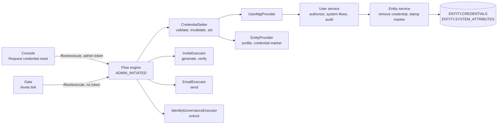

# Admin-Initiated Credential Reset Specification

- **Status:** Draft
- **Version:** 0.1
- **Related documents:** [Allow admins to start a credential reset that the user completes (#2024)](https://github.com/thunder-id/thunderid/issues/2024), [Privileged user initiated flows (#6695)](https://github.com/thunder-id/thunderid/discussions/6695), [Account locking and suspension (#5368)](https://github.com/thunder-id/thunderid/discussions/5368)

## Summary

An administrator who sets a user's credential directly knows the new value and must share it. Admin-initiated credential reset lets the administrator ask the user to choose a new password or PIN instead. The administrator starts an `ADMIN_INITIATED` flow for one user and one credential. The flow emails the user a reset link at the address stored on the user's profile, and once the email is sent it removes the stored credential, signing the user out everywhere. The user opens the link, passes any checks the flow adds, and sets the new value.

The governing decision is send first, then remove, in one administrator request: a reset that cannot reach the user changes nothing, and removal is attempted only after a link was sent. A failure after removal can void that link while leaving the credential removed. The feature composes existing executors and storage. It adds modes to `CredentialSetter`, a removal operation in the user and entity services, and an audit event for invalidation, and it ships a default flow, an email template and a Console action. It adds no table, credential format or account state.

Out of scope: self-service forgot password, a forced change at the next sign-in, credentials the user does not set (passkeys, authenticator apps), reset codes without a link, SMS delivery of the link, showing the link to the administrator, users without an email address, bulk resets and declarative users.

## Architecture



- The flow engine owns the execution, the bound subject, the execution's authority and its expiry. `ADMIN_INITIATED` keeps its existing authority rule: a step sent with the starting administrator's token runs as that administrator, and a step sent without a token runs with the permissions that administrator still holds (`flowexec.continuationAuthority`). If that administrator loses the permission, or is suspended or deleted, before the user finishes, the user's step is refused, the credential stays removed, and another administrator starts a new reset.
- `CredentialSetter` owns the reset's state in the execution's runtime data and reaches user management only through `providers.UserMgtProvider` and `entityprovider.EntityProviderInterface`.
- The user service owns authorization, the revocation system flows and the audit events. The entity service owns credential storage and the `credentialUpdatedAt` marker.
- `InviteExecutor`, `EmailExecutor` and `IdentityGovernanceExecutor` are reused. `EmailExecutor.withUndeliveredInviteLink` already withholds an `ADMIN_INITIATED` link from every response.

## Detailed design

### Flow stages

The shipped `default-admin-credential-reset-flow` runs:

| Node | Executor and mode | Stage |
|---|---|---|
| `permission_validator` | `PermissionValidator`, `system:user:update` or `org:user:update` | Administrator |
| `validate_reset` | `CredentialSetter` `validate`, input `credential` | Administrator |
| `generate_link` | `InviteExecutor` `generate` | Administrator |
| `send_link` | `EmailExecutor` `send`, template `admin-credential-reset`, not best effort | Administrator |
| `invalidate_credential` | `CredentialSetter` `invalidate` | Administrator |
| `link_sent` | Prompt, the administrator's result | Pause |
| `verify_link` | `InviteExecutor` `verify` | User |
| `set_credential` | `CredentialSetter` `set`, `onIncomplete` to the prompt | User |
| `prompt_new_credential` | Prompt with a `DYNAMIC_INPUT_PLACEHOLDER`, submitting back to `set_credential` | User |
| `release_account_locks` | `IdentityGovernanceExecutor` `unlock` | User |
| `reset_complete` | Prompt | User |

The administrator stage runs within one request. The engine stores the execution only after the request ends (`flowexec.Execute`), so the user cannot continue before invalidation has run. No prompt sits between `send_link` and `invalidate_credential`.

The flow validator limits `validate` and `invalidate` to `ADMIN_INITIATED` flows, and `CredentialSetter` refuses them in any other flow type. In an `ADMIN_INITIATED` flow, `set` writes only the credential the reset recorded.

### Validate

`validate` reads the bound subject, not an input. It refuses when the execution has already recorded an invalidation. It reads the credential type from the node's first input, `credential` by default, and calls `UserMgtProvider.ValidateRemoveUserCredential`. That runs, without writing, the checks invalidation runs (see Credential removal). It then refuses a user held at the recovery plane, which a suspension holds and an automatic lock does not, stating the hold through the existing access refusal.

It reads the attributes of the user's type and refuses the credential when it is not a string credential (`FET-1046`, reused). `EmailExecutor` reads a request input before the stored profile, so `validate` refuses a request that carries any input besides `subject` and its own credential input with `FET-1141` (new). This covers profile attributes and any name a custom email node reads, so the administrator cannot supply the address the email step reads, and a credential may itself be named `credential`. It pins no recipient. It records `userID` and `resetCredential`, clears the invite token and link, and clears the shared `deliveredRecipients` list. Because it runs before link generation, an unauthorized, ineligible or held target receives no email.

### Delivery

`InviteExecutor` `generate` creates the token and link, and `EmailExecutor` `send` renders `admin-credential-reset`. The email node's `EMAIL_INPUT` names the profile attribute, `email` in the shipped flow, and with no value in the request the executor reads it from the bound user's stored profile. A flow author picks another attribute, such as `workEmail`, by renaming that input. When the email has no provider, the send fails, or the user has no value for the attribute (`FET-1037`, reused), the node fails, the flow ends with that error, and nothing has changed. The link appears in no response: `generate` returns it only for `USER_ONBOARDING`, and `withUndeliveredInviteLink` withholds it for `ADMIN_INITIATED`. A successful send adds the recipient to `deliveredRecipients`.

### Invalidate

`invalidate` requires the bound subject, a recorded credential type, no recorded marker, a stored invite token, and at least one address in `deliveredRecipients`. Without a delivered link it fails with `FET-1139` (new). It calls `UserMgtProvider.RemoveUserCredential` and records the returned marker as `resetCredentialMarker`.

Every failure clears the stored invite token in the same response, so a link already emailed cannot be verified, and a later request that resumes at this node fails too. A failure after the send reports `FET-1140` (new), whose description tells the administrator that the emailed link will not work.

### Credential removal

`UserService.RemoveUserCredential(ctx, userID, credentialType)` and its check-only twin `ValidateRemoveUserCredential` refuse:

- a missing user ID (`USR-1002`, reused), a blank credential type, or a system-managed type such as `passkey` (`USR-1024`, reused);
- an unknown user or a non-user entity (`USR-1003`, reused);
- a caller without `ActionUpdateUser` on the user's organization unit, answered through the existing shared-user refusal;
- a target the caller cannot control (`authzService.CanControlEntity`);
- a declarative user or one a control plane deployed (`checkUserMutable`);
- a credential the user's type does not declare (`USR-1024`).

Invalidation then follows the path a direct change of a held credential takes (`replaceCredentials`): the `system-user-credential-update-pre` system flow revokes the user's tokens and ends their sessions, the entity service removes the credential, and `system-user-credential-update-post` advances the revocation cutoff and ends sessions again. An error after the removal is reported as a failure; the credential stays removed.

`EntityService.RemoveCredential(ctx, entityID, credentialType)` checks that the type is declared, then, in one transaction, deletes that key from `ENTITY.CREDENTIALS` while keeping every other key, and stamps `credentialUpdatedAt` under the entity's lock. It returns the stamped value. A key already absent is removed again without error, so a repeated reset still works.

### Superseded links

The marker written at removal uses `time.RFC3339Nano`. Every other credential write stamps `time.RFC3339`, and a later removal stamps a new nanosecond value, so any credential change after the removal moves the marker, even within the same second. The refresh grant's `credentialChangedSince` parses either form and compares whole seconds, as before.

The `ADMIN_INITIATED` `set` reads the user through the entity provider and compares the current marker with `resetCredentialMarker`. On mismatch, or when no invalidation was recorded, it fails with `FET-1073` (reused, "invalid or has expired"), disclosing nothing about the user for these invalid-link cases. Recovery-plane holds are checked separately and state the suspension or expired lifespan through the existing access refusal. A second reset, a completed reset, a forgot password recovery and a direct administrator change all void a pending link. The marker is per user, so this includes a reset of another credential: a PIN reset started while a password reset is pending voids the password link, and the password stays removed until another password reset or a forgot password recovery completes. `set` checks the marker and the hold on every request, before it asks for the credential, so a voided or held reset is refused before any screen is shown. In a custom flow that places an SMS OTP between the link and `set`, a voided link still sends that OTP before it is refused; this is accepted.

### Completion

Credential names are not reserved: `set` reads the attributes of the user's type and asks for one input named after the recorded credential, of type `PASSWORD_INPUT`, labelled with the schema display name or the attribute name. `set` forwards it as the `inputs` forwarded data, and the prompt node renders it in place of `DYNAMIC_INPUT_PLACEHOLDER`. When a value is refused, the prompt now clears forwarded inputs as well as its own, so it asks for the credential again. Only string credentials are reset: a number credential is not hashed when a user is created, so `validate` refuses it with `FET-1046` and `set` fails with `FET-1048`. The value is kept as text, so a string PIN keeps its leading zeros. `set` takes the value from the input named after the recorded credential, re-checks the marker and the recovery-plane hold, and writes through `UserMgtProvider.UpdateUserCredentials`. The check and the write are separate steps: a credential change that commits between them is overwritten. That window is one request and is accepted rather than closed with a conditional write. Since nothing is held for that credential, the user service takes its first-time path: it writes and stamps the marker without another revocation. A value the schema refuses asks again through `onIncomplete` (`FET-1133`, reused). After the write it publishes `provenSubject`.

`IdentityGovernanceExecutor` `unlock` now runs in `ADMIN_INITIATED` flows. There it releases automatic locks only when `provenSubject` equals the bound subject, and it never unsuspends. The engine marks every `ADMIN_INITIATED` node context with `WithRecoveryProof`, including nodes a custom flow places before `verify_link`, and `dispatchPlaneFor` maps `ADMIN_INITIATED` to the recovery plane by flow type alone. The flow's position is not used as evidence. As a result, OTP checks a custom flow adds are judged as in recovery, and an automatic lock does not block them.

The execution ends at `reset_complete`, and the engine deletes it, so the link cannot be used again.

### Audit

| Event | Actor | Details |
|---|---|---|
| `user.credential.invalidate` (new) | The administrator | `credential_type` |
| `user.credential.update` (existing) | The user, set by `publishCredentialUpdate` only for the reset-completion write; the link step runs as the recorded administrator | None, as today |

Neither event carries a credential value, the invite token or the link. Like user onboarding, nothing joins the two events: a completion is matched to the latest `user.credential.invalidate` for the same user. A user has at most one pending reset, since a new reset voids the earlier link.

### Data model

No schema change. `ENTITY.CREDENTIALS` loses the reset credential's key at removal and gains it again at completion. `ENTITY.SYSTEM_ATTRIBUTES.credentialUpdatedAt` is stamped at both. The execution's runtime data holds `userID`, `resetCredential`, `resetCredentialMarker`, the delivered recipients and the invite token, in the existing flow context store, until completion or expiry.

### API

No new endpoint. `POST /flow/execute` starts the reset with an administrator's token:

```json
{"flowType": "ADMIN_INITIATED", "handle": "default-admin-credential-reset-flow", "verbose": true,
 "inputs": {"subject": "<user ID>", "credential": "password"}}
```

A started reset returns `INCOMPLETE` at `link_sent` with `additionalData.emailSent` `"true"`. A refusal returns `ERROR` with the node's error. The user continues with `executionId` and `inputs.inviteToken` from the link and no token, then the new value under the credential's name. `api/flow-execution.yaml` documents the handle and the `credential` input.

New error codes: `FET-1139` reset link not delivered, `FET-1140` credential reset failed, `FET-1141` input not allowed. New `UserMgtProvider` methods: `ValidateRemoveUserCredential`, `RemoveUserCredential`; the disabled provider answers `UMP-1003`. Adding methods to this public embedded-engine interface is a breaking change: custom provider implementations must implement the new methods.

### UI

The Console offers the reset where user administration runs through flows, to operators who can update users, when `adminCredentialResetFlow` names a flow: a **Send credential reset link** row action in the user listing, and a **Send reset link** button beside each string credential on the user's **Credentials** tab. Suspended and expired users get a disabled action with the reason; declarative users get none; locked users stay eligible. The dialog lists the string credentials the user's type declares, excluding system-managed ones, preselecting the one chosen on the tab. The warning names the selected credential:

```text
Send a credential reset link?
The user will receive an email with a link to set a new credential.
Credential to reset: (o) Password  ( ) PIN
The current password will stop working once the email is sent, until the user sets a new one.
[Cancel] [Send reset link]
```

On success the dialog closes with "Reset link sent. The user's current credential no longer works."; on failure it shows the error inline. Gate renders the user's stage through its existing `/invite` entry. The flow builder offers the `CredentialSetter` modes in administrator-initiated flows, and a matching **Administrator Credential Reset with Email Link Flow** template.

### Configuration

| Key | Default | Level | Validation |
|---|---|---|---|
| `flow.adminCredentialResetFlow.defaultHandle` | `default-admin-credential-reset-flow` (bootstrap) | Deployment, writable through server config | Must name an `ADMIN_INITIATED` flow |
| `flow.adminInitiatedFlow.expirySeconds` | `1800` | Deployment | Existing; sets the link's lifetime for every `ADMIN_INITIATED` flow without its own expiry, including attribute verification, lowered from 86400 |

The shipped flow's `send_link` node ships without an email sender, like the verification sibling, so a deployment selects its provider first. The `admin-credential-reset` email template and the `recovery:admin.reset.*` and `adminCredentialReset.email.*` translations ship in bootstrap and in the Console samples.

## Requirements

### R1. Start a reset without choosing the new value

**Requirement:** An authorized administrator asks a user to set a new password or PIN, without seeing or choosing it.

**Acceptance criteria:**

- **AC1.1:** Given an administrator with `system:user:update`, or with `org:user:update` over the user's unit, and a user with a stored email, when the administrator starts the flow with the user and `password`, then the user receives the reset email and the administrator's response is `INCOMPLETE` with `emailSent` `"true"` and no link.
- **AC1.2:** Given an administrator without update access to the user, when they start the flow, then it fails and no email is sent.
- **AC1.3:** Given a user whose type does not declare the named credential, or a system-managed credential, when the reset starts, then it fails with `USR-1024` and no email is sent.
- **AC1.4:** Given a declarative or control-plane-managed user, when the reset starts, then it is refused and no email is sent.
- **AC1.5:** Given a start that carries an input besides `subject` and `credential`, such as `email`, `workEmail` or a name a custom flow's email node reads that is not a profile attribute, when the reset starts, then it fails with `FET-1141`, no email is sent, and the old credential still authenticates.
- **AC1.6:** Given a flow whose email node reads `workEmail`, when the reset starts, then the link is sent to the user's stored `workEmail` only.

### R2. Block the old credential once the email is sent

**Requirement:** Starting a reset blocks the selected credential and signs the user out, only after the link reached the email provider.

**Acceptance criteria:**

- **AC2.1:** Given a started reset, when the user signs in with the old password, then sign-in fails.
- **AC2.2:** Given a user with a refresh token, when a reset starts, then the refresh token is rejected and the user's sessions end.
- **AC2.3:** Given a user with a password and a PIN, when the password is reset, then the PIN still authenticates.
- **AC2.4:** Given a user with no value for the email node's attribute, a flow whose email node has no provider, or a send that fails, when the reset starts, then it fails and the old credential still authenticates.
- **AC2.5:** Given the removal fails after the email was sent, when the administrator reads the result, then it reports `FET-1140`, and the emailed link fails verification.

### R3. Complete the reset from the link

**Requirement:** The user sets the new value from the link without signing in.

**Acceptance criteria:**

- **AC3.1:** Given a started password reset, when the user opens the link in a browser with no session and submits a valid password, then the new password authenticates and the execution ends.
- **AC3.2:** Given a reset of a string credential with any name, such as `pin` or `accessCode`, when the user opens the link, then one masked input named after it is shown, labelled with its display name or attribute name, and the new value, leading zeros included, authenticates.
- **AC3.7:** Given a number credential, when the reset starts, then it fails with `FET-1046`, no email is sent, and the old credential still authenticates.
- **AC3.3:** Given a value the user type's schema refuses, when the user submits it, then the screen asks again and the reset stays open.
- **AC3.4:** Given a completed reset, when the link is opened again, then it is refused.
- **AC3.5:** Given an automatically locked user, when they complete the reset through the default flow, then the lock is released; a custom flow without the unlock node leaves it.
- **AC3.6:** Given a user suspended before or after the link was sent, when the reset starts or completes, then it is refused and suspension stays.

### R4. Refuse superseded links

**Requirement:** Only the latest reset's link can complete. A reset link is refused when a later credential change is visible at its marker check; the check-to-write window described under Completion remains.

**Acceptance criteria:**

- **AC4.1:** Given two resets started for the same user, when the first link is used, then it fails with `FET-1073`, and the second still completes.
- **AC4.2:** Given a pending reset, when the user completes forgot password, then the pending link fails with `FET-1073`.
- **AC4.3:** Given a link that expired, when the administrator checks the credential, then it is still removed.

### R5. Trace a reset

**Requirement:** Initiation and completion are recorded with their respective actors.

**Acceptance criteria:**

- **AC5.1:** Given a completed reset, when the audit log is read, then `user.credential.invalidate` names the administrator, the user and `credential_type`, and `user.credential.update` names the user.
- **AC5.2:** Given any reset, when its audit events are read, then none carries a credential value, the invite token or the link.

## Change log

| Version | Date | Change |
|---|---|---|
| 0.1 | 2026-11-12 | Initial specification. |
