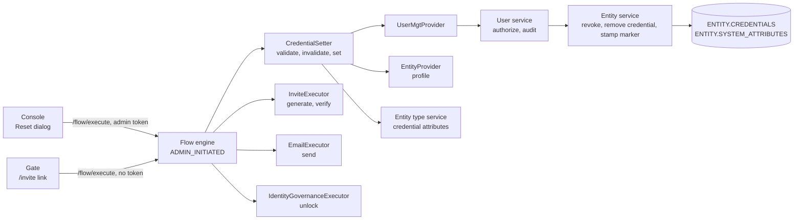

# Admin-Initiated Credential Reset Specification

- **Status:** Draft
- **Version:** 0.6
- **Related documents:** [Allow admins to start a credential reset that the user completes (#2024)](https://github.com/thunder-id/thunderid/issues/2024), [Privileged user initiated flows (#6695)](https://github.com/thunder-id/thunderid/discussions/6695), [Account locking and suspension (#5368)](https://github.com/thunder-id/thunderid/discussions/5368)

## Summary

An administrator who sets a user's credential directly knows the new value and must share it. Admin-initiated credential reset lets the administrator ask the user to choose a new password or PIN instead. The administrator starts an `ADMIN_INITIATED` flow for one user and one credential. The flow emails the user a reset link at the address stored on the user's profile, and once the email is sent it removes the stored credential, signing the user out everywhere. The user opens the link, passes any checks the flow adds, and sets the new value.

The governing decision is send first, then remove, in one administrator request: a reset that cannot reach the user changes nothing, and removal is attempted only after a link was sent. A failure after removal can void that link while leaving the credential removed. The feature composes existing executors and storage. It adds modes to `CredentialSetter`, a removal operation in the user and entity services, and an audit event for invalidation, and it ships a default flow, an email template and a Console action. It adds no table, credential format or account state.

Out of scope: self-service forgot password, a forced change at the next sign-in, credentials the user does not set (passkeys, authenticator apps), reset codes without a link, SMS delivery of the link, showing the link to the administrator, users without an email address, bulk resets and declarative users.

## Architecture



- The flow engine owns the execution, the bound subject, the execution's authority and its expiry. `ADMIN_INITIATED` keeps its existing authority rule: a step sent with the starting administrator's token runs as that administrator, and a step sent without a token runs with the permissions that administrator still holds (`flowexec.continuationAuthority`). If that administrator loses the permission, or is suspended or deleted, before the user finishes, the user's step is refused, the credential stays removed, and another administrator starts a new reset.
- `CredentialSetter` owns the reset's state in the execution's runtime data and reaches user management only through `providers.UserMgtProvider` and `entityprovider.EntityProviderInterface`. It reads which attributes of the user's type are credentials from the entity type service, as other executors do.
- The user service owns authorization and the audit events. The entity service owns credential storage, the `credentialUpdatedAt` marker and the revocation system flows that run around a credential change.
- `InviteExecutor`, `EmailExecutor` and `IdentityGovernanceExecutor` are reused. `EmailExecutor.withUndeliveredInviteLink` already withholds an `ADMIN_INITIATED` link from every response.

## Detailed design

### Flow stages

The shipped `default-admin-user-credential-reset-flow` runs:

| Node | Executor and mode | Stage |
|---|---|---|
| `permission_validator` | `PermissionValidator`, `system:user:update` or `org:user:update` | Administrator |
| `validate_reset` | `CredentialSetter` `validate`, input `credential` | Administrator |
| `generate_link` | `InviteExecutor` `generate` | Administrator |
| `send_link` | `EmailExecutor` `send`, template `admin-user-credential-reset`, not best effort | Administrator |
| `invalidate_credential` | `CredentialSetter` `invalidate` | Administrator |
| `link_sent` | Prompt, the administrator's result | Pause |
| `verify_link` | `InviteExecutor` `verify` | User |
| `set_credential` | `CredentialSetter` `set`, `onIncomplete` to the prompt | User |
| `prompt_new_credential` | Prompt with a `DYNAMIC_INPUT_PLACEHOLDER`, submitting back to `set_credential` | User |
| `release_account_locks` | `IdentityGovernanceExecutor` `unlock` | User |
| `reset_complete` | Prompt | User |

A start that names the credential runs the administrator stage within one request. A start without the `credential` input pauses at `validate_reset`, which asks for it, and nothing is sent or changed until the administrator names it; the request that names it runs the checks, the send and the invalidation together. The engine stores the execution only after the request ends (`flowexec.Execute`), so the user cannot continue before invalidation has run. No prompt sits between `send_link` and `invalidate_credential`.

One map from mode to flow types, `credentialSetterModeFlowTypes`, gives `CredentialSetter` its supported modes and refuses `validate` and `invalidate` in any flow type but `ADMIN_INITIATED`; `set` runs in any flow and stays the default mode. The flow validator applies the same limit when a flow is saved, and refuses a `CredentialSetter` node that names any other mode. In an `ADMIN_INITIATED` flow, `set` writes only the credential the reset recorded.

### Validate

`validate` reads the bound subject, not an input. It refuses when the execution has already recorded an invalidation. It reads the credential type from the node's first input, `credential` by default, and calls `UserMgtProvider.ValidateRemoveUserCredential`. That runs, without writing, the checks invalidation runs (see Credential removal). It then refuses a user held at the recovery plane, which a suspension holds and an automatic lock does not, stating the hold through the existing access refusal.

The user service refuses a credential that is not a string credential of the user's type with `USR-1024` (reused), in the same check. It pins no recipient: for a bound user with no signed-in user, as here, `EmailExecutor` reads the address from the stored profile and never from a request input, so another input in the start, such as `email`, `workEmail` or a name a custom email node reads, is not used. A credential may itself be named `credential`. Once its checks pass it removes both start inputs from the execution, so no later step reads either of them, and `set` never takes a start input as the new value. It records `userID` and `resetCredential`, clears the invite token and link, and clears the shared `deliveredRecipients` list. Because it runs before link generation, an unauthorized, ineligible or held target receives no email.

### Delivery

`InviteExecutor` `generate` creates the token and link, and `EmailExecutor` `send` renders `admin-user-credential-reset`. The email node's `EMAIL_INPUT` names the profile attribute, `email` in the shipped flow, and the executor reads it from the bound user's stored profile, not from the request. A constant value on that input would be used instead, so the shipped flow sets none. A flow author picks another attribute, such as `workEmail`, by renaming that input. When the user has no value for the attribute (`FET-1037`, reused) or the node names no usable email provider (`FET-1038`, reused), the node fails, the flow ends with that error, and nothing has changed. A send the mail server refuses fails as a server error, and the execution is removed. After a client error the execution stays stored at the email node, so the administrator can continue it once the cause is fixed, for example after adding an email to the profile. An address in that request is not used either. The link appears in no response: `generate` returns it only for `USER_ONBOARDING`, and `withUndeliveredInviteLink` withholds it for `ADMIN_INITIATED`. A successful send adds the recipient to `deliveredRecipients`.

### Invalidate

`invalidate` requires the bound subject, a recorded credential type, no recorded marker, a stored invite token, and at least one address in `deliveredRecipients`. Without a delivered link it fails with `FET-1139` (new). In the shipped flow a failed send ends at the email node with that node's error, so `FET-1139` is reached only in a custom flow whose email node is best effort and completed without sending. It calls `UserMgtProvider.RemoveUserCredential` and records the returned marker as `resetCredentialMarker`.

Every failure clears the stored invite token in the same response, so a link already emailed cannot be verified, and a later request that resumes at this node fails too. A failure after the send reports `FET-1140` (new), whose description tells the administrator that the emailed link will not work.

### Credential removal

`UserService.RemoveUserCredential(ctx, userID, credentialType)` and its check-only twin `ValidateRemoveUserCredential` refuse:

- a missing user ID (`USR-1002`, reused), a blank credential type, or a system-managed type such as `passkey` (`USR-1024`, reused);
- an unknown user or a non-user entity (`USR-1003`, reused);
- a caller without `ActionUpdateUser` on the user's organization unit, answered through the existing shared-user refusal;
- a target the caller cannot control (`authzService.CanControlEntity`);
- a declarative user or one a control plane deployed (`checkUserMutable`);
- a credential the user's type does not declare (`USR-1024`).

Invalidation then follows the path a direct change of a held credential takes: `EntityService.RemoveCredential` runs the `system-entity-credential-update-pre` system flow, which revokes the user's tokens and ends their sessions, removes the credential, and runs `system-entity-credential-update-post`, which advances the revocation cutoff and ends sessions again. An error after the removal is reported as a failure; the credential stays removed, and `user.credential.invalidate` records it as done.

`EntityService.RemoveCredential(ctx, entityID, credentialType)` checks that the type is declared, then, in one transaction, takes the entity's lock, reads `ENTITY.CREDENTIALS` from the database rather than the cache, deletes that key while keeping every other key, and stamps `credentialUpdatedAt` with a time taken under that lock. A direct credential change reads the credentials under the same lock, so a change that runs at the same time cannot write the removed key back. It returns the stamped value. A key already absent is removed again without error, so a repeated reset still works.

### Superseded links

Every write of a credential the user's type declares stamps the marker through one helper, `EntityService.stampCredentialMarker`, with `time.RFC3339Nano`, always later than the stored marker (one nanosecond after it when the clock has not passed it). That covers `UpdateCredentials`, `RemoveCredential`, and `UpdateEntity` and `UpdateAttributes` when they carry a declared credential, such as an attribute collector input that names one, each in the transaction that writes the credential. So any change to such a credential after the removal moves the marker. Passkeys are system-managed and do not move it. The refresh grant's `credentialChangedSince` parses either form and compares whole seconds, as before.

The `ADMIN_INITIATED` `set` asks `UserMgtProvider.IsUserCredentialUnchangedSince` whether the user's marker still holds `resetCredentialMarker`. The user service reads the user's `credentialUpdatedAt` and compares it, so the executor never reads the marker and a custom provider keeps its own form of it. When it does not hold, or when no invalidation was recorded, it fails with `FET-1073` (reused, "invalid or has expired"), disclosing nothing about the user for these invalid-link cases. Recovery-plane holds are checked separately and state the suspension or expired lifespan through the existing access refusal. A second reset once it removes the credential, a completed reset, a forgot password recovery, a direct administrator change and a declared credential written through an attribute update all void a pending link. A second reset refused before its removal, and a passkey enrollment, leave it working. The marker is per user, so this includes a reset of another credential: a PIN reset started while a password reset is pending voids the password link, and the password stays removed until another password reset or a forgot password recovery completes. `set` checks the marker and the hold on every request, before it asks for the credential, so a voided or held reset is refused before any screen is shown. In a custom flow that places an SMS OTP between the link and `set`, a voided link still sends that OTP before it is refused; this is accepted.

### Completion

Credential names are not reserved: `set` reads the attributes of the user's type and asks for one input named after the recorded credential, of type `PASSWORD_INPUT`, labelled with the schema display name or the attribute name. `set` forwards it as the `inputs` forwarded data, and the prompt node renders it in place of `DYNAMIC_INPUT_PLACEHOLDER`. When a value is refused, the prompt now clears forwarded inputs as well as its own, so it asks for the credential again. Only string credentials are reset: a number credential is not hashed when a user is created, so `validate` refuses it with `USR-1024` and `set` fails with `FET-1048`. The value is kept as text, so a string PIN keeps its leading zeros. `set` first runs in the request that opened the link. There it removes any input named after the recorded credential from the execution, records `resetCredentialRequested`, and asks for the credential, so it reads the value only from a request after that one and never from one sent before the link was opened. It then takes the value from the input named after the recorded credential, re-checks the marker and the recovery-plane hold, and writes through `UserMgtProvider.UpdateUserCredentials`. The hold is checked once per request: before the credential is asked for, or before the write. The user's profile read for the type's attributes also gives the category the write uses. The check and the write are separate steps: a credential change that commits between them is overwritten. That window is one request and is accepted rather than closed with a conditional write. Since nothing is held for that credential, the entity service replaces nothing: it writes and stamps the marker without another revocation. A value the schema refuses asks again through `onIncomplete` (`FET-1133`, reused). After the write it publishes `provenSubject`.

`IdentityGovernanceExecutor` `unlock` now runs in `ADMIN_INITIATED` flows. There it releases automatic locks only when `provenSubject` equals the bound subject, and it never unsuspends. The engine marks every `ADMIN_INITIATED` node context with `WithRecoveryProof`, including nodes a custom flow places before `verify_link`, and `dispatchPlaneFor` maps `ADMIN_INITIATED` to the recovery plane by flow type alone. The flow's position is not used as evidence. As a result, OTP checks a custom flow adds are judged as in recovery, and an automatic lock does not block them.

The execution ends at `reset_complete`, and the engine deletes it, so the link cannot be used again.

### Audit

| Event | Actor | Details |
|---|---|---|
| `user.credential.invalidate` (new) | The administrator | `credential_type` |
| `user.credential.update` (existing) | The user when the step is sent without a token: it runs as the recorded administrator, and `publishCredentialUpdate` names the user for any successful write on a recorded caller, and an anonymous actor for a failed one, since the user has not set the credential. The administrator when they send the step with their own token | None, as today |

`user.credential.invalidate` is published for every removal the invalidation attempts. A removal refused or failed before the credential is removed is recorded as a failure. A removal that fails after the credential is removed, while revoking, is recorded as a success, since the credential is gone; the administrator still gets `FET-1140`.

Neither event carries a credential value, the invite token or the link. Like user onboarding, nothing joins the two events: a completion is matched to the latest `user.credential.invalidate` for the same user. A user has at most one pending reset, since a new reset voids the earlier link.

### Data model

No schema change. `ENTITY.CREDENTIALS` loses the reset credential's key at removal and gains it again at completion. `ENTITY.SYSTEM_ATTRIBUTES.credentialUpdatedAt` is stamped at both. The execution's runtime data holds `userID`, `resetCredential`, `resetCredentialMarker`, `resetCredentialRequested`, the delivered recipients and the invite token, in the existing flow context store, until completion or expiry.

### API

No new endpoint. `POST /flow/execute` starts the reset with an administrator's token:

```json
{"flowType": "ADMIN_INITIATED", "handle": "default-admin-user-credential-reset-flow", "verbose": true,
 "inputs": {"subject": "<user ID>", "credential": "password"}}
```

A start without `credential` returns `INCOMPLETE` asking for it. A started reset returns `INCOMPLETE` at `link_sent` with `additionalData.emailSent` `"true"`. A refusal returns `ERROR` with the node's error. The user continues with `executionId` and `inputs.inviteToken` from the link and no token, then the new value under the credential's name. `api/flow-execution.yaml` documents the handle and the `credential` input.

An address in a request that continues a start is not used. The user's first request from the link carries `inviteToken`; an input named after the credential in that request is ignored. New error codes: `FET-1139` reset link not delivered, `FET-1140` credential reset failed. New `UserMgtProvider` methods: `ValidateRemoveUserCredential`, `RemoveUserCredential`, `IsUserCredentialUnchangedSince`; the disabled provider answers `UMP-1003`. Adding methods to this public embedded-engine interface is a breaking change: custom provider implementations must implement the new methods. A saved `CredentialSetter` node that names a mode other than `set`, `validate` or `invalidate` was accepted before and ran as a set; it now fails to save and to run.

### UI

The Console offers the reset where user administration runs through flows, to operators who can update users and read the server configuration, when `adminUserCredentialResetFlow` names a flow. It adds no button: the existing **Reset** button of each string credential on the user's **Credentials** tab opens a dialog that asks how to reset that credential, setting a new value there, as before and selected first, or emailing the user a link. A number credential's dialog offers no link, since `validate` refuses it. For suspended and expired users the link option is disabled with the reason below it, and the value can still be set; declarative users have no **Credentials** tab; locked users stay eligible. The user listing offers no reset action. The dialog is for its own credential, with no choice of credential, named by the schema display name, or the attribute name when there is none. With the link chosen:

```text
Reset Secret?
How should the secret be reset?
( ) Set a new secret now
(o) Email the user a link to set a new secret
The user will receive an email with a link to set a new secret.
Secret stops working once the email is sent, and the user is signed out everywhere. It stays unusable until the user sets a new value from the link.
[Cancel] [Send reset link]
```

The Console starts the flow with `verbose: true` and counts the link as sent only on `INCOMPLETE` with `emailSent` `"true"`. On success the dialog closes with "Reset link sent. Secret no longer works until the user sets a new one."; on failure it keeps the dialog open and shows the error inline, with its own message for `FET-1037`, `FET-1038`, `FET-1114`, `FET-1139` and `FET-1140`.

Gate renders the user's stage through its existing `/invite` entry, which also serves invites and verification links, so its checking and refused messages name no kind of link: "Checking your link..." and "This link can't be used. It is invalid or has expired. Ask for a new one.", in the Gate fallbacks and the shipped `invite` translations. The page labels its input with the credential's display name; its heading is the flow's static prompt text, since prompt text resolves only `t()` and `meta()`.

The flow builder shows the `CredentialSetter` mode as an **Operation** setting: **Set credentials**, **Validate credential reset** and **Remove credential**. It offers the last two only in administrator-initiated flows, and keeps a mode a node already has so it can be changed back. Choosing **Set credentials** leaves the node without a mode, as the shipped flow has it. A matching **Administrator User Credential Reset with Email Link** template copies the shipped flow, and the `admin-user-credential-reset` email joins the Console's notification template samples.

### Configuration

| Key | Default | Level | Validation |
|---|---|---|---|
| `flow.adminUserCredentialResetFlow.defaultHandle` | `default-admin-user-credential-reset-flow` (bootstrap) | Deployment, writable through server config | Must name an `ADMIN_INITIATED` flow |
| `flow.adminInitiatedFlow.expirySeconds` | `21600` (6 hours) | Deployment | Existing; sets the link's lifetime for every `ADMIN_INITIATED` flow, including attribute verification, lowered from 86400. |

The shipped flow's `send_link` node ships without an email sender, like the verification sibling, so a deployment selects its provider first. The `admin-user-credential-reset` email template and the `recovery:admin.reset.*` and `adminCredentialReset.email.*` translations ship in bootstrap and in the Console samples.

## Requirements

### R1. Start a reset without choosing the new value

**Requirement:** An authorized administrator asks a user to set a new password or PIN, without seeing or choosing it.

**Acceptance criteria:**

- **AC1.1:** Given an administrator with `system:user:update`, or with `org:user:update` over the user's unit, and a user with a stored email, when the administrator starts the flow with the user and `password`, then the user receives the reset email and the administrator's response is `INCOMPLETE` with `emailSent` `"true"` and no link.
- **AC1.2:** Given an administrator without update access to the user, when they start the flow, then it fails and no email is sent.
- **AC1.3:** Given a user whose type does not declare the named credential, or a system-managed credential, when the reset starts, then it fails with `USR-1024` and no email is sent.
- **AC1.4:** Given a declarative or control-plane-managed user, when the reset starts, then it is refused and no email is sent.
- **AC1.5:** Given a start that carries an address input besides `subject` and `credential`, such as `email` or `workEmail`, when the reset starts, then the link goes only to the address stored on the profile. Given a custom flow whose email node names an attribute the profile lacks, such as `recipient`, and a start carrying it, then the reset fails with `FET-1037`, no email is sent, and the old credential still authenticates.
- **AC1.6:** Given a flow whose email node reads `workEmail`, when the reset starts, then the link is sent to the user's stored `workEmail` only.
- **AC1.7:** Given a start that stopped at the email node with `FET-1037`, when the administrator continues it with an `email` input, then it fails with `FET-1037` again, no email is sent, and the old credential still authenticates. Once the administrator adds an email to the profile, continuing it, even with another `email` input, sends the link only to the stored address.

### R2. Block the old credential once the email is sent

**Requirement:** Starting a reset blocks the selected credential and signs the user out, only after the link reached the email provider.

**Acceptance criteria:**

- **AC2.1:** Given a started reset, when the user signs in with the old password, then sign-in fails.
- **AC2.2:** Given a user with a refresh token, when a reset starts, then the refresh token is rejected and the user's sessions end.
- **AC2.3:** Given a user with a password and a PIN, when the password is reset, then the PIN still authenticates.
- **AC2.4:** Given a user with no value for the email node's attribute (`FET-1037`), a flow whose email node has no usable provider (`FET-1038`), or a send the mail server refuses (a server error), when the reset starts, then it fails with that error and the old credential still authenticates.
- **AC2.6:** Given a custom flow whose email node is best effort and sends nothing, when the reset starts, then it fails with `FET-1139` and the old credential still authenticates.
- **AC2.5:** Given the removal fails after the email was sent, when the administrator reads the result, then it reports `FET-1140`, and the emailed link fails verification.

### R3. Complete the reset from the link

**Requirement:** The user sets the new value from the link without signing in.

**Acceptance criteria:**

- **AC3.1:** Given a started password reset, when the user opens the link in a browser with no session and submits a valid password, then the new password authenticates and the execution ends.
- **AC3.2:** Given a reset of a string credential with any name, such as `pin` or `accessCode`, when the user opens the link, then one masked input named after it is shown, labelled with its display name or attribute name, and the new value, leading zeros included, authenticates.
- **AC3.7:** Given a number credential, when the reset starts, then it fails with `USR-1024`, no email is sent, and the old credential still authenticates.
- **AC3.8:** Given a value under the credential's name sent with a request before the link was opened, when the user opens the link, then the screen asks for the credential, that value never authenticates, and the value the user then submits does.
- **AC3.3:** Given a value the user type's schema refuses, when the user submits it, then the screen asks again and the reset stays open.
- **AC3.4:** Given a completed reset, when the link is opened again, then it is refused.
- **AC3.5:** Given an automatically locked user, when they complete the reset through the default flow, then the lock is released; a custom flow without the unlock node leaves it.
- **AC3.6:** Given a user suspended before or after the link was sent, when the reset starts or completes, then it is refused and suspension stays.

### R4. Refuse superseded links

**Requirement:** Only the latest reset's link can complete. A reset link is refused when a later credential change is visible at its marker check; the check-to-write window described under Completion remains.

**Acceptance criteria:**

- **AC4.1:** Given two resets started for the same user, when the first link is used, then it fails with `FET-1073`, and the second still completes.
- **AC4.2:** Given a pending reset, when the user completes forgot password, then the pending link fails with `FET-1073`.
- **AC4.3:** Given a link that expired, when the administrator checks the credential, then it is still removed.
- **AC4.4:** Given a pending PIN reset, when the user's PIN is written through an attribute collector at sign-in, then the pending link fails with `FET-1073` and the collected PIN stands.
- **AC4.5:** Given a pending reset, when a second reset is refused before its removal or the user enrolls a passkey, then the pending link still completes.

### R5. Trace a reset

**Requirement:** Initiation and completion are recorded with their respective actors.

**Acceptance criteria:**

- **AC5.1:** Given a completed reset, when the audit log is read, then `user.credential.invalidate` names the administrator, the user and `credential_type`, and `user.credential.update` names the user, or the administrator when they sent the completion with their own token.
- **AC5.2:** Given any reset, when its audit events are read, then none carries a credential value, the invite token or the link.
- **AC5.3:** Given a removal that fails before the credential is removed, when the audit log is read, then `user.credential.invalidate` records a failure; given a completion from the link that fails, `user.credential.update` records a failure with an anonymous actor.

## Change log

| Version | Date | Change |
|---|---|---|
| 0.1 | 2026-11-12 | Initial specification. |
| 0.2 | 2026-11-23 | Aligned with the implementation in #6810: a non-string credential is refused with `USR-1024`; `validate` removes both start inputs; `invalidate` refuses any input; `set` reads the value only after the link was opened and checks the hold once per request; email failure codes and when `FET-1139` is reached; every declared credential write moves the marker, passkeys and a refused second reset do not; audit outcomes for failed removals and completions; one mode-to-flow-types map and the saved-mode breaking change; link lifetime 21600 seconds. |
| 0.3 | 2026-11-23 | Rebased on the flow input handling of #7021: the email node reads only the stored profile for the bound user, so `validate` and `invalidate` no longer refuse other inputs and `FET-1141` is removed; AC1.5 and AC1.7 describe the address that is not used. |
| 0.4 | 2026-11-24 | Aligned the UI with the Console in #7041: the action is only a **Send reset link** button beside each string credential on the **Credentials** tab, with no user listing action and no credential choice in the dialog; dialog and toast copy name the credential; Gate's link page names no kind of link; the flow builder's **Operation** setting and template names. |
| 0.5 | 2026-11-25 | Review of #7041: the dialog lowercases the credential's name mid-sentence, as the direct reset dialog does; the **Operation** options are sentence case. |
| 0.6 | 2026-11-25 | The Console adds no **Send reset link** button: the credential's existing **Reset** dialog asks whether to set a new value or email the user a link, and a held user's link option is disabled there with the reason. |
