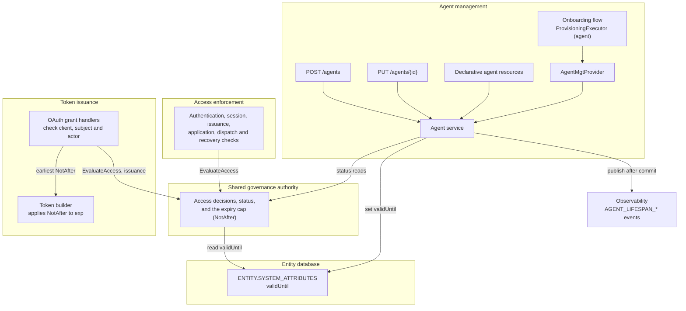

# Agent Lifespan Specification

- **Status:** Draft
- **Version:** 0.2
- **Related documents:** [Feature issue #4609](https://github.com/thunder-id/thunderid/issues/4609), [Finalized requirements](https://github.com/thunder-id/thunderid/issues/4609#issuecomment-6054905581), [Account locks and suspensions feature issue #5073](https://github.com/thunder-id/thunderid/issues/5073), [Account locks and suspensions specification (#5442)](https://github.com/thunder-id/thunderid/pull/5442)

## Summary

An agent registered for a fixed engagement, a pilot, or a contractor's project stays valid indefinitely. Nothing records when it should stop working, nothing refuses it once that date passes, and nothing tells its owner or a compliance reviewer where it stands.

This specification gives every agent a **lifespan** that ends at its `validUntil` instant. The lifespan is chosen by whoever registers the agent, changed through the agent management API by callers permitted to update the agent, enforced by the identity governance authority introduced by the account locks and suspensions specification, and audited through administration events published to observability.

The governing design decisions are:

- **`validUntil` is a reserved agent system attribute.** It is stored on the agent record beside `name`, `owner`, and `clientId`, and is reserved in the same way as the credential-change marker: generic entity writes preserve it, and only the agent service sets it, after validating it. It is configuration an operator sets on the agent, not runtime state, so it is not stored in the runtime row; the governance authority reads it from the entity it already receives.
- **The governance authority is the only component that interprets `validUntil`.** It derives the `EXPIRED` status and its precedence, refuses an expired agent, and tells each grant the latest expiry a token issued now may carry. The agent service and the Console show what governance returns, and the token builder applies the expiry it is given.
- **Changing the lifespan is an agent update.** A caller with permission to update the agent sets a new `validUntil` through `PUT /agents/{id}`. No separate flow or lifecycle command is involved. The agent service validates the value and publishes an event for every change.
- **`EXPIRED` is derived from `validUntil`, not stored.** Every access decision and status read compares `validUntil` with the current time, exactly as the account locks and suspensions specification derives `LOCKED` from a lock's `unlockAt`. No state is written at expiry and no job runs. The runtime `STATE` column keeps the values that specification defines, so changing `validUntil` is an attribute update that never writes lifecycle state. Effective status follows **`SUSPENDED` > `EXPIRED` > `LOCKED` > `ACTIVE`**.
- **The audit record is the observability event stream.** Every lifespan decision is published as an administration event. No history table is added, and ThunderID offers no history API; a deployment keeps and queries the events in its own observability backend.
- **There is no deployment lifespan policy.** The registering caller decides `validUntil`, or leaves the agent without one. The only validation is that a supplied value is a well-formed instant in the future, checked before it is persisted. A declarative resource file may also carry a past value, which loads the agent as expired.
- **Expiry disables automatically and never deletes.** From its `validUntil` instant, an agent is refused at every access plane with the refusal reason `expired`, and obtains no new access or refresh token through any grant. It keeps its profile, credentials, and assignments. Moving `validUntil` into the future reactivates it, because the derived status follows the new value.

The feature is delivered in two phases. Phase 1 does not depend on the account locks and suspensions feature (#5073): it delivers the lifespan, its audit events, and token lifetime capping, so no token issued to or for an agent outlives its `validUntil` and none is issued once it has passed. Because the governance authority does not exist yet, phase 1 derives the lifespan phase in the agent service and caps tokens from the token builder's own entity reads, as an interim. Phase 1 refuses no authentication or session for expiry. Phase 2 moves every lifespan decision into the identity governance authority once #5073 lands: it refuses an expired agent at every access plane, adds the `EXPIRED` status value, and supplies the token expiry cap to each grant, and the token builder's entity reads are removed. See Delivery phases.

Revocation of tokens already issued at expiry, cascade to sub-agents, expiry notifications, and availability schedules are outside this specification.

## Architecture

The feature adds no new component. It extends the agent service's system attributes, the agent creation boundary the agent onboarding flow specification defines, and the governance authority the account locks and suspensions specification defines.



The diagram shows the complete design. In phase 1 there is no governance authority: the agent service derives the lifespan phase itself, and the token builder reads `validUntil` from the entity records it resolves and caps tokens on its own. See Delivery phases.

### Component responsibilities

| Component | Responsibility |
|---|---|
| Agent service | The single path that sets `validUntil`, on create and on update. Authorizes the change with the existing agent update check, validates the value, writes the attribute, and publishes the matching administration event after the write commits. |
| Entity service | Treats `validUntil` as a reserved system attribute: generic system-attribute writes carry the stored value forward. Exposes a reserved-attribute setter used only by the agent service. |
| Identity governance service | The only component that interprets `validUntil`. Evaluates expiry as the refusal reason `expired` and decides which planes it applies to; derives the `EXPIRED` status, its precedence, and the lifespan phase for management reads; returns the latest allowed token expiry (`NotAfter`) on an admitted decision; and stops counting authentication failures while an agent is expired. |
| `AgentMgtProvider` | Carries an optional `validUntil` collected by an onboarding flow into the agent service. |
| Access enforcement components | They refuse whatever the authority does not admit, and map a recognized reason to its error. |
| OAuth grant handlers | Once a grant has resolved its parties (the client, the subject, and every actor), it asks the authority about each one at the plane that fits, refuses when one is not admitted, and passes the earliest `NotAfter` to the token builder. Code redemption, CIBA redemption, and token exchange gain issuance-plane checks; token exchange also checks the actor. |
| Token builder | Applies the `NotAfter` it is given to every access, refresh, and ID token it builds, and to ID-JAGs. Makes no governance call and reads no lifespan. In phase 1 only, it reads `validUntil` from the entity records it resolves and caps on its own. |
| Management APIs and Console | Expose `validUntil`, the lifespan phase, and the effective status governance reports, and let permitted callers change `validUntil`. |

### Why expiry is enforced by the governance authority

The account locks and suspensions specification makes the governance authority the one place that decides whether an identity may be used at a given plane. Its decision carries whether access is admitted and, when disclosure permits, a refusal reason; "which planes a hold applies to is decided inside the authority, so a caller only maps a reason to its error." It also states that "a reason a caller does not recognize is refused as a wrong secret."

Expiry fits that contract as a third refusal reason, `expired`, beside `suspended` and `locked`. The authority already reads the governed entity to learn its category and organization unit. Reading `validUntil` from the same record and refusing with `expired` when it has passed means every plane refuses an expired agent with no extra read and no per-site logic. An enforcement point that has not yet mapped `expired` still refuses, as for a wrong secret, so expiry is enforced everywhere from the start; mapping it only matters for disclosure.

The hold is computed from the attribute on every evaluation, in effect a time-bounded rule derived from the agent's own record. Nothing is stored when it takes effect, so it takes effect at the right instant whether or not anything is watching.

The same reasoning applies to status and to token issuance. The user and agent services do not compute status; they obtain an access reader from the governance service and show the effective status it returns, without knowing the rules behind it. The reader receives the full entity, system attributes included, so it derives `EXPIRED` from `validUntil` with no change to the agent service, and a later status changes only governance. Token issuance likewise asks the authority rather than deciding in the token builder: each grant calls governance once its parties are resolved, and governance returns the decision and, when a lifespan applies, the latest expiry a token issued now may carry. The builder only applies that expiry. This keeps every lifespan rule in one component, keeps category checks out of the grant handlers, and keeps the builder free of entity reads, which matters for token exchange of external tokens, whose `sub` is not necessarily a local entity.

Deriving the status, rather than storing it, is also what keeps lifespan changes within the account locks and suspensions specification's model. That specification changes lifecycle state only through governance lifecycle commands, never as a side effect of a profile or attribute write. Because `EXPIRED` is never written, an update that moves `validUntil` changes an attribute only, and the status follows it.

### Why `validUntil` is a reserved system attribute

`validUntil` describes the agent, is set when the agent is created, and is changed by the people who manage the agent, so it belongs on the agent record with the other agent system attributes. It also changes access decisions, so it must not change as a side effect of an unrelated write.

`SYSTEM_ATTRIBUTES` is one JSON column, and every write replaces it whole. As an ordinary key, `validUntil` could be changed by any path that writes that column:

| Write path | Effect on an ordinary `validUntil` key |
|---|---|
| Agent update (`PUT /agents/{id}`) | The agent service rebuilds the column from `name`, `description`, `owner`, and `clientId`. A rename or an owner change would drop `validUntil` and leave the agent unbounded, unvalidated and unrecorded. |
| Entity provider (`UpdateEntity`, `UpdateSystemAttributes`) | A flow executor, or a host's executor in embedded mode, could write any value, bypassing validation and the audit events. |
| Entity service (`UpdateEntity`, `UpdateSystemAttributes`) | Any service holding the entity service could replace the column with any value. |

The entity service already guards the credential-change marker against the same problem. It is a reserved key: both system-attribute write paths re-read the stored row and copy the reserved key over whatever the caller supplied. `validUntil` joins that reserved set, so every path in the table above leaves it unchanged; the write succeeds and `validUntil` keeps its stored value.

Callers still change the lifespan by sending `validUntil` in `PUT /agents/{id}`, as described under Changing the lifespan. Inside the agent service, that request takes two internal writes: the generic entity update for the other fields, which the merge prevents from touching `validUntil`, and a dedicated entity-service setter that writes only `validUntil`. The agent service is the setter's only caller, and calls it only after the permission check and after the value passes validation, and publishes the change once it commits. The only path that can change the lifespan is therefore the one that validates and audits it.

### Why `validUntil` is not stored in the runtime row

The account locks and suspensions specification keeps governance state in `ENTITY_RUNTIME_DATA`, read fresh by the governance service outside the entity cache. `validUntil` is not stored there. That row holds state the server changes as it runs (failure counters, lock episodes, suspensions), while `validUntil` is configuration an operator sets on the agent, and the row's rules would break it:

| Runtime row rule | Effect on `validUntil` stored there |
|---|---|
| A declarative file only seeds the row; an existing row takes precedence over later file loads. | A changed expiry in an agent's resource file would be ignored after the first load, and the old date would keep being enforced. |
| Runtime data is never serialized with the profile, so it is not exported. | An exported agent would be imported with no expiry. |
| The row lives in the runtime persistent database, apart from the profile, and the two are written in separate ordered steps. | An agent update could no longer write its attributes and `validUntil` in one transaction, so one could succeed while the other fails. |
| Guarded, revisioned updates and uncached reads, for counters written on every sign-in attempt. | Not needed: `validUntil` changes rarely, and clearing the cached profile on each change keeps it fresh. |

Storing it in system attributes also lets phase 1 ship with no schema change and no dependency on the runtime row. It does not leave governance with a second source: the access reader receives the full entity, and `EvaluateAccess` reads it, so the authority sees `validUntil` and the runtime row together. The one difference from runtime data is caching, which the agent service covers by dropping the agent's cached copy after every lifespan change commits; see Data model.

## Detailed design

### Delivery phases

The rest of this specification describes the complete design, which is the state after phase 2. This section states what phase 1 delivers, how it differs, and what phase 2 changes.

#### Phase 1: independent of the account locks and suspensions feature

| Area | Phase 1 behavior |
|---|---|
| Lifespan attribute | `validUntil` as a reserved agent system attribute, set on create and changed through `PUT /agents/{id}`, as specified. Import and export carry it; see Export and import. |
| Enforcement | Only at issuance. The token builder issues no token to or for an expired agent. No authentication, session, or other plane refuses an agent for expiry. |
| Token lifetime capping | An interim in the token builder, described under Phase 1 token capping. Phase 2 replaces it with the governance cap. |
| Reads | `validUntil` and the `lifespan` object, with `phase` `UNBOUNDED`, `ACTIVE`, or `EXPIRED`, derived by the agent service. There is no `status` object, because that object is introduced by the account locks and suspensions feature. |
| Audit events | Every event under Lifecycle audit, as specified. |
| Console | The **Expires** column with the remaining time, a chip derived from the phase (**Active**, **Expired**), and the **Expires on** field on the edit page. Delivered in a separate frontend change from the backend. |

Owner access (the owner read rule and `GET /users/me/agents`) and the onboarding flow's **Expires on** input are not part of phase 1; see Open decisions.

#### Phase 1 token capping

With no governance authority to ask, the token builder caps on its own. It resolves the agents involved in the token (the subject, the client the token is issued to, and the actor, from the build context of the access, refresh, or ID token, or the parties of an ID-JAG) through the actor provider, from the cache-backed entity store, and reads each one's `validUntil` from the system attributes the same read returns. An identity that is not an agent, or an agent with no `validUntil`, imposes no cap. A lookup that fails is a failed issuance, so a read failure never produces an uncapped token. A mapped `sub` that names no local entity is not an agent and imposes no cap, so token exchange of an external token is unaffected. Grants that already know the subject's category pass it to the builder, so a user subject is skipped without an entity read.

With the entity provider disabled (`entity_provider.type: disabled`), the builder cannot look up any entity, so it caps nothing; see Known limitations.

#### Expired agents in phase 1

Nothing refuses an expired agent's authentication or session in phase 1, so its grants still reach the token builder. The builder fails the issuance instead of building a token when the earliest `validUntil` of the agents involved is one second or less away, and the grant answers `invalid_grant` without saying why. No access, refresh, or ID token is issued to or for an expired agent.

The builder refuses rather than issuing a token whose `exp` equals its issuance instant, because validators accept a token until `exp` plus their clock-skew leeway. ThunderID's own validator applies `jwt.leeway`, 30 seconds by default, so such a token would be usable for that window, and a refresh token issued that way could be redeemed within the window for another, keeping the agent alive indefinitely.

The one-second hold-back exists because the builder computes a shortened validity period, and the JWT service stamps `iat` from its own clock a moment later, possibly in the next whole second, and derives `exp` from it. The builder therefore holds one second back, so a token's `exp` is at most `validUntil` and can be up to one second earlier, and issuance stops up to one second before `validUntil`. Capping at exactly `validUntil` requires the JWT service to accept the issuance instant from its caller.

#### Phase 1 limitations

| Gap | Effect until phase 2 |
|---|---|
| Flow sign-in is not refused | An expired agent can complete an authentication flow and receive the flow's authentication assertion. No token is issued for that assertion. |
| SSO sessions are not checked | An expired agent's existing session can be reused. No token is issued through it. |
| No `EXPIRED` status value | Expiry is visible as `lifespan.phase: EXPIRED` only. |
| Expiry is refused only at issuance | An expired agent passes client authentication and reaches the grant, which answers `invalid_grant` from the token builder. Disclosure rules do not apply, because the governance authority is not involved. |
| No interplay with locks and suspension | Status precedence does not apply, because locks and suspension do not exist yet. |
| Issuance stops one second early | Because of the hold-back, an agent obtains no token in the final second before its `validUntil`, and a token's `exp` can be up to one second before it. |
| Only the outermost actor caps | The builder caps at the actor named in `act`, not at earlier actors nested inside it. A delegation chain whose inner actor is an expired agent is not refused for that agent. |

#### Phase 2: after the account locks and suspensions feature

| Change | Effect |
|---|---|
| Enforcement moves to the governance authority | The `expired` refusal applies at every plane, as specified under Expiry enforcement. An expired agent is refused at client authentication and the other planes, before its grant reaches the token builder. |
| Status derived by governance | The access reader derives `EXPIRED`, its precedence `SUSPENDED` > `EXPIRED` > `LOCKED` > `ACTIVE`, and the lifespan phase. The agent service stops deriving the phase and reports what the reader returns. |
| Token capping moves to the grants | Each grant asks the authority about its client, subject, and actors, and passes the earliest `NotAfter` to the token builder, as specified under Token lifetime capping. The builder's entity reads are removed; it still refuses a `NotAfter` one second or less away, for the hold-back. |
| Failure counting while expired | The authority records no authentication failure for an expired agent, as specified under Failure counting while expired. |

The lifespan attribute, its validation rules, the update path, the audit events, the capping rule (`exp` never later than the earliest `validUntil` involved), and the Console fields are unchanged by phase 2.

#### Acceptance criteria by phase

Phase 1 satisfies every acceptance criterion except the following:

| Criterion | Phase 1 coverage |
|---|---|
| AC2.1 | Not delivered; owner access is an open decision. |
| AC2.2, AC3.1, AC3.2, AC3.3 | API parts met. The Console parts are delivered by a separate frontend change. |
| AC2.2, AC2.3, AC2.4, AC5.2 | Met through `lifespan.phase`; the `status` value and precedence arrive with phase 2. |
| AC5.4, AC8.1, AC8.5, AC8.12 | Phase 2 only. Phase 1 refuses no authentication or session for expiry. |
| AC8.2, AC8.3 | Met by the token builder, which issues no token to or for an expired agent. Client authentication refuses the agent only in phase 2. |
| AC8.7 | Phase 2 only. |
| AC8.13 | Met by the token builder for the actor named in `act`; an actor nested deeper in the chain is checked only in phase 2. |

### Lifespan model

Every agent has a lifespan ending at a single UTC instant, `validUntil`. The agent is operational, subject to every other check, while the current time is earlier than `validUntil`. From `validUntil` onward it is expired.

An **unbounded** lifespan is stored as the same non-expiring sentinel the lock model uses, `9999-12-31T23:59:59Z`. Public responses report it as `phase: UNBOUNDED` and omit `validUntil`, matching how the account locks and suspensions specification reports a non-expiring lock. An agent record with no `validUntil` attribute, which is true of every agent registered before this feature, is treated as unbounded.

Each agent's lifespan is in one of three **phases**, derived on every read from `validUntil` and the current time:

| Phase | Condition | Restricts access |
|---|---|---|
| `UNBOUNDED` | `validUntil` is the sentinel or absent. | No |
| `ACTIVE` | Current time is earlier than `validUntil`. | No |
| `EXPIRED` | Current time is at or after `validUntil`. | Yes, at every plane |

The phase is a lifespan property, reported separately from access status. `EXPIRED` affects access, so it also surfaces as status `EXPIRED`.

How close an agent is to its expiry is shown as the time remaining until `validUntil`, such as "Expires in 3 days", which a client computes from `validUntil`; no threshold decides when an agent counts as approaching expiry.

This specification delivers lifespan for the `agent` category only. Users and applications may gain a `validUntil` later, so the design keeps every lifespan mechanism tied to the entity rather than to the agent:

| Mechanism | Why it carries to other categories |
|---|---|
| `validUntil` | A reserved key in the entity service's system attributes, which every category has. |
| Expiry decision and status | The governance authority evaluates `validUntil` for whichever entity it is asked about or reads. |
| Token lifetime capping | Each grant asks the authority about every party, whatever its category, and the builder applies the earliest `NotAfter`. The phase 1 builder reads agents only. |

Extending lifespan to another category means adding `validUntil` to that category's management API and Console, and giving its `expired` refusal a category-specific message. Until then, only agents carry a `validUntil`, so the authority finds none on any other entity.

### Lifespan validation

There is no deployment policy for lifespans: no default duration, no maximum, and no warning window. Whoever registers or updates an agent decides its `validUntil`. The agent service validates the requested value before anything is persisted, on every create through the API or a flow and on every update that carries `validUntil`:

| Value | On create | On update |
|---|---|---|
| Absent | Unbounded. | Unchanged. |
| `null` | Unbounded. | Becomes unbounded. |
| A timestamp | Must be a valid RFC 3339 instant later than the current time. | Same as on create. |

Declarative agents follow a different rule: the value must be a valid RFC 3339 instant, and a past value is accepted. See Declarative agents.

A value that fails is refused with a validation error naming the constraint, and nothing is written. An absent `validUntil` and a `null` one are distinct on update: absent leaves the stored value alone, so a client that does not know the field cannot clear a lifespan, while `null` removes the expiry.

### Registration

Every agent registration path reaches the agent service:

| Path | How `validUntil` arrives |
|---|---|
| `POST /agents` | Optional `validUntil` field on the request. |
| Onboarding flow | Optional `validUntil` input collected by the flow and passed through `AgentMgtProvider.CreateAgent`. |
| Declarative agent resource | Optional top-level `validUntil` in the resource file. |
| Import | `validUntil` in the imported agent document; see Export and import. |

For the API and the flow, the agent service validates the value, writes it as a system attribute with the rest of the new agent in the entity-creation transaction, and publishes `AGENT_LIFESPAN_SET` after it commits. A failure rolls the agent back. An agent registered without a `validUntil` is stored with the unbounded sentinel.

The provisioning executor validates nothing about the lifespan. Validation stays in the agent service, so the API and flow paths cannot disagree, and a successful flow precheck never replaces service validation.

#### Declarative agents

A declarative agent's `validUntil` comes from its resource file. When the file is loaded, the value must be a valid RFC 3339 instant; a malformed value fails the load, as any invalid declarative resource does. A past value is accepted and loads the agent as expired, so a file does not stop loading when its agent's lifespan ends. An absent value is unbounded.

Declarative agents are read-only through the management API, so their lifespan changes only by editing the file and redeploying. The file's version history is the record of those changes; no lifespan events are published for them. Expiry of a declarative agent is enforced the same way as for any other agent.

#### Export and import

Export writes every agent's `validUntil`, using the unbounded sentinel for an agent that does not expire, so importing the document onto an agent that has a bound removes the bound. Import restores the value as exported, a past one included, so an expired agent is restored expired rather than refused; the future-only rule applies to the API and the flow, not to a restore. A malformed value fails the import, and a dry run reports it. An import creates or updates the agent through the agent service, so it publishes the same lifespan events as the API.

### Changing the lifespan

`PUT /agents/{id}` accepts an optional `validUntil`:

- **Absent:** the stored value is unchanged. This is the one field of the agent update that is not replaced when omitted, so an existing client that does not know about the field cannot clear or reset a lifespan.
- **Present and different from the stored value:** the agent service authorizes, validates, and writes the change. `null` removes the expiry.
- **Present and equal to the stored value:** no change and no event. `null` on an agent that is already unbounded is equal.

Authorization is the agent update check the service already applies (`checkAgentAccess` with the update action and the agent's organization unit). A caller who may update the agent may change its lifespan; there is no separate permission and no separate flow. Two additional rules apply only to a lifespan change:

- An agent may not change its own lifespan, even when it holds the update permission. Allowing it would let an agent keep itself alive. The rule applies when the agent is the subject of the caller's token and when it is the actor (`act`) in it, so an agent cannot extend itself through a token delegated by its owner or another user who holds the update permission.
- Declarative agents are read-only, as for every other field.

The agent service performs the change in one entity-database transaction:

1. Read the stored agent, including its current `validUntil`.
2. Validate the new value as described under Lifespan validation.
3. Write the new value with the reserved-attribute setter, which changes only `validUntil` and preserves every other system attribute.

The events described under Lifecycle audit are published after the transaction commits.

A lifespan change can move `validUntil` later or earlier. Moving it later is an **extension**. Moving it earlier is a **reduction**; a reduction to a time just ahead of now is the way to end an agent's lifespan early without suspending it. Both are published with their actor.

#### Reactivation

A change made while the agent is expired, to a `validUntil` in the future, is a **reactivation**. It is the same update with the same checks; nothing about the agent's identity, credentials, or assignments has to be recreated. No lifecycle state is written: the governance authority's next evaluation reads the new value, so the agent is admitted on its next request, subject to every other check. Its status reads `ACTIVE` when no other hold applies; a suspended agent still reads `SUSPENDED`, and an agent with a live lock reads `LOCKED`.

Reactivation does not recreate sessions, grants, or tokens, and does not release a suspension or a lock.

#### Concurrent writes

Two updates of the same agent are not serialized beyond what the entity database's isolation provides, which is the existing behavior of every agent field. If two lifespan changes race, the later commit wins and both are published, each with the previous value it read. A concurrent update that does not carry `validUntil` preserves the stored value through the reserved-attribute merge, which re-reads the row inside its own transaction. See Known limitations.

### Expiry enforcement

The governance authority adds one rule to its access evaluation: for an identity of the `agent` category whose record carries a bounded `validUntil`, if the current time is at or after `validUntil`, the decision is not admitted, with the refusal reason `expired`.

The rule reads `validUntil` from the entity record the authority already reads for the identity's category and organization unit, so expiry adds no read at any plane.

The authority applies `expired` at every plane, as it applies `suspended`:

| Reason | Refused by | Stated as |
|---|---|---|
| `expired` | A lapsed agent lifespan, at every plane. | Agent lifespan ended. |

| Plane | Effect on an expired agent |
|---|---|
| `authentication` | Refused, for every sign-in method. |
| `dispatch` | No challenge is sent. |
| `recovery` | Refused. |
| `session` | Refused; no SSO checkpoint is saved and no assertion is issued. |
| `issuance` | A refresh grant mints nothing. |
| `application` | The agent's own inbound client is refused at client resolution, which covers client authentication and every grant the agent requests as a client. |

At the `dispatch` plane, a withheld challenge answers as the account locks and suspensions specification defines for any held identity: as a delivered challenge does, by default.

Refusals follow the account locks and suspensions specification's disclosure rules. Under `discloseAccountHold: never`, the authority sets no reason, and an expired agent receives the sign-in method's existing failure response, which for OAuth client authentication is `invalid_client`. Under `always`, the authority sets `expired`, and an enforcement point that maps it states that the agent's lifespan has ended, without stating when it ended. One that does not yet map it answers as for a wrong secret.

The comparison uses the server clock with no leeway. An agent is operational up to, and not including, its `validUntil` instant.

#### Failure counting while expired

The account locks and suspensions specification's `RecordFailure` stops counting while a lock is in place. The authority also records no failure for an agent whose `validUntil` has passed, in any scope. Otherwise anyone who knows an expired agent's client ID could lock it by sending wrong secrets, and the lock would surface only after the agent is reactivated. Expiry already refuses every plane, so no lock is needed to contain it.

#### Precedence and interaction with locks and suspension

Effective status follows **`SUSPENDED` > `EXPIRED` > `LOCKED` > `ACTIVE`**. `SUSPENDED` is a stored state; `EXPIRED` and `LOCKED` are derived on read and are never written as lifecycle state values, so the stored states the account locks and suspensions specification defines are unchanged.

Suspension ranks above expiry because it is a deliberate administrative containment with its own release; an expired agent that is also suspended reports `SUSPENDED`, and changing its lifespan does not release the suspension. Expiry ranks above a lock because it withholds every plane while a lock withholds only new authentication.

`SUSPENDED` is not reused for expiry. A suspension implies that containment ran (tokens revoked, sessions ended) and is released by unsuspend; expiry revokes nothing and is released by changing `validUntil`. Reporting both as `SUSPENDED` would offer the wrong release action and imply containment that did not happen.

| Event | Effect on lifespan | Effect on locks and suspension |
|---|---|---|
| Lifespan change | Moves `validUntil`. | None. A suspended agent stays suspended; a live lock stays live. |
| Unsuspend | None. | As specified by the account locks and suspensions specification: the stored state returns to `ACTIVE`. An agent whose `validUntil` has passed then reports `EXPIRED`. |
| Unlock | None. | As specified by the account locks and suspensions specification. |
| Suspend | None. | As specified by the account locks and suspensions specification. An expired agent's stored state is `ACTIVE`, so it can be suspended, and containment runs. |

#### Automatic disabling and token issuance

An agent is disabled by expiry at its `validUntil` instant, automatically: no operator action, scheduled job, or write is involved, and an agent that has not reached its `validUntil` is never refused for expiry. Every path that mints an access or refresh token for an agent is refused once the agent has expired:

| Issuance path | Where an expired agent is refused |
|---|---|
| Client credentials grant | `application` plane, at the agent's client authentication. |
| Authorization code or CIBA grant requested by the agent as client | `application` plane, at the agent's client authentication. |
| Refresh token grant | `application` plane for the agent as client, and the `issuance` plane check on the refreshed subject. No new access or refresh token is minted. |
| Token exchange with the agent as client | `application` plane, at the agent's client authentication. |
| Authorization code or CIBA redemption whose subject is the agent, by another client | `issuance` plane check on the subject at redemption; see below. |
| Token exchange whose subject token's subject is the agent, by another client | `issuance` plane check on the subject at exchange; see below. |
| Token exchange whose actor token names the agent, as its subject or anywhere in its `act` chain, by another client | `issuance` plane check on each actor at exchange; see below. |
| Interactive sign-in of the agent through a flow | `authentication` and `session` planes, before an assertion is issued. |

The rows marked "see below" need checks the account locks and suspensions specification does not place. That specification relies on revocation at redemption and exchange, because a suspension revokes the grants that preceded it. Expiry revokes nothing, so a code, CIBA request, subject token, or actor token established for the agent before `validUntil` would otherwise mint tokens after it. No existing plane covers an actor at all: the agent is neither the client nor the subject of a delegated token whose `act` names it, so without an actor check an expired agent could keep acting for users with an actor token it obtained before its `validUntil`.

Authorization code redemption, CIBA redemption, and token exchange therefore make an issuance-plane `EvaluateAccess` call for the token's subject, and token exchange makes one for each actor it records in `act`. The grants make these calls for every party, without checking its category; the authority decides which holds apply at the plane. An entity with no `validUntil` gets the decision the account locks and suspensions specification defines for the issuance plane, and a subject with no local identity, such as the `sub` of an external token, is admitted, as that specification's checks already do. A refused redemption or exchange answers `invalid_grant`.

#### Token lifetime capping

A token issued before `validUntil` must not outlive it. Every token issued to or for an agent with a bounded lifespan expires no later than that agent's `validUntil`:

```
exp = min(issuedAt + configuredValidity, validUntil of every agent involved)
```

For example, an agent whose `validUntil` is five minutes away requests a client credentials token, and the application's access token validity is twenty minutes. The token is issued with an `exp` five minutes from now, and `expires_in` in the token response is `300`.

An agent is **involved** in an issuance when it is the token's subject, the client the token is issued to, or the actor in a token exchange. When more than one agent is involved, the earliest `validUntil` applies. An unbounded lifespan imposes no cap.

| Artifact | Capped at `validUntil` |
|---|---|
| Access token | Yes. `exp`, `expires_in`, and introspection's `exp` all reflect the capped value. |
| Refresh token | Yes, including a rotated refresh token issued by the refresh grant. |
| ID token | Yes, at the `validUntil` of its subject and the client it is issued to, which covers an agent signing in through a flow and an agent acting for a user. |
| ID-JAG | Yes, at the `validUntil` of its subject and client. |
| Authorization code and CIBA request | No. They are short-lived, and their redemption after `validUntil` is refused by the issuance-plane check above. |

**Where the cap is decided and applied.** The governance authority decides the cap, and the token builder applies it. An admitted access decision carries a new optional field, `NotAfter`: the latest instant a token issued now may expire, which is the entity's `validUntil` when it has a bounded one, and is empty otherwise. For each token request, the grant:

1. Resolves its parties: the client the token is issued to, the subject, and every actor it records in `act`.
2. Asks the authority about each one at the plane that fits, as listed under Automatic disabling and token issuance, and refuses with `invalid_grant` when any is not admitted.
3. Passes the earliest non-empty `NotAfter` to the token builder.

The builder computes `exp = min(issuedAt + configuredValidity, NotAfter)` for every token it builds from that request, and derives `expires_in` from it, holding back one second as described under Expired agents in phase 1, until the JWT service accepts the issuance instant from its caller. It makes no governance call and reads no entity for the cap. A grant added later is covered once it makes the same checks.

A governance read that fails is a refused decision, so a read failure never produces an uncapped token.

The cap uses the `validUntil` the authority reads, which comes from the entity record and may be served from the entity cache. After a reduction, a node whose per-node cache still holds the previous value caps at that value until its entry expires; see Entity cache staleness under Known limitations.

In phase 1, before the authority exists, the token builder reads `validUntil` itself and caps on its own, as described under Phase 1 token capping.

**Mapped subject claims.** An application can map its tokens' `sub` claim to an attribute, such as an email address, so `sub` alone does not name the entity. Grants resolve each involved entity's resource ID independently of `sub`, so every involved agent is checked and capped:

| Grant | How the entity is resolved |
|---|---|
| Authorization code | From the flow assertion's subject ID, as today. |
| Refresh token | From the entity resolved while verifying the refresh token or, when `sub` names no entity, from the attribute cache entry its `aci` claim references, as today. |
| Token exchange | For each ThunderID-issued subject token and actor token whose `sub` names no entity, from the attribute cache entry its `aci` claim references, the same fallback the refresh grant uses. The handler resolves the subject's and the actor's resource IDs from it. |

The attribute cache entry outlives every token that references it. If a ThunderID-issued subject or actor token's `sub` names no entity and its `aci` entry cannot be read, or the entry records no subject ID (entries created before entries recorded one), the exchange fails with `invalid_grant` rather than issuing an uncapped token. The user signs in again to obtain a new entry.

The token builder makes no governance call, as the account locks and suspensions specification requires. This specification adds one field, `NotAfter`, to that specification's access decision.

The cap is fixed when the token is issued. A later lifespan change does not alter tokens already issued: a reduction leaves them valid until their original capped `exp`, and an extension does not lengthen them, so a reactivated agent obtains new tokens to benefit from its new `validUntil`.

Expiry does not revoke tokens. Because no token issued to or for an agent outlives its `validUntil`, there is no token left to revoke when the agent expires, apart from tokens issued before this feature or before a reduction.

Expiry does not delete the agent, its credentials, or its group and role assignments. An expired agent remains readable and editable by authorized callers, and is distinguishable by status `EXPIRED` and phase `EXPIRED`.

### Lifecycle audit

The lifespan audit record is the stream of administration events published to observability. ThunderID adds no history table and no history API: a reviewer reads these events in the deployment's observability backend, which also owns their retention. Events are published under `observability.administration` when observability is enabled, after the write they describe commits.

| Event | Published when | Actor |
|---|---|---|
| `AGENT_LIFESPAN_SET` | An agent is created through the API or a flow. | The registering caller. |
| `AGENT_LIFESPAN_EXTENDED` | An update moves `validUntil` later, including to unbounded. | The updating caller. |
| `AGENT_LIFESPAN_REDUCED` | An update moves `validUntil` earlier. | The updating caller. |
| `AGENT_REACTIVATED` | An update made while the agent is expired moves `validUntil` into the future. Published after the matching `AGENT_LIFESPAN_EXTENDED`. | The updating caller. |
| `AGENT_LIFESPAN_UPDATE_FAILED` | A lifespan change is refused or fails, with a failure class: `not_authorized`, `invalid_lifespan`, `read_only`, or `operation_failed`. | The caller. |

Each event carries the agent's ID, the actor's identity and category, the previous `validUntil` where one existed, the new `validUntil`, and the outcome. An `AGENT_REACTIVATED` event's previous `validUntil` is the lapsed one, so the expiry it ended is part of the record.

**Expiry has no event of its own.** Expiry is derived, not written, so nothing happens at the `validUntil` instant that could publish one, and publishing on each refusal would repeat the same fact for every request the expired agent makes. The expiry instant is already in the record: it is the `validUntil` carried by the agent's most recent `AGENT_LIFESPAN_SET`, `AGENT_LIFESPAN_EXTENDED`, or `AGENT_LIFESPAN_REDUCED` event. In this specification expiry is the disable, so the same instant records both.

A failure to publish is logged and does not undo the change. Events published for an agent remain in the observability backend after the agent is deleted.

### Scope exclusions

This specification does not define:

- A scheduled job at expiry. Disabling needs no job.
- A persisted lifecycle history or a history API in ThunderID.
- Revocation of tokens or termination of sessions at expiry.
- Cascade of expiry to sub-agents or delegated tokens.
- Notifications before or at expiry.
- Availability schedules, or a combined lifespan and availability model.
- Approval workflows, justification, or risk-tier policies for lifespan changes.
- A deployment lifespan policy: a default lifespan, a maximum lifespan, or a warning window before expiry.
- Lifespan for users or applications. The mechanisms are entity-level, so a later specification can extend them; see Lifespan model.

### Data model

#### Agent system attribute

`validUntil` is added to the agent's `SYSTEM_ATTRIBUTES` JSON in the `ENTITY` table, beside the existing `name`, `description`, `owner`, and `clientId`. No column is added to `ENTITY`.

```json
{
  "name": "quarterly-report-agent",
  "description": "Builds the quarterly finance report",
  "owner": "5f3e...",
  "clientId": "qr-agent",
  "validUntil": "2027-03-31T00:00:00Z"
}
```

`validUntil` is a UTC RFC 3339 instant, or the sentinel `9999-12-31T23:59:59Z` for an unbounded lifespan. The entity service adds it to its reserved system attributes, beside the credential-change marker:

- Every generic system-attribute write, including the agent update path and any flow writing through the entity provider, carries the stored `validUntil` forward over the caller's value.
- A dedicated reserved-attribute setter changes `validUntil` alone. Only the agent service calls it.
- The setter invalidates the agent's entity cache entries before the write, as the existing system-attribute write does. The setter runs inside the agent service's transaction and cannot see its commit, so the agent service drops the agent's cache entries again, through the entity service, after that transaction commits. A read that lands between the write and the commit therefore cannot leave the previous `validUntil` cached.


### API

#### Registration

`POST /agents` accepts an optional `validUntil`:

```json
{
  "ouId": "8a1c...",
  "type": "default",
  "name": "quarterly-report-agent",
  "owner": "5f3e...",
  "validUntil": "2027-03-31T00:00:00Z"
}
```

| Condition | Response |
|---|---|
| `validUntil` is not a valid RFC 3339 instant | `400`, invalid lifespan. |
| `validUntil` is not later than the current time | `400`, lifespan must end in the future. |
| `validUntil` is `null` or absent | The lifespan is unbounded. |

#### Update

`PUT /agents/{id}` accepts an optional `validUntil`, with the same validation as registration:

| Condition | Response |
|---|---|
| `validUntil` absent | The stored lifespan is unchanged. |
| Caller lacks the agent update permission | `403`, as for any agent update. |
| The agent is the subject or the actor (`act`) of the caller's token, and `validUntil` differs from the stored value | `403`. |
| Agent is declarative | `403`, as for any update of a read-only agent. |
| Invalid or not in the future | `400`, as for registration. Nothing is updated, including the other fields in the request. |
| `null` | The lifespan becomes unbounded, published as `AGENT_LIFESPAN_EXTENDED`. An expired agent is also reactivated. |

An update that changes `validUntil` and other fields applies them together or not at all.

#### Reads

Agent reads, single and list, carry `validUntil` and a read-only `lifespan` object beside the `status` object the account locks and suspensions specification defines:

```json
{
  "status": {
    "value": "ACTIVE"
  },
  "validUntil": "2026-10-20T00:00:00Z",
  "lifespan": {
    "phase": "ACTIVE"
  }
}
```

| Field | Contract |
|---|---|
| `validUntil` | Omitted when the lifespan is unbounded. |
| `lifespan.phase` | `UNBOUNDED`, `ACTIVE`, or `EXPIRED`. |

Status and the lifespan phase are derived by the governance access reader on every read, from the stored state, the lock data, and `validUntil`, with no extra query; the agent service reports what the reader returns. A stored `SUSPENDED` reports `SUSPENDED`; otherwise a passed `validUntil` reports `EXPIRED`; otherwise a live lock reports `LOCKED`; otherwise `ACTIVE`. Reads never write. In phase 1 the agent service derives the phase from `validUntil` itself.

An expired agent reports `status.value: EXPIRED` with details reason `LIFESPAN_ENDED` and `since` set to `validUntil`, unless a suspension takes precedence:

```json
{
  "status": {
    "value": "EXPIRED",
    "details": {
      "reason": "LIFESPAN_ENDED",
      "since": "2026-09-30T00:00:00Z"
    }
  },
  "validUntil": "2026-09-30T00:00:00Z",
  "lifespan": {
    "phase": "EXPIRED"
  }
}
```

#### Owner access

The system authorization service's owner shortcut today applies only to a user acting on their own user resource. This feature adds a narrow agent owner rule: a caller whose subject equals an agent's recorded owner is authorized for the agent **read** action on that agent. The owner is read by the agent service from the trusted entity record and supplied to the authorization context; it is never taken from the request. The rule grants no update action, so an owner changes a lifespan only when they also hold the agent update permission for the agent's organization unit.

Owners list their own agents through:

| Endpoint | Behavior |
|---|---|
| `GET /users/me/agents` | Return the agents whose recorded owner is the caller, with `status`, `validUntil`, and `lifespan`, using the existing owner lookup. Paginated with `limit` and `offset`. |

Owner access is not part of phase 1. The API gate on `GET /agents/**` requires the agent view permission before the agent service runs, so the owner read rule cannot be added at the service layer alone, and `GET /users/me/agents` needs an owner index rather than a scan of every agent. Both follow with a decision on the gate; see Open decisions.


### UI

The screens below are described by layout; mockups are to be added under `assets/` before the specification is accepted.

#### Agent list

The agent list gains an **Expires** column showing the time remaining until `validUntil`, such as "in 3 days" or "in 5 hours", with the exact date on hover; "Expired 12 days ago" once it has passed; or "Never" for an unbounded lifespan. A status chip shows the effective status: **Active**, **Expired**, **Locked**, or **Suspended**, using the precedence above.

#### Agent edit page

The agent's general tab gains an **Expires on** date-time field in its existing edit form, saved with the rest of the form through `PUT /agents/{id}`. Beside it the page shows the remaining time ("Expires in 8 days") or how long ago it ended ("Expired 12 days ago"). The picker rejects past dates. The field is read-only for callers without the update permission and for declarative agents. For an unbounded agent the field shows "Does not expire" and can be set to a date. A **Does not expire** option clears the date and saves `validUntil: null`.

When the agent is expired, saving a future date shows a confirmation that the agent will be reactivated and that revoked tokens or sessions are not restored. Moving the date earlier shows a confirmation stating the new expiry.

#### Agent onboarding

The flow builder's Provision Agent resource accepts the `validUntil` input like the other agent system attributes it carries, and passes it through unchanged, so a flow that collects it must produce a full RFC 3339 date and time. Leaving it empty registers an agent that does not expire.

The default onboarding flow does not collect it yet. A `DATE_INPUT` submits a date only, such as `2027-03-31`, which the agent service refuses as an invalid lifespan, so adding the input needs either a date-time input or a defined rule for turning a date into an instant; see Open decisions.

## Requirements

Requirement and acceptance criterion numbers follow the [finalized requirements](https://github.com/thunder-id/thunderid/issues/4609#issuecomment-6054905581). Criteria removed there keep their gaps.

### R1. Agent lifespan policy and registration

**Requirement:** As a Platform / IAM Administrator, I want to enforce the configured lifespan limits during registration so that agent authorization is time-bounded.

This specification has no deployment-level lifespan limit. The lifespan is limited per agent, by the `validUntil` its registering caller sets, and A1.1 permits an infinite default. A deployment default or maximum is a scope exclusion.

**Acceptance criteria:**

- **AC1.1:** Given any registration path, when an agent is registered without a `validUntil` or with `validUntil: null`, then its lifespan is unbounded.
- **AC1.2:** Given an authorized caller and a future `validUntil`, when the agent is registered through the API, the onboarding flow, or a declarative resource, then the agent's lifespan ends at that instant.
- **AC1.3:** Given an agent registered through the API or a flow, when it is read, then its system attributes hold its `validUntil`, or the unbounded sentinel, and `AGENT_LIFESPAN_SET` was published when observability is enabled.
- **AC1.4:** Given an agent whose `validUntil` is in the future and no other hold, when it authenticates or requests a token, then lifespan does not refuse it.
- **AC1.5:** Given an agent, when its system attributes are written by any path other than the agent service's lifespan change, including an agent update that omits `validUntil` and a flow writing through the entity provider, then the stored `validUntil` is unchanged.
- **AC1.6:** Given a registration or update through the API or a flow that supplies a malformed `validUntil`, when it is submitted, then it is refused and nothing is written.
- **AC1.8:** Given a registration or update through the API or a flow that supplies a `validUntil` at or before the current time, when it is submitted, then it is refused and nothing is written.
- **AC1.9:** Given a declarative resource file whose `validUntil` is a valid instant at or before the current time, when it is loaded, then the agent loads with phase `EXPIRED`; given a malformed `validUntil`, then that resource fails to load.

### R2. Agent lifecycle visibility

**Requirement:** As an Agent Owner, I want to see my agent's expiry date and lifecycle status so that I know how long the agent will remain operational.

**Acceptance criteria:**

- **AC2.1:** Given a user recorded as an agent's owner, when they read the agent or list `GET /users/me/agents`, then the response carries the agent's `validUntil`, and the owner rule grants no update action.
- **AC2.2:** Given an agent, when an authorized read occurs, then the response carries the effective `status` and the lifespan `phase`, and the Console shows them on the agent list and edit page.
- **AC2.3:** Given agents in each phase, when they are read, then the phase is `UNBOUNDED`, `ACTIVE`, or `EXPIRED` accordingly, and status follows `SUSPENDED` > `EXPIRED` > `LOCKED` > `ACTIVE`.
- **AC2.4:** Given an expired agent, when an authorized read occurs, then status `EXPIRED` with reason `LIFESPAN_ENDED` and `since` equal to `validUntil` is returned without any authentication attempt.

### R3. Identifying agents approaching expiry

**Requirement:** As an Agent Owner, I want to identify agents that are approaching expiry so that I can take action before their operation is interrupted.

A3.1 asks for a configured warning period. This specification has none: every bounded agent shows the time remaining until its expiry, so an owner sees how close each agent is without a threshold deciding which agents count as approaching expiry.

**Acceptance criteria:**

- **AC3.1:** Given an agent with a future `validUntil`, when it is shown in the Console, then the time remaining until `validUntil` is shown, such as "Expires in 3 days".
- **AC3.2:** Given one agent with a future `validUntil` and one past it, when both are read, then they report phases `ACTIVE` and `EXPIRED` respectively, and the Console shows the remaining time for the first and **Expired** for the second.
- **AC3.3:** Given a bounded agent, when it is shown in the Console or returned by the API, then its `validUntil` is shown with the remaining time or the phase.

### R4. Agent extension

**Requirement:** As an Agent Owner, I want to extend the lifespan of an agent that is still required so that I can continue using the existing agent without creating a replacement identity.

**Acceptance criteria:**

- **AC4.1:** Given a caller who holds the agent update permission for the agent's organization unit, including an owner who holds it, when they update the agent with a later valid `validUntil`, then the change is applied; given a caller without that permission, or a token whose subject or actor (`act`) is the agent itself, then it is refused and nothing is written.
- **AC4.2:** Given `PUT /agents/{id}` with a `validUntil`, when it is processed, then the new value is validated as a future instant before it is written.
- **AC4.4:** Given a valid change on a single node or with the `redis` cache, when it commits, then the agent's `validUntil` is the new value on the next read, access evaluation, and token issuance on every node; with the per-node `inmemory` cache and more than one node, other nodes apply the new value no later than `cache.ttl` after the commit.
- **AC4.6:** Given a committed extension and observability enabled, when it commits, then `AGENT_LIFESPAN_EXTENDED` is published with the actor and the previous and new `validUntil`.
- **AC4.7:** Given an update that omits `validUntil`, when it commits, then the lifespan is unchanged and no lifespan event is published.
- **AC4.8:** Given an update with an invalid `validUntil`, when it is processed, then no field in the request is applied.
- **AC4.9:** Given a suspended or locked agent, when its lifespan is changed, then the suspension or lock remains.
- **AC4.10:** Given a permitted caller, when they move `validUntil` earlier but still in the future, then the change is applied and published as `AGENT_LIFESPAN_REDUCED`.
- **AC4.11:** Given a bounded agent, when a permitted caller updates it with `validUntil: null`, then its phase is `UNBOUNDED` and `AGENT_LIFESPAN_EXTENDED` is published with the previous `validUntil`.

### R5. Expired agent retention

**Requirement:** As a Compliance Reviewer, I want an expired agent to remain available as an expired identity rather than being deleted so that its historical activity and lifecycle information remain available for auditing.

**Acceptance criteria:**

- **AC5.1:** Given an agent whose `validUntil` has passed, when it is read, then the agent, its credentials, and its assignments still exist.
- **AC5.2:** Given an expired agent with no suspension, when it is read, then status is `EXPIRED` and phase is `EXPIRED`.
- **AC5.3:** Given an expired agent, when its status is read, then its lock state remains, and the lifespan events published for it are unaffected by its expiry.
- **AC5.4:** Given an expired agent, when it attempts client authentication, any authentication method, session reuse, refresh, or any grant as a client, then it is refused, with the existing failure response under default disclosure.
- **AC5.5:** Given an agent whose `validUntil` passes, when no request reaches it, then its status is `EXPIRED` on the next read, and no lifecycle state was written.

### R6. Extending an expired agent

**Requirement:** As an Agent Owner, I want to extend the lifespan of an already-expired agent so that I can restore a still-needed agent through the same governed process instead of creating a replacement identity.

**Acceptance criteria:**

- **AC6.1:** Given an expired agent and a caller with the agent update permission, when they update the agent with a valid future `validUntil`, then the agent's status is no longer `EXPIRED`, and its next authentication is admitted subject to every other check.
- **AC6.2:** Given a reactivation, when it commits, then no session, grant, or token is recreated, and a suspension or lock remains.

### R7. Lifecycle audit

**Requirement:** As a Compliance Reviewer, I want to see when an agent's lifespan was set, extended, expired, disabled, or reactivated so that I can demonstrate that agent lifecycle decisions were properly governed.

The record a reviewer reads is the deployment's observability event stream, not a ThunderID API. When an agent expired, and so was disabled, is the `validUntil` carried by its most recent lifespan event; see Lifecycle audit.

**Acceptance criteria:**

- **AC7.1:** Given observability is enabled and an agent registered through the API or a flow, when the registration commits, then `AGENT_LIFESPAN_SET` is published with the time, the registering actor, and the `validUntil` it was registered with, or the unbounded sentinel.
- **AC7.2:** Given observability is enabled and a lifespan change, when it commits, then `AGENT_LIFESPAN_EXTENDED` or `AGENT_LIFESPAN_REDUCED` is published with the actor and the previous and new `validUntil`; given the change fails, then `AGENT_LIFESPAN_UPDATE_FAILED` is published with its failure class.
- **AC7.5:** Given observability is enabled and an expired agent, when it is reactivated, then `AGENT_LIFESPAN_EXTENDED` and then `AGENT_REACTIVATED` are published, both carrying the lapsed `validUntil` as the previous value.
- **AC7.6:** Given a published lifespan event, when the event fails to publish, then the failure is logged and the lifespan change is not undone.

### R8. Agent expiry and automatic disabling

Token lifetime capping is delivered in phase 1; refusal of an expired agent at every plane depends on the account locks and suspensions feature ([#5073](https://github.com/thunder-id/thunderid/issues/5073)) and is delivered in phase 2. Criteria AC8.1 to AC8.5 correspond to A6.1 to A6.5 of that requirement as it was supplied.

**Requirement:** As a Platform / IAM Administrator, I want agents to be automatically disabled when their `validUntil` date is reached so that expired agents cannot continue obtaining new access tokens.

**Acceptance criteria:**

- **AC8.1:** Given an agent with a bounded lifespan, when the governance authority evaluates access at any plane, then it compares the agent's `validUntil` with the current time as part of that evaluation, with no operator action or scheduled job.
- **AC8.2:** Given an expired agent, when it requests a token through the client credentials, authorization code, CIBA, refresh token, or token exchange grant, or another client redeems a code or CIBA request or exchanges a subject token whose subject is the agent, then no access token is issued.
- **AC8.3:** Given an expired agent holding a refresh token issued before its `validUntil`, when the refresh token is used, or any grant that could return a refresh token is requested for the agent, then no refresh token is issued.
- **AC8.4:** Given an expired agent, when it is read or listed, then it is returned with its identifier, name, and status `EXPIRED`, and it is not deleted because its lifespan ended.
- **AC8.5:** Given an agent whose `validUntil` is in the future, when any grant or authentication is evaluated, then it is not refused for expiry; given the instant before `validUntil` and the instant at it, then the agent is admitted at the first and refused at the second.
- **AC8.6:** Given an expired agent with no suspension or live lock, when its `validUntil` is moved into the future through `PUT /agents/{id}`, then the runtime `STATE` column is not written, and the agent's status reads `ACTIVE`.
- **AC8.7:** Given a suspended agent whose `validUntil` has passed, when it is read, then its status is `SUSPENDED`; when it is unsuspended, then its status is `EXPIRED`.
- **AC8.8:** Given an agent whose `validUntil` is five minutes away and an access token validity of twenty minutes, when it obtains an access token through any grant, then the token's `exp` is no later than the agent's `validUntil` and no more than one second before it, and `expires_in` is at most 300.
- **AC8.9:** Given an agent with a bounded lifespan, when a refresh token or ID token is issued to or for it, or it is the subject, client, or actor of an issued token, then no issued token's `exp` is later than the earliest `validUntil` of the agents involved, as read by the issuing node within the staleness bound of AC4.4.
- **AC8.10:** Given a token already issued to an agent, when the agent's `validUntil` is extended or reduced, then the token's `exp` is unchanged.
- **AC8.11:** Given an agent with an unbounded lifespan, when it obtains a token, then the token's lifetime is the configured validity.
- **AC8.12:** Given an expired agent, when an authentication with its client ID or any other identifier fails, then no failure is counted and no lock forms.
- **AC8.13:** Given an expired agent, when another client exchanges a user's token with an actor token that names the agent, then no token is issued; given an agent whose `validUntil` is in the future, then the issued token's `exp` is no later than it.

## Known limitations

| Limitation | Effect |
|---|---|
| Tokens issued before a reduction | Token lifetimes are capped at the `validUntil` in force when they are issued. Moving `validUntil` earlier leaves tokens already issued valid until their original capped `exp`; expiry revokes nothing. |
| Tokens issued before this feature | Tokens issued before the cap was introduced carry their full configured lifetime and can outlive a later `validUntil`. |
| No audit without observability | The audit record exists only where observability is enabled and its backend retains the events. ThunderID itself keeps no lifespan history and cannot answer a history query. |
| Lost events | Events are published after the change commits. A publish failure is logged but not retried, so the change stands without its event. |
| No expiry event | Nothing is published at the expiry instant. A reviewer reads the expiry from the `validUntil` of the agent's most recent lifespan event. |
| Expiry observed at the server clock | Expiry uses the evaluating node's clock with no leeway. Nodes whose clocks differ can disagree on an agent's status for the size of the skew. |
| Validator leeway past `validUntil` | A token capped at `validUntil` is accepted until its `exp` plus the validator's clock-skew leeway. ThunderID's own validator applies `jwt.leeway`, 30 seconds by default, so a capped token can be used for up to that long after `validUntil`. Resource servers that validate tokens themselves apply their own leeway. |
| Entity cache staleness | The authority, and in phase 1 the token builder, read `validUntil` from the entity record, which may be served from the entity cache. The node that makes a lifespan change invalidates the agent's cache entries, so with a single node or the shared `redis` cache the next read on any node sees the new value. With the per-node `inmemory` cache and more than one node, another node keeps the previous value until its entry expires, for at most `cache.ttl` (3600 seconds by default): after an extension the agent can be refused, and after a reduction it can be admitted and receive tokens capped at the previous `validUntil`, for up to that window. Multi-node deployments that need a reduction to take effect at once must use the `redis` cache, or suspend the agent. |
| Concurrent lifespan changes | Two lifespan changes of the same agent are not serialized; the later commit wins, and both are recorded with the previous value each read. The reserved-attribute merge that protects `validUntil` from unrelated updates has the same read-then-write window as the existing credential-change marker. |
| Declarative agents | Their lifespan changes only through the resource file. No lifespan events are published for them; the file's version history is that record. |
| No lifespan filtering | The agent list filter supports equality only, so agents cannot be listed by "expiring before" or "expired" through the API. Listing all agents and reading their phase works but does not scale to large inventories. |
| Owners need the update permission | An owner who does not hold the agent update permission for the agent's organization unit can see, but not change, their agent's lifespan. |
| No deployment limit | Any caller permitted to create or update an agent can set any future `validUntil`, or none. A deployment cannot require agents to expire or cap how far ahead their lifespan ends. |
| Pre-existing agents | Agents registered before this feature have no `validUntil` and are unbounded. |
| Disabled entity provider (phase 1) | With `entity_provider.type: disabled`, the agent API still stores and reports `validUntil`, but the phase 1 token builder cannot look up agents, so an expired agent keeps obtaining tokens. This follows the other entity-based checks, such as groups and roles, which a disabled provider also turns off. |
| Self-change check gaps | The rule that an agent cannot change its own lifespan matches the agent against the subject of the caller's token and its `act` chain. An agent that is only the `client_id` of a user's token is not matched, and neither is a `sub` mapped to an attribute. |

## Open decisions

| Area | Decision required |
|---|---|
| Owner lifespan changes | Whether owners should be able to change their agent's lifespan without the general agent update permission, through a narrower permission or an owner rule limited to `validUntil`. |
| Owner-facing UI | Whether owners without Console access get a surface beyond `GET /users/me/agents` and `GET /agents/{id}` to see their agents' lifespan. |
| Deployment lifespan policy | Whether a later version adds a deployment default, a maximum, or a warning window, if deployments need to require agents to expire. |
| Lifespan filtering | Whether to add a range filter on `validUntil` to the agent list API, so that expiring and expired agents can be queried directly. |
| Owner access | How the owner read rule passes the `GET /agents/**` API gate, which requires the agent view permission before the agent service runs, and which owner index `GET /users/me/agents` uses. Owner access follows phase 1 once this is decided. |
| Onboarding expiry input | Whether the default onboarding flow collects **Expires on** with a date-time input, or with a date input and a defined rule for the instant it means (for example, the end of that day in UTC). |
| Issuance checks for users | Redemption and exchange checks are made for every party without a category check, so a user subject also gains an issuance-plane check at code redemption, CIBA redemption, and token exchange. Whether that matches the account locks and suspensions specification's intent for users, or the checks apply to agents only, is to be agreed with that specification. |
| `NotAfter` | The name and type of the new access-decision field, agreed with the account locks and suspensions specification. |

## Change log

| Version | Date | Change |
|---|---|---|
| 0.1 | 2026-10-12 | Initial specification. |
| 0.2 | 2026-10-16 | Governance owns every lifespan decision: it derives status and the lifespan phase, supplies the token expiry cap through `NotAfter`, checks actors at token exchange, and stops failure counting while an agent is expired. Phase 1 caps in the token builder as an interim. Added why `validUntil` is not stored in the runtime row, export and import, the one-second issuance hold-back, ID-JAG capping, and new limitations. Moved owner access and the onboarding input out of phase 1. Declarative updates answer `403`. |
