# Agent Lifespan Threat Model

This model covers the agent lifespan feature defined in the [agent lifespan specification](spec.md): setting and changing an agent's `validUntil`, protecting it from unrelated writes, refusing an expired agent, capping token lifetimes at `validUntil`, exposing lifespan to readers and owners, and publishing lifespan audit events.

## Overview

The feature gives every agent an optional lifespan that ends at a single UTC instant, `validUntil`. It is security-relevant because `validUntil` decides whether an agent may still authenticate and obtain tokens, and how long the tokens it holds stay valid. An attacker who can change it, bypass it, or outlive it keeps a credential alive that its owner meant to end.

The entry points are `POST /agents` and `PUT /agents/{id}`, the agent onboarding flow, declarative agent resources, the import and export APIs, every OAuth grant that issues a token to or for an agent, and the agent read endpoints. The key behaviour is that `validUntil` is a reserved system attribute only the agent service can change, that expiry is derived on every evaluation rather than written, and that no token issued to or for an agent outlives its `validUntil`.

The feature is delivered in two phases, and this model marks every control with its status:

| Status | Meaning |
| --- | --- |
| **[Built]** | Implemented in phase 1 ([#5833](https://github.com/thunder-id/thunderid/pull/5833)). |
| **[Phase 2]** | Specified, and delivered with the identity governance authority of the account locks and suspensions feature ([#5073](https://github.com/thunder-id/thunderid/issues/5073)). Not in place today. |
| **[Not built]** | Specified, but not yet scheduled, such as an open decision in the specification. |

`Materializable` describes the system as it is in phase 1. Where a phase 2 control will close a threat that is open today, the row says so, and [09] describes what an expired agent can still do in phase 1.

Cross-cutting concerns covered elsewhere: the identity governance authority, refusal disclosure, and suspension containment (account locks and suspensions specification, [#5442](https://github.com/thunder-id/thunderid/pull/5442)); the `authorization_code`, `client_credentials`, and `refresh_token` grants ([OAuth 2.0 Authorization and Core Grants Threat Model](../oauth/authorization-and-core-grants/threat-model.md)). Three further areas have no threat model yet: client authentication, token signing, and the token model; flow execution, including which flows may run the provisioning executor; and system authorization for agent management actions. Until those models are written, this model treats them as trust assumptions and does not analyse them, except where lifespan depends on them directly: which flows may create agents ([01]-8), and changes made with the management API key ([02]-12).

## Scope

This model covers:
- `POST /agents`, the onboarding flow's `ProvisioningExecutor` through `AgentMgtProvider`, and declarative agent resources, as they set `validUntil` at registration
- `PUT /agents/{id}` as it changes `validUntil`: extension, reduction, removal of the expiry, and reactivation, including changes made with the management API key
- The import and export APIs as they carry `validUntil`
- The entity service's reserved-attribute merge and setter as they protect `validUntil` from generic system-attribute writes, and the entity cache that serves it
- The governance authority's `expired` refusal at every plane, and its status, cap, and failure-counting rules, in phase 2
- Issuance checks at authorization code redemption, CIBA redemption, and token exchange, in phase 2
- Token lifetime capping: in the token builder in phase 1, and from the governance cap in phase 2
- What an expired agent can still do in phase 1, and how an administrator contains a compromised agent before suspension exists
- Embedded mode, where a host application supplies the providers that read and create agents
- Agent reads, and the agent owner read rule and `GET /users/me/agents` as specified (not built)
- Publication of the `AGENT_LIFESPAN_*` and `AGENT_REACTIVATED` administration events

Out of scope (see the referenced companion documents):
- How the governance authority evaluates suspension and locks, its disclosure setting, and suspension containment, covered by the account locks and suspensions specification
- Client authentication strength, token signing, DPoP, and the token model
- Grant-specific validation unrelated to lifespan, covered by the OAuth 2.0 Authorization and Core Grants Threat Model
- Authorization of agent management actions in general (`checkAgentAccess`), and the REST permission gate in front of the management APIs
- Ownership lifecycle: who may own an agent, and what happens to an agent when its owner is suspended or leaves
- Storage, retention, and access control of events in the deployment's observability backend, owned by the deployer
- Direct write access to the entity database, owned by the deployer

## Architecture

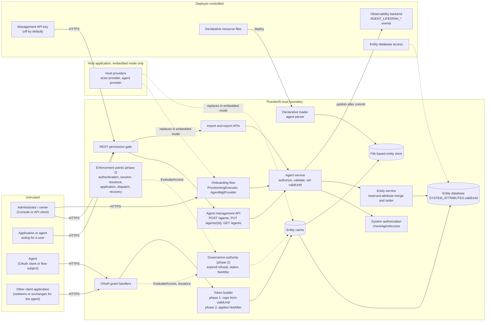

Dashed arrows are phase 2 paths, or paths that exist only in embedded mode.

### Components

The agent service is the only component that changes `validUntil`. The entity service enforces that by treating `validUntil` as reserved. In phase 1 the token builder is the only reader whose decisions depend on it; in phase 2 the governance authority becomes the only component that interprets it.

| Component | Task |
| --- | --- |
| REST permission gate | Requires the management permission for each API before the handler runs. Covered by the system authorization concerns that have no model yet. |
| Agent management API | Accepts `validUntil` on create and update, and returns `validUntil` and `lifespan.phase` on reads. **[Built]** Status from governance on reads. **[Phase 2]** |
| Import and export APIs | Export writes every agent's `validUntil`, the sentinel for an unbounded one. Import restores it through the agent service, a past value included, and a dry run reports a malformed one. **[Built]** |
| Onboarding flow | Passes an optional `validUntil` through `AgentMgtProvider.CreateAgent` unchanged. The provider calls the agent service in the server's runtime context, so the flow's own gate, not the agent create permission, protects this path. The default onboarding flow does not collect a `validUntil`. **[Built]** |
| Declarative loader | Parses an optional `validUntil` with the agent package's parser and loads the agent straight into the file-based entity store, not through the agent service. A past value loads the agent as expired. A malformed value fails startup, as any invalid declarative resource does. **[Built]** |
| Agent service | Authorizes with `checkAgentAccess`, refuses a change by the agent itself (as the subject or anywhere in the `act` chain of the caller's token), validates the value as a future RFC 3339 instant, writes it in the agent's transaction, drops the agent's cached copy after commit, and publishes the matching event. **[Built]** |
| Entity service | Carries the stored `validUntil` over every generic system-attribute write, under the entity's row lock, as it already does for the credential-change marker, and exposes a setter that only the agent service calls. **[Built]** |
| Governance authority | Refuses an agent whose bounded `validUntil` has passed with the reason `expired`, at every plane; derives `EXPIRED`, its precedence, and the phase; returns `NotAfter` on an admitted decision; records no authentication failure while an agent is expired. **[Phase 2]** |
| Enforcement points and grant handlers | Refuse whatever the authority does not admit. Code redemption, CIBA redemption, and token exchange check the subject, and token exchange checks every actor, at the issuance plane. **[Phase 2]** |
| Token builder | Phase 1: reads the `validUntil` of the client, the subject, and the outermost actor, holds back one second, and fails issuance when one second or less remains. **[Built]** Phase 2: applies the earliest `NotAfter` it is given and reads no entity. **[Phase 2]** |
| Entity cache | Serves entity records, including `validUntil`, to the token builder in phase 1 and the authority in phase 2. **[Built]** |
| Host providers | In embedded mode, the host's actor provider supplies the agent records the token builder reads, and the host's agent provider can replace how agents are created. See [11]. |

### Actors

#### Actors

The agent is software, but it is listed as an actor because it is the principal whose lifespan is governed and whose compromise this feature limits.

| Actor | Description | Roles or permissions |
| --- | --- | --- |
| Administrator | Registers agents, sets and changes their lifespan, and suspends them (phase 2). | Agent create and update permission for the agent's organization unit |
| Delegated caller | An application or agent calling the management API with a token issued for a user, acting for that user. | The user's permissions, as carried by the token |
| Flow user | A user running a flow that contains the provisioning executor. For the default onboarding flow this is a root administrator. | Whatever the flow's gate requires |
| Operator | Controls the deployment: declarative resource files, the management API key, configuration, and the host process. | Full control of the deployment |
| Agent owner | The entity recorded as the agent's owner. An explicit owner can be any existing entity, a user, an application, or another agent; when none is given, the caller becomes the owner; an import made with the management API key records `management-api-key`. The owner read rule is not built. | Update only with the agent update permission |
| Agent | Authenticates as a client or through a flow and obtains tokens until its lifespan ends. Must not change its own lifespan. | Its own client credentials; whatever permissions it has been granted |
| Other client application | Redeems a code or CIBA request, or exchanges a subject or actor token, that names the agent. | Its own client credentials |
| Host application | In embedded mode, supplies the providers ThunderID reads agents from and creates them through. | Full control of the providers it supplies |
| Compliance reviewer | Reads lifespan events in the deployment's observability backend. | Access to the observability backend, granted by the deployer |
| Malicious actor | An external attacker, a compromised agent, or an insider trying to keep an agent alive past its intended end, change another agent's lifespan, or hide a change. | N/A |

#### Entitlement matrix

| Actor | Set `validUntil` at registration | Change `validUntil` | Read `validUntil` and phase | Obtain tokens after `validUntil` | Read lifespan events |
| --- | --- | --- | --- | --- | --- |
| Administrator | Yes | Yes | Yes | No | Only with observability access |
| Delegated caller | Only with the user's create permission | Only with the user's update permission, and not for the agent acting | Only with the user's read permission | No | No |
| Flow user | Through the flow, when the flow collects it | No | No | No | No |
| Operator | Yes, through declarative files or the management API key | Yes, through the same | Yes | No | Yes |
| Agent owner | Only with create permission | Only with update permission | Only with read permission (owner rule not built) | No | Only with observability access |
| Agent | Only for another agent it has permission to create | No, for itself; only with update permission for another agent | Only with read permission | No | No |
| Other client application | No | No | No | No, for the agent | No |
| Host application | Through its own agent provider | Through its own providers | Through its own providers | Not controlled by ThunderID if its provider omits `validUntil`; see [11] | No |
| Compliance reviewer | No | No | Only with read permission | No | Yes |
| Malicious actor | No | No | No | No | No |

"Obtain tokens after `validUntil`" is refused in phase 1 by the token builder, and in phase 2 by the governance authority as well.

### External Dependencies (not owned)

| Dependency | Description (usage, purpose, authentication, authorization, security) |
| --- | --- |
| Governance authority and enforcement points | Introduced by the account locks and suspensions specification. Trusted to call `EvaluateAccess` at every plane, to refuse unrecognized reasons as a wrong secret, and to read `validUntil` from the entity it receives. Phase 2 depends on it. |
| System authorization and the REST permission gate | Decide agent management actions. Trusted input for who may set or change a lifespan. |
| Flow engine | Decides who may run a flow. Trusted to keep the provisioning executor behind an administrator gate. |
| OAuth grant handlers and token service | Resolve the subject, client, and actor, and call the token builder. |
| JWT service | Stamps `iat` and derives `exp` from the validity the builder passes, which is why the builder holds back one second. |
| Entity database and entity cache | Store and serve `validUntil` in `SYSTEM_ATTRIBUTES`. Internal access only. Encryption and access control at the infrastructure layer. |
| Host providers | In embedded mode, trusted to return each agent's `validUntil` in the stored form and to create agents through the agent service. See [11]. |
| Observability backend | Receives administration events when an output subscribes to `observability.administration`. Its retention, integrity, and access control are deployer-owned. |
| Server clock | Every expiry decision and token cap uses the evaluating node's clock. Clock synchronization is deployer-owned. |

## Threats and mitigations

### Out-of-scope interactions and risks

- Suspension containment (token revocation, session termination) and its release, covered by the account locks and suspensions specification. Suspension, not expiry, is the control for a compromised agent; [09] gives the phase 1 procedure until it exists.
- Refusal disclosure policy (`discloseAccountHold`), covered by the account locks and suspensions specification. This model only checks that the `expired` reason follows it.
- Client authentication strength, token signing, and token theft.
- Resource servers that validate tokens themselves: they enforce `exp` with their own leeway. ThunderID controls only the `exp` it issues.
- Revocation of tokens at expiry, cascade to sub-agents, notifications, and availability schedules, which the specification excludes.
- Agent deletion does not revoke the agent's tokens, unlike application deletion. This predates the feature and belongs with agent management.
- Ownership lifecycle, and events for owner changes and agent deletion, which belong with agent management.
- Integrity, retention, and access control of events in the observability backend, and direct writes to the entity database, owned by the deployer.
- Rate limiting on the management and token endpoints, applied at the deployment or gateway layer.

### Interactions

#### [01]: Agent registration with a lifespan

**Description**

A caller registers an agent through `POST /agents` or the onboarding flow, optionally with `validUntil`. The agent service validates `validUntil` as a valid RFC 3339 instant later than now, writes it as a system attribute in the entity-creation transaction (or the unbounded sentinel when absent or `null`), and publishes `AGENT_LIFESPAN_SET` after commit. On the API path the agent create permission is checked. On the flow path the provider calls the agent service in the server's runtime context, so the check passes, and the flow's own gate is the control. A declarative file is parsed by the agent package and loaded into the file-based store with no event: a past value loads the agent as expired, and a malformed one fails startup.

**Assets involved**

| Initiator | Intermediate | Target |
| --- | --- | --- |
| Administrator, delegated caller, or agent with create permission; flow user; operator through declarative files | Agent management API or onboarding flow, system authorization | Agent service, entity database, observability |

**Data flow**

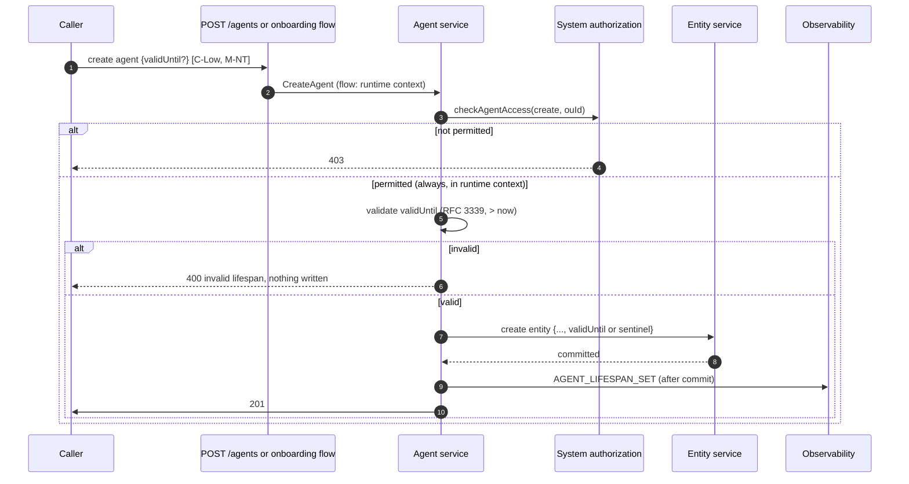

**Security considerations**

| Area | Response | Comments |
| --- | --- | --- |
| Data confidentiality | [C-Low] | `validUntil` is not secret. |
| Communication medium | [M-NT] | Declarative files arrive through [M-FS]. |
| Transport security | TLS | |
| Authentication | Caller's access token, or the flow's authentication | |
| Accessibility | Restricted | |
| Authorization and Access Control | Agent create permission on the API path; the flow's gate on the flow path | Validation is in the agent service, so the API, import, and flow paths cannot disagree. Declarative files use the same parser. |

**Threat assessment**

| ID | Category | Threat | Materializable | Mitigation / comment |
| --- | --- | --- | --- | --- |
| 1 | Tampering | A caller submits a malformed `validUntil`, a date-only value, or an offset that moves the instant past year 9999 in UTC (such as `9999-12-31T23:00:00-02:00`), to store a value the token builder parses differently, or not at all. | No | **[Built]** The agent service parses the value as a strict RFC 3339 instant and stores it normalized to UTC at second precision. A value at or past the unbounded sentinel is stored as the sentinel, so it never reaches storage as a five-digit year, and a negative UTC year is refused. A value that fails parsing is refused with `400` and nothing is written. The token builder parses the same stored form. |
| 2 | Tampering | A caller supplies a `validUntil` in the past or equal to now through the API or flow, to register an agent that looks bounded but is already expired. | No | **[Built]** Values not later than the current time are refused with `400`. Only declarative files and imports accept a past value, and those load the agent as expired, which restricts rather than widens access. |
| 3 | Security Risk | A caller supplies exactly the unbounded sentinel, so the agent is unbounded while the request looks like it set an expiry. | No | **[Built]** The sentinel is reported as `phase: UNBOUNDED` with `validUntil` omitted, so the outcome is visible on read and in the `AGENT_LIFESPAN_SET` event. It grants nothing a `null` value does not. |
| 4 | Elevation of Privilege | A flow executor writes `validUntil` directly through the entity provider during onboarding, bypassing validation and the event. | No | **[Built]** `validUntil` is reserved: generic writes through the entity provider carry the stored value forward. The executor validates nothing about the lifespan and passes it to the agent service. See [03]. Embedded mode, where the host replaces the provider, is covered in [11]. |
| 5 | Lateral Movement | A compromised agent that holds the agent create permission registers a new, unbounded agent before its own lifespan ends, and moves its work to that agent to outlive its expiry. | Yes | **[Built]** The new agent requires the create permission, is recorded with its creator in `AGENT_LIFESPAN_SET`, and is a separate identity. Residual: there is no deployment maximum lifespan, so nothing forces the new agent to expire. Agents do not hold the create permission by default; grant it only through roles that need it. See Residual risks. |
| 6 | Repudiation | A declarative agent's lifespan is set or changed with no lifespan event. | Yes | By design, the file's version history is the record. Residual: deployments that do not version their declarative files have no record. See Residual risks. |
| 7 | Denial of Service | A malformed `validUntil` in a declarative file stops the server from starting. | Yes | **[Built]** The declarative loader stops at the first invalid resource and the server does not start, as it does for any invalid declarative resource. A past value loads, so a lifespan ending never stops a file from loading. Residual: one typo in one agent file blocks startup until it is reverted. Validate declarative files before deploying them, for example with the import API's dry run. See Residual risks. |
| 8 | Elevation of Privilege | The provisioning executor is added to a sign-in or self-registration flow, so anyone who can run that flow creates agents, with any lifespan, without the agent create permission. | Yes | The flow path runs in the server's runtime context, so the agent create permission does not apply, and the flow's gate is the only control. The default onboarding flow is an administration flow that only root administrators can run. Residual: placing the executor in another flow is a root administrator's configuration choice that nothing prevents. Keep the provisioning executor in administration flows. Which flows may create agents belongs to the flow execution model. See Residual risks. |
| 9 | Security Risk | Agents onboarded through the default onboarding flow never expire, because the flow does not collect a `validUntil`. | Yes | **[Not built]** The specification's onboarding **Expires on** input is an open decision, because a date input yields a date the agent service refuses. Residual: until it is added, agents onboarded the documented way are unbounded, and an administrator sets a lifespan with `PUT /agents/{id}` afterwards. See Residual risks. |

#### [02]: Changing an agent's lifespan

**Description**

A caller sends `PUT /agents/{id}` with `validUntil`. An absent value leaves the lifespan unchanged. A value equal to the stored one changes nothing. A different value, or `null`, is refused for a declarative agent, authorized with the existing agent update check, refused when the agent is the subject or anywhere in the `act` chain of the caller's token, validated, and written by the reserved-attribute setter in the same transaction as the rest of the entity update. The service drops the agent's cached copy and publishes `AGENT_LIFESPAN_EXTENDED`, `AGENT_LIFESPAN_REDUCED`, and, for an expired agent moved into the future, `AGENT_REACTIVATED`, after commit, or `AGENT_LIFESPAN_UPDATE_FAILED` with a failure class. Imports reach the same update path.

**Assets involved**

| Initiator | Intermediate | Target |
| --- | --- | --- |
| Administrator, delegated caller, or owner with update permission; operator through the management API key or an import | Agent management API or import API, system authorization | Agent service, entity service setter, entity database, observability |

**Data flow**

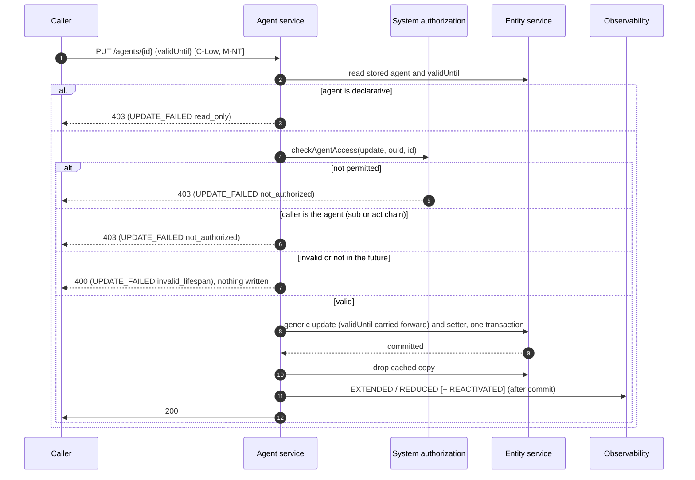

**Security considerations**

| Area | Response | Comments |
| --- | --- | --- |
| Data confidentiality | [C-Low] | |
| Communication medium | [M-NT] | |
| Transport security | TLS | |
| Authentication | Caller's access token, or the management API key | |
| Accessibility | Restricted | |
| Authorization and Access Control | Agent update permission for the agent's organization unit, and the agent is not the caller | |

**Threat assessment**

| ID | Category | Threat | Materializable | Mitigation / comment |
| --- | --- | --- | --- | --- |
| 1 | Elevation of Privilege | An agent holding the update permission extends its own lifespan, keeping itself alive indefinitely. | No | **[Built]** The agent service refuses a lifespan change when the caller's subject is the agent, with `403`, even with the update permission. |
| 2 | Elevation of Privilege | An agent extends its own lifespan through delegation: it obtains a token with its owner, or another user with the update permission, as subject and itself as actor (`act`), and calls `PUT /agents/{id}` with it. | No | **[Built]** The agent service refuses the change with `403` when the agent is the subject or appears anywhere in the `act` chain of the caller's token. |
| 3 | Elevation of Privilege | An agent extends its own lifespan as the `client_id` of a user's token that carries no `act`, or through a token whose `sub` is mapped to an attribute, so the self-change rule does not recognise it. | Yes | **[Built]** The rule matches the subject and the `act` chain only. Residual: an agent that is only the client, with no `act`, is not matched, and neither is a mapped `sub`. Agents obtain user tokens through the delegated grants, which record them in `act`. Matching the client and a mapped `sub` needs the caller's entity from the authentication middleware, a follow-up. See Residual risks. |
| 4 | Elevation of Privilege | An owner without the update permission changes their agent's lifespan by relying on ownership. | No | **[Built]** Ownership grants nothing today. A lifespan change goes through `checkAgentAccess` with the update action like any other field. |
| 5 | Tampering | A client unaware of `validUntil` sends a full `PUT` without it and clears or resets the lifespan, leaving the agent unbounded. | No | **[Built]** An absent `validUntil` leaves the stored value unchanged. Only an explicit `null` removes the expiry, and that is published as `AGENT_LIFESPAN_EXTENDED` with the previous value. |
| 6 | Tampering | A request combines a valid field change with an invalid `validUntil`, so the other fields apply while the lifespan check fails. | No | **[Built]** The lifespan is checked before anything is written, so an invalid `validUntil` refuses the whole request with `400` and writes nothing. The entity update and the lifespan are written in one transaction. The agent's OAuth profile is saved before that transaction, as for every agent update, so a database failure in the transaction can leave an OAuth change applied; it cannot apply a lifespan change. |
| 7 | Elevation of Privilege | A caller with update permission reactivates an agent that was deliberately left to expire, or one that expired because it was no longer trusted, and the agent returns with its old client secret, roles, and groups. | Yes | **[Built]** Reactivation needs the update permission and is published as `AGENT_REACTIVATED` with the actor and the lapsed `validUntil`. **[Phase 2]** Reactivation does not release a suspension. Residual: expiry is not containment, and reactivation restores everything the agent held. An agent that is no longer trusted is deleted or, in phase 2, suspended, not left to expire; rotate its secret before reactivating it. The Console confirmation is in the separate frontend change. See Residual risks. |
| 8 | Denial of Service | A caller with update permission moves another agent's `validUntil` to just ahead of now, disabling it without suspending it. | No | **[Built]** This is a permitted action for that caller, not an escalation. It is published as `AGENT_LIFESPAN_REDUCED` with the actor, and a permitted caller can restore the agent. |
| 9 | Repudiation | Two concurrent lifespan changes race: the stored value is the later commit, but a change can be skipped as "no change", or its event can carry the wrong previous value. | Yes | **[Built]** The writes themselves are serialized by the entity's row lock, and the later commit wins. Residual: whether a request is a change, and its previous value, are decided from the copy read before the transaction, so a racing change can be published with a stale previous value, or not published when it matched that copy. Deciding the change under the row lock closes this. See Residual risks. |
| 10 | Repudiation | A refused or failed lifespan change leaves no record, hiding attempts to extend an agent. | Yes | **[Built]** `AGENT_LIFESPAN_UPDATE_FAILED` is published with the class `not_authorized`, `invalid_lifespan`, `read_only`, or `operation_failed`, and the caller. Residual: the declarative check runs before the permission check, so an unauthorized caller's attempt on a declarative agent is classed `read_only`; and a request that fails on another field after the lifespan checks pass publishes no failure event. See Residual risks. |
| 11 | Tampering | A declarative agent's lifespan is changed through the API or an import, diverging from its file. | No | **[Built]** Declarative agents are read-only. A lifespan change is refused with `403` and published as `read_only`. |
| 12 | Repudiation | A change made with the management API key is recorded as made by `management-api-key`, not by a person, and the self-change rule cannot apply because no agent is the caller. | Yes | The key is off by default and is an operator credential, equivalent to control of the deployment. Residual: changes made with it name no person. Keep the key disabled except for automation, and record its use in the automation's own logs. See Residual risks. |
| 13 | Elevation of Privilege | Extending an agent's lifespan also extends how long its client secret works, because client secrets do not expire on their own. | Yes | By design, `validUntil` bounds the agent, and with it its secret, since an expired agent obtains no token. Residual: an extended agent keeps the same secret for its new lifespan. Rotate the secret when extending an agent by a long period, and on reactivation. Secret expiry belongs with client authentication. See Residual risks. |
| 14 | Elevation of Privilege | Two agents that both hold the agent update permission, or an agent and a successor it created, keep extending each other indefinitely. | Yes | **[Built]** The self-change rule stops an agent extending itself, and every extension is published with its actor. Residual: nothing stops agents with the update permission extending each other, and there is no deployment maximum. Agents do not hold the update permission by default; grant it to an agent only when it manages other agents, and review `AGENT_LIFESPAN_EXTENDED` events whose actor is an agent. See Residual risks. |

#### [03]: Generic system-attribute writes

**Description**

Any component holding the entity service or entity provider can write an agent's `SYSTEM_ATTRIBUTES`, which is one JSON column replaced whole on every write. The agent update path rebuilds it from `name`, `description`, `owner`, and `clientId`. `validUntil` joins the reserved set that `mergeReservedAttributes` already applies to the credential-change marker: both write paths take the entity's row lock, re-read the stored row under it, and copy the reserved keys over the caller's value. Only the dedicated setter, called by the agent service, writes `validUntil`. The entity cache serves the record, `validUntil` included, to the token builder.

**Assets involved**

| Initiator | Intermediate | Target |
| --- | --- | --- |
| Agent service, flow executors through the entity provider, other internal services | Entity service (`UpdateEntity`, `UpdateSystemAttributes`), entity cache | Entity database |

**Data flow**

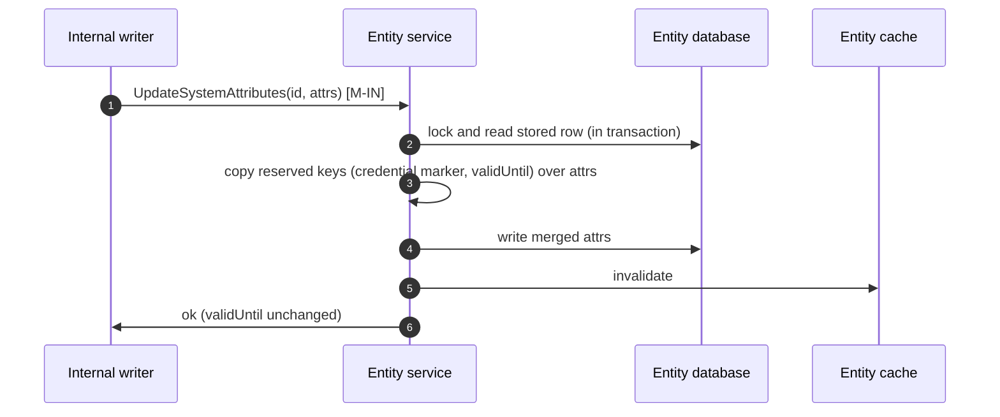

**Security considerations**

| Area | Response | Comments |
| --- | --- | --- |
| Data confidentiality | [C-Low] | |
| Communication medium | [M-IN], [M-DB] | |
| Transport security | N/A | In-process. Database transport per deployment. |
| Authentication | N/A | Internal callers |
| Accessibility | Internal | |
| Authorization and Access Control | Only the agent service calls the reserved setter | |

**Threat assessment**

| ID | Category | Threat | Materializable | Mitigation / comment |
| --- | --- | --- | --- | --- |
| 1 | Tampering | A rename or an owner change rebuilds `SYSTEM_ATTRIBUTES` without `validUntil`, dropping it and leaving the agent unbounded with no validation or event. | No | **[Built]** The reserved merge carries the stored `validUntil` into every generic write. |
| 2 | Elevation of Privilege | A flow executor writes a new `validUntil` through the entity provider, extending an agent without authorization or audit. | No | **[Built]** The merge overrides any caller-supplied `validUntil` with the stored one. The write succeeds and the lifespan is unchanged. |
| 3 | Elevation of Privilege | A future internal service calls the reserved setter directly and changes `validUntil` without the agent service's checks. | Yes | **[Built]** The setter accepts any string, and only the agent service calls it. Residual: nothing in the type system stops another caller; code review is the control. The setter changes only `validUntil`, so misuse cannot alter other attributes. See Residual risks. |
| 4 | Tampering | A concurrent lifespan change is overwritten by an unrelated update that read the older value. | No | **[Built]** The merge takes the entity's row lock with a no-op write and re-reads the row under it, so for writers in the process there is no read-then-write window: a reserved key written by a concurrent transaction is carried across. |
| 5 | Tampering | An entity is created with reserved keys the caller supplies, so a create path other than the agent service stores an unvalidated `validUntil`. | No | **[Built]** The merge applies to updates; on create, the reserved keys the caller passes are kept. Only the agent service creates agents, and it supplies `validUntil` itself, so no other path can set it today. Revisit when lifespans are added to another entity category, whose create path must then strip or validate the key. |
| 6 | Elevation of Privilege | After a reduction, a node serves a stale cached record, and the token builder caps at, or admits until, the previous `validUntil`. | Yes | **[Built]** The agent service drops the agent's cached copy after its transaction commits, so a single node or the shared `redis` cache sees the new value on the next read. Residual: with the per-node `inmemory` cache and more than one node, other nodes use the previous value for up to `cache.ttl` (3600 seconds by default). See Residual risks. |
| 7 | Tampering | Someone with direct write access to the entity database edits `validUntil`, with no validation and no event. | No | Out of scope: database access is deployer-owned and equivalent to control of every identity. An unreadable value fails token issuance for that agent rather than leaving it uncapped. |

#### [04]: Expiry enforcement at the access planes (phase 2)

**Description**

**[Phase 2]** At every plane, the enforcement point calls `EvaluateAccess`. For an identity with a bounded `validUntil`, the authority refuses when the current time is at or after `validUntil`, with the reason `expired`, reading `validUntil` from the entity it already reads. The access reader derives the `EXPIRED` status and its precedence for management reads. No state is written at expiry and no job runs. While an agent is expired, `RecordFailure` counts nothing. Disclosure follows the account locks and suspensions specification. None of this is in place in phase 1; see [09].

**Assets involved**

| Initiator | Intermediate | Target |
| --- | --- | --- |
| Agent | Enforcement point (client authentication, flow, session, issuance, dispatch, recovery) | Governance authority, entity cache |

**Data flow**

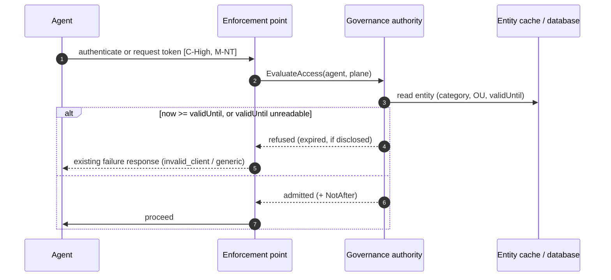

**Security considerations**

| Area | Response | Comments |
| --- | --- | --- |
| Data confidentiality | [C-High] | Client credentials and tokens transit these planes. |
| Communication medium | [M-NT] | |
| Transport security | TLS | |
| Authentication | Per plane | |
| Accessibility | Public | |
| Authorization and Access Control | Governance authority decision | Unrecognized reasons are refused as a wrong secret, so a plane that has not mapped `expired` still refuses. |

**Threat assessment**

| ID | Category | Threat | Materializable | Mitigation / comment |
| --- | --- | --- | --- | --- |
| 1 | Elevation of Privilege | An expired agent finds a plane or grant that does not consult the authority and keeps obtaining access. | Yes | **[Phase 2]** Expiry is evaluated inside the authority, which every plane calls, and an enforcement point that has not mapped `expired` still refuses. Open today: phase 1 has no plane checks; see [09]. **[Built]** The token builder already refuses every token for an expired agent. |
| 2 | Elevation of Privilege | An agent stays operational after `validUntil` because nothing runs at the instant it expires. | No | **[Built]** Expiry is derived on every evaluation from the stored `validUntil` and the current time, so it takes effect at the exact instant with no job or write. |
| 3 | Information Disclosure | The refusal reveals that the agent exists, that it is expired, or when its lifespan ended. | No | **[Phase 2]** Under the default disclosure, an expired agent receives the method's existing failure response. Under `always`, the response states only that the lifespan has ended, never when. **[Built]** In phase 1 the token builder's refusal is a plain `invalid_grant`. |
| 4 | Operational Risk | Clock skew between nodes makes them disagree on whether an agent is expired. | Yes | **[Built]** The comparison uses the evaluating node's clock with no leeway. Residual: disagreement lasts for the size of the skew. Keep node clocks synchronized. See Residual risks. |
| 5 | Denial of Service | A legitimate agent is refused because its lifespan ended unnoticed, interrupting a dependent service. | Yes | **[Built]** Reads report `validUntil` and the phase. The Console's remaining-time display is in the separate frontend change. Residual: until it ships, and with no expiry notifications, owners must read the API to see an approaching expiry. See Residual risks. |
| 6 | Security Risk | An expired agent that is also suspended is reported as `EXPIRED`, and an operator extends it believing that restores it, while containment is hidden. | No | **[Phase 2]** Status precedence is `SUSPENDED` > `EXPIRED` > `LOCKED` > `ACTIVE`, derived by governance, and a lifespan change does not release a suspension. |
| 7 | Elevation of Privilege | Any agent update, including a lifespan change, writes the agent's stored state as `ACTIVE`, which would release a suspension once suspension exists. | No | **[Phase 2]** The account locks and suspensions specification removes the state from the profile record: it lives in the runtime row, which generic profile updates cannot write. The agent update's `ACTIVE` write predates this feature and has no effect once that lands. Tracked with #5073. |
| 8 | Denial of Service | Anyone who knows an expired agent's client ID sends wrong secrets until it locks, and the lock surfaces only after the agent is reactivated. | No | **[Phase 2]** The authority records no authentication failure while an agent is expired. Today there are no locks. |
| 9 | Elevation of Privilege | The authority cannot read a stored `validUntil` and admits the agent as unbounded. | No | **[Phase 2]** An unreadable value refuses, as the account locks and suspensions specification refuses for an unreadable runtime document. **[Built]** In phase 1 the token builder fails issuance for it. |

#### [05]: Issuance checks at redemption and exchange (phase 2)

**Description**

**[Phase 2]** A code, CIBA request, subject token, or actor token established for an agent before `validUntil` could mint tokens after it, because expiry revokes nothing. Authorization code redemption, CIBA redemption, and token exchange therefore make an issuance-plane `EvaluateAccess` call for the subject, and token exchange makes one for every actor it records in `act`. A refusal answers `invalid_grant`. The calls carry no category check; the authority decides which holds apply. **[Built]** In phase 1 the token builder gives the same outcome for the client, the subject, and the outermost actor: it reads their `validUntil` and refuses, whichever grant is used.

**Assets involved**

| Initiator | Intermediate | Target |
| --- | --- | --- |
| Other client application, or the agent as client | Grant handler, subject and actor resolution | Governance authority (phase 2), token builder (phase 1) |

**Data flow**

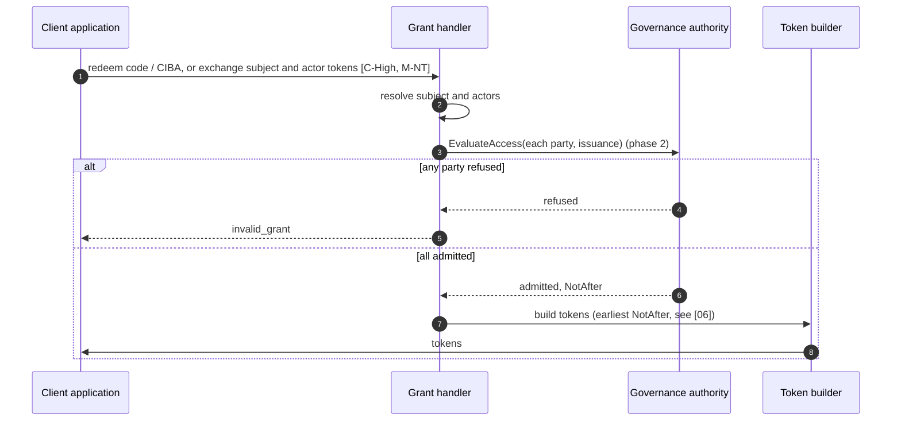

**Security considerations**

| Area | Response | Comments |
| --- | --- | --- |
| Data confidentiality | [C-High] | |
| Communication medium | [M-NT] | |
| Transport security | TLS | |
| Authentication | Client authentication | |
| Accessibility | Public | |
| Authorization and Access Control | Governance authority, issuance plane (phase 2); token builder (phase 1) | |

**Threat assessment**

| ID | Category | Threat | Materializable | Mitigation / comment |
| --- | --- | --- | --- | --- |
| 1 | Elevation of Privilege | Another client redeems an authorization code or CIBA request issued for the agent before `validUntil`, after the agent has expired, and obtains tokens for it. | No | **[Built]** The token builder reads the subject's `validUntil` at redemption and refuses with `invalid_grant`; grants that know the subject's category pass it so the agent is always read. **[Phase 2]** The issuance-plane check refuses before the builder. |
| 2 | Lateral Movement | Another client exchanges a subject token whose subject is the expired agent, including a token issued before this feature or before a reduction, so its own `exp` is still in the future. | No | **[Built]** The builder reads the subject's current `validUntil` at the exchange, not the subject token's `exp`, so the exchange is refused however the subject token was issued. An external issuer's subject is not a local agent and has no lifespan here. **[Phase 2]** The issuance-plane check gives the same result. |
| 3 | Elevation of Privilege | An expired agent keeps acting for users by presenting, as `actor_token`, a token it obtained before its `validUntil`, through another client. | No | **[Built]** The builder caps and refuses at the actor named in `act`. **[Phase 2]** Token exchange checks every actor at the issuance plane. |
| 4 | Lateral Movement | The issuing application maps its subject claim to an attribute such as an email address, so a token exchange cannot resolve the subject or actor to the agent from `sub`, skipping both the check and the cap. | No | **[Built]** For a ThunderID-issued subject or actor token whose `sub` names no entity, the handler resolves the entity from the attribute cache entry its `aci` claim references. If that entry cannot be read, or records no subject ID, the exchange fails with `invalid_grant`. |
| 5 | Security Risk | A grant change silently drops the subject's category or ID before the token builder, removing the cap. | No | **[Built]** Integration tests cover issuance and refusal after `validUntil` for client credentials, authorization code and refresh, CIBA, token exchange with the agent as client, subject, and actor, and an agent signing in to an application. |
| 6 | Security Risk | The new issuance checks change behaviour for user subjects defined by the account locks and suspensions specification. | No | **[Phase 2]** Whether a user subject also gains the check at redemption and exchange is an open decision in the specification, to be agreed with the account locks and suspensions specification. |

#### [06]: Token lifetime capping

**Description**

**[Built]** In phase 1, for every access, refresh, and ID token and ID-JAG it builds, the token builder collects the parties involved (the client, the subject, and the outermost actor), skips those it knows are not agents, and reads each agent's `validUntil` through the actor provider and entity cache. A party it cannot match to any entity, such as a mapped `sub` or an external user, imposes no cap. When one second or less remains before the earliest `validUntil`, the builder fails the issuance and the grant answers `invalid_grant`; otherwise it shortens the validity so `exp` is at most `validUntil`, holding back one second because the JWT service stamps `iat` a moment later. A lookup failure fails issuance. **[Phase 2]** The grants obtain `NotAfter` from the authority for every party, and the builder applies it with no entity read.

**Assets involved**

| Initiator | Intermediate | Target |
| --- | --- | --- |
| Any client requesting a token to or for an agent | Grant handler, actor provider, entity cache | Token builder |

**Data flow**

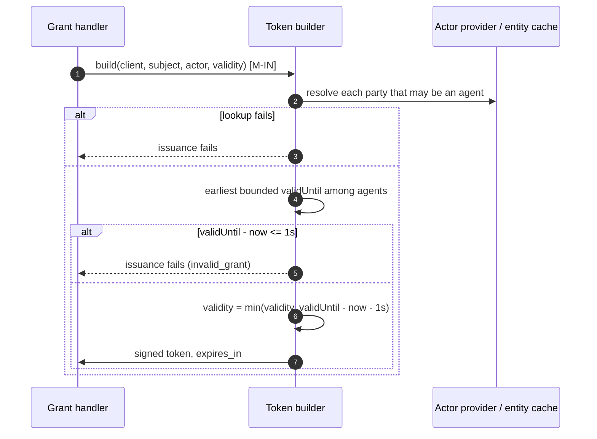

**Security considerations**

| Area | Response | Comments |
| --- | --- | --- |
| Data confidentiality | [C-High] | Issued tokens |
| Communication medium | [M-IN] | |
| Transport security | N/A | In-process |
| Authentication | N/A | After the grant's own authentication |
| Accessibility | Internal | |
| Authorization and Access Control | N/A | An attribute read in phase 1; the governance cap in phase 2 |

**Threat assessment**

| ID | Category | Threat | Materializable | Mitigation / comment |
| --- | --- | --- | --- | --- |
| 1 | Elevation of Privilege | A token issued shortly before `validUntil` stays valid long after it, extending the agent's effective lifespan by the configured validity. | No | **[Built]** Every access, refresh, and ID token and ID-JAG expires no later than the earliest `validUntil` of the agents involved. Resource servers may accept it for their own leeway; see threat 6. |
| 2 | Elevation of Privilege | A grant added later issues tokens without the cap. | No | **[Built]** The cap is in the token builder, which every grant uses. **[Phase 2]** A new grant must make the issuance checks to obtain `NotAfter`; review new grants for them. |
| 3 | Elevation of Privilege | A read failure in the builder produces an uncapped token. | No | **[Built]** A lookup failure, or an unreadable `validUntil`, fails issuance. No token is returned. |
| 4 | Elevation of Privilege | An agent obtains a longer-lived token by acting through another identity: as the actor in a token exchange, or as the client for a user's token. | No | **[Built]** The agent counts as involved when it is the client, the subject, or the outermost actor. |
| 5 | Elevation of Privilege | An agent named earlier in a delegation chain, not as the outermost actor, has expired, and the new token is not capped or refused for it. | Yes | **[Built]** The builder reads the outermost actor only. Residual: an expired agent nested deeper in `act` does not cap the token. **[Phase 2]** Token exchange checks every actor. See Residual risks. |
| 6 | Elevation of Privilege | Tokens are refused before `validUntil`, or issued with `exp == iat`, and a validator's leeway keeps the agent alive: a refresh token issued that way is redeemed within the leeway for another. | No | **[Built]** The builder refuses when one second or less remains, so no token is issued with `exp` at or before its `iat`. Issuance therefore stops up to one second before `validUntil`, and `exp` can be up to one second earlier than it. |
| 7 | Elevation of Privilege | A resource server applies clock-skew leeway, so a capped token is accepted for that leeway after `validUntil`. | Yes | Residual: bounded by the validator's leeway, 30 seconds by default for ThunderID's own validator (`jwt.leeway`). See Residual risks. |
| 8 | Elevation of Privilege | A reduction moves `validUntil` earlier, but tokens already issued keep their original `exp`. ThunderID's own APIs and its introspection endpoint report them active until then, and downstream systems that started their own sessions from the agent's token are not told. | Yes | Residual: by design, the cap is fixed at issuance and expiry revokes nothing. A team can believe a reduced agent is stopped while its tokens still work. Suspension, which revokes tokens, is the containment control in phase 2; see [09] for phase 1. See Residual risks. |
| 9 | Elevation of Privilege | Tokens issued before this feature carry their full configured lifetime and outlive a later `validUntil`. | Yes | Residual: bounded by the configured token validity, and ends one validity period after the feature is deployed. See Residual risks. |
| 10 | Security Risk | A lifespan bounds when an agent's tokens finally end, not how long each one lasts, so a compromised agent obtains full-length tokens until close to `validUntil`. | Yes | By design. Residual: the exposure window of a stolen token is the configured validity, not the lifespan. Keep agent token validity short. See Residual risks. |
| 11 | Denial of Service | The extra entity read for each involved agent slows issuance. | No | **[Built]** Parties whose category is known not to be an agent are skipped, and agents are read from the cache-backed entity store. |

#### [07]: Reading lifespan, and owner access (not built)

**Description**

**[Built]** Agent reads, single and list, return `validUntil` (omitted when unbounded) and `lifespan.phase`, derived on every read with no writes, under the agent read permission. **[Phase 2]** Status comes from the governance access reader. **[Not built]** The owner read rule and `GET /users/me/agents` are specified but deferred: the REST permission gate on `GET /agents/**` requires the agent view permission before the agent service runs, so the rule cannot be added at the service alone, and the owner list needs an owner index. Their threats are recorded here for when they are built.

**Assets involved**

| Initiator | Intermediate | Target |
| --- | --- | --- |
| Administrator, reviewer; owner once built | REST permission gate, agent management API, system authorization | Agent service, entity database |

**Data flow**

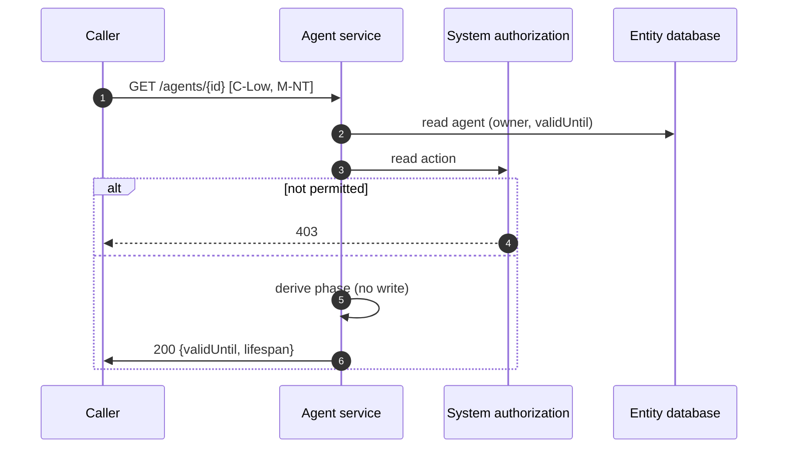

**Security considerations**

| Area | Response | Comments |
| --- | --- | --- |
| Data confidentiality | [C-Low] | Agent metadata |
| Communication medium | [M-NT] | |
| Transport security | TLS | |
| Authentication | Caller's access token | |
| Accessibility | Restricted | |
| Authorization and Access Control | Agent read permission; the owner rule once built | |

**Threat assessment**

| ID | Category | Threat | Materializable | Mitigation / comment |
| --- | --- | --- | --- | --- |
| 1 | Elevation of Privilege | A caller claims ownership through a request parameter to read another user's agents. | No | **[Not built]** When built, the owner is read from the stored record and never taken from the request, and `GET /users/me/agents` filters by the caller's subject. |
| 2 | Elevation of Privilege | An owner let through the existing `GET /agents/**` routes also reads the agent's groups and roles, or the rule is extended by accident to update actions. | No | **[Not built]** The owner rule needs its own route or a gate decision that admits owners to the agent read only, and grants no update or delete. Its tests must assert both. |
| 3 | Information Disclosure | An application or agent, which is also a signed-in subject, calls `GET /users/me/agents` and lists the agents it owns, or an owner sees more of the agent record than they need. | No | **[Not built]** Whether non-user subjects may call the endpoint, and which fields owners see, are part of the owner access open decision. |
| 4 | Security Risk | A stored `validUntil` that cannot be read is omitted from reads, so the agent looks unbounded while no token can be issued for it. | Yes | **[Built]** Reads omit both `validUntil` and `lifespan` for an unreadable value, and the token builder fails issuance for it, so the agent fails closed. Only a direct database edit, or a host provider in embedded mode, can produce such a value. Residual: the read misreports it; reporting it as expired would match the token behaviour. See Residual risks. |
| 5 | Denial of Service | Large inventories make listing all agents to find expiring ones expensive. | No | **[Built]** Reads are paginated. A range filter on `validUntil` is an open decision in the specification. |

#### [08]: Lifespan audit events

**Description**

**[Built]** The agent service publishes `AGENT_LIFESPAN_SET`, `AGENT_LIFESPAN_EXTENDED`, `AGENT_LIFESPAN_REDUCED`, `AGENT_REACTIVATED`, and `AGENT_LIFESPAN_UPDATE_FAILED` under `observability.administration` after the write commits, when observability is enabled and an output subscribes to that category. Each carries the agent ID, the caller's token subject and its category in the actor fields, the previous and new `validUntil`, and the outcome. Events are sent in the background with no retry. No event is published at the expiry instant; the expiry is the `validUntil` in the most recent lifespan event.

**Assets involved**

| Initiator | Intermediate | Target |
| --- | --- | --- |
| Agent service | Observability publisher | Deployer's observability backend |

**Data flow**

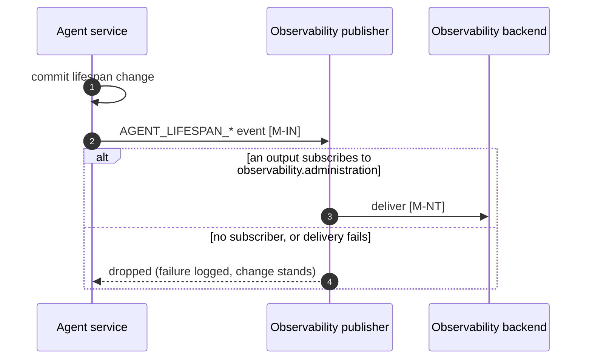

**Security considerations**

| Area | Response | Comments |
| --- | --- | --- |
| Data confidentiality | [C-Medium] | Events carry actor identities. |
| Communication medium | [M-IN], [M-NT] | |
| Transport security | Per observability configuration | |
| Authentication | Per observability configuration | |
| Accessibility | Internal | |
| Authorization and Access Control | Deployer-owned in the backend | |

**Threat assessment**

| ID | Category | Threat | Materializable | Mitigation / comment |
| --- | --- | --- | --- | --- |
| 1 | Repudiation | An actor extends or reactivates an agent and later denies it. | Yes | **[Built]** Every committed change publishes an event with the caller's token subject and its category, and the previous and new `validUntil`. Residual: when an application or agent calls for a user, the event names the user, not the delegate in `act`; a flow run without a signed-in user records no actor. See Residual risks. |
| 2 | Repudiation | An event is published for a change that later rolls back, recording something that did not happen. | No | **[Built]** Events are published only after the write commits. |
| 3 | Repudiation | Observability is disabled, no output subscribes to `observability.administration`, or a publish fails, so a change has no record. | Yes | **[Built]** A failure is logged. Residual: there is no retry and no in-product history, and the documented observability examples subscribe only to `observability.authentication`, so a deployment that follows them records no lifespan events. Subscribe an output to `observability.administration` where lifespan decisions must be auditable; the deployment documentation must list the category. See Residual risks. |
| 4 | Tampering | Events are altered or deleted in the observability backend. | No | Out of scope: backend integrity and retention are deployer-owned. |
| 5 | Privacy Risk | Events retain actor identities after the agent, or the actor, is deleted. | No | Events carry identifiers needed for accountability, not profile data. Retention is set by the deployer's backend. |
| 6 | Repudiation | A reviewer cannot tell when an agent expired, because no event is published at the expiry instant. | No | **[Built]** The expiry instant is the `validUntil` in the agent's most recent `SET`, `EXTENDED`, or `REDUCED` event, and `AGENT_REACTIVATED` carries the lapsed value. |

#### [09]: An expired agent in phase 1

**Description**

**[Built]** In phase 1 the token builder is the only control that acts on expiry. An expired agent still passes client authentication, completes a flow sign-in and receives its assertion, and reuses an existing SSO session; every request that would mint a token is then refused with `invalid_grant`. Tokens issued before `validUntil` stay valid until their `exp`. There is no suspension yet, so an administrator contains a compromised agent with the controls that exist today: rotating its client secret, which stops client authentication at once; reducing `validUntil` to just ahead of now, which stops new tokens; removing its role and group assignments; or deleting it. None of these revokes tokens already issued.

**Assets involved**

| Initiator | Intermediate | Target |
| --- | --- | --- |
| Expired agent, or an attacker holding its credentials | Client authentication, flow engine, session store | Token builder |

**Data flow**

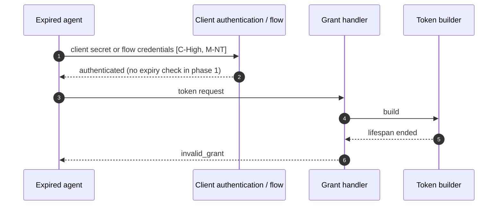

**Security considerations**

| Area | Response | Comments |
| --- | --- | --- |
| Data confidentiality | [C-High] | Client credentials |
| Communication medium | [M-NT] | |
| Transport security | TLS | |
| Authentication | Client authentication or the flow | Not refused for expiry in phase 1 |
| Accessibility | Public | |
| Authorization and Access Control | Token builder | |

**Threat assessment**

| ID | Category | Threat | Materializable | Mitigation / comment |
| --- | --- | --- | --- | --- |
| 1 | Information Disclosure | Someone holding an expired agent's stolen secret confirms it is still correct, because client authentication succeeds and only the token request fails, and learns it will work again if the agent is reactivated. | Yes | Residual: client authentication is not refused for expiry until phase 2, and the token refusal is the same `invalid_grant` as other grant failures but follows a successful authentication. Rotate the secret of an agent whose secret may be exposed, and before reactivating it. **[Phase 2]** The authority refuses at client authentication with the existing failure response. See Residual risks. |
| 2 | Elevation of Privilege | An expired agent completes a flow sign-in or reuses an SSO session and acts on the assertion or session directly, without a token. | Yes | **[Built]** No token is issued through them. Residual: an application that trusts the flow assertion or session without a token sees a signed-in agent. **[Phase 2]** The `authentication` and `session` planes refuse. See Residual risks. |
| 3 | Security Risk | A team reduces `validUntil` to stop a compromised agent and believes it is stopped, while its existing tokens keep working. | Yes | Residual: a reduction stops new tokens only. Until suspension exists, contain a compromised agent by rotating its secret and removing its assignments, and treat tokens already issued as valid until their `exp`; keep agent token validity short so that window is small. See Residual risks. |
| 4 | Security Risk | An expired agent keeps its client secret, roles, and groups until someone extends or deletes it, and there is no last-used information to tell which expired agents are safe to delete. | Yes | By design, expiry keeps the agent for audit. Residual: cleanup of expired agents is manual. Review expired agents periodically, and delete those no longer needed. See Residual risks. |

#### [10]: Import and export

**Description**

**[Built]** Export writes every agent's `validUntil`, using the unbounded sentinel for an agent that does not expire. Import creates or updates agents through the agent service with a restore flag, so a past `validUntil` is accepted and the agent is restored expired; every other check, including the self-change rule, applies, and the same lifespan events are published. A dry run reports a malformed value before anything is written. The import API is called with a bearer token, or with the management API key when it is enabled.

**Assets involved**

| Initiator | Intermediate | Target |
| --- | --- | --- |
| Administrator, or operator with the management API key | REST permission gate, import API | Agent service, entity database, observability |

**Data flow**

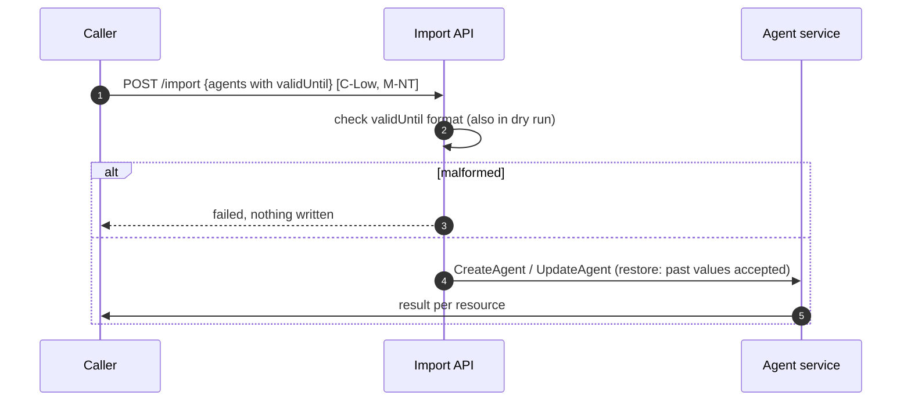

**Security considerations**

| Area | Response | Comments |
| --- | --- | --- |
| Data confidentiality | [C-Low] | |
| Communication medium | [M-NT] | |
| Transport security | TLS | |
| Authentication | Bearer token or management API key | |
| Accessibility | Restricted | |
| Authorization and Access Control | Import permission, and the agent service's checks | |

**Threat assessment**

| ID | Category | Threat | Materializable | Mitigation / comment |
| --- | --- | --- | --- | --- |
| 1 | Elevation of Privilege | An import extends or removes an agent's lifespan without the agent update permission. | No | **[Built]** Import calls the agent service, which applies the same permission check and self-change rule as the API. |
| 2 | Security Risk | An export loses `validUntil`, so imported agents come back unbounded. | No | **[Built]** Export writes every agent's `validUntil`, and the sentinel for an unbounded one, so the bound, or its absence, is restored exactly. |
| 3 | Tampering | An import restores a past `validUntil`, which the API would refuse. | No | **[Built]** By design: a restore reproduces the agent as exported, and a past value restricts rather than widens access. |
| 4 | Repudiation | An import made with the management API key records `management-api-key` as the owner of agents it creates and as the actor of its lifespan changes. | Yes | See [02]-12. |

#### [11]: Embedded mode

**Description**

When ThunderID runs inside a host application, the host supplies its own providers. The token builder reads agent records, and so `validUntil`, from the host's actor provider, and the host can replace the agent provider that flows create agents through. ThunderID expects a host's actor provider to return the agent's system attributes, `validUntil` included, in the stored form (an RFC 3339 UTC instant, or the sentinel), and expects a host that creates agents to do so through the agent service.

**Assets involved**

| Initiator | Intermediate | Target |
| --- | --- | --- |
| Host application | Host providers | Token builder, flows |

**Data flow**

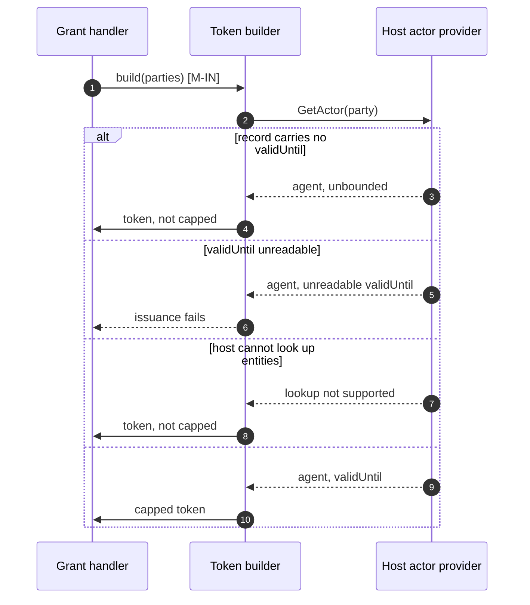

**Security considerations**

| Area | Response | Comments |
| --- | --- | --- |
| Data confidentiality | [C-High] | |
| Communication medium | [M-IN] | In-process, inside the host |
| Transport security | N/A | |
| Authentication | N/A | The host is trusted |
| Accessibility | Internal | |
| Authorization and Access Control | Host-owned | |

**Threat assessment**

| ID | Category | Threat | Materializable | Mitigation / comment |
| --- | --- | --- | --- | --- |
| 1 | Elevation of Privilege | A host's actor provider omits `validUntil`, or does not support lookups, so tokens for an expired agent are not capped and nothing signals it. | Yes | The host is inside the trust boundary and owns the agents it supplies. Residual: ThunderID cannot tell an unbounded agent from one whose provider dropped the attribute. A host that supports agent lifespans returns `validUntil` in the stored form. This follows the disabled entity provider, which turns off every entity-based check. See Residual risks. |
| 2 | Denial of Service | A host's actor provider returns `validUntil` in another format, so every token for that agent fails. | No | **[Built]** An unreadable value fails issuance rather than leaving the agent uncapped. The host fixes its provider. |
| 3 | Elevation of Privilege | A host replaces the agent provider, so agents created through its flows skip ThunderID's validation, self-change rule, and events. | Yes | The host owns that provider. Residual: lifespan guarantees for those agents are the host's. A host that supplies an agent provider calls the agent service to create agents. See Residual risks. |

## Security Review Checklist

A review aid that complements the threat models and the self-assessment. Guidance follows the [OWASP Top 10 Proactive Controls](https://top10proactive.owasp.org/).

### Security considerations

| # | Consideration | State | Comments |
| --- | --- | --- | --- |
| 1 | Are all inputs and outputs validated (syntactic and semantic)? | Yes | `validUntil` is parsed as a strict RFC 3339 instant, normalized to UTC, clamped to the sentinel, and must be later than now on create and update. A malformed declarative value fails startup, as any invalid declarative resource does ([01]-7). See [01]-1, [01]-2. |
| 2 | Are rate limits in place where necessary? | N/A | Applied at the deployment or gateway layer for the management and token endpoints. |
| 3 | Are permissions, roles, and entitlements defined on the principle of least privilege and business need? | Yes | Lifespan changes reuse the agent update permission. An agent cannot change its own lifespan. The owner rule, when built, grants read access only. See [02]-1, [02]-2, [07]-2. |
| 4 | Are authentication and authorization validated at both the UI and API layers, front end and back end, before granting access to resources? | Partial | The agent service enforces the checks on the API and import paths. The flow path relies on the flow's gate ([01]-8). The Console field is in the separate frontend change. |
| 5 | Are proper isolations in place between components to ensure least-privilege access and reduce the blast radius against lateral movement? | Yes | Only the agent service calls the reserved setter, and the entity service carries `validUntil` over every generic write. See [03]. |
| 6 | Have any default credentials been changed, and are default superuser or root accounts not in use (when using third-party components)? | N/A | |
| 7 | Has the implementation followed best-practice guidelines (OWASP, Kubernetes, vendor, or technology provider)? | Yes | Fail-closed issuance on lookup failure, derived rather than stored expiry, and token lifetime bounded by the identity's lifespan. |
| 8 | Are secrets, credentials, and internal-only material kept out of the public source tree and its git history? | Yes | The feature adds no secrets. |
| 9 | Was a security-focused code review conducted for this change, and have the findings been addressed? | Partial | The phase 1 review is in progress on #5833. Its findings are recorded here as threats or residual risks. |
| 10 | Is Static Analysis (SAST) or IaC scanning conducted, and are findings addressed? | Yes | Covered by the product scan. |
| 11 | Is Software Composition Analysis (SCA) conducted or integrated into the repository, and are findings addressed (for example FOSSA, Trivy)? | Yes | Covered by the product scan. The feature adds no dependencies. |
| 12 | Is Dynamic (DAST) or API scanning conducted on a non-production setup, and are findings addressed? | Yes | Covered by the product scan. |
| 13 | Are audit logs generated in a standardized format for critical functionality, and available to authorized users to trace critical events and aid incident response? Note the retention period in Comments. | Partial | Lifespan changes publish administration events when an output subscribes to `observability.administration`. Retention is set by the deployer's backend. There is no in-product history. See [08]-1, [08]-3. |
| 14 | Do audit logs for critical configuration changes record the difference between the old and new versions? | Yes | Events carry the previous and new `validUntil`, subject to [02]-9. |
| 15 | Are data in transit and at rest encrypted? | Partial | TLS on the API and token endpoints. `validUntil` is stored in the entity database, whose encryption at rest is deployer-owned. |
| 16 | Are sensitive values such as credentials and keys stored in a secret store or vault? | N/A | The feature handles no secrets. |
| 17 | Is personal, sensitive, or confidential data kept out of logs? | Yes | Events and logs carry identifiers and timestamps, not profile data or tokens. |
| 18 | Have users been given clear instructions for secure usage? | No | Operator guidance goes in the agent management guide (`docs/content/guides/agents/manage-agents.mdx`) and the deployment observability documentation, with phase 1: how to contain a compromised agent before suspension exists ([09]-3); subscribe an output to `observability.administration`; keep node clocks synchronized; keep agent token validity short; rotate the secret when extending or reactivating an agent; grant agents the create and update permissions sparingly; keep the provisioning executor in administration flows. |

### Business impact and resilience

For an open-source component, most of these are shared with the operator who deploys it. This section captures the project's defaults and recommendations; the rest is left to the deployer.

| # | Consideration | State | Comments |
| --- | --- | --- | --- |
| 1 | Has a business impact analysis been done to identify resilience requirements (maximum tolerable downtime, uptime, RPO, RTO)? | N/A | Left to the deploying organization. An unplanned expiry interrupts the agent's dependants, mitigated by reads that report the phase and reactivation without recreating the agent. |

Resilience details to record:
- High availability requirements: not defined at the project level
- Disaster recovery requirements: not defined at the project level. `validUntil` is restored with the entity database, and carried by export and import.
- Backups, frequency, and retention: deployer-owned, including the observability backend that holds lifespan events
- Health checks: not defined at the project level
- User banners: not defined at the project level

### Dependency and component health

| # | Consideration | State | Comments |
| --- | --- | --- | --- |
| 1 | Are dependencies, base images, and runtimes monitored for known vulnerabilities and kept current (for example automated dependency scanning), and are findings addressed? | Yes | Covered by the product SCA scanning. The feature adds no dependencies. |
| 2 | Are any End-of-Life or End-of-Service components in use? | No | |
| 3 | Is hardening guidance published for operators who deploy the project (optional)? | No | See Security considerations item 18. |

### Privacy considerations

The feature processes the agent owner's identifier, already stored on the agent, and the actor identifiers in lifespan events.

| # | Consideration | State | Comments |
| --- | --- | --- | --- |
| 1 | Is the purpose and legal basis for processing personal data clearly defined? | Yes | Actor identifiers in events provide accountability for lifespan decisions. |
| 2 | Are the collection, storage, processing, sharing, archival, and disposal of personal data aligned with the data minimization principle? | Yes | Events carry identifiers only, not profile attributes. |
| 3 | Is personal data stored securely? | Partial | In the entity database and the deployer's observability backend, whose controls are deployer-owned. |
| 4 | Are privacy notices updated to reflect any new processing or changes to purpose and legal basis? | N/A | No new category of personal data is collected. |
| 5 | Is access to personal data granted on a need-to-know basis? | Yes | Agent reads require the read permission. Event access is deployer-controlled. |
| 6 | Are data retention requirements considered? | Partial | Event retention is set by the deployer's backend. Events outlive a deleted agent by design. |
| 7 | Is there a process to dispose of personal data on request in a timely manner while meeting retention requirements? | N/A | Event disposal is handled in the deployer's backend. |
| 8 | Are records of personal-data processing maintained in the project's data inventory or records of processing? | Partial | Not yet confirmed against the data inventory. |

## Residual risks (open items)

| Risk | Description | Current Status | Recommendation |
| --- | --- | --- | --- |
| Agents managing agents | An agent with the create permission can register an unbounded successor ([01]-5), and agents with the update permission can extend each other ([02]-14). | Accepted. A deployment maximum lifespan is an open decision in the specification. | Grant agents the create and update permissions only when they manage other agents. Review lifespan events whose actor is an agent. |
| Agents that never expire by default | The default onboarding flow does not collect a `validUntil` ([01]-9), and agents created before the feature are unbounded. | Open. The onboarding input is an open decision in the specification. | Set a lifespan with `PUT /agents/{id}` after onboarding. Resolve the input type and add it to the default flow. |
| Provisioning outside administration flows | The provisioning executor can be placed in any flow, where the agent create permission does not apply ([01]-8). | Accepted. A root administrator's configuration choice. | Keep the executor in administration flows. Cover it in the flow execution model. |
| Declarative typo blocks startup | A malformed `validUntil` in one declarative file stops the server from starting ([01]-7). | Accepted. Same as any invalid declarative resource. | Validate declarative files before deploying, for example with the import dry run. |
| Expiry is not containment | Expiry revokes nothing: tokens issued before a reduction or before the feature keep their `exp` and introspect as active ([06]-8, [06]-9). In phase 1 an expired agent still authenticates, signs in, and reuses sessions ([09]-1, [09]-2). Reactivation restores the agent's secret, roles, and groups ([02]-7). | Accepted by design. Phase 2 adds refusal at every plane; suspension is the containment control. | Until suspension exists, contain a compromised agent by rotating its secret and removing its assignments ([09]-3). Keep agent token validity short. Rotate the secret before reactivating an agent. |
| Client secrets do not expire | Extending a lifespan extends how long the agent's secret works ([02]-13). | Accepted. Secret expiry belongs with client authentication. | Rotate the secret on a long extension and on reactivation. |
| Self-change check gaps | An agent that is only the `client_id` of a user's token, or a mapped `sub`, is not matched by the self-change rule ([02]-3). | Accepted for phase 1. | Match the caller's entity in the authentication middleware, a follow-up. |
| Operator credential actions | Changes and imports made with the management API key name no person ([02]-12, [10]-4). | Accepted. The key is off by default. | Enable the key only for automation, and log its use there. |
| Lifespan event accuracy | Racing changes can publish a stale previous value or skip an event ([02]-9). An unauthorized attempt on a declarative agent is classed `read_only`, and a failure on another field after the lifespan checks publishes no failure event ([02]-10). | Open. | Decide the change under the row lock, check permission before the declarative check, and publish a failure for every refused request that carried a lifespan change. |
| Audit attribution and delivery | Events name the user, not the delegate acting for them, and flows without a signed-in user record no actor ([08]-1). Events reach the backend only if an output subscribes to `observability.administration`, which the documented examples do not ([08]-3). There is no retry, and no event for declarative agents ([01]-6). | Open. | Record the delegate from `act` in lifespan events. List `observability.administration` in the deployment documentation. Keep declarative files under version control. |
| Delegation chain depth (phase 1) | Only the outermost actor caps a token ([06]-5). | Accepted for phase 1. | Phase 2 checks every actor. |
| Exposure window | A lifespan does not shorten individual tokens ([06]-10), and resource servers accept capped tokens for their leeway after `validUntil` ([06]-7). | Accepted. | Keep agent token validity and `jwt.leeway` short. |
| Clock skew and cache staleness | Nodes can disagree on expiry for the size of their clock skew ([04]-4). With the per-node `inmemory` cache and more than one node, a stale cache can cap tokens at the previous `validUntil` for up to `cache.ttl` after a change ([03]-6). | Accepted. | Synchronize node clocks. Use the `redis` cache in multi-node deployments. |
| Reserved setter misuse | Only code review stops another service calling the setter ([03]-3). | Accepted. | Keep the setter's single caller under review. |
| Unreadable stored value | A `validUntil` only a direct database edit or a host provider can produce is omitted from reads while tokens fail ([07]-4). | Open. | Report an unreadable value as expired on read. |
| Unnoticed expiry | Until the Console change ships, and with no notifications, an approaching expiry is visible only through the API ([04]-5). | Open. | Ship the Console's remaining-time display. |
| Expired agent cleanup | Expired agents keep their credentials and assignments, with no last-used information ([09]-4). | Accepted. | Review and delete expired agents that are no longer needed. |
| Embedded host providers | A host provider that omits `validUntil` leaves tokens uncapped, and a host agent provider skips ThunderID's checks ([11]-1, [11]-3). | Accepted. The host is trusted. | Document what ThunderID expects from host providers. |

## Appendix

- Sample requests and configurations: see the API section of the [specification](spec.md).
- References: RFC 3339 (Date and Time on the Internet), RFC 6749 (OAuth 2.0), RFC 8693 (Token Exchange), RFC 7519 (JWT, `exp` and clock skew). Companion documents: [agent lifespan specification](spec.md), account locks and suspensions specification ([#5442](https://github.com/thunder-id/thunderid/pull/5442)), [OAuth 2.0 Authorization and Core Grants Threat Model](../oauth/authorization-and-core-grants/threat-model.md).

## Change log

| Version | Date | Change |
|---|---|---|
| 0.1 | 2026-10-13 | Initial threat model. |
| 0.2 | 2026-10-16 | Aligned with specification 0.2 and the phase 1 implementation: control status on every mitigation, governance as the only interpreter of `validUntil` in phase 2, actor checks, failure counting while expired, and the one-second hold-back. Added the import and export ([10]) and embedded mode ([11]) interactions, what an expired agent can do in phase 1 ([09]), new actors, operator and host trust zones, and the review's findings as threats and residual risks. Corrected the declarative path, the flow path's control, the declarative update status (`403`), the merge's row lock, and the sequence diagrams' alternative paths. |
