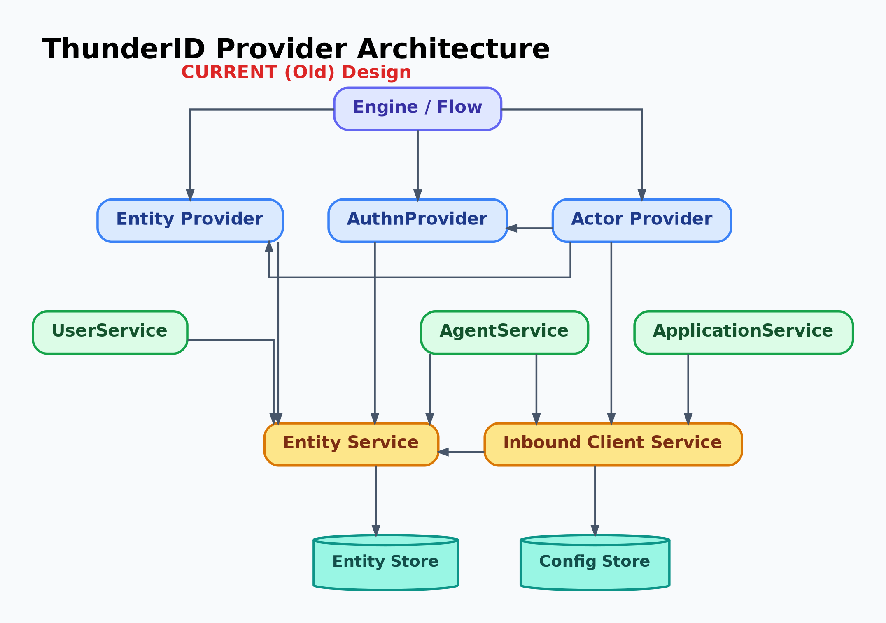
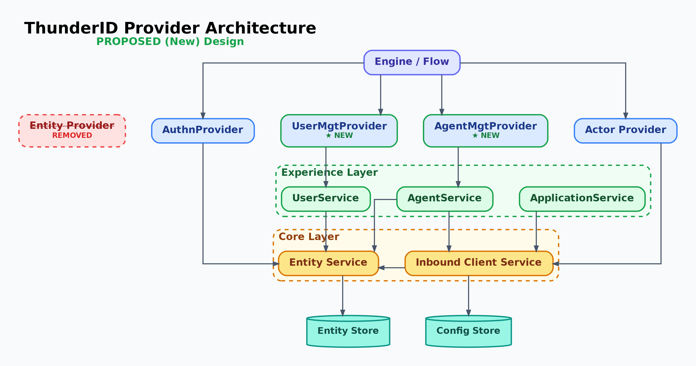
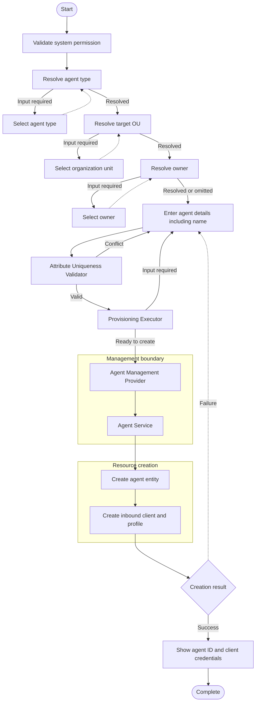
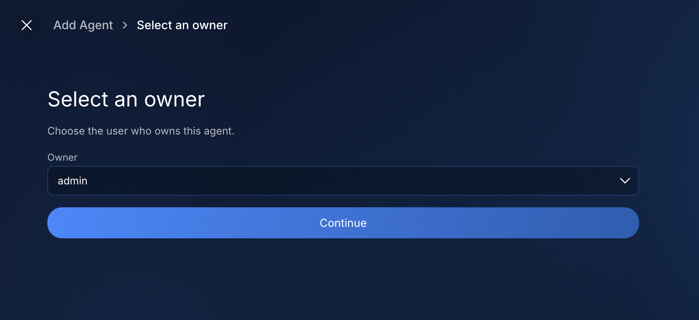
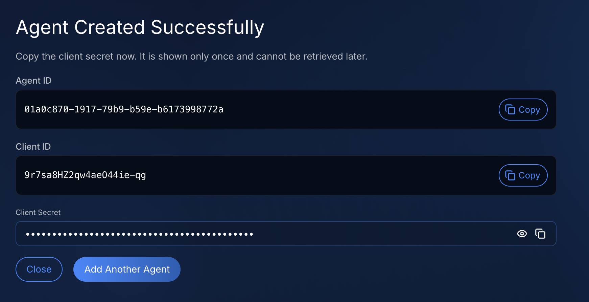

# Agent Onboarding Flow Specification

- **Status:** Draft
- **Version:** 0.3

## Summary

Agent onboarding in ThunderID runs as a configurable administration flow. An administrator selects the agent type, organization unit, and owner, supplies the agent's details, and receives its credentials. The Console renders the screens and actions returned by the flow, so an author can change the onboarding journey without changing the creation page.

Creating an agent involves an entity, an inbound client, and an authentication profile. The agent management service owns that work and its validation. The prerequisite provider architecture gives the runtime a service-backed creation contract for each category: `UserMgtProvider` for users and `AgentMgtProvider` for agents. Shared executors handle orchestration, while management services apply the rules for the resource being created.

This specification covers that provider foundation, category-aware provisioning, type and owner resolution, schema-based agent details, onboarding for agents acting on their own identity or on behalf of users, and the Console and SDK selection controls that support those flows.

Agent self-registration and the complete replacement of the entity provider are outside this feature. The authentication and consent journey that an end user later completes through an agent is also separate from onboarding. This feature configures that journey; it does not run it during agent creation.

## Architecture

### Why the provider architecture must change

The entity provider exposes operations on the common entity representation. Using its creation operation from a flow is sufficient to persist an entity, but does not establish that the complete category-specific resource has been created.

For an agent, provisioning must also create and configure its inbound client and authentication profile. It must apply agent rules such as name validation, owner resolution, credential generation, and inbound authentication validation. Calling the entity provider alone would bypass that work. Calling the inbound services separately from the executor would make the executor another owner of the agent creation process, including its failure handling.

The same problem applies to users even though their creation does not require the agent's inbound resources. ThunderID already has a user management service. Keeping flow creation below that service would require user-specific rules to be repeated in executors or would leave different creation entry points with different validation.

The architectural direction is to keep the entity service internal to management services. A provider exposed to the runtime should represent a supported management capability, with its business rules intact. It should not expose entity persistence as an alternative way to create a user or agent.

The starting architecture exposes entity creation through `EntityProvider`. Category management services also use the entity service, but that runtime creation path can bypass their business rules.

### Agreed management boundary

Introduce category management providers between flow execution and the management services. The provisioning executor will prepare the request and select the provider for its category. Each default provider will delegate creation to the corresponding management service.

| Component | Responsibility |
|---|---|
| Flow executor | Resolve flow inputs, request missing information, choose the category, and orchestrate the next step. |
| `UserMgtProvider` | Expose user creation to the runtime and delegate to the user management service. |
| `AgentMgtProvider` | Expose agent creation to the runtime, pass the creation request and delegation intent to the agent management service, and return its result. |
| User management service | Apply user creation rules and coordinate entity creation. |
| Agent management service | Validate the agent, apply delegation-based OAuth grant rules, and coordinate the entity, inbound client, and authentication profile. |
| Inbound client service | Validate and manage inbound authentication settings and their associated resources. |
| Entity service | Manage the common entity representation used internally by the management services. |

For example, a flow that provisions an agent will call `AgentMgtProvider.CreateAgent`. The provider will call the agent service, which will use the entity and inbound services. The executor will not create an inbound client or generate credentials itself.

Management services will remain the authority for business validation. Flow validation will serve a different purpose: resolving trusted selections and collecting enough information to submit a meaningful creation request. A successful flow precheck will never replace service validation.

The proposed architecture gives the engine category management providers. Each provider enters through its category's management service, which preserves the service layer as the owner of validation and multi-resource creation.

The proposed diagram shows the longer-term provider direction in which `EntityProvider` is removed from the engine boundary. This feature delivers the creation part of that direction: user and agent creation move to their management providers, while the entity provider remains temporarily available for the non-creation operations listed below.

### Provider foundation and scope

The management-provider boundary is the foundation for onboarding. User creation goes through `UserMgtProvider` to the user service, and agent creation goes through `AgentMgtProvider` to the agent service. The flow can therefore request a complete resource in one operation, while the service handles its validation and related records.

Creation is no longer a responsibility of the entity provider. Its other operations, such as finding, reading, and updating entities, remain available during this phase. Replacing the rest of that provider is separate work.

If the required management provider is unavailable, creation fails. The flow must not work around that failure by creating an entity directly. Any future category must have its own management capability and creation rules before flows can provision it.

### Shared provisioning and category resolution

Users and agents share the same Provisioning step. **User Type Resolver** establishes that the flow is working with a user, while **Agent Type Resolver** establishes that it is working with an agent. Each resolver also selects the type that defines the resource's schema. Provisioning uses that resolved information to collect the right details and call the corresponding management provider.

When no category has been resolved, provisioning defaults to users. This preserves existing flows that create users without a type-resolution step, including just-in-time (JIT) provisioning during federated sign-in. Agent onboarding runs **Agent Type Resolver** before provisioning, so its category and schema are established explicitly.

Agent provisioning is available only in Administration flows. It does not enable agents to register themselves or create an agent as a side effect of signing in.

The uniqueness validator uses the resolved category and type to find the schema attributes that need a uniqueness check. The owner resolver verifies the selected owner. These steps help the administrator provide valid information before creation; the management service still validates the complete request.

## Detailed design

### How the parts fit together

The management providers establish the creation boundary. Shared executors use those providers after the resolvers establish the agent type, OU, and owner. The administration flow connects those steps to the prompts and credentials screen, and the Console runs the configured flow. Each layer has one role: the flow controls the journey, the provider connects the runtime to management, and the service owns the resource rules.

User provisioning must continue to work throughout this change. The service-backed user path is part of the feature's foundation and must receive regression coverage alongside the new agent path.

### Administration access

Agent onboarding requires a signed-in administrator with the root `system` permission. ThunderID checks that permission when the flow starts and whenever it continues. A custom flow cannot remove this access requirement by leaving out the permission-checking step.

The supplied flow also includes **Permission Validator**. Agent creation remains restricted to Administration flows, and agent self-registration is outside this feature.

### Resolve the schema type and organization unit

An entity category identifies the kind of resource, such as an agent. An entity type identifies the schema within that category. The onboarding flow must resolve both the agent schema type and the organization unit (OU) in which to create the agent.

**Agent Type Resolver** offers agent types that are compatible with the chosen organization unit. A flow author can use `allowedAgentTypes` to restrict that choice; leaving the list empty adds no restriction. The type must belong to the target organization unit or one of its ancestors. Type discovery currently considers the first 100 catalog entries, which can limit the choices in a deployment with more agent types.

The resolver will handle the remaining candidates as follows:

| Eligible types | Flow behavior |
|---|---|
| None | Fail with a category-specific type-resolution error. |
| One | Resolve the type without displaying a selection screen. |
| Several | Request a selection and provide the eligible options. |

ThunderID validates a submitted type against the agent category, the flow's allowed types, and the selected organization unit. The default flow resolves the type first, then lets **Organization Unit Resolver** choose a compatible target. When there is no choice to make, the flow can continue without showing a selection screen.

The flow's allowed-type list controls administration onboarding. Application restrictions on the types that may sign in do not decide which agent types an administrator can create here.

### Carry verified choices through the flow

The flow keeps the administrator's submitted choices separate from the values verified by its resolvers. Later steps use the verified category, type, organization unit, and owner rather than asking the administrator to supply them again.

| Resolved choice | How the flow uses it |
|---|---|
| Category and type | Select the management provider and the schema for details and uniqueness checks. |
| Target organization unit | Place the agent in the selected compatible unit, using the type's unit when no separate target is selected. |
| Owner | Assign the verified user, or let the agent service use the authenticated caller when no owner is selected. |

This keeps the flow's steps consistent: the details being collected, the checks being performed, and the resource being created all refer to the same resolved agent type.

### Resolve the owner

`OwnerResolver` will request an optional `USER_SELECT` input. The Console will obtain user candidates from the user management API and submit the selected user ID. Candidate display is a UI responsibility; accepting the identifier is a server responsibility.

The resolver must verify that the selected entity exists and belongs to the user category. A missing entity and an entity of another category will produce the same owner-selection error and return to the prompt. A lookup service failure will fail execution rather than masquerade as an invalid selection.

Provisioning uses the owner verified by the resolver. Supplying an owner field directly to a later step does not replace that verified selection.

If the optional selection is declined, the flow will continue without a resolved owner. The agent service will use the authenticated caller as the default owner. The Console will preselect the signed-in user to make this default visible.

### The user selection input type

Owner selection needs a source of current users rather than a fixed list saved in the flow. `USER_SELECT` tells the client to load users from the management API, display their labels, and submit the selected user ID. The Console preselects the signed-in user so the default ownership is visible.

The picker helps the administrator make a choice, but the server still verifies it. The flow does not trust an identifier merely because it came from a selection control.

#### Shared SDK selection controls

The SDK selection component accepts a callback for loading options. The user, authentication-flow, and user-type pickers build on that component and connect it to the appropriate SDK management API function. They share paging, loading, and retry behavior, so each picker only needs to define what it lists and what value it submits.

| Input type | Candidate source | Display and submitted value |
|---|---|---|
| `USER_SELECT` | User management API | Display the user's label and submit the user ID for owner selection. |
| `AUTH_FLOW_SELECT` | Authentication flows from the flow management API | Display the flow name and submit its ID. |
| `USER_TYPE_SELECT` | User type management API | Display and submit the type handle. |

The SDK's native selection control offers **Load more** when another page is available. The Console uses its own selection adapter and loads more options as the administrator reaches the end of the list. Both use the same SDK data-loading functions. A selected value remains visible even if its option is not in the pages loaded so far.

The Console follows the same design: specialized picker adapters build on its shared selection adapter and reuse the SDK loading functions. The onboarding page uses the shared flow renderer, with its own organization-unit picker and owner default. Resource pickers load successive pages instead of stopping at the first page.

Management API calls require an authenticated integration. These pickers are not a promise that every public sign-in or registration surface can enumerate management resources. The onboarding Console supplies the signed-in administrator's context; server-side SDK integrations use their session-backed loaders.

The Flow Builder offers `USER_SELECT` as an element and executor input type. It preserves the field as a prompt input when a flow is saved. The OBO widgets supply the authentication-flow and user-type selectors used during delegated onboarding.

### Collect and validate agent information

The selected agent type defines the schema attributes that onboarding collects. Agent record fields, such as the owner, description, and logo URL, keep their management meaning. Collecting both kinds of information in a flow does not change which service validates them.

#### Agent name and schema validation

An agent's name is `attributes.name`. The default agent type defines it as a required, unique string and selects it as the display attribute. The Agent Details prompt collects the name alongside the other schema attributes. Required and unique constraints come from the schema, so the flow and direct management API use the same validation rules.

Agent reads and lists can request `include=display`. The returned `display` value is resolved from the type's configured display attribute, with the agent ID as the fallback. The Console uses that display value in lists and headers, and edits the name through the Attributes tab. A custom agent type controls its own naming and display rules.

#### Schema attributes and their correction path

Provisioning checks the resolved schema for outstanding required attributes and, when `includeOptional` is enabled, optional attributes. Missing string attributes with an enumeration are requested as `SELECT` inputs with those values as options. A prompt receiving those inputs can display the schema's choices. A prompt reached before provisioning supplies inputs must declare its own options; a static list in a template does not automatically follow later schema edits.

The Agent Details prompt submits through `AttributeUniquenessValidator`. A conflict returns to the same prompt with the attribute identified, so the administrator can correct it without losing the other values. Provisioning requests any remaining inputs on its incomplete connection. The service validates the complete request again at creation, including conflicts that arise after the precheck.

| Connection | Purpose |
|---|---|
| Details prompt to uniqueness validator | Check submitted values of unique schema attributes, including the default name. |
| Uniqueness validator incomplete to details prompt | Correct the conflicting attribute. |
| Uniqueness validator success | Continue to provisioning, or to delegation settings in an OBO or Choose Mode template. |
| Provisioning incomplete to an input prompt | Collect outstanding schema or delegated-agent settings. |
| Provisioning failure to details prompt | Show the service error and allow correction of agent details. |

The supplied flows return provisioning failures to Agent Details. This supports name and attribute correction, but that screen cannot correct every possible service error, such as a rejected login-flow selection. Custom flows need an appropriate correction route for the information they collect.

#### Other collected information

Owner selection uses the separate verification step. Description and logo URL are optional management fields when a custom flow includes them. They are passed to the agent service for validation rather than treated as schema attributes.

For the default agent type, the administrator must supply a name. The other default schema attributes are optional, so the administrator can leave them empty.

### Configure an agent to act on behalf of a user

An agent can act using its own identity or act on behalf of a user. The administrator chooses that behavior during onboarding, or the flow supplies it through the Provisioning node's `delegated` setting. This choice configures the agent's later authentication behavior; it does not sign in an end user or collect their consent during creation.

Provisioning reads the first non-empty `delegated` value from runtime data, then submitted inputs, then the node property. If none is supplied, it uses `false`. An invalid boolean fails. The node property is a fallback, so a submitted choice can override it.

With delegation enabled, provisioning requires the following values:

| Input | Control | Meaning |
|---|---|---|
| `redirectUris` | Text input | Callback URIs, separated by commas. Whitespace is trimmed; separators alone do not supply a URI. |
| `authFlowId` | `AUTH_FLOW_SELECT` | The authentication flow used when a user later signs in through the agent. |
| `allowedUserTypes` | `USER_TYPE_SELECT` | One user-type handle, stored as a one-entry allowed-types list. |

The **Delegated Agent Details** widget collects these settings for an OBO flow. **Choose Agent Mode** also collects the delegation choice. When delegation is disabled, provisioning does not apply these three values, including values left over from an earlier selection. The selected login flow is saved on the agent and executes only when a user later authenticates through it.

### Uniqueness and existing entities

The uniqueness step checks submitted values for attributes marked unique in the resolved schema. If a value is already in use, the flow returns to Agent Details and identifies the attribute to correct. The service checks the complete request again when creating the agent, because a value can become unavailable after the earlier check.

Provisioning also checks for an existing identity before creating another one. It retains the existing behavior for duplicate identities and organization-unit boundaries. Onboarding does not introduce a separate copy of those rules for agents.

Resolving the agent category does not create an agent-only uniqueness namespace. The current identification checks can still conflict with a value held by another category. Category-scoped identification is separate work.

### Create the complete resource

After collecting valid input, the provisioning executor will build a category-specific request and invoke its management provider. A user request will include its type, OU, and schema attributes. An agent request will also include its management fields and delegation intent.

The flow requests an OAuth configuration because onboarding returns client credentials. It supplies delegation intent and, for an OBO agent, the callback URIs, login-flow ID, and allowed user type. `AgentMgtProvider` passes that request to the agent service. Grant policy belongs to the service, so flow-based creation and direct management calls apply the same rules.

#### Delegation-based grant policy

The agent service decides which OAuth grants the agent needs from the delegation choice and the configuration supplied. This policy applies to both create and update requests, whether they arrive through a flow or directly through the management API. The provider passes the request to the service; it does not own these decisions.

For the standard onboarding journey, the service supplies the following configuration:

| Agent behavior | Configuration supplied by the service |
|---|---|
| Acts using its own identity | Client credentials for the agent to obtain tokens as itself. |
| Acts on behalf of a user | Client credentials, authorization code, and refresh token grants, with the code response type and PKCE enabled. |

When a management caller supplies its own grants for a delegated agent, the service requires a grant that supports acting for a user: authorization code, CIBA, or token exchange. A refresh-token grant alone is not enough. Valid explicit choices are preserved, and the resulting configuration must pass OAuth validation. Public clients do not receive client credentials automatically.

The onboarding flow always requests an OAuth client because it presents client credentials at completion. A direct non-delegated management request can omit the OAuth configuration. Delegation is an instruction for configuring the agent; the resulting grants determine its capabilities. Changing that instruction does not automatically remove grants explicitly included in the request.

The service validates the agent details, resolves the default owner, and coordinates creation of the agent and its authentication records. If creating the authentication records fails after the entity has been created, the service handles cleanup. The flow reports the failure rather than implementing a separate creation or rollback process.

After creation, the flow applies any configured group and role assignments. The complete flow is not a single transaction: a later step can fail after the agent exists. Closing the page before creation creates no agent; closing it afterward does not delete the agent.

### Return credentials

Successful agent creation will publish `agentId`, `clientId`, and `clientSecret` as additional flow response data. The credentials prompt will bind its display components to these values.

The client secret is a creation-time result and cannot be retrieved later through an agent read operation. The UI must present it masked, with explicit reveal and copy controls, and explain that it must be saved before leaving. Restarting the flow must clear the previous run's values.

The one-time disclosure message means the secret is not available through later agent reads. The active flow may retain its result until the execution expires. The Console must not save the secret in persistent browser storage or write it to logs.

### Default onboarding flow

The shipped flow will have handle `default-agent-onboarding-flow` and type `ADMINISTRATION`. It will provide the following sequence, with prompt loops where information is required:

The flow keeps orchestration in the executor layer and creation ownership in the management layer. `ProvisioningExecutor` collects the flow result and calls `AgentMgtProvider` only when the required information is available. The provider delegates to the agent service, which validates the creation request, applies the grant policy, and coordinates the entity, inbound client, and authentication profile. A successful service result supplies the identifiers and secret used by the credentials prompt.

1. Validate the administrator's permission.
2. Resolve the agent schema type, initially restricted to the `default` agent type.
3. Resolve the target OU.
4. Resolve the owner.
5. Collect the agent details, including the name defined by the schema.
6. Run agent provisioning, requesting outstanding schema attributes through the details prompt and checking submitted unique attributes before retrying creation.
7. Display the created agent's identifiers and client secret, then finish the flow.

The bootstrap flow sets `includeOptional: true` and `delegated: false` on Provisioning. Agent Type Resolver establishes the category and type before that node runs. The flow goes from owner resolution to Agent Details, then through the uniqueness validator to provisioning. Both provisioning's incomplete and failure connections return to Agent Details; uniqueness conflicts return there as well.

The builder supplies three complete onboarding templates. All include permission checking, agent type and OU resolution, owner selection, agent details, uniqueness validation, provisioning, and credential display.

| Template | Delegation behavior |
|---|---|
| **Agent Onboarding Flow (Own Identity)** | Uses `delegated: false` and creates an agent that acts with its own identity. |
| **Agent Onboarding Flow (On Behalf of a User)** | Collects login settings and uses `delegated: true`. |
| **Agent Onboarding Flow (Choose Mode)** | Collects the administrator's mode choice and the settings needed for delegation. |

The OBO and Choose Mode templates collect delegation settings after the details and uniqueness steps. Their dynamic missing-input prompt collects any additional values requested by provisioning. Provisioning failures return to Agent Details. Authors can change the prompts and connections, then make the saved Administration flow active through the server configuration.

### Data model and API

The feature will reuse existing entity, agent, inbound-client, and flow-execution storage. It requires no new database tables, columns, or indexes. Type, OU, and owner resolution will use existing transient flow state. Schema enumeration metadata will be exposed to input generation from the existing stored schema.

No dedicated onboarding endpoint is required. The Console will compose existing APIs:

| API | Purpose |
|---|---|
| `GET /server-config/flow` | Read the effective onboarding flow handle. |
| `GET /flows?flowType=ADMINISTRATION` | Resolve the handle to a flow ID, following pagination. |
| `POST /flow/execute` | Initiate and continue the authorized administration flow. |
| `GET /users?include=display` | Supply owner candidates with user display values. |
| `GET /flows?flowType=AUTHENTICATION` | Supply login-flow candidates for delegated onboarding. |
| `GET /user-types` | Supply user-type handles for delegated onboarding. |
| Existing OU APIs | Supply the OU selector. |

The Console will initiate execution with the resolved `flowId` and continue using the execution ID and action/input contract. Verbose responses will provide the components needed to render each step. Direct creation continues to use the agent management API. Agent create and update requests carry the name in `attributes.name`; agent responses expose it in `attributes` and can return a derived `display` value when requested. Declarative resources, imports, exports, and provider models use the same schema-attribute representation.

Existing deployments must update the persisted agent type and agent attributes when adopting the schema-based name contract. The name change does not migrate stored system names automatically. The default type needs its required, unique `name` field and display mapping, and existing names need to be supplied as `attributes.name`. Until a usable display value exists, the agent ID is shown.

### UI

#### Onboarding page

The agent create route will render a flow-driven onboarding page in place of the wizard. The page will resolve the configured flow, start it, render the returned components, and submit the selected action and input values. It must not assemble an agent creation request or fall back to posting to the agent API.

Text, input blocks, ordinary selects, user and OU selectors, actions, and copyable values will use the Console's visual components. The renderer will support runtime options and schema-generated fields. User selection will show a display value while submitting the user ID. The OU selector will respect the root supplied by the flow.

The owner step will follow this layout:

The details and delegation prompts share one page shell, with fields and labels supplied by the flow. Their number and order are not fixed in the Console. Loading failures are reported to the administrator, and submission failures remain visible beside the current step. The page displays the message returned by the flow, using a generic step-failure message when no usable error text is available.

Breadcrumbs will derive from visited step headings. Returning to a previously visited heading will trim the trail. Only the first breadcrumb will restart the run; other breadcrumbs will not imply that the engine supports backward navigation. Since branches and dynamic prompts can change the number of screens, progress will be an activity indication rather than a fixed step count.

#### Credentials screen

The result prompt will present copyable agent and client IDs and a masked client secret. **Close** will return to the agent list. **Add Another Agent** will start a fresh execution.

#### Flow builder

The builder exposes the flow capabilities through its existing resource panel and property editor:

| Resource | Authoring behavior |
|---|---|
| Provisioning | Insert the shared executor. The resolved runtime category determines whether it provisions a user or agent. |
| Agent Type Resolver | Resolve an agent schema type and configure an optional allowed-type list. |
| Owner Resolver | Verify the selected user owner. |
| Attribute Uniqueness Validator | Check the schema identified by the resolved category and type. It needs no category property panel. |
| Owner Resolution widget | Compose the user-selection prompt and owner resolver. |
| Delegated Agent Details widget | Collect redirect URIs, login flow, and user type for an OBO agent. |
| Choose Agent Mode widget | Collect delegation intent and the delegated-agent settings. |
| Agent onboarding templates | Start an own-identity, OBO, or administrator-selected onboarding journey. |

The Provisioning property panel always offers **Delegated mode**. Only agent provisioning reads this setting, so it has no effect on user creation. The canvas uses one Provisioning resource with an identity-card icon; the Agent Type Resolver uses the agent icon.

The templates include Agent Type Resolver before provisioning. An author can use them as complete starting flows, configure their allowed types and prompts, and save the chosen flow as the server's onboarding default. A custom flow must still establish a valid agent type before provisioning.

### Configuration

| Setting | Default or initial value | Scope | Validation and behavior |
|---|---|---|---|
| `flow.agentOnboardingFlow.defaultHandle` | `default-agent-onboarding-flow` | Server configuration | Must resolve to an administration flow before onboarding can start. |
| `user_mgt_provider.type` | Default service-backed provider | Deployment | `disabled` must reject user provisioning. |
| `agent_mgt_provider.type` | Default service-backed provider | Deployment | `disabled` must reject agent provisioning. |
| Provisioning `delegated` | `false` | Flow node | Fallback for agent delegation intent; runtime data and submitted values take precedence. |
| Agent resolver `allowedAgentTypes` | `default` in the shipped flow | Flow node | Restrict the candidate schema types; an empty list adds no restriction. |
| Provisioning `includeOptional` | `true` in the shipped flow | Flow node | Include optional schema attributes in collection. |

The Console must read the `merged` configuration layer. A missing handle, a handle that does not resolve to an administration flow, and a configuration request failure are distinct conditions. Missing configuration will identify the setting to configure; a missing flow will identify the configured handle. A request failure must not be reported as an empty setting.

Handle resolution must search subsequent pages of administration flows. The Console must not assume the bootstrap flow is on the first page or hardcode its ID.

Every flow, including this one, belongs to exactly one organization unit. A flow document in a bootstrap or declarative file names its owner with `ouId` or `ouHandle`, so the default flow will carry `ouHandle: default`. A flow created through `POST /flows` must give `ouId`, and a flow's owner cannot change afterwards.

The default flow and its configuration will be bootstrap resources. Existing deployments must apply those resources through the bootstrap process during upgrade; a binary update alone must not be assumed to install them. Flow authors may select another administration flow by changing the configured handle.

## Requirements

### R1. Preserve management-service ownership of creation

**Requirement:** Flow creation must use the business rules of the corresponding category management service.

**Acceptance criteria:**

- **AC1.1:** Given user provisioning, when creation runs, then the executor calls `UserMgtProvider` and the default provider calls the user service.
- **AC1.2:** Given agent provisioning, when creation runs, then the executor calls `AgentMgtProvider` and the default provider calls the agent service to coordinate the complete agent resource.
- **AC1.3:** Given the provider refactor, when the entity provider contract is inspected, then it exposes no creation operation; its remaining operations are not required to be removed by this feature.
- **AC1.4:** Given invalid creation data, when the management service rejects it, then the flow preserves the service error except for the specified category-aware attribute-conflict mapping.

### R2. Require the management-provider foundation

**Requirement:** Agent onboarding must depend on the category management capabilities established by the prerequisite refactor.

**Acceptance criteria:**

- **AC2.1:** Given the prerequisite refactor, when flow provisioning creates a user or agent, then creation reaches the corresponding management service through its provider.
- **AC2.2:** Given an unavailable management capability, when provisioning is attempted, then the flow fails without falling back to entity-provider creation.
- **AC2.3:** Given agent onboarding, when the complete agent resource is created, then coordination of the entity and inbound resources remains in the agent service rather than the executor.

### R3. Share provisioning across categories

**Requirement:** One provisioning executor must serve users and agents while preserving category-specific behavior.

**Acceptance criteria:**

- **AC3.1:** Given an Administration flow whose Agent Type Resolver has selected an agent type, when provisioning runs, then it creates the agent through the agent management provider.
- **AC3.2:** Given a user category, or no resolved category, when provisioning runs, then it follows user provisioning behavior, preserving existing registration and eligible JIT provisioning flows.
- **AC3.3:** Given an unsupported resolved category, when provisioning runs, then it fails rather than creating a different kind of resource.
- **AC3.4:** Given a failure returned by the flow, when the Console displays it, then the administrator can read the returned message beside the current step.
- **AC3.5:** Given configured group or role assignments, when creation succeeds, then assignment uses the created category's member or assignee type.

### R4. Resolve an eligible agent schema and OU

**Requirement:** The flow must resolve a valid agent schema type and compatible target OU before creation.

**Acceptance criteria:**

- **AC4.1:** Given one eligible type, when resolution runs, then it continues without prompting; given several, it requests a selection.
- **AC4.2:** Given no eligible type, when resolution runs, then it fails with an agent type-resolution error.
- **AC4.3:** Given a submitted type outside the node's allowed list or incompatible with the selected OU, when it is validated, then it is refused.
- **AC4.4:** Given a resolved agent type and a compatible target organization unit, when provisioning runs, then it creates the agent using those choices.
- **AC4.5:** Given a supplied agent onboarding flow, when its steps execute, then Agent Type Resolver establishes the agent category and type before provisioning.

### R5. Verify agent ownership

**Requirement:** An administrator may select a user owner or use the authenticated caller as the default.

**Acceptance criteria:**

- **AC5.1:** Given a selected user, when the owner resolver verifies it and creation succeeds, then that user owns the agent.
- **AC5.2:** Given a nonexistent ID or an ID from another category, when it is submitted as owner, then the same selection error is returned and the prompt is shown again.
- **AC5.3:** Given an unverified owner input, when provisioning runs, then that value cannot replace the resolved owner.
- **AC5.4:** Given no selected owner, when creation succeeds, then the authenticated caller owns the agent.
- **AC5.5:** Given a flow declaring a `USER_SELECT` input, when the flow is validated, then the input type is accepted; and when the Console renders that step, then it lists candidates it sourced itself and submits the selected user's identifier rather than a display value.

### R6. Collect and validate schema-based agent details

**Requirement:** The flow must collect attributes from the selected agent type, including the default name, and provide a correction path before creation.

**Acceptance criteria:**

- **AC6.1:** Given the default agent type, when details are collected, then `name` is a required, unique schema attribute collected on Agent Details.
- **AC6.2:** Given a missing string attribute with enumerated values, when provisioning requests it, then the forwarded input contains those values as selection options.
- **AC6.3:** Given the default agent type and a valid name, when optional schema attributes are omitted, then their omission alone does not prevent creation.
- **AC6.4:** Given a submitted details prompt, when the uniqueness validator detects a conflict, then its incomplete path returns to the details prompt with the conflicting attribute identified.
- **AC6.5:** Given a conflict arising after the precheck, when creation runs, then management-service validation rejects it.
- **AC6.6:** Given a name or schema attribute rejected at creation, when the service error returns, then the supplied flow returns to Agent Details with the error and collected values available for correction.
- **AC6.7:** Given outstanding schema information, when provisioning cannot proceed, then it forwards the missing inputs through its incomplete connection.
- **AC6.8:** Given an agent read with `include=display`, when its display attribute has a value, then the response exposes the derived label; otherwise it falls back to the agent ID.
- **AC6.9:** Given an agent type resolved earlier in the flow, when the uniqueness step runs, then it checks the submitted unique attributes defined by that type.

### R7. Create the requested inbound authentication configuration

**Requirement:** Flow delegation intent must produce the supported agent inbound configuration through the management services.

**Acceptance criteria:**

- **AC7.1:** Given own-identity onboarding, when the flow requests an OAuth client, then the agent service supplies client credentials with the default confidential-client authentication settings.
- **AC7.2:** Given delegated onboarding with valid callback URIs, a login-flow ID, and a user-type handle, when creation succeeds, then those settings are saved and the service supplies authorization code, refresh token, code response, and PKCE settings.
- **AC7.3:** Given delegation with no callback URI, when provisioning runs, then a URI is requested and no fabricated default is used.
- **AC7.4:** Given an unreadable delegation value, when provisioning processes it, then creation fails with an error identifying that input.
- **AC7.5:** Given an inbound-creation failure after entity creation, when the service handles the failure, then it invokes its compensation path and the flow does not report successful provisioning.
- **AC7.6:** Given a delegated create or update request with grants beyond client credentials, when the agent service validates it, then at least one of authorization code, CIBA, or token exchange is required.
- **AC7.7:** Given a public-client configuration, when grants are resolved, then client credentials is not added automatically; incompatible explicit settings are rejected by OAuth validation.
- **AC7.8:** Given runtime or submitted delegation intent, when it differs from the node property, then the first non-empty runtime value or submitted value takes precedence.
- **AC7.9:** Given delegation is disabled, when provisioning builds the request, then collected redirect URIs, login flow, and allowed user type are not applied.
- **AC7.10:** Given the onboarding flow completes, when the selected login flow is stored, then it has not been executed as part of agent creation.

### R8. Restrict onboarding execution

**Requirement:** Agent onboarding must require an authorized administration caller and refuse agent self-registration.

**Acceptance criteria:**

- **AC8.1:** Given no authenticated caller, when an administration flow is initiated or continued, then execution is rejected before provisioning.
- **AC8.2:** Given an authenticated caller without root `system` permission, when the same request is made, then execution is refused.
- **AC8.3:** Given a custom administration flow without `PermissionValidator`, when an unauthorized caller executes it, then the entry-point gate still rejects the request.
- **AC8.4:** Given a flow other than Administration, when agent provisioning is attempted, then no agent is created.

### R9. Run onboarding from the configured Console flow

**Requirement:** The Console must replace its fixed creation wizard with the configured administration flow.

**Acceptance criteria:**

- **AC9.1:** Given a configured and available flow, when the agent create page opens, then it executes that flow and renders its first prompt.
- **AC9.2:** Given the matching flow is on a later listing page, when the handle is resolved, then onboarding still starts.
- **AC9.3:** Given missing configuration, a missing flow, or a failed configuration request, when the page opens, then it reports the appropriate distinct condition without using direct agent creation as a fallback.
- **AC9.4:** Given a flow change using supported components, when onboarding starts again, then the page follows the changed prompts and actions without a wizard code change.
- **AC9.5:** Given the default flow is abandoned before provisioning, when the page is closed, then no agent has been created.

### R10. Present creation credentials

**Requirement:** Successful onboarding must show the generated credentials and make their creation-time availability clear.

**Acceptance criteria:**

- **AC10.1:** Given successful provisioning, when the credentials prompt appears, then the agent ID, client ID, and masked client secret are available with copy controls.
- **AC10.2:** Given a masked secret, when reveal is selected, then the secret is displayed for copying.
- **AC10.3:** Given a completed creation, when Close is selected, then the Console returns to the agent list; when Add Another Agent is selected, it starts a fresh run without the previous credentials.
- **AC10.4:** Given a later agent read, when details are fetched, then onboarding does not depend on retrieving the creation secret again.

### R11. Author and configure onboarding flows

**Requirement:** A flow author must be able to compose and select an agent onboarding flow through existing configuration surfaces.

**Acceptance criteria:**

- **AC11.1:** Given the builder resource panel, when agent onboarding is authored, then the shared Provisioning resource, agent type resolver, owner resolver, related widgets, and three templates are available.
- **AC11.2:** Given a provisioning node, when the flow is reopened, then the canvas shows Provisioning and retains its delegated and optional-attribute settings.
- **AC11.3:** Given an agent resolver, when its properties are edited, then its allowed types can be configured; the uniqueness validator uses the resolved runtime category and type.
- **AC11.4:** Given another valid administration flow handle in the merged server configuration, when onboarding starts, then the Console runs that flow.
- **AC11.5:** Given any supplied agent onboarding template, when its graph is inspected, then Agent Type Resolver precedes provisioning and the template includes the inputs needed for its delegation behavior.
- **AC11.6:** Given a saved Owner Resolution widget, when the flow is reopened, then its `USER_SELECT` remains a prompt input.
- **AC11.7:** Given more candidates than one page, when an administrator continues through a resource picker, then additional pages load through the shared SDK loader without changing the selected value.

- **AC11.8:** Given a flow document with neither `ouId` nor `ouHandle`, when it is imported, loaded from a declarative or bootstrap file, or created through `POST /flows`, then it is refused, and given a flow that already has an owner, when an update names a different organization unit, then the update is refused.

## Change log

| Version | Date       | Change |
|---|------------|---|
| 0.1 | 2026-09-07 | Define the provider architecture prerequisite, shared executor design, and flow-driven agent onboarding requirements. |
| 0.2 | 2026-09-23 | Correct five statements against the implementation: the category defaulting rule, the credentials disclosure wording, the owner of the provisioning failure connection, how the Console renders a step failure, and the scope of the builder template. |
| 0.2 | 2026-10-26 | Every flow is owned by exactly one organization unit. A flow names its owner with `ouId` on create, or with `ouId` or `ouHandle` in a bootstrap or declarative file, and the default onboarding flow carries `ouHandle: default` (AC11.8). |
| 0.3 | 2026-10-29 | Describe the complete administration onboarding design: management-provider creation, runtime category resolution, schema-based agent names, delegation and grant policy, reusable SDK and Console selectors, and the three onboarding templates. |
