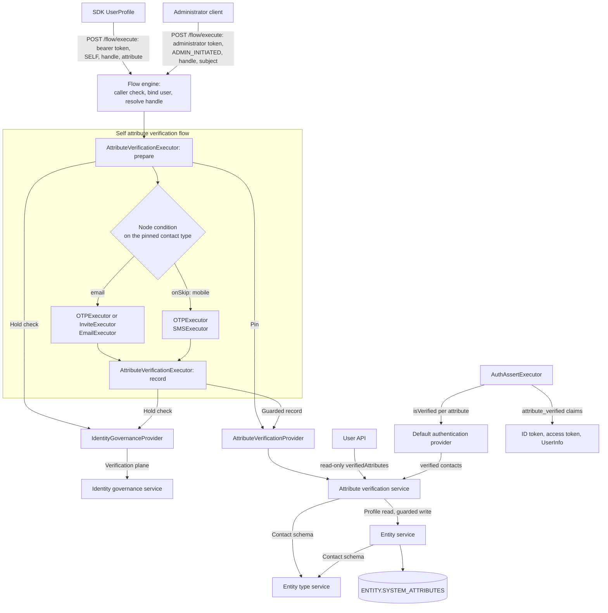

# Email and Mobile Attribute Verification Specification

- **Status:** Draft
- **Version:** 0.4
- **Related documents:** Attribute verification threat model [#6258](https://github.com/thunder-id/thunderid/pull/6258); feature issue [#5439](https://github.com/thunder-id/thunderid/issues/5439); design discussion [#5440](https://github.com/thunder-id/thunderid/discussions/5440); contact attribute types [#5787](https://github.com/thunder-id/thunderid/pull/5787); account lock and suspension specification [#5442](https://github.com/thunder-id/thunderid/pull/5442) and identity governance service [#5681](https://github.com/thunder-id/thunderid/pull/5681); ThunderID Account self-care sample [thunder-id/samples#2](https://github.com/thunder-id/samples/pull/2); [OpenID Connect Core 1.0 §5.1](https://openid.net/specs/openid-connect-core-1_0.html#StandardClaims); [NIST SP 800-63B-4](https://pages.nist.gov/800-63-4/sp800-63b.html); [OWASP ASVS 5.0.0 V6](https://github.com/OWASP/ASVS/blob/v5.0.0/5.0/en/0x15-V6-Authentication.md).

## Summary

An email address or mobile number on a user profile does not show that the user controls it. This feature records proof of control as server-owned metadata and exposes verification status and time read-only through the user API. A contact change removes its verification in the same transaction, and a proof is recorded only while the value it proves is still stored. A new attribute verification service prepares and records verification, and the entity service, which owns the entity row, writes it under the entity lock; suspension is checked through the account access policy introduced with account lock and suspension (#5442, #5681).

A signed-in user verifies their own contact through a self flow. `SELF` is a new flow type for operations a signed-in user performs on their own account; this feature adds its first flow. The client starts it on `POST /flow/execute` with the flow type, the required flow `handle` and the attribute to verify, carrying the user's access token. The engine requires that token at the start and binds its user to the execution. One `AttributeVerificationExecutor` surrounds the existing configurable challenge and sender nodes: its `prepare` mode pins the stored contact and makes it the senders' recipient, and its `record` mode records verification only when the challenge was passed and every send since the pin went to that contact. One flow serves email and mobile: after `prepare`, an inline node condition on the pinned contact's type runs the email branch or skips to the mobile branch, so each branch is configured on its own and the client never names a channel.

An administrator can ask a user to verify their email through an administrator-initiated flow. `ADMIN_INITIATED` is a new flow type for operations an administrator starts and the target user finishes; this feature adds its first flow. The administrator starts it on the same endpoint with their own token, the required `handle`, the target user and the attribute; the email link goes to the user, who finishes the flow on Gate without a token and without the administrator.

The same executor can record verification in recovery, registration and user onboarding flows an operator builds, when the code or link those flows send reaches the contact. Recovery pins the user it identified. Registration and onboarding pin the user they established, or, before the user is created, the value they collected, which is recorded for the created user only if it is still that user's value. The shipped flows of these types do not verify contacts.

An application can release verification status beside a released contact: `<attribute>_verified` is a boolean claim in the ID token, the access token and the UserInfo response, resolved at sign-in. A user type that defines `<attribute>_verified` itself keeps releasing its own attribute, because the deployment then has its own source, such as a federated provider's `email_verified`.

Only top-level, single-valued `email` and `mobile` attributes are eligible. Verification proves control at a point in time; it is not an account lifecycle state or identity proofing. Out of scope: an administrator-initiated mobile flow in the shipped resources; verifying a new contact before the update is saved; recording verification from sign-in or `ADMINISTRATION` flows; blocking sign-in until a contact is verified; letting an administrator mark a contact as verified without proof; and declarative users.

## Architecture



| Component | Responsibility |
|---|---|
| Flow engine | Adds the `SELF` and `ADMIN_INITIATED` flow types. At the start of a `SELF` flow it requires a bearer access token this deployment issued, binds its subject to the execution, resolves the required flow handle and applies the self flow expiry. At the start of an `ADMIN_INITIATED` flow it applies the administration gate, resolves the required handle, binds the user the `subject` input names and applies that type's expiry. Continues both publicly by execution ID and challenge token. |
| `AttributeVerificationExecutor` | `prepare`: pin the flow's user (the user bound at the start in `SELF` and `ADMIN_INITIATED`, the established user in recovery, registration and onboarding) or, for a user not created yet, the collected value; reset earlier evidence and the delivered recipients, set the pinned value as the expected recipient and its type, which a node condition also reads, and return the channel and masked contact for display. `record`: check the passed marker and where every send since the pin was delivered, then request recording for the pinned user, or the user the flow established since, and attribute. Before preparing for an existing user and before recording, it checks the user at the verification plane through the governance port. It has no node property: its `attribute` input names the attribute, which a flow can fix with a constant input; it never sends, never checks a code, never reads the profile and never writes the entity. |
| `OTPExecutor`, `InviteExecutor` | Issue and check the challenge as today. When a contact is pinned, additionally mark a passed challenge on the evidence; `OTPExecutor` checks a pinned contact's code at the verification plane and clears the marker when it issues a new code. `OTPExecutor` also takes `maxAttempts` on a `verify` node, in any flow, to void a code after that many wrong codes. |
| `EmailExecutor`, `SMSExecutor` | Deliver as today and know nothing about pins. Each reads the expected recipient an earlier node set for its recipient type before any other source, and after an actual send adds the recipient to the delivered recipients on shared runtime data. An SMS node without a selected provider fails at the send step. |
| `AttributeVerificationProvider` | New engine port with `PrepareAttributeVerification`, which takes an `AttributeVerificationRequest` naming the attribute and either an existing entity or, with its pending-creation flag set, the entity type and collected value, and `RecordAttributeVerification`, which takes the pin. The attribute verification service implements it, as flow management implements `FlowProvider`, with no adapter. It makes no access or hold check; its caller makes both. |
| `IdentityGovernanceProvider` | Existing engine port. Its access check at the verification plane, where a suspension refuses and an automatic lock neither holds nor counts, decides whether the user may verify. |
| Attribute verification service | New internal service and the authority for which users and attributes may verify. Prepares a pin from a prepare request: for an entity pending creation it checks the collected value against the user type schema; for an existing entity it reads the profile through the entity service and checks it against the schema. Records by re-reading eligibility, comparing the current contact with the pin and then asking the entity service for the locked write. Projects, on each read of a loaded entity, which recorded verifications count, for user responses and authentication assurance, without reading the schema. Publishes the requested, verified and refused events. Its refusals are `AVS-1001` ("Attribute cannot be verified"). It makes no caller or runtime-context check. |
| Entity service | The only writer of the entity row. Performs the guarded recording write, which rechecks the user type, the attribute's contact type and its canonical value under the entity lock; reserves the metadata key and keeps it on system attribute writes, strips it on create, and invalidates on every attribute write and publishes the invalidated event, using its own storage format. Exposes recorded evidence from system attributes through `ReadRecordedAttributeVerifications`, without applying verification policies or reading storage. It projects no effective verification status. |
| User service | Sets the verified contacts the attribute verification service projects, read-only, on user responses. |
| Default authentication provider | Treats the code check of a pinned contact as a contact proof: submits it at the verification plane, where a suspension refuses and an automatic lock neither holds nor counts, so a correct code is admitted under a lock, a wrong one is never counted and neither clears failed sign-ins. Reports each attribute's verification as `isVerified` from the verified contacts the attribute verification service projects. |
| `AuthAssertExecutor` | Resolves `<attribute>_verified` claims at sign-in from the provider's `isVerified`, beside their released contact, unless the user type's schema defines that name. |
| Application configuration | Accepts `<attribute>_verified` in an application's attribute lists and scope-to-claims mapping for each `email` or `mobile` attribute of an allowed user type. |
| Security context | Marks a request whose bearer token this deployment issued, so a user is taken only from such a token. |
| Event registry | Registers the four verification event types in the Administration category. |
| Console, SDK | The Console shows status and offers `<attribute>_verified` in an application's token attributes. The SDK shows status and starts the self flow. |

The design uses existing seams: the engine's caller check for `ADMINISTRATION` flows, flow handles (unique per flow type), inline node conditions as branches, the onboarding invite link continued through Gate, the entity service's lock (`QueryLockEntity`) and reserved system attributes, the provider port pattern of `FlowProvider`, and, from the account lock and suspension work, the governance port's access check and the account access policy.

## Detailed design

### Eligible attributes

An attribute can be verified when all of the following hold:

1. The entity is a user, not a declarative one.
2. The attribute is a top-level, noncredential property of the user's type with type `email` or `mobile`.
3. The attribute is single-valued. Array items and properties nested in objects are not eligible, since a record keyed by attribute name cannot identify which item was proven.
4. The stored contact is a nonempty string. A value of another JSON type cannot be pinned as contact proof.

The type also fixes the channel. An `email` attribute is delivered by `EmailExecutor` and a `mobile` attribute by `SMSExecutor`. A recording is refused when any send since the pin was on the other channel, since its recipient cannot equal the pinned value.

Eligibility is checked in `prepare` and again in `record`: the attribute verification service checks that the target is an existing, mutable user and reads the profile and user type schema to pin an eligible contact without a write lock. At recording, it rechecks eligibility against the user's current type and value, then the entity service confirms under the entity lock that the type is unchanged and the attribute is still a contact with the pinned canonical value. The flow editor cannot check it when a flow is saved, because one flow serves users of any type. Without an entity type service no attribute is a contact, so preparation and recording refuse.

Verification is stored under the concrete attribute name, such as `workEmail`, and never under a role such as the user type's primary email. A user type can have several eligible attributes of one type, so the caller names the concrete attribute when it starts the flow. It is pinned at preparation and cannot change later in the execution, so a proof for one attribute can never be recorded on another.

### Verification metadata

Verification is stored in `ENTITY.SYSTEM_ATTRIBUTES` under the reserved key `attributeVerification`, keyed by attribute name. An attribute has an entry only while its current value is verified:

```json
{
  "attributeVerification": {
    "email": {
      "verifiedAt": "2026-10-14T09:00:00Z"
    },
    "mobile_number": {
      "verifiedAt": "2026-10-15T11:20:00Z"
    }
  }
}
```

| Field | Meaning |
|---|---|
| `verifiedAt` | Server time of the latest successful verification of the current value. |

An attribute is verified when it has an entry. A schema change neither removes nor hides an entry: an attribute that is no longer eligible stays verified until its value changes or is removed, or the user's type changes. Every supported contact write must use the entity service and remove the entry of a changed or removed value in the same transaction, so a value changed from A to B and back to A is unverified until it is verified again. Recording writes the system attributes through the entity store's existing system attribute update under the entity lock, which moves the general modification time and re-syncs the identifiers from the stored row, so they are unchanged. Preparation writes nothing. A proof is checked against the value stored when it is recorded: it records only if that value equals the pinned one.

The canonical value is used directly for the change check, the pin and the comparison at recording time, where each delivered recipient a sender recorded is put in the same form. These temporary values stay in server-owned flow state and are never returned or logged:

- **Email:** surrounding whitespace removed and the domain lowercased. The local part is kept exactly, because RFC 5321 allows it to be case-sensitive.
- **Mobile:** the stored string. The `mobile` type's default pattern requires E.164.

`attributeVerification` is added to the entity service's reserved system attributes. `mergeReservedAttributes` restores it on every system attribute update. `CreateEntity` drops it from incoming system attributes, in the same way it drops linked identities.

### Invalidation on change

When a verified attribute's canonical value differs between the stored and the incoming attributes (changed or removed), the entity service removes that attribute's entry in the same transaction as the attribute write, under the entity lock.

| Write path | Entity service method | Change required |
|---|---|---|
| Administrator update, SCIM replace by an administrator | `UpdateEntity` | Read under the entity lock, merge reserved metadata, compare contacts and write both columns. |
| Self update (`PUT /users/me`), SCIM replace of the caller's own user, flow attribute collection | `UpdateAttributes` | Validate against the user's type before the transaction, as `UpdateEntity` does. Inside it, lock, read, re-check the user type (a type changed since validation refuses the write with `USR-1019`) and compare. Write attributes and, when an entry is cleared, the system attributes in that same transaction. After the write commits, the user service reads the stored profile again and returns its attributes and verification from the same snapshot. If that read fails, verification is omitted from the response; the successful write remains committed. Neither partial-write path warms the profile cache before commit. |
| Create | `CreateEntity` | Drop the reserved key. |

A verified attribute whose schema is no longer a contact is compared exactly, so a schema change cannot hide a value change. A stored value that is not a string, including null, counts as no value: replacing it with a valid contact clears old verification, and it is never accepted as a proof target. Profile mutations resolve the contact schema even when no verification is recorded; when no entry is invalidated, the stored metadata is left unchanged. An unreadable schema refuses the profile mutation, and malformed stored metadata fails the write rather than being discarded. An entry without a valid verification time reads as unverified, and the next write that rewrites the entries drops it.

`PUT /users/me` replaces the whole attribute set, so an eligible attribute missing from the request is treated as removed. If `UpdateEntity` changes the user's type, every entry is removed. Updates that change neither the user type nor a verified attribute leave the verification entries unchanged; a partial write writes the system attributes only when it removes an entry.

### Self flows

`SELF` flows run operations a signed-in user performs on their own account. Many flows can share the type; a flow handle is unique within a flow type, so a start must name the flow by `handle`. Self attribute verification is the first such operation.

**Start.** The client calls `POST /flow/execute` with the user's bearer token, `flowType: SELF`, the required flow `handle` and the flow's inputs. An application ID is not needed and is ignored. The engine checks, in this order, before anything runs:

1. The caller presents an access token this deployment issued, with a subject. Otherwise the start is refused with `FES-1017` ("Authentication required"). This check runs before the handle is resolved, so an unauthenticated caller cannot learn which handles exist. Tokens from trusted external issuers are refused, so an external subject never selects a local user. ID and refresh tokens are not access tokens and are refused.
2. Require the request's `handle`; if it is missing or empty, refuse with `FES-1023`.
3. A `SELF` flow with that handle exists. Otherwise the start is refused with `FES-1025` before anything runs.

The subject is interpreted as the intended local user resource ID; this entry point does not resolve profile-mapped token subjects. The engine then binds the token's subject to the execution, in an engine-owned field that executors read and cannot write, and applies the `flow.selfFlow.expirySeconds` expiry. CALL frames preserve an existing binding and cannot create one for an execution started as another flow type. The bound subject is not the flow's authenticated user: it does not set `AuthUser`, so a CALL into a sign-in flow cannot turn the bearer token into a new sign-in.

**Continuation.** Later requests carry the execution ID and challenge token, as for every flow, and need no bearer token; the engine does not re-check one. The bound subject stays with the execution, so a token sent with a later request cannot change the user. A code or link proves control of the contact, as in recovery.

**Other entry points.** A `SELF` flow cannot be started by flow ID (`FES-1018` for an administrator, otherwise the administration gate's `FES-1017` or `FES-1019`), and the internal initiation entry points refuse the type. The embedded engine has no bearer token middleware, so a `SELF` start is refused there.

**`handle` and other flow types.** `handle` is a general field of the start request. In this feature only `SELF` flows are resolved by handle; other flow types keep their existing selection, by application binding or server configuration, and ignore it. A flow type that later resolves flows by handle must keep its application binding and initiation guards.

### Self attribute verification flow

Bootstrap ships Default Self Attribute Verification Flow (`default-self-attribute-verification-flow`). Like other managed flows, it belongs to an organization unit; bootstrap assigns it to the default organization unit with `ouHandle: default`. The SDK starts it by that handle unless the application names another flow; an operator customizes it in place or points applications at another `SELF` flow.

```text
START → AttributeVerificationExecutor (prepare)        ← bound user; attribute from the start request
      → OTPExecutor generate_email_otp (condition {{ctx(recipientType)}} = email, onSkip generate_mobile_otp)
          email  → EmailExecutor (send, template otp)
                 → PROMPT email_code (verify; resend → prepare) → OTPExecutor (verify)
          mobile → OTPExecutor generate_mobile_otp → SMSExecutor (send, template otp)
                 → PROMPT mobile_code (verify; resend → prepare) → OTPExecutor (verify)
      → AttributeVerificationExecutor (record) → END
```

```json
{"flowType": "SELF", "handle": "default-self-attribute-verification-flow", "inputs": {"attribute": "email"}, "verbose": true}
```

`prepare` pins the attribute and writes its contact type, `email` or `mobile`, to runtime data as `recipientType`. The email branch's first node, `generate_email_otp`, carries the inline node condition `{key: '{{ctx(recipientType)}}', value: email, onSkip: generate_mobile_otp}`: it runs for an email contact, and for a mobile contact the flow skips to `generate_mobile_otp`, which has no condition, so the first response is the code prompt of the matching branch. The placeholder resolves from runtime data first and falls back to user inputs only when the runtime value is empty. `prepare` always writes `recipientType` before the condition runs and nothing later changes it, so a `recipientType` input on the start or a resend cannot change the branch. The client does not choose the channel. Each branch is configured on its own, for example an email link instead of an email code, by placing the condition on that branch's first node. A condition's `onSkip` must name an existing node, as flow management already requires. The Console flow builder displays the target as a dashed **On skip** edge and saves the branch through the node's condition. A custom graph that routes a contact to the wrong branch, or evaluates the condition before `prepare` has written `recipientType`, may still send on the wrong channel, to a recipient that sender resolves itself, but records nothing: its delivered recipient cannot equal the pinned value.

Both branches ship in the default flow. As for every shipped flow with a sender, the operator configures an email or SMS provider; a branch whose sender has no provider fails at the send step and sends nothing. The email node has no sender, as in other shipped flows, and the SMS node has the `{{SENDER_ID}}` placeholder. When a flow is opened in the Console flow builder, an email node without a sender takes the first email provider, and an SMS node with the placeholder takes the SMS provider when exactly one exists; otherwise the builder reports the missing SMS sender until the operator selects one.

Resend returns to `prepare`, which pins the current value of the same attribute again: it checks the user again, publishes another requested event, resets the evidence and the delivered recipients, and returns the channel and masked contact again. The branch's `OTPExecutor` (`generate`) then issues a new code, which replaces the earlier one, so the earlier code no longer verifies; `OTPExecutor` caps code generations per execution. A wrong code returns to the prompt without recording verification. The shipped `verify` nodes set `maxAttempts: 3`: after three wrong codes the code is void, `verify` answers `FET-1009` ("Maximum OTP attempts reached") without checking any further code, and a resend issues a new code with its own three, within the generation cap. The code proves control of a contact; it is not a sign-in. When `OTPExecutor` checks the code of a pinned contact, the authentication provider submits it at the verification plane, which governance keeps for contact proofs: a wrong code is not counted toward the account access policy's failure threshold, a correct one does not clear that count, an automatic lock refuses nothing and a suspension refuses. A passed code does not authenticate the user in the flow. `OTPExecutor` checks a code it generates for a pinned contact at the verification plane too, whatever the flow type, so a user whose one-time password is locked still receives the code, while a suspended user is refused at `generate`, at `prepare` and at `record`.

The Console also offers Self Attribute Verification with Email Link: its email branch uses `InviteExecutor` and `EmailExecutor` with the `self-email-verification` template. Its first response is a step with no input that tells the user to open the link; the user continues on Gate's invite page, without the bearer token, and confirms on a prompt before `record`, so opening the link alone, as a mail scanner does, records nothing. The server does not require that prompt: an operator who builds a link flow by hand must place a confirmation prompt between Verify Invite and Record Verification, as the template does. After `record`, the template ends on a display-only `verification_complete` prompt shared by both branches, so the `COMPLETE` response carries a view that Gate shows; the SDKs show their own success message on `COMPLETE`.

### Administrator-initiated flows

`ADMIN_INITIATED` flows run operations an administrator starts on another user's account and the user finishes. `ADMINISTRATION` cannot serve them: the engine refuses every continuation of an `ADMINISTRATION` flow sent without the administrator's token, so the user could never continue one from a link. `INVITATION` does not fit either: it is started by flow ID with a token issued for an organization unit and brings a new user into that unit, while these flows act on an existing user. Administrator email verification is the first such operation.

**Start.** The administrator calls `POST /flow/execute` with their bearer token, `flowType: ADMIN_INITIATED`, the required flow `handle` and the flow's inputs. An application ID is not needed and is ignored. The engine checks, in this order, before anything runs:

1. The administration gate: the floor every flow that acts for its caller applies, an authenticated caller, not a runtime context, with a subject and a system permission. A request without a valid token is refused with `FES-1017`; a caller without a system permission, such as a user's own token, with `FES-1019`. This check runs before the handle is resolved.
2. Require the request's `handle`; if it is missing or empty, refuse with `FES-1023`.
3. An `ADMIN_INITIATED` flow with that handle exists. Otherwise the start is refused with `FES-1025`.

The flow's nodes act with the administrator's authority, so the attribute verification service confines the administrator to users it may update: it requires the `user:update` action on the target's organization unit, as identity governance does for suspension. An organization unit administrator can verify only users of its own organization units; root `system` reaches every unit. A runtime caller, such as a self flow, passes this check. Before the flow runs, the flow the handle names must be owned by, or shared with, the organization unit the administrator's token is issued for, else `FES-1029`, as for an administration flow started by ID; root `system` skips this check.

The engine binds the user the start's `subject` input names to the execution, in the field a `SELF` flow uses, and does not set `AuthUser`; it applies the `flow.adminInitiatedFlow.expirySeconds` expiry. Like `ADMINISTRATION` and `USER_ONBOARDING`, the flow runs as the caller who started it: the engine records the administrator's subject, organization unit and permissions with the execution.

**Target.** The target is the user bound at the start, which only the administrator's start names, after the administration gate. A `subject` input on a later request is ignored, so the user continuing from a link cannot choose whom to verify, and a resend that returns to `prepare` on that continuation pins the same user. A start without `subject` binds no one, and `prepare` fails with `FET-1132`.

**Continuation.** Later requests carry the execution ID and the challenge, as an onboarding invite does, and need no bearer token. A step sent without a token runs as the recorded administrator with the permissions they still hold, so the link stops working, with `FES-1019`, once the administrator holds no system permission or is suspended. A step sent with another caller's token is refused with `FES-1030`. A link proves control of the contact.

**Other entry points.** An `ADMIN_INITIATED` flow cannot be started by flow ID (`FES-1018`), and the internal initiation entry points refuse the type. The embedded engine has no bearer token middleware, so a start is refused there.

### Administrator attribute verification flow

Bootstrap ships Default Admin Attribute Verification Flow (`default-admin-attribute-verification-flow`) in the default organization unit. It proves an email with a link.

```text
START → PermissionValidator (system:user:update, org:user:update)
      → AttributeVerificationExecutor (prepare)        ← the bound user; the start's attribute, email by default
      → InviteExecutor (generate) → EmailExecutor (send, template admin-initiated-email-verification)
      → PROMPT link_sent                                ← returned to the administrator
      → InviteExecutor (verify)                         ← the user opens the link on Gate
      → PROMPT confirm → AttributeVerificationExecutor (record)
      → PROMPT verification_complete → END           ← shown to the user on Gate
```

```json
{"flowType": "ADMIN_INITIATED", "handle": "default-admin-attribute-verification-flow", "inputs": {"subject": "<user id>"}, "verbose": true}
```

The administrator's response is the `link_sent` step with no input, carrying `channel`, `maskedDestination` and the sender flag in `data.additionalData`; it never carries the link, the invite token or the address, even when the email cannot be sent: `EmailExecutor` hands an undelivered invite link to the screen in every other flow type, but withholds it in `ADMIN_INITIATED`, where the administrator could confirm in the user's place. The flow's `attribute` input defaults to `email`, so a start without it verifies the email address, and a start may name another email attribute. The flow does not restrict the attribute: a deployment may compose an administrator-initiated flow for another channel, but the shipped flow sends only by email, so a start naming a mobile attribute records nothing. The `admin-initiated-email-verification` template sends the link, which opens Gate's invite page with the execution ID and invite token. Gate continues the execution with only those, and the user confirms on a prompt before `record`, so opening the link alone, as a mail scanner does, records nothing. After `record`, the display-only `verification_complete` prompt ends the flow, so the `COMPLETE` response carries a view telling the user the email is verified, as the recovery flow's `recovery_complete` does; without it Gate keeps the confirmation prompt on screen. The pinned-contact rules of the self flow apply: `prepare` makes the pinned address the sender's recipient and returns the channel and masked destination, and `record` requires the passed invite and a send to the pinned address. `prepare` asks the attribute verification service before the hold check, so a target the administrator may not update fails with `FET-1112` whatever its state, and only then does a suspended target fail with `FET-1114`; a declarative or non-user target fails with `FET-1112`.

### Verification in other flow types

`prepare` takes its user from the flow type:

| Flow type | User | Without one |
|---|---|---|
| `SELF` | The subject bound at the start | `FET-1132` |
| `ADMIN_INITIATED` | The subject the administrator's start bound | `FET-1132` |
| `RECOVERY` | The user the flow identified, read as other recovery executors read it: the runtime user ID, else the authenticated user | `FET-1132` |
| `REGISTRATION`, `USER_ONBOARDING` | The user the flow established, read the same way | Pin the value the flow collected for the attribute, for a user not created yet |
| Any other type | None | `FET-1132` |

Apart from the `subject` input of an `ADMIN_INITIATED` start, which the engine binds, runtime data is written only by executors, so no input selects the user. For a user not created yet, `prepare` reads the value as provisioning does, from runtime data before user inputs, and the user type from the runtime `categoryType` that `UserTypeResolver` resolved. The attribute verification service reads the user type schema, checks whether the attribute is a top-level `email` or `mobile` property of that type, and pins the canonical value with no subject. The expected recipient, challenges and delivered recipient then apply to that value as to any pin. `record` binds such a pin to the user the flow has established by then, which after `ProvisioningExecutor` is the created user, checks that user at the verification plane, and the attribute verification service records only if that user's stored value equals the pinned value, compared again by the entity service under the entity lock. A user changed to another address after the challenge is therefore created unverified. With no user established, `record` fails and records nothing.

A recovery or onboarding flow sends its own challenge, so it verifies the contact only when the challenge is pinned, sent to the pinned value by `EmailExecutor` or `SMSExecutor` and passed before `record`. An onboarding invite link copied without a sender step has no send since the pin and records nothing. The existing onboarding contract also returns the generated invite to its initiator, so invite-based proof trusts that party; use an independently delivered code when it must not share the proof secret. A flow that must not tell whether an account exists routes the `prepare` failure to the same answer as an unknown user, as the shipped recovery flow routes its identification failure. A pinned code is a contact proof in every flow type: a passed code does not authenticate the user, so a registration that pins before its code check still signs the user in through provisioning, as without the pin.

### Challenge evidence

For an existing user, `OTPExecutor` binds its code to the user ID and leaves the destination to a later sender node. The SMS sender reads the recipient from user input before the stored profile, and the invite link records no destination. A successful code or link therefore needs a record of where it was sent to establish which contact received it.

The evidence is typed and executor-owned on `SharedRuntimeData`, following the existing proven-subject pattern: the pin and a challenge-passed marker, `{pin, passed}`. Beside it, every sender adds the recipient of its actual send to `deliveredRecipients`, a JSON list of the distinct recipients sent to since `prepare` cleared it, on any channel. Ordinary `RuntimeData` is saved and restored per CALL frame, so it must not hold the authoritative evidence: a callee's proof could otherwise disappear on return or an earlier caller snapshot could be restored. No evidence is decoded from user inputs, forwarded form values or additional response data. `OTPExecutor` and `InviteExecutor` read and write the evidence only when a contact is pinned, in any flow type; without a pin they behave as before, apart from `OTPExecutor`'s opt-in wrong-code cap below. `EmailExecutor` and `SMSExecutor` know nothing about pins and act the same in every flow. Nothing sent without a pin can be recorded, because `record` needs a pin, a passed marker and a send since the pin.

| Executor | Part in the evidence |
|---|---|
| `OTPExecutor` | With a pin, `generate` checks the pinned user at the verification plane and clears the passed marker. `verify` checks the code as a contact proof at the verification plane; a successful `verify` sets the marker to `true` and never signs the user in or adds claims for the pin. In every flow, `verify` without an OTP session token, such as after `prepare` voided the code, answers as for a wrong code (`FET-1008`) and asks again, instead of failing with a server error. |
| `InviteExecutor` | `generate` is unchanged. With a pin, a successful `verify`, after the token matches the stored token, sets the marker to `true`. |
| `EmailExecutor` | When the runtime key `recipientType` is `email`, read the recipient from the runtime key `expectedRecipient` when an earlier node set it, before every other source (constant input, forwarded data, runtime data, user inputs, profile). After an email that was actually sent, add the recipient to `deliveredRecipients` on `SharedRuntimeData` unless it is already listed. A list that does not decode fails the node before anything is sent. A skipped, best-effort-failed or failed send writes nothing; a skipped send reports `emailSent` as `true`, as in every flow. |
| `SMSExecutor` | The same, when `recipientType` is `mobile`, with `smsSent`. |

`OTPExecutor` also gains a wrong-code cap that does not depend on a pin. A `verify` node with `maxAttempts` counts each submitted wrong code in runtime data; once the count reaches `maxAttempts`, the code is void and `verify` answers `FET-1009` without checking a code until `generate` issues a new one, which resets the count. A `verify` node without `maxAttempts` caps nothing, as before, so existing flows are unchanged; on a `generate` node the property still caps generations. A request without a code is not counted.

`prepare` sets the recipient, so in the shipped flow no input, forwarded value or runtime value can redirect a challenge; without an expected recipient of its type each sender keeps its resolution order. Runtime data is per CALL frame, so a sender in a called flow does not see the recipient and resolves its own; `record` still compares where it sent. The recipient keys are not attribute names such as `email` or `mobile_number`, because provisioning and authentication assertion read runtime data keyed by an attribute name as the user's attributes; nothing else reads `expectedRecipient`. One set of keys serves every recipient type, so a new channel needs no new key. `record` requires every recipient since the pin to be the pinned value, so a custom graph that also sends a code or link to another recipient, on either channel and before or after the pinned one, records nothing. A node that rewrites `expectedRecipient`, such as an `HTTPRequestExecutor` response mapping, cannot hide such a send, because the sender lists where it actually sent. The invite token and OTP session token stay in ordinary runtime data, and `prepare` clears them only in its own CALL frame, so a restored frame can bring back an older token, which can pass but records only when every send since the pin went to the pin. Sender response flags and the channel and masked destination `prepare` returns remain presentation data.

`SMSExecutor`'s `senderId` property stays required. The default flow declares its SMS node with the `{{SENDER_ID}}` placeholder, which the property check accepts, so the flow ships before any SMS provider exists. Sending with the placeholder fails at execution and sends nothing; in a `SELF` flow it fails with `FET-1042`, as in user onboarding.

### Attribute verification executor

`AttributeVerificationExecutor` is a utility executor. It has no default mode, so a node without a mode cannot be saved. It has no node property. It declares one required input, `attribute`, read only in `prepare` mode. A flow fixes the attribute with a constant executor input on the `prepare` node, `{identifier: attribute, type: TEXT_INPUT, required: true, defaultValue: email, constant: true}`: the task node writes the constant's value into the inputs before the executor runs and replaces any value the caller sent. Flow management requires a non-empty `defaultValue` for a constant input and refuses a prompt that asks for an input held constant. Flow management accepts it in any flow type, and rejects a flow that has a `prepare` node without a `record` node, or a `record` node without a `prepare` node. No flow type requires it. Email and mobile are handled by the same modes: the attribute's schema type decides the channel.

**`prepare` mode**

1. Take the user from the flow type, as in "Verification in other flow types"; without one, fail the node with `FET-1132` before anything is sent, except in a registration or onboarding flow that will create the user. On a resend, keep the attribute of the existing pin. When that pin names a user other than the flow's user, fail the node with `FET-1112` and clear the evidence.
2. Take the attribute from the `attribute` input: the node's constant value when the flow fixes one, otherwise the caller's input, supplied when the flow is started; a missing input pauses the node for it like any required executor input, as in the shipped self flow. On a resend the existing pin's attribute wins over either. From here on only the pin counts.
3. For a user, check the user at the verification plane through the governance port: a suspended user fails the node with `FET-1114` ("Account suspended"), and an automatic lock does not hold. Then call `PrepareAttributeVerification` on the verification provider with a prepare request naming the user and the attribute. The attribute verification service refuses an unknown entity, a non-user and a declarative user, reads the entity profile and checks the attribute's eligibility against its user type schema, then pins the canonical value and channel without taking a write lock. For a user not created yet, the prepare request instead carries the resolved user type, the collected value and the pending-creation flag; the attribute verification service refuses an attribute the type does not declare as a contact, or an empty value. Each refusal is that service's `AVS-1001` ("Attribute cannot be verified"), which the node shows as `FET-1112`.
4. Write into runtime data the user ID when there is one, so the challenge node binds to that user, `recipientType` (`email` or `mobile`), which the branch's node condition and the senders read, and the pinned value as `expectedRecipient`. The value is written under no attribute name: provisioning and authentication assertion read runtime data keyed by an attribute name as the user's attributes, so a `workEmail` value written under `email` would be stored or released as `email`.
5. Store the evidence `{pin}`, with the pin `{subject, attribute, value, channel}` and an empty subject for a user not created yet, on `SharedRuntimeData`, so the passed marker starts unset. Clear `deliveredRecipients`, the OTP session token and the stored invite token and link. Only a challenge passed and sent after this point counts.
6. Return the channel and `maskedDestination` in additional response data (for example `a•••@example.com` or `•••67`), on the start and on every resend, since a resend re-enters `prepare`. These are presentation data, never recording evidence.

In a `SELF` flow, a `subject` input is ignored and the event actor is the bound user.

**`record` mode**

1. Require the typed shared pin and challenge-passed marker. Derive the target user and attribute only from the pin, never from a later input or the current flow user; later nodes cannot retarget an earlier proof. A pin with no subject takes the user the flow has established since, and fails when there is none.
2. Require a non-empty `deliveredRecipients` list in which every recipient's canonical form, for the pin's channel, equals the pinned value. A send on the other channel cannot equal it, and a list that does not decode records nothing. `prepare` made the pinned value the sender's recipient; this check confirms where the sender actually sent.
3. Check the user at the verification plane again, as in `prepare`; a suspended user fails the node with `FET-1114`.
4. Call `RecordAttributeVerification` with the pin; a refusal (`AVS-1001`) fails the node with `FET-1112`.
5. Clear the expected recipient, the evidence and the delivered recipients.

A failure in any step records nothing and fails the node; a refusal clears the expected recipient, the evidence and the delivered recipients too. A recording failure is never reported as success. Without a governance provider, or with governance disabled, the hold check admits, so both modes run without a suspension check. Without a verification provider, either mode fails with a server error.

### Recording verification

The attribute verification service first reads the user's profile through the entity service, with the type schema, and checks that the pinned subject still exists as a user, is not declarative, and that the pinned attribute is still eligible with a current canonical value and channel equal to the pin. It then asks the entity service to record, passing the user type it read and the pinned value. The entity service resolves the contact schema for that user type before its transaction, and under the entity lock checks that:

1. The user still exists and has that user type.
2. Using that schema snapshot, the attribute is an `email` or `mobile` contact of that type, and its current canonical value equals the pinned value. This is the comparison invalidation uses, so recording and invalidation agree on when a contact changed.

Schema administration is a separate configuration transaction: the entity lock protects the user row, not a concurrent edit to its type definition. Operators coordinate schema changes with profile mutations and outstanding proofs. It then sets `verifiedAt` to the current time. Any failed check refuses the recording as stale and writes nothing. Before this, `record` reads suspension through the governance port and refuses a hold it observes, because a suspension leaves pending executions and their links valid. The suspension read precedes the attribute verification service's reads and the entity transaction; it is not an atomic commit-time hold check. Verifying an attribute that is already verified refreshes `verifiedAt`. Preparation reads the entity profile through the entity service and takes no write lock; if that snapshot becomes stale, recording refuses unless the pinned value and channel still match the current eligible contact. Recording bypasses the profile cache and reads under the entity lock, and its write invalidates the cached profile. The attribute verification service makes no caller or runtime-context check: its only engine caller is `AttributeVerificationExecutor`, through the provider port, after the evidence and hold checks. The entity service's locked write trusts its in-process callers; its only caller is the attribute verification service.

### Challenge configuration

Challenges are configured on the upstream nodes with their existing properties: `otpLength`, `otpValidityPeriodSeconds` and `maxAttempts` on `OTPExecutor` (generations on a `generate` node, wrong codes per code on a `verify` node); `inviteBaseURL` on `InviteExecutor`; sender and template on `EmailExecutor` and `SMSExecutor`. A link lives as long as the flow execution. The shipped flow uses:

| | Code | Email link (Console template) |
|---|---|---|
| Lifetime | 300 seconds, within an execution expiry of 1800 seconds by default | The execution expiry, 1800 seconds by default |
| Generation cap | `maxAttempts` per execution, 3 in the shipped flow | No cap added by this feature |
| Wrong-code cap | `maxAttempts` on the `verify` node, 3 per code in the shipped flow, then the code is void | Not applicable |

No verification-specific send cooldown, configuration key or runtime-store namespace is added. The existing OTP generation cap applies within one execution, so with three wrong codes per code the shipped flow accepts at most nine wrong codes in one execution; starting another execution bypasses both caps. Authentication limits who can request sends but does not provide a send-rate limit. Deployments must address repeated sends through shared flow, sender or gateway abuse controls, including limits for a target user or destination where needed. Such cross-execution protection is not supplied by this feature; deployments limit request volume on `/flow/execute` as described in [Configure Rate Limiting](https://thunderid.dev/docs/deployment/production-guidelines/#configure-rate-limiting).

Notification templates: the code branches reuse the existing `otp` email and SMS templates; the email link template uses the new `self-email-verification` email template.

### Token claims

**Claim.** When an application releases an `email` or `mobile` attribute of a user, it can also release `<attribute>_verified`, a boolean that is `true` when the released value is verified and `false` otherwise. Today the claim name is the attribute name with the suffix; when per-application attribute mapping arrives, the suffix follows the mapped name. The claim is released only together with its contact, and it is `true` only when the released value is the stored value the verification was read for, so a value a flow wrote into runtime data releases `false`. Neither runtime data nor an external identity provider's claim sets it. The server issues no verification claim for agents, or where the executor has no entity type service to read the schema (the embedded engine); there a `_verified` name resolves like any other attribute, from the host's provider.

**Resolution.** `AuthAssertExecutor` resolves the claim once, at sign-in, with the other user attributes. The authentication provider reports each attribute's verification as `isVerified` in its assurance metadata: the default provider reads the recorded verifications the attribute verification service projects for user responses, and a REST authentication provider can report its own. The executor reads the user type's schema only when a `_verified` name is requested. The ID token, the access token, refreshed tokens and the UserInfo response use that sign-in snapshot, as they do for the contact itself, so a verification or a contact change after sign-in shows after the next sign-in; `GET /users/me` reads the current state.

**Schema-defined claims.** A user type whose schema defines `<attribute>_verified` keeps that attribute: it is resolved like any other attribute (runtime data, then the stored value, then the external identity provider's claim) and the server's status is not used. The claim follows ordinary attribute resolution; the server's verification state never substitutes for a schema-defined claim. `_verified` names are not reserved.

**Application configuration.** The application's assertion, access token, ID token and UserInfo attribute lists and its scope-to-claims mapping accept `<attribute>_verified` for each `email` or `mobile` attribute of an allowed user type, so the default `email` scope keeps `email_verified` for a type whose `email` is a contact. Person's mobile attribute is `mobile_number`, so its claim is `mobile_number_verified`, and the default `phone` scope's `phone_number_verified` stays empty until attribute mapping arrives. Consent treats any `<attribute>_verified` as available whenever `<attribute>` is; configuration admits the name only as described here, and the assertion releases only what this section allows.

### Events and logging

When observability is enabled, the attribute verification service publishes `ATTRIBUTE_VERIFICATION_REQUESTED` when a preparation pins an existing user's contact (before any delivery outcome is known; a pin for a user not created yet publishes none), `ATTRIBUTE_VERIFICATION_VERIFIED` when a recording is applied and `ATTRIBUTE_VERIFICATION_REFUSED` when it refuses a recording because the user is gone or the pin is stale or no longer eligible, in the Administration event category, with component `AttributeVerification`. Each carries the user, attribute and actor. The requested event's actor is the caller's subject when the request carries one, so an administrator who starts a verification is named, and the user otherwise; the verified and refused events name the user, who completes the proof. A refused preparation publishes no event: `prepare` checks the hold before calling the service, except in an administrator-initiated flow, where the service checks the administrator first, so there the requested event is published even when the later hold check refuses a suspended user. A recording that `record` refuses on its own evidence or hold checks before calling the attribute verification service, including a suspension, publish no verification event and surface as a failed flow node. After a contact write commits, the entity service builds and publishes `ATTRIBUTE_VERIFICATION_INVALIDATED`, in the same category with component `EntityService`, once for each verified attribute the write cleared, with the user, attribute, reason (`value_changed`, `removed` or `user_type_changed`) and the caller as actor when the write has one. A rolled-back write and a change to an unverified attribute publish nothing. Observability ships disabled; operators configure the Administration category and a retained output. Publication occurs outside the entity transaction and is not a durable delivery guarantee. Verification-specific events, logs and additional response data omit the challenge code, invite link, invite or OTP token, and full destination. Destinations in sender logs are masked. Inherited execution IDs and continuation challenge tokens follow the flow protocol; outgoing messages necessarily carry the contact challenge.

### Data model

The existing entity database and `ENTITY.SYSTEM_ATTRIBUTES` column are reused on PostgreSQL and SQLite. No table or column is added or changed.

- `ENTITY.SYSTEM_ATTRIBUTES` gains the reserved key `attributeVerification`. Existing rows need no migration.
- The flow execution context gains the subject bound at the start of a `SELF` or `ADMIN_INITIATED` flow, stored with the rest of the context.
- Bootstrap resources gain the default self attribute verification flow, the `flow.selfFlow` server configuration and the `verification` translations. The email-link variant, shipped with the Console flow templates, adds the `self-email-verification` notification template with its `selfEmailVerification.email.*` translations in the `notification` namespace.

### API

**User responses.** `GET /users/{id}`, `GET /users` and `GET /users/me` include a read-only field:

```json
{
  "verifiedAttributes": {
    "email": { "verifiedAt": "2026-10-14T09:00:00Z" }
  }
}
```

An attribute appears when it has a recorded verification. The entries are read from the user's stored metadata without the user type's schema, so an attribute a schema change made ineligible still appears until its value changes or is removed. The field is `{}` when nothing is verified. It never includes the stored metadata or the complete system attributes. Create and update responses carry the same field. A listing that returns identifiers only omits it. When a user's verification state cannot be read, because its stored metadata is malformed, the field is omitted for that user and the server logs a warning, so clients show the status as unknown rather than unverified. No request model has a field that sets verification. `api/user.yaml` is updated to match.

**Tokens and UserInfo.** No endpoint changes. The ID token, access token and `GET /oauth2/userinfo` gain `<attribute>_verified` booleans as described in "Token claims", released through the existing scope and attribute configuration.

**Flow execution.** `POST /flow/execute` gains a `handle` field and the `SELF` flow type; `handle` is required for self flow initiation; no new endpoint is added. A `SELF` start carries the user's bearer token, `flowType`, `handle` and the flow's inputs (for self attribute verification, `attribute`). The first response of the self attribute verification flow is an `INCOMPLETE` code prompt, or for a link branch a step with no input, carrying `channel`, `maskedDestination` and the sender flag in `data.additionalData`. The flow returns `ERROR` when the attribute is not eligible, the user may not verify or the evidence does not match the pin (`FET-1112`, reused from the identity governance executor, #5681, for the attribute verification service's `AVS-1001` and the executor's evidence checks), when the user is suspended (`FET-1114`, "Account suspended", as the account lock design states a suspension), when `prepare` runs in a flow type without a user source (`FET-1132`, new: "Verification not available", "This contact cannot be verified here"), when the branch's sender has no provider, and when the generation cap is reached. A server failure of the governance or verification provider is a server error, not an `ERROR` step. These starts are refused before the flow runs: a `SELF` start without a usable token (`FES-1017`), without a handle (`FES-1023`) or with an unknown handle (`FES-1025`); and a `SELF` flow started by flow ID (`FES-1018` for an administrator, otherwise `FES-1017` or `FES-1019`). An `ADMIN_INITIATED` start carries the administrator's bearer token, `flowType`, `handle` and the flow's inputs (for administrator attribute verification, `subject` and `attribute`); it is refused without the administration gate (`FES-1017` or `FES-1019`), without a handle (`FES-1023`), with an unknown handle (`FLM-1003`), for a flow neither owned by nor shared with the organization unit of a caller without root `system` (`FES-1029`) or by flow ID (`FES-1018`). The user continues it with `executionId` and `inputs.inviteToken`, then the confirm action with the challenge token. `api/flow-execution.yaml` gains `handle`, the `SELF` start and the `ADMIN_INITIATED` start, and `api/flow-management.yaml` gains both flow types.

### UI

**Control Plane Console user page.** Every eligible attribute shows a Verified or Unverified status inline with its label as compact caption text with a thin outline around both states, with green text when verified and neutral text when unverified, on the General tab and on the Attributes tab while the field holds the stored value; its tooltip gives the verification time. The server repository's Console has no action that starts verification; an administrator's Verify action belongs to the data-plane Console, which the SDKs build, and is planned there. Declarative users, nested contacts, arrays and empty values show no status.

```text
┌ Attributes ───────────────────────────────────────────────────────┐
│ Email  (Verified)                                                  │
│ ┌──────────────────────────────────────────────────────────────┐   │
│ │ alex@example.com                                             │   │
│ └──────────────────────────────────────────────────────────────┘   │
│ Mobile Number  (Unverified)                                        │
│ ┌──────────────────────────────────────────────────────────────┐   │
│ │ +94771234567                                                 │   │
│ └──────────────────────────────────────────────────────────────┘   │
└────────────────────────────────────────────────────────────────────┘
```

**Flow builder.** The executor palette gains "Prepare Verification" (`prepare`) and "Record Verification" (`record`) in every flow type. Neither has a node property: the Console does not edit constant executor inputs, so a flow that fixes the attribute does so in its flow definition. Create flow offers the Self type with a Blank template and the Self Attribute Verification and Self Attribute Verification with Email Link templates, both of which branch with the node condition, and the Administrator-initiated type with an Administrator Attribute Verification with Email Link template that reproduces the shipped administrator flow. It has no Blank template, so a new administrator flow starts from the permission check. The builder keeps a node's `condition` when a flow is loaded and saved, as thunder-id/thunderid#6321 adds, but does not edit it.

```text
┌ Create flow ─────────────────────────────────────────────────────────────┐
│ Type                                                                      │
│ (•) Self   Let signed-in users manage their own account           │
│ Template                                                                  │
│ [Self Attribute Verification] [Self Attribute Verification with Email Link]│
└───────────────────────────────────────────────────────────────────────────┘
```

**Console application token settings.** For each `email` or `mobile` attribute of an allowed user type, the attribute picker of the token and UserInfo settings and of the scope mapping also lists `<attribute>_verified`, once even when the schema defines that name itself.

**Gate.** The existing invite page continues the email link branch and renders its confirmation prompt. As in every upstream prompt, the submit action sits in a `BLOCK`, which Gate renders as the form. No new page.

**SDK `UserProfile`.** The React and Vue components show the status from `verifiedAttributes` beside the stored value of each top-level `email` or `mobile` field that holds a value, with the verification time in a tooltip. On iOS, Android and Flutter, the built-in profile shows and announces only the status. The SDK profile data still exposes `verifiedAt` for custom rendering. When the profile is editable, for an unverified `email` or `mobile` field showing its stored value it offers "Verify", also when the schema makes the field read-only, since verifying does not write the attribute, which runs the self attribute verification flow inline through a `VerifyAttribute` component built on the existing embedded flow renderers, with the user's access token attached by the SDK's authenticated client. It starts the flow with `flowType: SELF`, the handle `default-self-attribute-verification-flow` unless the application sets another, and the field's attribute name. The component starts the flow once per opening and re-reads `/users/me` on completion. On Android and iOS, the built-in profile dismisses its verification dialog after that refresh and shows the resulting status on the profile. The standalone verification component can still render its completion state. For a link branch it shows where the link went and a Done action that re-reads `/users/me`; it does not poll. Saving an email address or mobile number refreshes the stored value and its status. The user selects "Verify" separately to start the flow.

```text
┌ Profile ──────────────────────────────────────────────┐
│ Email   new@example.com   ○ Unverified   [Verify]    │
├───────────────────────────────────────────────────────┤
│ We sent a code to n•••@example.com                    │
│ [ _ _ _ _ _ _ ]    [Verify]    Resend code · Cancel   │
└───────────────────────────────────────────────────────┘
```

**SDK `UserDetails`.** The SDK shows verification status for stored email and mobile fields using `verifiedAttributes` when the server reports it. With administrator verification enabled, it offers "Send verification link" for an unverified email of a writable user, once any pending save finishes. The administrator selects that action to request a link. The shipped administrator flow sends email only. An Admin Console integration must enable the action only for administrators who may update the user. React, Vue, SwiftUI and Android Compose read the user type schema to identify email and mobile fields by type. React and Vue show the badge after the stored value. SwiftUI and Android Compose show a Verified or Unverified pill below the attribute label, with a compact Send link action at the trailing edge for an eligible email. Recorded status remains visible when the schema cannot be read. The built-in send action requires a schema-defined email field, such as `workEmail`, and passes that concrete field name to the flow. On the JavaScript SDK, `sendUserAttributeVerification` posts the handle and the `subject` and `attribute` inputs to `/flow/execute` under the configured `baseUrl`. Next.js and Nuxt can relay that start with the administrator’s server-held access token. The iOS and Android SDKs expose the same operation as `users.sendAttributeVerification`. The send result does not change the verification status. The built-in React, Vue, SwiftUI and Android Compose views show a failure if the flow reports that the email was not sent.

**ThunderID Account sample.** The sample renders `UserProfile`, so it gains verification by upgrading `@thunderid/react`.

### Configuration

Set the `flow` section through declarative server configuration resources or the [Server Config API](../../api/server-config.yaml).

| Key | Level | Default | Validation |
|---|---|---|---|
| `flow.selfFlow.expirySeconds` | Server configuration, `flow` section | 1800 | Zero or more seconds; zero uses the default. Sets the execution expiry of every `SELF` flow, including user attribute verification |
| `flow.adminInitiatedFlow.expirySeconds` | Server configuration, `flow` section | 86400 | Zero or more seconds; zero uses the default. Sets the execution expiry of every `ADMIN_INITIATED` flow, long enough for the user to open the emailed link; `defaultHandle` is rejected |
| Constant `attribute` input on `AttributeVerificationExecutor` | Flow node, `prepare` | None: the caller's `attribute` input | A non-empty `defaultValue` naming an attribute; eligibility is checked when the node runs |
| `senderId` on `SMSExecutor` | Flow node | `{{SENDER_ID}}` in the default flow | Required, as today; sending with the placeholder fails |
| Challenge and sender properties | Flow node | As shipped in the default flow | Existing node validation |

## Requirements

### R1. Verify only eligible contact attributes

**Requirement:** Only a user's top-level, single-valued `email` and `mobile` attributes can be verified, each through its own channel.

**Acceptance criteria:**

- **AC1.1:** Given a user whose type defines `email` with type `email`, when the self attribute verification flow targets `email`, then a code is sent by email.
- **AC1.2:** Given a flow whose graph routes a pinned `mobile` attribute to `EmailExecutor`, when that node runs, then the email node may send, but nothing is recorded.
- **AC1.3:** Given an attribute of type `string`, or an `email` value inside an array or object, when `prepare` targets it, then the node fails before anything is sent.
- **AC1.4:** Given a declarative user, when the flow targets them, then `prepare` fails with `FET-1112` and nothing is sent.
- **AC1.5:** Given an eligible attribute with no value, when `prepare` targets it, then the node fails and nothing is sent.

### R2. Keep verification metadata server-owned

**Requirement:** Only guarded recording and invalidation may change verification state.

**Acceptance criteria:**

- **AC2.1:** Given a create request, through the API, SCIM or flow provisioning, whose system attributes carry `attributeVerification`, when the user is created, then the stored user has no `attributeVerification`.
- **AC2.2:** Given a verified attribute, when an update changes only other attributes, then its entry is unchanged.
- **AC2.3:** Given a system attribute update that omits or alters `attributeVerification`, when it is applied, then the stored `attributeVerification` is unchanged.
- **AC2.4:** Given the user create, update and self-update request models, when they are inspected, then none has a field that sets verification.
- **AC2.5:** Given a contact, when preparation pins it, then nothing is written and the general modification time is unchanged.

### R3. Remove verification when a value changes

**Requirement:** A change to or removal of an eligible attribute removes its verification in the same transaction, on every write path, and a challenge for an earlier value cannot be recorded against a different current value.

**Acceptance criteria:**

- **AC3.1:** Given a verified email A, when an administrator update, a SCIM update, a self update or flow attribute collection changes it to B, then after the commit `email` is unverified.
- **AC3.2:** Given a verified mobile number, when an update removes it, then it is unverified.
- **AC3.3:** Given a verified email A, when it changes to B and then back to A, then `email` is unverified.
- **AC3.4:** Given a code or link issued after `prepare` pinned A, when A changes to B before the challenge is passed, then `record` records nothing.
- **AC3.5:** Given a recording for A and a change to B running concurrently, when both complete, then B is never shown as verified with A's proof, on PostgreSQL and SQLite.
- **AC3.6:** Given a self update whose attribute set omits an eligible attribute, when it is applied, then that attribute is treated as removed.
- **AC3.7:** Given an update that changes the user's type, when it is applied, then every attribute is unverified.
- **AC3.8:** Given a verified mobile number, when it is removed and later restored to the same number, then it is unverified.
- **AC3.9:** Given a verified attribute whose schema is temporarily not a contact, when its value changes, then it is unverified when its schema is a contact again.

### R4. Record only a challenge sent to the pinned value

**Requirement:** Verification is recorded only when a challenge was passed after the pin and every send since the pin went to the pinned value, on the attribute's channel.

**Acceptance criteria:**

- **AC4.1:** Given `prepare` pinned email A and a code was delivered to A, when the correct code is verified and `record` runs while A is stored, then `email` is verified with a server-generated `verifiedAt`.
- **AC4.2:** Given a pinned mobile number, when the request carries a `mobile_number` input with another number, then the SMS goes only to the pinned number, nothing is sent to the other number, and a passed code records the pinned number.
- **AC4.3:** Given a pinned value, when any send since the pin went to another value or on the other channel, before or after a send to the pinned value, then nothing is recorded.
- **AC4.4:** Given a code generated before `prepare`, when it is submitted after `prepare`, then it cannot be verified, because `prepare` cleared its session token: the verify step answers as for a wrong code (`FET-1008`) and asks again, and nothing is recorded.
- **AC4.5:** Given a flow that reaches `record` without a passed `verify`, when it runs, then `record` refuses.
- **AC4.6:** Given a verified attribute, when it is verified again, then `verifiedAt` is the time of the new verification.
- **AC4.7:** Given a persistence failure while recording, when the flow continues, then it reports a failure and the attribute is not shown as verified.
- **AC4.8:** Given an existing flow without `AttributeVerificationExecutor`, when it sends a code or invite, then its behavior and response are unchanged.
- **AC4.9:** Given preparation for user A, when a later input or node names user B, then recording cannot apply A's pin to B.
- **AC4.10:** Given a pin for one attribute, when a later request in the same execution supplies another `attribute` or `subject` input, then recording uses the pinned attribute and user only.
- **AC4.11:** Given preparation in a caller and, in a called flow, a passed code sent to the pinned value, when the called flow returns, then recording reads the same shared evidence; restoring a CALL frame cannot restore evidence cleared by a later preparation.
- **AC4.12:** Given a flow that sends a code before `prepare`, when that code is submitted and the flow reaches `record`, then nothing is recorded.

### R5. Verify through a self flow

**Requirement:** A signed-in user can verify their own eligible email or mobile attribute with a one-time code or a link, starting a `SELF` flow by handle with their access token, and one flow serves both contact types.

**Acceptance criteria:**

- **AC5.1:** Given a signed-in user with an unverified `email`, when they start `default-self-attribute-verification-flow` with `flowType: SELF`, their bearer token and `attribute: email`, then a code is sent to the stored email and the response identifies the destination only by channel, sender flag and masked destination, besides the code prompt's length and format; it never contains the address or the code.
- **AC5.2:** Given an issued code, when the user submits it within its lifetime, then the attribute is verified and the flow completes.
- **AC5.3:** Given an issued code, when the user submits a wrong code, then the flow returns to the prompt with an error, nothing is recorded and the user's account access failure count is unchanged.
- **AC5.4:** Given a `SELF` start without a bearer token, with an expired or malformed token, or with a token issued by a trusted external issuer, when it is sent, then it is refused with `FES-1017` before the handle is resolved and nothing runs; given a token whose subject is not a user, then `prepare` fails with `FET-1112` and nothing is sent.
- **AC5.5:** Given a `subject` input naming another user, when the flow runs, then the input is ignored and the token's user is the target.
- **AC5.6:** Given an execution has reached the existing OTP generation limit, when the user asks to resend in that execution, then no further code is generated or sent.
- **AC5.7:** Given a `SELF` flow, when a caller starts it by flow ID, then it is refused; when a `SELF` start has no `handle`, then it is refused with `FES-1023`; when it names a handle no `SELF` flow has, then it is refused with `FES-1025` before anything runs.
- **AC5.8:** Given a suspended user, when the flow reaches `prepare`, then it fails with `FET-1114` and nothing is sent; given a declarative user, then it fails with `FET-1112` and nothing is sent.
- **AC5.9:** Given a resend, when the user submits the first code, then it is refused, because the new code replaced it.
- **AC5.10:** Given a flow definition of any flow type with an `AttributeVerificationExecutor` node in `prepare` mode and none in `record` mode, or the reverse, when it is saved through flow management, then it is rejected; given a `SELF` flow without the executor, then it is accepted.
- **AC5.11:** Given a user under an automatic lock, when they complete the flow with the issued code, then the attribute is verified and the lock is unchanged.
- **AC5.12:** Given a flow started with one user's token, when a continuation or resend carries another user's token, then the code goes to the first user's contact and only the first user is verified.
- **AC5.13:** Given a configured SMS provider, when a user starts the flow with a `mobile` attribute, then the flow takes the mobile branch, a code is sent by SMS to the stored number and the correct code verifies it; when the start also carries `action: email`, then the mobile branch is still taken.
- **AC5.14:** Given no SMS provider for the mobile branch (the sender is unset, the `{{SENDER_ID}}` placeholder or unknown), when a user starts the flow with a `mobile` attribute, then the flow fails with `FET-1042`, nothing is sent and nothing is recorded.
- **AC5.15:** Given the email link template as the flow, when a user starts it, then a link is sent to the stored email, opening the link records nothing until the user confirms, and confirming verifies the email without the bearer token.
- **AC5.16:** Given an issued code, when the user submits it without a bearer token, then the attribute is verified.
- **AC5.17:** Given `prepare` in an `AUTHENTICATION`, `ADMINISTRATION` or `SIGNOUT` flow, when it runs, then it fails with `FET-1132` and nothing is sent.
- **AC5.18:** Given a start with `handle` for a flow type other than `SELF`, when it runs, then the flow is selected as without the handle.
- **AC5.19:** Given the shipped verification flow, SDKs start it with `flowType: SELF` and `handle: default-self-attribute-verification-flow`; an application can supply a custom flow handle. Configuration rejects `selfFlow.defaultHandle`, and the server never selects a verification flow for a request without a handle.
- **AC5.20:** Given an issued code in the shipped flow, whose `verify` nodes set `maxAttempts: 3`, when the user submits three wrong codes, then the third returns the prompt with `FET-1009`, the correct code is then refused and nothing is recorded, and a resend issues a new code that verifies. A wrong code never counts toward the account access policy. Given an `OTPExecutor` `verify` node without `maxAttempts` in any flow, then wrong codes are not capped, as before.
- **AC5.21:** Given a pinned contact and a `mobile_number` or `email` input, forwarded value or runtime value naming another destination, when the sender runs, then the code goes to the pinned value; given `prepare` pins `workEmail`, then no runtime key carries the value under `email` or `workEmail`.

### R6. Branch on the pinned contact type

**Requirement:** The shipped flow and templates take the email or mobile branch from the pinned contact's type through an inline node condition on `{{ctx(recipientType)}}`, which the client cannot change and the Console flow builder keeps.

**Acceptance criteria:**

- **AC6.1:** Given the shipped flow, when a user starts it with an `email` attribute and `action: mobile`, then the email branch is taken.
- **AC6.2:** Given the shipped flow or a Self template opened in the Console flow builder, when the flow is saved and reopened, then its node condition is unchanged.
- **AC6.3:** Given a resend on a code prompt, when it runs, then `prepare` pins the current value of the same attribute again and a new code is sent to it.
- **AC6.4:** Given a `recipientType` input naming the other channel, on the start or on a resend, when the flow runs, then the branch follows the pin: the code goes only to the pinned contact, nothing is sent on the other channel and only the pinned attribute is verified.
- **AC6.5:** Given the Self Attribute Verification with Email Link template and a configured SMS provider, when a user starts it with a `mobile` attribute, then the flow skips the link branch and sends a code by SMS to the stored number.

### R7. Expose verification read-only through the user API

**Requirement:** User responses report which attributes are verified, and when.

**Acceptance criteria:**

- **AC7.1:** Given a user with a verified email, when the user is read through `GET /users/{id}`, `GET /users` or `GET /users/me`, then `verifiedAttributes.email.verifiedAt` is returned.
- **AC7.2:** Given a user with no verified attribute, when the user is read, then `verifiedAttributes` is `{}`.
- **AC7.3:** Given a verified attribute, when its value changes or is removed through any supported write path and the user is read, then that attribute is not returned in `verifiedAttributes`.
- **AC7.4:** Given a verified attribute whose type is no longer `email` or `mobile`, when the user is read, then it is still returned until its value changes or is removed, or the user's type changes.
- **AC7.5:** Given any user response, when it is inspected, then it contains no stored verification metadata or other system attribute.
- **AC7.6:** Given a user whose verification state cannot be read, when the user is read, then `verifiedAttributes` is omitted for that user only.

### R8. Keep secrets out of responses, logs and events

**Requirement:** Verification activity is observable without exposing secrets.

**Acceptance criteria:**

- **AC8.1:** Given a verification operation, when verification-specific logs, events and additional response data are inspected, then none contains the challenge code, invite link, invite or OTP token, or unmasked destination; inherited execution and continuation fields retain their flow-protocol meaning.
- **AC8.2:** Given observability is enabled and a preparation pins a contact, a verification succeeds, the attribute verification service refuses a recording, or a committed change clears a verified attribute, when the operation completes, then an event is published with the user, the attribute and the initiator when there is one: the user, or the caller of the write.

### R9. Show verification in the Console and SDK

**Requirement:** Administrators see verification status; users see it and can verify from their profile.

**Acceptance criteria:**

- **AC9.1:** Given a user page, when it loads, then each eligible attribute shows Verified or Unverified inline with its label on both tabs, and no action starts verification.
- **AC9.2:** Given a verified attribute, when the user page loads, then it shows Verified with its time.
- **AC9.3:** Given a signed-in user, when `UserProfile` renders, then each top-level `email` and `mobile` field with a value shows Verified or Unverified from `verifiedAttributes`. On iOS, Android and Flutter, the built-in status displays and announces the status alone.
- **AC9.4:** Given an unverified `email` or `mobile` field showing its stored value, when the user selects "Verify", then the flow runs inline with the user's access token, `flowType: SELF`, the default handle or the one the application set, and the field's attribute name, and the status updates on success.
- **AC9.5:** Given a changed email address or mobile number, when the profile save succeeds, then the field shows the stored value and its reported verification status. A save sends no verification message. The user can select "Verify" after saving.
- **AC9.6:** Given the Console flow builder, when a flow is created, then the Self type offers the Blank, Self Attribute Verification and Self Attribute Verification with Email Link templates.
- **AC9.7:** Given the Console flow builder, when a flow is created, then the Administrator-initiated type offers the Administrator Attribute Verification with Email Link template, and a flow created from it and given an email provider sends the link and records the verification once the user confirms.
- **AC9.8:** Given administrator verification is enabled in `UserDetails`, when an administrator saves a changed contact, then the save sends no verification message. In the Data Plane Admin Console, an administrator with the root `system` permission can select "Send verification link" for an eligible email after saving.
- **AC9.9:** Given a user whose schema declares `workEmail` as an email and `mobile_number` as a mobile number, when the React, Vue, SwiftUI or Android Compose admin details load, then React and Vue show the verification badges after the stored values, and SwiftUI and Android Compose show a Verified or Unverified pill below the attribute label. If `workEmail` is unverified and sending is enabled, selecting the send action starts the flow for `workEmail`. The mobile row offers no send action.

### R10. Verify in recovery, registration and onboarding flows

**Requirement:** An operator can record verification in a recovery, registration or user onboarding flow whose challenge reaches the contact, for the user the flow identified or created, without changing the shipped flows.

**Acceptance criteria:**

- **AC10.1:** Given a recovery flow that identifies the user, then runs `prepare` with a constant `attribute` input `email`, issues a code or link, sends it by email and runs `record` after the challenge, when the user completes it with the challenge sent to their stored email, then `email` is verified.
- **AC10.2:** Given a recovery flow whose `prepare` runs before a user is identified, when it runs, then it fails with `FET-1132` and nothing is sent.
- **AC10.3:** Given a registration flow that resolves the user type, collects an email, runs `prepare` for `email`, sends a code to that address, verifies it, provisions the user and then runs `record`, when a user registers with the correct code, then the new user's `email` is verified.
- **AC10.4:** Given the flow of AC10.3 with a prompt after the code check that collects `email` again, when the user enters another address there, then the user is created with the new address, `record` fails and `email` is not verified.
- **AC10.5:** Given a registration flow, when `prepare` runs before a user type is resolved, or for an attribute the user type does not declare as `email` or `mobile`, or with no collected value, then it fails and nothing is sent.
- **AC10.6:** Given a user onboarding flow that runs `prepare` for the invited email before generating the invite, sends the invite by email and runs `record` after provisioning, when the invitee opens the link and completes onboarding, then the new user's `email` is verified.
- **AC10.7:** Given the same onboarding flow with the invite link returned to the administrator instead of emailed, when the invitee completes onboarding, then nothing is recorded.
- **AC10.8:** Given a pin made before the user exists, when `record` runs before the flow has created or identified a user, then nothing is recorded.
- **AC10.9:** Given a constant `attribute` input on `prepare`, when it runs, then the user is not asked for the attribute and an `attribute` input from the caller does not change it.

### R11. Release verification status in tokens and UserInfo

**Requirement:** An application can release whether each released `email` or `mobile` contact is verified, as a boolean claim beside it, unless the user type defines that claim itself.

**Acceptance criteria:**

- **AC11.1:** Given an application that releases `email` and `email_verified` in the ID token and UserInfo, when a user whose email is verified signs in, then both carry `email_verified: true`.
- **AC11.2:** Given the same application, when a user whose email is not verified signs in, or whose verified email changed before the sign-in, then both carry `email_verified: false`.
- **AC11.3:** Given an application that releases `email_verified` but not `email`, when a user signs in, then no `email_verified` claim is issued.
- **AC11.4:** Given a user type whose schema defines `email_verified`, when its user signs in, then the claim follows ordinary attribute resolution, whatever the server's verification state.
- **AC11.5:** Given a user type that does not define `email_verified`, when runtime data or an external identity provider supplies `email_verified`, then the token carries only the server's status.
- **AC11.6:** Given a flow that releases an `email` value other than the stored one, when the assertion is built, then `email_verified` is `false`.
- **AC11.7:** Given an application that lists `<attribute>_verified` for an `email` or `mobile` attribute of an allowed user type, when it is created or updated, then the name is accepted; for another attribute whose `_verified` name the schema does not define, a create is rejected and an update drops the name, as it drops any undeclared attribute.

### R12. Let an administrator ask a user to verify their email

**Requirement:** An administrator can start email verification for a user with an `ADMIN_INITIATED` flow; the user proves control from the emailed link without a token, and only the user the administrator named can be verified.

**Acceptance criteria:**

- **AC12.1:** Given an administrator allowed to update a user, and a user with an unverified `email`, when the administrator starts `default-admin-attribute-verification-flow` with `subject`, then a link is sent to the user's stored email and the administrator's response carries only the channel, sender flag and masked destination, never the link, invite token or address.
- **AC12.2:** Given that link, when the user opens it and Gate continues the execution with only the execution ID and invite token, then a confirmation prompt is shown and nothing is recorded; when the user confirms, then the email is verified, without any bearer token, and the `COMPLETE` response carries a view saying so.
- **AC12.3:** Given a wrong invite token, when it is submitted, then the flow refuses it and nothing is recorded.
- **AC12.4:** Given an `ADMIN_INITIATED` start without a token or with an invalid token, then it is refused with `FES-1017` before the handle is resolved; with a user's own token or a token without a system permission, with `FES-1019` before the handle is resolved; without a handle, with `FES-1023`; with a handle no `ADMIN_INITIATED` flow has, with `FES-1025`; started by flow ID, with `FES-1018`; by a caller without root `system` for a flow neither owned by nor shared with the organization unit its token is issued for, with `FES-1029` and nothing sent.
- **AC12.5:** Given a continuation that carries a `subject` input naming another user, when it reaches the flow, then the target is unchanged and only the user the administrator named can be verified; given a continuation sent with another caller's token, then it is refused with `FES-1030`; given the administrator who started the flow no longer holds a system permission, then a continuation without a token is refused with `FES-1019`.
- **AC12.6:** Given an `ADMIN_INITIATED` start without `subject`, when it reaches `prepare`, then `prepare` fails with `FET-1132` and nothing is sent; given a continuation that returns to `prepare`, then it pins the user bound at the start.
- **AC12.7:** Given a suspended target, when the administrator starts the flow, then `prepare` fails with `FET-1114` and nothing is sent; given a declarative or non-user target, then it fails with `FET-1112` and nothing is sent.
- **AC12.8:** Given observability is enabled, when an administrator starts the flow and the user completes it, then the requested event names the administrator as actor and the verified event names the user.
- **AC12.9:** Given an organization unit administrator allowed to update users of its own unit, when it starts the flow for a user of that unit, then the link is sent; for a user outside its units, `prepare` fails with `FET-1112` and nothing is sent, even when that user is suspended; when the user confirms the link, the verification is recorded with the permissions the administrator still holds.
- **AC12.10:** Given a start of the shipped flow or the Console template without `attribute`, when the user completes it, then the email is verified; given the email send fails with a client error, then no response to the administrator carries the link.

## Open questions

1. **Type name.** Is `SELF` the right name for the flow type of operations a signed-in user performs on their own account?
2. **Claim mapping.** When per-application attribute mapping arrives, the verification claim follows the mapped claim name (`mobile` mapped to `phone_number` gives `phone_number_verified`). Should mapping also refuse a mapped name ending in `_verified`? Proposed: yes.
3. **Code length.** ASVS 5.0 V6.5.4 gives six random digits as a typical example; their uniform space has approximately 19.93 bits. Should the shipped flow use seven digits for deployments requiring a strict mathematical minimum of 20 bits?
4. **Other proof sources.** Should administrator-assisted code entry or administrator assertion without proof ever be supported, with separate permissions and audit requirements?
5. **Shared send protection.** Which shared flow, sender or gateway control will deployments use to limit repeated sends across executions? This feature adds no dedicated cooldown; existing OTP limits cover one execution only.
6. **Token audience.** A `SELF` start accepts any access token this deployment issued for the user, from any application and with any scope, as `GET` and `PUT /users/me` do. Should starting a self flow require a scope or audience? Proposed: no, matching `/users/me`; a code goes only to the user's stored contact and completion needs it.
7. **Administrator-initiated type name.** Is `ADMIN_INITIATED` the right name for the flow type of operations an administrator starts and the target user finishes?
8. **Administrator link lifetime.** The `ADMIN_INITIATED` execution expiry defaults to 24 hours, as an onboarding invite, so the user has time to open the link. Should it be shorter?

## Change log

| Version | Date | Change |
|---|---|---|
| 0.1 | 2026-10-19 | Initial specification. |
| 0.2 | 2026-10-22 | Self flow type started by handle, with the signed-in user bound at the start; one flow for email and mobile through a preselected chooser prompt; administrator request flow removed from scope; recovery, registration and onboarding flows may record verification. |
| 0.3 | 2026-10-29 | Chooser prompt kept with a validated `preselectAction`, so each branch is an action edge in the Console; required flow handle; `<attribute>_verified` token claims; contact proofs at a verification plane; `verifiedAttributes` read without the schema; `FET-1132`. |
| 0.4 | 2026-11-10 | Chooser prompt removed: the self flow branches on the pinned contact type with a node condition, and resend returns to `prepare`. `SELF_SERVICE` renamed to `SELF`. Senders read the expected recipient `prepare` sets and record what they delivered. Administrator-initiated email verification added (`ADMIN_INITIATED`): the start binds the named user, and the verification service requires `user:update` on that user's organization unit before `prepare` checks a hold; other flows check the hold first. A start by handle needs the flow owned by, or shared with, the caller's organization unit (`FES-1029`). |
