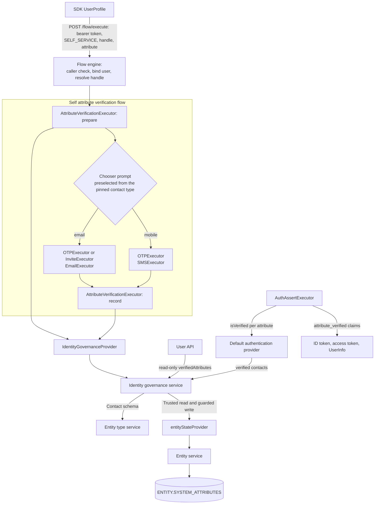

# Email and Mobile Attribute Verification Specification

- **Status:** Draft
- **Version:** 0.3
- **Related documents:** Feature issue [#5439](https://github.com/thunder-id/thunderid/issues/5439); design discussion [#5440](https://github.com/thunder-id/thunderid/discussions/5440); contact attribute types [#5787](https://github.com/thunder-id/thunderid/pull/5787); account lock and suspension specification [#5442](https://github.com/thunder-id/thunderid/pull/5442) and identity governance service [#5681](https://github.com/thunder-id/thunderid/pull/5681); ThunderID Account self-care sample [thunder-id/samples#2](https://github.com/thunder-id/samples/pull/2); [OpenID Connect Core 1.0 §5.1](https://openid.net/specs/openid-connect-core-1_0.html#StandardClaims); [NIST SP 800-63B-4](https://pages.nist.gov/800-63-4/sp800-63b.html); [OWASP ASVS 5.0.0 V6](https://github.com/OWASP/ASVS/blob/v5.0.0/5.0/en/0x15-V6-Authentication.md).

## Summary

An email address or mobile number on a user profile does not show that the user controls it. This feature records proof of control as server-owned metadata and exposes verification status and time read-only through the user API. A contact change removes its verification in the same transaction, and a proof is recorded only while the value it proves is still stored. The design builds on the identity governance service and account access policy introduced with account lock and suspension (#5442, #5681).

A signed-in user verifies their own contact through a self-service flow. `SELF_SERVICE` is a new flow type for operations a signed-in user performs on their own account; this feature adds its first flow. The client starts it on `POST /flow/execute` with the flow type, the required flow `handle` and the attribute to verify, carrying the user's access token. The engine requires that token at the start and binds its user to the execution. One `AttributeVerificationExecutor` surrounds the existing configurable challenge and sender nodes: its `prepare` mode pins the stored contact, and its `record` mode records verification only when delivery and challenge evidence match that contact. One flow serves email and mobile: after `prepare`, a chooser prompt takes the email or mobile action from the pinned contact's type through its new `preselectAction` property, so each action leads to a branch configured on its own and the client never names a channel.

The same executor can record verification in recovery, registration and user onboarding flows an operator builds, when the code or link those flows send reaches the contact. Recovery pins the user it identified. Registration and onboarding pin the user they established, or, before the user is created, the value they collected, which is recorded for the created user only if it is still that user's value. The shipped flows of these types do not verify contacts.

An application can release verification status beside a released contact: `<attribute>_verified` is a boolean claim in the ID token, the access token and the UserInfo response, resolved at sign-in. A user type that defines `<attribute>_verified` itself keeps releasing its own attribute, because the deployment then has its own source, such as a federated provider's `email_verified`.

Only top-level, single-valued `email` and `mobile` attributes are eligible. Verification proves control at a point in time; it is not an account lifecycle state or identity proofing. Out of scope: an administrator-initiated verification flow (planned later as an `ADMINISTRATION` flow); verifying a new contact before the update is saved; recording verification from sign-in or administration flows; blocking sign-in until a contact is verified; letting an administrator mark a contact as verified without proof; and declarative users.

## Architecture



| Component | Responsibility |
|---|---|
| Flow engine | Adds the `SELF_SERVICE` flow type. At the start of a `SELF_SERVICE` flow it requires a bearer access token this deployment issued, binds its subject to the execution, resolves the required flow handle and applies the self-service expiry. Continues the flow publicly by execution ID and challenge token. |
| `AttributeVerificationExecutor` | `prepare`: pin the flow's user (the bound user in `SELF_SERVICE`, the established user in recovery, registration and onboarding) or, for a user not created yet, the collected value; reset earlier challenge evidence and expose the contact type for a preselected action. `record`: check the evidence and request recording for the pinned user, or the user the flow established since, and attribute. Its one property, `attribute`, names the attribute; it never sends, never checks a code, never reads the profile and never writes the entity. |
| `OTPExecutor`, `InviteExecutor` | Issue and check the challenge as today. When a contact is pinned, additionally record the active challenge and mark it passed. |
| `EmailExecutor`, `SMSExecutor` | Deliver as today. When a contact is pinned, additionally refuse any channel or recipient other than the pin's and record a delivery receipt. An SMS node without a selected provider fails at the send step. |
| `IdentityGovernanceProvider` | Engine port. Gains `PrepareAttributeVerification`, `PrepareNewUserAttributeVerification` and `RecordAttributeVerification`. |
| Identity governance service | Authority for which users and attributes may verify. Reads the entity profile and user type schema to prepare existing-user and new-user pins, checks suspension, publishes the requested, verified and refused events, and projects recorded verification for user responses and authentication assurance. |
| `entityStateProvider` | The identity governance service's port over the entity service. Uses the existing profile read for preparation and a guarded recording write under the entity lock. |
| Entity service | The only writer of the entity row. Reserves the metadata key, invalidates on every attribute write and publishes the invalidation events governance defines after commit, performs the guarded recording write, which rechecks the user type, the attribute's contact type and its canonical value under the entity lock, and supplies stored metadata for governance to project on user responses. |
| User service | Sets the verified contacts governance projects, read-only, on user responses. |
| Default authentication provider | Treats the code check of a pinned contact as a contact proof: submits it at the verification plane, where a suspension refuses and an automatic lock neither holds nor counts, so a correct code is admitted under a lock, a wrong one is never counted and neither clears failed sign-ins. Reports each attribute's verification as `isVerified` from the verified contacts governance projects. |
| `AuthAssertExecutor` | Resolves `<attribute>_verified` claims at sign-in from the provider's `isVerified`, beside their released contact, unless the user type's schema defines that name. |
| Application configuration | Accepts `<attribute>_verified` in an application's attribute lists and scope-to-claims mapping for each `email` or `mobile` attribute of an allowed user type. |
| Security context | Marks a request whose bearer token this deployment issued, so a user is taken only from such a token. |
| Event registry | Registers the four verification event types in the Administration category. |
| Console, SDK | The Console shows status and offers `<attribute>_verified` in an application's token attributes. The SDK shows status and starts the self-service flow. |

The design uses existing seams: the engine's caller check for `ADMINISTRATION` flows, flow handles (unique per flow type), prompt actions as branches, the onboarding invite link continued through Gate, the entity service's lock (`QueryLockEntity`) and reserved system attributes, and, from the account lock and suspension work, the governance port and the account access policy.

## Detailed design

### Eligible attributes

An attribute can be verified when all of the following hold:

1. The entity is a user, not a declarative one.
2. The attribute is a top-level, noncredential property of the user's type with type `email` or `mobile`.
3. The attribute is single-valued. Array items and properties nested in objects are not eligible, since a record keyed by attribute name cannot identify which item was proven.
4. The stored contact is a nonempty string. A value of another JSON type cannot be pinned as contact proof.

The type also fixes the channel. An `email` attribute is delivered by `EmailExecutor` and a `mobile` attribute by `SMSExecutor`. A recording whose delivery used another channel is refused.

Eligibility is checked in `prepare` and again in `record`: governance checks that the target is an existing, mutable user and reads the profile and user type schema to pin an eligible contact without a write lock. At recording, governance rechecks eligibility against the user's current type and value, and the entity service then confirms under the entity lock that the type is unchanged and the attribute is still a contact with the pinned canonical value. The flow editor cannot check it when a flow is saved, because one flow serves users of any type. Without an entity type service no attribute is a contact, so preparation and recording refuse.

Verification is stored under the concrete attribute name, such as `workEmail`, and never under a role such as the user type's primary email. A user type can have several eligible attributes of one type, so the caller names the concrete attribute when it starts the flow. It is pinned at preparation and cannot change later in the execution, so a proof for one attribute can never be recorded on another.

### Verification metadata

Verification is stored in `ENTITY.SYSTEM_ATTRIBUTES` under the reserved key `attributeVerification`, keyed by attribute name. An attribute has an entry only while its current value is verified:

```json
{
  "attributeVerification": {
    "email": {
      "verifiedAt": "2026-10-14T09:00:00Z"
    },
    "mobile_number": {
      "verifiedAt": "2026-10-15T11:20:00Z"
    }
  }
}
```

| Field | Meaning |
|---|---|
| `verifiedAt` | Server time of the latest successful verification of the current value. |

An attribute is verified when it has an entry. A schema change neither removes nor hides an entry: an attribute that is no longer eligible stays verified until its value changes or is removed, or the user's type changes. Every supported contact write must use the entity service and remove the entry of a changed or removed value in the same transaction, so a value changed from A to B and back to A is unverified until it is verified again. Recording writes the system attributes through the entity store's existing system attribute update under the entity lock, which moves the general modification time and re-syncs the identifiers from the stored row, so they are unchanged. Preparation writes nothing. A proof is checked against the value stored when it is recorded: it records only if that value equals the pinned one.

The canonical value is used directly for the change check, the pin, the delivery receipt and the comparison at recording time. These temporary values stay in server-owned flow state and are never returned or logged:

- **Email:** surrounding whitespace removed and the domain lowercased. The local part is kept exactly, because RFC 5321 allows it to be case-sensitive.
- **Mobile:** the stored string. The `mobile` type's default pattern requires E.164.

`attributeVerification` is added to the entity service's reserved system attributes. `mergeReservedAttributes` restores it on every system attribute update. `CreateEntity` drops it from incoming system attributes, in the same way it drops linked identities.

### Invalidation on change

When a verified attribute's canonical value differs between the stored and the incoming attributes (changed or removed), the entity service removes that attribute's entry in the same transaction as the attribute write, under the entity lock.

| Write path | Entity service method | Change required |
|---|---|---|
| Administrator update, SCIM replace by an administrator | `UpdateEntity` | Read under the entity lock, merge reserved metadata, compare contacts and write both columns. |
| Self update (`PUT /users/me`), SCIM replace of the caller's own user, flow attribute collection | `UpdateAttributes` | Validate against the user's type before the transaction, as `UpdateEntity` does. Inside it, lock, read, re-check the user type (a type changed since validation refuses the write with `USR-1019`) and compare. Write attributes and, when an entry is cleared, the system attributes in that same transaction. After the write commits, the user service reads the stored profile again and returns its attributes and verification from the same snapshot. If that read fails, verification is omitted from the response; the successful write remains committed. Neither partial-write path warms the profile cache before commit. |
| Create | `CreateEntity` | Drop the reserved key. |

A verified attribute whose schema is no longer a contact is compared exactly, so a schema change cannot hide a value change. A stored value that is not a string, including null, counts as no value: replacing it with a valid contact clears old verification, and it is never accepted as a proof target. Profile mutations resolve the contact schema even when no verification is recorded; when no entry is invalidated, the stored metadata is left unchanged. An unreadable schema refuses the profile mutation, and malformed stored metadata fails the write rather than being discarded.

`PUT /users/me` replaces the whole attribute set, so an eligible attribute missing from the request is treated as removed. If `UpdateEntity` changes the user's type, every entry is removed. Updates that change neither the user type nor a verified attribute leave the verification entries unchanged; a partial write writes the system attributes only when it removes an entry.

### Self-service flows

`SELF_SERVICE` flows run operations a signed-in user performs on their own account. Many flows can share the type; a flow handle is unique within a flow type, so a start must name the flow by `handle`. Self attribute verification is the first such operation.

**Start.** The client calls `POST /flow/execute` with the user's bearer token, `flowType: SELF_SERVICE`, the required flow `handle` and the flow's inputs. An application ID is not needed and is ignored. The engine checks, in this order, before anything runs:

1. The caller presents an access token this deployment issued, with a subject. Otherwise the start is refused with `FES-1017` ("Authentication required"). This check runs before the handle is resolved, so an unauthenticated caller cannot learn which handles exist. Tokens from trusted external issuers are refused, so an external subject never selects a local user. ID and refresh tokens are not access tokens and are refused.
2. Require the request's `handle`; if it is missing or empty, refuse with `FES-1021`.
3. A `SELF_SERVICE` flow with that handle exists. Otherwise the start is refused with `FLM-1003` before anything runs.

The engine then binds the token's subject to the execution, in an engine-owned field that executors read and cannot write, and applies the `flow.selfServiceFlow.expirySeconds` expiry. The bound subject is not the flow's authenticated user: it does not set `AuthUser`, so a CALL into a sign-in flow cannot turn the bearer token into a new sign-in.

**Continuation.** Later requests carry the execution ID and challenge token, as for every flow, and need no bearer token; the engine does not re-check one. The bound subject stays with the execution, so a token sent with a later request cannot change the user. A code or link proves control of the contact, as in recovery.

**Other entry points.** A `SELF_SERVICE` flow cannot be started by flow ID (`FES-1018` for an administrator, otherwise the administration gate's `FES-1017` or `FES-1019`), and the internal initiation entry points refuse the type. The embedded engine has no bearer token middleware, so a `SELF_SERVICE` start is refused there.

**`handle` and other flow types.** `handle` is a general field of the start request. In this feature only `SELF_SERVICE` flows are resolved by handle; other flow types keep their existing selection, by application binding or server configuration, and ignore it. A flow type that later resolves flows by handle must keep its application binding and initiation guards.

### Self attribute verification flow

Bootstrap ships Default Self Attribute Verification Flow (`default-self-attribute-verification-flow`). Like other managed flows, it belongs to an organization unit; bootstrap assigns it to the default organization unit with `ouHandle: default`. The SDK starts it by that handle unless the application names another flow; an operator customizes it in place or points applications at another `SELF_SERVICE` flow.

```text
START → AttributeVerificationExecutor (prepare)        ← bound user; attribute from the start request
      → PROMPT choose_channel (preselectAction {{ctx(contactType)}})
          email  → OTPExecutor (generate) → EmailExecutor (send, template otp)
                 → PROMPT email_code (verify; resend → generate) → OTPExecutor (verify)
          mobile → OTPExecutor (generate) → SMSExecutor (send, template otp)
                 → PROMPT mobile_code (verify; resend → generate) → OTPExecutor (verify)
      → AttributeVerificationExecutor (record) → END
```

```json
{"flowType": "SELF_SERVICE", "handle": "default-self-attribute-verification-flow", "inputs": {"attribute": "email"}, "verbose": true}
```

`prepare` pins the attribute and writes its contact type, `email` or `mobile`, to runtime data as `contactType`. The chooser prompt `choose_channel` has an `email` and a `mobile` action, each leading to its branch, and its `preselectAction` property is `{{ctx(contactType)}}`. A prompt with `preselectAction` reads that key from runtime data only, never from user inputs; when the value is the ref of one of its actions, it selects that action, replacing any action the request selected, and continues without showing itself, so the first response is the code prompt of the matching branch. When the value names none of its actions, or the prompt is shown again for a failure of a later node, it shows its actions. Flow management refuses a `preselectAction` that is not a single `{{ctx(key)}}` placeholder. The client does not choose the channel. Each branch is configured on its own, for example an email link instead of an email code, by pointing the chooser's action at it. The senders still refuse a pinned contact of the other channel, so a custom graph that routes a contact to the wrong branch sends nothing.

Both branches ship in the default flow. As for every shipped flow with a sender, the operator configures an email or SMS provider; a branch whose sender has no provider fails at the send step and sends nothing. The email node has no sender, as in other shipped flows, and the SMS node has the `{{SENDER_ID}}` placeholder. When a flow is opened in the Console flow builder, an email node without a sender takes the first email provider, and an SMS node with the placeholder takes the SMS provider when exactly one exists; otherwise the builder reports the missing SMS sender until the operator selects one.

Resend returns to the branch's `OTPExecutor` (`generate`), which issues a new code for the same pin and resets the proof state, as upstream's OTP flows resend; `OTPExecutor` caps code generations per execution. A flow that returns to `prepare` instead re-pins the attribute of the existing pin. A wrong code returns to the prompt without recording verification. The code proves control of a contact; it is not a sign-in. When `OTPExecutor` checks the code of a pinned contact, the authentication provider submits it at the verification plane, which governance keeps for contact proofs: a wrong code is not counted toward the account access policy's failure threshold, a correct one does not clear that count, an automatic lock refuses nothing and a suspension refuses. A passed code does not authenticate the user in the flow. `OTPExecutor` checks a code it generates for a pinned contact at the verification plane too, whatever the flow type, so a user whose one-time password is locked still receives the code, while a suspended user is refused at `generate`, at `prepare` and at `record`.

The Console also offers Self Attribute Verification with Email Link: its email branch uses `InviteExecutor` and `EmailExecutor` with the `self-email-verification` template. Its first response is a step with no input that tells the user to open the link; the user continues on Gate's invite page, without the bearer token, and confirms on a prompt before `record`, so opening the link alone, as a mail scanner does, records nothing. The server does not require that prompt: an operator who builds a link flow by hand must place a confirmation prompt between Verify Invite and Record Verification, as the template does.

### Verification in other flow types

`prepare` takes its user from the flow type:

| Flow type | User | Without one |
|---|---|---|
| `SELF_SERVICE` | The subject bound at the start | `FET-1119` |
| `RECOVERY` | The user the flow identified, read as other recovery executors read it: the runtime user ID, else the authenticated user | `FET-1119` |
| `REGISTRATION`, `USER_ONBOARDING` | The user the flow established, read the same way | Pin the value the flow collected for the attribute, for a user not created yet |
| Any other type | None | `FET-1119` |

Runtime data is written only by executors, so no input selects the user. For a user not created yet, `prepare` reads the value as provisioning does, from runtime data before user inputs, and the user type from the runtime `categoryType` that `UserTypeResolver` resolved. Governance reads the user type schema, checks whether the attribute is a top-level `email` or `mobile` property of that type, and pins the canonical value with no subject. The senders, challenges and receipts then apply to that value as to any pin. `record` binds such a pin to the user the flow has established by then, which after `ProvisioningExecutor` is the created user, and governance records only if that user's stored value equals the pinned value, under the entity lock. A user changed to another address after the challenge is therefore created unverified. With no user established, `record` fails and records nothing.

A recovery or onboarding flow sends its own challenge, so it verifies the contact only when the challenge is pinned, sent to the pinned value by `EmailExecutor` or `SMSExecutor` and passed before `record`. An onboarding invite link that the administrator copies instead of emailing has no delivery receipt and records nothing. A flow that must not tell whether an account exists routes the `prepare` failure to the same answer as an unknown user, as the shipped recovery flow routes its identification failure. A pinned code is a contact proof in every flow type: a passed code does not authenticate the user, so a registration that pins before its code check still signs the user in through provisioning, as without the pin.

### Challenge evidence

For an existing user, `OTPExecutor` binds its code to the user ID and leaves the destination to a later sender node. The SMS sender reads the recipient from user input before the stored profile, and the invite link records no destination. A successful code or link therefore needs delivery evidence to establish which contact received it.

The pin, challenge-passed marker and delivery receipts form typed, executor-owned evidence on `SharedRuntimeData`, following the existing proven-subject pattern. Ordinary `RuntimeData` is saved and restored per CALL frame, so it must not hold the authoritative evidence: a callee's proof could otherwise disappear on return or an earlier caller snapshot could be restored. No evidence is decoded from user inputs, forwarded form values or additional response data. Four existing executors gain additive reads and writes of this shared evidence, only when a contact is pinned, in any flow type. Without a pin they behave exactly as before; nothing they deliver can be recorded, because `record` needs a pin and evidence issued after it.

| Executor | Addition when a contact is pinned |
|---|---|
| `OTPExecutor` | `generate` records its session token as the active challenge and clears the challenge-passed marker and receipts. `verify` refuses a session token other than the active challenge; a successful `verify` sets the marker to `true`. |
| `InviteExecutor` | `generate` records its token as the active challenge and clears the marker and receipts. A successful `verify` sets the marker to `true`. |
| `EmailExecutor` | Resolve the pinned recipient first. Refuse before sending, with `FET-1119` ("This contact cannot be verified here"), unless the pin's channel is email, a challenge has been issued and the canonical recipient equals the pinned value. After a delivery that was actually sent, append a receipt `{channel: email, value}` with the canonical recipient value. A skipped or best-effort non-delivery adds no receipt. |
| `SMSExecutor` | The same, with `channel: sms`. |

When a contact is pinned, `SMSExecutor` resolves its recipient from runtime data before user inputs, as `EmailExecutor` does in every flow, so a request input cannot redirect a challenge; otherwise it keeps its resolution order. Generating a verification invite always issues a fresh token and resets the passed marker and receipts. Invite verification must match both its ordinary stored token and the shared active token, so restoring an older CALL-frame token cannot validate a different challenge. Sender response flags and masked destinations remain presentation data.

`SMSExecutor`'s `senderId` property stays required. The default flow declares its SMS node with the `{{SENDER_ID}}` placeholder, which the property check accepts, so the flow ships before any SMS provider exists. Sending with the placeholder fails at execution and sends nothing; in a `SELF_SERVICE` flow it fails with `FET-1042`, as in user onboarding.

### Attribute verification executor

`AttributeVerificationExecutor` is a utility executor. It has no default mode, so a node without a mode cannot be saved. It has one node property, `attribute`, applicable to `prepare`, and declares one required input of the same name, read only in `prepare` mode and only when the property is not set. Flow management accepts it in any flow type, and rejects a flow that has a `prepare` node without a `record` node, or a `record` node without a `prepare` node. No flow type requires it. Email and mobile are handled by the same modes: the attribute's schema type decides the channel.

**`prepare` mode**

1. Take the user from the flow type, as in "Verification in other flow types"; without one, fail the node with `FET-1119` before anything is sent, except in a registration or onboarding flow that will create the user. On a resend, keep the attribute of the existing pin, and its user when it names one.
2. Take the attribute from the `attribute` property, else require the `attribute` input, supplied when the flow is started; a missing input pauses the node for it like any required executor input. From here on only the pin counts.
3. For a user, call `PrepareAttributeVerification`. Governance refuses a non-user, a declarative user and a suspended user with `FET-1112`. It reads the entity profile and checks the attribute's eligibility against its user type schema, then pins the canonical value and channel without taking a write lock. For a user not created yet, call `PrepareNewUserAttributeVerification` with the resolved user type and the collected value; governance refuses an attribute the type does not declare as a contact, or an empty value, with `FET-1112`.
4. Write the value into runtime data under the attribute name and under the channel's default attribute (`email` or `mobile_number`), so the sender for that channel resolves it, the user ID when there is one, so the challenge node binds to that user, and `contactType` (`email` or `mobile`), which the chooser prompt's `preselectAction` reads.
5. Store the pin `{subject, attribute, value, channel}`, with an empty subject for a user not created yet, on `SharedRuntimeData` and clear the challenge-passed marker, the delivery receipts, any OTP session token and any invite token. Only a challenge issued and delivered after this point counts.
6. Return nothing for display: the sender that delivers to the pin returns the channel and `maskedDestination` in additional response data (for example `a•••@example.com` or `•••67`), on the first send and on every resend. These are presentation data, never recording evidence.

A `subject` input is ignored. The event actor is the user.

**`record` mode**

1. Require the typed shared pin and challenge-passed marker. Derive the target user and attribute only from the pin, never from a later input or the current flow user; later nodes cannot retarget an earlier proof. A pin with no subject takes the user the flow has established since, and fails when there is none.
2. Require at least one delivery receipt, and every receipt since the pin to have the pin's channel and the pinned canonical value. Senders already refuse to deliver a challenge anywhere else; the receipts check it again.
3. Call `RecordAttributeVerification` with the pin.
4. Clear the pin, the marker and the receipts.

A failure in any step records nothing and fails the node. A recording failure is never reported as success.

### Recording verification

Governance first reads the user's profile and type schema and checks that the pinned subject still exists as a user, is not declarative, and that the pinned attribute is still eligible with a current canonical value and channel equal to the pin. It then records through `entityStateProvider`, passing the user type it read and the pinned value. In one transaction under the entity lock, the entity service checks that:

1. The user still exists and has that user type.
2. The attribute is still an `email` or `mobile` contact of that type, and its current canonical value equals the pinned value. This is the comparison invalidation uses, so recording and invalidation agree on when a contact changed.

It then sets `verifiedAt` to the current time. Any failed check refuses the recording as stale and writes nothing. Before this, governance reads suspension and refuses a hold it observes, because a suspension leaves pending executions and their links valid. The suspension read precedes the entity transaction; it is not an atomic commit-time hold check. Verifying an attribute that is already verified refreshes `verifiedAt`. Preparation reads the entity profile through the entity service and takes no write lock; if that snapshot becomes stale, recording refuses unless the pinned value and channel still match the current eligible contact. Recording bypasses the profile cache and reads under the entity lock, and its write invalidates the cached profile. Disabled governance refuses both operations.

### Challenge configuration

Challenges are configured on the upstream nodes with their existing properties: `otpLength`, `otpValidityPeriodSeconds` and `maxAttempts` on `OTPExecutor`; `inviteBaseURL` on `InviteExecutor`; sender and template on `EmailExecutor` and `SMSExecutor`. A link lives as long as the flow execution. The shipped flow uses:

| | Code | Email link (Console template) |
|---|---|---|
| Lifetime | 300 seconds, within an execution expiry of 1800 seconds by default | The execution expiry, 1800 seconds by default |
| Generation cap | `maxAttempts` per execution, 3 in the shipped flow | No cap added by this feature |

No verification-specific send cooldown, configuration key or runtime-store namespace is added. The existing OTP generation cap applies within one execution; starting another execution bypasses that cap. Authentication limits who can request sends but does not provide a send-rate limit. Deployments must address repeated sends through shared flow, sender or gateway abuse controls, including limits for a target user or destination where needed. Such cross-execution protection is not supplied by this feature; deployments limit request volume on `/flow/execute` as described in [Configure Rate Limiting](https://thunderid.dev/docs/deployment/production-guidelines/#configure-rate-limiting).

Notification templates: the code branches reuse the existing `otp` email and SMS templates; the email link template uses the new `self-email-verification` email template.

### Token claims

**Claim.** When an application releases an `email` or `mobile` attribute of a user, it can also release `<attribute>_verified`, a boolean that is `true` when the released value is verified and `false` otherwise. Today the claim name is the attribute name with the suffix; when per-application attribute mapping arrives, the suffix follows the mapped name. The claim is released only together with its contact, and it is `true` only when the released value is the stored value the verification was read for, so a value a flow wrote into runtime data releases `false`. Neither runtime data nor an external identity provider's claim sets it. The server issues no verification claim for agents, or where the executor has no entity type service to read the schema (the embedded engine); there a `_verified` name resolves like any other attribute, from the host's provider.

**Resolution.** `AuthAssertExecutor` resolves the claim once, at sign-in, with the other user attributes. The authentication provider reports each attribute's verification as `isVerified` in its assurance metadata: the default provider reads the recorded verifications governance projects for user responses, and a REST authentication provider can report its own. The executor reads the user type's schema only when a `_verified` name is requested. The ID token, the access token, refreshed tokens and the UserInfo response use that sign-in snapshot, as they do for the contact itself, so a verification or a contact change after sign-in shows after the next sign-in; `GET /users/me` reads the current state.

**Schema-defined claims.** A user type whose schema defines `<attribute>_verified` keeps that attribute: it is resolved like any other attribute (runtime data, then the stored value, then the external identity provider's claim) and the server's status is not used. A user of that type with no stored value gets no claim. `_verified` names are not reserved.

**Application configuration.** The application's assertion, access token, ID token and UserInfo attribute lists and its scope-to-claims mapping accept `<attribute>_verified` for each `email` or `mobile` attribute of an allowed user type, so the default `email` scope keeps `email_verified` for a type whose `email` is a contact. Person's mobile attribute is `mobile_number`, so its claim is `mobile_number_verified`, and the default `phone` scope's `phone_number_verified` stays empty until attribute mapping arrives. Consent treats any `<attribute>_verified` as available whenever `<attribute>` is; configuration admits the name only as described here, and the assertion releases only what this section allows.

### Events and logging

When observability is enabled, governance publishes `ATTRIBUTE_VERIFICATION_REQUESTED` when a preparation pins an existing user's contact (before any delivery outcome is known; a pin for a user not created yet publishes none), `ATTRIBUTE_VERIFICATION_VERIFIED` when a recording is applied and `ATTRIBUTE_VERIFICATION_REFUSED` when a recording is refused, because the user is suspended or the entity service finds the pin stale, in the Administration event category. Each carries the user, attribute and initiator, which is the user. A refused preparation, and a recording that `record` refuses on its own evidence checks before calling governance, publish no governance event and surface as a failed flow node. After a contact write commits, the entity service builds and publishes `ATTRIBUTE_VERIFICATION_INVALIDATED`, in the same category, once for each verified attribute the write cleared, with the user, attribute, reason (`value_changed`, `removed` or `user_type_changed`) and the caller as actor when the write has one. A rolled-back write and a change to an unverified attribute publish nothing. Observability ships disabled; operators configure the Administration category and a retained output. Publication occurs outside the entity transaction and is not a durable delivery guarantee. Verification-specific events, logs and additional response data omit the challenge code, invite link, invite or OTP token, and full destination. Destinations in sender logs are masked. Inherited execution IDs and continuation challenge tokens follow the flow protocol; outgoing messages necessarily carry the contact challenge.

### Data model

The existing entity database and `ENTITY.SYSTEM_ATTRIBUTES` column are reused on PostgreSQL and SQLite. No table or column is added or changed.

- `ENTITY.SYSTEM_ATTRIBUTES` gains the reserved key `attributeVerification`. Existing rows need no migration.
- The flow execution context gains the subject bound at the start of a `SELF_SERVICE` flow, stored with the rest of the context.
- Bootstrap resources gain the default self attribute verification flow, the `flow.selfServiceFlow` server configuration, the `verification` translations, and the `self-email-verification` notification template with its `selfEmailVerification.email.*` translations in the `notification` namespace.

### API

**User responses.** `GET /users/{id}`, `GET /users` and `GET /users/me` include a read-only field:

```json
{
  "verifiedAttributes": {
    "email": { "verifiedAt": "2026-10-14T09:00:00Z" }
  }
}
```

An attribute appears when it has a recorded verification. The entries are read from the user's stored metadata without the user type's schema, so an attribute a schema change made ineligible still appears until its value changes or is removed. The field is `{}` when nothing is verified. It never includes the stored metadata or the complete system attributes. Create and update responses carry the same field. A listing that returns identifiers only omits it. When a user's verification state cannot be read, because its stored metadata is malformed, the field is omitted for that user and the server logs a warning, so clients show the status as unknown rather than unverified. No request model has a field that sets verification. `api/user.yaml` is updated to match.

**Tokens and UserInfo.** No endpoint changes. The ID token, access token and `GET /oauth2/userinfo` gain `<attribute>_verified` booleans as described in "Token claims", released through the existing scope and attribute configuration.

**Flow execution.** `POST /flow/execute` gains a `handle` field and the `SELF_SERVICE` flow type; `handle` is required for self-service initiation; no new endpoint is added. A `SELF_SERVICE` start carries the user's bearer token, `flowType`, `handle` and the flow's inputs (for self attribute verification, `attribute`). The first response of the self attribute verification flow is an `INCOMPLETE` code prompt, or for a link branch a step with no input, carrying `channel`, `maskedDestination` and the sender flag in `data.additionalData`. The flow returns `ERROR` when the attribute is not eligible, the user may not verify or the evidence does not match the pin (`FET-1112`, reused from the identity governance service, #5681), when a send would reach anything other than the pinned contact or `prepare` runs in a flow type without a user source (`FET-1119`, new: "Verification not available", "This contact cannot be verified here"), when the branch's sender has no provider, and when the generation cap is reached. A governance server failure is a server error, not an `ERROR` step. These starts are refused before the flow runs: a `SELF_SERVICE` start without a usable token (`FES-1017`), without a handle (`FES-1021`) or with an unknown handle; and a `SELF_SERVICE` flow started by flow ID (`FES-1018` for an administrator, otherwise `FES-1017` or `FES-1019`). `api/flow-execution.yaml` gains `handle` and the `SELF_SERVICE` start, and `api/flow-management.yaml` gains the flow type.

### UI

**Console user page.** Every eligible attribute shows a Verified or Unverified status inline with its label as a small chip styled like the user type chip in the page header, green when verified, on the General tab and on the Attributes tab while the field holds the stored value; its tooltip gives the verification time. The Console has no action that starts verification. Declarative users, nested contacts, arrays and empty values show no status.

```text
┌ Attributes ───────────────────────────────────────────────────────┐
│ Email  (Verified)                                                  │
│ ┌──────────────────────────────────────────────────────────────┐   │
│ │ alex@example.com                                             │   │
│ └──────────────────────────────────────────────────────────────┘   │
│ Mobile Number  (Unverified)                                        │
│ ┌──────────────────────────────────────────────────────────────┐   │
│ │ +94771234567                                                 │   │
│ └──────────────────────────────────────────────────────────────┘   │
└────────────────────────────────────────────────────────────────────┘
```

**Flow builder.** The executor palette gains "Prepare Verification" (`prepare`) and "Record Verification" (`record`) in every flow type. Prepare Verification has an "Attribute" property; Record Verification has none. Create flow offers the Self Service type with a Blank template and the Self Attribute Verification and Self Attribute Verification with Email Link templates. A prompt's properties panel edits its Preselected action (`preselectAction`).

```text
┌ Create flow ─────────────────────────────────────────────────────────────┐
│ Type                                                                      │
│ (•) Self Service   Let signed-in users manage their own account           │
│ Template                                                                  │
│ [Self Attribute Verification] [Self Attribute Verification with Email Link]│
└───────────────────────────────────────────────────────────────────────────┘
```

**Console application token settings.** For each `email` or `mobile` attribute of an allowed user type, the attribute picker of the token and UserInfo settings and of the scope mapping also lists `<attribute>_verified`, once even when the schema defines that name itself.

**Gate.** The existing invite page continues the email link branch and renders its confirmation prompt. As in every upstream prompt, the submit action sits in a `BLOCK`, which Gate renders as the form. No new page.

**SDK `UserProfile`.** The React component shows the status from `verifiedAttributes` beside each top-level `email` or `mobile` field that holds a value, with the verification time in a tooltip. When the profile is editable, for an unverified `email` or `mobile` field showing its stored value it offers "Verify", which runs the self attribute verification flow inline through a `VerifyAttribute` component built on the existing embedded flow renderers, with the user's access token attached by the SDK's authenticated client. It starts the flow with `flowType: SELF_SERVICE`, the handle `default-self-attribute-verification-flow` unless the application sets another, and the field's attribute name. The component starts the flow once per opening and re-reads `/users/me` on completion. For a link branch it shows where the link went and a Done action that re-reads `/users/me`; it does not poll. After a save that changed an `email` field, the component opens the flow for it only when the re-read stored value differs from the one before the save and `verifiedAttributes` reports it unverified, so an edit the server stores as the same address, or a status that could not be read, opens nothing. The user can dismiss it and verify later.

```text
┌ Profile ──────────────────────────────────────────────┐
│ Email   new@example.com   ○ Unverified   [Verify]    │
├───────────────────────────────────────────────────────┤
│ We sent a code to n•••@example.com                    │
│ [ _ _ _ _ _ _ ]    [Verify]    Resend code · Not now  │
└───────────────────────────────────────────────────────┘
```

**ThunderID Account sample.** The sample renders `UserProfile`, so it gains verification by upgrading `@thunderid/react`.

### Configuration

| Key | Level | Default | Validation |
|---|---|---|---|
| `flow.selfServiceFlow.expirySeconds` | Deployment | 1800 | Zero or more seconds; zero uses the default. Sets the execution expiry of every `SELF_SERVICE` flow, including user attribute verification |
| `attribute` on `AttributeVerificationExecutor` | Flow node, `prepare` | Unset: the `attribute` input | An attribute name; eligibility is checked when the node runs |
| `senderId` on `SMSExecutor` | Flow node | `{{SENDER_ID}}` in the default flow | Required, as today; sending with the placeholder fails |
| Challenge and sender properties | Flow node | As shipped in the default flow | Existing node validation |

## Requirements

### R1. Verify only eligible contact attributes

**Requirement:** Only a user's top-level, single-valued `email` and `mobile` attributes can be verified, each through its own channel.

**Acceptance criteria:**

- **AC1.1:** Given a user whose type defines `email` with type `email`, when the self attribute verification flow targets `email`, then a code is sent by email.
- **AC1.2:** Given a flow whose graph routes a pinned `mobile` attribute to `EmailExecutor`, when that node runs, then nothing is sent, the node fails with `FET-1119` and nothing is recorded.
- **AC1.3:** Given an attribute of type `string`, or an `email` value inside an array or object, when `prepare` targets it, then the node fails before anything is sent.
- **AC1.4:** Given a declarative user, when the flow targets them, then `prepare` fails with `FET-1112` and nothing is sent.
- **AC1.5:** Given an eligible attribute with no value, when `prepare` targets it, then the node fails and nothing is sent.

### R2. Keep verification metadata server-owned

**Requirement:** Only guarded recording and invalidation may change verification state.

**Acceptance criteria:**

- **AC2.1:** Given a create request, through the API, SCIM or flow provisioning, whose system attributes carry `attributeVerification`, when the user is created, then the stored user has no `attributeVerification`.
- **AC2.2:** Given a verified attribute, when an update changes only other attributes, then its entry is unchanged.
- **AC2.3:** Given a system attribute update that omits or alters `attributeVerification`, when it is applied, then the stored `attributeVerification` is unchanged.
- **AC2.4:** Given the user create, update and self-update request models, when they are inspected, then none has a field that sets verification.
- **AC2.5:** Given a contact, when preparation pins it, then nothing is written and the general modification time is unchanged.

### R3. Remove verification when a value changes

**Requirement:** A change to or removal of an eligible attribute removes its verification in the same transaction, on every write path, and a challenge for an earlier value cannot be recorded against a different current value.

**Acceptance criteria:**

- **AC3.1:** Given a verified email A, when an administrator update, a SCIM update, a self update or flow attribute collection changes it to B, then after the commit `email` is unverified.
- **AC3.2:** Given a verified mobile number, when an update removes it, then it is unverified.
- **AC3.3:** Given a verified email A, when it changes to B and then back to A, then `email` is unverified.
- **AC3.4:** Given a code or link issued after `prepare` pinned A, when A changes to B before the challenge is passed, then `record` records nothing.
- **AC3.5:** Given a recording for A and a change to B running concurrently, when both complete, then B is never shown as verified with A's proof, on PostgreSQL and SQLite.
- **AC3.6:** Given a self update whose attribute set omits an eligible attribute, when it is applied, then that attribute is treated as removed.
- **AC3.7:** Given an update that changes the user's type, when it is applied, then every attribute is unverified.
- **AC3.8:** Given a verified mobile number, when it is removed and later restored to the same number, then it is unverified.
- **AC3.9:** Given a verified attribute whose schema is temporarily not a contact, when its value changes, then it is unverified when its schema is a contact again.

### R4. Record only a challenge delivered to the pinned value

**Requirement:** Verification is recorded only when a challenge issued after the pin was delivered only to the pinned value, on the attribute's channel, and passed.

**Acceptance criteria:**

- **AC4.1:** Given `prepare` pinned email A and a code was delivered to A, when the correct code is verified and `record` runs while A is stored, then `email` is verified with a server-generated `verifiedAt`.
- **AC4.2:** Given a pinned mobile number, when the request carries a `mobile_number` input with another number, then the SMS goes only to the pinned number, nothing is sent to the other number, and a passed code records the pinned number.
- **AC4.3:** Given a pinned value, when a sender is asked to deliver the challenge to another value, then nothing is sent there and nothing is recorded.
- **AC4.4:** Given a code generated before `prepare`, when it is submitted after `prepare`, then the verification step refuses it and nothing is recorded.
- **AC4.5:** Given a flow that reaches `record` without a passed `verify`, when it runs, then `record` refuses.
- **AC4.6:** Given a verified attribute, when it is verified again, then `verifiedAt` is the time of the new verification.
- **AC4.7:** Given a persistence failure while recording, when the flow continues, then it reports a failure and the attribute is not shown as verified.
- **AC4.8:** Given an existing flow without `AttributeVerificationExecutor`, when it sends a code or invite, then its behavior and response are unchanged.
- **AC4.9:** Given preparation for user A, when a later input or node names user B, then recording cannot apply A's pin to B.
- **AC4.10:** Given a pin for one attribute, when a later request in the same execution supplies another `attribute` or `subject` input, then recording uses the pinned attribute and user only.
- **AC4.11:** Given preparation in a caller and successful challenge and delivery evidence in a called flow, when the called flow returns, then recording reads the same shared evidence; restoring a CALL frame cannot restore evidence cleared by a later preparation.
- **AC4.12:** Given a flow that sends a code before `prepare`, when that code is submitted and the flow reaches `record`, then nothing is recorded.

### R5. Verify through a self-service flow

**Requirement:** A signed-in user can verify their own eligible email or mobile attribute with a one-time code or a link, starting a `SELF_SERVICE` flow by handle with their access token, and one flow serves both contact types.

**Acceptance criteria:**

- **AC5.1:** Given a signed-in user with an unverified `email`, when they start `default-self-attribute-verification-flow` with `flowType: SELF_SERVICE`, their bearer token and `attribute: email`, then a code is sent to the stored email and the response identifies the destination only by channel, sender flag and masked destination, besides the code prompt's length and format; it never contains the address or the code.
- **AC5.2:** Given an issued code, when the user submits it within its lifetime, then the attribute is verified and the flow completes.
- **AC5.3:** Given an issued code, when the user submits a wrong code, then the flow returns to the prompt with an error, nothing is recorded and the user's account access failure count is unchanged.
- **AC5.4:** Given a `SELF_SERVICE` start without a bearer token, with an expired or malformed token, or with a token issued by a trusted external issuer, when it is sent, then it is refused with `FES-1017` before the handle is resolved and nothing runs; given a token whose subject is not a user, then `prepare` fails with `FET-1112` and nothing is sent.
- **AC5.5:** Given a `subject` input naming another user, when the flow runs, then the input is ignored and the token's user is the target.
- **AC5.6:** Given an execution has reached the existing OTP generation limit, when the user asks to resend in that execution, then no further code is generated or sent.
- **AC5.7:** Given a `SELF_SERVICE` flow, when a caller starts it by flow ID, then it is refused; when a `SELF_SERVICE` start has no `handle`, then it is refused with `FES-1021`; when it names a handle no `SELF_SERVICE` flow has, then it is refused before anything runs.
- **AC5.8:** Given a suspended or declarative user, when the flow reaches `prepare`, then it fails and nothing is sent.
- **AC5.9:** Given a resend, when the user submits the first code, then it is refused, because only the latest code issued after the pin is the active challenge.
- **AC5.10:** Given a flow definition of any flow type with an `AttributeVerificationExecutor` node in `prepare` mode and none in `record` mode, or the reverse, when it is saved through flow management, then it is rejected; given a `SELF_SERVICE` flow without the executor, then it is accepted.
- **AC5.11:** Given a user under an automatic lock, when they complete the flow with the issued code, then the attribute is verified and the lock is unchanged.
- **AC5.12:** Given a flow started with one user's token, when a continuation or resend carries another user's token, then the code goes to the first user's contact and only the first user is verified.
- **AC5.13:** Given a configured SMS provider, when a user starts the flow with a `mobile` attribute, then the flow takes the mobile branch, a code is sent by SMS to the stored number and the correct code verifies it; when the start also carries `action: email`, then the mobile branch is still taken.
- **AC5.14:** Given no SMS provider for the mobile branch (the sender is unset, the `{{SENDER_ID}}` placeholder or unknown), when a user starts the flow with a `mobile` attribute, then the flow fails with `FET-1042`, nothing is sent and nothing is recorded.
- **AC5.15:** Given the email link template as the flow, when a user starts it, then a link is sent to the stored email, opening the link records nothing until the user confirms, and confirming verifies the email without the bearer token.
- **AC5.16:** Given an issued code, when the user submits it without a bearer token, then the attribute is verified.
- **AC5.17:** Given `prepare` in an `AUTHENTICATION`, `ADMINISTRATION` or `SIGNOUT` flow, when it runs, then it fails with `FET-1119` and nothing is sent.
- **AC5.18:** Given a start with `handle` for a flow type other than `SELF_SERVICE`, when it runs, then the flow is selected as without the handle.
- **AC5.19:** Given the shipped verification flow, SDKs start it with `flowType: SELF_SERVICE` and `handle: default-self-attribute-verification-flow`; an application can supply a custom flow handle. Configuration rejects `selfServiceFlow.defaultHandle`, and the server never selects a verification flow for a request without a handle.

### R6. Branch on the pinned contact type

**Requirement:** The shipped flow and templates take the email or mobile branch from the pinned contact's type through a chooser prompt's `preselectAction`, and the Console edits that property.

**Acceptance criteria:**

- **AC6.1:** Given the shipped flow, when a user starts it with an `email` attribute and `action: mobile`, then the email branch is taken.
- **AC6.2:** Given a prompt whose Preselected action is set in the Console flow builder, when the flow is saved and reopened, then the value is unchanged.
- **AC6.3:** Given a resend on a code prompt, when it runs, then a new code is sent to the same pinned contact without running `prepare` again.
- **AC6.4:** Given a `preselectAction` key absent from runtime data but sent as an input, or a value naming none of the prompt's actions, when the flow reaches the prompt, then it shows its actions.
- **AC6.5:** Given a preselected branch that fails back to the chooser, when the chooser is shown again, then it shows its actions and the error instead of taking that branch again.
- **AC6.6:** Given a flow whose `preselectAction` is not a single `{{ctx(key)}}` placeholder, when it is saved, then flow management refuses it.

### R7. Expose verification read-only through the user API

**Requirement:** User responses report which attributes are verified, and when.

**Acceptance criteria:**

- **AC7.1:** Given a user with a verified email, when the user is read through `GET /users/{id}`, `GET /users` or `GET /users/me`, then `verifiedAttributes.email.verifiedAt` is returned.
- **AC7.2:** Given a user with no verified attribute, when the user is read, then `verifiedAttributes` is `{}`.
- **AC7.3:** Given a verified attribute, when its value changes or is removed through any supported write path and the user is read, then that attribute is not returned in `verifiedAttributes`.
- **AC7.4:** Given a verified attribute whose type is no longer `email` or `mobile`, when the user is read, then it is still returned until its value changes or is removed, or the user's type changes.
- **AC7.5:** Given any user response, when it is inspected, then it contains no stored verification metadata or other system attribute.
- **AC7.6:** Given a user whose verification state cannot be read, when the user is read, then `verifiedAttributes` is omitted for that user only.

### R8. Keep secrets out of responses, logs and events

**Requirement:** Verification activity is observable without exposing secrets.

**Acceptance criteria:**

- **AC8.1:** Given a verification operation, when verification-specific logs, events and additional response data are inspected, then none contains the challenge code, invite link, invite or OTP token, or unmasked destination; inherited execution and continuation fields retain their flow-protocol meaning.
- **AC8.2:** Given observability is enabled and a preparation pins a contact, a verification succeeds, governance refuses a recording, or a committed change clears a verified attribute, when the operation completes, then an event is published with the user, the attribute and the initiator when there is one: the user, or the caller of the write.

### R9. Show verification in the Console and SDK

**Requirement:** Administrators see verification status; users see it and can verify from their profile.

**Acceptance criteria:**

- **AC9.1:** Given a user page, when it loads, then each eligible attribute shows Verified or Unverified inline with its label on both tabs, and no action starts verification.
- **AC9.2:** Given a verified attribute, when the user page loads, then it shows Verified with its time.
- **AC9.3:** Given a signed-in user, when `UserProfile` renders, then each top-level `email` and `mobile` field with a value shows Verified or Unverified from `verifiedAttributes`.
- **AC9.4:** Given an unverified `email` or `mobile` field showing its stored value, when the user selects "Verify", then the flow runs inline with the user's access token, `flowType: SELF_SERVICE`, the default handle or the one the application set, and the field's attribute name, and the status updates on success.
- **AC9.5:** Given the user saves a changed `email` field, when the save succeeds, then the field shows Unverified and the flow opens for it once; when the save fails, then no flow starts.
- **AC9.6:** Given the Console flow builder, when a flow is created, then the Self Service type offers the Blank, Self Attribute Verification and Self Attribute Verification with Email Link templates.

### R10. Verify in recovery, registration and onboarding flows

**Requirement:** An operator can record verification in a recovery, registration or user onboarding flow whose challenge reaches the contact, for the user the flow identified or created, without changing the shipped flows.

**Acceptance criteria:**

- **AC10.1:** Given a recovery flow that identifies the user, then runs `prepare` with the `attribute` property `email`, issues a code or link, sends it by email and runs `record` after the challenge, when the user completes it with the challenge sent to their stored email, then `email` is verified.
- **AC10.2:** Given a recovery flow whose `prepare` runs before a user is identified, when it runs, then it fails with `FET-1119` and nothing is sent.
- **AC10.3:** Given a registration flow that resolves the user type, collects an email, runs `prepare` for `email`, sends a code to that address, verifies it, provisions the user and then runs `record`, when a user registers with the correct code, then the new user's `email` is verified.
- **AC10.4:** Given the flow of AC10.3 with a prompt after the code check that collects `email` again, when the user enters another address there, then the user is created with the new address, `record` fails and `email` is not verified.
- **AC10.5:** Given a registration flow, when `prepare` runs before a user type is resolved, or for an attribute the user type does not declare as `email` or `mobile`, or with no collected value, then it fails and nothing is sent.
- **AC10.6:** Given a user onboarding flow that runs `prepare` for the invited email before generating the invite, sends the invite by email and runs `record` after provisioning, when the invitee opens the link and completes onboarding, then the new user's `email` is verified.
- **AC10.7:** Given the same onboarding flow with the invite link returned to the administrator instead of emailed, when the invitee completes onboarding, then nothing is recorded.
- **AC10.8:** Given a pin made before the user exists, when `record` runs before the flow has created or identified a user, then nothing is recorded.
- **AC10.9:** Given `prepare` with the `attribute` property, when it runs, then the user is not asked for the attribute and an `attribute` input does not change it.

### R11. Release verification status in tokens and UserInfo

**Requirement:** An application can release whether each released `email` or `mobile` contact is verified, as a boolean claim beside it, unless the user type defines that claim itself.

**Acceptance criteria:**

- **AC11.1:** Given an application that releases `email` and `email_verified` in the ID token and UserInfo, when a user whose email is verified signs in, then both carry `email_verified: true`.
- **AC11.2:** Given the same application, when a user whose email is not verified signs in, or whose verified email changed before the sign-in, then both carry `email_verified: false`.
- **AC11.3:** Given an application that releases `email_verified` but not `email`, when a user signs in, then no `email_verified` claim is issued.
- **AC11.4:** Given a user type whose schema defines `email_verified`, when its user signs in, then the claim carries the stored value, or is absent when none is stored, whatever the server's verification state.
- **AC11.5:** Given a user type that does not define `email_verified`, when runtime data or an external identity provider supplies `email_verified`, then the token carries only the server's status.
- **AC11.6:** Given a flow that releases an `email` value other than the stored one, when the assertion is built, then `email_verified` is `false`.
- **AC11.7:** Given an application that lists `<attribute>_verified` for an `email` or `mobile` attribute of an allowed user type, when it is created or updated, then the name is accepted; for another attribute whose `_verified` name the schema does not define, a create is rejected and an update drops the name, as it drops any undeclared attribute.

## Open questions

1. **Type name.** Is `SELF_SERVICE` the right name for the flow type of operations a signed-in user performs on their own account?
2. **Claim mapping.** When per-application attribute mapping arrives, the verification claim follows the mapped claim name (`mobile` mapped to `phone_number` gives `phone_number_verified`). Should mapping also refuse a mapped name ending in `_verified`? Proposed: yes.
3. **Code length.** ASVS 5.0 V6.5.4 gives six random digits as a typical example; their uniform space has approximately 19.93 bits. Should the shipped flow use seven digits for deployments requiring a strict mathematical minimum of 20 bits?
4. **Other proof sources.** Should administrator-assisted code entry or administrator assertion without proof ever be supported, with separate permissions and audit requirements?
5. **Shared send protection.** Which shared flow, sender or gateway control will deployments use to limit repeated sends across executions? This feature adds no dedicated cooldown; existing OTP limits cover one execution only.
6. **Token audience.** A `SELF_SERVICE` start accepts any access token this deployment issued for the user, from any application and with any scope, as `GET` and `PUT /users/me` do. Should starting a self-service flow require a scope or audience? Proposed: no, matching `/users/me`; a code goes only to the user's stored contact and completion needs it.

## Change log

| Version | Date | Change |
|---|---|---|
| 0.1 | 2026-10-19 | Initial specification. |
| 0.2 | 2026-10-22 | Self-service flow type started by handle, with the signed-in user bound at the start; one flow for email and mobile through a preselected chooser prompt; administrator request flow removed from scope; recovery, registration and onboarding flows may record verification. |
| 0.3 | 2026-10-29 | Chooser prompt kept with a validated `preselectAction`, so each branch is an action edge in the Console; required flow handle; `<attribute>_verified` token claims; contact proofs at a verification plane; `verifiedAttributes` read without the schema; `FET-1119`. |
