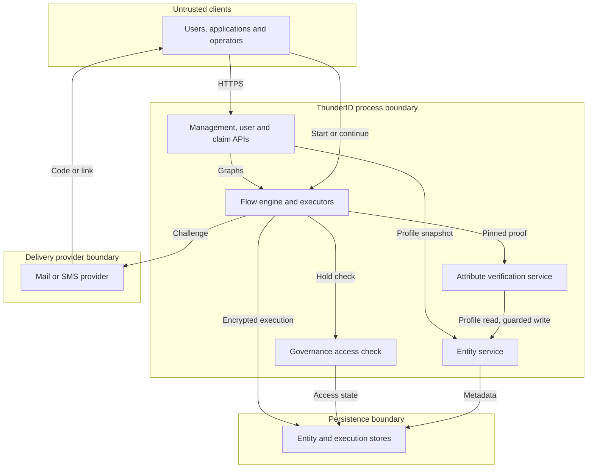
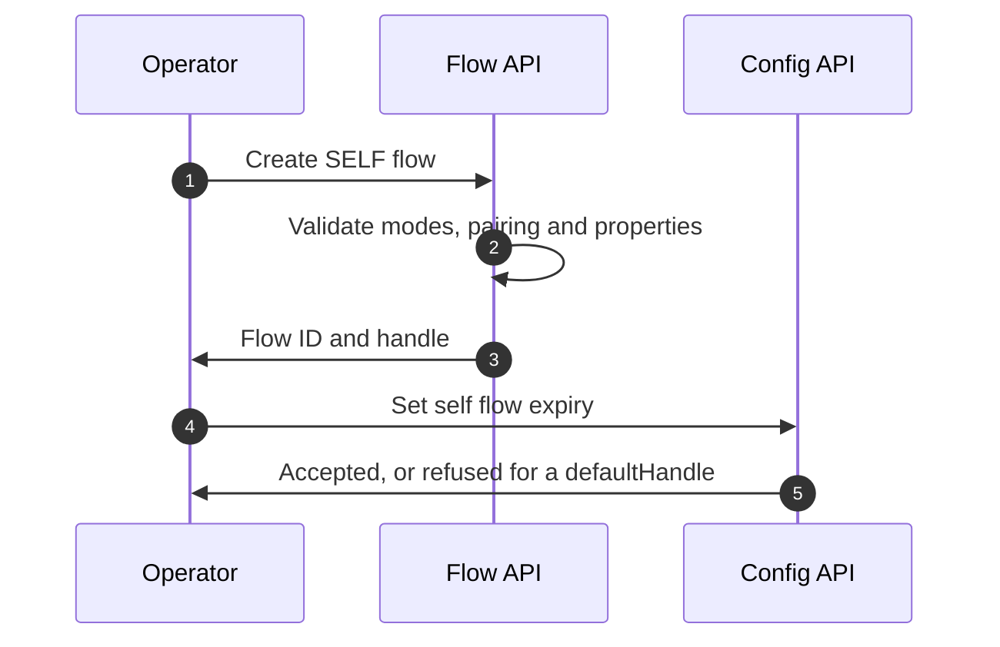
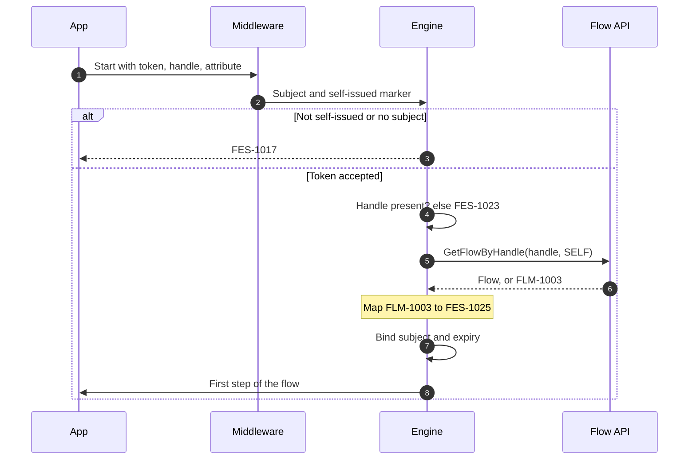
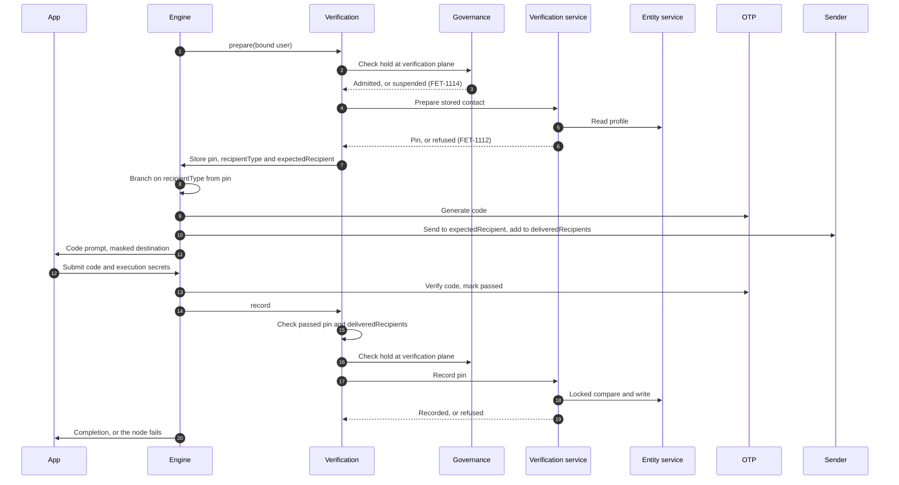
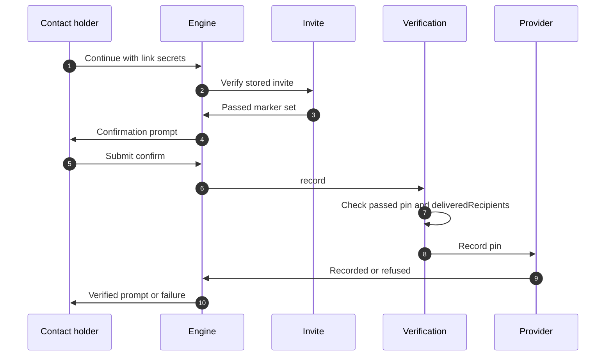
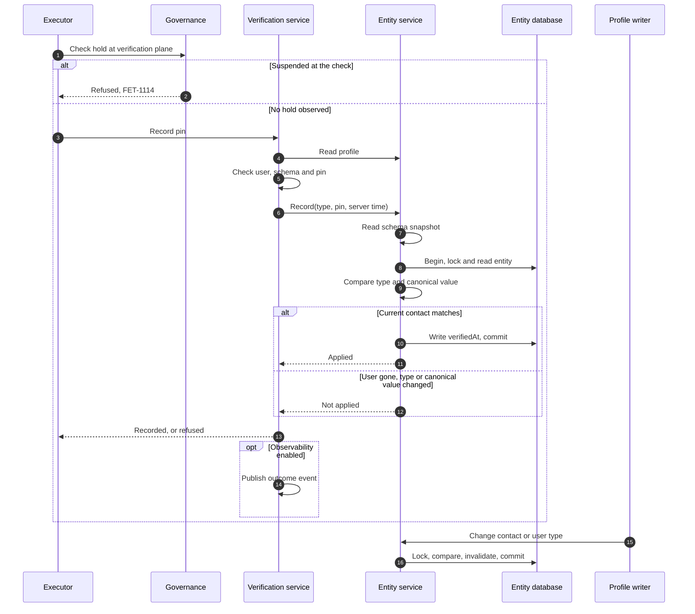
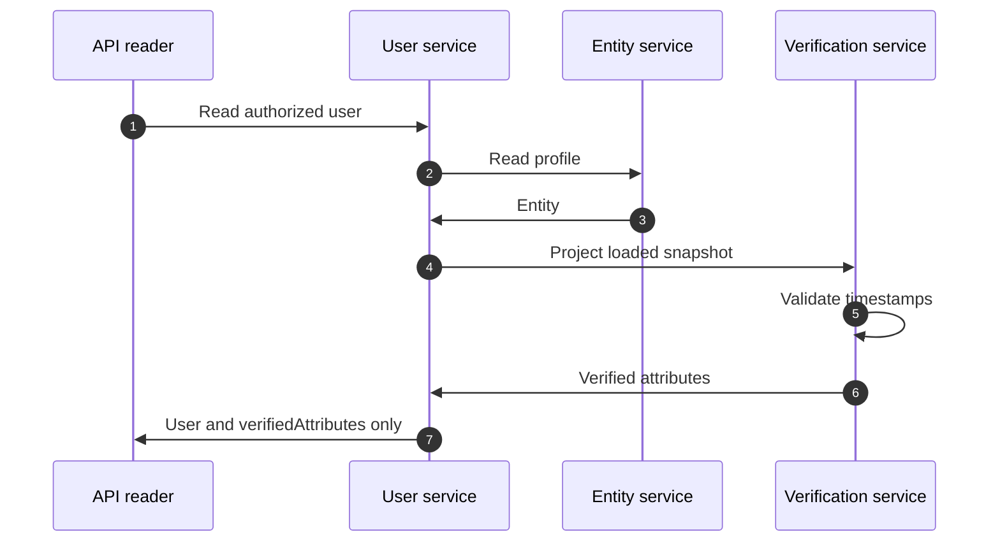
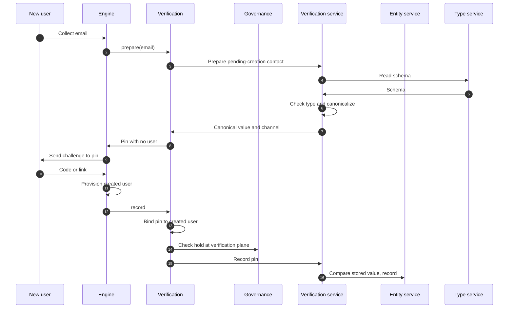
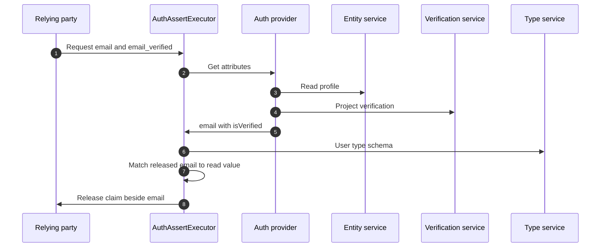
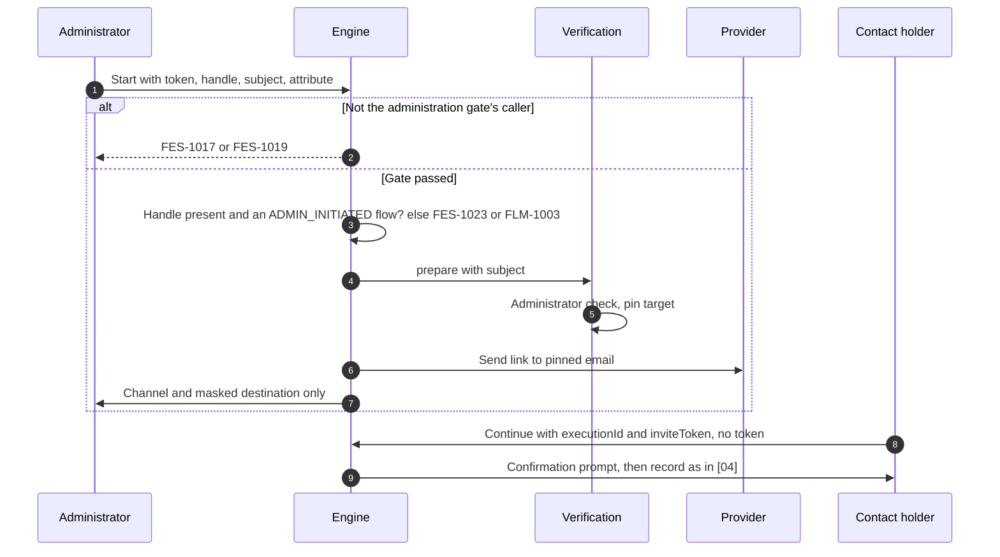

# Attribute Verification Threat Model

This model covers email and mobile attribute verification in ThunderID: the `SELF` flow type a signed-in user starts by handle with their access token, the shipped `default-self-attribute-verification-flow` and its Console templates, the `ADMIN_INITIATED` flow type an administrator starts by handle for another user and the shipped `default-admin-attribute-verification-flow`, the `AttributeVerificationExecutor` that pins a contact before the challenge and records proof after it, also when an operator places it in a recovery, registration or user onboarding flow, the inline node condition on `{{ctx(recipientType)}}` that picks the email or mobile branch, the attribute verification service that prepares and records verification, the entity service operations that write and invalidate it, the governance access check that refuses a suspended user, the read-only `verifiedAttributes` projection on user responses, and the `<attribute>_verified` claims released in tokens and UserInfo.

## Overview

This feature records point-in-time control of an email address or mobile number as server-owned metadata in `ENTITY.SYSTEM_ATTRIBUTES.attributeVerification`. Entry points are `POST /flow/execute`, the user read APIs (`GET /users/{id}`, `GET /users` and `GET /users/me`), and verification claims released in tokens and UserInfo. Self flow start binds the token subject once; an administrator-initiated start passes the administration gate and its target is pinned while the administrator's request is in flight; recording requires an executor-owned passed challenge for the pinned contact and a send to it since the pin, compares its current canonical value under the entity lock, and contact writes invalidate affected verification in the same transaction.

Cross-cutting concerns covered elsewhere: OAuth grants, token signing and resource-server validation are owned by the [OAuth authorization and core grants model](https://github.com/thunder-id/thunderid/blob/main/docs-internals/oauth/authorization-and-core-grants/threat-model.md). The [account lock and suspension model](https://github.com/thunder-id/thunderid/pull/5701) is a companion in review for governance and holds. Bearer-context construction on public paths, system authorization (`sysauthz`), flow execution and CALL frames, challenge primitives, notification transport and entity cache/lock infrastructure remain trust inputs; no dedicated companion model for each of those areas has been established by this review. Their verification-specific uses and limits are assessed below.

## Scope

This model covers:
- Configuration of self flows: the `SELF` flow type, `flow.selfFlow.expirySeconds`, the bootstrap flow `default-self-attribute-verification-flow`, the Console templates Self Attribute Verification and Self Attribute Verification with Email Link, the node condition that branches them, and flow management's pairing rule for `AttributeVerificationExecutor`.
- Starting a `SELF` flow: the caller check, handle resolution and the subject the engine binds to the execution.
- The self attribute verification flow with a one-time code by email or SMS: `AttributeVerificationExecutor` in `prepare` and `record` modes, the hold check at the verification plane, preparation in the attribute verification service, the node condition that picks the branch, `OTPExecutor`, `EmailExecutor` and `SMSExecutor`, and the SDK `UserProfile` and `VerifyAttribute` components that start it.
- The email link variant: `InviteExecutor`, the Gate invite page and the confirmation prompt.
- Administrator-initiated verification: the `ADMIN_INITIATED` flow type, `flow.adminInitiatedFlow.expirySeconds`, the start's administration gate and handle resolution, the `subject` input `prepare` reads, the bootstrap flow `default-admin-attribute-verification-flow` and its `admin-email-verification` template, and the user's continuation from the link.
- Verification in operator-built recovery, registration and user onboarding flows: the user each flow type supplies to `prepare`, the pin of a value collected for a user not created yet, and its binding to the created user at `record`.
- Guarded recording and invalidation in the entity service, including create, full update, partial attribute update and system attribute writes.
- The `verifiedAttributes` projection on user responses.
- The `<attribute>_verified` claims: the authentication provider's `isVerified` metadata, their resolution in `AuthAssertExecutor`, and the application configuration and consent that admit them.

Out of scope (owners are identified here and under External Dependencies):
- Token issuance, signing, refresh and UserInfo access control. Owned by the OAuth model; the claims here use the existing attribute snapshot and release configuration.
- The meaning of a `<attribute>_verified` attribute a user type's schema defines itself. Owned by the deployment that defines and fills it.
- Authorization to replace a contact (for example `PUT /users/me` without reauthentication). Owned by the user management area; this feature only clears verification when a contact changes.
- Recording verification from sign-in or `ADMINISTRATION` flows, gating sign-in on verification, and administrator assertion without proof. Not part of this design.
- The administrator's Verify action in a client such as the data-plane Console. Presentation only; the server boundary is interaction [09].
- Token generation, entropy and comparison inside `InviteExecutor` and `OTPExecutor`. Owned by those executors; inherited here unchanged.
- The security of mail and SMS providers and of the user's mailbox or handset.
- Declarative users, which are never eligible.

## Architecture

The process boundary separates trusted executors from clients; persistence and delivery providers have separate access and transport controls. A signed-in user starts a self flow with their bearer token; the engine takes the user from that token once, at the start, and stores it with the execution. An administrator starts an administrator-initiated flow with their own token; the target is pinned at `prepare` in that same request, and the user continues from the link. Later requests carry the execution secrets and the delivered code or link, not the token. Everything the record step relies on (the bound user, the pin, the passed marker and the senders' delivered recipients) stays inside the boundary in the encrypted execution store, and nothing a client sends is read as evidence. The challenge leaves through the provider to the mailbox or handset. A delivered recipient means the configured sender accepted the send, not that the intended human received it; the returned challenge is the evidence of destination control. A provider or mailbox compromise defeats that assumption.

### Design baseline

| Area | Design position |
| --- | --- |
| Meaning of verification | Proof of control of one stored contact at a point in time. It is not identity proofing, permanent ownership, safe account recovery or a sign-in. A `<attribute>_verified` claim states it for the contact value released in the same token or UserInfo response, as read at sign-in; a claim of that name the user type's schema defines carries the deployment's own meaning instead. |
| Who is verified | In a `SELF` execution, only the user bound at its start, taken from an access token this deployment issued; a self flow frame reached from an execution started as another flow type has no bound user and verifies no one. CALL frames in an execution started as `SELF` preserve its original bound user. In a recovery flow, the user it identified; in a registration or user onboarding flow, the user it established, or, for a pin made before the user existed, the user it created or identified by `record`, and only if that user's stored value is the pinned one. The user is read from runtime data, which only executors write, or the flow's authenticated user. In an `ADMIN_INITIATED` execution, the user the administrator names in the `subject` input, read only while the request reaching `prepare` carries the administrator. Otherwise inputs never name the user. Sign-in, `ADMINISTRATION` and sign-out flows have no user source. |
| Token subject contract | Self flow interprets the signed access token's `sub` as the intended local user resource ID. It does not resolve a profile-mapped subject to a local user. Issuers and application configuration must preserve this identity contract; token subject mapping is owned by the OAuth boundary. |
| Authority and evidence | Only the entity service owns persisted verification. The executor and challenge nodes own the pin and the passed marker, and the sender nodes own the delivered recipients. Clients cannot submit that evidence. The attribute verification service makes no caller, runtime-context or proof check, and the entity service's locked write trusts its in-process callers; the evidence check belongs to the executor, not to a second check in either service (05.6). |
| Self flows | Any `SELF` flow can be started by any signed-in user who names its handle. The engine gives such a flow only the bound user, which only `AttributeVerificationExecutor` reads. What a self flow is allowed to do is decided by whoever composes it (01.1). |
| Administrator-initiated flows | Only a caller with the root system permission can start an `ADMIN_INITIATED` flow; the engine applies the administration gate before resolving the handle. Continuations are public, as for an onboarding invite, because the target user finishes the flow without the administrator. The administrator never receives the link. What such a flow does is decided by whoever composes it (09.5). |
| Contact changes | The attribute verification service checks eligibility, canonical value and channel before the write; the entity service then resolves the contact schema before its transaction, then compares the locked entity's category, user type and canonical value using that schema snapshot. Changing a verified value deletes its timestamp atomically; returning to an earlier value never restores that timestamp by itself. There is no contact revision: a still-live proof for an earlier value can record it again when that value is current. This is the intended current-value contract, not a cancelled-proof guarantee. |
| Schema administration | User type definitions are trusted configuration in a separate database. The entity lock protects the user row, not concurrent schema edits. Operators coordinate schema changes with contact writes and outstanding proofs (05.10). |
| Holds | Automatic locks allow contact proof without adding to or clearing sign-in counts, and proof leaves `AuthUser` unchanged. The executor checks the user at the verification plane through the governance port before preparing an existing user and before recording, separately from the entity transaction; a suspension observed by those checks refuses with `FET-1114`, without an atomic commit-time suspension guarantee (05.9). Without a governance provider, or with governance disabled, no hold is checked. |
| Lifetimes and limits | Self flow executions expire after `flow.selfFlow.expirySeconds`, 1800 seconds by default, and administrator-initiated executions after `flow.adminInitiatedFlow.expirySeconds`, 86400 seconds by default, both with no maximum. The shipped code branches set `otpValidityPeriodSeconds: 300` and `maxAttempts: 3`; the latter caps generations, and the shipped `verify` nodes set `maxAttempts: 3`, which voids a code after three wrong codes. Deployment submission controls are a separate prerequisite (03.7). Expiry blocks use; physical retention depends on the runtime store and operations (06.5). |
| Audit | Verification events are conditional on observability, which ships disabled. Publication is separate from the entity write and is not a durable audit guarantee (03.14, 05.7). |
| Embedded hosts | The host supplies providers, runtime storage and the request security context. Without a verification provider the executor fails with a server error and records nothing; without a governance provider verification runs with no hold check. A start without a self-issued user token, or an administrator-initiated start, is refused before any flow is resolved, since the host supplies no bearer context. |

### Components

The shipped flow is a graph of existing nodes around the new executor. The executor never sends, never checks a challenge, never reads the profile and never writes the entity; governance decides holds, the attribute verification service decides eligibility, and the entity service is the only writer.

| Component | Task |
| --- | --- |
| Flow management and server configuration | Accept `SELF` and `ADMIN_INITIATED` flows. Reject a flow of any type that has `AttributeVerificationExecutor` in one of `prepare` and `record` without the other, and a node of that executor without a mode. Reject `flow.selfFlow.defaultHandle` and `flow.adminInitiatedFlow.defaultHandle`; accept nonnegative `expirySeconds` for both. Require `senderId` on `SMSExecutor`, which the shipped flow's `{{SENDER_ID}}` placeholder satisfies until an operator selects a sender. |
| Flow engine start | For `SELF`: require an access token this deployment issued with a subject (`FES-1017`), then a handle (`FES-1023`), then resolve the handle among `SELF` flows only (`FES-1025` when none matches). Ignore `applicationId`, load no application, bind the token's subject to the execution and set the self flow expiry. For `ADMIN_INITIATED`: apply the administration gate (an authenticated caller, not a runtime context, with a subject and the root system permission; `FES-1017` or `FES-1019`), then require a handle (`FES-1023`) and resolve it among `ADMIN_INITIATED` flows only (`FLM-1003`); load no application, bind no subject and set that type's expiry. The flow ID entry point admits only `ADMINISTRATION` flows, and the internal initiation used by authorization, CIBA and sign-out refuses `SELF` and `ADMIN_INITIATED`. Continuations re-check the administrator only for `ADMINISTRATION`. |
| Flow engine execution | Persist the bound subject with the encrypted execution context, copy it read-only into each node's context, keep it across CALL frames and never make it the flow's authenticated user. Continue an execution publicly by execution ID; a continuation cannot change the bound subject. |
| Node condition | An existing flow primitive: the email branch's first node carries `condition {key: '{{ctx(recipientType)}}', value: email, onSkip: <mobile branch's first node>}`, so it runs for an email contact and the flow otherwise skips to the mobile branch. The placeholder resolves from runtime data first and falls back to user inputs only when the runtime value is empty; `prepare` writes `recipientType` from the pin before the condition runs, and nothing later changes it. Flow management requires `onSkip` to name an existing node. The Console builder shows the skip target as a read-only **On skip** edge. A flow created from either template keeps the condition; if a save from the builder drops it, the mobile branch becomes unreachable and flow management refuses the save, so a lost condition fails closed. |
| `AttributeVerificationExecutor` | `prepare`: take the user from the flow type (the bound subject in `SELF`, the consumed `subject` input in `ADMIN_INITIATED` only while the request carries the administration gate's caller, the established user in recovery, registration and onboarding) and refuse with `FET-1132` when the type has none or, outside registration and onboarding, no user is established; read the `attribute` input, which the caller supplies unless a constant executor input on the node fixes it (the task node then writes it over any caller value), or on a resend the existing pin's attribute; for an existing user, check it at the verification plane through the governance port and call the verification provider for it, or, in registration or onboarding before the user exists, call the provider for the collected value and the resolved user type; store the evidence `{pin}` on shared runtime data and clear `deliveredRecipients` there; write the user ID, `recipientType` and the pinned value as `expectedRecipient` into runtime data, and clear the stored invite token and link; return the channel and masked destination as presentation data. `record`: require the pin and the passed marker, require `deliveredRecipients`, the distinct recipients of every send since the pin, to be non-empty and each equal the pinned value canonically for the pin's channel, bind a pin with no user to the user the flow established since (refusing when there is none), check that user at the verification plane again, then call the verification provider with the pin. A suspension observed by either check fails the node with `FET-1114`; any other refusal fails it with `FET-1112`; success and both refusals clear the expected recipient, the evidence and the delivered recipients. A server error from either provider stops the flow. Without a verification provider, either mode is a server error. |
| `OTPExecutor` | With a pin present, `generate` checks the user at the verification plane and resets the passed marker; each generation replaces the session token, so an earlier code no longer verifies. `verify` sets the passed marker only after a correct code, and checks the code as a contact proof: it marks the context as a contact verification, so the authentication provider submits a correct or wrong code at the verification plane, a wrong code is never counted toward a lock, a correct one is admitted without clearing the failure count, and neither sets the flow's authenticated user. Without a pin it behaves as in any flow. |
| `InviteExecutor` | `generate` is unchanged: it reuses a stored token or issues a new one, and `prepare` clears the stored token, so each pin gets a new one. With a pin present, `verify` sets the passed marker only after the submitted token matches the stored token. Returns the link to the caller only in onboarding flows. |
| `OTPExecutor` wrong-code cap | In any flow, a `verify` node with `maxAttempts` counts each submitted wrong code in runtime data and, at the cap, voids the code with `FET-1009` until `generate` issues a new one, which resets the count. Without the property nothing is capped. |
| `EmailExecutor`, `SMSExecutor` | Know nothing about pins. When `recipientType` names the sender's type (`email` or `mobile`), read the recipient from `expectedRecipient` when an earlier node set it, before every other source (constant input, forwarded data, runtime data, user inputs, profile). After an actual send, add the recipient to the `deliveredRecipients` list on shared runtime data unless already listed, the same key for every sender; a list that does not decode fails the node before sending. A skipped, best-effort-failed or failed send writes nothing; a skipped send reports the sender flag as true, as in every flow. In a `SELF` or `ADMIN_INITIATED` flow, a missing or unknown SMS sender fails with `FET-1042`. |
| Identity governance provider | Its existing access check at the verification plane refuses a suspended user and states the suspension; an automatic lock neither holds nor counts there. It holds no verification operation. The disabled provider, like a missing one, admits, so no hold is checked. |
| Attribute verification service (`AttributeVerificationProvider`) | The internal service behind the engine port the executor calls, implementing it directly, as flow management implements `FlowProvider`; no adapter, caller or runtime-context check sits between them. Preparation is one operation taking an `AttributeVerificationRequest`: for an existing entity, require a user that is not declarative, read the entity profile through the entity service and the user type schema, and pin an eligible canonical contact without a write lock; for an entity pending creation, check the collected value against the user type schema directly, pinning an eligible canonical value with no user. Recording: read the profile and schema again and require the pin to equal the current eligible contact, then ask the entity service for its locked write. Refusals are the service's client error `AVS-1001` ("Attribute cannot be verified"), which the executor shows as `FET-1112`. Publish `ATTRIBUTE_VERIFICATION_REQUESTED` (for an existing user only), `ATTRIBUTE_VERIFICATION_VERIFIED` and `ATTRIBUTE_VERIFICATION_REFUSED` events, with component `AttributeVerification`, user ID and attribute. Projects, on each read of a loaded entity, which recorded verifications count, for user responses and authentication assurance, without reading the schema. The requested event's actor is the caller's subject when the request carries one (the administrator in `ADMIN_INITIATED`), else the user; verified and refused events name the user. |
| Entity service writes | `RecordAttributeVerification` resolves the contact schema before the transaction and, under the entity lock, sets `verifiedAt` only while category and user type are unchanged and the canonical value using that schema equals the pinned value, the comparison invalidation uses; it trusts its in-process caller, the attribute verification service. Owns the storage format for the locked write, the reserved-key merge, the create-time strip and invalidation, and exposes recorded evidence from a loaded entity without applying verification policies or reading storage. Drops `attributeVerification` on create, preserves it on system attribute writes, and removes the verification of every changed or removed contact, then publishes `ATTRIBUTE_VERIFICATION_INVALIDATED`, with component `EntityService`, after the write commits. It projects nothing. |
| Default authentication provider (attributes) | Reports each attribute's `isVerified` from the verified contacts the attribute verification service projects, on the sign-in result and on attribute reads. |
| `AuthAssertExecutor` | For each requested `<attribute>_verified` whose name the user type's schema does not define and whose attribute is an `email` or `mobile` property: skip runtime data and external claims, and release a boolean only beside the released contact, `true` only when the released value equals the provider value whose `isVerified` was read. For agents, and without an entity type service (the embedded engine), and for a schema-defined name, the name is resolved like any attribute. |
| Application configuration and consent | For an application with allowed user types, accept `<attribute>_verified` in attribute lists and scope-to-claims mappings only for an `email` or `mobile` attribute of one of those types, or a name the schema defines; an application without allowed user types reconciles no attribute name, this one included. Consent treats a `<attribute>_verified` the server issues for the user's type as available whenever `<attribute>` is. |
| User service projection | Sets `verifiedAttributes` from the attribute verification service's projection of an already loaded entity: `verifiedAt` for each entry of a mutable user, and `{}` when none is recorded. For a user whose verification state cannot be read the field is omitted, so it reads as unknown, never as unverified or verified. No stored metadata or other system attribute is returned. |
| Console | The user page shows a compact outlined Verified or Unverified text status from `verifiedAttributes`; it starts no verification. The flow builder offers the Self type and the two templates, and has no editor for their node condition. |
| Gate invite page | Continues the execution with `executionId` and `inviteToken` from the link and renders the confirmation prompt, for the self link variant and the administrator-initiated flow alike. |
| SDK `UserProfile`, `VerifyAttribute` | Show status from `verifiedAttributes`, start the flow by handle (`default-self-attribute-verification-flow` unless the application names another) once per opening with the access token attached by the SDK's authenticated client, and re-read `/users/me` on completion. The built-in mobile profile exposes only the status in its display and accessibility label. Custom renders can read the timestamp from the server-owned profile data. |

### Actors

#### Actors

| Actor | Description | Roles or permissions |
| --- | --- | --- |
| Signed-in user | Verifies their own email or mobile number through a self flow from an application such as the ThunderID Account sample. | An access token this deployment issued whose subject is the intended local user resource ID; no verification-specific permission |
| Administrator | Asks a user to verify their email through an administrator-initiated flow. | An access token whose context carries the root system permission; the shipped flow's `PermissionValidator` also requires `system:user` |
| Recovering, registering or invited user | Completes an operator-built recovery, registration or onboarding flow that verifies a contact. | The flow's own entry: an application's flow binding, or an invite link an administrator sent; no access token |
| Contact holder | Whoever controls the destination the code or link reached; completes the flow. | Possession of the execution ID, the challenge token or invite token, and the delivered code or link |
| Flow author or operator | Composes self and administrator-initiated flows, selects delivery providers and templates, and sets the self and administrator-initiated flow expiries. | Root `system` on flow management, server configuration and imports; deployment-file access for declarative resources |
| API reader | Reads users and their `verifiedAttributes`. | Existing user read permissions, or the user's own token for `/users/me` |
| Relying party | An application that receives a user's tokens and UserInfo after sign-in. | Its own OAuth configuration, scopes and the user's consent |
| Mailbox or link scanner | Software that opens or submits links delivered to the mailbox. | Possession of the link; opening alone records nothing, but software that submits confirmation can complete the contact proof |
| Holder of a stolen user token | Impersonates a user when starting self verification. | The token's user binding, subject to the external token-validation boundary |
| Onboarding initiator | Starts onboarding and receives its generated invite link under the existing contract. | The onboarding start's existing authorization; trusted to handle the invite secret (07.5) |
| Notification provider | Handles outgoing codes and links and their destination. | Trusted delivery credentials; access to challenge content, not an entitlement to change profiles or verification metadata |
| Deployment or embedding administrator | Controls storage, crypto, configuration and provider wiring. | Trusted host and deployment authority, outside end-user authorization |

#### Entitlement matrix

`[Yes]` is conditional on the stated proof and permissions; roles are not exclusive. `system:user:view` permits management reads and `system:user` includes viewing, subject to OU scope; root `system` covers every OU. Permission names gain the configured system resource-server handle prefix when set. A stolen token carries its holder's entitlements; a delivery provider learns the challenge but gains no profile-write API. Administrators have no API action that directly sets verification: they read status as API readers, compose flows as flow authors and start administrator-initiated flows, whose proof comes only from the user. An onboarding initiator also handles the invite secret and is part of that flow's trust boundary (07.5). Deployment administrators control the trust boundary rather than receiving an end-user entitlement.

| Actor | Configure self flows | Start self verification | Start verification for another user | Complete with the code or link | Read verification status | Set verification directly |
| --- | --- | --- | --- | --- | --- | --- |
| Signed-in user | [No] | [Yes], for their own contact | [No] | [Yes], only with the delivered code or link | [Yes], through `/users/me` | [No] |
| Recovering, registering or invited user | [No] | [No] | [No] | [Yes], only with the delivered code or link | [No] | [No] |
| Contact holder | [No] | [No] | [No] | [Yes] | [No] | [No] |
| Flow author or operator | [Yes] | [No], except as a signed-in user | [No], except as an administrator | [No] | [No] | [No] |
| API reader | [No] | [No] | [No] | [No] | [Yes] | [No] |
| Mailbox or link scanner | [No] | [No] | [No] | [Yes], only if it also submits confirmation | [No] | [No] |
| Relying party | [No] | [No] | [No] | [No] | [Yes], as `<attribute>_verified` beside a contact it is configured to receive | [No] |
| Administrator | [No], unless also a flow author | [No], except as a signed-in user | [Yes], with an `ADMIN_INITIATED` flow; the shipped flow sends the link to the user's stored email when the administrator names an email attribute | [No], the link is not returned to the administrator | [Yes] | [No] |
| Onboarding initiator | [No] | [No] | [No] | [Yes], if given the invite and all remaining graph steps permit completion | [No] | [No] |

### External Dependencies (not owned)

| Dependency | Description (usage, purpose, authentication, authorization, security) |
| --- | --- |
| Bearer token middleware | Supplies the request security context on `POST /flow/execute`. The path is public, so the self flow start asserts a subject from a token this deployment issued, and the attribute verification service requires that subject to be a user; the administrator-initiated start asserts an authenticated caller with the root system permission. A self-issued token must carry the RFC 9068 access token `typ`, so ID and refresh tokens are refused. Signature, lifetime and revocation enforcement belong to the middleware; this model does not establish complete middleware correctness. |
| Account access policy | Decides holds through the governance provider. `prepare` for an existing user and `record` check the user at the verification plane, and for a pinned contact, in any flow type, the code generation and the code check are evaluated there too, where an automatic lock refuses nothing and a suspension refuses; a wrong verification code is submitted there too, where no failure is ever counted, and a correct one does not clear the failure count. |
| Flow engine execution store | Holds runtime and shared runtime data and the bound subject, encrypted with AES-GCM. Self flow TTL is `flow.selfFlow.expirySeconds`, default 1800 seconds; administrator-initiated TTL is `flow.adminInitiatedFlow.expirySeconds`, default 86400 seconds. Continuation updates preserve the initial TTL. CALL frames do not restore shared evidence. Database expiry filters reads without deleting expired rows (06.5); Redis and embedded stores have their own retention. No dedicated companion model is established here. |
| SMTP connection and SMS sender | Deliver the code or link. Selected by the operator on the sender node. Their transport security and credentials are owned by the connection and notification areas. |
| Notification templates | The shipped flow reuses the existing `otp` email and SMS templates; the email link template uses `self-email-verification`; the administrator-initiated flow uses `admin-email-verification`. |
| Entity type service | Supplies the schema that decides eligibility and channel. An unreadable schema refuses the operation. Schema resolution precedes the entity transaction; configuration changes are separately authorized and coordinated (05.10). |
| Deployment challenge-abuse controls | Operators enforce and test shared limits for starts, challenge submissions, concurrent executions and sends on `/flow/execute`, across replicas and executions, before enabling verification. This assessment does not establish a deployed policy or its effectiveness (03.7, 03.9). |
| Observability bus | Verification publishers run only when observability is enabled; `observability.enabled` and the shipped console output are false by default. Operations enable the Administration category and flow events in a durable sink and set access, retention and alerts. Publication is not transactional with the entity write. |
| Storage, caches and clock | Operations protect entity and execution stores, encryption keys and backups, use shared storage/cache configuration across replicas and consistent reads for authority checks, and synchronize clocks. Restore profile attributes and their metadata together; restored or retained execution state remains sensitive. Embedded hosts choose their own runtime-store topology. |
| Gate invite page | Existing onboarding page reused to continue the flow from the link. |
| REST authentication provider | A deployment's external provider reports its own `isVerified` per attribute; the assertion trusts it as it trusts the provider's attribute values. |

## Threats and mitigations

### Out-of-scope interactions and risks

- A hijacked session or an administrator replacing a contact without reauthentication or old-channel notification. Owned by user management; this feature clears verification on the change, so a replaced contact is never shown as verified. Contact update, including notifying the old contact, is outside this feature.
- Weakness of the invite token itself: a UUIDv7 in the query string compared with a plain string comparison. Owned by `InviteExecutor` and shared with onboarding, so any hardening is an upstream change outside this feature; the consequence here is bounded in interaction [04].
- Compromise of the user's mailbox or handset, shared mailboxes and reassigned numbers. Verification proves control at a point in time, not ownership or identity proofing.
- Bypass of the bearer token middleware or the API permission model. Trust inputs here.
- Delivery security of the SMTP or SMS provider.
- A deployment's own `<attribute>_verified` attribute, defined in a user type's schema and filled by a flow, an administrator or a federated provider. The deployment owns its source and meaning; this feature releases it unchanged.

### Interactions

#### [01]: Configuring self flows

**Description**

Self flows use the same organization-unit ownership validation as other managed flows. The shipped flow belongs to the default organization unit (`ouHandle: default`); ownership does not restrict which signed-in users may start it by handle.

An operator or flow author creates a `SELF` flow, usually from the Console's Self Attribute Verification or Self Attribute Verification with Email Link template, or uses the shipped `default-self-attribute-verification-flow`. The flow starts with `AttributeVerificationExecutor` in `prepare` mode, then a challenge branch per channel whose email branch starts with a node condition on `{{ctx(recipientType)}}` that skips to the mobile branch for a mobile contact, and `record`. The SMS node carries `senderId: "{{SENDER_ID}}"` until the operator selects a sender. `flow.selfFlow.expirySeconds` sets the execution expiry of every `SELF` flow (1800 seconds by default); each `SELF` start requires an explicit flow handle, so the server does not infer the operation from the flow type. Flow management rejects a flow of any type with only one of the executor's two modes, and a node of the executor without a mode.

**Assets involved**

| Initiator | Intermediate | Target |
| --- | --- | --- |
| Flow author or operator | Flow management API, server configuration API, Console flow builder | Flow definitions and the `flow` server configuration section |

**Data flow**

**Security considerations**

| Area | Response | Comments |
| --- | --- | --- |
| Data confidentiality | [C-Low] | Flow graphs and handles are configuration, not secrets. |
| Communication medium | [M-NT], [M-DB] | Management API over the network, persisted in the configuration database. |
| Transport security | [TLS] | On the management listener. |
| Authentication | Bearer token on the management APIs | |
| Accessibility | [Restricted] | |
| Authorization and Access Control | Existing flow management and server configuration permissions | |

**Threat assessment**

| ID | Category | Threat | Materializable | Mitigation / comment |
| --- | --- | --- | --- | --- |
| 01.1 | [Elevation of Privilege] | A flow author publishes a `SELF` flow whose nodes act on a user or address named in inputs, and every signed-in user can start it by naming its handle. | [Yes] | Accepted: trusted composition. Every `SELF` flow can be started by any signed-in user with a self-issued token; executors run with runtime privilege, as in every flow. The engine gives a self flow only the bound user, which only `AttributeVerificationExecutor` reads, so no shipped executor acts on another user from it. Operations publish only self flows whose every step is safe for any signed-in user acting on themself. Residual: trusted composition. |
| 01.2 | [Process Risk] | A trusted author removes the confirmation prompt from the link variant, allowing a link prefetch to record, or places a sender or challenge step before `prepare`, so the flow sends to whatever address its inputs name, so a code someone else also received records. | [Yes] | Accepted: graph authors control these paths. Validation checks that `prepare` and `record` both exist, not their order; senders act the same in every flow, and without a pin challenge steps behave as in any flow type. The shipped flow and both templates start with `prepare`, send once per code to the recipient `prepare` set, and keep confirmation before `record` in the link variant. The evidence check still prevents a send alone from recording: `record` needs a pin, a challenge passed after it and a send since the pin, every one delivered to the pinned value, on any channel, so a code or link also sent elsewhere since the pin records nothing. A code sent before the pin cannot pass, because `prepare` clears the OTP session token and the stored invite, unless a CALL-frame restore brings an older token back (04.6). After the pin every sender reads the recipient `prepare` set, and a node that rewrites `expectedRecipient`, such as an `HTTPRequestExecutor` response mapping, cannot hide a send elsewhere, because each sender lists where it actually sent. Operations review custom graphs before publishing them. Residual: trusted composition. |
| 01.3 | [Tampering] | A flow prepares without recording, and completes as if verified, or records without preparing. | [No] | Flow management rejects a flow with only one of the two modes, in every flow type, and a node without a mode. `record` refuses without a pin. |
| 01.4 | [Operational Risk] | The mobile branch runs with no SMS sender selected, or the email branch with no email provider, and verification cannot complete. | [No] | Flow validation requires an SMS `senderId`; the shipped placeholder selects no real sender, so the branch fails with `FET-1042`. The email branch has no selected provider and fails with `FET-1038` until configured. Failed sends add no delivered recipient and cannot record verification. |
| 01.5 | [Tampering] | The branch's node condition reads a value the client controls, such as a `recipientType` input, so a client steers a pinned email contact into the mobile branch, or the reverse. | [No] | The condition resolves `{{ctx(recipientType)}}` from runtime data first and reads user inputs only when the runtime value is empty; in the shipped flow and templates `prepare` writes `recipientType` from the pin before the condition runs, on the start and on every resend, so an input never decides the branch. A custom graph that evaluates the condition before `prepare` has no pin, so nothing it sends before the pin can be recorded. If the other channel's branch runs after the pin, its sender ignores the expected recipient, which is of the other type, and may send to one it resolves itself; its delivered recipient cannot equal the pin, so `record` refuses, even when a send to the pin follows. |
| 01.6 | [Security Risk] | A long `flow.selfFlow.expirySeconds` keeps an email link or a resend window open longer than intended. | [No] | The execution expiry is the operator's configuration, 1800 seconds by default, and applies to every self flow. A code or link can still record only the pinned contact while it is current, and each code keeps its own configured lifetime, 300 seconds in the shipped flow. |

#### [02]: Starting a self flow

**Description**

The application, through the SDK, calls `POST /flow/execute` with the user's bearer token and `{"flowType": "SELF", "handle": "<handle>", "inputs": {"attribute": "email"}}`. The engine checks the flow type, then requires an access token this deployment issued with a subject and refuses otherwise with `FES-1017`; only then does it require a nonempty handle (`FES-1023`) and resolve it among `SELF` flows only, refusing an unknown handle with `FES-1025`. It ignores `applicationId`, loads no application, binds the token's subject to the execution and sets the self flow expiry. The bound subject is stored with the encrypted execution context, copied read-only into each node's context, kept across CALL frames and never becomes the flow's authenticated user. Continuations need the execution ID and the current challenge, not the token, and cannot change the bound subject.

**Assets involved**

| Initiator | Intermediate | Target |
| --- | --- | --- |
| Signed-in user through an application or SDK `UserProfile` | Bearer token middleware, flow engine start, flow management handle lookup | The bound subject in the execution context |

**Data flow**

**Security considerations**

| Area | Response | Comments |
| --- | --- | --- |
| Data confidentiality | [C-Medium] | The bound subject is a user ID, held in the encrypted execution store. |
| Communication medium | [M-NT], [M-DB] | Application to server, then the execution store. |
| Transport security | [TLS] | On the deployment's listener. |
| Authentication | Bearer access token this deployment issued, asserted by the self flow start | |
| Accessibility | [Public] | The path is public; the start refuses a caller without a self-issued user token before resolving the flow. |
| Authorization and Access Control | The bound subject selects the verification user; other graph actions remain the author's responsibility (01.1) | No verification-specific permission, as for `GET` and `PUT /users/me`. |

**Threat assessment**

| ID | Category | Threat | Materializable | Mitigation / comment |
| --- | --- | --- | --- | --- |
| 02.1 | [Spoofing] | An unauthenticated caller, or one with an expired or malformed token, starts a self flow, triggers sends or learns which handles exist. | [No] | The caller check runs before the handle is read or resolved, so such a caller gets `FES-1017` for every handle, existing or not. Validating the token is the bearer token middleware's. |
| 02.2 | [Spoofing] | A client-credentials, agent or other non-user token starts verification, or a token from a trusted external issuer whose subject equals a local user ID selects that user. | [No] | The start requires a token this deployment issued, so a trusted external issuer's token is refused. A self-issued token whose subject is suspended is refused by the hold check at `prepare`, and one whose subject is not an existing, non-declarative user is refused by the attribute verification service there, before anything is sent. |
| 02.3 | [Elevation of Privilege] | A caller names another user through a `subject` input, or continues the execution with another user's token, to verify that user's contact. | [No] | The engine binds the user only from the start token; no input is read as the user, and continuations cannot change the bound subject. On a resend `prepare` refuses a pin whose user differs from the bound one. |
| 02.4 | [Elevation of Privilege] | A caller starts an authentication, registration or administration flow through the self flow entry point, or a self flow through the flow ID or an internal initiation entry point, to bypass the guards of either. | [No] | The handle is resolved among `SELF` flows only. Starting by flow ID admits only `ADMINISTRATION` flows, after its own caller check, and the internal initiation used by authorization, CIBA and sign-out refuses `SELF`. |
| 02.5 | [Elevation of Privilege] | Another flow, for example a sign-in flow, CALLs a self flow, so `prepare` pins a user the calling flow chose. | [No] | Only a `SELF` start binds a user. An execution started as sign-in or another type therefore has no bound user in its self flow callee, so `prepare` refuses with `FET-1132`. An execution started as `SELF` preserves its original user across CALL frames; a callee cannot replace that binding. |
| 02.6 | [Information Disclosure] | A signed-in user learns which self flow handles exist from `FES-1025`. | [No] | Handles are configuration, not secrets, and every self flow is meant to be startable by any signed-in user (01.1). |
| 02.7 | [Spoofing] | A stolen user access token impersonates the user to read masked destinations or request codes. | [Yes] | Bounded: it can act on that user's stored contact, not choose another user. Completion still requires the contact challenge. The token's existing profile-write authority is not proof of contact control. Operations protect bearer tokens and limit sends. Residual: token authority. |
| 02.8 | [Spoofing] | Another application's access token whose subject names a local user starts verification and sends a code without verification-specific authority. | [Yes] | Bounded: no verification-specific audience or scope is checked, matching the current `/users/me` boundary, and the start ignores `applicationId`. The subject must name a local mutable user; profile-mapped subjects are not resolved here. ID and refresh tokens are refused; trusted external subjects never select a local user. Completion still needs the stored-contact challenge. Whether to narrow token authority remains a product decision. Residual: token authority. |

#### [03]: Verifying a contact with a one-time code

**Description**

`prepare` takes the bound user and the `attribute` input (pausing for it when absent), or when the flow returns to it the existing pin's attribute. It checks the user at the verification plane through the governance provider, where a suspension refuses with `FET-1114`, then calls `PrepareAttributeVerification` on the attribute verification service. That service requires an existing user, reads the entity profile through the entity service with the user type schema, refuses a declarative user, checks eligibility and returns the pin without taking a write lock or writing anything; its refusals (`AVS-1001`) fail the node with `FET-1112`. Every refusal comes before a challenge is generated. Recording later checks eligibility and channel in the attribute verification service, then the entity service compares the pinned canonical value with the locked entity using a separately read schema snapshot (05.10), so a stale preparation profile cannot verify a different stored contact. `prepare` stores the pin, clears the earlier delivered recipients and the stored invite, writes the user ID, `recipientType` and the pinned value as the expected recipient into runtime data, never the contact value under an attribute name, and returns the channel and a masked destination. The node condition on the email branch's first node runs it for an email contact and otherwise skips to the mobile branch; a `recipientType` input or an action the client sends does not change the branch. `OTPExecutor` generates a code; the sender for the branch sends it to the recipient `prepare` set and records where it sent. The user submits the code with the execution ID and challenge token; `OTPExecutor` verifies it as a contact proof and sets the passed marker, and a wrong code returns to the code prompt; the third wrong code voids the code until a resend (`maxAttempts: 3` on the shipped `verify` nodes). `record` requires the pin, the passed marker and a send since the pin, every one delivered to the pinned value, checks the user at the verification plane again and calls the verification provider. Resend returns to `prepare`, which pins the current value of the same attribute again, checks the user again, publishes another requested event and returns the display data again; the branch's `OTPExecutor` (`generate`) then issues a new code, which replaces the earlier one; `OTPExecutor` caps generations per execution (`maxAttempts: 3`) and each code lives 300 seconds in the shipped flow.

**Assets involved**

| Initiator | Intermediate | Target |
| --- | --- | --- |
| Signed-in user through an application or SDK `UserProfile` | `AttributeVerificationExecutor`, the node condition, `OTPExecutor`, `EmailExecutor` or `SMSExecutor`, the governance hold check, the attribute verification service, the entity service | Shared evidence in the execution store, the code delivered to the stored contact, and the recording request to the attribute verification service |

**Data flow**

**Security considerations**

| Area | Response | Comments |
| --- | --- | --- |
| Data confidentiality | [C-High] | The one-time code is a short-lived secret; the contact value stays in the encrypted execution store and the response carries a masked destination only. |
| Communication medium | [M-NT], [M-DB] | Application to server, execution store and entity database, then the provider to the mailbox or handset. |
| Transport security | [TLS] | On the deployment's listener; provider transport is the connection's. |
| Authentication | The bound user from the start; the code at completion | Continuation needs the execution ID, challenge token and code, not the token. |
| Accessibility | [Public] | Continuation of `POST /flow/execute` by execution ID. |
| Authorization and Access Control | Subject-bound evidence: the user verifies only their own stored contact | |

**Threat assessment**

| ID | Category | Threat | Materializable | Mitigation / comment |
| --- | --- | --- | --- | --- |
| 03.1 | [Tampering] | A signed-in user adds a `mobile_number` or `email` input so that the flow sends its code to someone else's number or address, using ThunderID as a message relay, then confirms it. | [No] | `prepare` sets the pinned value as the sender's recipient, which each sender reads before inputs, forwarded data, runtime data or the profile, so in the shipped flow a code goes only to the user's stored contact. Each actual send also records its recipient, and `record` refuses unless every send since the pin went to the pinned value. A sender in a called flow of a custom graph does not see the recipient and resolves its own, which is trusted composition (01.2); what it sends elsewhere cannot record. |
| 03.2 | [Tampering] | A caller sends the other channel's action at the start, for example `mobile` for an email address, to send a challenge somewhere unexpected. | [No] | The branch follows the node condition on `recipientType`, which `prepare` wrote from the pin; the request's action and inputs do not select it. If a branch for another channel still runs in a custom graph, its sender may send to a recipient it resolves itself, but its delivered recipient cannot equal the pin, so `record` refuses, even when a send to the pin follows. |
| 03.3 | [Tampering] | The user names an ineligible attribute: a credential, an attribute of type `string`, an array item, a nested property, or an empty value, or is a declarative user. | [No] | The attribute verification service requires an existing mutable user and checks the profile and schema for a top-level, noncredential `email` or `mobile` property holding a nonempty string. Recording repeats those checks and the entity service compares the pin with the locked entity using the schema read before the transaction (05.10). A preparation refusal happens before challenge generation; recording can still refuse after a challenge is passed. |
| 03.4 | [Tampering] | A skipped or failed sender call is treated as proof of delivery and the flow records. | [No] | Only an actual configured send adds a delivered recipient; a skipped, best-effort-failed or failed send writes nothing, and `record` requires at least one delivered recipient since the pin. A skipped send reports the sender flag as true, as in every flow, so the flag is presentation only and never read as evidence. The provider remains trusted to deliver what it accepts; a delivered recipient does not prove physical receipt by the human. |
| 03.5 | [Tampering] | A code generated before `prepare`, or before a resend, is verified after it. | [No] | A resend re-enters `prepare` and then `generate`, which replaces the session token, so the earlier code no longer verifies. `prepare` clears the OTP session token, so a code generated before it no longer verifies, and clears the delivered recipients, so only a send since the pin counts. A code `prepare` voided is answered as a wrong code (`FET-1008`), not a server error. |
| 03.6 | [Tampering] | User inputs, forwarded form values or response data manufacture the pin, the passed marker or the delivered recipients. | [No] | The evidence and the delivered recipients are shared runtime data written only by executors. No evidence is decoded from user inputs, forwarded data or additional response data. |
| 03.7 | [Security Risk] | Missing or ineffective deployment challenge-abuse controls undermine confidence in contact proof. | [Yes] | Bounded only within the assessed deployment boundary: operators enforce and test shared submission and concurrent-execution limits across replicas and executions on `/flow/execute` before enabling verification. The shipped 300-second code lifetime, the three wrong codes a code accepts and the generation cap bound serial guessing to nine codes per execution, since parallel submissions on one execution can read the same count, but do not establish that policy; sign-in locks are not the compensating control. A deployment without verified controls is outside this assessment. Residual: proof-attempt limiting. |
| 03.8 | [Denial of Service] | Wrong codes, submitted by the user or by anyone holding the execution ID and challenge token, lock the user's one-time-code sign-in. | [No] | The authentication provider submits a verification code at the verification plane, where the account access policy counts no failure, and a correct code does not clear the count. |
| 03.9 | [Denial of Service] | Repeated resends or new executions flood the user's mailbox or phone and consume paid SMS volume. | [Yes] | Bounded to the user's own pinned contact and, in shipped code branches, three generations per execution. New executions remain possible with the user's token; the cap does not cover aggregate volume or link sends. A requested event is emitted at each preparation, including each resend, only when observability is enabled and does not prove delivery. Operations enforce per-user and per-destination send limits and provider quotas. Residual: delivery abuse. |
| 03.10 | [Elevation of Privilege] | A user under an automatic lock passes a verification code and uses it to sign in, for example through a sign-in flow that CALLs a self flow. | [No] | A self flow callee in an execution started as sign-in has no bound user, so `prepare` refuses before anything is sent (02.5). The verification-plane admission applies only to the code of a pinned contact, and a passed code leaves the flow's authenticated user unchanged. |
| 03.11 | [Elevation of Privilege] | The user is suspended after a code was sent and still completes the flow. | [No] | Code admission and the hold check in `record` each refuse a suspension they observe, at the verification plane through the governance provider. Neither makes the hold read atomic with the entity write; that bounded ordering limit is 05.9. |
| 03.12 | [Information Disclosure] | The response, logs or events reveal the full contact or the code. | [No] | The response carries a masked destination. Sender logs mask the recipient. Verification events carry the user ID and attribute name, never the contact or code. The user already sees their own contact through `/users/me`. |
| 03.13 | [Security Risk] | The embedded engine or a root without a verification or governance provider runs the executor and records through a fallback path, or verifies a suspended user. | [No] | With no verification provider the executor returns a server error and the flow stops; the executor has no profile-update fallback. With no governance provider, or with governance disabled, the hold check admits, as every other access check then does, so no plane enforces a suspension and verification matches sign-in. A host that suspends users supplies governance. |
| 03.14 | [Repudiation] | A preparation or recording cannot be traced to the user it concerned. | [Yes] | Accepted deployment dependency: observability ships disabled. When enabled, requested, verified and refused events carry the user, attribute and the user as actor; requested means prepared, not delivered. Refused preparations, a pin for a user not created yet, and executor evidence and hold refusals use flow events instead. Operations enable and retain Administration and flow events in a protected sink. Residual: audit coverage. |
| 03.15 | [Information Disclosure] | The refusal at `prepare` or `record` tells the caller which check failed: an ineligible attribute, a missing value, a suspended or declarative user, a changed contact or missing evidence. | [No] | Attribute verification service refusals (`AVS-1001` inside the server) and executor evidence refusals use `FET-1112` without identifying the failed check. A missing user source or not-yet-established user uses `FET-1132`; server failures remain server errors. A suspension is stated as `FET-1114`, as the account lock design states holds at every plane; the hold check runs first, so this also covers a suspended non-user subject. This does not establish account-existence indistinguishability in custom recovery graphs (07.3). |
| 03.16 | [Denial of Service] | Failed sign-ins lock the user's one-time password, so the user can no longer receive a code to verify a contact. | [No] | `OTPExecutor` checks a code it generates for a pinned contact at the verification plane, whatever the flow type, where an automatic lock does not hold; a suspension still refuses. |
| 03.17 | [Spoofing] | A user sets their stored email to someone else's address and guesses the code sent there to get it verified. | [No] | The shipped `verify` nodes void a code after three wrong codes (`maxAttempts: 3`), and the generation cap allows three codes per execution, so one execution accepts at most nine guesses at a six-digit code; more need new executions, which deployment submission limits bound (03.7). |
| 03.18 | [Tampering] | Verifying a second email attribute, such as `workEmail`, makes provisioning or authentication assertion store or release its value as `email`. | [No] | `prepare` keeps the value in the pin on shared runtime data and writes it into runtime data only as `expectedRecipient`, which is not an attribute name such as `email` or `mobile_number`; nothing but the senders reads it. It writes no runtime key named after an attribute. |

#### [04]: Verifying an email address with a link

**Description**

In a flow built from the Self Attribute Verification with Email Link template, the email branch uses `InviteExecutor` instead of a code. After `prepare`, the node condition on `InviteExecutor`'s node runs the link branch for an email contact; `prepare` has cleared the stored invite token, so `InviteExecutor` issues a new one, and `EmailExecutor` sends a link to the recipient `prepare` set, the pinned address, with the `self-email-verification` template, and records where it sent. The contact holder opens the link; Gate's invite page continues the execution on the public path with `executionId` and `inviteToken`. `InviteExecutor` in `verify` mode compares the submitted token with the stored token and sets the passed marker. The flow stops at a confirmation prompt, and only an explicit confirmation submit reaches `record`, which reads the target only from the pin and checks the evidence as in interaction [03]. Successful recording and executor refusals clear the evidence; a server error stops the flow. Execution retention follows the selected store (06.5).

**Assets involved**

| Initiator | Intermediate | Target |
| --- | --- | --- |
| Contact holder in Gate | Flow engine, `InviteExecutor`, confirmation prompt, `AttributeVerificationExecutor` | Shared evidence in the execution store and the recording request to the attribute verification service |

**Data flow**

**Security considerations**

| Area | Response | Comments |
| --- | --- | --- |
| Data confidentiality | [C-High] | The invite token is a bearer secret for this execution until it ends or expires. |
| Communication medium | [M-NT] | Gate to the flow execution endpoint. |
| Transport security | [TLS] | On the deployment's listener. |
| Authentication | Possession of the execution ID and the stored invite token | No account authentication; possession of the delivered link is the proof. |
| Accessibility | [Public] | `POST /flow/execute` continuation by execution ID. |
| Authorization and Access Control | Subject-bound evidence: the record step needs no caller authority and acts only on the pinned user and attribute | |

**Threat assessment**

| ID | Category | Threat | Materializable | Mitigation / comment |
| --- | --- | --- | --- | --- |
| 04.1 | [Tampering] | Opening the link, including a mail scanner prefetching it, records verification. | [No] | Successful invite verification reaches a confirmation prompt; only an explicit submit reaches `record`. A scanner that also submits forms acts with possession of the delivered message, which is the control being proven. |
| 04.2 | [Information Disclosure] | The signed-in user obtains the link or token from the response and confirms without access to the mailbox. | [No] | `InviteExecutor` returns the link in response data only in onboarding flows. A self flow returns only the channel, the masked destination and the sender flag; the token and link stay in the encrypted execution store and the outgoing message. |
| 04.3 | [Tampering] | The link holder adds `subject` or `attribute` inputs on continuation, or a later node names another user, to retarget the proof. | [No] | The attribute is read at preparation and pinned; the user is the bound subject. `record` derives the user and attribute only from the pin and never uses the flow user or later inputs. |
| 04.4 | [Spoofing] | Someone who is not the contact holder obtains the link through a forwarded message, a shared mailbox, proxy or browser history, or the query string, and confirms. | [Yes] | Bounded: the link can only record verification of the contact already stored and pinned, for that user and attribute, and only when that contact is current at recording; it cannot change a contact or reach another user. The link expires with its execution, 1800 seconds by default. Hardening the token is an upstream `InviteExecutor` matter outside this feature. Residual: delivered-link possession. |
| 04.5 | [Spoofing] | An attacker guesses an invite token for a known execution ID. | [No] | The token is a UUIDv7 with 74 random bits, bound to one execution and replaced at each pin, and expires with the execution. This inherited entropy makes online guessing impractical under the deployment request limits. |
| 04.6 | [Tampering] | A CALL-frame restore reintroduces an older invite token or older evidence, so a stale challenge validates. | [No] | The evidence and the delivered recipients live on shared runtime data, which CALL frames do not save and restore, so a later `prepare` clears them for good. The invite token stays in ordinary runtime data, so a restored frame can bring back an older token, and it can pass; it records only if every send since the pin went to the pinned value. A graph that sent that older token elsewhere before the pin and then sends it to the pin is trusted composition (01.2); the shipped flow and templates make no CALL. |
| 04.7 | [Tampering] | A recording failure is reported to the user as success. | [No] | Any failed check, hold or attribute verification service refusal fails the node; the verified prompt is reached only on success. |
| 04.8 | [Security Risk] | Several outstanding links for the same contact, from repeated executions, stay usable after a newer one is sent. | [No] | Each execution pins the same stored value, so any of them proves control of that value, and none records once the stored value is different. |
| 04.9 | [Elevation of Privilege] | The user is suspended after the link is sent, and the link holder still confirms. | [No] | A suspension leaves pending executions and links valid. `record` reads current suspension through the governance provider before calling the attribute verification service and refuses a hold it observes with `FET-1114`; the refusal is a failed flow node and publishes no `ATTRIBUTE_VERIFICATION_REFUSED`. This is a fresh check, not atomic with the later contact write (05.9). |

#### [05]: Recording and invalidation

**Description**

`AttributeVerificationExecutor` checks its evidence, then the user's hold at the verification plane through the governance provider, and only then calls `RecordAttributeVerification` on the verification provider, which the attribute verification service implements directly. That service makes no caller or runtime-context check. It reads the profile through the entity service, with the type schema, and checks that the pinned subject is still a mutable user, that the attribute is still eligible (top-level, noncredential, `email` or `mobile` type, nonempty string), and that the current canonical value and channel equal the pin. It then calls the entity service's locked write, which trusts its in-process caller; the entity service resolves the contact schema before its transaction, then under the entity lock checks that category and user type are unchanged and that the canonical value, using that schema snapshot, equals the pin; it then sets `verifiedAt` to the server time through a write that changes only `SYSTEM_ATTRIBUTES`. Every contact write path goes through the entity service: `CreateEntity` drops incoming `attributeVerification`; `UpdateEntity` and `UpdateAttributes` read under the lock, compare canonical contacts and remove the entry of every changed or removed verified contact in the same transaction as the attribute write; `UpdateSystemAttributes` restores reserved keys from the stored row. A user type change removes every entry.

**Assets involved**

| Initiator | Intermediate | Target |
| --- | --- | --- |
| `AttributeVerificationExecutor` through the verification provider; any profile writer (administrator update, SCIM, self update, flow attribute collection) | Governance hold check, attribute verification service, entity service, entity lock and transaction | `ENTITY.SYSTEM_ATTRIBUTES.attributeVerification` and the contact attributes |

**Data flow**

**Security considerations**

| Area | Response | Comments |
| --- | --- | --- |
| Data confidentiality | [C-Medium] | Timestamps are not secret, but they describe a user's contacts. |
| Communication medium | [M-IN], [M-DB] | In process to the attribute verification service, the entity service and its database. |
| Transport security | [Not Encrypted] | In process; database transport is the deployment's. |
| Authentication | None of its own: an in-process call from the executor after its evidence and hold checks | The attribute verification service makes no caller check, and the entity service's locked write trusts its in-process caller (05.6). |
| Accessibility | [Internal] | No API sets verification. |
| Authorization and Access Control | Recording is authorized by subject-bound evidence; profile writers keep their existing permissions | |

**Threat assessment**

| ID | Category | Threat | Materializable | Mitigation / comment |
| --- | --- | --- | --- | --- |
| 05.1 | [Tampering] | A verified contact changes from A to B and back to A, and A is still shown as verified. | [No] | Every change or removal deletes the attribute's entry in the same transaction, so returning to A does not restore it; only a new recording does. Record compares the current canonical value with the pin. |
| 05.2 | [Tampering] | A recording for A and a change to B run concurrently, and B is shown as verified with A's proof. | [No] | Recording and every contact write take the entity lock and compare inside one transaction, so either the change lands first and recording is stale, or recording lands first and the change clears it. |
| 05.3 | [Tampering] | A verified contact changes while its schema is temporarily ineligible, then becomes eligible again, and the old verification still shows. | [No] | A verified attribute stays tracked while ineligible; its value is compared exactly, so a change still removes the entry. Stored non-string representations, including null, count as no value; replacing one with a valid contact removes the old verification. |
| 05.4 | [Tampering] | A create request, a full update or a system attribute write forges or drops verification. | [No] | `attributeVerification` is a reserved system attribute: `CreateEntity` drops it, and full and system attribute writes restore it from the row read under the lock. No user request model applies a verification field. Only guarded recording writes an entry; preparation writes nothing. |
| 05.5 | [Tampering] | A partial contact write commits while clearing verification fails, leaving the new contact verified. | [No] | `UpdateAttributes` writes the attributes and the cleared metadata in the same locked transaction; a metadata failure rolls both back. It validates before the transaction and refuses the write if the user's type changed under the lock, so the comparison uses the type the attributes were validated against. Neither partial write warms the profile cache before commit. |
| 05.6 | [Elevation of Privilege] | Another caller of the attribute verification service or of the entity service's locked write, or an embedded host's own verification provider, records verification without passing a challenge. | [No] | No API exposes a recording operation. The only engine caller of the attribute verification service is `AttributeVerificationExecutor`, which records only with a pin, a passed challenge, a send to the pinned value since the pin and no observed suspension, and the only caller of the entity service's locked write is the attribute verification service. Neither service checks its caller or a runtime context, and neither repeats the proof check, as flow management trusts the engine that calls `FlowProvider`. This rests on an internal-caller trust boundary: server-side code holding either service could record without a challenge, so it is reachable only by changing the server's code, not through configuration or a request. Code review keeps the executor the only caller of recording and the attribute verification service the only caller of the locked write, and an embedded host that supplies its own verification provider must preserve the same boundary. |
| 05.7 | [Repudiation] | A contact change clears verification without a retained audit record. | [Yes] | Accepted deployment dependency: publication is conditional on observability and happens outside the write transaction. When enabled, after the write commits the entity service publishes `ATTRIBUTE_VERIFICATION_INVALIDATED` once for each verified attribute it cleared, with the user, attribute, reason (`value_changed`, `removed` or `user_type_changed`) and the caller as actor when the write has one. A rolled-back write publishes nothing, and so does a change to an unverified attribute, because no verification was lost. Operations retain the events in a protected sink; a process failure after commit can still lose publication. Residual: audit coverage. |
| 05.8 | [Operational Risk] | An unreadable schema or a malformed metadata entry blocks profile writes for a user. | [No] | Refusing the write is deliberate: discarding unreadable metadata could silently keep or lose a verification. Malformed metadata affects that user's writes; an unreadable shared schema can affect every user of that type. The operation returns a server error and requires repair of the affected metadata or configuration. |
| 05.9 | [Operational Risk] | Suspension commits after the executor's hold check but before the contact metadata write, and verification still records. | [Yes] | Bounded: suspension is read through the governance provider before the attribute verification service's reads and the entity transaction, not locked with them. The write still requires the original contact proof and matching current value; it neither authenticates nor releases a hold. Existing verification is not removed by suspension. No atomic commit-time hold guarantee is claimed. Residual: suspension ordering. |
| 05.10 | [Operational Risk] | A concurrent change to a trusted user type definition leaves a contact write or recording using an earlier schema snapshot. | [Yes] | Accepted: schema administration is a separate configuration transaction. The entity lock protects the user row and checks its category, user type and canonical value; it does not lock the schema. Operations coordinate schema changes with profile mutations and outstanding proofs, and review affected recorded claims. Residual: schema administration. |

#### [06]: Verification projection on user reads

**Description**

`GET /users/{id}`, `GET /users` and `GET /users/me` return `verifiedAttributes`, a map from attribute name to `verifiedAt`. The attribute verification service builds it from the same loaded entity snapshot as the attributes, without an additional profile read, keeping every entry with a valid `verifiedAt` and reading no schema. Declarative users and users with no recorded verification return `{}`; a user whose metadata cannot be read omits the field. The field is read-only in `api/user.yaml`. The Console user page and the SDK `UserProfile` show it as a status.

**Assets involved**

| Initiator | Intermediate | Target |
| --- | --- | --- |
| API reader or the user | User handler and service, entity service profile read, attribute verification service projection | `verifiedAttributes` in the user response |

**Data flow**

**Security considerations**

| Area | Response | Comments |
| --- | --- | --- |
| Data confidentiality | [C-Low] | A timestamp per verified contact. |
| Communication medium | [M-NT] | |
| Transport security | [TLS] | |
| Authentication | Bearer token | |
| Accessibility | [Restricted] | |
| Authorization and Access Control | Existing user read permissions, or the user's own token for `/users/me` | |

**Threat assessment**

| ID | Category | Threat | Materializable | Mitigation / comment |
| --- | --- | --- | --- | --- |
| 06.1 | [Information Disclosure] | User responses expose stored verification metadata, the full system attributes, or internal proof state. | [No] | The user service emits only the filtered timestamp map the attribute verification service projects, `{}` when nothing qualifies. System attributes are not serialized on the user. |
| 06.2 | [Tampering] | A request sets verification through the user API. | [No] | No request model applies a verification field; `verifiedAttributes` is read-only in the API specification and never written back to the entity, whose verification state lives only in reserved system attributes. |
| 06.3 | [Security Risk] | A changed contact, or one a schema change made ineligible, is still reported as verified. | [No] | Invalidation clears `verifiedAt` on every change or removal and on a user type change, in the same transaction as the write, including while the attribute is ineligible (05.3). An ineligible attribute keeps its entry and is still reported until then, which stays true of the value that was proven; the projection reads no schema. |
| 06.4 | [Security Risk] | A consumer relies on a stale verification projection after a contact change. | [Yes] | Bounded to public-read cache visibility: attributes and timestamps come from one profile snapshot. Recording bypasses the profile cache for its locked value comparison; the attribute verification service checks eligibility and channel earlier and the entity transaction uses a separately read schema snapshot (05.10); preparation uses a profile snapshot without a write lock. ThunderID does not use this projection as authorization. Token claims are read at sign-in (interaction [08]). Integrators must define freshness before treating it as security authority. Residual: profile cache visibility. |
| 06.5 | [Privacy Risk] | Encrypted execution state retains contact data after it becomes unusable or its user is deleted. | [Yes] | Accepted deployment dependency: expiry stops execution reads but the database runtime store filters expired rows without deleting them. User deletion removes profile metadata, not every independent execution or backup. Operations set cleanup and backup retention for the selected runtime store and protect the encryption key. Residual: execution retention. |

#### [07]: Verifying a contact in a recovery, registration or onboarding flow

**Description**

An operator places `prepare` and `record` in a flow of one of these types. In a recovery flow, `prepare` runs after the user is identified and pins that user's stored contact; the flow's own code or link goes to the pinned value and `record` runs after it is passed. In a registration or user onboarding flow, `prepare` pins the established user when there is one. Before the user exists, it pins the value the flow collected for the attribute (runtime data before user inputs, as provisioning reads it), after the attribute verification service checks that the attribute is a top-level `email` or `mobile` property of the user type `UserTypeResolver` resolved; the pin has no user and publishes no requested event. The code or invite then goes to that value, provisioning creates the user, and `record` binds the pin to the user the flow established, which is the created user, checks that user's hold at the verification plane and asks the attribute verification service to record. It records only if that user's stored canonical value equals the pinned value, under the entity lock. In every flow type other than these three, `SELF` and `ADMIN_INITIATED`, `prepare` refuses with `FET-1132`.

**Assets involved**

| Initiator | Intermediate | Target |
| --- | --- | --- |
| Recovering, registering or invited user | Flow engine, `AttributeVerificationExecutor`, the flow's challenge and sender nodes, `ProvisioningExecutor`, the governance hold check, the attribute verification service, entity service | The created or identified user's verification metadata |

**Data flow**

**Security considerations**

| Area | Response | Comments |
| --- | --- | --- |
| Data confidentiality | [C-Medium] | The pin holds the contact value and user type, in the encrypted execution store. |
| Communication medium | [M-NT], [M-DB] | Public flow execution, then the entity database. |
| Transport security | [TLS] | On the flow execution listener. |
| Authentication | The flow's own: an application's flow binding, the identifying step, or the invite link | No bearer token. |
| Accessibility | [Public] | Registration and recovery are public; onboarding continues from the invite link. |
| Authorization and Access Control | Proof of control of the pinned value | The user is never taken from an input. |

**Threat assessment**

| ID | Category | Threat | Materializable | Mitigation / comment |
| --- | --- | --- | --- | --- |
| 07.1 | [Elevation of Privilege] | A registrant passes the code for an address they control, then changes the address before provisioning, so another address is marked verified. | [No] | `record` asks the attribute verification service to record the pin, and the entity service records only while the created user's stored canonical value equals the pinned one, under the entity lock. A changed address is created unverified. |
| 07.2 | [Elevation of Privilege] | A caller supplies the user `prepare` pins or `record` binds, through an input. | [No] | The user comes from runtime data, which only executors write, or the flow's authenticated user, never from an input. A `subject` input is ignored. |
| 07.3 | [Information Disclosure] | A recovery flow answers a `prepare` refusal (no contact value, a suspended or declarative user) differently from an unknown user, revealing account state. | [Yes] | Accepted: trusted composition. The flow author routes the `prepare` failure to the same answer as an unknown user, as the shipped recovery flow routes its identification failure. A suspension is stated as `FET-1114`, as the account lock design states holds at every plane. Residual: trusted composition. |
| 07.4 | [Spoofing] | A pin made before the user existed is recorded for a user the flow established some other way, for example an existing account the registration continues with, whose stored value happens to equal the pinned one. | [Yes] | Accepted: trusted composition. The challenge proved control of the pinned value, and recording requires that user's stored value to equal it, so the record is true of the address; which user carries it is decided by the flow the author composed. Operations keep verified contact attributes unique. Residual: trusted composition. |
| 07.5 | [Process Risk] | An onboarding invitation is treated as contact proof independent of the party initiating onboarding. | [Yes] | Accepted: the existing onboarding contract returns the generated invite link to its initiator. A delivered recipient proves a configured send, not exclusive possession by the invitee. Treat the initiator as trusted for that proof; use a separately delivered code when the initiator must not share the proof secret. A copied-only invite with no send since the pin cannot record. Residual: onboarding initiator trust. |
| 07.6 | [Elevation of Privilege] | A pinned code in a registration or recovery flow signs the user in, or lets a locked user past a lock. | [No] | A pinned code is a contact proof in every flow type: it is submitted at the verification plane and never sets the flow's authenticated user. Registration signs the created user in through provisioning, as without the pin; recovery's credential and unlock steps keep their own guards. |
| 07.7 | [Tampering] | A recovery caller changes inputs to redirect the pinned user's challenge to another destination. | [No] | `prepare` sets the pinned value as the sender's recipient, which the sender reads before any input, and `record` refuses unless every send since the pin went to the pinned value (03.1). Recovery starts keep their own entry contract; delivery volume remains a deployment obligation (03.9). |
| 07.8 | [Tampering] | `prepare` runs before the user type is resolved, or for an attribute the type does not declare as a contact, and pins an arbitrary value. | [No] | The attribute verification service requires the resolved user type to declare the attribute as a top-level `email` or `mobile` property and the value to be nonempty, or `prepare` fails before anything is sent. Recording checks eligibility again on the created user. |

#### [08]: Releasing verification claims in tokens and UserInfo

**Description**

At sign-in, `AuthAssertExecutor` fetches the user's attributes from the authentication provider. The default provider reads the profile from the entity service and marks each attribute `isVerified` from the verified contacts the attribute verification service projects from it, the same ones the user API returns. When the application requests a name ending in `_verified`, the executor reads the user type's schema. For each requested `<attribute>_verified` that the schema does not define and whose attribute is an `email` or `mobile` property, it ignores runtime data and external identity provider claims and, once the contact is released, adds `true` when the released value equals the provider value whose `isVerified` was read and `false` otherwise. A schema-defined name is resolved like any attribute. The result joins the attribute snapshot that the ID token, access token, refresh and UserInfo use. Application configuration with allowed user types admits the name only for a contact of one of those types, and consent treats it as available with its contact.

**Assets involved**

| Initiator | Intermediate | Target |
| --- | --- | --- |
| Relying party, on the user's sign-in | Flow engine, `AuthAssertExecutor`, authentication provider, attribute verification service projection, entity type service, attribute cache, token and UserInfo endpoints | `<attribute>_verified` in the ID token, access token and UserInfo response |

**Data flow**

**Security considerations**

| Area | Response | Comments |
| --- | --- | --- |
| Data confidentiality | [C-Low] | A boolean per released contact. |
| Communication medium | [M-NT] | |
| Transport security | [TLS] | |
| Authentication | The user's sign-in; the relying party's client authentication at the token endpoint | Owned by the OAuth model. |
| Accessibility | [Restricted] | Released only to an application configured for the claim, under its scopes and the user's consent. |
| Authorization and Access Control | Application attribute lists, scope-to-claims mapping and consent | |

**Threat assessment**

| ID | Category | Threat | Materializable | Mitigation / comment |
| --- | --- | --- | --- | --- |
| 08.1 | [Spoofing] | A flow's runtime data or an external identity provider's `email_verified`, which may describe another address, reaches the token as the server's verification claim. | [No] | For a user whose type has `<attribute>` as an `email` or `mobile` property and does not define the name, the executor skips runtime data and external claims; only the provider's `isVerified` for the stored contact sets it. Any other `_verified` name resolves like any attribute, as without this feature. Agents and the embedded engine issue no server claim; there the name resolves as before, which embedded hosts own with their provider. |
| 08.2 | [Tampering] | The claim is released for a contact that is not released, or `true` for a value other than the verified one, such as a value a flow wrote into runtime data. | [No] | The claim is added only when its contact is released, and is `true` only when the released value equals the provider value whose `isVerified` was read in the same call; otherwise `false`. |
| 08.3 | [Security Risk] | A token or UserInfo response issued before a contact change, or before a verification, keeps the earlier status after it. | [Yes] | Bounded: the claim and its contact come from one sign-in snapshot, which refresh and UserInfo reuse, so the claim stays true of the address released beside it. The current state is in `GET /users/me` and the next sign-in. Relying parties must not combine the claim with an address read elsewhere. Residual: token snapshot. |
| 08.4 | [Spoofing] | A user type's own `<attribute>_verified` is released and taken as server-checked proof, although an administrator, a flow or a federated provider set it. | [Yes] | Accepted: deployment-defined claim. A schema that defines the name chooses its own source, and the server's status is not used for that type. Operations define such an attribute only with a source they trust for the contact it is released with. Residual: deployment-defined claim. |
| 08.5 | [Elevation of Privilege] | An application administrator lists `<attribute>_verified` for an attribute that is not a contact to obtain a forged verified claim. | [No] | An application with allowed user types refuses the name on create, and drops it on update, unless the attribute is an `email` or `mobile` property of one of those types or the schema defines it; an application without allowed user types reconciles no attribute name. Either way the executor issues the server claim only for those properties, and any other `_verified` name is an ordinary attribute. |
| 08.6 | [Information Disclosure] | Verification status reaches an application the user did not approve. | [No] | It is released only under the application's attribute lists and scopes, beside a contact it already receives, and consent prompts for it when consent is configured. |
| 08.7 | [Tampering] | A REST authentication provider reports `isVerified` for a contact it did not verify. | [Yes] | Accepted: trusted provider. The deployment configures the provider and trusts its attribute values and metadata alike. Residual: deployment-defined claim. |

#### [09]: Verifying a user's email at an administrator's request

**Description**

An administrator calls `POST /flow/execute` with their bearer token and `{"flowType": "ADMIN_INITIATED", "handle": "default-admin-attribute-verification-flow", "inputs": {"subject": "<user id>", "attribute": "email"}}`. The engine applies the administration gate before reading the handle: an authenticated caller, not a runtime context, with a subject and the root system permission, else `FES-1017` or `FES-1019`. It then requires a handle (`FES-1023`) and resolves it among `ADMIN_INITIATED` flows only (`FLM-1003`), loads no application, binds no subject and sets the administrator-initiated expiry. The shipped flow's `PermissionValidator` requires `system:user`. `prepare` consumes the `subject` input and accepts it only when the request reaching it passes the same administrator check, so the pin is made in the administrator's request; the hold check refuses a suspended target with `FET-1114`, and the attribute verification service refuses a declarative or non-user target, shown as `FET-1112`. `InviteExecutor` issues a new invite token, for an email attribute `EmailExecutor` sends the link to the recipient `prepare` set, the pinned address, with the `admin-email-verification` template, and the administrator receives a step carrying only the channel and masked destination `prepare` returned and the sender flag. The user opens the link; Gate continues the execution with only `executionId` and `inviteToken`, the engine does not re-check the administrator, and the flow then proceeds as interaction [04]: verification, a confirmation prompt and `record` from the pin.

**Assets involved**

| Initiator | Intermediate | Target |
| --- | --- | --- |
| Administrator through a management client; then the contact holder in Gate | Bearer token middleware, flow engine start, `PermissionValidator`, `AttributeVerificationExecutor`, `InviteExecutor`, `EmailExecutor` | The pin for the named user and the outgoing link |

**Data flow**

**Security considerations**

| Area | Response | Comments |
| --- | --- | --- |
| Data confidentiality | [C-High] | The invite token is a bearer secret held in the encrypted execution store and the outgoing message; the administrator's response carries neither. |
| Communication medium | [M-NT], [M-DB] | Clients to server, then the execution store. |
| Transport security | [TLS] | On the deployment's listener. |
| Authentication | The administrator's bearer token at the start; possession of the link on continuation | |
| Accessibility | [Public] | The path is public; the start refuses any caller without the administration gate before resolving the flow. |
| Authorization and Access Control | Root system permission at the start; the target is fixed by the pin made in the administrator's request | |

**Threat assessment**

| ID | Category | Threat | Materializable | Mitigation / comment |
| --- | --- | --- | --- | --- |
| 09.1 | [Spoofing] | An unauthenticated caller, or a user with their own token, starts an administrator-initiated flow to send links to arbitrary users or to learn which handles exist. | [No] | The administration gate runs before the handle is read. On this public path a token without the root permission arrives as a runtime context and gets `FES-1017`, the same answer for every handle. |
| 09.2 | [Elevation of Privilege] | The user, or anyone holding the link, adds a `subject` input on continuation to retarget the proof to another user. | [No] | `prepare` reads `subject` only while the request carries the administrator, and `record` derives the user and attribute only from the pin. A continuation that reaches `prepare` without the administrator fails with `FET-1132`. |
| 09.3 | [Elevation of Privilege] | A caller starts an administrator-initiated flow by flow ID or through an internal initiation entry point, or uses the handle to start a flow of another type, to avoid the gate or another type's guards. | [No] | The handle is resolved among `ADMIN_INITIATED` flows only; the flow ID entry point admits only `ADMINISTRATION` flows (`FES-1018`), and the internal initiation entry points refuse the type. |
| 09.4 | [Information Disclosure] | The administrator obtains the link or invite token from the response and confirms without the user. | [No] | `InviteExecutor` returns the link in response data only in onboarding flows; the administrator receives the channel, the masked destination and the sender flag. |
| 09.5 | [Elevation of Privilege] | A flow author composes an `ADMIN_INITIATED` flow that skips confirmation, returns the challenge to the administrator or performs other actions that continue without the administrator. | [Yes] | Accepted: trusted composition. Composing flows requires root `system`, the same authority that can start them, and every step after the send runs on public continuations. Validation proves the `prepare` and `record` pair is present, not its order. Residual: trusted composition. |
| 09.6 | [Denial of Service] | A compromised administrator token, or a careless administrator, sends links to many users or repeatedly to one user. | [Yes] | Bounded: requires the root system permission, and completion still needs the user. The shipped flow is for email verification: naming an email attribute sends to that user's stored email. Which attribute to name is the administrator's decision; for any other attribute the email node sends to an `email` input the administrator supplies, else the user's stored `email`, and `record` refuses, so nothing is recorded. No verification-specific send limit is added. Residual: delivery abuse. |
| 09.7 | [Spoofing] | A forwarded or stolen link confirms the user's email within the longer administrator-initiated lifetime. | [Yes] | Bounded: as 04.4, the link can only verify the contact already stored and pinned, and only while it is current; the execution expires after `flow.adminInitiatedFlow.expirySeconds`, 86400 seconds by default. Residual: delivered-link possession. |
| 09.8 | [Repudiation] | An administrator denies asking for a verification, or the record names the wrong party. | [No] | When observability is enabled, the requested event names the administrator as actor and the verified event names the user who completed the proof. Event availability is the audit residual (03.14). |

## Security Review Checklist

A review aid that complements this model and the self-assessment. `[No]` means the full requirement has not been established by this review; it is not evidence that every deployment lacks it. Guidance follows the [OWASP Top 10 Proactive Controls](https://top10proactive.owasp.org/).

### Security considerations

| # | Consideration | State | Comments |
| --- | --- | --- | --- |
| 1 | Are all inputs and outputs validated (syntactic and semantic)? | [Partial] | Flow type, handle type, the caller's token, executor mode and pairing, attribute eligibility, stored contact, channel and evidence are checked server side. Verification outputs carry a masked destination, a filtered timestamp map and a boolean claim released only beside its contact. This is not a claim that all inherited flow, provider or transport inputs and outputs were assessed. |
| 2 | Are rate limits in place where necessary? | [No] | No verification-specific cross-execution send limit is added. Bearer tokens restrict callers but do not limit their volume; shipped code branches cap generations per execution; generation caps and expiry are not an assessed submission-rate policy. Deployments must enforce and test shared flow, sender or gateway controls before enabling verification; see [Configure Rate Limiting](https://thunderid.dev/docs/deployment/production-guidelines/#configure-rate-limiting). |
| 3 | Are permissions, roles, and entitlements defined on the principle of least privilege and business need? | [Partial] | A user verifies only their own stored contact, bound from their token at the start. The verification provider is called only by the executor: recording after proof and a hold check, and preparation for the user the flow bound or established, or a schema check for a user not created yet; neither the attribute verification service nor the entity service's locked write adds a caller check of its own (05.6). Self verification has no dedicated scope or audience (02.8), and every self flow is startable by any signed-in user (01.1). Starting verification for another user requires the root system permission (09.1). |
| 4 | Are authentication and authorization validated at both the UI and API layers, front end and back end, before granting access to resources? | [Partial] | The self flow start, the executor, the governance hold check, the attribute verification service and the entity service enforce the feature boundary server side; SDK and Console provide presentation checks. Inherited middleware correctness and a complete UI authorization assessment are outside this review. |
| 5 | Are proper isolations in place between components to ensure least-privilege access and reduce the blast radius against lateral movement? | [Partial] | The executor talks only to the verification provider port, which the attribute verification service implements, and to the governance port for its hold check; that service writes only through the entity service's locked write, and the entity service is the only writer of the entity row. Neither makes a caller check, so isolation from other in-process callers rests on code review (05.6). The bound subject is read only by the executor. No new table or provider family is added. |
| 6 | Have any default credentials been changed, and are default superuser or root accounts not in use (when using third-party components)? | [N/A] | The feature ships no credentials and adds no third-party component. |
| 7 | Has the implementation followed best-practice guidelines (OWASP, Kubernetes, vendor, or technology provider)? | [Partial] | Follows OWASP mass-assignment guidance for server-owned metadata and RFC 5321 for email comparison (domain lowercased, local part kept). Inherited invite token handling (UUIDv7 in the query string, plain comparison) is an upstream `InviteExecutor` matter outside this feature, and proof-attempt limiting across executions remains a deployment obligation. ASVS 5.0 explicitly gives six random digits as an entropy example; this contact proof does not assert authentication-assurance compliance. |
| 8 | Are secrets, credentials, and internal-only material kept out of the public source tree and its git history? | [Yes] | The feature introduces no secret material. |
| 9 | Was a security-focused code review conducted for this change, and have the findings been addressed? | [Partial] | The design and implementation were reviewed against this model during development; the review of the implementation pull request is pending. |
| 10 | Is Static Analysis (SAST) or IaC scanning conducted, and are findings addressed? | [Partial] | The backend golangci-lint configuration enables `gosec` and `make pr_checks` includes lint. This source review did not run scanning or establish that every finding is resolved. |
| 11 | Is Software Composition Analysis (SCA) conducted or integrated into the repository, and are findings addressed (for example FOSSA, Trivy)? | [Partial] | Existing repository dependency checks apply. This feature adds no dependency. |
| 12 | Is Dynamic (DAST) or API scanning conducted on a non-production setup, and are findings addressed? | [No] | This review did not establish a completed DAST assessment. Existing integration tests drive the shipped flow and the link variant over HTTP on SQLite; they do not replace scanning. |
| 13 | Are audit logs generated in a standardized format for critical functionality, and available to authorized users to trace critical events and aid incident response? Note the retention period in Comments. | [Partial] | When observability is enabled, the attribute verification service publishes requested, verified and record-refused events, with component `AttributeVerification`, user ID, attribute and actor (the administrator on a requested event an administrator started, else the user); refused preparations and hold refusals surface as failed flow node events. The entity service publishes invalidation events, with component `EntityService`, after commit. Observability ships disabled; operations must configure an output, categories, access and retention. Publication is not atomic with the write (03.14, 05.7). |
| 14 | Do audit logs for critical configuration changes record the difference between the old and new versions? | [No] | Server-config events record actor, section and outcome when observability is enabled, not old and new values. This feature adds no audit diff for flow graphs or the self flow expiry. |
| 15 | Are data in transit and at rest encrypted? | [Partial] | API traffic uses the deployment's TLS. The bound subject, pin, challenge and contact value in the execution store are encrypted at rest. Timestamps in `SYSTEM_ATTRIBUTES` are stored like other profile data. Provider transport is the connection's. |
| 16 | Are sensitive values such as credentials and keys stored in a secret store or vault? | [N/A] | No new credential or key. SMTP and SMS credentials stay with their existing connections. |
| 17 | Is personal, sensitive, or confidential data kept out of logs? | [Yes] | Verification-specific log messages and events omit challenge content and full contact values; sender logs mask recipients. Links and codes necessarily appear in outgoing messages, invite URLs and client submissions, while authorized profile responses already contain contacts. Operations redact query strings and bodies in proxy, application and provider logs. Events carry identifiers and the attribute name only. |
| 18 | Have users been given clear instructions for secure usage? | [Partial] | The configuration, flow building, executor and user management guides cover the self flow, the administrator-initiated flow, its senders, the executor and its events, and how a contact change clears verification. The executor guide requires a confirmation prompt for link verification. This model supplies graph and deployment-control obligations; a complete deployment hardening assessment has not been performed. |

### Business impact and resilience

For an open-source component, most of these are shared with the operator who deploys it. Capture the project's defaults and recommendations here, and note what is left to the deployer.

| # | Consideration | State | Comments |
| --- | --- | --- | --- |
| 1 | Has a business impact analysis been done to identify resilience requirements (maximum tolerable downtime, uptime, RPO, RTO)? | [N/A] | Owned by the deployer. The shipped self flow is separate from sign-in. An operator who adds verification to recovery, registration or onboarding also makes those flows depend on its availability. |

Resilience details to record:
- High availability: server replicas need shared execution storage and compatible encryption keys; recording relies on the entity database lock. An embedded host must choose equivalent storage if it needs cross-replica continuation.
- Disaster recovery: restore contact attributes and their metadata together. Lost execution state invalidates outstanding codes and links; restored state can retain an old pin until its original expiry, so do not treat restored executions as fresh proof. Never restore obsolete contacts or credentials without reviewing their authority.
- Backups, frequency, and retention: no new table. Entity backups carry metadata. Execution state becomes unusable after the configured self flow TTL. Expiry is not physical erasure; operations set runtime-row cleanup and backup retention (06.5).
- Health checks: none specific. Repeated record-refused events or send failures are the operational signal.
- User banners: not applicable.

### Dependency and component health

| # | Consideration | State | Comments |
| --- | --- | --- | --- |
| 1 | Are dependencies, base images, and runtimes monitored for known vulnerabilities and kept current (for example automated dependency scanning), and are findings addressed? | [Partial] | As checklist item 11. No dependency is added. |
| 2 | Are any End-of-Life or End-of-Service components in use? | [N/A] | No dependency or runtime is introduced; inherited component lifecycle was not reassessed. |
| 3 | Is hardening guidance published for operators who deploy the project (optional)? | [Partial] | Production rate-limiting and executor guidance exist. This model identifies verification-specific obligations, including trusted composition and independent proof controls. |

### Privacy considerations

The feature processes the user's email address or mobile number, the user ID and verification timestamps.

| # | Consideration | State | Comments |
| --- | --- | --- | --- |
| 1 | Is the purpose and legal basis for processing personal data clearly defined? | [Partial] | The purpose is contact-control evidence, including contacts collected during registration and onboarding. The deployer, as controller, establishes the legal basis. |
| 2 | Are the collection, storage, processing, sharing, archival, and disposal of personal data aligned with the data minimization principle? | [Partial] | Persistent metadata adds only a timestamp per verified attribute. Execution state contains contacts and evidence, providers receive destinations and challenges, and approved applications receive claims. Expiry does not prove erasure; cleanup, outputs and backups depend on operator retention rules (06.5). |
| 3 | Is personal data stored securely? | [Partial] | Execution state is encrypted at rest. Entity metadata, provider records, outputs and backups rely on the deployment's storage, access and encryption controls. |
| 4 | Are privacy notices updated to reflect any new processing or changes to purpose and legal basis? | [N/A] | Owned by the deployer. Sending a verification message to the user's own stored contact is the new processing to describe. |
| 5 | Is access to personal data granted on a need-to-know basis? | [Yes] | The user receives only a masked destination during the flow. `verifiedAttributes` is returned only to callers who may already read the user. |
| 6 | Are data retention requirements considered? | [Partial] | A timestamp persists until contact invalidation or user deletion; it has no age-based expiry. Execution use ends at its TTL (default 1800 seconds, configurable). Database expiry does not erase rows, and user deletion does not locate all execution state; runtime cleanup, provider records, events and backups need operator retention rules (06.5). |
| 7 | Is there a process to dispose of personal data on request in a timely manner while meeting retention requirements? | [Partial] | User deletion removes profile metadata. Independent executions, provider records, audit outputs and backups require their retention and disposal procedures (06.5). |
| 8 | Are records of personal-data processing maintained in the project's data inventory or records of processing? | [N/A] | Owned by the deployer. |

## Residual risks (open items)

Each Materializable `[Yes]` row appears once below. Accepted denotes a design trust assumption recorded here, not formal risk-owner approval. Bounded means a named control limits exposure; it does not imply a safe request rate or complete mitigation without the required deployment controls. Accepted identifies an existing design or deployment dependency, not approval of every new security finding. Exploitable, unfixed defects require private security triage. Deployment controls below are requirements on operators, not controls the feature supplies.

- 01.1, 01.2, 07.3, 07.4, 09.5 (accepted, trusted composition): every self flow can be started by any signed-in user, and flow authors can remove confirmation, place a send before `prepare` or send one code to two recipients, on one channel or on both with the pinned one last; an administrator-initiated flow continues publicly after its send, so its author decides what the link holder can reach. In recovery, registration and onboarding flows the author decides which user the flow establishes and what a `prepare` failure answers. Operations publish only self flows whose every step is safe for any signed-in user acting on themself, keep `prepare` first, send each code once, map no response into `expectedRecipient` and keep confirmation before recording, route a recovery `prepare` failure to the unknown-user answer, and keep verified contact attributes unique. Validation proves the pair is present, not its order.
- 02.7, 02.8 (bounded, token authority): a stolen token or another application's own-deployment user access token can start self verification without a dedicated audience or scope. Completion still requires the stored-contact challenge. Operations protect bearer tokens and limit delivery; narrowing token authority remains a product decision.
- 03.7 (bounded, proof-attempt limiting): this assessment requires independently enforced submission and concurrent-execution limits across replicas and executions on `/flow/execute`. Operators verify those controls before enabling verification. A code lifetime, the per-code wrong-code cap, a generation cap or sign-in lockout does not establish that policy; deployments lacking it are outside the assessed boundary.
- 03.9, 09.6 (bounded, delivery abuse): user-token holders can start repeated executions, and administrators can start them for any user. Operations limit flow starts and sends per user and destination across replicas and set provider quotas. Code generation caps neither cross-execution volume nor link sends; audit is not a rate limit. The [production guidelines](https://thunderid.dev/docs/deployment/production-guidelines/#configure-rate-limiting) explain front-door controls; deployments must explicitly cover verification on `/flow/execute` too.
- 03.14, 05.7 (accepted, audit coverage): observability ships disabled and event publication is outside the entity transaction. Operations enable Administration and flow events in a durable protected output, set retention and monitor output loss. Requested means preparation succeeded, not that a message arrived; the recorded actor is the bound user or the administrator who asked, not necessarily the person who submitted the challenge.
- 04.4, 09.7 (bounded, delivered-link possession): a forwarded or stolen link can confirm only its pinned, currently stored contact during its execution TTL, 1800 seconds by default for self flows and 86400 seconds for administrator-initiated flows. Operations protect provider access and remove link query strings from logs; graph authors retain the confirmation prompt.
- 05.9 (bounded, suspension ordering): a suspension that commits after the executor's hold check can race a recording. The same proven current contact is required; recording never signs in or clears suspension. The model claims refusal of an observed hold, not an atomic hold-and-contact transaction.
- 05.10 (accepted, schema administration): entity and configuration transactions do not form one atomic schema-and-contact check. Operations coordinate user type definition changes with writes and outstanding proofs; a definition change alone does not invalidate recorded timestamps.
- 06.4 (bounded, profile cache visibility): public reads can lag a concurrent write, including on the same node when a read repopulates a cache between invalidation and commit, or on another node. Integrators define freshness before using verification outside display. Recording compares the pin with the locked stored value using a separately read schema snapshot; attributes and timestamps in public responses come from the same loaded entity.
- 06.5 (accepted, execution retention): database-backed execution expiry blocks use but does not erase stored ciphertext. Operations set runtime cleanup and retention for execution stores, provider records, audit outputs and backups and protect shared encryption keys. Deleting a user is not complete erasure of those independent copies.
- 07.5 (accepted, onboarding initiator trust): an onboarding invite is shared with its initiator under the existing contract. Operators trust that party for invite-based contact proof or configure an independently delivered code; a recorded send does not establish exclusive invite possession.
- 08.3 (bounded, token snapshot): tokens and UserInfo carry the status read at sign-in beside the contact read with it, through refresh. Relying parties needing current status re-authenticate or read `/users/me`, and never pair the claim with an address from another source.
- 08.4, 08.7 (accepted, deployment-defined claim): a schema-defined `<attribute>_verified` or a REST authentication provider's `isVerified` is released as the deployment supplies it. Operations define or connect such sources only when they trust them for the released contact.

Deployment obligations from non-materializable rows: trusted embedded hosts supply a verification provider that records only for the executor, governance when they suspend users, the security context and shared storage; server code keeps `AttributeVerificationExecutor` the only caller of recording (05.6); operations protect TLS, provider credentials and encryption keys, select an SMS sender before enabling the mobile branch, and restore attributes with their metadata. Any further way for one user to start verification for another user, or a narrower administrator boundary than the root system permission, needs a fresh authorization and disclosure review.

## Appendix

- Sample request: the SDK starts the shipped flow with `POST /flow/execute`, the user's bearer token and `{"flowType": "SELF", "handle": "default-self-attribute-verification-flow", "inputs": {"attribute": "email"}, "verbose": true}`, then continues with `flowType: SELF`, `executionId`, `challengeToken`, the action returned by the prompt and `inputs.otp`. In the link variant, Gate's invite page continues with the `executionId` and `inviteToken` from the link. An administrator starts the administrator-initiated flow with their bearer token and `{"flowType": "ADMIN_INITIATED", "handle": "default-admin-attribute-verification-flow", "inputs": {"subject": "<user id>", "attribute": "email"}, "verbose": true}`; the user continues from the link the same way and confirms with the challenge token.
- Configuration: `flow.selfFlow.expirySeconds` is 1800 and `flow.adminInitiatedFlow.expirySeconds` is 86400 as shipped; clients explicitly send the shipped verification handle or a custom `SELF` handle. The shipped flow's SMS node carries `senderId: "{{SENDER_ID}}"` until an operator selects a sender.

### Default trade-offs

| Setting or control | Shipped value | Security trade-off |
| --- | --- | --- |
| `flow.selfFlow.expirySeconds` | 1800 seconds; zero uses the default | Applies to every self flow. Longer values extend state and link exposure; there is no maximum. Continuations preserve the initial TTL (01.6, 04.4). |
| `flow.adminInitiatedFlow.expirySeconds` | 86400 seconds; zero uses the default | Gives the user a day to open the link, as an onboarding invite. Longer values extend state and link exposure; there is no maximum (09.7). |
| `OTPExecutor.otpValidityPeriodSeconds` | 300 in the shipped flow and both templates | Caps code lifetime, not request count. The global notification default is 120 seconds but these nodes override it (03.7). |
| `OTPExecutor.maxAttempts` | 3 | Caps generations, including the initial generation. Deployment submission and aggregate send controls are separate requirements (03.7, 03.9). |
| `OTPExecutor.maxAttempts` on `verify` | 3 in the shipped flow and both templates; unset caps nothing | Voids the code; with the generation cap, at most nine guesses per execution, each with a one-in-a-million chance. New executions are bounded only by deployment controls (03.7, 03.17). |
| `notification.otp.length`, `notification.otp.use_numeric_only` | 6, true; verification nodes inherit them | Six uniform random digits give 1,000,000 possibilities, approximately 19.93 bits. This does not establish a deployment submission-rate policy (03.7). |
| Branch condition | `condition {key: '{{ctx(recipientType)}}', value: email}` on the email branch's first node, skipping to the mobile branch, in the shipped flow and templates | The pin decides the branch; runtime data comes before inputs, and `record` refuses any send since the pin on the other channel (01.5, 03.2). |
| `EmailExecutor.senderId` | Unset, as on upstream's shipped email nodes | The email branch fails with `FET-1038` and sends nothing until an email provider is selected (01.4). |
| `SMSExecutor.senderId` | `{{SENDER_ID}}` placeholder | The mobile branch fails with `FET-1042` and sends nothing until a sender is selected (01.4). |
| `observability.enabled`, shipped console output | false, false | No retained verification audit is guaranteed until operations enable appropriate categories and a durable output (03.14, 05.7). |

### Source areas and references

- Source areas: `backend/internal/flow/flowexec` (self and administrator-initiated starts and the bound subject), `backend/internal/flow/executor` (`attribute_verification_executor.go` and the OTP, invite, email and SMS executors), `backend/internal/flow/mgt` (executor pairing, server configuration), `backend/internal/identitygovernance` (the verification plane), `backend/internal/attributeverification` (preparation, record orchestration, its events and the projection), `backend/internal/entity` (the storage format, recorded-evidence reader, locked write, the reserved-key merge, the create-time strip, invalidation and its event), `backend/internal/entitytype/model` (`CanonicalContactValue`), `backend/internal/user`, `backend/internal/authnprovider` (contact proof admission and `isVerified`), `backend/internal/flow/executor/auth_assert_executor.go` (verification claims), `backend/internal/inboundclient` (attribute validation), `backend/internal/flow/executor/consent_executor.go` (claim availability), `backend/internal/system/security` (self-issued marker), `backend/internal/system/observability/event`, `backend/pkg/thunderidengine/providers` (the verification provider port, the governance port's verification plane, `VerificationChannel`, `AttributeVerificationPin` and the node context's bound subject), the bootstrap resources in `backend/cmd/server/bootstrap`, and the Console `configure-users` and `configure-flows` packages.
- References: feature issue [#5439](https://github.com/thunder-id/thunderid/issues/5439); design discussion [#5440](https://github.com/thunder-id/thunderid/discussions/5440); [OpenID Connect Core 1.0 §5.1](https://openid.net/specs/openid-connect-core-1_0.html#StandardClaims); [NIST SP 800-63B-4](https://pages.nist.gov/800-63-4/sp800-63b.html); [OWASP ASVS 5.0.0 V6](https://github.com/OWASP/ASVS/blob/v5.0.0/5.0/en/0x15-V6-Authentication.md); [OWASP Mass Assignment Cheat Sheet](https://cheatsheetseries.owasp.org/cheatsheets/Mass_Assignment_Cheat_Sheet.html); [RFC 5321](https://www.rfc-editor.org/rfc/rfc5321).

## Change log

| Version | Date | Change |
|---|---|---|
| 0.1 | 2026-11-04 | Initial specification. |
