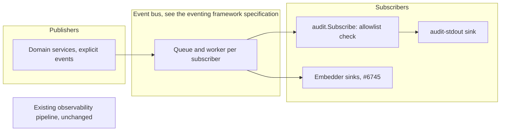

# Audit Logs Specification

- **Status:** Draft
- **Version:** 0.13
- **Related documents:** feature issue #5591, audit design #5601, eventing design #5590, eventing issue #5588, umbrella #5438, eventing framework specification (`docs-internals/eventing/spec.md`), eventing and audit logs threat model (#6297), delivery plans #6319 and #6320

## Summary

ThunderID has no audit log of its own. It has diagnostic logging, and an observability pipeline built for operators. Neither answers "who did what, to what, and was it allowed" in a cloud deployment where stdout is the only place an operator looks.

This specification defines the audit logs of ThunderID in two parts that share one record. Management events record what an administrator, an application or the system changes in the configuration and in the identities ThunderID holds. They are built, or in review, in the merged and open pull requests listed under Implementation status. Runtime events record what a person or a client does through the running system: a sign-in, a session, a locked account, a recovery, a consent decision. They are specified here and not started.

The governing decisions are those of the eventing framework specification. An audit event is published explicitly by the domain service that knows the resource and the outcome, once for each confirmed attempt, on the event bus as the `audit` category. A subscriber writes it to stdout as one JSON line starting with a fixed marker. Audit records outcomes, and the steps inside a flow stay in diagnostics. Audit works by default in the shipped server and control plane, and the one setting is `audit.enabled`. An application that embeds the engine gets no audit output until it adds a sink through one public option.

Who sees an event is decided on the read side from two facts recorded on the event, the subject and the organization unit. Nothing is filtered at write time, so an event is recorded once and each reader sees the part they are allowed to.

Out of scope: at-least-once delivery and any audit store, retention and tamper evidence, replay, network forwarders and webhooks, a built-in SIEM, alerting and anomaly detection, moving the existing observability pipeline or diagnostic logging onto the bus, and any change to diagnostic log lines. The store, its retention and the two endpoints are designed in #5601. This specification states what they must carry and show, and does not redesign them. This specification does not close #5591.

The existing `ObservabilityProvider` hook, the exported `providers.Event`, its event names, `component` and `status` values, `Data` keys and the `observability.*` configuration are unchanged. An external customer implements that hook, so nothing here removes or reshapes it.

## Implementation status

Status as of 2026-11-13. Each requirement below also carries its own status.

Merged events: 77, from the pull requests below. Open events: 43.

| Increment | Events | Status | Reference |
|---|---|---|---|
| Audit package, stdout sink, user changes | `user.create`, `user.update`, `user.delete` | Merged | #6475 |
| Application changes | `application.create`, `application.update`, `application.delete` | Merged | #6492 |
| Roles and groups | `role.*` and `group.*`, with `role.assignment.add`, `role.assignment.remove`, `group.member.add`, `group.member.remove` | Merged | #6518, #6549 |
| Flows and server configuration | `flow.create`, `flow.update`, `flow.delete`, `flow.restore`, `server_config.update` | Merged | #6550 |
| Client authentication and tokens | `client.authenticate`, `token.issue`, `token.revoke` | Merged | #6551 |
| Client address recorded only for a public address | None | Merged | #6580 |
| Gateway apply and revert | `gateway.apply`, `gateway.revert` | Merged | #6552 |
| Themes and layouts | `theme.*`, `layout.*` | Merged | #6553 |
| Agents and types | `agent.*`, `agent_type.*`, `user_type.*` | Merged | #6554 |
| Connections and resource servers | `connection.*`, `resource_server.*`, `resource_server.resource.*`, `resource_server.action.*` | Merged | #6555 |
| Configuration import and export | `configuration.import`, `configuration.export`, `configuration.delete` | Merged | #6556 |
| Notification senders and templates | `notification_sender.*`, `notification_template.*` | Merged | #6557 |
| Organization units, projects, and sharing policies of users and applications | `ou.*`, `project.*`, `user.sharing_policy.*`, `application.sharing_policy.*` | Merged | #6560 |
| Credential update and enrollment | `user.credential.update`, `user.credential.enroll`, `agent.credential.update` | Merged | #6689 |
| Account lifecycle | `<type>.lock`, `<type>.unlock`, `<type>.suspend`, `<type>.unsuspend` for `user`, `agent` and `application` | Open | #6619 |
| Gateway registration and configuration version | `gateway.create`, `gateway.update`, `gateway.delete`, `configuration_version.create` | Open | #6690 |
| Sharing policies of roles, flows and connections, and flow variables | `role.sharing_policy.*`, `flow.sharing_policy.*`, `connection.sharing_policy.*`, `flow.variables.update` | Open | #6691 |
| Authorization detail types, credential configurations, presentation definitions | `authorization_detail_type.*`, `credential_configuration.*`, `presentation_definition.*` | Open | #6692 |
| Secrets, variables and consent records | `secret.*`, `variable.*`, `consent.create`, `consent.update` | Open | #6693 |
| Embedder audit sink option | None | Open | #6745 |
| Audit events skill (internal guidance for contributors) | None | Open | #6505 |
| Runtime events and their record context | See Runtime events | Specified, not started | R11 to R21 |
| Audit store and the two read endpoints | None | Designed in #5601, not started | R22 to R24 |
| User documentation for audit logs | None | Not started | |

## Architecture



Components:

- **The audit package** (`internal/system/eventbus/audit`): the audit payload, the allowlist of audited events (`auditedEvents`, event name to allowed detail keys), `audit.Subscribe`, actor resolution from the security context, and `audit.NewPayload`, which reads the client from the request context. It also holds the payload builders services use so one rule decides subject and outcome: `ChangePayload`, `ChangePayloadWithSubject`, `MembershipPayloads` and `BatchPayload`.
- **The shared client middleware:** `ClientMiddleware` is a request-context middleware in `internal/system/middleware`, next to the correlation ID and deployment ID middlewares, and it is not an audit component. It records the TCP peer address, only when it is a public address, and the user agent (capped at 256 characters) on the request context through `internal/system/context` (`WithClient` and `GetClient`). Forwarded headers are never read, and it makes no audit decision.
- **The stdout sink** (`internal/system/eventbus/stdoutsink`): subscriber ID `audit-stdout`. One JSON line per event, standard library only.
- **`defaultaudit`:** builds the bus and subscribes the stdout sink when `audit.enabled` is true. With audit off the bus has no sink, so an event is validated by the bus and dropped.
- **`cmd/server`, `cmd/cpserver`:** each builds its bus through `defaultaudit`, injects the publish-only interface through constructors, and stops the bus after the HTTP server. Both binaries publish the management events of the services they run.
- **The embedded engine** (`pkg/thunderidengine`): builds its own bus with no subscriber, so the OAuth services' events are dropped unwritten, no worker starts and an upgrade changes nothing for an embedder. #6745 adds the option that subscribes an embedder's sinks.

Publishers added by the runtime events, which are specified and not started:

- **Authentication provider manager.** Publishes `user.authenticate` for each credential check through a decorator around its `AuthenticateUser` path, and publishes the account link event. It already publishes credential enrollment.
- **Flow session service.** Publishes `session.create`, `session.reuse` and `session.end`. Its termination hook already reports every terminated session after the terminating transaction commits.
- **Token services.** Already publish `token.issue` and `token.revoke`. The revocation handler gains the owning user as subject.
- **Attribute verification service, entity service and user service.** The attribute verification service publishes `user.verification.request` and `user.verification.verify`, the entity service publishes `user.verification.invalidate` when a committed write clears a recorded verification, and the user service publishes the credential removal event.
- **Consent service.** Publishes `consent.create` and `consent.update` (in review in #6693). It has no revoke or delete operation, so it publishes no revoke event.
- **Flow engine.** Publishes the flow outcome event.
- **Audit service (from #5601).** Serves the two endpoints, applies the end-user projection, and publishes the event for a read of the audit log.

The observability pipeline is not changed. The existing observability events, including the identity lock and suspension events and the attribute verification events, keep their names and payloads.

## Detailed design

### Design principles

- **Explicit publication.** The service that owns an outcome publishes it. No middleware, wrapper or route table derives audit events (eventing framework R5). A new audited resource is added by one explicit event in its service and one reviewed allowlist entry.
- **Least surface.** Audit has one configuration key, a fixed marker, and a closed list of audited events that grows one reviewed entry at a time. The line carries no deployment, host, process or binary identifier, because the log collector adds that identity itself.
- **One event for each confirmed attempt by one actor.** The unit is a change, a credential check, a session transition, a token request or a decision, and the event is published when the outcome is final.
- **Audit records outcomes, diagnostics record steps.** The node-by-node events of a flow stay in the observability pipeline. A reader moves between the two by the trace ID, and for a login by the flow reference and the session reference.
- **No identifier that works as a credential enters an event.** A session ID, a flow execution ID, a token and an attempted username never appear in a line.
- **Add, never repurpose.** A new event or an extra detail key is additive. An event name, a reason code and a detail key keep their meaning for good.

### Audit type marker

Every audit line starts with the fixed marker `"log_type":"AUDIT"` as its first field, so a line identified by itself in any file or stream tells what kind of line it is. The sink writes it before the event body. It is a constant of the product and not a setting, and it does not come from the event, so no publisher or caller field can change it. Event values sit in named fields and `details` is a nested object, so none can occupy the top-level marker key. A `log.type.*` key in configuration is rejected at startup by the strict configuration loader.

Diagnostic logging is out of scope. Its lines keep their current format and carry no marker, and access lines are byte-for-byte unchanged.

### Audit payload and line schema

An audit line is one JSON object on one line, written in a single write:

```json
{"log_type":"AUDIT","schema_version":1,"id":"01a1abc7-05b7-7620-9cd1-f8fe07860abd","time":"2026-11-05T12:55:09.495689Z","event":"user.create","trace_id":"16b3e5a1-ec78-4319-8f63-70711d4c2e8e","actor":{"type":"user","id":"01900000-0000-7000-8000-000000000030"},"subject":{"type":"user","id":"01a1abc7-0586-775f-949b-94f179f39d05"},"target":{"type":"user","id":"01a1abc7-0586-775f-949b-94f179f39d05"},"action":"create","outcome":{"result":"succeeded"},"client":{"address":"203.0.113.7","user_agent":"Go-http-client/1.1"}}
```

| Field | Required | Notes |
|---|---|---|
| `actor` | yes | `type` is `user`, `application`, `agent`, `system` or `anonymous`. The set is open. `id` is a system-generated UUID, or the fixed ID `management-api-key` for the management API key. Anonymous has no `id`. The `type` is resolved at publish time from the security context: anonymous when there is no caller, `system` for the management API key, `agent` for a token with an `act` claim, otherwise the `sub_type` claim value when it is `application` or `agent`, otherwise `user`. The `id` is the token subject, except for a token with an `act` claim, where it is the `sub` of the `act` claim (RFC 8693, the party acting) and the token subject goes to `on_behalf_of`. An OAuth endpoint authenticates a client and not a token, so its publisher sets the actor explicitly, as the ID of the application or agent entity and never its client ID, and a bearer token sent to the endpoint cannot become the actor. |
| `on_behalf_of` | no | Present only when the token carries an `act` claim. It carries the token subject, the party the actor acts for. |
| `target` | yes | `type` is required and, where one exists, `id`. A failed create has no ID. On a failed update or delete the `id` is the path value the caller sent (see below). |
| `subject` | no | The identity whose activity log the event belongs in. It is the affected resource for a change to one, and the owning identity for a record kept for one, such as a sharing policy of a user. Set when the outcome is `succeeded` or `denied`, because the resource exists when a service refuses. On `failed` the event carries the target only and no subject, because the ID may be an unknown path value and a failed create has no ID. Empty when no identity applies. |
| `action` | yes | A present-tense verb. The event name is `<resource>.<action>`, as in the audit design (#5601), and the `action` field repeats the verb so a consumer can filter without parsing the name. The verbs in use are `authenticate`, `apply`, `create`, `export`, `import`, `update`, `delete`, `add`, `remove`, `restore`, `issue`, `revoke`, `revert`, `enroll`, `request`, `verify` and `invalidate`, and the open account lifecycle events add `lock`, `unlock`, `suspend` and `unsuspend`. The set is open. |
| `outcome` | yes | `result` is `succeeded`, `denied` (a security decision refused the attempt) or `failed` (allowed but not completed). `reason` is a stable code, required unless succeeded, never free text, and matches `^[a-z][a-z0-9_]{0,63}$`. |
| `client` | no | The TCP peer address (`RemoteAddr` without the port) and the user agent, capped at 256 characters. Recorded only when the peer is a public address, so a proxy, a private or a loopback peer records no client, and the user agent is recorded only with the address. Forwarded headers are not read. |
| `details` | no | Keys from the allowlist of that event name. Never request bodies, credentials, tokens or secrets. |

Every ID in the line (actor, subject, target and on-behalf-of) is capped at 128 characters.

For a failed `update` or `delete` the `target.id` is the path value the caller sent, capped at 128 characters and JSON-escaped, so it can be caller-chosen text and not a generated UUID. It shows which ID was probed, and a consumer must treat `target.id` on a failed event as untrusted text.

Rules for evolution: optional fields can be added within a schema version, and consumers must ignore unknown fields. A field is never renamed or removed within a version.

The actor is resolved at publish time from the security context, and the client address and user agent come from the request context, so a call site does not pass them. The audit package only reads the client from the request context. It reads no `traceparent`.

### Outcomes and reasons

A management service ends an attempt with a service error or none, and one rule maps it to the outcome, so every service records the same thing:

- No error is `succeeded`.
- An error from the service's access check, or from its grant check refusing to confer permissions the caller does not hold, is `denied` with the reason `forbidden`.
- Any other error is `failed`, with the reason derived from the service error code by lowercasing it and replacing every character outside letters and digits with an underscore, as `usr_1003` from `USR-1003`. A code that cannot make a valid reason gives `server_error`.
- A request that acts on several items and completes with at least one item failed is `failed` with the reason `item_failed`, so a partial result is never recorded as `succeeded`.

The subject is set by the same rule. For a change to a resource, the resource is the subject when the attempt succeeded or was denied and is not set on a failure, because a service refuses a change only to a target it found while a failed attempt may name one that does not exist. A record kept for another identity, such as a sharing policy of a user, names that identity as subject by the same rule. A role assignment or a group membership change that succeeded writes one event for each distinct member, with the member as subject, so the log names everyone who gained or lost the membership, and any other outcome writes one event with the target only, because a call may name several members.

An OAuth endpoint maps the error code it answers with: `invalid_client`, `unauthorized_client`, `access_denied` and `invalid_scope` are `denied`, any other error is `failed`, an answer with no code is recorded as `server_error`, and the code is the reason.

### Audit validation

`audit.Subscribe` wraps the sink. It drops an event, logging the reason and never writing a line, when any of these hold: the event name is not in `auditedEvents`, a detail key is outside the allowlist of that event name, a `denied` or `failed` outcome has no reason or a reason that breaks the grammar, the target has no type, the action is empty, or the result is not one of the three. The check lives in the audit package so the bus stays generic, which also means `Publish` returns no error for these cases. The allowlist is the one reviewable list of what is audited. Adding an audited event is a reviewed change to it. The detail keys allowed today are `grant_type` (`token.issue`), `dry_run` (`configuration.import`) and `attribute` (`user.verification.*`), and the open pull requests add `authentication_method` (`<type>.lock`, #6619) and `connection` (`user.linked_account.create`).

### Default stdout sink

The sink writes each event as one JSON line in a single `Write` to stdout, whatever the diagnostic level or format. It uses the standard library only and has the fixed marker. A write failure never breaks the publisher.

Line integrity: a line is capped at 4,096 bytes, newline included. When an event would exceed it, details are dropped first, the largest first, then the user agent is cut, and then every free-form field is capped at 256 bytes. A line that is still over the limit is not written. The guarantee is the pipe atomic write size (POSIX `PIPE_BUF`): 4,096 bytes on Linux and 512 on macOS. The prototype's real audit lines are 527 to 623 bytes, so on macOS they exceed the atomic size. The prototype saw no interleaving in 3,600 concurrent lines, but that is an observation, not a guarantee, so a container runtime on Linux is the supported target.

### Management events

Management events are built, or in review, for every resource listed under Implementation status. The rules below apply to all of them.

- An event describing a change is published after the change is committed, and one public service method call publishes exactly one event for the action, plus one for each member where a membership change succeeded.
- The event name is the attempted action in the present tense and never the result, so a failed or denied attempt keeps the name and the outcome says what happened: `succeeded`, `denied` with the reason `forbidden`, or `failed` with the reason taken from the service error code.
- A refusal raised inside a service is `denied`. A caller without the permission gets a 403 from the security layer and nothing is written (see the known gaps).
- A change that reaches a service by any path is recorded by that service: management API calls and the same Control Plane routes, the MCP tools, import, bootstrap, flow provisioning, SCIM, self-service `PUT /users/me`, dynamic client registration (server binary only), and organization unit or project moves (recorded as `application.update` for an application). A path without a caller publishes with an anonymous actor.
- An import records one `configuration.import` event for the request, with the detail `dry_run` set to `true` or `false`, and each resource it writes is recorded by its own service. The importer looks a resource up before it updates or creates it, so a create is recorded as a create and not as a failed update. An export is recorded as `configuration.export`, because it can carry secrets, and the deletion of a declarative resource file as `configuration.delete`.
- A client secret regeneration through the administration flow is recorded as `application.update` (#6689). No detail tells it apart from another update.
- A change to a gateway registration is recorded as `gateway.create`, `gateway.update` or `gateway.delete`, and a capture of the configuration as a version as `configuration_version.create`, named by its hash (in review in #6690). Updating or deleting a gateway that is not registered is recorded as `failed` with the reason of the not-found error. An update that changes nothing is recorded as a plain `gateway.update`, because it is the caller's request. A capture that matches a version already held creates nothing and writes no line. The capture the system runs after each change is its own work and publishes nothing, whatever wrote the change. Replacing the current version in place is a create of the new hash. No key, address or certificate is recorded.
- A variable or a secret is identified by its name, which is the target ID, capped at 128 characters and escaped like a path value, so a failed create keeps the name the caller sent. Two names that share their first 128 characters share a target ID, a recorded limitation. A `PUT` that creates a name is recorded as `*.update`, because the name of an event is the attempted action. A delete of a name that is not stored writes no event. The response is built from a read after the write, and that read never changes the recorded outcome (#6693). No value or description is recorded.
- A sharing policy of a role, a flow or a connection is recorded as `<resource>.sharing_policy.create`, `.update` or `.delete`, with the policy as target and the owning resource as subject, typed as that resource's own events type it, so a policy of a notification sender names a `notification_sender` subject and keeps the `connection.sharing_policy.*` family, because it is one sharing resource type (in review in #6691). Setting the values an organization unit holds for the variables of a flow is recorded as `flow.variables.update`, with the flow as target and subject. It records no variable name, value or unit, and the event is published from the write, before the response reads the values back. The response of that call now carries the stored values to a caller who may update the flow and not view it, where it was a refusal after a stored write.
- A user or application event carries the resource as target and, as subject, when the outcome is `succeeded` or `denied`. No detail key is allowed for them, and a client secret, client ID, redirect URI, application name, credential or its type never appears in a line.
- A request writes the events its services publish and nothing else. A request that no service publishes for writes no audit line, and its method, path and status are in the access log.

#### Known gaps

These are recorded limitations, not silent omissions.

- A management resource whose service has no audit event yet, in particular any resource not listed under Implementation status. Each is added one service at a time by explicit events in that service.
- Declarative and file-backed resources and direct database edits are not recorded.
- Localized variants and translations written through the i18n service are not recorded.
- Calls the security layer refuses with 401 or 403, and requests a handler rejects before they reach a service (for example invalid JSON), are not recorded. This is a decision for the 401 and 403 refusals (open question 3).
- A dynamic client registration create is published inside its transaction, so a `succeeded` line can be written for a create that then rolls back. A delete of a missing ID is recorded as `succeeded`, because delete is idempotent by design. Creating an application can never be denied, because the access check is only in the security layer.
- The stdout sink and a full queue are best effort, so events can be lost.
- `trace_id` comes from a caller-supplied header, capped at 128 characters, and is untrusted.
- Sign-in, session and the other runtime events are not recorded until their increments land.
- A verification refused by the flow executor before it reaches the attribute verification service writes no verification event: a held user, a challenge that was not passed and a challenge that was not delivered to the pinned contact. The failed passcode of a sign-in is recorded by `user.authenticate`. These are known gaps of the verification increment.
- Sharing policies an import applies, a reshare the framework re-narrows, and the removal of a policy a resource does not hold write no line, unlike a delete of a missing dynamic client registration, which is recorded as `succeeded`.
- An essential-attribute denial is stored by the consent service and recorded as `consent.create` with the outcome `succeeded`, while the enforcer then refuses the request, because the event describes the write and not the decision.
- A federated sign-up writes its link inside the user create, so it is recorded by `user.create` and writes no `user.linked_account.create` line. Only a link made to an existing user by the account-linking flow is recorded by that event, and only a user can be linked.
- A link a provider does not store, such as for a declarative read-only user, writes no `user.linked_account.create` line, so a federated sign-in of such a user re-runs linking each time without a record.
- The embedded engine takes the host's own attribute verification provider, so a verification the host performs writes no verification event, even with an embedder sink.
- The verification events do not carry the record context (`application`, `ou`, `flow_ref`) until the record context increment (R11) lands.

### Client authentication and token events

Merged in #6551, with the client address rule of #6580.

- `client.authenticate` records only a refusal. The actor is anonymous whatever token the request carries, the target is the type `application` with the client ID the request named, unverified and cut to 128 characters, and the outcome follows the OAuth mapping above, so an invalid or unauthorized client is `denied`. A secret and a client assertion are never recorded. A success is not recorded (open question 9).
- `token.issue` records a token request. The actor is the application or agent, by entity ID and never by client ID. The target is the type `token` and carries no ID. The subject is the user when the token is issued for a user. The detail `grant_type` is recorded only when the server knows the grant type, so no text the caller chose reaches the event. A refusal carries the stable reason of the error response, and a refresh is recorded with the grant type `refresh_token`. The answers a polling client gets while a CIBA or device grant is still pending are not outcomes and publish nothing.
- `token.revoke` records a revocation request by the authenticated client. The actor is the application or agent, and the target is the type `token` with no ID. An unknown or invalid token succeeds, as RFC 7009 answers it, so the event never tells whether a token existed. A token issued to another client is `denied` with the reason `invalid_grant`, and a malformed request or a server error is `failed`. The event does not name the owning user yet (R15).

### Account lifecycle events

In review in #6619. This specification follows that pull request and records what it does, so the two stay in step.

An administrator suspending, unsuspending or unlocking an identity, a recovery flow releasing a lock, and a lock formed by failed sign-ins each write one event. The event is named for the identity category and the action: `user.suspend`, `user.unsuspend`, `user.unlock` and `user.lock`, and the same four for `agent` and `application`. The identity is the target and the subject, typed by its category. The governance service publishes them beside the observability events it publishes today, with the same trigger, so the two cannot disagree.

- An administration flow records the operator as actor. A recovery flow runs under the runtime context with no token, so its unlock has an anonymous actor.
- A lock formed by failed sign-ins is written once, after its transaction commits, with an anonymous actor and the detail `authentication_method`. Nothing from the attempt itself is recorded.
- An operator suspending themselves or acting outside their boundary is `denied` with `forbidden`. An unsuspend of an active identity or an over-long note is `failed` with the service reason. A repeated suspend writes nothing and is `succeeded`. The operator note is never recorded.
- An operation on an identity that was never read (no ID, an unknown ID or a failed read) has no known category, so no audit line is written. The observability event is still published.
- A lock that lapses on its own, and the expired entry a later sign-in clears, write no line. Direct database edits are not recorded.

### Runtime events

Specified here and not started. The catalog lists what each event records.

#### Record context

The audit record gains these fields. Each is set only when it exists, so no field is written empty.

| Field | Content | Source |
|---|---|---|
| `application` | Application ID and display name | The application the request or flow runs for |
| `ou` | ID of the organization unit the event belongs to | The home organization unit of the subject or the target, resolved when the event is published |
| `session_ref` | A reference to the session that is the same on every event of that session, and cannot be used as the session | The flow session service |
| `flow_ref` | A reference to the login flow execution that is the same on every event of that login, and cannot be used as the execution | The flow engine |

`session_ref` and `flow_ref` are the only join keys across requests. A credential check happens before a session exists, so it carries `flow_ref` only. `session.create` carries both, which links the login to the session it created. Every later event of the session carries `session_ref`.

A reference is an identifier that is distinct from the handle the client presents, so a copy of a log line gives no access to the session or the flow. For the session it is the session's own `SessionID`, which every application in the session already receives as the `sid` claim and which is documented as not a credential, while the cookie value is the separate `HandleID`. For the flow it is a new random identifier (a UUID v7) created when the flow starts and kept in the flow context, separate from the execution ID the client presents to continue the flow, which is a capability while the login is in progress and is never written. No key and no hash is needed. The flow context is a serialized record, so a new field is not expected to need a schema migration, which the first increment confirms (open question 7).

Display names of the target and the application are copied into the record when the event is published, capped at 128 characters and JSON-escaped, so the record stays readable after the object is deleted.

#### Event catalog

Every event follows the audit payload rules above: names are `<resource>.<action>`, an outcome is `succeeded`, `denied` or `failed`, and a reason code is required unless it succeeded.

Change to an existing event:

| Event | Change |
|---|---|
| `token.revoke` | Carries the owning user as subject when the token belongs to a user. A token that is unknown or not valid carries no subject, so the log never says whether it existed. |

New events:

| Event | Published by | Actor | Subject and target | Outcomes and reasons | Details |
|---|---|---|---|---|---|
| `user.authenticate` | Authentication provider manager, once for each credential check | The authenticated entity on success, anonymous on failure or refusal | The authenticated entity on success. On a failure, the user the identifier resolved to as subject (R13), and the user type as target | `succeeded`. `failed`: `invalid_credentials`, `user_not_found`, `invalid_request`, `ambiguous_user`, `server_error`. `denied`: `account_locked`, `account_suspended`, `subject_not_allowed` | `authentication_method` |
| `session.create` | Flow session service | The authenticated user, set explicitly because the login flow keeps the request's bearer token | The user | `succeeded`. `failed` (`server_error`). `denied` (`subject_mismatch`) when the authenticated subject conflicts with the session it would join | None |
| `session.reuse` | Flow session service | The user whose session is used, set explicitly | The user, with the application in the record context | `succeeded`, or `failed` (`server_error`) | None |
| `session.end` | Flow session service, after the terminating transaction commits | The user for a sign-out in the end-user flow. Otherwise the caller, such as an administrator, or anonymous when there is none | The user | `succeeded`, or `failed` (`server_error`) for a sign-out and for a termination of all sessions | `end_reason`: `sign_out`, `subject_revocation`, `application_detached` |
| `user.verification.request`, `user.verification.verify`, `user.verification.invalidate` | Attribute verification service for request and verify, entity service for invalidate | The caller outside a runtime flow. In a runtime flow, which may carry any bearer token sent to a public path, the user for a verify that succeeded and anonymous for every other outcome and for a request | The user | `succeeded`, `denied` (forbidden), `failed` (the reason of the service error). An invalidation is always `succeeded` | `attribute`, the name of the attribute, recorded only when it resolved to a contact attribute of the user type. Text a caller typed is never recorded, and neither is the value |
| `user.linked_account.create` | Authentication provider manager | The user the linking flow has already authenticated, anonymous when no user is known. Never the owner of a bearer token sent to a public path | The user | `succeeded`, `failed` (the reason of the service error) | `connection`, the ID of the connection the identity came through. Never the identity's subject at the connection |
| `flow.execution.finish` | Flow engine | The user when known, otherwise anonymous | The flow definition | `succeeded`, `failed` with a stable reason | `flow_type` |
| `audit_log.read` | Audit service | The reader | The audit log, with the scope in `details` | `succeeded`, `denied` | `scope`, `filters` (names only) |

The events of the account lifecycle (`<type>.lock`, `<type>.unlock`, `<type>.suspend`, `<type>.unsuspend`) are in review in #6619 and described above. They are not repeated here, and the key `authentication_method` is shared with `user.authenticate`, so one concept has one name.

`user.authenticate` is one name for every entity category. On a success the actor type shows whether the entity is a user, an agent or an application. The publisher sets the actor explicitly and never reads the security context of the request, so a bearer token sent to a public endpoint cannot become the actor. Machine credentials (client and flow secrets) are not a sign-in and write no event here.

#### Credential checks and failed attempts

A sign-in with two credentials, such as a password then a one-time passcode, writes two `user.authenticate` events with the same `flow_ref` and a different `authentication_method`. A failed first factor writes one event and the login ends there.

A failed check records the user the identifier resolved to as subject, using the internal ID, so the event appears in that account's own log. The text the person typed is never recorded, because people paste passwords into username fields. When the identifier resolves to no user or to more than one, the event has no subject and the target is the user type with no ID. A failed unauthenticated attempt still produces an event with an anonymous actor.

An earlier draft of the eventing specification recorded no account on a failed check. This specification changes that, following the definition of subject in #5601, the identity whose activity log the event belongs in. It is open question 2 and needs a security review.

Some outcomes are not covered at first and are recorded as gaps when the increment lands: a refusal at grant time (a held account, an interaction required, a magic link claim mismatch), single sign-on reuse where no credential is presented (covered by `session.reuse`), and an account expiry, which reads as `invalid_credentials`.

#### Sessions

`session.create` is published after the session commits, and only for a session that is new. A sign-in that joins an existing session writes no session event, because the fresh authentication is recorded by `user.authenticate`. `session.reuse` is published when an existing session satisfies an authorization request without a credential check, which is the single sign-on case that no credential event covers. `session.end` is published after the terminating transaction commits, for each session whose row was removed, by a sign-out, by a termination of all of a subject's sessions, and by the removal of the last application of a session, which is `application_detached`. All three are published directly by the session service and not through its termination hook, because the hook only notifies when a listener exists and drops the notification when the participants cannot be read. No event records the session handle, the cookie value, which is a credential. The session is named by `session_ref`, which is its public `SessionID`.

An expired session has no event today. Nothing in the system acts when a session expires: the resolver finds it expired only when it is presented, and the idle deadline slides on activity, so a reader cannot derive expiry from the `session.create` time and the configured lifetime. Whether expiry needs an event is open question 17.

#### Verification, linking and recovery

The verification events are published beside the observability events the attribute verification and entity services publish today, with the same trigger, so each fact is written once to each pipeline from the same code path. A request and a verify record every attempt on an existing user, including a refused one, which the observability pipeline records only for a verify, and a request for a user that does not exist yet (a pending creation) writes no event. An invalidation is published after the write that cleared the verification commits, once for each cleared attribute. It does not record why it was cleared, because a new detail key is easy to add and hard to remove, and the reason is available in the observability event while that pipeline keeps it. A recovery has no event of its own for its start (open question 18, decided). When it resets a credential it records `user.credential.update` with the actor set explicitly to the user whose credential was set. The merged credential events record no credential, no hash and no credential type (open question 14).

#### Consent and flow outcomes

The consent service has list, create, update and search operations and no revoke or delete, and it is covered by what it has: `consent.create` and `consent.update`, which record a person's consent decisions as a consent record and are in review in #6693. A separate decision event is not added, because the record events already carry the user and the outcome. When the service gains a revoke operation, a `consent.revoke` event is added in the same change (open question 6). `flow.execution.finish` records only the final outcome of a flow execution. The nodes of the execution are not audit events.

#### Not audited, by decision

- **Flow node steps, and a restarted or replayed flow.** They stay in diagnostics, joined to the audit events by `flow_ref` and the trace ID (open question 8).
- **A successful client authentication.** It stays in diagnostics, because it would be written on every token request. `token.issue` records the client as the actor of each token request, and a refusal is `client.authenticate` (open question 9).
- **A call refused with 401 or 403.** It needs no audit event. Its method, path and status are in the access log, and a refusal raised inside a service is already `denied` (open question 3).

#### Example: one sign-in with a password then a one-time passcode

This example shows what one login writes to audit, what stays in diagnostics, and how a reader moves between the two. Names are real event names. The values are illustrative, and the placement of the new context fields is as proposed in this specification.

A login is several requests. The person submits their identifier and password in one request, the passcode in the next, and the application then calls the token endpoint. Each request has its own `trace_id`, so the trace ID cannot join them. `flow_ref` joins the requests of the login, and `session_ref` joins everything after the session exists.

| Step | Request | Audit event written | Diagnostic events written |
|---|---|---|---|
| 1 | The flow starts and shows the password screen | none | `FLOW_STARTED`, `FLOW_USER_INPUT_REQUIRED` |
| 2 | The person submits the password | `user.authenticate`, method `password`, `succeeded`, with `flow_ref` | `FLOW_NODE_EXECUTION_STARTED`, `FLOW_NODE_EXECUTION_COMPLETED`, `FLOW_USER_INPUT_REQUIRED` for the passcode screen |
| 3 | The person submits the passcode | `user.authenticate`, method `otp`, `succeeded`, with the same `flow_ref` | `FLOW_NODE_EXECUTION_STARTED`, `FLOW_NODE_EXECUTION_COMPLETED` |
| 4 | The flow creates the session and ends | `session.create`, with `flow_ref` and `session_ref`, then `flow.execution.finish`, `succeeded` | `FLOW_NODE_EXECUTION_COMPLETED`, `FLOW_COMPLETED` |
| 5 | The application exchanges the code at the token endpoint | `token.issue`, `succeeded`, grant type `authorization_code`, carrying `session_ref` when the request can be tied to the session | `TOKEN_ISSUANCE_STARTED`, `TOKEN_ISSUED` |

The audit events of steps 2 and 4, an illustrative line for the password check and one for the session:

```json
{"log_type":"AUDIT","schema_version":1,"id":"0193...","time":"2026-11-12T09:14:03.120411Z","event":"user.authenticate","trace_id":"b7e1...","actor":{"type":"user","id":"u42..."},"subject":{"type":"user","id":"u42..."},"target":{"type":"user","id":"u42..."},"action":"authenticate","outcome":{"result":"succeeded"},"client":{"address":"203.0.113.7","user_agent":"Mozilla/5.0 ..."},"application":{"id":"a17...","name":"Customer Portal"},"ou":{"id":"o3..."},"flow_ref":"f9c2...","details":{"authentication_method":"password"}}
{"log_type":"AUDIT","schema_version":1,"id":"0193...","time":"2026-11-12T09:14:19.804233Z","event":"session.create","trace_id":"c4a8...","actor":{"type":"user","id":"u42..."},"subject":{"type":"user","id":"u42..."},"target":{"type":"user","id":"u42..."},"action":"create","outcome":{"result":"succeeded"},"client":{"address":"203.0.113.7","user_agent":"Mozilla/5.0 ..."},"application":{"id":"a17...","name":"Customer Portal"},"ou":{"id":"o3..."},"flow_ref":"f9c2...","session_ref":"s5d1..."}
```

What the example shows:

| Observation | What it shows | Where addressed |
|---|---|---|
| Five audit events are written, and eleven diagnostic events. | Audit records the result of each accountable act. The nodes of the flow are not audit events. | R19, AC19.2 |
| Both credential events carry the same `flow_ref`, and the requests that produced them have different trace IDs. | The reference joins a login across requests where the trace ID cannot. | R11, AC11.5, R12, AC12.3 |
| `session.create` carries both references. | It ties the login to the session it created, and every later event of the session carries `session_ref`. | R11, AC11.5 |
| A failed passcode would write `user.authenticate`, method `otp`, `failed`, with the user as subject, and no `session.create`. | The failure is in the account's own log, and the absence of a session is itself the evidence that the login did not complete. | R12, R13 |
| No line contains the password, the passcode, a session ID or the flow execution ID. | The references are not credentials. | R11, AC11.4 |
| An investigator who wants to know which node of the flow failed reads the diagnostic events of the same trace ID or `flow_ref`. | Step detail is in diagnostics, which keep it for a shorter period and may lose it under load. | R19 |

The last row is the cost of the split. Once the diagnostic events expire, the audit record still says what the outcome was and who was involved, and no longer says which node the failure happened in.

### Visibility

A reader sees events by the rule for their role. The rule is applied on the read side, from the `subject`, the `ou` and the event name. The read side is designed in #5601 and is not built.

| Event group | Platform administrator | End user | Compliance officer |
|---|---|---|---|
| Management changes | all | those whose subject is the user | all |
| Deployment-wide changes (`server_config.update`, `gateway.*`, `configuration_version.*`, `project.*`) | all | none | all |
| Sign-in, session, token | all | those whose subject is the user | all |
| Credential, account state, verification, linking, recovery | all | those whose subject is the user | all |
| Consent records (`consent.create`, `consent.update`) | all | those whose subject is the user | all |
| Flow outcomes | all | none | all |
| `audit_log.read` | all | none | all |

A platform administrator and a compliance officer both hold the audit read permission. The compliance officer's permission is read only and does not allow any change. Visibility limited to an organization unit subtree is open question 5.

### Delivery and failure behavior

Audit events use the delivery of the eventing framework specification, which is best effort. When the audit store of #5601 exists, audit events are delivered at least once and recorded after the change commits, as chosen in #5590, which depends on the eventing framework open question 1.

A publisher never fails its caller because of audit. A change, a sign-in, a token request and a consent decision complete whether or not the event is recorded. A publish that fails writes one diagnostic line without the event content. Loss on a full queue is detectable through the drop warning the bus writes for the overflow episode, and through the collector. The envelope has no sequence number.

Every increment is additive and independent. Removing a publisher stops new events and leaves stored events valid. Renaming or removing an event, a reason code or a detail key is a breaking change for any consumer, and is not allowed after the event ships.

### Data model

No new table for the stdout log. The audit store of #5601 keeps these values of this specification in columns or in its payload: `application_id`, `ou_id`, `session_ref`, `flow_ref` and the subject ID. Its access paths must include the subject within a time range, for the end-user view, and the session reference within a time range, for investigation.

Any audit table or index follows the deployment-scoped rule: a `DEPLOYMENT_ID VARCHAR(255) NOT NULL` column, `PRIMARY KEY (DEPLOYMENT_ID, ID)`, unique indexes scoped by `DEPLOYMENT_ID`, every query filtered by it, and the SQLite and PostgreSQL scripts changed together.

### API

No endpoint exists today. The two endpoints of #5601 are specified for the store and change as follows for runtime events.

- `GET /audit-events` needs the audit read permission and refuses a caller without it. It gains the filters `sessionRef` and `flowRef`, and returns `application`, `ou`, `session_ref` and `flow_ref`. Its filters are allowlisted. It never accepts a free-form query.
- `GET /users/me/activity` returns the events whose subject is the caller and no other, and applies the end-user projection below.

End-user projection:

| Field | Shown to the end user |
|---|---|
| Time, event label from the catalog, outcome | yes |
| Client address and user agent | yes, of the caller's own events |
| Application display name | yes |
| Actor | the caller, or the words "an administrator" or "the system" when someone else acted. Never the administrator's ID or name |
| Reason | a category the person understands. Never the internal code |
| `trace_id`, `session_ref`, `flow_ref`, target IDs, organization unit | no |

### Embedder extension

In review in #6745. An application embedding the engine opts in to audit by adding a sink through a public option, without importing an internal package. The public surface is small: a plain struct view of the envelope and audit payload in `pkg/thunderidengine/providers` (`AuditEvent`, with `AuditRef`, `AuditOutcome` and `AuditClient`), one `AuditSink` interface with one method, `Handle(ctx, AuditEvent) error`, and one engine option, `WithAuditSink`, that adds a sink and can be passed more than once. There is no option to disable audit, because audit is on by default only in the shipped binaries. A sink has a stable ID, `audit-embedder-` followed by its position among the options, receives only the envelope and the audit payload, gets its own copy of the details, and follows the same queue and drop rules as internal subscribers.

With no sink an event is validated and dropped, no worker runs, and the engine prints nothing, so an upgrade does not change an existing embedder's output. The engine needs no stop method: a worker exists only when the embedder passes a sink, and then lives as long as the process. A nil sink is refused when the engine is built. The embedder's own providers, for example its user store, are outside ThunderID, so changes made through them are the embedder's to audit. The bus and audit packages add no sink or OpenTelemetry dependency to the engine. The engine already links the OpenTelemetry SDK through `internal/agent`, so "the engine links no OpenTelemetry SDK" is not a requirement of this change.

`ObservabilityProvider` is not an audit extension point. Audit events never reach it.

### Configuration

| Key | Default | Scope | Validation |
|---|---|---|---|
| `audit.enabled` | `true` in the shipped binaries | Deployment | boolean |

This is the only audit configuration. The strict configuration loader rejects any other `audit.*` key and any `log.type.*` key at startup. A new top-level `audit` key is used instead of a key under `observability`, because the existing `observability.*` configuration belongs to the unchanged pipeline. Runtime events add no key.

## Example output

```text
time=2026-11-05T18:25:09.495+05:30 level=INFO msg="203.0.113.7 - - [05/Nov/2026:18:25:09 +0530] POST /users HTTP/1.1 201 ..." trace_id=16b3e5a1-ec78-4319-8f63-70711d4c2e8e
{"log_type":"AUDIT","schema_version":1,"id":"01a1abc7-05b7-7620-9cd1-f8fe07860abd","time":"2026-11-05T12:55:09.495689Z","event":"user.create","trace_id":"16b3e5a1-ec78-4319-8f63-70711d4c2e8e","actor":{"type":"user","id":"01900000-0000-7000-8000-000000000030"},"subject":{"type":"user","id":"01a1abc7-0586-775f-949b-94f179f39d05"},"target":{"type":"user","id":"01a1abc7-0586-775f-949b-94f179f39d05"},"action":"create","outcome":{"result":"succeeded"},"client":{"address":"203.0.113.7","user_agent":"Go-http-client/1.1"}}
{"log_type":"AUDIT","schema_version":1,"id":"01a1abc7-3c41-7e0a-8b52-2d6a9c1f40e7","time":"2026-11-05T12:58:41.207310Z","event":"user.delete","trace_id":"7d0c2f94-5b1a-4e83-9a6f-3c8e1b2a4d57","actor":{"type":"user","id":"01900000-0000-7000-8000-000000000044"},"subject":{"type":"user","id":"01a1abc7-0912-7b3d-a1c4-5e7f20d98b63"},"target":{"type":"user","id":"01a1abc7-0912-7b3d-a1c4-5e7f20d98b63"},"action":"delete","outcome":{"result":"denied","reason":"forbidden"},"client":{"address":"203.0.113.7","user_agent":"Go-http-client/1.1"}}
```

The first audit line is from a real run, with the client address replaced by a documentation address. The second shows a user manager scoped to one organization unit deleting a user in a sibling organization unit: the event keeps the attempted action `user.delete`, and the outcome says `denied` with the reason `forbidden`. The diagnostic and access lines are unchanged and carry no marker. A local run on a loopback address records no `client`, because the peer is not public.

What the sample shows, and where each point is addressed in this specification:

| Observation | What it shows | Where addressed |
|---|---|---|
| Every audit line is one JSON line that starts with `"log_type":"AUDIT"`. | An audit line identifies itself in any file or stream. | Audit type marker |
| The audit line shares its `trace_id` with the access log line of the same request. | A reader can join them. | Eventing framework, envelope |
| The event is named `user.create`, and a refused delete keeps the name `user.delete`. | The name is the attempted action and the outcome says what happened. | Management events |
| The create line has the new user as both subject and target, with the real ID. | The service knows the ID, so the line names the resource. | Management events |
| The denied line carries the reason `forbidden`. | A refused attempt has a stable reason code. | Outcomes and reasons |
| The `client.address` is the TCP peer address, and is absent for a non-public peer. | A proxy's address is never recorded as the client. | Audit payload and line schema, open question 11 |
| The line carries no deployment, host or process field. | Deployment identity belongs to the log collector. | Design principles |

## Requirements

Each requirement lists its status as of 2026-11-13. Requirements R1 to R10 describe what is built or in review. R11 to R24 are specified and not started, except where a status says otherwise.

### R1. Audit type marker

**Requirement:** Every audit line starts with a fixed type marker, so it identifies its own kind.

**Status:** Built, #6475.

**Acceptance criteria:**

- **AC1.1:** Given default configuration, when an audit line is written, then its first member is `"log_type":"AUDIT"`.
- **AC1.2:** Given an event whose `details` contains the key `log_type`, when the line is written, then the top-level marker is unchanged.
- **AC1.3:** Given a `log.type.*` key in configuration, when the server starts, then startup fails.

### R2. Audit on stdout by default

**Requirement:** Audit lines are written to stdout with no configuration, in both shipped binaries, and one setting, `audit.enabled`, turns them off. An embedded engine writes audit only when its embedder adds a sink.

**Status:** Built, #6475. The embedder option is R9.

**Acceptance criteria:**

- **AC2.1:** Given default configuration, when a covered event happens, then one JSON audit line appears on stdout.
- **AC2.2:** Given `audit.enabled: false`, when a covered event happens, then no audit line appears, no worker runs and the request succeeds.
- **AC2.3:** Given `log.level` set to its most restrictive value, or either log output format, when a covered event happens, then the audit line is still written as a line of its own.
- **AC2.4:** Given a stdout write failure, when an audit line is written, then the publisher is not affected.
- **AC2.5:** Given an embedded engine with no sink option, when a covered event happens, then no audit line is written and the engine works.
- **AC2.6:** Given any `audit.*` key other than `audit.enabled`, when the server starts, then the strict loader rejects it and startup fails.

### R3. Audit line content and validation

**Requirement:** Each audit line carries the marker, schema version, envelope fields, event name, actor, target, action and outcome, and optionally subject, client, on-behalf-of and details. The audit package writes only events that pass its checks.

**Status:** Built, #6475 and every event increment since.

**Acceptance criteria:**

- **AC3.1:** Given a succeeded event, when it is written, then `outcome.result` is `succeeded` and no reason is required.
- **AC3.2:** Given a `denied` or `failed` outcome without a reason, or with a reason that is not a lowercase code of at most 64 characters, when it reaches the audit subscriber, then the event is dropped, the drop is logged and no line is written.
- **AC3.3:** Given an event with outcome `succeeded` or `denied`, when it is written, then `subject` carries the affected resource or the identity the record is kept for. Given an event with outcome `failed`, then the line carries the target only and no `subject`.
- **AC3.4:** Given an unknown field added in a later version, when an existing consumer parses the line, then the known fields are unchanged.
- **AC3.5:** Given any event, when it is written, then no credential, token, secret or request body appears. Given a detail key outside the allowlist of that event name, then the event is dropped and logged.
- **AC3.6:** Given an event whose line would exceed 4,096 bytes, when it is written, then details are dropped largest first, then the user agent is cut, then each free-form field is capped at 256 bytes, and the line stays under the limit. Given a line that cannot be brought under the limit, then it is not written.
- **AC3.7:** Given an actor, subject, target or on-behalf-of ID longer than 128 characters, when the line is written, then the ID is cut to 128 characters.
- **AC3.8:** Given an event name that is not in the audit package's allowlist, an event whose target has no type, or an event with no action, when it reaches the audit subscriber, then the event is dropped, the drop is logged and no line is written.
- **AC3.9:** Given a failed update or delete, when the line is written, then `target.id` is the path value the caller sent, capped at 128 characters and JSON-escaped, and a consumer treats it as untrusted text.
- **AC3.10:** Given a service error, when the outcome is built, then an access or grant refusal is `denied` with the reason `forbidden`, any other error is `failed` with the reason derived from the error code, and a request that completes with a failed item is `failed` with the reason `item_failed`.

### R4. Actor, client and trace from the request context

**Requirement:** The actor is resolved at publish time from the security context, and the client address, user agent and trace come from the request context, so a call site does not pass them.

**Status:** Built, #6475, #6551 and #6580.

**Acceptance criteria:**

- **AC4.1:** Given an authenticated request whose token has no `act` claim, when an event is built from its context, then the actor is the token subject, and its type is the `sub_type` claim when it is `application` or `agent` and `user` otherwise.
- **AC4.2:** Given the management API key, when it authenticates, then the actor is `system` with the fixed ID `management-api-key`.
- **AC4.3:** Given an unauthenticated request, when an event is built, then the actor is `anonymous` with no ID.
- **AC4.4:** Given the same request, when audit and the access log write lines, then they share `trace_id`.
- **AC4.5:** Given a token with an `act` claim, when an event is built, then the actor type is `agent`, the actor id is `act.sub` (the party acting, RFC 8693) and `on_behalf_of` carries the token subject. Given a token without an `act` claim, then `on_behalf_of` is absent.
- **AC4.6:** Given a request from a public TCP peer, when an event is built, then `client.address` is that address without its port and `client.user_agent` is capped at 256 characters. Given a private or loopback peer, then the line has no `client`. Given forwarded headers, then they are not read.
- **AC4.7:** Given a bearer token sent to an OAuth endpoint, when its event is built, then the actor is set by the endpoint's publisher, by entity ID, and the token's subject is not used.

### R5. User change events

**Requirement:** The user service publishes `user.create`, `user.update` and `user.delete` explicitly, for every path that changes a user through the service.

**Status:** Built, #6475.

**Acceptance criteria:**

- **AC5.1:** Given a management API call that creates, updates or deletes a user, when the change commits, then one event `user.create`, `user.update` or `user.delete` is written with outcome `succeeded`, the user as target and subject, and the event is published after the commit.
- **AC5.2:** Given a caller who may not change the user, for example a user manager scoped to one organization unit deleting a user in a sibling organization unit, when the call is refused, then the same event name is written with outcome `denied`, the reason `forbidden` and the user as target and subject.
- **AC5.3:** Given a change that is allowed but not completed, when it fails, then the same event name is written with outcome `failed`, the reason taken from the service error code and the target only, with no subject.
- **AC5.4:** Given a user change through self-service `PUT /users/me`, SCIM, flow provisioning, import or bootstrap, when it reaches the user service, then it is recorded like a management call, with an anonymous actor where there is no caller.
- **AC5.5:** Given an import that creates users, when it ends, then the importer has looked each user up before it updates or creates it, and a create is recorded as `user.create` and not as a failed `user.update`.

### R6. Application change events

**Requirement:** The application service publishes `application.create`, `application.update` and `application.delete` explicitly, for every path that changes an application through the service, from both the server and the Control Plane binaries.

**Status:** Built, #6492, and the secret regeneration event in #6689.

**Acceptance criteria:**

- **AC6.1:** Given a management API call, a Control Plane route, an MCP tool (`create_application`, `update_application`), an import, bootstrap, a dynamic client registration (server binary only) or an organization unit or project move (recorded as `application.update`), when the change commits, then one event `application.create`, `application.update` or `application.delete` is written with outcome `succeeded`, target type `application`, and the application as target and subject.
- **AC6.2:** Given a change that is allowed but not completed, when it fails, then the same event name is written with outcome `failed`, the reason taken from the service error code and the target only, with no subject. For an update or delete the target ID is the path value the caller sent (AC3.9).
- **AC6.3:** Given a refusal raised inside the application service, which in practice is a system-flow refusal on update or delete, when the call is refused, then the same event name is written with outcome `denied`, the reason `forbidden` and the application as target and subject. Given a caller without permission, then the security layer returns 403 and no line is written (a known gap). Given an application create, then it is never `denied`.
- **AC6.4:** Given any application event, when it is written, then no client secret, client ID, redirect URI or application name appears in the line, and no detail key is allowed, so an application event that carries one is dropped and logged.
- **AC6.5:** Given an import that creates applications, when it ends, then the importer has looked each application up before it updates or creates it, and a create is recorded as `application.create` and not as a failed `application.update`.
- **AC6.6:** Given the server and the Control Plane binaries, when an application is changed through either, then each writes the event, `application.Initialize` takes the publish-only bus, and a nil bus is refused.
- **AC6.7:** Given one application action through a public service method, when it completes, then exactly one event is published for it.
- **AC6.8:** Given a client secret regeneration through the administration flow, when it completes, then one `application.update` event is written and the secret appears nowhere in the line.

### R7. Events for other management resources

**Requirement:** Each management service publishes explicit events for the changes it owns, by the rules of Management events, so one rule decides name, subject and outcome for every resource.

**Status:** Built for the 77 events listed as merged under Implementation status. In review for the open pull requests listed there (#6690, #6691, #6692, #6693).

**Acceptance criteria:**

- **AC7.1:** Given a change to a resource whose service is listed in the catalog, when it commits, then one event named `<resource>.<action>` is written with the matching target type, and a failed or denied attempt keeps the name.
- **AC7.2:** Given a role assignment or a group membership change for several members that succeeds, when it commits, then one event is written for each distinct member with the member as subject. Given any other outcome, then one event is written with the target only.
- **AC7.3:** Given a request that acts on several items and completes with at least one failure, when it ends, then the event is `failed` with the reason `item_failed`.
- **AC7.4:** Given an import, when it ends, then one `configuration.import` event is written for the request with the detail `dry_run`, and each resource it writes is recorded by its own service. Given an export, then `configuration.export` is written.
- **AC7.5:** Given a sharing policy of a user, an application, a role, a flow or a connection, when it changes, then the target type names the policy and the subject is the owning resource, typed as that resource's own events type it, and a policy of a notification sender names a `notification_sender` subject.
- **AC7.6:** Given a credential update or enrollment for a user or an agent, when it completes, then `user.credential.update`, `user.credential.enroll` or `agent.credential.update` is written and carries no credential, hash or credential type.
- **AC7.7:** Given a service that has no audit event, when a request changes its resource, then no audit line is written and the access log is the only record (a known gap).

### R8. Client authentication and token events

**Requirement:** A refused client authentication, a token request and a token revocation are recorded by the service that knows the outcome.

**Status:** Built, #6551 and #6580.

**Acceptance criteria:**

- **AC8.1:** Given a refused client authentication, when the client is not valid, then `client.authenticate` is written with an anonymous actor, the type `application` and the presented client ID (at most 128 characters) as target, and outcome `denied` for an invalid or unauthorized client.
- **AC8.2:** Given a token request, when a token is issued or refused, then `token.issue` is written with the application or agent as actor by entity ID, the type `token` as target, the grant type in `details` when the grant type is known, and the outcome. A refusal carries the stable reason of the error response.
- **AC8.3:** Given a token issued for a user, when `token.issue` is written, then the user is the subject.
- **AC8.4:** Given the answers a polling client gets while a CIBA or device grant is pending, when they are returned, then no event is written.
- **AC8.5:** Given a revocation request, when it is handled, then `token.revoke` is written with the client as actor and the type `token` as target, `succeeded` for a token that is unknown, invalid or revoked, `denied` with `invalid_grant` for a token issued to another client, and `failed` for a malformed request or a server error.
- **AC8.6:** Given any of these events, when it is written, then no secret, assertion or token appears.

### R9. Customer extension

**Requirement:** An application embedding the engine can add an audit sink through a public option without importing an internal package.

**Status:** In review, #6745.

**Acceptance criteria:**

- **AC9.1:** Given a custom sink added through the option, when an audit event is published, then it receives the envelope and the audit payload as plain values.
- **AC9.2:** Given a slow custom sink, when events are published, then the publisher is unaffected and no other sink is delayed.
- **AC9.3:** Given an engine with no sink added, when it runs, then it writes no audit line, starts no worker, and works.
- **AC9.4:** Given the public surface, when its imports are listed, then no internal package is imported and the engine links no new sink or OpenTelemetry package because of the bus and audit packages.
- **AC9.5:** Given a nil sink, when the engine is built, then it is refused. Given several sinks, then each has its own stable ID and queue.

### R10. Account lifecycle events

**Requirement:** A change in the lock or suspension state of a user, agent or application is recorded when it happens, from the same code path as the observability event.

**Status:** In review, #6619.

**Acceptance criteria:**

- **AC10.1:** Given an administrator who suspends, unsuspends or unlocks an identity, when it completes, then one event named for the category and the action (`user.suspend`, `agent.unlock`, `application.unsuspend` and so on) is written with the identity as target and subject and the operator as actor.
- **AC10.2:** Given a recovery flow that releases a lock, when it completes, then the unlock event is written with an anonymous actor, because the flow runs with no token.
- **AC10.3:** Given a lock formed by failed sign-ins, when its transaction commits, then one lock event is written with an anonymous actor and the detail `authentication_method`, and nothing from the attempt itself is recorded.
- **AC10.4:** Given an operator who suspends themselves or acts outside their boundary, when it is refused, then the event is `denied` with the reason `forbidden`. Given an unsuspend of an active identity or an over-long note, then it is `failed` with the service reason. Given a repeated suspend, then nothing is written and it is `succeeded`.
- **AC10.5:** Given an identity that was never read, when the operation ends, then no audit line is written and the observability event is still published.
- **AC10.6:** Given an operator note, when an event is written, then the note is not in the line.
- **AC10.7:** Given any of these facts, when the observability event for it is published, then both the observability event and the audit event are written from the same code path.

### R11. Record context

**Requirement:** Every runtime event carries the context a reader needs to say which application, organization unit, login and session it belongs to, and none of it can be used to act as the person.

**Status:** Specified, not started.

**Acceptance criteria:**

- **AC11.1:** Given an event published for a request that runs for an application, when it is written, then the line carries the application ID and a display name of at most 128 characters.
- **AC11.2:** Given a subject that belongs to an organization unit, when an event is written, then the line carries that organization unit's ID.
- **AC11.3:** Given an event inside a login flow, when it is written, then it carries `flow_ref`. Given an event inside a session, then it carries `session_ref`. Given neither exists, then neither field is present and none is written empty.
- **AC11.4:** Given any event, when it is written, then no field contains a session ID, a flow execution ID, a token or an attempted username, and a copy of the line does not allow a request to be made as the person.
- **AC11.5:** Given a login that creates a session, when `session.create` is written, then it carries both `flow_ref` and `session_ref`, and the earlier credential events of that login carry the same `flow_ref`.

### R12. Credential checks

**Requirement:** Each credential check during a sign-in is recorded with its outcome and method.

**Status:** Specified, not started (the delivery plan #6320 calls it PR 4).

**Acceptance criteria:**

- **AC12.1:** Given a credential check, when it succeeds, is refused or fails, then one `user.authenticate` event is written for that check with the matching outcome and the `authentication_method` in the details.
- **AC12.2:** Given a successful check, when the event is written, then the authenticated entity is the actor, the subject and the target.
- **AC12.3:** Given a sign-in with a password then a one-time passcode, when both succeed, then two events are written with the same `flow_ref` and different methods.
- **AC12.4:** Given a refused or failed check, when the reason is known, then it is one of `invalid_credentials`, `user_not_found`, `invalid_request`, `ambiguous_user` or `server_error` for `failed`, and `account_locked`, `account_suspended` or `subject_not_allowed` for `denied`.
- **AC12.5:** Given a bearer token sent to a public sign-in endpoint, when a check fails, then the actor is anonymous and the token's subject is not used.

### R13. Failed attempts name the account

**Requirement:** A failed or refused attempt on an existing account appears in that account's log without recording what the person typed.

**Status:** Specified, not started. Open question 2.

**Acceptance criteria:**

- **AC13.1:** Given a failed check whose identifier resolves to exactly one user, when the event is written, then that user is the subject, by internal ID.
- **AC13.2:** Given a failed check whose identifier resolves to no user or to more than one, when the event is written, then it has no subject and the target is the user type with no ID.
- **AC13.3:** Given any failed check, when the event is written, then the text the person typed appears nowhere in the line.

### R14. Session lifecycle

**Requirement:** Establishing, reusing and ending a session are separate events.

**Status:** Built in the second runtime slice, in review.

**Acceptance criteria:**

- **AC14.1:** Given a login that completes, when the session commits, then one `session.create` event is written for the user.
- **AC14.2:** Given an existing session that satisfies an authorization request without a credential check, when it is used, then one `session.reuse` event is written carrying the application.
- **AC14.3:** Given a sign-out, when the session ends, then `session.end` is written with `end_reason` `sign_out` and the user as actor.
- **AC14.4:** Given an administrative termination of all of a user's sessions, when it commits, then one `session.end` event with `end_reason` `subject_revocation` is written for each session that ended, with the administrator as actor.
- **AC14.5:** Given a session found expired, when open question 17 is decided, then this criterion states the event written. Until then no event is written.

### R15. Revocation names the owner

**Requirement:** A token revocation says whose token it was, without saying whether a token existed.

**Status:** Specified, not started. The refusal reason and the refresh grant type of `token.issue` are already built (R8). Only some tokens can name their user, which the criteria below state.

**Acceptance criteria:**

- **AC15.1:** Given a revocation that takes effect on an access token issued for a user, which carries `client_id` and a `sub` that is not that client, when it succeeds, then `token.revoke` carries that user as subject.
- **AC15.3:** Given a revocation of a refresh token, which carries no `client_id` and is minted with the client as its `sub`, or of a token issued to a client for itself, when it succeeds, then the event carries no subject, because the token does not name a user. The token family it revokes is not recorded.
- **AC15.2:** Given a revocation of a token that is unknown or not valid, when it is handled, then the event carries no subject and the response is unchanged.

### R16. Verification, linking and recovery

**Requirement:** A verification of an attribute, the linking of a federated account and the start of a recovery are recorded when they happen.

**Status:** The `user.verification.*` events are in review in #6812 and `user.linked_account.create` follows in its own pull request. The start of a recovery is not recorded, by decision (open question 18). The observability events for verification exist today.

**Acceptance criteria:**

- **AC16.1:** Given a verification of an attribute that is requested, completed or invalidated, when it happens, then the matching `user.verification.*` event is written, with the attribute name when the attribute resolved to a contact attribute of the user type and never its value. Given a request or a verify that is refused or fails, then the same event is written with the outcome `denied` or `failed` and the reason, and a failed event carries no subject. Given a request whose attribute did not resolve, then the event carries no `attribute` detail, so text a caller typed never reaches a line. Given a request for a user pending creation, then no event is written.
- **AC16.5:** Given a verification in a runtime flow that carries a bearer token sent to a public path, when the event is written, then the token's subject is not the actor: a verify that succeeded names the user, and every other outcome and every request is anonymous.
- **AC16.2:** Given a federated account that is linked, when the provider stores the link, then `user.linked_account.create` is written with the connection ID in the details and the user as actor, subject and target, and the identity's subject at the connection appears nowhere in the line.
- **AC16.6:** Given a link that is refused or fails, when the event is written, then it carries the reason, no subject, and the user as target and actor when the flow has resolved one. Given a provider that stores no links, then nothing is written. Given a link that already exists, then it is recorded as `succeeded`, as an idempotent delete is.
- **AC16.4:** Given a verification, when the observability event for it is published, then both the observability event and the audit event are written from the same code path.

### R17. Self-service credentials

**Requirement:** A credential change through recovery or self-service is recorded, including the ones that fail.

**Status:** Built, #6689, for the credential update a recovery completes, the enrollment and the failures. No operation removes a credential or a factor today, so there is no removal event to write. It is added in the same change that adds such an operation (AC17.2).

**Acceptance criteria:**

- **AC17.1:** Given a recovery that resets a credential, when it completes, then `user.credential.update` is written with the actor set explicitly to the user whose credential was set.
- **AC17.2:** Given a service that gains an operation that removes a credential or a factor, when it ships, then a `user.credential.remove` event is added in the same change, with the user as subject on success, and the credential is never recorded.
- **AC17.3:** Given a credential change that fails on an account the identifier resolved to, when the event is written, then it carries that user as target, the reason and no subject, as every failed event does.
- **AC17.4:** Given any credential event, when it is written, then it never carries the credential, a hash of it or a prompt.

### R18. Consent records

**Requirement:** A consent record that the consent service creates or updates is recorded, covering what the consent service has today.

**Status:** In review, #6693. Revoke is not covered, because the service has no revoke operation.

**Acceptance criteria:**

- **AC18.1:** Given a consent that is recorded for a user, when the service creates it, then `consent.create` is written with the user as subject and the outcome. A consent with no user named has no subject. The enforcer sends one authorization for each consent today, and the subject type is `user`.
- **AC18.2:** Given a consent that is changed, when the service updates it, then `consent.update` is written with the user as subject and the outcome, and a failed attempt keeps the name and carries the reason.
- **AC18.3:** Given any consent event, when it is written, then no attribute value is in the line.
- **AC18.5:** Given a consent recorded in a runtime flow that carries a bearer token sent to a public path, when the event is written, then the token's subject is not the actor: the actor is the user when the write succeeded and anonymous otherwise.
- **AC18.4:** Given a consent service that gains a revoke or delete operation, when it ships, then a `consent.revoke` event is added in the same change.

### R19. Flow outcomes

**Requirement:** The final outcome of a flow execution is recorded, and its steps are not.

**Status:** Specified, not started.

**Acceptance criteria:**

- **AC19.1:** Given a flow execution that completes or fails, when it ends, then one `flow.execution.finish` event is written with `flow_type` and a stable reason on failure.
- **AC19.2:** Given a flow execution, when it runs, then no audit event is written for any of its nodes, and the node events stay in the observability pipeline.
- **AC19.3:** Given a flow execution event, when it is written, then its `trace_id` and `flow_ref` match those of the credential events of the same login.

### R20. Details and secrets

**Requirement:** Details hold facts that identify nothing secret.

**Status:** Built for the allowlist rule, #6475. The new keys are specified.

**Acceptance criteria:**

- **AC20.1:** Given an event, when its details carry a key the event does not allow, then the event is not written.
- **AC20.2:** Given a detail value, when it is written, then it is at most 512 characters and JSON-escaped.
- **AC20.3:** Given any event of this specification, when it is written, then no password, one-time passcode, token, secret, session ID or attribute value is in the line.

### R21. No effect on the request

**Requirement:** Recording an event never changes the outcome of the request.

**Status:** Built for the existing events, by eventing framework R5. Specified for the new ones.

**Acceptance criteria:**

- **AC21.1:** Given a publisher whose bus is full or has no sink, when a sign-in, a token request or a consent decision completes, then the response is the same as with audit off.
- **AC21.2:** Given a publish that fails, when it fails, then one diagnostic line is written without the event content and the caller is not told.

### R22. End-user visibility

**Requirement:** A user sees the events about their own account and nothing else.

**Status:** Designed in #5601, not started.

**Acceptance criteria:**

- **AC22.1:** Given a caller, when they request their activity, then every event returned has the caller as subject and no event with another subject is returned.
- **AC22.2:** Given an event where the caller is only the actor on another person's resource, when they request their activity, then it is not returned.
- **AC22.3:** Given an event caused by an administrator, when it is returned, then the actor reads "an administrator", with no ID or name.
- **AC22.4:** Given an event with an internal reason code, when it is returned, then the reason is a category and not the code.
- **AC22.5:** Given the response, when it is returned, then it carries no `trace_id`, `session_ref`, `flow_ref`, target ID or organization unit.

### R23. Administrator visibility

**Requirement:** Reading the audit log is a deliberate permission, and each read is recorded.

**Status:** Designed in #5601, not started.

**Acceptance criteria:**

- **AC23.1:** Given a caller without the audit read permission, when they request the audit log, then the request is refused and `audit_log.read` is written with outcome `denied`.
- **AC23.2:** Given a caller with the permission, when they request it, then all events of the groups in the visibility table are available, filtered by the allowlisted filters only.
- **AC23.3:** Given a read, when it completes, then `audit_log.read` is written with the filter names and never their values.
- **AC23.4:** Given a request for events of one session, when `sessionRef` is given, then the events of that session and none other are returned, in time order.

### R24. Stable names and reason codes

**Requirement:** Event names, reason codes and detail keys do not change after they ship.

**Status:** Built for the existing events. Specified for the new ones.

**Acceptance criteria:**

- **AC24.1:** Given every event of this specification, when it is published, then its name is in the audit catalog and follows the name grammar.
- **AC24.2:** Given an outcome other than `succeeded`, when the event is written, then it carries a reason from the stable set of that event.
- **AC24.3:** Given a release, when it adds an event or a detail key, then no existing name, reason or key changes.
- **AC24.4:** Given the observability pipeline, when an event is added here, then the `ObservabilityProvider` receives the same events with the same names and payloads as before.

## Open questions

These need a decision before approval. Each states the default this draft assumes.

1. **One event for each credential check or one for each login.** This specification keeps one for each credential check, because it records the step that failed. #5601 says one actor, one attempt, one event, which could also mean one for each login. A login summary can be derived at read time from the checks, the session and the flow outcome.
2. **Whether a failed check names the account.** R13 records the resolved user as subject, by the definition of subject in #5601. An earlier draft recorded no account on a failed check. It needs a security review.
3. **Authorization denied.** Decided: not audited. A refusal by the security layer with 401 or 403 needs no audit event, because its method, path and status are in the access log, and a refusal raised inside a service is already recorded as `denied`.
4. **User data viewed.** Open, to be solved in an optimum way. #5601 gives disclosure of secrets, with user data viewed as the example, and does not define which reads count. Auditing every read would be very high volume. The candidate default of this draft: audit a read of credential or secret material, audit a single-record read of a person's profile by someone other than that person, record a list or search as one event with the filter names and never one for each row, and never audit a person reading their own data. The alternative is to rely on the access log alone. It is decided with the owners of #5601 before any read event is added.
5. **Visibility limited to an organization unit subtree.** A proposal in a comment on #5601 records the organization unit as a lineage snapshot and scopes the endpoint by it. This specification records the organization unit on every event, which that proposal needs, and does not decide the scoping or the partner case.
6. **Consent revoked.** Decided: cover what the consent service has, which is `consent.create` and `consent.update` (#6693). The service has no revoke or delete operation, so `consent.revoke` is added in the same change that adds one.
7. **The session and flow references.** Decided by a spike on 2026-11-14: the session reference is the existing `SessionID`, and the flow reference is a new random identifier kept in the flow context and distinct from the execution ID. Confirmed in the first increment: that the serialized flow context needs no migration, and that the new field survives every path that resumes a flow.
8. **Flow restart and replay.** Decided: not audited. It stays in diagnostics, joined by `flow_ref` and the trace ID.
9. **Successful client authentication.** Decided: not audited, because of the volume. It stays in diagnostics, and `token.issue` records the client as actor of each token request.
10. **PII policy.** Until decided, only IDs appear and no body, credential, token or secret is recorded. The policy for names and emails in actor or target is parked, and the display names copied into the runtime record context (R11) need it decided first.
11. **Client address rule.** The audit client is the TCP peer, recorded only when public, and forwarded headers are never read, while sessions and the access log use the address resolved through `server.trusted_proxies`. Behind a proxy the audit event has no client while the session shows the forwarded address. Issue #6775 asks for one rule. A trusted-proxy setting that honours a forwarded header is a later decision.
12. **Linux as the supported target for line atomicity.** A macOS pipe guarantees only 512 bytes.
13. **Run or task ID for agent actions, and the MCP gate and AuthZEN events.** Not in this specification. The agent behavior name space (`agent.*`, `token.exchange`, `consent.*`, `authz.*`, `tool.*`) is reserved by the name grammar and needs no renaming later.
14. **The kind of credential in credential events.** The merged credential events deliberately record no credential type, because the type narrows what an attacker needs to try. Recording it (`password`, `pin`, `passkey`) would help an administrator and an end user, and needs a decision and a detail key.
15. **The actor of an automatic lock and of a recovery unlock.** #6619 records both with an anonymous actor, because neither runs with a token. Naming `system` for a lock, or the user for a recovery unlock, is possible, and the subject already places both events in the account's own log.
16. **The values of `authentication_method`.** Decided: the value is the specific method, such as `password` or `otp`, for the sign-in event and for a lock. #6619 records `credential` on a lock today, and a comment on that pull request asks for the specific method. The full list of values is fixed before the sign-in increment.
17. **Session expiry.** Open, and harder than first thought. Expiry is found only when a session is presented, the idle deadline slides on activity, and nothing deletes or marks an expired session, so the same expired session is found again each time it is presented. An event at detection would repeat forever, and fixing that needs a change to the session lifecycle: either the resolver ends an expired session it finds, which writes one `session.end` with `end_reason` `expired`, or a periodic job does. Both change what the system does, beyond an audit change. Candidates: that lifecycle change, then the event; or no event, with the reader inferring expiry from the last activity the session records. The slice that records the other session events does not depend on this.
18. **Whether `user.recovery.start` is needed.** Decided: dropped. No service owns the start of a recovery: it is a flow-level fact spread over the identifying executor, and audit events are published by services, not by executors. A start for an identifier that resolves to no user would carry no subject, and a start that names the resolved account is the account-enumeration signal question 2 is about. A recovery is recorded by what it does: the verification events for the contact it proves, `user.credential.update` with the actor set explicitly to the user whose credential was set, and `flow.execution.finish` for the outcome. An event published by the flow engine when a recovery-type flow starts can be added later if the flow engine can name the resolved user.

## Change log

| Version | Date | Change |
|---|---|---|
| 0.1 | 2026-11-13 | Initial version of the audit logs specification. It takes the audit parts of the eventing and audit logs specification 0.13 (#6296) and the audit runtime events specification 0.1 (#6788) into one document, with management events and runtime events in one record. Corrected against the merged code and the open pull requests: the client is recorded only for a public address (#6580), the verbs in use, the reason grammar and the outcome rules (`item_failed`, membership events, grant refusals), the line truncation order, the application event for a secret regeneration, `token.issue` refusal reasons and refresh grant type as built, the actor of OAuth events by entity ID, the refused client outcome as `denied`, and the credential events recording no credential type. The account lifecycle events follow the open #6619, with the key `authentication_method` shared by lock and sign-in, and the lock and unlock events removed from the runtime catalog. The per-category sequence number is removed, because the envelope has none. Requirements renumbered R1 to R24 with a status on each, and an implementation status table added. Earlier history is in the change log of the eventing framework specification. |
| 0.2 | 2026-11-13 | Decisions: flow node steps, a restarted or replayed flow and a successful client authentication stay in diagnostics, and 401 and 403 refusals need no audit event (questions 3, 8 and 9 decided, with a Not audited, by decision section). Consent is covered by what the consent service has (`consent.create` and `consent.update`, #6693), so `consent.decide` is removed from the catalog and R18 now covers consent records (question 6 decided). Session expiry is open question 17, and the claim that a reader derives expiry from `session.create` is corrected, because the idle deadline slides. Question 4 records a candidate default for user data viewed. |
| 0.3 | 2026-11-13 | Verification events corrected against the code: the entity service, not the attribute verification service, publishes the invalidation. A request and a verify record every attempt on an existing user, with `denied` and `failed` outcomes, and a runtime flow has an anonymous actor. AC16.1 states it. |
| 0.4 | 2026-11-13 | Review of the verification increment: the `attribute` detail is recorded only when it resolved to a contact attribute, so caller-typed text never reaches a line (AC16.1). In a runtime flow the actor is explicit, because the flow keeps the request's bearer token (AC16.5). The verbs `request`, `verify` and `invalidate` are in the verb list. Added the known gaps for executor refusals, the embedded engine and the record context, and the reason an invalidation does not record why it was cleared. |
| 0.5 | 2026-11-13 | Gateway registration and configuration version events (#6690): the decisions of that review are recorded, namely a failed update or delete of a missing gateway, an update that changes nothing is recorded, an unchanged capture writes nothing, the automatic capture after a change publishes nothing, and `configuration_version.*` is a deployment-wide change. |
| 0.6 | 2026-11-13 | Reviews of #6691 and #6693: the rules for variables and secrets (the name is the target ID, a failed create keeps it, a PUT that creates is an update, a delete of a missing name writes nothing, the read-back never changes the outcome), for sharing policies of roles, flows and connections (the subject is the owning resource typed as its own events type it) and for `flow.variables.update`, with the response change; AC7.5 extended; R18 states the consent actor (AC18.5) and that a consent with no user has no subject; known gaps for imported and re-narrowed policies and for an essential-attribute denial recorded as a succeeded write. |
| 0.7 | 2026-11-14 | Open question 18 records the design problem of `user.recovery.start`: no service owns it, and a recovery is already recorded by the verification, credential update and flow outcome events. The recommendation is to drop it. |
| 0.8 | 2026-11-14 | `user.linked_account.create` (review of its implementation): the actor is the user the linking flow has already authenticated, and anonymous only when no user is known, because the flow authenticates before it links, unlike enrollment. The outcomes are `succeeded` and `failed`, because no security decision can deny a link. AC16.2 and AC16.6 state the criteria, and `connection` joins the allowed detail keys. A provider that stores no link writes nothing, recorded as a known gap, and a link that already exists is recorded as succeeded. |
| 0.9 | 2026-11-14 | Open question 18 decided: `user.recovery.start` is dropped from the catalog and from R16, because no service owns the start of a recovery and the recovery is recorded by the events of what it does. |
| 0.10 | 2026-11-14 | R17 corrected against the code: the credential update a recovery completes and the failures are built in #6689, a failed credential event carries the user as target and no subject, and `user.credential.remove` is removed from the catalog because no operation removes a credential or a factor, so it is added with such an operation, as `consent.revoke` is. |
| 0.11 | 2026-11-14 | Open question 7 decided by a spike: `session_ref` is the existing public `SessionID` (the `sid` claim, not a credential), and `flow_ref` is a new random identifier in the flow context, never the execution ID the client presents. No key or hash is needed. |
| 0.12 | 2026-11-14 | Session events specified against the session service: they are published directly by the service and not through the termination hook, a sign-in that only joins an existing session writes nothing, a refused join is `denied` with `subject_mismatch`, `session.reuse` has no `denied`, `session.end` adds the reason `application_detached`, and the actor of a sign-out is the user under the end-user flow. Open question 17 records why an expiry event needs a lifecycle change first. |
| 0.13 | 2026-11-14 | R15 limited to what a token can say: an access token issued for a user names that user, while a refresh token and a token issued to a client for itself carry the client as their subject and name no user, so the revocation event has no subject for them (AC15.3). Verified in the token builder and validator. |
