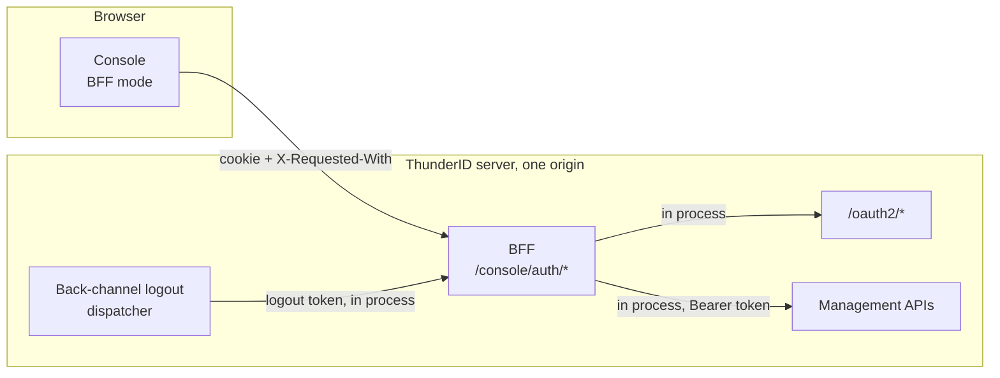

# Backend for Frontend (BFF) Specification

- **Status:** Draft
- **Version:** 0.4
- **Related documents:** [RFC 10017: OAuth 2.0 for Browser-Based Applications](https://www.rfc-editor.org/rfc/rfc10017.html), [OpenID Connect Back-Channel Logout 1.0](https://openid.net/specs/openid-connect-backchannel-1_0.html), [back-channel-logout/spec.md](../back-channel-logout/spec.md), [sdk-development/spec.md](../sdk-development/spec.md)

## Summary

Browser apps built on the ThunderID SDKs, and the Console itself, keep their tokens in the browser. Any script that runs in the page can read them, nothing on the server can end the app's session, and idle timeouts run in JavaScript.

A BFF is a small server, on the same origin as the app, that runs the OAuth flow and keeps the tokens. The browser only holds an `HttpOnly` cookie it cannot read, and calls APIs through the BFF.

> The BFF is a contract, not a package. This document fixes the endpoints, the cookies, and the security rules. Any backend can implement them, and the client SDKs talk to any implementation.

Scope of this version:

- The contract.
- A Go implementation inside the ThunderID server, serving the Console at `/console/auth`.
- Two session modes, chosen per deployment. **Stateful**, the default: the tokens live in the runtime store behind an opaque cookie. **Stateless**: the tokens live in encrypted cookies. Either way any replica serves any request, because the runtime store is shared.

Out of scope for this version: a standalone BFF binary, the embedded sign-in flow through the BFF, and native mobile clients. Each builds on this contract.

## Architecture



| Component | Responsibility |
|---|---|
| Handlers | The endpoints below |
| Session store | Keeps sessions, stateful in the runtime store or stateless in cookies, behind one interface the handlers use |
| Sealer | Encrypts and decrypts session payloads with the server's encryption key |
| In-process transport | Sends the BFF's OAuth and API calls through the server's own handler chain, in process |
| Back-channel logout endpoint | Receives logout tokens, records the `sid` of the ended SSO session in the runtime store, and deletes the stateful session held for it |

Seams used:

| Seam | Use |
|---|---|
| Runtime crypto provider | AES-GCM with the server key, the same path the flow engine uses for its context |
| Runtime store | Holds stateful sessions and their refresh locks, and records ended sessions. Shared by every replica |
| Back-channel logout dispatcher | Tells the BFF a session ended, from any sign-out path, delivering to the server's own origin in process |
| Server handler chain | Runs token, discovery, and API requests with the same middleware a network request gets |
| JWT service | Verifies a logout token's signature against the server's own keys, and its issuer, audience, and lifetime |

The in-server BFF acts as the existing `CONSOLE` public client with PKCE. It does not need a client secret, because it is the authorization server's own process. A standalone BFF is a confidential client.

## Detailed design

### Endpoints

All paths are relative to the BFF base path. The Console's base path is `/console/auth`. The SDKs turn this mode on when `endpoints.backend` is set, for example `endpoints: {backend: {signIn: '/api/auth/signin'}}`, and default any unset path under `/api/auth`. App developers see "backend", not "BFF".

| Method and path | Request | Response |
|---|---|---|
| `GET /signin` | `returnTo`, optional, a same-origin path | `302` to the authorization endpoint. Sets the transaction cookie |
| `GET /callback` | `code`, `state` from the authorization server | `302` to `returnTo`. Starts the session. On error, `302` to the app with `error` |
| `GET /session` | Session cookie | `200 {isSignedIn, user, expiresAt}`. Stateless only: `401 session_expired` when the access token has expired |
| `GET /checksession` | Session cookie | `200 {isSignedIn}`. Read-only: it neither refreshes the tokens nor counts as activity, so polling it does not keep an idle session alive |
| `POST /refresh` | Session cookie, and the refresh cookie when stateless | `204`. `401` and a cleared session when the refresh fails |
| `POST /signout` | Session cookie | `200 {redirectUrl}`, the end-session URL. Clears all cookies |
| `POST /backchannel-logout` | `logout_token`, form encoded, from the authorization server | `200`, or `400 invalid_request` for a token that fails validation. No CSRF check, because the authorization server calls it, not a browser |
| `ANY /proxy/{path}` | Session cookie, when signed in | The upstream response for `/{path}`, called with the access token when there is a session and without one otherwise. `401 login_required` when the request's session cookie names a session that has ended or could not be refreshed. Stateless only: `401 session_expired` when the access token has expired |

`user` is the ID token's claims, without the protocol claims (`iss`, `aud`, `exp`, `iat`, `nbf`, `auth_time`, `nonce`, `at_hash`, `c_hash`, `sid`, `azp`, `jti`).

The client handles `401 session_expired` the same way everywhere: call `POST /refresh` once, retry, and treat a second failure as signed out. It treats `401 login_required` as signed out straight away. Any other `401` comes from the API itself and is returned as is. A stateful BFF refreshes on the server and never answers `session_expired`, so the same client works with both modes.

A standalone BFF also exposes `POST /backchannel-logout`. The in-server BFF does not need it, because it hears about ended sessions in process.

### Cookies

| Cookie | Path | Stateful | Stateless | Lifetime |
|---|---|---|---|---|
| `__Host-tid_console_session` | `/` | Opaque 256-bit handle | Encrypted access token, ID token, expiry, `sid` | Browser session |
| `__Secure-tid_console_refresh` | `<base>/refresh` | Not used | Encrypted refresh token | Refresh token expiry |
| `__Secure-tid_console_txn` | `<base>/callback` | Encrypted `state`, PKCE verifier, `nonce`, `returnTo`, `redirect_uri` | Same | 10 minutes |

- Names follow the server's `tid_` cookie convention, as the SSO cookie `tid_sso_<hash>` does, under the browser-enforced `__Host-` and `__Secure-` prefixes.
- Every cookie is `HttpOnly`, `SameSite=Lax`, and `Secure`. When the server runs over plain HTTP the `Secure` flag and the name prefixes are dropped.
- Every value other than the stateful handle is encrypted with AES-GCM under the server's encryption key, then base64url encoded.
- A value over 3800 bytes is split into numbered chunks: `<name>.0`, `<name>.1`, and so on. A stateless session cookie needs two.
- A stateless refresh token is only sent to the refresh endpoint, so a request to any other path never carries it.

### Stateful sessions

| Aspect | Design |
|---|---|
| Record | Runtime store, namespace `console:session`, value `{"v": version, "data": encrypted session, "seen": last use}` |
| Key | SHA-256 of the cookie's handle. The store never holds the handle, so its contents cannot be replayed as cookies |
| Idle timeout | The record's TTL, `session.idle_timeout`. A request pushes it out when the last push is over a minute old, so a busy session writes at most once a minute |
| Absolute lifetime | The refresh token's. Once it expires, the next refresh fails and the session ends |
| Refresh | On the server, whenever a request finds the access token expired. The request that takes the lock `console:refresh_lock` runs the grant and replaces the record with a compare-and-swap on its version. Any other request, on any replica, waits for the new version and uses it, because the authorization server rotates the refresh token and a second grant with the old one would fail |
| Sign-in again | Deletes the previous record before writing the new one |
| Sign-out | Deletes the record |
| SSO session index | Runtime store, namespace `console:sid`, key the `sid`, value the record key, with the record's idle timeout. An ended SSO session's record is deleted through it straight away. It names the latest record for a `sid`: an older record, left by a browser that lost its cookie and signed in again, is still refused through the ended session check and expires with its idle timeout |

### CSRF

`SameSite=Lax` stops cross-site `POST`s from carrying the cookie. On top of that, every endpoint except `/signin` and `/callback` requires:

- an `X-Requested-With` header. A cross-origin page cannot send a custom header without a CORS preflight, and the BFF answers no preflight.
- an `Origin` header, when present, equal to the server's public origin.

`Lax` rather than `Strict`, because the authorization server's redirect back to `/callback` is a cross-site navigation. With `Strict`, the first page load after sign-in would not carry the session cookie.

### Sign-in

1. `/signin` creates `state`, a PKCE verifier and `nonce`, stores them in the transaction cookie, and redirects to the authorization endpoint with `client_id`, `redirect_uri=<origin><base>/callback`, `scope`, `resource`, and the PKCE challenge.
2. `/callback` checks `state` against the transaction cookie, exchanges the code with the verifier, checks the ID token's `nonce`, starts the session, clears the transaction cookie, and redirects to `returnTo`.

`returnTo` MUST be a path on the app's own base path. Anything else falls back to the app root, so the BFF is not an open redirect.

### Refresh

Stateless: the client calls `/refresh` after a `401 session_expired`, and `/refresh` runs the refresh token grant and rewrites both cookies. Stateful: `/session` and `/proxy` refresh on the server as described above, and `/refresh` does the same on request. Either way the authorization server rotates the refresh token, so the old one stops working.

### Sign-out and ended sessions

`/signout` ends the session, deleting a stateful record, clears the cookies, and returns the end-session URL with `client_id`, `id_token_hint`, and `post_logout_redirect_uri`. The client navigates there. The authorization server ends the SSO session and revokes its token families.

Any sign-out path ends the SSO session through the session service: this app, another app sharing the session, or an administrator. The BFF hears about it the way any relying party does, through OpenID Connect Back-Channel Logout 1.0. Bootstrap registers `<public URL>/console/auth/backchannel-logout` as the `CONSOLE` application's back-channel logout URI. The URI is on the server's own origin, so the dispatcher delivers to it in process, through the server's handler chain: a server on `localhost`, with private addresses refused and a self-signed certificate, still reaches it. See [back-channel-logout/spec.md](../back-channel-logout/spec.md).

`/backchannel-logout` validates the logout token as section 2.6 requires: a signed JWT, never encrypted; the signature, `iss` from discovery, `aud` the client ID, and `exp`; `typ` `logout+jwt` when present; `iat`; the back-channel logout event; no `nonce`; and a `sid`, because sessions are tracked by SSO session. It records each `jti` in `console:logout_token` until the token expires and refuses a replay. A valid token records the ended `sid` in the runtime store, under a 24 hour TTL, and in stateful mode deletes the session through the `sid` index, so the tokens leave the store without waiting for the browser. `/session`, `/refresh`, and `/proxy` check the record, and a hit ends the session and reports signed out.

With `oauth.logout.backchannel.enabled` set to false, or the URI removed from the application, the BFF is not told. Its tokens are still revoked, so the next refresh fails and the session ends then.

The runtime store is shared, so a sign-out seen on one replica reaches every replica. The revoked token families are the backstop: the authorization server and the API gate reject them even before the record is written.

The browser learns about it in three ways, so an open tab signs out without waiting for the user:

| Trigger | Response |
|---|---|
| Any API call through `/proxy` | `401 login_required` |
| The page gets focus or becomes visible again | The SDK calls `/checksession`, at most once every five seconds |
| A polling interval, when configured | The SDK calls `/checksession` every interval while the page is visible. The SDKs take it from `syncSession` and `checkSessionInterval`; the Console from `client.backend.check_session_interval` |

On any of them the SDK marks the session signed out and fires its `sign-out` hook. The React and Vue providers then clear the user and report `isSignedIn: false`, so a route guard sends the user to sign in. A sign-out the app starts itself does not fire the hook, because the app is already navigating away.

### API proxy

`/proxy/{path}` forwards the method, query, body, `Content-Type`, and `Accept` to `/{path}` with `Authorization: Bearer <access token>`. Without a session it forwards the call without a token, so public APIs, such as the translations, work before sign-in. It drops the cookies and every other request header. It copies back the status, the body, and `Content-Type`.

A path under the Console, the Gate, or the BFF itself is refused with `404`, so the proxy cannot loop or reach the static apps.

### Configuration

`deployment.yaml`, deployment-level:

```yaml
console_client:
  client_id: "CONSOLE"
  scopes: ["openid", "profile", "email", "ou", "system"]
  # RFC 8707 resource indicator sent on sign-in. Matches the resource server bootstrap registers.
  # Empty sends none.
  resource: "https://localhost:8090/mcp"
  session:
    # "stateful" keeps the tokens in the runtime store behind an opaque cookie; "stateless" keeps
    # them in encrypted cookies. Anything else stops the server at startup.
    mode: "stateful"
    # Seconds a stateful session lasts without being used.
    idle_timeout: 3600
```

The Console application also registers `<public url>/console/auth/callback` as a redirect URI.

## Requirements

### R1. No token reaches the browser

**Requirement:** In BFF mode the browser never receives an access, refresh or ID token.

**Acceptance criteria:**

- **AC1.1:** Given a completed sign-in, when the browser inspects responses and script-readable storage, then no token appears.
- **AC1.2:** Given a signed-in session, when the browser calls `/session`, then it receives the user's claims and no token.

### R2. API calls work through the proxy

**Requirement:** The app calls the management APIs through the BFF.

**Acceptance criteria:**

- **AC2.1:** Given a signed-in session, when the app calls `/proxy/users`, then the response equals a direct call to `/users` with the session's access token.
- **AC2.2:** Given a request without `X-Requested-With`, when it reaches any endpoint other than `/signin` or `/callback`, then it is refused with `403`.

### R3. Sessions end everywhere

**Requirement:** A session ended at the authorization server ends at the BFF.

**Acceptance criteria:**

- **AC3.1:** Given a signed-in session, when the user signs out from another app sharing the SSO session, then the next `/session` reports signed out and clears the cookies.
- **AC3.2:** Given an expired access token and a valid refresh token, when the client calls `/refresh`, then it receives fresh cookies and the next `/session` succeeds.
- **AC3.3:** Given a Console tab open and signed in, when the user signs out of another app sharing the SSO session, then within one polling interval, or as soon as the tab regains focus, the Console shows the sign-in page.
- **AC3.4:** Given a stateful session, when the client polls `/checksession`, then the idle timeout is not extended.
- **AC3.5:** Given a signed-in session, when the authorization server posts a valid logout token for its `sid` to `/backchannel-logout`, then the response is `200` and the next `/checksession` reports signed out.
- **AC3.6:** Given a logout token that is unsigned, encrypted, for another audience or issuer, expired, without a `sid` or the back-channel logout event, with a `nonce`, or already used, when it is posted to `/backchannel-logout`, then the response is `400 invalid_request` and no session ends.

### R4. Stateful sessions stay on the server

**Requirement:** In stateful mode the browser holds only an opaque handle, and the server enforces the idle timeout.

**Acceptance criteria:**

- **AC4.1:** Given a stateful sign-in, when the browser inspects its cookies, then the session cookie holds a random handle and no token, and no refresh cookie exists.
- **AC4.2:** Given a stateful session left unused for longer than `idle_timeout`, when the browser calls `/session`, then it is signed out.
- **AC4.3:** Given a stateful session whose access token has expired, when two requests on any replicas arrive together, then the refresh token grant runs once and both requests succeed with the new access token.
- **AC4.4:** Given a stateful session, when its SSO session ends by any path, then its record is deleted from the runtime store before the browser makes another request.

## Change log

| Version | Date | Change |
|---|---|---|
| 0.1 | 2026-10-12 | Initial specification. |
| 0.2 | 2026-10-13 | Stateful session mode, the default, alongside stateless. |
| 0.3 | 2026-10-13 | `/checksession`, `401 login_required` from the proxy, and sign-out detection in an open tab. |
| 0.4 | 2026-10-14 | `/backchannel-logout` replaces the termination listener, delivered in process, and stateful sessions are deleted as soon as their SSO session ends. |
