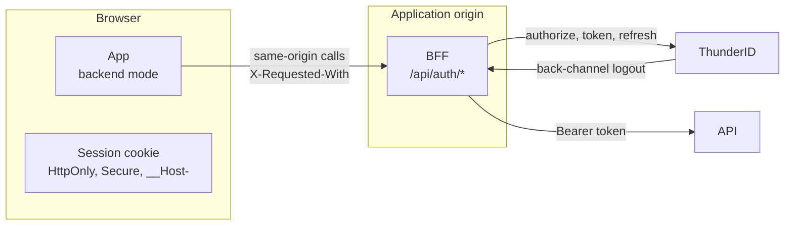

# Backend for Frontend (BFF) Contract Specification

- **Status:** Draft
- **Version:** 0.1
- **Related documents:** [SDK development specification](../sdk-development/spec.md), [SDK threat model](../sdk-development/threat-model.md), [#5698](https://github.com/thunder-id/thunderid/issues/5698), [#5699](https://github.com/thunder-id/thunderid/discussions/5699), [#5868](https://github.com/thunder-id/thunderid/issues/5868), [#7095](https://github.com/thunder-id/thunderid/issues/7095), [RFC 10017: OAuth 2.0 for Browser-Based Applications](https://www.rfc-editor.org/rfc/rfc10017.html), [RFC 7516: JSON Web Encryption](https://www.rfc-editor.org/rfc/rfc7516.html), [RFC 5869: HKDF](https://www.rfc-editor.org/rfc/rfc5869.html), [RFC 6265bis: Cookies](https://datatracker.ietf.org/doc/draft-ietf-httpbis-rfc6265bis/), [OpenID Connect Back-Channel Logout 1.0](https://openid.net/specs/openid-connect-backchannel-1_0.html)

## Summary

RFC 10017 (BCP 212) describes three ways to run OAuth for a browser-based application. It strongly recommends the Backend for Frontend (BFF) pattern of section 6.1 for business applications, sensitive applications and applications that handle personal data. In that pattern a server on the application's own origin is a confidential OAuth client. It holds the tokens, and the browser holds only an `HttpOnly` cookie it cannot read.

The browser and mobile SDKs have a `backend` mode (#5868) that talks to such a server instead of to ThunderID. This specification fixes what that server must do, so that any implementation can pair with any of those SDKs. One decision governs the rest:

> The BFF is a contract, not a package. It is a fixed set of endpoints, cookie rules and security rules. Several backends implement it, and the client SDKs talk to any of them.

The contract covers:

- the endpoints, their methods, request and response shapes, and status codes
- the request rules that keep a cross-site page from using the session cookie
- the session cookie: its attributes, and, for a session kept in the cookie, its encrypted format
- what a BFF never does: return a token to the browser, unless the application turns on the token endpoint

Out of scope:

- A BFF on a different origin than the application. Same origin is what makes the cookie first party and the request rules hold.
- Front-channel logout and session management iframes.
- The standalone Node and Go BFFs and the hosted BFF for Console, which are later implementations of this contract (#5699).
- A general API gateway. The proxy attaches the access token and forwards; it does nothing else.

## Architecture

| Component | Responsibility |
|---|---|
| Client SDK in `backend` mode | `@thunderid/browser` (and the React, Vue and router SDKs on it), and the iOS, Android and Flutter SDKs. Calls the BFF endpoints, never ThunderID, and holds no token. |
| BFF | A server on the application's origin. Runs sign-in as a confidential client, keeps the session, serves the endpoints below, and forwards API calls with the access token. |
| ThunderID | The authorization server. Issues tokens to the BFF and sends it back-channel logout tokens. |
| API | The application's resource server. Receives the access token from the BFF's proxy, or is the BFF itself (RFC 10017 section 6.1.2.5). |

The JavaScript implementations share one handler in `@thunderid/node` (`handleBffRequest`). It owns the routing, the request rules, the response shapes, `Cache-Control` and the proxy. Each framework SDK supplies only its own sign-in and session operations through an adapter (`BffAdapter`). So the contract is enforced once, and an implementation can differ only where its session store differs.

| Implementation | Package | Session kept in | Mounted as |
|---|---|---|---|
| Express (reference) | `@thunderid/express` | The SDK's session store. The cookie holds an opaque session ID. | `app.use(thunderIDBff())` after `thunderID()` |
| Next.js | `@thunderid/nextjs` | The encrypted session cookie | `export const {GET, POST, PUT, PATCH, DELETE} = thunderIDBff()` in `app/api/auth/[...thunderid]/route.ts` |
| Nuxt | `@thunderid/nuxt` | The encrypted session cookie | Registered by the module |

## Detailed design

### Endpoints

All endpoints are served under one prefix, `/api/auth` unless configured. The prefix can change; the endpoint names cannot. A request outside the prefix is not the BFF's.

| Method and path | Request header required | Purpose | Success | Failure |
|---|---|---|---|---|
| `GET /signin?returnTo=&ouId=` | No (a navigation) | Starts sign-in. `returnTo` is kept only when it is a path on the application. `ouId` bounds the sign-in to an organization unit. | `302` to ThunderID, or to `returnTo` when already signed in | `500 server_error` |
| `GET /callback` | No (a navigation) | Checks the `state` against the sign-in cookie, exchanges the authorization code, writes the session, returns to `returnTo` | `200` with a page that moves on to `returnTo` (a `302` when the session cookie is `Lax`) | `302` to `/` on an `error` or with no sign-in in progress; `500 server_error` |
| `GET /session` | Yes | The signed-in user. Refreshes an expired access token when it can. | `200 {isSignedIn: true, user, expiresAt, scope}` or `200 {isSignedIn: false}` | `500 server_error` |
| `GET /checksession` | Yes | Whether the session is still live. Does not refresh and does not count as activity, so the client can poll it. | `200 {isSignedIn}` | `500 server_error` |
| `POST /refresh` | Yes | Refreshes the session's tokens | `204` | `401 login_required`, and the session is over |
| `POST /signout` | Yes | Ends the session here and returns where the browser ends it at ThunderID | `200 {redirectUrl}` | `500 server_error` |
| `POST /switch?ouId=` | Yes | Switches the session to another organization unit without a redirect. `ouId` is read from the query or a JSON body `{"ouId": …}`. | `200 {}` | `400 invalid_request` without a unit; `401 login_required` without a session; `400 interaction_required` when the switch needs sign-in, which the client then does through `signin?ouId=`; another OAuth `error` from ThunderID |
| `POST /backchannel-logout` | No (server to server) | Receives a logout token from ThunderID, as the SDK development specification's back-channel logout rules require | `200` | `400`, `5xx` |
| `ANY /proxy/<path>` | Yes | Forwards to `<apiBaseUrl>/<path>` with the session's access token | The API's response | `401 login_required` without a session, except the public `GET /proxy/flow/meta`; `400 invalid_path`; `502 bad_gateway` |
| `GET /proxy/flow/meta` | No | The sign-in UI's public metadata, read before anyone signs in | The API's response | `502 bad_gateway` |
| `POST /token` | Yes | Off unless the application turns it on. Returns the access token for requests that skip the proxy (`endpoints.backend.bypass`). | `200 {access_token, token_type, expires_in, scope}` | `401 login_required`; `404` when off |

Any other path or method under the prefix is answered `404 not_found`.

**Response rules:**

1. Every response is `Cache-Control: no-store`.
2. No response the BFF itself builds carries an access, refresh or ID token, except `POST /token` when the application turned it on. A response the proxy passes through is the API's own: the BFF does not inspect or change its body, so an API that serves the browser must not return tokens in it. That endpoint is the token-mediating pattern of RFC 10017 section 6.2, which the RFC allows only when a BFF is not possible, so it is off by default and never returns the refresh token.
3. An error body is JSON with a stable `error` code: `forbidden`, `invalid_path`, `invalid_request`, `login_required`, `not_found`, `server_error`, `bad_gateway`, or an OAuth error from ThunderID. A server error carries no detail.
4. Only `login_required` tells the client the session is over. A `401` from the API passes through the proxy unchanged and does not sign the client out.

**The session's `user`** is the ID token's claims without the claims that only matter for validating it: `acr`, `amr`, `at_hash`, `aud`, `azp`, `c_hash`, `iss`, `jti`, `nbf`, `nonce` and `sid`. `auth_time`, `iat` and `exp` stay, since applications show when the user signed in. `expiresAt` is when the access token expires, in seconds since the epoch. `scope` is the granted scopes, space separated.

### Request rules

A cross-site page must not be able to use the session cookie. Three layers do it:

1. **`SameSite=Strict` on the session cookie.** A request another site starts does not carry it, not even a link the user follows. An application that chose `Lax` still keeps it off a cross-site `POST`, and the next two layers stand alone against the rest.
2. **A required request header.** Every call the client SDK makes carries `X-Requested-With: XMLHttpRequest`. A cross-site page cannot add the header without a CORS preflight, which the BFF never answers.
3. **Fetch metadata and origin.** A request whose `Sec-Fetch-Site` is anything other than `same-origin` or `none` is refused. A state-changing request (any method except `GET`, `HEAD` and `OPTIONS`) whose `Origin` is not an allowed origin is refused. A request without `Sec-Fetch-Site` or `Origin` is not refused for the missing header. Browsers can omit them, for example `Sec-Fetch-Site` on a plain-HTTP origin or `Origin` on a same-origin `GET`, and clients that are not browsers, such as a mobile SDK in `backend` mode, never send them. Such a request still needs the required header, which a cross-site page cannot add.

The navigations (`signin`, `callback`), the back-channel logout from ThunderID and the public proxy paths are exempt: none of them can carry the header, and none acts on the session cookie in a way a cross-site page could exploit. A refused request is answered `403 forbidden`.

The allowed origins default to the application's origin as the implementation knows it: the origin of `afterSignInUrl` for Express, and for Next.js and Nuxt the request's own origin plus the one in `X-Forwarded-Host` and `X-Forwarded-Proto`. Trusting the forwarded headers is safe here for the same reason as the request header: a cross-site page cannot set them without a preflight.

### Cookies

The BFF sets these cookies:

| Cookie | `SameSite` | Lifetime | Holds |
|---|---|---|---|
| `thunderid-session` | `Strict`, or `Lax` when the application sets it | The session | The session: the encrypted tokens and claims, or, for a stateful BFF such as Express, the session ID |
| `thunderid-session-state` | `Lax` | 15 minutes, deleted at the callback | The sign-in in progress: the session ID its `state` and PKCE verifier are stored under, and for Next.js and Nuxt the place to return to, encrypted like the session |
| `thunderid-return-to` | `Lax` | 10 minutes, deleted at the callback | Express only: the place to return to |

Every one of them is:

- `HttpOnly`, `Path=/`, with no `Domain`
- named `<vendor>-<purpose>` in lowercase, where `<vendor>` is the configured vendor (`thunderid` by default)
- `Secure`, and named with the `__Host-` prefix, in production: `__Host-thunderid-session`. A browser then keeps the cookie to the host that set it, and refuses it without `Secure`. On a plain-HTTP development server both are left off, since the browser would drop the cookie.
- deleted with the same attributes it was set with. A browser ignores a deletion of a `__Host-` cookie that is not `Secure` with `Path=/`.
- chunked into `<name>.0`, `<name>.1`, … when its value passes 4 KB

#### SameSite

The session cookie is `SameSite=Strict` by default, as RFC 10017 §6.1.3.2 recommends. The browser then sends it only on requests the application's own site starts.

That has two consequences the BFF handles:

- **The callback.** ThunderID's redirect back to `/callback` is a request another site starts, so a `Strict` cookie does not come back on it. The sign-in in progress therefore travels in `thunderid-session-state`, which is `Lax`. The callback reads the session ID from it, checks the returned `state` against the one stored under that ID, and only then exchanges the code. An attacker's code carries a `state` not stored under the victim's ID, so a forged callback fails. The session cookie is set only once the sign-in completes.
- **The page after sign-in.** A redirect from the callback still belongs to ThunderID's cross-site chain, so the browser would leave out the `Strict` session cookie just set, and a protected page would send the user back through sign-in without end. With `Strict`, the callback therefore answers `200` with a page that moves on to the place to return to through `<meta http-equiv="refresh">`. That navigation starts on the application's site, so the cookie is sent. It needs no script, so a Content Security Policy does not block it. An Express application's own `onSignIn` redirect is answered the same way.

A server-rendered page reached through a link from another site gets no session cookie on that first request, so a protected page sends the user through sign-in, which ThunderID's single sign-on completes without a prompt. A browser application in `backend` mode is not affected: its calls to the BFF start on its own site.

An application can make the session cookie `Lax` instead: `sessionCookie.sameSite: 'lax'` for Express, and `THUNDERID_SESSION_COOKIE_SAME_SITE=lax` for Next.js and Nuxt. The browser then also sends the cookie on links from other sites. It deviates from RFC 10017, which asks for a reason specific to the deployment, so the SDK logs a warning. Cross-site request forgery is still refused by the request header and the fetch metadata and origin checks.

### The encrypted session cookie

A BFF that keeps the session in the cookie encrypts it. RFC 10017 requires client-side session state to be encrypted, and a signed cookie would let anyone who holds it read the tokens. The format is fixed, so any two implementations, in any language, read each other's cookies.

- **Serialization:** a JWE in compact serialization (RFC 7516), five parts separated by `.`.
- **Protected header:** `{"alg":"dir","enc":"A256GCM","typ":"JWT"}`. A reader accepts only `alg: dir` with `enc: A256GCM`, and refuses a `zip` header, so a cookie cannot choose a weaker algorithm or a decompression bomb.
- **Encrypted key:** empty, as `dir` requires.
- **IV:** 12 random bytes, new for every cookie.
- **Content key:** derived from the session secret with HKDF-SHA256 (RFC 5869): the secret's UTF-8 bytes as input keying material, an empty salt, `info` set to `bff-session-cookie-v1`, and a 32-byte output.
- **Plaintext:** a JSON claim set with `iat` and `exp` in seconds since the epoch. A reader refuses a cookie whose `exp` has passed, except when it reads the cookie to refresh it.
- **Session secret:** `THUNDERID_SESSION_SECRET`, a cryptographically random value of at least 32 bytes, for example from `openssl rand -base64 32`. The length is a minimum, not a measure of strength: a guessable value lets whoever holds a cookie test guesses offline. A missing or shorter secret, or the published development secret, stops the application from handling sessions unless `NODE_ENV` is `development` or `test`, where a fixed development secret is used with a warning.

The session cookie's claims are:

| Claim | Meaning |
|---|---|
| `type` | `session`, or `temp` for the cookie that carries a sign-in in progress |
| `sub` | The user |
| `sessionId` | The BFF's own session identifier |
| `sid` | The ThunderID session, from the ID token. Back-channel logout matches the session by it. |
| `signedInAt` | When the user signed in. Kept across refresh, unlike `iat`. |
| `accessToken`, `refreshToken`, `idToken` | The tokens |
| `scopes` | The granted scopes, space separated |
| `organizationId` | The organization the session acts in, when there is one |

The sign-in cookie, `thunderid-session-state`, holds `sessionId` and, when given, `returnTo`, and expires after 15 minutes. The authorization request's PKCE verifier and `state` are not in it: the SDK keeps them in its store under `sessionId` between `/signin` and `/callback`.

A cookie that cannot be decrypted, because the secret changed or the cookie was altered, is treated as no session. Changing the secret signs every user out.

### Session models

The contract does not fix where the session lives:

- **In the cookie** (Next.js, Nuxt). Any replica serves any request. A back-channel logout cannot delete the cookie, so the BFF records the ended session and refuses the cookie from then on, as the SDK development specification's back-channel logout rules describe. The record is per process unless the application gives the SDK a shared store. So is the sign-in in progress, kept under the session ID in the SDK's store. With several replicas, the application gives the SDK a shared store, or routes a browser's `/signin` and `/callback` to the same replica. Otherwise a callback on another replica cannot complete the sign-in, and a back-channel logout received by one replica does not reach the others.
- **In a store** (Express). The cookie holds an opaque session ID, and the tokens stay in the SDK's session store. A back-channel logout deletes the session from the store. Several replicas need a shared store.

Both serve the same endpoints with the same shapes, so a client cannot tell them apart.

### Sign-in

1. `GET /signin` creates a session ID, starts an authorization code request with PKCE and `state` as a confidential client, remembers `returnTo`, and redirects to ThunderID. A session that is already signed in goes straight to `returnTo`, unless `ouId` asks for another organization unit.
2. ThunderID redirects back to `/callback`, which must be the application's registered redirect URI: `afterSignInUrl` in the SDK configuration.
3. `/callback` reads the sign-in in progress from `thunderid-session-state`, checks the `state`, exchanges the code with the client secret, writes the session, forgets the sign-in in progress, and moves the browser on to `returnTo` (see [SameSite](#samesite)).

`returnTo` is kept only when it is a path on the application: it starts with a single `/`, not `//` or `/\`, contains no control character (tab, line break or any other in U+0000 to U+001F, or U+007F), and still resolves to the application's origin. A URL parser drops tabs and line breaks, so `/<tab>/evil.example` would otherwise resolve to `//evil.example`. The rule applies to the decoded value, before it is stored or redirected to. Anything else returns to `/`, so sign-in cannot be used to send the user to another site.

### Calling APIs

The client sends every API call to `/proxy/<path>`. The BFF:

1. reads the session, refreshing an expired access token when it can, and answers `401 login_required` without one. The public `GET /proxy/flow/meta` is the exception: it is forwarded without a session and without an access token.
2. resolves `<apiBaseUrl>/<path>` and refuses, with `400 invalid_path`, a path that would leave the API, such as one with an encoded slash
3. forwards with `Authorization: Bearer <access token>` and only the request headers `accept`, `accept-language`, `content-type`, `if-match` and `if-none-match`. Cookies and the request header stay at the BFF.
4. returns the API's status and body with only the response headers `content-type`, `etag`, `last-modified`, `location` and `www-authenticate`, and does not follow a redirect

`apiBaseUrl` defaults to ThunderID's base URL, so the client SDK components that call ThunderID's own APIs, such as the user profile, work through the proxy.

### Configuration

| Key | Environment variable | Meaning | Default |
|---|---|---|---|
| `baseUrl` | `THUNDERID_BASE_URL` | ThunderID | required |
| `clientId` | `THUNDERID_CLIENT_ID` | The OAuth client | required |
| `clientSecret` | `THUNDERID_CLIENT_SECRET` | The OAuth client secret | required |
| `afterSignInUrl` | per SDK | The redirect URI. Must be `<origin><prefix>/callback`. | per SDK |
| `sessionSecret` | `THUNDERID_SESSION_SECRET` | Encrypts the session cookie. At least 32 bytes. | required in production for a session kept in the cookie |
| `prefix` | None | Where the endpoints are served | `/api/auth` |
| `apiBaseUrl` | None | Where the proxy forwards | `baseUrl` |
| `allowedOrigins` | None | The origins a state-changing request may come from | the application's origin |
| `exposeAccessToken` | None | Serve `POST /token` | `false` |

## Requirements

### R1. One contract for every BFF

**Requirement:** Every BFF implementation serves the endpoints, shapes and status codes of this specification, so a client SDK in `backend` mode works with any of them.

**Acceptance criteria:**

- **AC1.1:** Given a signed-in session, when the client calls `GET /session`, then the response is `200` with `isSignedIn: true`, the user's claims without the protocol claims, `expiresAt` and `scope`.
- **AC1.2:** Given no session, when the client calls `GET /session` or `GET /checksession`, then the response is `200 {isSignedIn: false}`.
- **AC1.3:** Given a session whose access token expired and whose refresh fails, when the client calls `POST /refresh`, then the response is `401 {error: "login_required"}` and the session is over.
- **AC1.4:** Given any request under the prefix, when the BFF answers it, then the response has `Cache-Control: no-store`.
- **AC1.5:** Given a session, when the client calls `GET /checksession`, then the session is neither refreshed nor counted as activity.

### R2. No token reaches the browser

**Requirement:** The browser never receives an access, refresh or ID token from the BFF, unless the application turned on the token endpoint, and then never the refresh token.

**Acceptance criteria:**

- **AC2.1:** Given any endpoint other than a `POST /token` the application turned on, when it answers, then its body holds no token.
- **AC2.2:** Given the token endpoint was not turned on, when the client calls `POST /token`, then the response is `404`.
- **AC2.3:** Given the token endpoint was turned on, when the client calls `POST /token`, then the response holds the access token and no refresh token.

### R3. A cross-site page cannot use the session

**Requirement:** The BFF refuses calls that a page on another site could make with the user's cookie.

**Acceptance criteria:**

- **AC3.1:** Given a call to any endpoint other than `signin`, `callback`, `backchannel-logout` and the public proxy paths, when it lacks `X-Requested-With: XMLHttpRequest`, then the response is `403 forbidden` and nothing changes.
- **AC3.2:** Given a call to an endpoint AC3.1 covers, whose `Sec-Fetch-Site` is `cross-site` or `same-site`, when the BFF receives it, then the response is `403 forbidden`.
- **AC3.3:** Given a state-changing call to an endpoint AC3.1 covers, whose `Origin` is not allowed, when the BFF receives it, then the response is `403 forbidden`.
- **AC3.4:** Given `GET /signin` with a `returnTo` that is not a path on the application, when sign-in completes, then the browser returns to `/`.
- **AC3.5:** Given a call to an endpoint AC3.1 covers, with the required header but without `Sec-Fetch-Site` or `Origin`, when the BFF receives it, then it is not refused for the missing header.

### R4. The session cookie protects what it holds

**Requirement:** The session cookie cannot be read, changed or set from elsewhere, and a session kept in it is encrypted in the contract's format.

**Acceptance criteria:**

- **AC4.1:** Given production, when the BFF sets the session cookie, then it is `HttpOnly`, `Secure`, `Path=/`, has no `Domain`, its name starts with `__Host-`, and it is `SameSite=Strict` unless the application chose `Lax`.
- **AC4.2:** Given a session kept in the cookie, when the cookie is read without the session secret, then none of its claims can be recovered.
- **AC4.3:** Given a cookie written by one implementation with a secret, when another implementation reads it with the same secret, then it reads the same claims.
- **AC4.4:** Given a cookie whose ciphertext, IV, tag or header was changed, or that names another algorithm or compression, when the BFF reads it, then it is treated as no session.
- **AC4.5:** Given production and a session secret that is missing or shorter than 32 bytes, when the application starts or first handles a session, then it refuses to run.
- **AC4.6:** Given the BFF ends a session, when it deletes the session cookie, then the deletion repeats the cookie's `Secure` and `Path` attributes.
- **AC4.7:** Given a sign-in starts, when the BFF redirects to ThunderID, then it sets `thunderid-session-state` with `SameSite=Lax`, and sets no session cookie until the callback completes.
- **AC4.8:** Given a `Strict` session cookie, when the callback completes, then it answers `200` with a page that moves on to the place to return to, and not a redirect.

### R5. API calls go through the proxy

**Requirement:** The BFF forwards the client's API calls with the access token, and only to the configured API.

**Acceptance criteria:**

- **AC5.1:** Given a session, when the client calls `/proxy/<path>`, then the API receives `Authorization: Bearer` with the session's access token and none of the browser's cookies.
- **AC5.2:** Given a path that resolves outside `apiBaseUrl`, when the client calls the proxy, then the response is `400 invalid_path` and nothing is forwarded.
- **AC5.3:** Given the API answers `401`, when the proxy returns it, then the status and body are the API's, and the client stays signed in.

## Open questions

1. **The refresh token in its own cookie.** #5699 proposed a second cookie for the refresh token, sent only to `/refresh`. Next.js and Nuxt refresh the access token while they render pages, so they need the refresh token on every request, and keep it in the encrypted session cookie. Should the contract allow both?
2. **An encrypted stateless mode for Express.** #5699 proposed one beside the store. It needs the sign-in in progress (PKCE verifier and `state`) to move out of the in-memory store as well.
3. **The conformance suite.** `tests/bff-conformance`, which takes a BFF URL and a ThunderID URL and checks every requirement above, is not built yet.
4. **Concurrent refresh.** Next.js and Nuxt render a page with parallel requests that carry the same cookie. When ThunderID rotates refresh tokens, two requests can refresh at once, and the second presents a token the first already used. Under AC1.3 that second failure ends a session the first just renewed. The contract should say that a refresh failure does not end a session another request has renewed, and what the other requests return.
5. **Local sign-out and a copied cookie.** `POST /signout` deletes the browser's cookie, and in the store model the session too. In the cookie model, a copy of the cookie taken before sign-out stays valid until it expires, as long as ThunderID's session for it can still be refreshed. Recording the ended session, as back-channel logout does, would close it on that replica.
6. **Telling the BFF's `401` from the API's.** The client treats `401 {"error":"login_required"}` as the end of the session. An API whose own response has the same body through the proxy looks the same. A marker on the BFF's own error responses, such as a response header, would separate them.
7. **A refresh in flight during sign-out.** In the store model, a refresh that started before `POST /signout` can write its tokens after the session was deleted, under the same session ID. The browser's cookie is already gone, but a copy of it would find the session again. A per-session generation, checked before the write, would stop it.

## Change log

| Version | Date | Change |
|---|---|---|
| 0.1 | 2026-11-27 | Initial specification: the endpoints, request rules, cookie rules and encrypted session cookie format, as implemented by `@thunderid/express`, `@thunderid/nextjs` and `@thunderid/nuxt` (#7095). |
