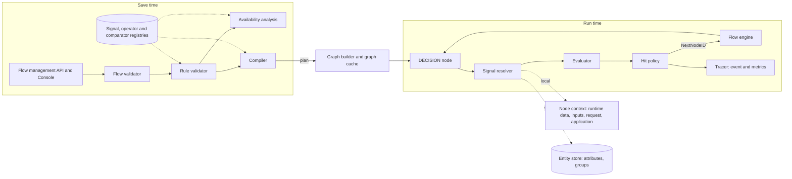
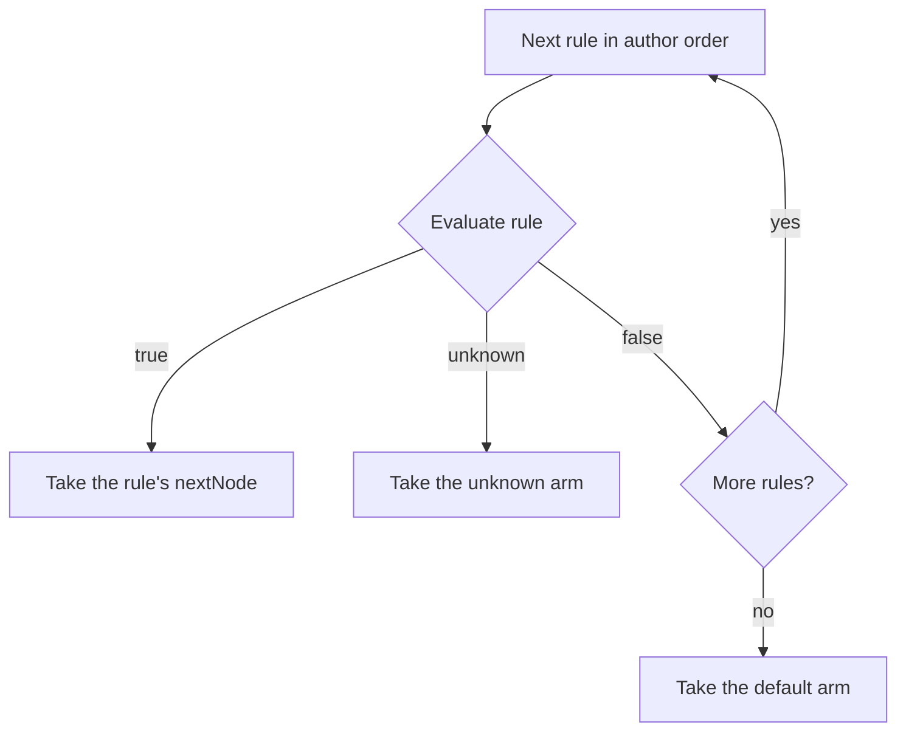

# Conditional Flow Execution Specification

- **Status:** Draft
- **Version:** 0.1
- **Related documents:**
  - Feature issue #5145 (Flow conditions)
  - Design discussion #6298 (Conditional flow execution with a declarative rule engine)
  - Threat model: [threat-model.md](threat-model.md), to be added before review
  - Extension executor specification: [../extension-executor/spec.md](../extension-executor/spec.md)

## Summary

A flow cannot branch today. The only conditional construct is the skip guard on a node, `condition {key, value, onSkip}`, which compares one runtime-data key with one string. It cannot combine checks, compare numbers or times, test membership in a list, or tell a value that is false from a value that is missing. A missing value skips the node, so the guard fails open. Authors work around it by repeating the same guard on several nodes.

This specification adds:

- a **`DECISION` node** that routes a flow to one of several next nodes by evaluating ordered rules;
- a **rule engine** that validates the rules when a flow is saved, compiles them into an immutable plan, and evaluates the plan when a flow reaches the node;
- a **signal registry** that names every value a rule can use and where it comes from: the platform, user type schemas, user inputs, request headers, and the answers of extension steps;
- a **signal availability analysis** that tells, for each decision node, which signals exist on every path that reaches it, on some paths, or on none;
- three **rule endpoints** under `/flows/rules` that the Console and agents use to discover operators and signals and to validate drafts.

**The governing design decision:** rules are data, not code, and missing data is never treated as false. Every condition evaluates to true, false or unknown. The first rule that is not false decides; an unknown rule sends the flow to a mandatory `unknown` arm. A failed lookup can therefore never let a user past a check, and the outcome on missing data is a choice the author makes explicitly.

**In scope:**

- the `DECISION` node in flows of every type, through the management API, declarative resources and the Console;
- the rule format, 12 operators and 6 comparators;
- built-in, schema, input, request-header and extension-output signals;
- save-time validation, availability analysis and node tests;
- the `meta`, `signals` and `validate` rule endpoints;
- the decision event and metrics.

**Out of scope** (future specifications):

- a text DSL for rules, and the `parse` and `print` endpoints;
- What-If simulation: `POST /flows/rules/simulate` and the Console What-If panel;
- a CEL derivation node that computes values inside a flow;
- actions on arms, report-only rollout, and replay of recorded decisions;
- hit policies other than `FIRST`;
- the client IP address as a signal, and the `ipInRange` and `matches` operators;
- external decision services (AuthZEN) and risk events (CAEP);
- outputs on `HTTPRequestExecutor`. Values from external services come through extension steps.

This specification refines discussion #6298 in four places: values from external services come through the extension executor and are named `extension.<nodeId>.<field>`; values the user typed are named `input.*`, separate from stored `user.*` attributes; node tests run inside `validate` and on save, with no separate test endpoint; What-If moves to a later phase.

## Architecture



| Component | Owner package | Responsibility | Existing seam used |
|---|---|---|---|
| Rule IR | `internal/flow/rules/ir` | The Go types and canonical JSON form of a `decision` block | `providers.NodeDefinition` |
| Registries | `internal/flow/rules/registry` | Operators, comparators and signals, built at start-up and immutable | Service initialisation in `internal/flow/mgt/init.go` |
| Comparators and values | `internal/flow/rules/value` | Read values as numbers, times, durations, scales, booleans or text | None |
| Operators | `internal/flow/rules/ops` | The 12 operators, each one registered specification | None |
| Rule validator | `internal/flow/rules/validate` | Collect every diagnostic for a decision node | Called from the flow validator in `internal/flow/mgt/validator.go` |
| Availability analysis | `internal/flow/rules/availability` | Signals available at each node, per path | Flow graph, `executormeta`, extension step properties, entity types |
| Compiler and plan | `internal/flow/rules/compile` | Turn validated rules into an immutable plan of closures | Called from `internal/flow/graphbuilder` |
| Signal resolver | `internal/flow/rules/resolve` | Fetch the values a plan needs, cheapest first | `providers.NodeContext`, entity provider |
| Evaluator | `internal/flow/rules/eval` | Three-valued evaluation of a plan | None |
| Decision node | `internal/flow/core` | Implements `NodeInterface` and routes on the outcome | `NodeInterface`, `NodeResponse.NextNodeID`, `NodeStatusForward` |
| Tracer | `internal/flow/rules/trace` | The decision event and metrics | Observability event bus |
| Executor outputs | `internal/flow/executormeta`, `pkg/thunderidengine/providers` | Declare which signals an executor produces | `ExecutorMeta` |
| Rule endpoints | `internal/flow/mgt` | `meta`, `signals` and `validate` | Flow management routes and authorization |
| Console | `frontend/packages/configure-flows` | Decision node, rule builder, signal picker, validation results | Flow builder canvas and node property panels |

`internal/flow/rules` imports no executor, store or network package. It reads data only through the resolver's sources, so the engine can be tested and reasoned about on its own.

The flow engine (`internal/flow/flowexec`) does not change. A decision node is one more node that returns a next node ID.

## Detailed design

### Decision node

A decision node has `type: DECISION` and a `decision` block:

```yaml
- id: access_check
  type: DECISION
  decision:
    grammarVersion: 1
    rules:
      - id: privileged
        label: Payment approvers need MFA
        when:
          op: all
          of:
            - { op: eq, signal: user.groups, value: [payments-approver, treasury] }
            - { op: not, of: { op: eq, signal: request.header.X-Network-Zone, value: corporate, ci: true } }
        nextNode: mfa_prompt
      - id: under_age
        label: Under 18
        when: { op: not, of: { op: gte, signal: extension.age_service.age, value: 18 } }
        nextNode: deny_access
    default: { label: Continue, nextNode: issue_token }
    unknown: { label: Cannot decide, nextNode: deny_access }
    tests:
      - name: approver off the corporate network needs MFA
        facts:
          user.groups: [payments-approver]
          request.header.X-Network-Zone: public
          extension.age_service.age: 30
        expect: mfa_prompt
      - name: directory unavailable
        unresolved: [user.groups]
        expect: deny_access
  layout:
    size: { width: 220, height: 120 }
    position: { x: 900, y: 470 }
```

| Element | Shape | Rules |
|---|---|---|
| `grammarVersion` | integer, default `1` | The rule language the node was written for. A server refuses a version it does not support. |
| `rules` | array, at least 1 | Evaluated in author order. |
| Rule | `{id, label?, when, nextNode}` | `id` matches `^[a-z][a-z0-9_]{0,63}$` and is unique in the node. `label` is at most 200 characters. |
| `default` | `{label?, nextNode}`, required | Taken when every rule is false. |
| `unknown` | `{label?, nextNode}`, required | Taken when the first rule that is not false is unknown. |
| `tests` | array of `{name, facts?, unresolved?, context?, expect}` | Scenarios run on save and by `validate`. `expect` is the `nextNode` the node must take. |
| `hitPolicy` | `FIRST`, default `FIRST` | Reserved. `FIRST` is the only policy. |
| `source` | `{frontend, frontendVersion}` | Reserved for the DSL. Accepted and stored, never required. |

The flow validator enforces, in addition to the rule validation below:

- a `DECISION` node has a `decision` block, and only a `DECISION` node has one;
- a `DECISION` node has no `executor`, `flow`, `prompts`, `inputs`, `onSuccess`, `onFailure`, `onIncomplete`, `next`, `message` or `condition`. It routes only through its arms, and a skip guard on it would bypass the decision;
- every `nextNode` of a rule and of both arms names a node in the flow;
- the existing reachability and termination checks apply: the node is reachable from `START` and every arm can reach an `END`.

The graph builder adds every arm's target to the node's next-node list, so reachability, termination and usages see every exit.

**Coexistence with the skip guard.** `condition` keeps its behaviour on every other node type. Flows that use it are unaffected. Authors move a guard to a decision node explicitly; nothing converts it automatically.

### Rule IR

The `decision` block is the rule IR: the one canonical form every authoring surface produces and the engine reads. The Console, the management API, declarative resources and agents all write it. A DSL in a later phase will produce the same structure.

Predicate grammar:

| Form | Shape | Meaning |
|---|---|---|
| Leaf | `{op, signal, value?, ref?, ci?, every?, options?}` | Compares a signal with a literal (`value`) or another signal (`ref`), never both. Presence operators take neither. |
| Group | `{op: all \| any, of: [p, p, ...]}` | `all` is AND, `any` is OR. At least two children. |
| Negation | `{op: not, of: p}` | Exactly one child. |

- `value` is a string, number or boolean, or a non-empty list of them. A list matches when any element matches.
- `ci: true` makes text comparison case-insensitive. It applies to `eq`, `startsWith`, `endsWith` and `contains`.
- `every: true` requires every value of a multi-valued signal to match.
- `options` is an object validated against the operator's options schema. No phase 1 operator has options.
- Unknown fields are refused, so a misspelt field is an error rather than ignored.
- Each element has a path (`rules[0].when.of[1].signal`) used in diagnostics and traces.
- Field order, defaults and number formatting are normalised before storage, so equal rules have identical JSON.

Limits, checked at save:

| Limit | Default | Hard cap |
|---|---|---|
| Rules per node | 32 | 64 |
| Nesting depth of a condition | 6 | 8 |
| Leaves per node | 128 | 256 |
| Values in one list literal | 1000 | 1000 |

### Evaluation semantics

**Three-valued logic.** Every leaf, group and rule evaluates to `T` (true), `F` (false) or `U` (unknown).

| Combinator | Result |
|---|---|
| `all` | `F` if any child is `F`; otherwise `U` if any child is `U`; otherwise `T` |
| `any` | `T` if any child is `T`; otherwise `U` if any child is `U`; otherwise `F` |
| `not` | `T` becomes `F`, `F` becomes `T`, `U` stays `U` |

A leaf is `U` when its signal is absent, when its source failed, or when no comparator can compare the two values. `exists` is the only operator that never returns `U`: it is how an author handles absence on purpose.

**Hit policy `FIRST`.** Rules are evaluated in author order and the first rule that is not false decides:



An unknown rule blocks the rules below it. If a rule that requires MFA is unknown because the directory is unreachable, a later rule that skips MFA on the corporate network must not win.

**Multi-valued signals.** A leaf on a multi-valued signal is true when some value matches. With `every: true` it is true when every value matches, and `U` when there are no values. `not` applies after this, so `not eq` means no value is equal.

### Values and comparators

Every value is a list of canonical strings. A single value is a list of one, so multi-valued signals need no special case. The literal `18` and the string `"18"` are the same value.

Operators do not inspect types. A **comparator** decides how two values are read:

| Comparator | Recognises | Equality | Ordering |
|---|---|---|---|
| `scale` | Members of a declared ordered scale, such as `aal1 < aal2 < aal3` | yes | yes |
| `instant` | `YYYY-MM-DD` dates and RFC 3339 timestamps | yes | yes |
| `duration` | ISO 8601 durations, such as `PT15M` and `P30D` | yes | yes |
| `number` | Decimal numbers with an optional sign, such as `30`, `-2`, `3.5`; not `1e3` | yes, numeric (`3.0` equals `3`) | yes |
| `boolean` | `true` and `false` | yes | no |
| `text` | Any value | yes, optionally case-insensitive | no |

Text has no ordering, so `"10" < "9"` can never decide a rule.

**Selecting a comparator for one comparison:**

1. If the signal declares a comparator, use it. If either value is not recognised by it, the comparison is incomparable.
2. Otherwise take the first comparator, in the order `instant`, `duration`, `number`, `boolean`, `text`, that recognises both values and offers the ability the operator needs. `scale` is never inferred: it is used only when a signal declares a scale.
3. If none qualifies, the comparison is incomparable. An incomparable comparison is `U`, never `F`.

The inference order is frozen at these five comparators. A comparator added later is opt-in: it is used only when a signal declares it, never inferred. Saved rules therefore never change meaning when comparators are added.

Each comparator is a `ComparatorSpec` with `Recognise`, `Equal`, `Compare` and `Key` functions. Literals are classified when the rule is compiled. A value fetched at run time is classified once into a bitmask, one bit per comparator that recognises it, and the comparator is chosen by intersecting the two masks with the operator's mask.

### Operators

| Operator | Kind | Holds when | Needs |
|---|---|---|---|
| `eq` | comparison | some left value equals some right value | equality |
| `gt`, `gte` | comparison | some left value orders above, or at or above, the right value | ordering |
| `startsWith`, `endsWith` | comparison | some left value's text begins or ends with a right value | text |
| `contains` | comparison | some left value's text contains a right value | text |
| `olderThan` | comparison | an instant is further in the past than a duration | instant and duration |
| `exists` | presence | the signal resolved | nothing |
| `isEmpty` | presence | the signal resolved with no non-whitespace value | nothing |
| `all`, `any` | group | AND, OR | nothing |
| `not` | negation | NOT | nothing |

*Not equals*, *less than*, *is one of* and *is not empty* are compositions of these. *Contains* on a list, such as *groups contains payments-approver*, is `eq` on a multi-valued signal; *contains* on text, such as *username contains @*, is the `contains` operator. The Console offers these forms as wording and stores the primitive form.

Each operator is one registered specification:

```go
type OperatorSpec struct {
    Name       string
    Since      int
    Kind       OperatorKind     // COMPARISON, PRESENCE, GROUP, NEGATION
    Right      RightSpec        // which of value, list and ref are accepted
    Qualifiers QualifierSet     // ci, every
    Needs      AbilityMask      // equality, ordering, text, or a named pair
    Options    *Schema
    Compile    func(CompileCtx, ir.Leaf) (Test, error)
    Lint       func(LintCtx, ir.Leaf) []Diagnostic
    Phrases    Phrases          // "is" / "is not"
    Cost       int
}
```

Adding an operator registers one specification. The validator, compiler, `meta` endpoint and Console pick it up without other changes. Adding an operator, comparator or signal changes the registry version, so plans recompile; it does not change the grammar version. The grammar version changes only for a new combinator or a change in the meaning of an existing construct. A server that does not know an operator or signal a flow uses refuses to load the flow; it never skips the rule.

### Signals

A signal is a named value a rule can use. Rules can name declared signals only. Raw runtime-data keys are not reachable.

Every signal is declared with:

| Field | Purpose |
|---|---|
| `name`, `display`, `description` | The identifier, the Console label and help text |
| `category` | Picker grouping: `APPLICATION`, `USER`, `USER_COLLECTED`, `RUNTIME`, `REQUEST`, `SESSION` |
| `layer` | `BUILT_IN`, `SCHEMA` or `FLOW` |
| `source`, `format` | Where the value comes from and how it becomes canonical values |
| `comparator` | Optional declared comparator |
| `multi` | Whether the signal can hold several values |
| `costClass` | `local` (already in memory) or `store` (needs a read) |
| `trust` | `system`, `directory`, `external` or `subject` (typed or sent by the client) |
| `sensitivity` | `public`, `internal` or `pii` |
| `flowTypes` | Flow types the signal can exist in; empty means all |
| `producedBy` | What makes the value exist: an executor, an input, an extension step, or always |

**Three layers.**

| Layer | Built from | Changes when | Visible in |
|---|---|---|---|
| `BUILT_IN` | Declarations in server code | A server upgrade | Every flow |
| `SCHEMA` | User type schemas (`ENTITY_TYPES.SCHEMA_DEF`) | A user type schema is edited | Flows whose organization unit uses the user type |
| `FLOW` | Inputs and extension steps in the flow | The flow is saved | That flow only |

**Built-in signals in phase 1:**

| Signal | Source | Category | Cost | Trust | Notes |
|---|---|---|---|---|---|
| `flow.type` | `NodeContext.FlowType` | APPLICATION | local | system | |
| `application.id`, `application.name`, `application.type`, `application.ouId` | `NodeContext.Application` | APPLICATION | local | system | |
| `user.id` | The identified user | USER | local | system | After a step that identifies the user |
| `user.ouId` | The identified user's organization unit | USER | local | system | After identification |
| `user.type` | The identified user's entity type | USER | store | directory | After identification |
| `user.groups` | `GROUP.NAME` through `GROUP_MEMBER_REFERENCE` | USER | store | directory | Multi-valued; after identification |
| `session.authTime` | Runtime data `ssoAuthTime`, Unix seconds | SESSION | local | system | Declared `instant`; produced by `SessionExecutor` |
| `request.header.<name>` | Header of the current request | REQUEST | local | subject | Name is case-insensitive |
| `request.query.<name>` | Query parameter of the current request | REQUEST | local | subject | |
| `request.initial.header.<name>`, `request.initial.query.<name>` | Header or query parameter of the request that started the flow | REQUEST | local | subject | |

`request.header.*` and the other request signals are families: the registry holds one template, and the part after the prefix is the header or parameter name, written as it appears in the request. Header names match case-insensitively; query parameter names match exactly. They read the same request data as the existing `{{request(...)}}` placeholders.

**Schema signals.** For each non-credential attribute of the user types in scope, the registry generates `user.<attribute>`:

| Schema type | Signal |
|---|---|
| `string`, `email`, `mobile` | Text. `email` and `mobile` have sensitivity `pii`. |
| `number` | Declared `number` |
| `boolean` | Declared `boolean` |
| `array` of a scalar type | Multi-valued, with the item type's comparator |
| `object`, or an array of objects | Not a signal in phase 1 |

Attributes marked `credential` never become signals. Schema signals have trust `directory`, cost `store`, and exist after a step that identifies the user. They are read from `ENTITY.ATTRIBUTES` of the identified user.

**Input signals.** For each prompt input on the paths into a node, the registry generates `input.<identifier>`, read from the user inputs of the flow execution. They have category `USER_COLLECTED` and trust `subject`. `NUMBER_INPUT` is declared `number`; other input types are text. Inputs of type `PASSWORD_INPUT` and `OTP_INPUT`, and inputs mapped to credential attributes, never become signals.

The prefix keeps a value the user typed apart from a stored attribute: `input.email` is what the user entered, `user.email` is what the directory holds. A rule whose condition depends only on signals with trust `subject`, which includes request headers, raises `W_SUBJECT_TRUST`, because the client controls every value it reads.

**Extension output signals.** An extension step stores its service's answer in runtime data as `extension.<nodeId>.<field>`. For each field named in the step's `responseKeys`, the registry generates a `FLOW` signal with the same name. An optional `outputs` property types them:

```yaml
- id: age_service
  type: TASK_EXECUTION
  executor: { name: ExtensionExecutor }
  properties:
    connectionId: 0195a2c0-6f3e-7a21-9f2a-2c4f8f1d9a10
    inputKeys: [dateOfBirth]
    responseKeys: [age]
    outputs:
      age: { display: User age, comparator: number, sensitivity: pii }
  onSuccess: access_check
```

- Category `RUNTIME`, trust `external`, cost `local`.
- Produced on the step's `onSuccess` path only. On `FAILED`, `INCOMPLETE` and `ERROR` paths the signal does not exist.
- A step with no `responseKeys` stores every field its service returns. Its answer cannot be used in rules, because the fields are not known at save time.
- Every key of `outputs` must also be in `responseKeys`.
- The node ID becomes part of the signal name, so the ID of an extension step whose outputs a rule uses must match `^[a-z][a-z0-9_]*$`.
- A computed value is never named `user.*`. The extension executor already prevents an answer from naming a profile attribute, and the registry keeps that separation.

**Reserved prefixes.** `flow.`, `application.`, `user.`, `session.`, `request.` and `input.` belong to the built-in, schema and input layers. `extension.` belongs to extension outputs. `derived.` is reserved for the derivation node in a later phase. No two signals have the same name.

### Executor outputs

`providers.ExecutorMeta` gains an `Outputs` field:

```go
type ExecutorOutput struct {
    Signal   string         // for example "user.id" or "session.authTime"
    OnStatus ExecutorStatus // the status on which the signal exists
}
```

The availability analysis uses it to know what each step produces. In phase 1:

- every executor that identifies or authenticates a user declares `user.id` on `COMPLETE`. That includes `CredentialsAuthExecutor`, `IdentifyingExecutor`, `PasskeyAuthExecutor`, `MagicLinkExecutor`, `OTPExecutor`, the federated executors, `SSOCheckExecutor`, `ProvisioningExecutor` and the extension auth resolver;
- `SessionExecutor` and `SSOCheckExecutor` declare `session.authTime`.

`user.ouId`, `user.type`, `user.groups` and the schema signals exist wherever `user.id` exists. An executor without declared outputs produces no signals for the analysis. A test fails if an executor that sets the authenticated user does not declare `user.id`.

### Signal availability

At save time, the analysis computes for each decision node which signals exist on every path that reaches it, on some paths, or on none.

1. Build the flow graph from `START`, with every node's exits, including arms of other decision nodes.
2. For each node, take the signals it produces: inputs of a prompt on the action that leaves it, executor outputs on the matching exit, extension outputs on `onSuccess`.
3. Run a forward dataflow pass with two bitsets per node: **must**, the intersection over all incoming edges (on every path), and **may**, the union (on some path). Loops are iterated until neither set changes.
4. A `CALL` node produces the built-in signals its callee produces on every path to its `END`, computed for the callee the same way. `FLOW` and input signals produced inside a callee are not visible to the caller in phase 1.
5. Filter by context: the flow type, and the user types of the flow's organization unit for schema signals. Built-in signals with no `producedBy` exist everywhere.

| Signal a rule uses | Result |
|---|---|
| In **must** | Accepted |
| In **may** only | `W_SIGNAL_SOMETIMES_ABSENT`: on the other paths the rule is unknown and the `unknown` arm decides |
| In neither | `E_SIGNAL_UNAVAILABLE` |

The cost is proportional to the number of nodes and edges times the number of signals divided by 64. The same result answers `POST /flows/rules/signals`, so the Console picker offers only signals that can exist at the node.

A node that is not reachable from `START` has no paths. The analysis reports it as unreachable, and `signals` returns the catalogue for the context with `reachable: false` (see *API*).

### Save path: validation, compilation and tests

When a flow is created, updated, imported, loaded from a declarative file, or sent to `validate`, every decision node goes through:

1. **Parse** the `decision` block into `ir.Decision`. Unknown fields are refused and defaults are filled in.
2. **Structure:** the checks in *Decision node*.
3. **Leaves:** known signal and operator; the operand matches the operator's `Right` (`value`, list or `ref`); qualifiers allowed by the operator; options valid; limits respected.
4. **Comparators:** a literal that the signal's declared comparator cannot read raises `W_INCOMPARABLE_LITERAL`; an operator whose needs the signal's declared comparator cannot meet raises `W_OPERATOR_COMPARATOR`.
5. **Availability:** as above.
6. **Lints:** a rule that can never be true (`W_NEVER_TRUE`), and a rule that can never decide because an earlier rule always does (`W_SHADOWED_RULE`). These are best-effort checks, not proofs.
7. **Compile** the node into a plan (below). A node that fails to compile is reported, never silently skipped.
8. **Tests:** each test runs against the plan using only the values it supplies. Signals in `facts` have those values, signals in `unresolved` behave as if their source failed, and every other signal is absent. A test whose outcome differs from `expect` raises `E_TEST_FAILED`.

The rule validator collects every diagnostic rather than stopping at the first. Each diagnostic has `path`, `nodeId`, `ruleId`, `code`, `severity`, `message` and, where possible, `suggestion` (for example the closest signal name).

| Code | Severity | Meaning |
|---|---|---|
| `E_UNKNOWN_SIGNAL`, `E_UNKNOWN_OPERATOR` | error | The name is not registered |
| `E_OPERAND` | error | `value` and `ref` both or neither, or a form the operator refuses |
| `E_ARITY` | error | A group with fewer than two children, or a negation without exactly one |
| `E_OPTIONS` | error | Options invalid for the operator |
| `E_GRAMMAR_VERSION` | error | Unsupported grammar version |
| `E_DUPLICATE_RULE_ID` | error | Two rules with the same `id` |
| `E_UNKNOWN_NODE` | error | A `nextNode` that is missing or not in the flow |
| `E_MISSING_ARM` | error | `default` or `unknown` missing |
| `E_NO_RULES` | error | `rules` is empty |
| `E_FORBIDDEN_FIELD` | error | A field a decision node must not have |
| `E_LIMIT` | error | A limit exceeded |
| `E_SIGNAL_UNAVAILABLE` | error | The signal exists on no path into the node |
| `E_OUTPUT_NAME` | error | An extension step's node ID or field does not form a valid signal name |
| `E_OUTPUT_NOT_STORED` | error | An `outputs` key that is not in `responseKeys` |
| `E_TEST_FAILED` | error | A node test failed |
| `W_SIGNAL_SOMETIMES_ABSENT` | warning | The signal exists on some paths only |
| `W_INCOMPARABLE_LITERAL`, `W_OPERATOR_COMPARATOR` | warning | The literal or operator cannot work with the signal's declared comparator |
| `W_NEVER_TRUE`, `W_SHADOWED_RULE` | warning | A rule that can never decide |
| `W_SUBJECT_TRUST` | warning | A rule's condition depends only on signals the client supplied (trust `subject`) |

Errors refuse a save. Warnings are returned and the save goes ahead. Create and update return `400` with `FLM-1046` and the first error in the description; `validate` returns the full list.

The existing flow validator returns the first structural error it finds. `validate` runs it on the same draft and adds its error to the list as a diagnostic, so an author sees structural and rule problems together.

**Compilation** has three passes:

- **Lower:** signal names become integer handles; literals are classified by comparator; each leaf gets an ID and a path; the signals a node uses are grouped into stages by cost class (`local`, then `store`).
- **Optimise:** nested groups of the same kind are flattened; `not not p` becomes `p`; a long list literal becomes a hash set; inside a group, children are ordered cheapest first. Rule order never changes, because in `FIRST` it is meaning. Reordering children inside a group cannot change a result, because the three-valued `all` and `any` are commutative and leaves have no side effects.
- **Generate:** each node of the tree becomes a Go closure `func(*Frame) Truth` with its handles and classified literals bound.

```go
type Plan struct {
    Key       PlanKey          // flowID, flowVersion, nodeID, grammarVersion, registry fingerprint
    Rules     []CompiledRule   // author order: closure, nextNode, leaf IDs
    Default   Arm
    Unknown   Arm
    Signals   []SignalHandle
    Stages    [][]SignalHandle // [[local...], [store...]]
    LeafCount int
    Summary   []string         // plain-language reading of each rule
}
```

A plan is immutable and shared by concurrent executions. Compiling the same rules against the same registries produces the same plan.

### Plans at run time and caching

Plans are never stored. The graph builder compiles each decision node's plan when it builds a flow's graph, and stores it on the node. Graphs are already cached per server in `core/graph_cache.go` and rebuilt when the flow's active version changes.

The graph cache staleness check also compares a **registry fingerprint**: a hash of the built-in registries plus a hash of each user type schema the flow's plans use. Editing a user type schema therefore rebuilds only the graphs that depend on it. A server upgrade that changes the built-in registries rebuilds every graph on first use.

If a rule names a schema signal whose attribute has since been removed, the rebuilt plan compiles that leaf to `U`, logs a warning, and publishes the decision event with `stale: true`. The rule cannot be true, the `unknown` arm decides as for any missing data, and the next save of the flow reports `E_UNKNOWN_SIGNAL`.

### Decision node execution

```go
func (n *decisionNode) Execute(ctx *providers.NodeContext) (*common.NodeResponse, *tidcommon.ServiceError) {
    frame := eval.Acquire(n.plan)
    defer eval.Release(frame)
    var out Outcome
    for _, stage := range n.plan.Stages {
        resolver.Resolve(ctx, stage, frame) // a failed source leaves its signals absent
        out = hitPolicy(n.plan, frame)      // signals not fetched yet are unknown
        if out.Settled {
            break
        }
    }
    tracer.Record(ctx, n.plan, frame, out)
    return &common.NodeResponse{Status: common.NodeStatusForward, NextNodeID: out.NextNode}, nil
}
```

- **Staged resolution.** The `local` stage reads the node context: runtime data, user inputs, the request and the application. The `store` stage reads the identified user's attributes, type and groups through the entity provider, in one batch, bounded by the request context's deadline. A source that fails or times out leaves its signals absent; it never fails the node.
- **Early exit.** After each stage the engine evaluates with unfetched signals as `U`. When the outcome can no longer change, later stages are skipped. This is safe because three-valued logic is monotone: replacing a `U` with `T` or `F` never turns a `T` into `F` or the reverse. A rule set whose first rule is decided by local data never reads the entity store.
- **Allocation.** Frames come from a pool and are sized from the plan, so a steady-state evaluation allocates nothing on the heap.
- **No side effects.** The decision node writes nothing to runtime data, the user or the store. It cannot fail: every problem becomes `U`, and `U` routes through the `unknown` arm.
- **Targets.** At the default maximum size, with every signal local, evaluation excluding resolution is at most 50 µs at p99, with zero heap allocations in steady state. Validation and compilation take at most 10 ms per decision node at save.

### Conformance

The evaluator is checked against an independent implementation:

- a **reference evaluator**, written from this specification only, interprets the rule IR directly, with no compilation or optimisation, and is used only in tests;
- a **conformance corpus** of rule IR, input values and the expected arm and leaf truths, shared by both evaluators;
- **fuzzing** generates rules and values and requires both evaluators to agree on the outcome and every leaf truth;
- **property tests** check the three-valued laws (commutativity of `all` and `any`, `not not p` equals `p`, De Morgan), that staged evaluation gives the same outcome as resolving every signal first, and that an incomparable leaf is never `F`.

### Observability

Every evaluation publishes one event on the observability event bus:

| Field | Value |
|---|---|
| Event type | `FLOW_DECISION` |
| `executionId`, `flowId`, `flowVersion`, `nodeId`, `flowType` | Identify the decision |
| `selectedBy` | `RULE`, `DEFAULT` or `UNKNOWN` |
| `ruleId`, `nextNode` | The decision |
| `rules` | Per rule: `id` and truth |
| `leaves` | Per evaluated leaf: path, signal name, truth, reason (`MATCH`, `NO_MATCH`, `UNRESOLVED`, `ABSENT`, `INCOMPARABLE`, `NOT_EVALUATED`) and comparator |
| `stages` | The stages used |
| `durationMicros` | Resolution and evaluation time |
| `stale` | `true` when a leaf referred to a signal that no longer exists |

The event carries no signal values, so no personal data leaves the server through it.

Metrics per flow and node: decisions by arm, the rate of `unknown` and `default` outcomes, the rate of incomparable leaves, the stages used, and evaluation latency. A rising `unknown` rate shows a failing source.

### Data model

No table changes. The feature reuses existing tables:

| Table | Use |
|---|---|
| `FLOW_VERSION.NODES` (configuration database) | Decision nodes, their rules and tests, and the `outputs` property of extension steps, inside the existing JSON. Each save creates a version as today, so rules are versioned, restored and exported with the flow. |
| `ENTITY_TYPES.SCHEMA_DEF` (configuration database) | Read to generate schema signals. |
| `ENTITY.ATTRIBUTES`, `ENTITY.TYPE`, `GROUP`, `GROUP_MEMBER_REFERENCE` (entity database) | Read at run time for `user.*` signals. Never written by the engine. |
| `RUNTIME_STORE`, namespace `flow:state` (runtime database) | Holds extension answers and user inputs inside the existing flow context. No new fields. |

Compiled plans, registries and evaluation frames live in memory only and are rebuilt on first use after a restart.

### API

**Flow management API** (`api/flow-management.yaml`):

- the `Node.type` enum gains `DECISION`;
- `Node` gains `decision`, of type `DecisionDefinition`, defined with the rule endpoints;
- create and update refuse an invalid decision node with `400 FLM-1046`.

**Rule endpoints.** A new file, `api/flow-rules.yaml`. All routes require OAuth2 with the `system` scope, as the other flow management routes do. They are not under `/flow/meta` or `/flow/execute`, which are public. `/flows/rules` is a fixed path next to `/flows/{flowId}`; flow IDs are UUIDs and literal segments take precedence in the router, so the two never collide.

| Method and path | Request | Response |
|---|---|---|
| `GET /flows/rules/meta` | none | `200`, `{grammarVersion, registryVersion, limits, operators[], comparators[]}`, with `ETag` set to `registryVersion` |
| `POST /flows/rules/signals` | `{flow?, nodeId?, context?, category?, query?, includeUnavailable?}` | `200`, `{nodeId?, reachable?, registryVersion, signals[]}`; `400 FLM-1044` or `FLM-1045`; `404 FLM-1003` for an unknown application or organization unit in `context` |
| `POST /flows/rules/validate` | `{flow, nodeIds?, context?, runTests?}` | `200`, `{valid, registryVersion, diagnostics[], nodes[{nodeId, summary[], tests}]}`; `400 FLM-1044` |

- `meta` describes the rule language: each operator's `name`, `since`, `kind`, accepted `right` operands, `qualifiers`, `options` schema and `phrases`; each comparator's `name` and inference order. It does not list signals.
- `signals` without `nodeId` returns the catalogue for the context: every signal that can exist for the flow type, application and organization unit, without availability. With `flow` and `nodeId` it returns the signals at that node, each with `availability` (`EVERY`, `SOME`, or `NONE` when `includeUnavailable` is set) and `producedBy`. For a node that is not reachable from `START`, it returns the catalogue with `reachable: false`. `category` and `query` filter the list.
- `validate` never saves. A draft with problems is `200` with `valid: false`; `400` is for a request that cannot be read. Test results per node carry `passed`, `failed` and, for each failure, `name`, `expected`, `actual` and the decision trace built from the test's own values.

| Code | Constant | Meaning |
|---|---|---|
| `FLM-1044` | `ErrorInvalidRuleRequest` | The rule request cannot be read |
| `FLM-1045` | `ErrorRuleNodeNotFound` | `nodeId` is not a node of the draft |
| `FLM-1046` | `ErrorInvalidDecisionNode` | Create or update refused because a decision node has errors |

### UI

**Flow builder, decision node.** A diamond-headed node with one exit handle per rule, plus Default and Unknown. Unconnected exits are marked until they are wired.

```text
◇ Access check
  ● Payment approvers need MFA   ──▶
  ● Under 18                     ──▶
  ● Default                      ──▶
  ● Cannot decide (unknown)      ──▶
```

**Decision node panel, rule builder.** Rules are listed in order and can be reordered by dragging. A condition is shown as groups of rows; a row can become a sub-group, and a group can be negated. The operator list and the value field follow the operator's descriptor from `meta`: a presence operator shows no value field, an operator that accepts lists shows a multi-value field, and qualifiers show as toggles.

```text
Rule 1  Payment approvers need MFA                       → mfa_prompt ▾
 ┌ ALL of ▾ ─────────────────────────────────────────────────────────┐
 │ [User ▾ groups          ] [is ▾      ] [payments-approver ×] [+]   │
 │ [Request ▾ header ▾ X-Network-Zone] [is not ▾] [corporate] ☑ ignore case │
 │ + condition   + group                                             │
 └───────────────────────────────────────────────────────────────────┘
Rule 2  Under 18                                         → deny_access ▾
   [Runtime ▾ User age (age_service)] [is less than ▾] [18]
Default                                                 → issue_token ▾
If it cannot be decided                                 → deny_access ▾
```

**Signal picker.** The admin picks a category, then a signal. The list comes from `signals` for the node, with badges for signals available on some paths only. Request headers and query parameters take a free-text name. On a node that is not connected yet, the picker shows the catalogue with the notice "Connect this node to the flow to see which signals are available here."

```text
Category  [User attributes collected ▾]
  input.email          Email (entered)
  input.mobile         Mobile (entered)       ⚠ some paths only
```

**Validation and tests.** The panel lists diagnostics with the field highlighted, and a Tests tab lists each scenario with pass or fail, expected and actual next node. Tests are added by name, values and expected next node.

**Flow builder, extension step.** The step gains an Outputs list under Stored fields, where each stored field can be given a display name, a comparator and a sensitivity.

### Configuration

| Key | Level | Default | Meaning |
|---|---|---|---|
| `flow.decision.max_rules_per_node` | deployment | 32 | Rules per decision node, at most 64 |
| `flow.decision.max_depth` | deployment | 6 | Nesting depth of a condition, at most 8 |
| `flow.decision.max_leaves_per_node` | deployment | 128 | Leaves per decision node, at most 256 |

The list-literal cap of 1000 values, the comparator inference order and the event fields are constants, not configuration.

## Open questions

1. **Resuming on a changed flow.** The flow context stores the flow ID, not its version, so an execution paused at a prompt resumes on the active version after an update. With decision nodes, a user may meet rules that did not exist when they started. Should the context pin the version it started on?
2. **Endpoint naming.** `/flows/{flowId}/overlay-rules` already exists for sharing. Would `/flows/decisions/*` be clearer than `/flows/rules/*`?
3. **Numeric equality.** This specification makes `"3.0"` equal `"3"` when both are numbers (discussion #6298, question 5). Should equality stay textual and only ordering be numeric?
4. **Stored combinator names.** `all` and `any`, or `and` and `or`? The Console shows *and* and *or* either way (discussion #6298, question 6).
5. **Failing tests on declarative load.** A failing node test refuses a save. Should it also refuse a declarative flow at start-up, or only log?
6. **Removing a schema attribute that rules use.** Should the entity type service refuse to remove an attribute a decision node uses, through the dependency registry, instead of leaving the leaf unknown?

## Requirements

### R1. A flow routes on ordered rules

**Requirement:** An administrator can add a decision node that sends the flow to one of several next nodes based on rules, with a default and an unknown arm.

**Acceptance criteria:**

- **AC1.1:** Given a decision node whose first rule is true, when the flow reaches it, then the flow continues at that rule's `nextNode` and no later rule is evaluated.
- **AC1.2:** Given a decision node whose rules are all false, when the flow reaches it, then the flow continues at the `default` arm's `nextNode`.
- **AC1.3:** Given a decision node whose first rule is false and second rule is unknown, and a third rule that is true, when the flow reaches it, then the flow continues at the `unknown` arm's `nextNode`.
- **AC1.4:** Given a decision node without a `default` or `unknown` arm, or with no rules, when the flow is saved, then the save is refused with `400 FLM-1046`.
- **AC1.5:** Given a decision node with `executor`, `prompts`, `onSuccess` or `condition`, when the flow is saved, then the save is refused with `400 FLM-1046`.
- **AC1.6:** Given a rule whose `nextNode` names no node in the flow, when the flow is saved, then the save is refused.
- **AC1.7:** Given an existing flow with skip guards and no decision nodes, when it runs after the upgrade, then it behaves as before.

### R2. Conditions combine checks with AND, OR and NOT

**Requirement:** A rule's condition can combine leaf checks with `all`, `any` and `not`, nested up to the configured depth, using the 12 operators.

**Acceptance criteria:**

- **AC2.1:** Given `all` of a true and an unknown leaf, when evaluated, then the result is unknown; given `all` of a false and an unknown leaf, then the result is false.
- **AC2.2:** Given `any` of a true and an unknown leaf, when evaluated, then the result is true; given `any` of a false and an unknown leaf, then the result is unknown.
- **AC2.3:** Given `not` of an unknown leaf, when evaluated, then the result is unknown.
- **AC2.4:** Given a condition nested deeper than `flow.decision.max_depth`, when the flow is saved, then the save is refused with `E_LIMIT`; given a group with one child, then it is refused with `E_ARITY`.
- **AC2.5:** Given `user.groups` with values `[employees, payments-approver]`, when `eq payments-approver` is evaluated, then it is true; with `every: true`, then it is false.
- **AC2.6:** Given `input.username` with value `alice@example.com`, when `contains "@"` is evaluated, then it is true.
- **AC2.7:** Given a signal that is absent, when `exists` is evaluated, then it is false; when `eq` is evaluated, then it is unknown.

### R3. Comparison does not depend on declared types

**Requirement:** Operators work on numbers, times, durations, scales, booleans and text without a type declared on the operator, and a comparison that makes no sense is unknown.

**Acceptance criteria:**

- **AC3.1:** Given `extension.age_service.age` with value `"30"` and no declared comparator, when `gte 18` is evaluated, then it is true.
- **AC3.2:** Given `user.postalCode` declared as text with value `"0123"`, when `eq "123"` is evaluated, then it is false.
- **AC3.3:** Given `session.authTime` declared `instant` with a value 40 days in the past, when `olderThan P30D` is evaluated, then it is true.
- **AC3.4:** Given a signal with value `"thirty"`, when `gte 18` is evaluated, then the leaf is unknown with reason `INCOMPARABLE`.
- **AC3.5:** Given two text values `"10"` and `"9"`, when `gt` is evaluated, then the leaf is unknown, never true or false.
- **AC3.6:** Given a rule saved before a new comparator is registered, when the server is upgraded, then the rule's comparisons and outcomes are unchanged.

### R4. Missing data never grants access

**Requirement:** A value that is missing, or whose source fails, makes the condition unknown, and the decision node never fails the flow because of it.

**Acceptance criteria:**

- **AC4.1:** Given a rule on `user.groups` and an entity store that times out, when the flow reaches the node, then the leaf is unknown with reason `UNRESOLVED`, the node takes the `unknown` arm, and the flow does not fail.
- **AC4.2:** Given `not eq user.groups admin` and an unavailable entity store, when evaluated, then the result is unknown, not true.
- **AC4.3:** Given an extension step that answered `FAILED`, when a later decision node reads its output, then the signal is absent and the leaf is unknown.
- **AC4.4:** Given a rule on a schema attribute that was removed after the flow was saved, when the flow runs, then the leaf is unknown, the `unknown` arm is taken, and the event carries `stale: true`.

### R5. Rules can use platform, user, input, request and extension values

**Requirement:** Rules can name built-in signals, schema attributes of the user's type, values the user entered, request headers and query parameters, and declared outputs of extension steps.

**Acceptance criteria:**

- **AC5.1:** Given a user type with a `number` attribute `employeeGrade`, when the signals for a node after identification are requested, then `user.employeeGrade` is listed, declared `number`, with trust `directory`.
- **AC5.2:** Given a user type attribute marked `credential`, when signals are requested, then it is not listed and a rule naming it is refused with `E_UNKNOWN_SIGNAL`.
- **AC5.3:** Given a prompt that collects `email`, when signals for a later node are requested, then `input.email` is listed with category `USER_COLLECTED` and trust `subject`, and `PASSWORD_INPUT` inputs are not listed.
- **AC5.4:** Given a request with header `X-Network-Zone: corporate`, when `request.header.x-network-zone eq corporate` is evaluated, then it is true.
- **AC5.5:** Given an extension step `age_service` with `responseKeys: [age]`, when a later rule uses `extension.age_service.age`, then the save succeeds; when the step has no `responseKeys`, then the rule is refused with `E_UNKNOWN_SIGNAL`.
- **AC5.6:** Given a rule naming a raw runtime-data key such as `attemptCount` or `ssoAuthTime`, when the flow is saved, then it is refused with `E_UNKNOWN_SIGNAL`.
- **AC5.7:** Given an extension step whose `outputs` names a field not in `responseKeys`, when the flow is saved, then it is refused with `E_OUTPUT_NOT_STORED`; given an extension step whose ID is `age-service` and whose output a rule uses, then it is refused with `E_OUTPUT_NAME`.

### R6. Rules only use signals that can exist at the node

**Requirement:** For each decision node, the server knows which signals exist on every path, on some paths, or on none, and validates rules against that.

**Acceptance criteria:**

- **AC6.1:** Given a decision node reached only through `age_service`'s `onSuccess`, when a rule uses `extension.age_service.age`, then no availability diagnostic is raised.
- **AC6.2:** Given a second path to the node that skips `age_service`, when the flow is validated, then `W_SIGNAL_SOMETIMES_ABSENT` is returned and the save succeeds.
- **AC6.3:** Given a decision node before any step that identifies the user, when a rule uses `user.groups`, then the save is refused with `E_SIGNAL_UNAVAILABLE`.
- **AC6.4:** Given a flow with a loop back to an earlier prompt, when it is validated, then validation completes, and a signal produced on every path into the decision node, including the path through the loop, is accepted without an availability diagnostic.
- **AC6.5:** Given a decision node not connected to `START`, when signals are requested for it, then the response has `reachable: false` and lists the catalogue for the context.
- **AC6.6:** Given an executor that sets the authenticated user, when its metadata has no `user.id` output, then the unit test suite fails.

### R7. Problems are reported before a flow is saved

**Requirement:** An author or a tool can validate a draft flow and receive every problem at once, with the exact location of each.

**Acceptance criteria:**

- **AC7.1:** Given a draft with an unknown signal and a missing `unknown` arm, when `validate` is called, then both diagnostics are returned with their paths, and `valid` is `false`.
- **AC7.2:** Given a draft with a misspelt signal `user.group`, when `validate` is called, then `E_UNKNOWN_SIGNAL` carries the suggestion `user.groups`.
- **AC7.3:** Given a draft with only warnings, when it is saved, then the save succeeds and a later `validate` returns the warnings.
- **AC7.4:** Given a draft that is not reachable from `START`, when `validate` is called, then the existing reachability error is returned as a diagnostic alongside the rule diagnostics.
- **AC7.5:** Given any `validate` call, when it completes, then nothing is saved.

### R8. Decision nodes carry tests

**Requirement:** A decision node can carry test scenarios that run on save and in `validate`, using only the values they supply.

**Acceptance criteria:**

- **AC8.1:** Given a test whose facts make the first rule true and whose `expect` is that rule's `nextNode`, when the flow is saved, then the test passes.
- **AC8.2:** Given a test with `unresolved: [user.groups]` expecting the `default` arm while the first rule uses `user.groups`, when the flow is saved, then the save is refused with `E_TEST_FAILED`, and `validate` reports expected and actual next node with the trace.
- **AC8.3:** Given a test run, when it evaluates, then no store, session, runtime data or external service is read.
- **AC8.4:** Given `validate` with `runTests: false`, when it completes, then no test results are returned.

### R9. Clients discover the rule language and the signals

**Requirement:** The Console and agents can discover operators, comparators and limits, and the signals available for a context or a node, without hard-coding them.

**Acceptance criteria:**

- **AC9.1:** Given `GET /flows/rules/meta`, when it returns, then it lists the 12 operators with `kind`, `right`, `qualifiers` and `phrases`, the comparators, the limits, and an `ETag` equal to `registryVersion`.
- **AC9.2:** Given a new operator registered on the server, when `meta` is requested, then the operator is listed and `registryVersion` has changed.
- **AC9.3:** Given `signals` with only a context, when it returns, then it lists signals without `availability`; given `flow` and `nodeId`, then each signal carries `availability` and `producedBy`.
- **AC9.4:** Given `signals` with `category: USER_COLLECTED`, when it returns, then only `input.*` signals are listed.
- **AC9.5:** Given a caller without the `system` scope, when any rule endpoint is called, then it returns `401` or `403`.

### R10. Decisions are fast and bounded

**Requirement:** A decision node adds negligible latency to a flow, and its size is bounded.

**Acceptance criteria:**

- **AC10.1:** Given a decision node at the default maximum size with all signals local, when it is evaluated, then p99 evaluation time, excluding resolution, is at most 50 µs, and a benchmark shows zero heap allocations per evaluation in steady state.
- **AC10.2:** Given a decision node whose first rule is decided by local signals, when it is evaluated, then the entity store is not read.
- **AC10.3:** Given a flow with decision nodes at the default maximum size, when it is saved, then validation and compilation complete within 10 ms per node.
- **AC10.4:** Given more rules than `flow.decision.max_rules_per_node`, when the flow is saved, then the save is refused with `E_LIMIT`.
- **AC10.5:** Given the same rules evaluated by the compiled evaluator and by the reference evaluator on generated inputs, when the conformance suite runs, then their outcomes and leaf truths are identical.

### R11. Every decision is observable

**Requirement:** Each decision publishes an event and metrics that explain it, without exposing personal data.

**Acceptance criteria:**

- **AC11.1:** Given a decision, when it completes, then one `FLOW_DECISION` event is published with the selected arm, the deciding rule, each rule's truth and each evaluated leaf's reason.
- **AC11.2:** Given a decision on `input.email`, when the event is published, then it contains the signal name and no value.
- **AC11.3:** Given repeated decisions taking the `unknown` arm, when metrics are read, then the unknown rate for that node reflects them.

### R12. Administrators build decision nodes in the Console

**Requirement:** An administrator can add and configure a decision node in the flow builder without writing JSON.

**Acceptance criteria:**

- **AC12.1:** Given the flow builder, when an administrator adds a decision node, then it shows one exit per rule plus Default and Unknown, and the flow cannot be saved until every exit is connected.
- **AC12.2:** Given the rule builder, when an administrator picks a signal category and a signal, then the list shows only signals from `signals` for that node, with a badge for signals available on some paths only.
- **AC12.3:** Given a presence operator, when it is selected, then no value field is shown; given an operator whose descriptor offers `ci`, then an ignore-case toggle is shown.
- **AC12.4:** Given an administrator who chooses *is not*, when the rule is saved, then the stored condition is `not` around `eq`.
- **AC12.5:** Given a decision node with diagnostics, when the administrator opens it, then each diagnostic is shown at its field, and the Tests tab shows each test's result.
- **AC12.6:** Given an extension step, when an administrator adds an output with a display name and a comparator, then `outputs` is stored and the signal appears in the picker under Runtime values with that display name.

## Change log

| Version | Date | Change |
|---|---|---|
| 0.1 | 2026-11-04 | Initial specification, from design discussion #6298. |
