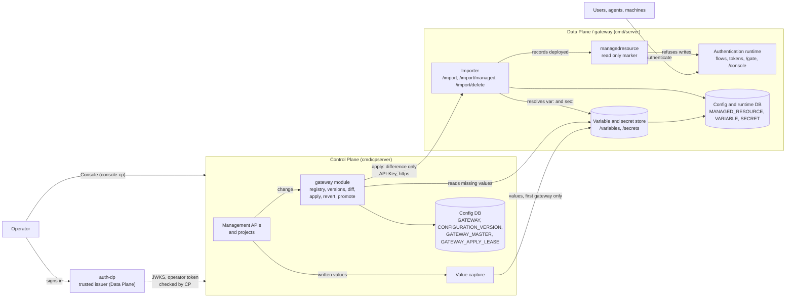

# Control Plane and Data Plane Separation Specification

- **Status:** Draft
- **Version:** 0.1
- **Related documents:** [#4281](https://github.com/thunder-id/thunderid/issues/4281) (separate ThunderID into a Control Plane and a Data Plane), [#5602](https://github.com/thunder-id/thunderid/issues/5602) (capture configuration versions and apply them to a gateway), [#5582](https://github.com/thunder-id/thunderid/issues/5582) (default gateway), [#5738](https://github.com/thunder-id/thunderid/issues/5738) (Control Plane and Data Plane out of the box for on-prem), [#6246](https://github.com/thunder-id/thunderid/issues/6246) (a revert on the Control Plane must reach the Data Plane), [#6392](https://github.com/thunder-id/thunderid/issues/6392) (pack naming), [Discussion #5862](https://github.com/thunder-id/thunderid/discussions/5862#discussioncomment-19390966) (projects). User guides: [configuration versions](../../docs/content/guides/declarative-configurations/configuration-versions.mdx), [import resources](../../docs/content/guides/declarative-configurations/import-resources.mdx), [value references](../../docs/content/guides/declarative-configurations/value-references.mdx), [centralized configuration](../../docs/content/use-cases/managed-deployments/centralized-configuration.mdx). API: [gateway](../../api/gateway.yaml), [configuration-version](../../api/configuration-version.yaml), [import](../../api/import.yaml), [variable-store](../../api/variable-store.yaml), [project](../../api/project.yaml). Threat model: not yet written (see Open questions).

## Summary

One ThunderID deployment used to author configuration and serve authentication in the same process. Teams that run several deployments, or that want to review a change before it reaches users who are signing in, had no way to author once and deploy many times, and every administrative surface was reachable on the process users hit.

This specification defines the split. A **Control Plane (CP)** is where configuration is authored. It serves no authentication traffic. A **Data Plane (DP)**, called a **gateway** from the CP's side, is where users authenticate. The CP captures its configuration as versions and applies them to the gateways it administers through the DP's import API, and the DP marks what a CP deployed as read only so the CP stays the single source of truth.

The governing decision: **configuration moves one way, as references, and values stay where they belong.** A CP exports documents that refer to environment specific values by name (`var:` and `sec:` references). Each DP resolves them from its own variable and secret store. A version never holds a value, so one version fits every environment, and a CP never needs to hold what a gateway must keep local.

In scope: the two entry points and deployment shapes, operator sign-in on the CP, the gateway registry, versions, apply, revert and promotion, value capture, and the DP side that receives a deploy. Out of scope: the content of each exported resource type, the project data model (see [Discussion #5862](https://github.com/thunder-id/thunderid/discussions/5862#discussioncomment-19390966) and `.agent/skills/backend/resource.md`), and the Console screens beyond the behaviors they rely on.

## Architecture

| Component | Location | Role |
|---|---|---|
| Data Plane server | `backend/cmd/server` | Authentication, tokens, flows, `/gate`, `/console`. Also the import API, variable store and secret store a CP deploys through. The DP-alone shape is this binary used on its own. |
| Control Plane server | `backend/cmd/cpserver` | Management APIs, `console-cp`, versions, gateways, deploy. Links no authentication runtime. |
| Gateway module | `backend/internal/gateway` | Registry, versions, diff, apply, revert, master, lease, pipeline, auto apply, value capture. CP only. |
| Project module | `backend/internal/project` | Groups configuration on the CP. CP only. |
| Managed resource marker | `backend/internal/system/managedresource` | DP only. Records what a CP deployed and refuses writes to it. |
| Importer | `backend/internal/system/importer` | Both. `POST /import` everywhere, `POST /import/managed` on a DP. |
| Quickstart pack | `quickstart/` | A CP, a DP and an authentication DP (`auth-dp`) wired together by `setup.sh`. |

Ownership boundaries:

- The CP owns configuration. The DP owns users' runtime state: sessions, tokens, credentials set through flows, and users created at sign-up.
- The DP owns environment values: client IDs and secrets, redirect URIs, connection credentials, resource server identifiers, an agent's owner. The CP stores only the reference. A value it captures as a resource is written is held in memory only until it is delivered to the first gateway's variable store (see [Value capture](#value-capture)).
- One CP administers one or more DPs (`gateway.max_gateways`, one by default). A DP does not know its CP beyond the management API key it accepts.

Existing seams the design uses: the declarative export and import (`internal/system/export`, `internal/system/importer`), the variable store (`internal/variablestore`), the trusted issuer feature of the security middleware, and the declarative resource store modes (`mutable`, `declarative`, `composite`).

## Detailed design

### Entry points and server mode

The role of a process is chosen by the binary that starts it. `cmd/cpserver` and `cmd/server` each pass `config.WithMode(...)` to `InitializeServerRuntime`, producing `ServerModeControlPlane` or `ServerModeDataPlane` (the default). The mode is a field of `ServerRuntime` and is not part of `Config`, so no configuration file can switch it.

The CP binary does not link the authentication runtime, so those routes are absent, not disabled. Each module registers its routes in its own `init.go`, and `cpserver/servicemanager.go` calls only the modules a CP needs, plus `gateway` and `project`. A runtime endpoint on a CP answers `404`.

Deployment shapes:

| Shape | Processes | Notes |
|---|---|---|
| All-in-one (quickstart) | auth-dp (8091), DP (8090), CP (8095) | The `thunderid` quickstart pack, wired together by `setup.sh`. A CP, the DP it manages, and `auth-dp`, the DP that signs CP operators in. |
| DP alone | one DP binary (`thunderid-gateway` pack) | Authors and serves in one place. No CP, no gateways. Still supported. |
| DP managed by a CP | DP binary, plus a CP elsewhere | The CP authors and deploys. The DP serves the Admin Console for users, agents, groups and roles. |

### Operator sign-in and permissions on the CP

A CP has no sign-in flow. Operators sign in at a DP that the CP trusts as an issuer (`server.security.trusted_issuer.*`). The CP checks the token's issuer, audience and signature against the issuer's JWKS, and enforces the root `system` permission (or a child such as `system:application:view`). A token the trusted issuer did not sign is refused, as is one without the permission.

System permissions are built from two catalogs, selected by plane: `InitControlPlanePermissions` declares the full `system` tree including gateways, projects and configuration versions, and `InitDataPlanePermissions` declares the set a DP enforces. The CP resource server that issues these scopes is imported into the issuer from `cmd/cpserver/idp-bootstrap/control-plane-resource-server.yaml`. A first CP administrator is given the Administrator role at bootstrap.

When `server.security.trusted_issuer.user_lookup` is configured, the CP resolves a token's user id to a name for `createdBy` and `appliedBy`. The name is read when shown and never stored. Without a lookup the id is recorded and the name is left out.

### Gateway registry

A gateway is a DP the CP deploys to. It has a name, a `baseUrl`, a management key, an optional CA certificate and an `isDefault` flag. Name and address are each unique per deployment, and at most one gateway is the default.

- **Store modes.** `gateway.store` is `mutable` (database only), `declarative` (files only, API registration refused) or `composite` (both; a gateway declared in a file cannot be edited or deleted through the API and never returns its key). `composite` is the default.
- **Bound.** `gateway.max_gateways` (default 1). An explicit zero means administer none.
- **Address rules.** The control plane calls a gateway only at an `https://` address, and only on a public one: a base URL naming a loopback, link-local or private address is refused at registration, and a host that resolves to one is refused at call time, unless `gateway.allow_private_addresses` is on. This keeps the management key, which every call carries, from being aimed at the CP's own network.
- **Key handling.** The key is returned once, on registration, and never again. It is stored encrypted.
- **Default gateway.** Registering a default moves the default. The default gateway is the first stage of the pipeline when none is configured.

### Export forms: references and placeholders

The same exporter writes two forms of a resource, by plane.

- **On a CP**, a field that belongs to an environment is exported as a reference: `var:<NAME>` for a variable, `sec:<NAME>` for a secret. A list, such as redirect URIs, is one reference that expands to the items. Names are `TYPE__<RESOURCE_ID>__FIELD`, so look-alike resource names cannot share a slot. A CP stores no values, beyond the in-memory copy that value capture is delivering to the first gateway, and an import there keeps references as written.
- **On a DP**, the export writes template placeholders and carries the values itself, for use as a seed for another deployment.

A reference is resolved by the deployment that imports the document, from its own store, at import time. The store refuses a reference stored as a value (`VAR-1011`), which would otherwise resolve without end.

A secret reference may stand only in a field that holds a credential. A capture that would put one anywhere else is refused with `GTW-1026`, naming each place, because every gateway would refuse that resource on import.

### Configuration versions

`POST /configuration-versions` exports the CP's configuration and keeps it as a version, named by the SHA-256 of the exported documents with references, not values. A change to a value alone is therefore not a new version.

- Capturing unchanged configuration returns `200` with the latest version. Going back to an earlier state adds a new version carrying the older hash, so applying `latest` undoes the change on a gateway.
- A CP also captures on its own: it waits about two seconds after the last of a run of changes, then replaces the **current** version in place, until that version is applied to a gateway. An apply keeps it, and the next change starts a new current version. This is what lets `latest` follow edits without a version per keystroke.
- `createdBy` records the acting user's id.
- At most `gateway.max_versions` versions are kept (default 3). The oldest goes first, except a version a gateway holds or can revert to, or one a resource held in a master was deployed from.
- `GET /configuration-versions/current` exports the present state without keeping it.

### Applying a version to a gateway

`POST /gateways/{id}/apply` compares a version with what the gateway holds and sends only the difference to the gateway's import API, presenting the gateway's management key.

**Master.** Per gateway, the CP keeps a **master**: every resource deployed, as the gateway last accepted it, with its source version, origin, state (`deployed`, `failed`, `removed`) and who applied it. The version tells the CP what the configuration should be, the master tells it what the gateway has, and the diff is between the two. Each apply writes a new master from the gateway's own per resource report and keeps the one before, bounded by `gateway.max_versions`. A refused resource is recorded `failed`, so the next diff offers it again and the version is recorded as partly applied. The CP never removes something it did not deploy.

**What is sent.** The resources the master lacks or holds in another form, and the removal of what the master records and the version no longer has. A role's assignee or a group's member that the version dropped is removed too, but only if the master recorded it. An assignee or member the gateway added itself stays. Nothing is sent when nothing differs.

**Selection.** `selection` names the changes to send this time. `leaveOut` holds changes back for this gateway on later applies as well, kept per gateway. A key the diff does not report is refused (`GTW-1025`). `withDependencies` (on by default) widens a selection to the resources it names by id that the gateway lacks or refused, followed transitively, with no per type declaration. A removal is refused (`GTW-1033`) while a document the gateway keeps still names the resource, and a removal an update frees is sent in a second import after the update is accepted.

**Missing values.** Before sending, the CP asks the gateway's store for every `var:` and `sec:` name the sent resources need. A dry run lists the missing ones with the resource and field each is for. An apply is refused (`GTW-1017`) until the gateway holds them all, and changed values (set again since the last apply) cause the resources that use them to be sent again.

**Removal confirmation.** An apply or revert that would remove more than `gateway.removal_confirmation_threshold` resources (default 5) is refused (`GTW-1030`) until sent again with `confirmRemovals`.

**Concurrency.** One apply or revert runs per gateway across all CP nodes, enforced by a lease row (`GATEWAY_APPLY_LEASE`). An apply for `latest` that arrives while one runs is queued: the answer is `202`, and the latest version at that moment is applied when the running apply finishes. Other applies wait, and are refused (`GTW-1029`) after as long as an import may take. The master and the applied version are written in one transaction, and only while the lease is still held (`GTW-1019` otherwise). An apply that took too long to prepare sends nothing (`GTW-5003`).

**Revert.** `POST /gateways/{id}/revert` returns the gateway to the master it held before the version it holds now, one step only (`GTW-1016` for a second). It follows the same rules as an apply. After a revert, auto apply applies the captured version too, so a reverted change reaches the DP (#6246).

**Dry run.** `dryRun` imports as a dry run, records nothing, and reports what would happen.

**Reading state.** `GET /gateways/{id}/diff`, `/applied-version`, `/applied-configuration`, `/master`, `/master/history` and `/master/resources/{type}/{resource}` expose the version, master and per resource history. They return references, never values.

### Pipeline, promotion, auto apply and projects

- **Pipeline.** `gateway.pipeline` lists registered gateways in order, each a stage. A deploy enters at the first. Empty, the default gateway is the only stage. `GET /gateways/pipeline` returns the stages.
- **Promotion.** Promoting deploys what one gateway runs to the next, using its master as the source (the `promote_gateway` MCP tool and the Console). It sends only what the source holds as the version has it, and is refused (`GTW-1042`) when the target would be left with a resource naming one it lacks.
- **Auto apply.** `gateway.auto_apply`, overridable at runtime by the `gateway` server config section, applies each captured version to the first gateway of the pipeline. Off by default.
- **Project scope.** A diff, apply, revert and status can be scoped to one project. Changes are placed in `project`, `needed`, `shared` or `other` sections. A project is deployed after the projects it builds on, carries what it names by handle, and can be rolled back on its own once per deploy. `PUT /projects/{projectId}/auto-sync` turns on a per project sync that runs after each capture. Projects are a configuration time grouping: the DP stores `projectId` without checking the project exists, and sign-in and tokens never use it.

### Value capture

References resolve at the gateway, so the gateway must hold their values. Because the CP stores only hashes of secrets, the only moment it can see a generated client secret or a password is the write itself. As a resource is written on the CP, the values its export refers to are sent to the **first gateway of the pipeline** (the default gateway when no pipeline is set), under the same name the reference uses.

- Covered writes: application and agent create and update, user create and credential update, connection create and update, resource server create and update, authorization detail type create and update. An agent's owner is captured on create and when an update changes it.
- The value goes in the background and never blocks the write. Failures retry with growing delay, up to ten times, and a newer value for the same name replaces one in flight. A value is sent only over `https://`.
- A value that is itself a reference is never captured.
- **Fill on start.** A CP that starts writes, to the first gateway, each variable its applications, agents and resource servers refer to that the gateway lacks. It never replaces a held value and never fills secrets.
- A value changed on a gateway directly (for example a regenerated client secret) takes effect on the DP at once but is reported to the CP as a changed value, and **Redeploy** resends the resources that use it.

### Data plane side

**Management API key.** `server.security.management_api_key_hash` is the SHA-256 digest of a key a CP presents in the `API-Key` header. It opens `/import`, `/import/managed`, `/import/delete`, `/variables` and `/secrets` and nothing else. It is not accepted as a bearer token, and the digest is not itself a credential. Off by default.

**Managed import.** `POST /import/managed` takes the plain import's request and answers with its response. It exists only on a DP and only the management key may call it (`IMP-1008` for a token). A resource it writes successfully is recorded in `MANAGED_RESOURCE` and, from then on:

- the DP's own APIs and Console refuse to update or delete it, and refuse changes to what it holds, with a per type `403` code (for example `GRP-1023`, `APP-1069`);
- a plain `POST /import` is refused the same way for it;
- reads return `isReadOnly: true` for lists and for the resource types whose responses carry the field;
- only a later managed import changes or removes it.

Group members and role assignees are owned one by one: a managed import removes only those an earlier managed import deployed, and the ones the DP added stay. A resource the DP created itself, or that a plain import wrote, stays editable. A managed import that meets a flow of the same handle no control plane deployed does not take it over (`IMP-1009`).

**Import only resources.** Some resources belong to no organization unit and apply to the whole deployment: root organization units, themes, layouts, translations, server configuration and authorization detail types. On a DP, including a DP alone, no token writes them (`SSE-4030`). They arrive only through an import with the management key. The CP's own token with the matching scope still writes them on the CP.

**Templated values.** The values a CP's export refers to by name (redirect URIs, client ID, client secret, an agent's owner) are resolved from the DP's variable and secret store at import. Regenerating a client secret on the DP works as usual and is reported to the CP as a changed value. The DP offers no endpoint to edit the other templated values of a deployed application or agent; they change through the variable store and the next deploy (see Open questions).

**Sharing and notification templates.** Sharing policy removals and reach changes publish from the CP to the DP, and notification templates keep their ids across planes on import.

### Upgrade order and compatibility

Upgrade a DP before the CP that deploys to it. A DP on a release without `POST /import/managed` answers `404`. The CP then falls back to the plain `POST /import` and the result carries `"plainImport": true`. That deploy succeeds, but what it writes is editable on that DP, and upgrading the DP later does not mark it read only. A resource is marked only when a managed import next writes it. A DP on a release without assignee or member removal refuses those removals as unsupported. A DP older than the owner reference cannot read an owner resolved from references.

### Data model

All tables carry `DEPLOYMENT_ID`. They live in the `configdb` scripts (`backend/dbscripts/configdb/{sqlite,postgres}.sql`).

| Table | Plane | Holds |
|---|---|---|
| `GATEWAY` | CP | Registered gateways: name, base URL, encrypted management key, CA certificate, `IS_DEFAULT` (partial unique index, one per deployment). |
| `CONFIGURATION_VERSION` | CP | Versions: `SEQ`, `HASH`, `RESOURCES`, encrypted `VARIABLES`, `IS_CURRENT`, `CREATED_BY`. |
| `GATEWAY_APPLIED_VERSION` | CP | The version each gateway holds and the previous one, `COMPLETE`, master pointers, held value times, `APPLIED_BY`. |
| `GATEWAY_MASTER` | CP | One row per apply: `RESOURCES`, `MANIFEST`, `HASH`, `PROJECT_ID`, `PROJECT_REVERT`. |
| `GATEWAY_APPLY_LEASE` | CP | One apply per gateway: claim token, start time, `PENDING_LATEST`, `PENDING_BY`. |
| `GATEWAY_EXCLUDED_RESOURCE` | CP | The changes a gateway holds back. |
| `VARIABLE`, `SECRET` | DP | Environment values. A secret is stored encrypted and never returned. |
| `MANAGED_RESOURCE` | DP | What a managed import deployed, by type, id and, for owned collections, part and key. |

Gateway rows have no foreign keys from the applied version, master and exclusion tables, because a gateway declared in a file has no `GATEWAY` row.

### API

CP: `/gateways` (CRUD, `/pipeline`, `/{id}/diff`, `/apply`, `/revert`, `/applied-version`, `/applied-configuration`, `/master*`, `/project-status`, `/variables*`, `/secrets*` passed through to the gateway), `/configuration-versions`, `/projects/{projectId}/auto-sync`. MCP tools serve the same operations. Every route requires the `system` permission or the child for its resource.

DP: `/import`, `/import/managed`, `/import/delete`, `/variables`, `/secrets` (management key).

Error codes are listed in the user guides and in `error_constants.go` of each module.

### Configuration

| Key | Plane | Default | Notes |
|---|---|---|---|
| `gateway.max_gateways` | CP | 1 | |
| `gateway.max_versions` | CP | 3 | |
| `gateway.store` | CP | `composite` | |
| `gateway.allow_private_addresses` | CP | `false` | |
| `gateway.removal_confirmation_threshold` | CP | 5 | |
| `gateway.apply_timeout_seconds` | CP | 300 | |
| `gateway.auto_apply`, `gateway.pipeline` | CP | off, empty | `autoApply` overridable at runtime |
| `import.timeout_seconds` | both | 120 | |
| `server.security.management_api_key_hash` | DP | empty (off) | |
| `server.security.trusted_issuer.*` | CP | empty | Includes `user_lookup.*` |

All are deployment level.

## Requirements

Each acceptance criterion names the test that covers it. Gaps are in Open questions, not here.

### R1. The planes are separate builds

**Requirement:** As an operator, I run a Control Plane that serves no authentication traffic, and a Data Plane whose configuration is deployed by a CP through the import API. A resource a CP deployed changes only through the CP, and the DP still authors and edits the resources it created itself.

**Acceptance criteria:**

- **AC1.1:** Given a Control Plane, when a client calls a runtime endpoint such as `/oauth2/token`, then it answers `404`. Verified by `controlplane_test.go` `TestRuntimeEndpointsAreNotServed`.
- **AC1.2:** Given the quickstart pack, when it starts, then the authentication DP, the DP and the CP each answer on their own port. Verified by `pack/smoke` `TestEveryPlaneAnswers`.
- **AC1.3:** Given a configuration file that names a mode, when the server starts, then the mode is still the one the entry point set. Verified by `runtimeconfig_test.go` and `config_test.go`.

### R2. Operators sign in through a trusted issuer

**Requirement:** As an operator, I sign in to the CP with a token from a DP the CP trusts, scoped by system permissions.

**Acceptance criteria:**

- **AC2.1:** Given a token without the `system` scope, when it calls a CP API, then it is refused. Verified by `TestATokenWithoutTheSystemScopeIsRefused`.
- **AC2.2:** Given a token the trusted issuer did not sign, when it calls a CP API, then it is refused. Verified by `TestATokenTheTrustedIssuerDidNotSignIsRefused`.
- **AC2.3:** Given each plane, when it receives its own token, then it accepts it. Verified by `pack/smoke` `TestEachPlaneAcceptsItsOwnToken`.
- **AC2.4:** Given a version captured by a user the issuer knows, when it is read with a user lookup configured, then `createdBy` carries the name, and without a lookup it carries the id only. Verified by `TestTheCurrentVersionNamesWhoseChangeItCaptured`, `TestAUserTheIssuerDoesNotKnowIsLeftOut` and `gateway_versions_test.go` `TestWithoutALookupNoUserIsNamed`.
- **AC2.5:** Given the data plane permission catalog, when it is built, then it holds the data plane set only. Verified by `data_plane_permissions_test.go`.

### R3. Gateways are registered and bounded

**Requirement:** As an administrator, I register the gateways my CP deploys to, with one marked as default.

**Acceptance criteria:**

- **AC3.1:** Given a registered gateway, when it is read back, then the key is not returned, and it is returned only at registration. Verified by `gateway_api_test.go` `TestOnlyRegistrationReturnsTheKey`.
- **AC3.2:** Given a registered address or name, when it is registered again, then it is refused. Verified by `TestAGatewayRegistersOnce` and `TestANameRegistersOnce`.
- **AC3.3:** Given a new default gateway, when it is registered, then the previous default is no longer the default. Verified by `TestRegisteringADefaultGatewayMovesTheDefault`.
- **AC3.4:** Given `gateway.max_gateways` registrations, when another is registered one at a time, then it is refused. The bound is a guard, not an invariant or a security boundary: concurrent registrations on PostgreSQL can exceed it. Verified by `TestTheBoundIsEnforced`.
- **AC3.5:** Given a base URL that is not usable, such as a private address, when it is registered or updated, then it is refused. Verified by `TestAnUnusableRegistrationIsRefused` and `TestUpdateRefusesAnUnusableAddress`.
- **AC3.6:** Given a gateway declared in a file, when the API edits or deletes it, then it is refused. Verified by `TestADeclaredGatewayCannotBeEditedThroughTheAPI` and `TestADeclaredGatewayCannotBeDeletedThroughTheAPI`.
- **AC3.7:** Given a gateway on plain HTTP, when the client is built, then it is refused. Verified by `version_client_test.go` `TestTheClientRefusesAPlainHTTPGateway`.

### R4. A CP exports references, a DP resolves them

**Requirement:** As a platform engineer, I author a configuration once and let each gateway fill in its own values.

**Acceptance criteria:**

- **AC4.1:** Given a CP with an application, when it is exported, then the client ID and secret are references, and an import on the CP keeps them. Verified by `controlplane_test.go` `TestExportRefersToValuesAndImportKeepsTheReferences`.
- **AC4.2:** Given a list of redirect URIs, when it is exported, then it is one reference. Verified by `TestExportRefersToAListAsOneReference`.
- **AC4.3:** Given a DP holding values, when it imports a CP export, then each reference resolves from its own store. Verified by `dataplane_test.go` `TestADataPlaneImportsTheExportWithItsOwnValues`.
- **AC4.4:** Given a resource server, when a DP imports it, then it holds the resource server under its own identifier. Verified by `TestADataPlaneHoldsAResourceServerUnderItsOwnIdentifier`.
- **AC4.5:** Given a reference, when it is stored as a variable value, then it is refused. Verified by `variable_store_api_test.go` `TestAReferenceIsRefusedAsAValue`.
- **AC4.6:** Given a secret reference in a field that holds no credential, when a version is captured, then it is refused. Verified by `gateway_versions_test.go` `TestACaptureRefusesASecretOutsideACredentialField`.
- **AC4.7:** Given a secret, when the variable store lists or reads it, then the value is never returned. Verified by `TestASecretValueIsNeverReturned`.

### R5. Versions follow the configuration

**Requirement:** As an operator, I capture the CP's configuration as versions that follow my edits.

**Acceptance criteria:**

- **AC5.1:** Given a change, when the debounce elapses, then it is captured as the current version, replacing the previous current version while that is unapplied. Verified by `current_version_test.go` `TestAChangeIsCapturedAsTheCurrentVersion` and `gateway_current_version_test.go` `TestTheCurrentVersionIsKeptUpToDateUntilDeployed`.
- **AC5.2:** Given versions, when they are listed and read by hash or prefix, then each is found. Verified by `TestVersionsAreListedAndReadBack` and `TestAVersionIsNamedAndReadByAPrefixOfItsHash`.
- **AC5.3:** Given the configuration, when `current` is read, then the references say what each value is for. Verified by `gateway_references_test.go` `TestTheCurrentConfigurationSaysWhatEachValueIsFor`.
- **AC5.4:** Given more than `gateway.max_versions` versions, when one is captured, then the oldest not held by a gateway or master is removed. Verified by `version_store_test.go` `TestPruneNamesTheBoundAndTheDeployment` and `master_service_test.go` `TestMastersBeyondTheBoundArePruned`.

### R6. A version is applied as a difference

**Requirement:** As an operator, I apply a version and each gateway receives only what it lacks.

**Acceptance criteria:**

- **AC6.1:** Given a gateway, when a version is applied, then the master records each resource as the gateway accepted or refused it. Verified by `gateway_master_test.go` `TestEachApplyRecordsTheMasterResourceByResource` and `TestARefusedResourceIsRecordedFailedBesideTheRest`.
- **AC6.2:** Given a gateway nothing was applied to, when its master is read, then it is empty. Verified by `TestAGatewayNothingWasAppliedToHoldsAnEmptyMaster`.
- **AC6.3:** Given a version that differs, when applied, then additions, updates and removals reach the gateway. Verified by `gateway_versions_test.go` `TestApplyAddsAndRemovesWhatTheVersionsDiffer`.
- **AC6.4:** Given a role or group that no longer lists someone, when applied, then they are removed. Verified by `TestApplyTakesOffWhoARoleOrGroupNoLongerLists`.
- **AC6.5:** Given a selection, when applied with `withDependencies` off, then only the named changes are sent. With it on (the default), the resources the selection names by id that the gateway lacks or refused are sent too. Verified by `TestASelectionDeploysOnlyTheChangesNamed`.
- **AC6.6:** Given a resource the gateway refuses, when applied, then it stays on offer. Verified by `TestARefusedResourceStaysOnOffer`.
- **AC6.7:** Given a dry run, when applied, then nothing changes. Verified by `TestADryRunChangesNothing`.
- **AC6.8:** Given a gateway missing a value, when applied, then the missing values are named with what each is for and nothing is sent. Verified by `gateway_references_test.go` `TestAMissingValueIsReportedWithWhatItIsFor`.
- **AC6.9:** Given a value set since the last apply, when applied, then it is reported. Verified by `gateway_apply_safety_test.go` `TestAnApplyReportsAValueSetSinceTheLastApply`.
- **AC6.10:** Given an apply that removes many resources, when it is not confirmed, then it is refused. Verified by `TestAnApplyRemovingManyResourcesIsRefusedUntilConfirmed`.
- **AC6.11:** Given an apply to a unit, when it names a parent the gateway lacks, then the parent comes with it, and a removal that a move frees goes after the move. Verified by `gateway_dependencies_test.go` `TestDeployingAUnitBringsItsParent` and `TestRemovingAUnitAMoveFreesGoesAfterTheMove`.
- **AC6.12:** Given a running apply, when one for the latest version arrives, then it is queued. Verified by `version_service_test.go` `TestAnApplyOfTheLatestVersionIsQueuedBehindARunningOne` (unit).
- **AC6.13:** Given an apply, when the gateway is unreachable, then it is reported and the version stays current. Verified by `TestAnUnreachableGatewayIsReported` and `TestAnApplyThatReachedNoGatewayLeavesTheVersionCurrent`.
- **AC6.14:** Given an applied version, when a revert is requested, then the gateway returns to the previous master. Verified by `deploy_test.go` `TestARevertReturnsToThePreviousMaster` (unit). No integration test.
- **AC6.15:** Given a gateway's applied configuration, when read, then it shows each resource as its own read does. Verified by the `gateway_version_resources_test.go` suite.

### R7. Deploys are staged and scoped

**Requirement:** As an operator, I deploy to one gateway first, then promote, and I can deploy one project.

**Acceptance criteria:**

- **AC7.1:** Given auto apply on, when a change is captured, then it reaches the default gateway, and turning it off at runtime stops that without a restart. Verified by `auto_apply_test.go` `TestAChangeIsAppliedToTheDefaultGatewayWhenAutoApplyIsOn` and `TestAutoApplyIsTurnedOnAndOffWithoutARestart`.
- **AC7.2:** Given a source gateway, when promoted, then the target receives what the source runs. Verified by `promote_test.go` `TestPromoteSendsWhatTheSourceRuns` (unit).
- **AC7.3:** Given a project, when a deploy is scoped to it, then it sends the project's resources and what they need. Verified by `project_scope_test.go` `TestADeployScopedToAProjectSendsWhatItNeeds`.
- **AC7.4:** Given a deployed project, when it is rolled back, then only its resources go back. Verified by `project_rollback_test.go` `TestAProjectIsDeployedReportedAndRolledBack`.

### R8. Values reach the first gateway as resources are written

**Requirement:** As an operator, I write a resource on the CP and the first gateway receives the values its reference needs.

**Acceptance criteria:**

- **AC8.1:** Given an application, agent, user, connection, resource server or authorization detail type, when it is written on the CP, then the first gateway holds the values under the names the export refers to. Verified by `capture_test.go` (one test per type, from `TestAWrittenApplicationsValuesReachTheDefaultGateway` through `TestAWrittenAuthorizationDetailTypesProcessorCredentialReachesTheDefaultGateway`).
- **AC8.2:** Given a send the gateway refused, when the resource is written again, then the value is sent again. Verified by `TestACapturedValueRefusedOnceIsWrittenAgain`.
- **AC8.3:** Given a CP that starts, when the first gateway lacks a variable, then it is filled, and a held value is not replaced. Verified by `value_capture_test.go` `TestFillingWritesOnlyTheVariablesTheFirstGatewayLacks` and `TestFillingKeepsAValueAlreadyOnItsWay` (unit).

### R9. What a CP deploys is read only on the DP

**Requirement:** As an operator, I know a deployed resource changes only through the CP, when the DP supports the managed import (see Upgrade order and compatibility). On a DP without it, the CP falls back to the plain import and what it writes stays editable until a managed import next writes it.

**Acceptance criteria:**

- **AC9.1:** Given the management key, when it calls the managed import, then the import succeeds, and without it, with a wrong key, with a token, or as a bearer, it is refused. Verified by `management_api_key_test.go` `TestTheKeyAuthenticatesTheManagedImport`, `TestNoCredentialIsRefused`, `TestAWrongKeyIsRefused`, `TestTheKeyIsNotAcceptedAsABearerToken` and `TestAnAdministratorCannotUseTheManagedImport`.
- **AC9.2:** Given the key, when it calls any other route, then it is refused. Verified by `TestTheKeyOpensNothingElse`.
- **AC9.3:** Given a deployed group or agent type, when the DP's API updates or deletes it, then it is refused, and a later managed import updates it. Verified by `managed_import_test.go` `TestADeployedGroupIsReadOnlyHere`, `TestADeployUpdatesADeployedGroup` and `TestADeployedAgentTypeIsReadOnlyHere`.
- **AC9.4:** Given a group created on the DP or written by the plain import, when it is edited, then it is allowed. Verified by `TestAGroupCreatedHereStaysEditable` and `TestAGroupWrittenByThePlainImportStaysEditable`.
- **AC9.5:** Given a user synced from the CP, when the DP edits it, then it is refused. Verified by `pack/propagation` `TestAUserSyncedFromTheControlPlaneIsReadOnlyOnTheDataPlane`.
- **AC9.6:** Given an update or delete on the CP, when it is deployed, then the DP follows. Verified by `TestAnUpdateAndADeleteOnTheControlPlaneReachTheDataPlane`.
- **AC9.7:** Given an application authored on the CP, when a client uses it on the DP, then a token is issued, and a person signs in with a password set on the CP. Verified by `pack/oauth` `TestAnApplicationAuthoredOnTheControlPlaneIssuesATokenOnTheDataPlane` and `TestAPersonSignsInOnTheDataPlaneWithAPasswordSetOnTheControlPlane`.
- **AC9.8:** Given a DP with no managed import, when the CP applies, then it falls back to the plain import. Verified by `version_client_test.go` `TestTheClientFallsBackToThePlainImportWhenThereIsNoManagedImport` (unit).

## Open questions

These are known gaps in what is built, or decisions not yet made. None is a requirement above.

1. **Revocation does not cross planes.** The CP accepts a token a DP revoked until the token expires. Pushing revocation events from a DP to the CP (RFC 8935 signed event tokens) is not built, so `server.security.token_revocation.source` accepts `db` only. A lost push, a CP restart that empties its in-memory cache, and several CP replicas each receiving one push are not covered, and a reconcile endpoint is deferred. Needs its own specification.
2. **Threat model.** None exists for this change. It crosses trust boundaries (a management key that writes everything on a DP, a CP that calls DPs at configured URLs, the CP's trust in a DP as issuer) and the docs-internals readme expects one.
3. **Templated values cannot be edited on a deployed resource.** A deployed application's redirect URIs, client ID and an agent's owner change only through the variable store and the next deploy. A DP-side endpoint (such as `PUT /applications/{id}/values`) that stores each change under the name the CP's export uses, and refuses a resource no CP deployed, is proposed and not built. The error codes `APP-1070` and `AGT-1064` are reserved without a route, and deployed application and agent reads do not carry `isManaged`.
4. **`isReadOnly` is incomplete.** Application and agent details, connections, projects, credential and presentation configurations, translations and server configuration sections do not carry it. The writes are refused anyway.
5. **Plain import fallback leaves resources editable.** A DP on an older release is deployed to as if no read only guarantee existed. Whether the CP should refuse instead, behind an option, is undecided.
6. **Value capture goes to the first gateway only,** and a rename changes the names a secret is exported under without the CP holding the secret to resend. Whether the capture tests in `tests/integration/controlplane` run against a real DP was not checked, and the pack tests do not name capture.
7. **The queued apply is best effort.** It is lost if the node running it restarts.
8. **Projects are not required on the CP for applications, agents and flows.**
9. **Revert has no whole gateway integration test.** AC6.14 rests on unit tests. The only integration revert coverage found is the per project rollback in `project_rollback_test.go`. Whether the auto apply revert fix (#6246) has an integration test was not found.
10. **Outbound calls from the CP to a gateway** use a guarded client when `gateway.allow_private_addresses` is off. Other outbound clients in the backend are not guarded the same way. See `outbound-connections.md` for the map.

## Change log

| Version | Date | Change |
|---|---|---|
| 0.1 | 2026-11-13 | Initial specification, written from the implementation on `upstream/main` (979417ce5). |
