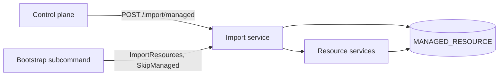

# Control Plane Managed Bootstrap Specification

- **Status:** Draft
- **Version:** 0.1
- **Related documents:** [Issue #6742](https://github.com/thunder-id/thunderid/issues/6742), [PR #6611, keep what a control plane deploys read only on the data plane](https://github.com/thunder-id/thunderid/pull/6611)

## Summary

A data plane (DP) that a control plane (CP) has deployed to cannot restart. The CP and the DP load the same bootstrap bundle, so the default resources (the `Default` organization unit, user and agent types, resource server, notification templates and flows) have the same IDs on both. When the CP deploys through `POST /import/managed`, the DP records those resources in `MANAGED_RESOURCE` and keeps them read only. On the next start the DP bootstrap upserts the same resources through a regular, non-managed import, each service refuses the write (for the organization unit, `OU-1026`), and because the bootstrap fails fast the server exits.

The root cause is that two writers own the same resource IDs: the DP's own bootstrap and the CP. This specification fixes the failure in two steps. Phase 1 makes the bootstrap leave a resource that a CP deployed untouched, which restores restarts. A later phase gives a CP-managed DP a bootstrap mode that seeds only what the CP cannot send, so the two writers no longer overlap. Only phase 1 is specified in full here; the later phase is described under [Future work](#future-work) and is not covered by the requirements.

The governing decision is that a data plane that is administered by a control plane takes its resources from the control plane, and nothing a CP deployed is changed by anything but the CP.

## Architecture

- The **bootstrap subcommand** (`thunderid bootstrap`, run by `start.sh --bootstrap-and-serve` or `setup.sh`) loads the bundle and calls `ImportResources` in-process. It runs under a runtime context and is not a managed import.
- The **import service** applies each document through the resource services, in dependency order.
- The **resource services** each refuse a write to a resource the **managed resource store** marks as deployed by a control plane, unless the context is a managed import.
- The **managed import** is the only import allowed to change a marked resource, and it is the only one that marks.

## Detailed design

### Skipping what a control plane deployed

The import options gain `SkipManaged`. It is set in code by the bootstrap and is not read from a request body (`json:"-"`), so an API caller cannot set it.

When an import is not managed and `SkipManaged` is set, the import service checks each document before resolving references or writing it:

1. It reads the document's `id`, or its `name` when it has no `id`. This is the key `markManaged` records a resource under.
2. It asks the managed resource store whether that key is marked under the document's resource type (`IsManaged(key, resourceType)`).
3. A marked resource is not written. The document is reported as a successful `skip` with the message "A control plane deployed this resource; it was left as deployed". This follows the existing `skip` outcome that a server without projects reports for a project document.
4. A document with neither `id` nor `name`, a document that cannot be decoded, or a failed read of the marks is not skipped. The service that writes the resource then decides, as it does for any other import.

The check is made once, in the import service, so it covers every resource type the bootstrap imports without a change to each service. The services keep their own read-only checks, so the HTTP API and file imports are unchanged.

A managed import ignores `SkipManaged`. It is the one import allowed to update what a control plane deployed.

### Bootstrap

The bootstrap sets `SkipManaged: true` on its request, alongside `Upsert: true`, `ContinueOnError: false` and the runtime target. A skipped document is a success, so a restart after a deploy no longer fails the bootstrap.

### Failure behavior and limits

- A skip is per resource. A marked role or group is skipped whole, so any assignments or members the bootstrap bundle would add to it are not applied on that start.
- Skipped documents count in `Summary.Imported`, as the project skip does. No separate count is added, which keeps the response schema unchanged.
- If the marks cannot be read for a document, it is imported normally and the owning service may still refuse it. The bootstrap then fails as before.

### Future work

These are not covered by the requirements below. They depend on the open questions that follow.

- **Bootstrap mode.** Add `--mode full|managed` to the `bootstrap` subcommand, defaulting to `full`. In `full` mode the bootstrap imports the whole bundle with the skip above. In `managed` mode it imports only a local seed: what the DP needs before its first deploy and the CP cannot send. The CP's management API key is configuration (`server.security.management_api_key_hash`), not a bootstrap resource, so an empty DP can already receive a deploy.
- **Enabling it.** The launcher sets `managed` for a DP that a CP administers: `build.sh run_dp`, the quickstart pack, and the cloud tenant DP.

### Open questions

- What belongs in the local seed? The quickstart seeds a DP admin console application with the same fixed ID on the DP and the CP so that the DP console can sign in before the first sync. Can it come only from the CP?
- Does the managed import adopt a resource that already exists on the DP unmarked, such as one a `full` bootstrap seeded before the DP was connected?
- Does anything at DP startup or at Console sign-in need the `Default` organization unit or a user type before the first deploy?

## Requirements

### R1. A bootstrap restart leaves what a control plane deployed untouched

**Requirement:** As an operator, I want a data plane to restart after a control plane deploys to it, so that the bootstrap does not fail on resources the control plane owns.

**Acceptance criteria:**

- **AC1.1:** Given a resource marked as deployed by a control plane, when the bootstrap imports a document with that resource's id and type, then the resource is not written and the document is reported as a successful `skip`.
- **AC1.2:** Given a bundle in which every resource is marked, when the bootstrap runs, then `Summary.Failed` is 0 and the bootstrap succeeds.
- **AC1.3:** Given a resource that is not marked, when the bootstrap imports it, then it is created or updated as before.
- **AC1.4:** Given a document with neither `id` nor `name`, when the bootstrap imports it, then it is imported and not skipped.

### R2. Other imports are unchanged

**Requirement:** As a maintainer, I want the skip limited to the bootstrap, so that the API and the control plane keep their behavior.

**Acceptance criteria:**

- **AC2.1:** Given an import without `SkipManaged`, when it imports a marked resource, then the managed marks are not read and the owning service refuses the write as before.
- **AC2.2:** Given a managed import with `SkipManaged` set, when it imports a marked resource, then the resource is written and marked as a managed import does, and the option is ignored.
- **AC2.3:** Given an import request body that sets a skip option, when the request is parsed, then the option is not set.

### R3. A failed read of the marks does not hide a refusal

**Requirement:** As a maintainer, I want an unreadable mark treated as unknown, so that the guard never skips a resource it cannot confirm.

**Acceptance criteria:**

- **AC3.1:** Given the managed resource store returns an error for a document, when the bootstrap imports it, then the document is not skipped and the owning service decides.

## Change log

| Version | Date | Change |
|---|---|---|
| 0.1 | 2026-11-11 | Initial specification. |
