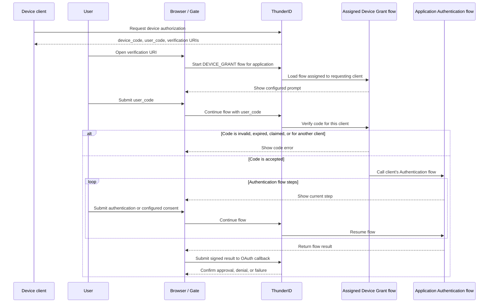
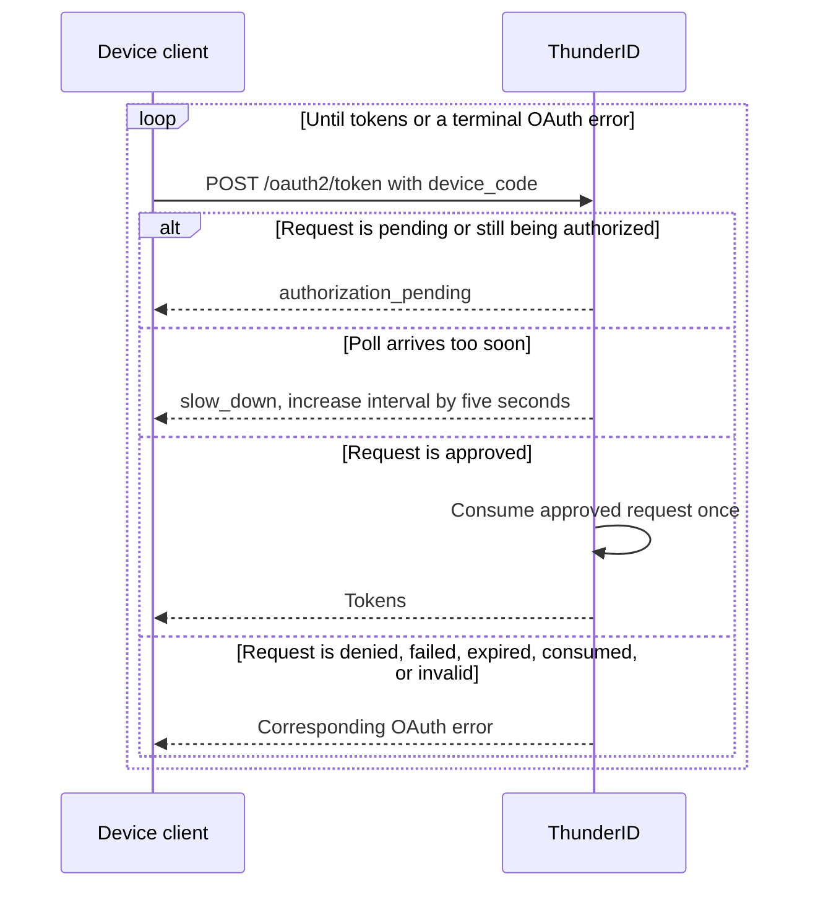

# OAuth 2.0 Device Authorization Grant Specification

- **Status:** Final
- **Version:** 1.0
- **Related documents:**
  - [Feature issue #5156](https://github.com/thunder-id/thunderid/issues/5156)
  - [RFC 8628](https://www.rfc-editor.org/info/rfc8628/)

## Summary

OAuth 2.0 Device Authorization Grant supports clients with limited input, such as TVs and command-line tools. This feature adds the RFC 8628 authorization and polling endpoints and uses a Device Grant flow assigned to the requesting application for browser approval.

## Architecture

| Component | Responsibility |
| --- | --- |
| Device client | Starts authorization, retains the secret `device_code`, displays the `user_code` and verification URI, and polls the token endpoint at the returned interval. |
| Device authorization service | Validates client grant permission, scopes and resources; generates codes; stores a `PENDING` request; and returns the authorization response. |
| Runtime store | Stores the request, hashed device-code key, request-ID index, HMAC-based user-code index, expiry, polling information, and lifecycle state. |
| Gate / browser SDK | Renders the browser verification UI, starts and continues the `DEVICE_GRANT` flow through `/flow/execute`, and submits the terminal flow result to the OAuth callback. The application context identifies the assigned flow; `verification_uri_complete` can prefill the user code, but the user must submit it. |
| Flow execution service | Starts the Device Grant flow assigned to the application. The caller cannot choose a flow ID. |
| Device Grant flow | Runs administrator-configured prompts, verifies the user code, calls the application's Authentication flow by fixed flow ID, and displays success or failure. When Device Code grant is enabled, the Console automatically selects the bootstrapped default flow and saves that assignment with the application; an administrator can choose another flow. |
| `DeviceCodeExecutor` | Verifies and atomically claims a pending request, then places trusted request data in flow runtime data for callback binding and token issuance. |
| `CALL` node | Invokes its statically configured flow ID. In a Device Grant flow it is reachable only after successful user-code verification; assignment validates the referenced-flow relationship against the application's configured flows. |
| Authentication flow | Applies the requesting application's configured authentication journey, including any consent step configured there. Device Grant does not force a separate consent policy. |
| OAuth callback | Validates the signed assertion and its request binding, then marks the request approved, denied, or failed. |
| Device Code token grant handler | Enforces client and resource binding, polling interval and expiry; returns pending or terminal OAuth errors; and issues tokens once for an approved request. |
| Discovery metadata | Advertises the device authorization endpoint and grant type when Device Grant is enabled by server configuration. |

### Device authorization and browser-flow execution



### Token polling and issuance



The browser and device have separate roles. The browser submits `user_code` and completes the assigned flow; the device holds `device_code` and polls. The browser flow `executionId` is unrelated to the Device Grant request ID used as callback `authId`.

## Detailed design

### Data model

Flow definitions use the existing flow storage model. `DEVICE_GRANT` is added as a supported flow type. The inbound-client record stores the assigned Device Grant flow ID in `DEVICE_GRANT_FLOW_ID` for applications. When Device Code grant is enabled, the application must have a valid Device Grant flow assigned. That flow must call the application's configured Authentication flow. The application API exposes the flow assignment.

Device authorization requests are stored in the runtime store rather than in a dedicated configuration-database table. Each record contains the request ID, requesting-client and OAuth-client bindings, hashed device code, requested and authorized scopes, resources, expiry, polling state, lifecycle state, and approval details. The assigned flow ID is stored on the inbound-client record, not in the request. The plaintext user code is excluded from the serialized request. A keyed HMAC of the normalized user code forms its lookup index; the index and request-ID index resolve to the same request.

### API

#### Device authorization request

`POST /oauth2/device-authorize` accepts an `application/x-www-form-urlencoded` request. A public client supplies `client_id`; a confidential client authenticates using its configured token-endpoint authentication method. The requesting application must allow the Device Code grant type and have a Device Grant flow assigned. Application configuration validation rejects saving Device Code grant enabled without a Device Grant flow. If an inconsistent stored application has the grant enabled but no flow assigned, the endpoint returns `server_error` with HTTP 500 and no codes. ThunderID validates requested scopes and the optional resource indicator against the client and configured resource servers.

ThunderID creates a request ID and generates an opaque `device_code` and a human-enterable `user_code`. The device code is stored by its hash. The user code is excluded from the serialized request; ThunderID normalizes it only to compute a keyed HMAC lookup index for the stored request. The initial request state is `PENDING`. The endpoint does not start a browser flow. If request creation fails, the endpoint does not return usable codes.

`oauth.device_grant.expires_in` configures the device authorization request lifetime, and `oauth.device_grant.interval` configures the initial polling interval. If either value is unset or nonpositive, ThunderID uses the 600-second lifetime or 5-second interval fallback. The response contains the effective values:

```json
{
  "device_code": "<opaque-device-code>",
  "user_code": "BCDF-GHJK",
  "verification_uri": "https://id.example.com/gate/device?applicationId=<application-id>",
  "verification_uri_complete": "https://id.example.com/gate/device?applicationId=<application-id>&user_code=BCDF-GHJK",
  "expires_in": 600,
  "interval": 5
}
```

ThunderID builds the Gate verification URL with an `applicationId` query parameter so Gate can load the requesting application's context and assigned Device Grant flow. `verification_uri_complete` adds the user code to that URL. After the user submits the code, ThunderID looks up the stored request and verifies that its client binding matches the flow context before continuing to the Authentication flow. The browser SDK can prefill the code input from the complete URI but still requires the user to submit it. The response is marked `Cache-Control: no-store` and `Pragma: no-cache`.

#### Start and continue browser verification

Gate or the browser SDK starts the existing `POST /flow/execute` with `flowType: DEVICE_GRANT`, the requesting application ID from the verification URI or SDK configuration, and empty inputs. ThunderID loads the Device Grant flow assigned to that application. The caller cannot choose a flow ID. The configured flow controls the order and content of its prompts; when the Device Code executor requests its required `user_code`, the browser SDK can prepopulate it from `verification_uri_complete` and still waits for the user to submit it.

The default flow is provided by bootstrap resources as `default-device-grant-flow`. When Device Code grant is enabled, the Console automatically selects this flow and includes the assignment when the application is saved. The bootstrapped flow's `CALL` node has a fixed reference to the default Authentication flow; it does not resolve each application's Authentication flow dynamically. Flow validation requires a Device Code executor and a fixed `CALL` node reachable only after successful code verification, and validates that the target matches the application's configured Authentication flow. An application using a different Authentication flow must be assigned a compatible Device Grant flow. The Device Grant templates have an empty `CALL` reference, which the flow author configures with the application's Authentication flow.

The Device Code executor normalizes the submitted code, finds the stored request, and atomically changes its state from `PENDING` to `REDEEMING` only while the request remains unexpired. Unknown, expired, denied, or already-claimed codes are presented through a generic invalid/unavailable-code response. Once claimed, trusted values from the stored record—not browser-supplied application data—bind the request to the flow execution. The request ID is retained as `authorizationRequestId`; it is separate from the flow execution ID returned by `/flow/execute`.

The Device Grant `CALL` node uses a fixed flow ID, just like other flow calls. The application assignment validator checks its referenced-flow relationship against that application's configured flows. The called flow runs as part of the same flow execution, and Gate renders the returned steps.

The Authentication flow controls its own consent behavior. Device Grant does not require a consent purpose, force a consent prompt, or create a separate consent mechanism. If the application flow includes a consent step, its result participates in the flow outcome. A successful Authentication flow can approve the request without a consent claim; a flow error such as user denial records a denied outcome.

On terminal flow completion, the browser submits the signed assertion to the existing `/oauth2/auth/callback` using the Device Grant request ID as `authId` and the Device Code grant type for callback dispatch. The assertion's `authorization_request_id` must match both `authId` and the stored request ID. A valid successful assertion records the user and approval data; a signed user-denial result records `DENIED`. Approval is accepted only while the request is in `REDEEMING` and before expiry. For applicable flow errors, `/flow/execute` returns a signed `errorAssertion` and callback metadata (`type` and `authId`) under `data.additionalData` so the OAuth callback can record the failure.

#### Poll and issue tokens

The device sends `grant_type=urn:ietf:params:oauth:grant-type:device_code` and the secret `device_code` to the existing `POST /oauth2/token` endpoint. Public clients also send `client_id`; confidential clients authenticate as configured. ThunderID checks client ownership and prevents a polling `resource` from expanding the original request.

| Stored state | Token endpoint behavior |
| --- | --- |
| `PENDING` or `REDEEMING` | `authorization_pending`, unless the client polls too soon |
| Poll too soon | `slow_down`; the server adds five seconds to the required interval |
| `APPROVED` | Issue eligible tokens and atomically transition to `CONSUMED` |
| `DENIED` | `access_denied` |
| `FAILED` | `server_error` |
| Expired request | `expired_token` |
| `CONSUMED`, unknown code, or code owned by another client | `invalid_grant` |

An ID token is returned when `openid` is authorized. A refresh token is returned when the client allows the `refresh_token`. The client must stop polling after tokens or a terminal OAuth error. A `slow_down` response requires increasing the polling interval by five seconds.

Only one concurrent token exchange can consume an approved request. The `PENDING` to `REDEEMING`, `REDEEMING` to `APPROVED`, and `APPROVED` to `CONSUMED` transitions use atomic state comparisons; the first two and consumption also require the request expiry to remain in the future. If request storage expires, the request cannot be claimed, approved, or consumed.

### UI

#### Gate verification page

Gate serves the browser page at `/gate/device`. The Gate Device wrapper provides the page layout and design context, while its Device box renders the configured Device Grant flow through the browser SDK's flow renderer and Gate adapters. The flow determines the prompt order and content. When `verification_uri_complete` includes a user code, Gate prefills the code input but waits for the user to submit it.

The page does not look up code status before submission and does not use a Device Grant-specific verification cookie, attempt counter, or per-code countdown. The device client receives `expires_in`; the server enforces expiry during code verification, callback completion, and token consumption.

#### Console configuration

- In **Applications**, enable the Device Code grant type. The Console automatically selects the bootstrapped default Device Grant flow; an administrator can choose another flow before saving. The assigned flow's `CALL` target must match the application's configured Authentication flow.
- In **Flows**, use the bootstrapped default Device Grant flow when its fixed Authentication-flow target matches the application's configured Authentication flow. Otherwise, create a flow from a Device Authorization template and configure its `CALL` target to the application's Authentication flow. Configure the user-code prompt, Device Code executor, and success and failure prompts; ThunderID validates the flow and its application assignment.

### Configuration

- **Deployment-level — OAuth grant enablement:** `oauth.allowed_grant_types` must contain `urn:ietf:params:oauth:grant-type:device_code` to enable Device Grant. The server rejects device authorization requests when the grant is disabled.
- **Application-level — Grant and flow assignment:** The application's OAuth `grantTypes` must include the Device Code grant. Enabling it automatically selects the bootstrapped Device Grant flow in the Console, and the selected flow ID is saved with the application. Its `CALL` target must match the application's configured Authentication flow.

## Requirements

### R1. Create a device request

**Requirement:** An eligible application can start a Device Grant request and receive the codes and verification details needed to authorize and poll.

**Acceptance criteria:**

- **AC1.1:** Given an application is enabled for Device Code grant, has an assigned Device Grant flow, and the client has passed authentication, when it submits a valid request to `/oauth2/device-authorize`, then ThunderID returns `device_code`, `user_code`, both verification URIs, `expires_in`, and `interval`.
- **AC1.2:** Given the requesting application is not enabled for Device Code grant or client authentication fails, when it submits a device authorization request, then ThunderID rejects the request and returns no usable codes.
- **AC1.3:** Given ThunderID has successfully created a device authorization request, when it stores the request, then its initial state is `PENDING` and no browser flow execution has started.
- **AC1.4:** Given ThunderID generates device and user codes, when it persists the request and its indexes, then it stores only the device-code hash and does not serialize the user code; the HMAC user-code index resolves to the request record.
- **AC1.5:** Given Device Code grant is enabled for an application, when its configuration is saved, then it has an assigned Device Grant flow that calls its configured Authentication flow.
- **AC1.6:** Given ThunderID creates a device authorization response, then `verification_uri` points to the Gate device page with the requesting application's ID, and `verification_uri_complete` appends the user code.
- **AC1.7:** Given an application has Device Code grant enabled but no Device Grant flow due to inconsistent stored configuration, when it submits a device authorization request, then ThunderID returns `server_error` with HTTP 500 and no usable codes. Normal application configuration validation prevents saving this state.

### R2. Verify and authorize in the browser

**Requirement:** A user can submit a device code in Gate and complete the requesting application's Authentication flow for that device request.

**Acceptance criteria:**

- **AC2.1:** Given a user opens the verification page, when Gate starts Device Grant, then it calls the existing `/flow/execute` endpoint with `flowType: DEVICE_GRANT`, the application context, and no user-code input; ThunderID loads that application's assigned Device Grant flow.
- **AC2.2:** Given `verification_uri_complete` contains a user code, when the configured flow requests the code, then Gate or the browser SDK prefills the code field and waits for the user to submit it before verification.
- **AC2.3:** Given an administrator saves a `DEVICE_GRANT` flow for application assignment, when ThunderID validates it, then the flow includes a Device Code executor and a configured Call node reachable only after successful code verification. A template may start with an empty Call reference, which the administrator configures before saving.
- **AC2.4:** Given an application enables the Device Code grant or assigns a Device Grant flow, when ThunderID validates its configuration, then it ensures the flow calls that application's configured Authentication flow.
- **AC2.5:** Given a submitted code is unknown, expired, denied, or already claimed, when ThunderID verifies it, then Gate receives the generic invalid-code response and the flow does not continue. Given the code belongs to another application, then the flow does not continue to the Authentication flow.
- **AC2.6:** Given a request is `PENDING` and unexpired, when multiple browser executions attempt to claim its code concurrently, then at most one execution transitions the request to `REDEEMING`.
- **AC2.7:** Given a Device Grant flow has claimed a request, when Gate submits its terminal assertion to the callback, then the callback `authId`, assertion `authorization_request_id`, and stored request ID must match, and the request ID remains distinct from the flow `executionId`.
- **AC2.8:** Given an application has configured its Authentication flow, when the Device Grant flow calls it, then authentication and any consent behavior follow that flow without a separate Device Grant consent requirement.
- **AC2.9:** Given a request is in `REDEEMING`, when the callback handles a valid signed success, user-denial, or other failure result for that request, then it records the corresponding `APPROVED`, `DENIED`, or `FAILED` outcome.

### R3. Poll and issue tokens once

**Requirement:** An authorized device client can poll for the outcome and receive tokens only after approval.

**Acceptance criteria:**

- **AC3.1:** Given a client submits a token request using the Device Code grant type, when ThunderID validates it, then it requires `device_code` and enforces client ownership and the original resource binding.
- **AC3.2:** Given a request is `PENDING` or `REDEEMING`, when the client polls at the permitted interval, then the token endpoint returns `authorization_pending`; when it polls too soon, then the endpoint returns `slow_down` and increases the polling interval by five seconds.
- **AC3.3:** Given a request is denied, failed, expired, consumed, unknown, or belongs to another client, when that client polls, then the endpoint returns the corresponding OAuth error and issues no tokens.
- **AC3.4:** Given a request is approved, when its client polls successfully, then ThunderID issues tokens limited to the authorized scopes and resource, returns an ID token when `openid` is authorized, and returns a refresh token when the client allows refresh token issuance.
- **AC3.5:** Given two token exchanges race for the same approved request, when ThunderID consumes it, then only one exchange succeeds in consuming the request and receiving tokens.

### R4. Expiry and request integrity

**Requirement:** A request cannot be claimed, approved, or consumed outside its valid lifecycle or through a mismatched flow assertion.

**Acceptance criteria:**

- **AC4.1:** Given a request is being claimed, approved, or consumed, when ThunderID performs the state transition, then it atomically checks the expected state and requires the request to remain unexpired.
- **AC4.2:** Given a caller continues an existing flow execution with a missing or invalid challenge token, when the Flow API validates the continuation, then it rejects the request and does not advance the flow.
- **AC4.3:** Given a callback assertion has an invalid signature, wrong audience, or request-ID mismatch, when the callback validates it, then ThunderID does not approve the stored request.
- **AC4.4:** Given a user has not submitted a code on the verification page, when the page is displayed, then it makes no code-status lookup; this implementation has no public status endpoint, per-browser attempt cookie, or attempt-limit configuration.

### R5. Advertise the grant

**Requirement:** Clients can discover Device Grant support when it is enabled by the server.

**Acceptance criteria:**

- **AC5.1:** Given Device Code grant is enabled at server level, when a client reads OAuth Authorization Server Metadata or OpenID Configuration, then the metadata includes `device_authorization_endpoint` and `urn:ietf:params:oauth:grant-type:device_code`.
- **AC5.2:** Given Device Code grant is disabled at server level, when a client reads discovery metadata or submits a device authorization request, then discovery omits the grant and the endpoint does not accept the request.

## Change log

| Version | Date | Change |
| --- | --- | --- |
| 1.0 | 2026-10-09 | Initial specification. |
