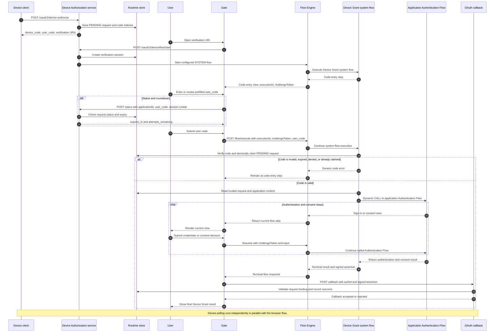
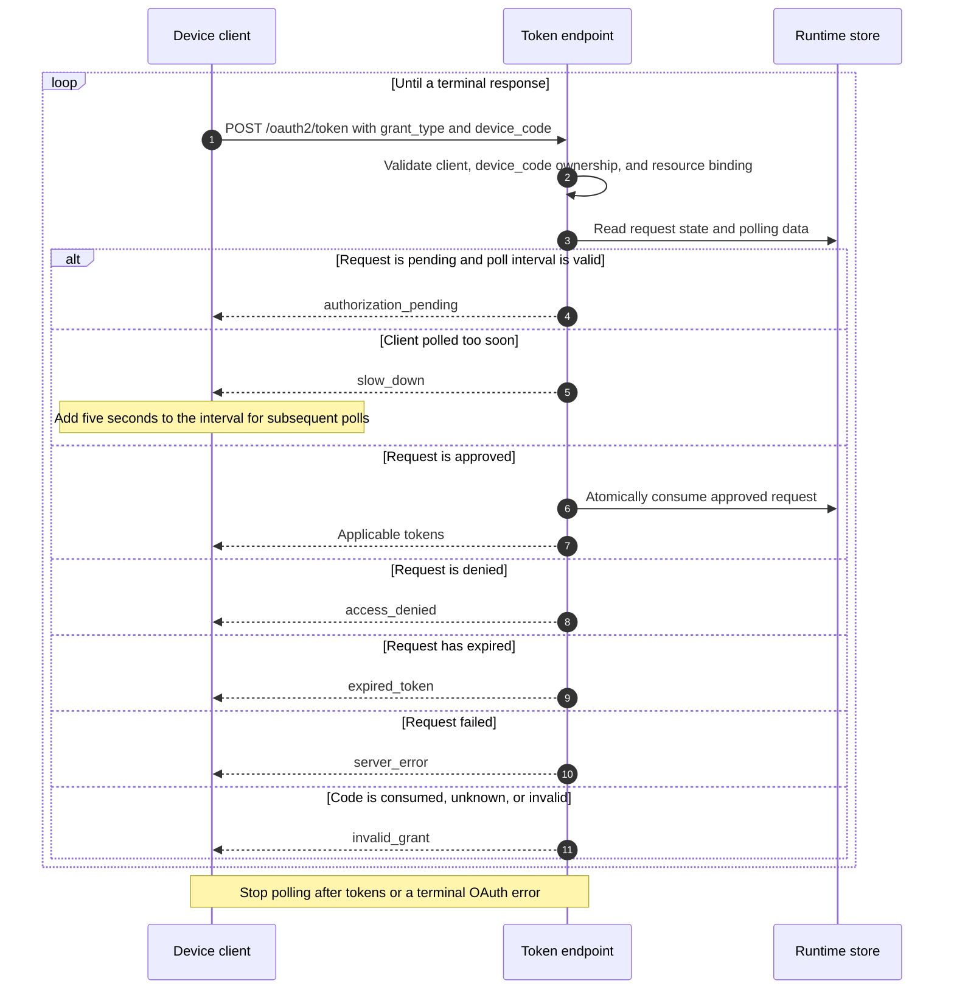

# OAuth 2.0 Device Authorization Grant Specification

- **Status:** Draft
- **Version:** 0.1
- **Related documents:**
  - [Discussion #5705](https://github.com/thunder-id/thunderid/discussions/5705)
  - [Feature issue #5156](https://github.com/thunder-id/thunderid/issues/5156)
  - [RFC 8628](https://www.rfc-editor.org/info/rfc8628/)

## Summary

Smart TVs, command-line tools, and other limited-input clients cannot conveniently complete a browser-based sign-in on the device itself. Device Authorization Grant lets the device start an OAuth request while the user signs in and approves it in a browser on another device.

This specification describes ThunderID's Device Authorization Grant support defined by RFC 8628. The device receives a `device_code`, a short `user_code`, and a verification URI, then polls the existing token endpoint. Gate starts the default Device Grant system flow when the user opens the verification URI. A `DeviceCodeExecutor` verifies and atomically claims the user code, then a trusted resolver selects and calls the verified application's configured Authentication Flow. This keeps code entry in a reusable system flow and reuses the application's authentication flow, while requiring explicit consent for the device request even when SSO satisfies authentication.

This specification covers request creation, user verification, authentication and approval, polling, token issuance, discovery, configuration, and the Gate user interface.

## Architecture

| Component | Responsibility |
| --- | --- |
| Device client | Calls the device authorization endpoint, displays the returned `user_code` and verification URI, and polls the token endpoint with the secret `device_code`. |
| Device authorization endpoint and service | Validates the client and request, creates and stores the Device Grant request, generates the codes and verification URIs, and returns the polling interval and expiry. |
| Runtime store | Stores the Device Grant request and its code indexes, state, expiry, and polling data. It also stores verification-session attempt and cooldown data. Flow execution state is managed by the Flow Engine. |
| Gate | Opens the browser verification page, starts the Device Grant system flow, displays its prompts, and submits user input while continuing the flow with its execution ID and challenge token. |
| Device flow start endpoint | Creates the verification-session cookie and starts the configured Device Grant `SYSTEM` flow. It does not accept a flow ID from the browser. |
| Device Grant system flow | Defines the browser journey: code entry, code verification, application-flow resolution, a dynamic Call node, and the final success or failure prompt. |
| `DeviceCodeExecutor` | Requests the user code, verifies the submitted code through the Device Grant service, atomically claims a valid pending request, and places trusted request details in flow runtime data. |
| `ApplicationAuthFlowResolver` | Uses the verified request's application ID to find that application's configured Authentication Flow and supplies its flow ID to the dynamic Call node. |
| Application Authentication Flow | Authenticates the user and collects an explicit consent decision for the Device Grant request. It runs within the system-flow journey. |
| OAuth callback | Receives the signed terminal flow result. It checks that `authId`, the assertion's `authorization_request_id`, and the stored Device Grant request ID match, then records approval, denial, or failure. |
| Token endpoint | Handles device polling, enforces client ownership and polling rules, and returns pending or terminal errors. It issues tokens once for an approved request. |
| Discovery endpoint | Advertises the device authorization endpoint and Device Grant grant type when configured as supported. |

**User authorization**



After authentication, the user must explicitly approve or deny the device request. The application's configured Authentication Flow must include a User Consent step after authentication. If the flow completes without an explicit decision, the callback records the request as failed and must not approve it. An existing browser SSO session may satisfy authentication, but it does not approve the request.

**Device polling and token issuance**

The device polls independently while the browser journey is in progress.



The device never receives the browser's flow execution ID, and Gate never receives the secret `device_code`.

## Detailed design

### Device request creation

`POST /oauth2/device-authorize` accepts a form-encoded request. Public clients identify themselves with `client_id`. A confidential client must also authenticate. ThunderID checks that the client may use Device Grant, validates the requested scopes, and resolves an optional `resource` to one permitted resource server.

ThunderID generates a `device_code` from 32 cryptographically random bytes. It generates eight random bytes for the `user_code`, maps them to `BCDFGHJKLMNPQRSTVWXZ`, and displays the result as `XXXX-XXXX`. The service retries a user-code collision up to five times. The request stores the client, application, requested scopes and permissions, resource binding, polling policy, expiry, and initial `PENDING` state. It does not create a flow execution at this stage. If code generation or storage fails, the endpoint returns an error and does not return usable codes.

The response includes `device_code`, `user_code`, `verification_uri`, and `expires_in`. This design also returns `interval` and `verification_uri_complete`, which RFC 8628 defines as optional fields:

```json
{
  "device_code": "<device-code>",
  "user_code": "WDJB-MJHT",
  "verification_uri": "https://id.example.com/gate/device?applicationId=app-123",
  "verification_uri_complete": "https://id.example.com/gate/device?applicationId=app-123&user_code=WDJB-MJHT",
  "expires_in": 600,
  "interval": 5
}
```

Both URIs include `applicationId` so Gate can load the application's design before code entry. The complete URI also includes the user code for a link or QR code. The device still displays the code so the user can confirm that it matches. The `applicationId` is a branding hint and is checked by the status endpoint against the request found from the user code. Code verification gets the application from that stored request instead of the URI. Including this ID makes the manually entered URI longer, which is a usability tradeoff against RFC 8628's recommendation for a short URI. Return this response with `Cache-Control: no-store` so the codes are not cached.

### User-code verification and browser flow

When a user opens the verification URI, Gate copies `applicationId` and `user_code` from the URL into page state, then removes both query parameters from the browser address before verification. Gate calls `POST /oauth2/device/flow/start`. ThunderID creates a verification-session cookie and starts the configured Device Grant `SYSTEM` flow. The response contains the first flow step, an `executionId`, and a challenge token. The endpoint does not accept a caller-selected flow ID.

The system flow displays the code-entry prompt. When the user submits the code, Gate calls the existing `POST /flow/execute` endpoint with the flow's `executionId`, current challenge token, and entered code. The `DeviceCodeExecutor` normalizes the code, looks up the matching Device Grant request, and atomically changes its state from `PENDING` to `REDEEMING`. Invalid, expired, denied, or already-claimed codes produce a generic code error and leave the user at the code-entry prompt.

The application ID in the verification URI is used for initial Gate branding and for the status lookup. The status endpoint requires both `applicationId` and `user_code`, checks that they match the stored request, and returns the remaining lifetime and attempts remaining. A status lookup does not claim the code or start the application's Authentication Flow. The URI's application ID does not select the flow. After code verification, ThunderID gets the application ID from the stored request associated with the submitted code.

The Device Grant request ID and the system-flow `executionId` are different identifiers. After verification, the flow stores the request ID in trusted runtime data as `authorizationRequestId`. `ApplicationAuthFlowResolver` uses the verified request's application ID to find its configured Authentication Flow. The system flow's dynamic `CALL` node runs that flow.

Gate renders the called Authentication Flow's steps within the ongoing Device Grant flow. The configured application flow must collect an explicit consent decision. The Flow Engine forces the consent prompt for Device Grant, including when the user has an SSO session. If the flow does not produce recorded consent, ThunderID does not approve the request.

When the flow reaches a terminal result, Gate receives the Device Grant request ID as `deviceAuthId` and sends that same ID as `authId` to `POST /oauth2/auth/callback`. The signed assertion contains the request ID in its `authorization_request_id` claim. The callback checks that the callback `authId`, assertion claim, and stored Device Grant request ID match. The `executionId` is used to continue the browser flow; it is not the callback request ID.

### Polling and token issuance

The device posts `grant_type=urn:ietf:params:oauth:grant-type:device_code` and `device_code` to the existing token endpoint. A public client also sends `client_id`; a confidential client authenticates using its configured method. ThunderID confirms that the code belongs to that client and that any resource parameter does not broaden the original request.

| Request state | Token endpoint result |
| --- | --- |
| `PENDING` or `REDEEMING` | `authorization_pending`, or `slow_down` if polling too quickly |
| `APPROVED` | Applicable tokens; atomically move to `CONSUMED` |
| `DENIED` | `access_denied` |
| `FAILED` | `server_error` |
| Expired | `expired_token` |
| `CONSUMED` or unknown code | `invalid_grant` |

The client waits at least `interval` seconds between polls. Each `slow_down` increases the required interval by five seconds for subsequent polls. On a connection timeout, the client reduces its polling frequency before retrying; exponential backoff is recommended. Access tokens contain only the approved scopes and resource audience. An ID token is issued when `openid` was approved; a refresh token is issued only when the client is allowed to use refresh tokens. Only one concurrent exchange may move `APPROVED` to `CONSUMED` and receive tokens.

### Data model

Device requests reuse the existing runtime store; no new table is needed. Each request record contains its ID, client and application IDs, hashed `device_code`, `user_code`, requested standard scopes and permissions, required attributes, approved scopes, resource binding, expiry, polling interval and last poll, current state, and authenticated user details after approval. The request ID and normalized user code are indexes to the request stored under the device-code hash. The system-flow execution is stored separately by the Flow service, and the verification session stores failed-attempt and cooldown state under a hash of the session ID. Device request records and indexes are retained briefly after expiry so a polling client can receive `expired_token`; they cannot authorize a token after expiry.

PostgreSQL's `RUNTIME_STORE` is partitioned by namespace, so Device Grant needs a `device:req` partition in the runtime schema. Existing PostgreSQL deployments also need that partition created during upgrade before Device Grant is enabled. SQLite reuses its unpartitioned runtime store. Application grant types remain in existing application configuration; they need no new table.

### Request lifecycle

The request moves through `PENDING`, `REDEEMING`, `APPROVED`, `DENIED`, `FAILED`, `CONSUMED`, or `EXPIRED`. The `PENDING` to `REDEEMING` and `APPROVED` to `CONSUMED` transitions must be atomic. An abandoned browser journey remains `REDEEMING` until the request expires; it cannot approve another request or be claimed by a second browser.

### API

#### Device authorization endpoint

**`POST /oauth2/device-authorize`** accepts `application/x-www-form-urlencoded` requests. Confidential clients authenticate using their configured method; public clients identify themselves with `client_id`.

| Parameter | Required | Notes |
| --- | --- | --- |
| `client_id` | Public clients | Confidential clients authenticate instead |
| `scope` | No | Space-delimited requested scopes |
| `resource` | No | RFC 8707 resource indicator; ThunderID accepts at most one resource per request and binds the grant to it |

On success, return HTTP 200 with the JSON response shown in [Device request creation](#device-request-creation), and include `Cache-Control: no-store`. Errors use the standard OAuth JSON shape with `error` and optional `error_description`.

| Error | Condition |
| --- | --- |
| `invalid_request` | Required parameter is missing or the request is malformed |
| `invalid_client` | Client authentication or identification failed |
| `unauthorized_client` | Client is not enabled for Device Grant |
| `invalid_scope` | Requested scope is unknown, malformed, or not allowed |
| `invalid_target` | Requested resource is invalid or not allowed |
| `server_error` | ThunderID cannot create or store the request |

OAuth errors use HTTP 400 by default. If client authentication using the HTTP `Authorization` header fails, return HTTP 401 and the appropriate `WWW-Authenticate` header.

#### Token endpoint

**`POST /oauth2/token`** is the existing token endpoint. The client must use form encoding and authenticate as required by its client type.

| Parameter | Required | Notes |
| --- | --- | --- |
| `grant_type` | Yes | `urn:ietf:params:oauth:grant-type:device_code` |
| `device_code` | Yes | Secret code returned by the device authorization endpoint |
| `client_id` | Public clients | Confidential clients authenticate instead |
| `resource` | No | At most one; if supplied, it must be the resource bound to the authorization request |

| Error | Condition | Client action |
| --- | --- | --- |
| `invalid_request` | A required parameter is missing or the request is malformed | Correct the request; do not poll |
| `unsupported_grant_type` | `grant_type` is not supported | Stop and use a supported grant |
| `invalid_client` | Client authentication failed | Correct client authentication |
| `unauthorized_client` | Client is not allowed to use Device Grant | Stop and have the application configured |
| `invalid_target` | The requested resource is invalid or not allowed | Correct the resource and start a new request |
| `authorization_pending` | User has not completed authorization | Retry after the current interval |
| `slow_down` | Client polled too soon | Add five seconds to the interval, then retry |
| `access_denied` | User denied the request | Stop polling |
| `expired_token` | Device authorization request expired | Stop polling |
| `invalid_grant` | Unknown, consumed, invalid, or another client's `device_code` | Stop polling |
| `server_error` | ThunderID marked the request `FAILED` | Stop polling |

Token endpoint errors use HTTP 400 unless OAuth specifies otherwise. If client authentication using the HTTP `Authorization` header fails, return HTTP 401 and the appropriate `WWW-Authenticate` header.


#### Gate and Flow APIs

These browser-facing APIs are separate from the OAuth protocol endpoints above:

| Endpoint | Purpose | Access |
| --- | --- | --- |
| `POST /oauth2/device/flow/start` | Create the verification-attempt session and start the default Device Grant system flow | Browser request; does not accept a caller-selected flow ID |
| `POST /oauth2/device-authorize/status` | Return remaining lifetime and attempts remaining for a complete pending `user_code` without claiming it | Browser request with `user_code`, `applicationId`, and the verification-session cookie |
| `POST /flow/execute` | Submit the code and continue authentication and consent in the same system-flow execution | Existing Flow API with execution ID, challenge token, action, and inputs |
| `POST /oauth2/auth/callback` | Process the signed flow result and record the request outcome | Existing callback with Device Grant dispatch |

The Flow response does not expose `device_code`. After code verification, the server carries the trusted request and application context inside the flow execution. The terminal response returns the Device Grant request ID as `deviceAuthId` and includes the Device Grant callback type with a signed success or error assertion. Gate maps `deviceAuthId` to the callback's existing `authId` field.

#### Discovery

OAuth Authorization Server Metadata at `/.well-known/oauth-authorization-server` publishes `device_authorization_endpoint` and includes the Device Grant URN, `urn:ietf:params:oauth:grant-type:device_code`, in `grant_types_supported` when the grant is enabled at deployment level, as specified by RFC 8628. ThunderID also publishes these fields in `/.well-known/openid-configuration` as a product extension. The endpoint value is the actual device authorization endpoint URL.

### UI

Gate adds an application-branded `/gate/device` code-entry screen using the `applicationId` in the URI. The code is prefilled when the user follows `verification_uri_complete`, but the user must submit it before the request is claimed. Gate starts the default Device Grant system flow and renders the flow's code-entry prompt.

```text
+----------------------------------------------+
| <Application logo>                           |
| Connect your device                          |
| Enter the code shown on your device.         |
|                                              |
| [ W ][ D ][ J ][ B ] - [ M ][ J ][ H ][ T ]  |
|                                              |
|                [ Continue ]                  |
|                                              |
|              Expires in 9:47                 |
+----------------------------------------------+
```

After Gate has a complete code and an `applicationId`, it calls `POST /oauth2/device-authorize/status` to retrieve the server-calculated remaining lifetime and attempts remaining. Gate displays a countdown while the code remains pending. The attempt counter belongs to the verification session, not to an individual code. The configured defaults allow five failed attempts in a 900-second window, followed by a 900-second cooldown. The status request does not claim the code or start the application's Authentication Flow. A visitor who has not supplied a code has no request-specific expiry to display. The countdown is a user-interface hint; the server checks expiry again when the executor verifies the code and when the callback processes the result.

After authentication, the User Consent step in the application's configured Authentication Flow must state that the user is authorizing another device. It must show the registered application, requested resource and access, and effect of approval using trusted server data. It must tell the user to deny a request they did not initiate or expect. **Deny** must be as prominent as **Allow**. This specification requires that consent behavior but does not define the executor's internal UI implementation. The callback accepts approval only when the signed flow result records an explicit affirmative decision. A denial or missing decision cannot produce tokens; a flow without an explicit decision fails closed.

Gate keeps the code-entry prompt active after an invalid, expired, or already-used user code and displays a generic error, with attempts remaining when available. The application's authentication and consent steps run inside the Device Grant system-flow execution. The user does not leave for a separate `/gate/signin` flow. After the called flow returns, the system flow renders its success or failure prompt. Gate sends the signed result to the OAuth callback and reports success only after the callback accepts it. The page never displays OAuth tokens.

```text
+----------------------------------------------+
| Device approved.                             |
| You can return to your device.               |
+----------------------------------------------+
```

### Configuration

The server setting controls whether ThunderID offers Device Grant. Each application must also allow the grant before its client can use it. Completing the cross-device risk assessment and applying its selected mitigations are operational requirements. The current implementation does not enforce completion of that assessment when these settings are enabled.

| Setting | Level | Default | Purpose |
| --- | --- | --- | --- |
| Device Grant in `oauth.allowed_grant_types` | Deployment | Enabled only when allowed | Registers the grant and its discovery metadata |
| Device Grant in application `grantTypes` | Application | Disabled | Allows that client to start and poll Device Grant |
| `oauth.device.expires_in` | Deployment | 600 seconds | Lifetime of the device request and both codes |
| `oauth.device.interval` | Deployment | 5 seconds | Initial minimum time between polls |
| `oauth.device.verification_attempt_limit` | Deployment | 5 | Failed code submissions allowed in one verification session window |
| `oauth.device.verification_attempt_window_seconds` | Deployment | 900 seconds | Window for failed code submissions |
| `oauth.device.verification_attempt_cooldown_seconds` | Deployment | 900 seconds | Cooldown after the attempt limit is reached |
| Gate device path | Deployment | `/gate/device` | Browser-facing verification URI |
| Default Device Grant system flow | Deployment resource | `default-device-grant-flow` | Collects and verifies the code, resolves the application flow, and renders terminal prompts |
| Application Authentication Flow | Application | Existing configured flow | Called by the system flow after code verification; must include authentication and an explicit User Consent step |

## Requirements

### R1. Start a device authorization request

**Requirement:** An eligible device client can start a request and receive the information needed to guide the user and poll.

**Acceptance criteria:**

- **AC1.1:** Given an eligible public client or a confidential client authenticated with its configured method, when it starts a request at `/oauth2/device-authorize`, then ThunderID returns `device_code`, `user_code`, `verification_uri`, `verification_uri_complete`, `expires_in`, and `interval`.
- **AC1.2:** Given a client that is not enabled for Device Grant, fails client authentication, when it starts a request, then ThunderID rejects it without issuing usable codes.
- **AC1.3:** Given a successful request, when ThunderID generates and stores its codes, then `device_code` is generated from 32 cryptographically random bytes and only its hash is used as the request key, while `user_code` contains eight characters derived from cryptographically random bytes and the specified 20-letter alphabet and is unique among active requests.
- **AC1.4:** Given a successful response, when its verification URIs are inspected, then both contain the requesting application's ID and `verification_uri_complete` also contains the `user_code`.
- **AC1.5:** Given a successful request, when ThunderID returns the codes, then no browser flow has started and the request remains `PENDING`.

### R2. Verify and authorize the user

**Requirement:** A user can verify a device request in Gate and complete the application's authentication and approval journey.

**Acceptance criteria:**

- **AC2.1:** Given the user opens the verification URI, when Gate starts device verification, then ThunderID creates a verification-session cookie and returns the first step, execution ID, and challenge token from the default Device Grant system flow.
- **AC2.2:** Given an unknown, expired, denied, or already-claimed code, when it is submitted, then Gate shows the same generic error and keeps the system flow at the code-entry step.
- **AC2.3:** Given a pending request, when the `DeviceCodeExecutor` verifies its `user_code`, then ThunderID atomically moves the request to `REDEEMING`, binds its request ID to the system-flow execution as `authorizationRequestId`, and keeps that ID distinct from the flow's `executionId`.
- **AC2.4:** Given a verified request, when the system flow resolves the application, then it ignores caller-supplied application selection, loads the verified application's configured Authentication Flow, and calls only a valid `AUTHENTICATION` flow.
- **AC2.5:** Given the user has authenticated, including through an existing SSO session, when the configured User Consent step runs, then it requires a fresh explicit allow or deny decision.
- **AC2.6:** Given a signed flow result records an explicit allow or deny decision, when the callback accepts it, then the request records the corresponding terminal state; a result without an explicit decision records `FAILED` and must not mark the request `APPROVED`.
- **AC2.7:** Given a complete pending user code and matching application ID, when Gate requests its status, then it receives the server-calculated remaining lifetime and attempts remaining without claiming the request or starting the application's flow.
- **AC2.8:** Given a terminal flow result, when Gate submits the signed assertion to the callback, then Gate reports success only after the callback accepts it.

### R3. Poll and issue tokens once

**Requirement:** The device client receives the correct polling result and can exchange an approved `device_code` only once.

**Acceptance criteria:**

- **AC3.1:** Given a token request missing `grant_type` or `device_code`, when it reaches the token endpoint, then ThunderID returns `invalid_request`; given a `grant_type` not supported by ThunderID, it returns `unsupported_grant_type`. Neither response issues tokens.
- **AC3.2:** Given a valid request for a pending or redeeming authorization, when its client polls at the allowed interval, then the token endpoint returns `authorization_pending`.
- **AC3.3:** Given a client polls sooner than the current interval, when the token endpoint responds, then it returns `slow_down` and the client adds five seconds to its interval for subsequent polls.
- **AC3.4:** Given a denied, expired, or failed request, when its client polls, then the endpoint returns `access_denied`, `expired_token`, or `server_error`, respectively, and does not issue tokens.
- **AC3.5:** Given an approved request, when its client polls, then the access token contains only the approved scopes and resource audience, an ID token is issued only when `openid` was approved, and a refresh token is issued only when permitted.
- **AC3.6:** Given two polls exchange the same approved request concurrently, when the token endpoint consumes the request, then only one poll receives tokens and the other receives `invalid_grant`.
- **AC3.7:** Given a consumed, unknown, invalid, or another client's device code, when a client polls, then the endpoint returns `invalid_grant` without disclosing the request's authorization state or issuing tokens.
- **AC3.8:** Given a token request times out, when the client retries, then it reduces its polling frequency before retrying.

### R4. Protect request binding and user-code entry

**Requirement:** Codes, browser verification, and the signed callback cannot be used to approve the wrong request.

**Acceptance criteria:**

- **AC4.1:** Given a system-flow execution is in progress, when a caller submits a missing or invalid challenge token, then the Flow API rejects that continuation.
- **AC4.2:** Given a flow assertion with an invalid signature, wrong audience, or `authorization_request_id` that differs from the callback's `authId` or stored Device Grant request ID, when the callback is submitted, then the request is not approved.
- **AC4.3:** Given a request's lifetime has elapsed, when the user submits its code or the flow attempts completion, then no approval or token issuance occurs.
- **AC4.4:** Given repeated invalid code submissions in one verification session, when the configured attempt limit is reached within the configured window, then the Flow response reports `device_attempts_exceeded` and the status endpoint returns `too_many_attempts` until the cooldown expires. A status lookup does not consume an attempt.

### R5. Advertise and configure the grant

**Requirement:** ThunderID advertises Device Grant when the server allows it, and only applications configured for the grant can use it.

**Acceptance criteria:**

- **AC5.1:** Given the server allows Device Grant, when a client reads OAuth Authorization Server Metadata, then it finds `device_authorization_endpoint` and the Device Grant URN in `grant_types_supported`; ThunderID also publishes them in OpenID Configuration.
- **AC5.2:** Given the server does not allow Device Grant, then discovery does not advertise it and the device authorization endpoint does not accept requests.

## Change log

| Version | Date | Change |
| --- | --- | --- |
| 0.1 | 2026-10-09 | Initial specification. |
