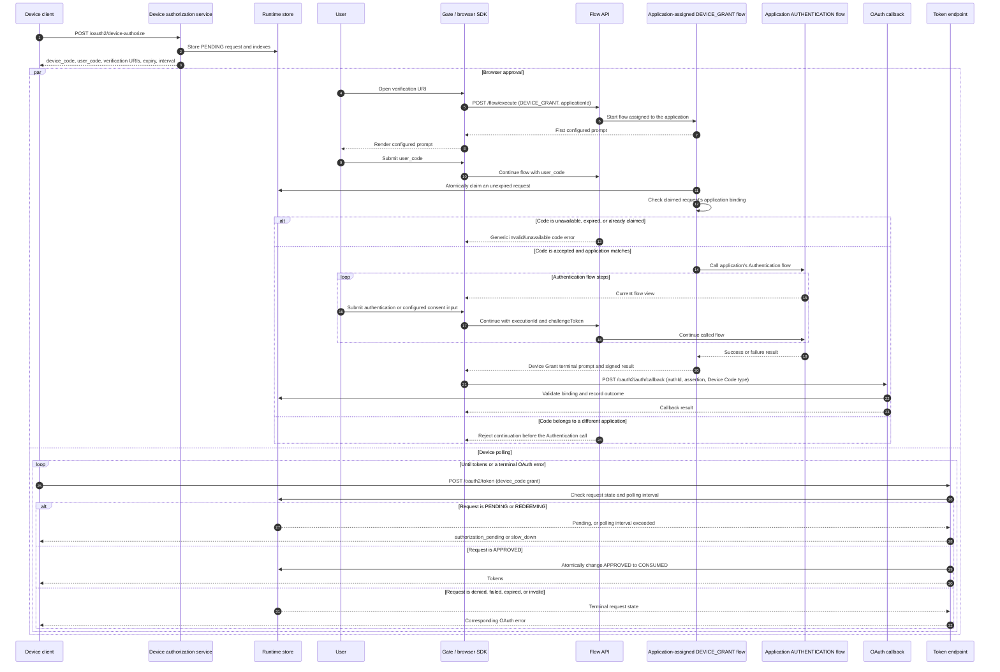

# OAuth 2.0 Device Authorization Grant Specification

- **Status:** Draft
- **Version:** 0.1
- **Related documents:**
  - [Feature issue #5156](https://github.com/thunder-id/thunderid/issues/5156)
  - [RFC 8628](https://www.rfc-editor.org/info/rfc8628/)

## Summary

OAuth 2.0 Device Authorization Grant supports clients with limited input, such as TVs and command-line tools. This feature adds the RFC 8628 authorization and polling endpoints and uses a Device Grant flow assigned to the application for browser approval.

## Architecture

| Component | Responsibility |
| --- | --- |
| Device client | Starts authorization, retains the secret `device_code`, displays the `user_code` and verification URI, and polls the token endpoint at the returned interval. |
| Device authorization service | Validates client grant permission, scopes and resources; generates codes; stores a `PENDING` request; and returns the authorization response. |
| Runtime store | Stores the request, hashed device-code key, request and user-code indexes, expiry, polling information, and lifecycle state. |
| Gate / browser SDK | Renders the browser verification UI, starts and continues the `DEVICE_GRANT` flow through `/flow/execute`, and submits the terminal flow result to the OAuth callback. The application context identifies the assigned flow; `verification_uri_complete` can prefill the user code, but the user must submit it. |
| Flow execution service | Starts the Device Grant flow assigned to the application context. The caller cannot choose a flow ID. |
| Device Grant flow | Runs the administrator-configured prompts, verifies the user code, calls the application's Authentication flow by fixed flow ID, and displays success or failure. The application can select a Device Grant flow; the server default handle supplies the default assignment. |
| `DeviceCodeExecutor` | Verifies and atomically claims a pending request, then places trusted request data in flow runtime data for callback binding and token issuance. |
| `CALL` node | Invokes its statically configured flow ID. For Device Grant, the ID must be the application's configured Authentication flow, and it may run only after successful user-code verification. |
| Application Authentication flow | Applies the application's configured authentication journey, including any consent step configured by that application. Device Grant does not force a separate consent policy. |
| OAuth callback | Validates the signed assertion and its request binding, then marks the request approved, denied, or failed. |
| Device Code token grant handler | Enforces client and resource binding, polling interval and expiry; returns pending or terminal OAuth errors; and issues tokens once for an approved request. |
| Discovery metadata | Advertises the device authorization endpoint and grant type when Device Grant is enabled by server configuration. |

### Authorization and token sequence



The device and browser have separate roles. The device holds `device_code` and polls; the browser submits `user_code` and completes the flow. The browser flow `executionId` is unrelated to the Device Grant request ID used as callback `authId`.

## Detailed design

### Data model

Flow definitions use the existing flow storage model. DEVICE_GRANT is added as a supported flow type; no separate flow table is introduced. The application record stores a reference to its assigned Device Grant flow in DEVICE_GRANT_FLOW_ID, alongside its existing Authentication, Registration, and Recovery flow references. When Device Code grant is enabled, the application must have a valid Device Grant flow assigned. That flow must call the same application's configured Authentication flow.

### API

#### Device authorization request

`POST /oauth2/device-authorize` accepts an `application/x-www-form-urlencoded` request. A public client supplies `client_id`; a confidential client authenticates using its configured token-endpoint authentication method. The client application must allow the Device Code grant type. ThunderID validates requested scopes and the optional resource indicator against the application and configured resource servers.

ThunderID creates a request ID and generates an opaque `device_code` and a human-enterable `user_code`. The device code is stored by its hash. User codes are normalized for lookup and indexed to the same stored request. The initial request state is `PENDING`. The endpoint does not start a browser flow. If request creation fails, the endpoint does not return usable codes.

The current implementation uses a 600-second request lifetime and a 5-second initial polling interval. The response contains:

```json
{
  "device_code": "<opaque-device-code>",
  "user_code": "BCDF-GHJK",
  "verification_uri": "https://id.example.com/gate/device?applicationId=<application-id>",
  "verification_uri_complete": "https://id.example.com/gate/device?applicationId=<application-id>&user_code=BCDF-GHJK",
  "expires_in": 600,
  "interval": 5
}
```

The `applicationId` in the verification URI lets Gate load application presentation and the Device Grant flow assigned to that application. It is not proof that a device request is authorized: after the user submits the code, ThunderID looks up the stored request and checks that its application matches the flow context before continuing to the Authentication flow. The complete URI also includes the user code for QR or link-based entry. The browser SDK prefills the flow's code input but leaves it for the user to review and submit. The response is marked `Cache-Control: no-store` and `Pragma: no-cache`.

#### Start and continue browser verification

There is no Device Grant-specific flow-start endpoint. Gate or the browser SDK starts the existing `POST /flow/execute` with `flowType: DEVICE_GRANT`, the application ID from the verification URI or SDK configuration, and empty inputs. ThunderID loads the Device Grant flow assigned to that application. The caller cannot choose a flow ID. The configured flow controls the order and content of its prompts; when the Device Code executor requests its required `user_code`, the browser SDK prepopulates it from `verification_uri_complete` and still waits for the user to submit it.

The default flow is provided by bootstrap resources as `default-device-grant-flow`. When an application enables Device Code grant, the Console selects this flow by default; the administrator can choose another Device Grant flow. The default contains a `DeviceCodeExecutor`, a user-code prompt, a `CALL` node with a static reference to the default Authentication flow, and terminal success and failure prompts. Flow validation requires the Device Code executor and an Authentication flow target that can only be reached after successful code verification. When a Device Grant flow is assigned to an application, ThunderID verifies that its reachable Authentication call target matches that application's configured Authentication flow.

The Device Code executor normalizes the submitted code, finds the stored request, and atomically changes its state from `PENDING` to `REDEEMING` only while the request remains unexpired. Unknown, expired, denied, or already-claimed codes are presented through a generic invalid/unavailable-code response. Once claimed, trusted values from the stored record—not browser-supplied application data—bind the request to the flow execution. The request ID is retained as `authorizationRequestId`; it is separate from the flow execution ID returned by `/flow/execute`.

The Device Grant `CALL` node uses a fixed flow ID, just like other flow calls. The application assignment validator ensures it points to the configured Authentication flow for that application. The called flow runs as part of the same flow execution, and Gate renders the returned steps.

The Authentication flow controls its own consent behavior. Device Grant does not require a consent purpose, force a consent prompt, or create a separate consent mechanism. If the application flow includes a consent step, its result participates in the flow outcome. A successful Authentication flow can approve the request without a consent claim; a flow error such as user denial records a denied outcome.

On terminal flow completion, Gate submits the signed assertion to the existing `/oauth2/auth/callback` using the Device Grant request ID as `authId` and the Device Code grant type for callback dispatch. The assertion's `authorization_request_id` must match both `authId` and the stored request ID. A valid successful assertion records the user and approval data; a signed user-denial result records `DENIED`; other flow failures record `FAILED`. Approval is accepted only while the request is in `REDEEMING` and before expiry.

**Implementation gap:** The current verifier atomically changes the request to `REDEEMING` before the executor compares the request's application ID with the flow context. A code entered in the wrong application's flow can therefore be claimed before continuation is rejected. The application match should be checked before the atomic claim.

#### Poll and issue tokens

The device sends `grant_type=urn:ietf:params:oauth:grant-type:device_code` and the secret `device_code` to the existing `POST /oauth2/token` endpoint. Public clients also send `client_id`; confidential clients authenticate as configured. ThunderID checks client ownership and prevents a polling `resource` from expanding the original request.

| Stored state | Token endpoint behavior |
| --- | --- |
| `PENDING` or `REDEEMING` | `authorization_pending`, unless the client polls too soon |
| Poll too soon | `slow_down`; the server adds five seconds to the required interval |
| `APPROVED` | Issue eligible tokens and atomically transition to `CONSUMED` |
| `DENIED` | `access_denied` |
| `FAILED` | `server_error` |
| Expired request | `expired_token` |
| `CONSUMED`, unknown code, or code owned by another client | `invalid_grant` |

The access token is restricted to the authorized scopes and resource audience. An ID token is returned when `openid` is authorized. The client must stop polling after tokens or a terminal OAuth error. A `slow_down` response requires increasing the polling interval by five seconds; clients should use backoff for network errors.

Only one concurrent token exchange can consume an approved request. The `PENDING` to `REDEEMING`, `REDEEMING` to `APPROVED`, and `APPROVED` to `CONSUMED` transitions use atomic state comparisons; the first two and consumption also require the request expiry to remain in the future. If request storage expires, the request cannot be claimed, approved, or consumed.

### UI

#### Gate verification page

Gate serves the browser page at `/gate/device`. The Gate Device wrapper provides the page layout and design context, while its Device box renders the configured Device Grant flow through the browser SDK's flow renderer and Gate adapters. The flow determines the prompt order and content. When `verification_uri_complete` includes a user code, Gate prefills the code input but waits for the user to submit it.

The default flow displays “Device authorized” with “You can return to your device.” after success, and “Device authorization failed” with “Return to your device and start again.” after failure. Administrators can configure different prompt text and flow steps.

The page does not look up code status before submission and does not use a Device Grant-specific verification cookie, attempt counter, or per-code countdown. The device client receives `expires_in`; the server enforces expiry during code verification, callback completion, and token consumption.

#### Console configuration

- In **Applications**, enable the Device Code grant type for the application. The Console assigns the default Device Grant flow unless an administrator selects another flow. The selected flow must call that application's configured Authentication flow.
- In **Flows**, create or edit a flow using the Device Grant flow type. Configure the user-code prompt, Device Code executor, Authentication flow call, and success and failure prompts. The Console validates that the required executor and Authentication flow call are present.
- Flow prompts and their order are administrator-configurable. The default Gate screens illustrate the bootstrapped flow; they do not prescribe every flow's wording or order.

### Configuration

Device Grant has deployment-level settings and per-application settings. It does not add an organization-wide attempt limit or verification-session cookie configuration.

- **Deployment-level — OAuth grant enablement:** `oauth.allowed_grant_types` must include `urn:ietf:params:oauth:grant-type:device_code` for the server to accept the grant and advertise it in discovery metadata. The server rejects device authorization requests when the grant is disabled.
- **Deployment-level — default flow:** `flow.deviceGrantFlow.defaultHandle` identifies the Device Grant flow assigned by default when an application enables the grant. It must refer to a valid Device Grant flow.
- **Deployment-level — request lifetime:** `flow.deviceGrantFlow.expirySeconds` controls how long an issued device authorization request remains valid. The current implementation uses 600 seconds. The server enforces expiry at verification, approval, and token consumption.
- **Application-level — grant and flow assignment:** In the Console, an administrator enables the Device Code grant type and may select a Device Grant flow. The default flow is assigned when no override is selected. Validation requires the assigned flow to call the application's configured Authentication flow.

The initial polling interval is currently 5 seconds and is not listed as a configuration setting. Clients must honor the returned interval and apply the RFC 8628 `slow_down` behavior.

## Requirements

### R1. Create a device request

**Requirement:** An eligible client can start a Device Grant request and receive the codes and verification details needed to authorize and poll.

**Acceptance criteria:**

- **AC1.1:** Given a client is enabled for Device Code grant and has passed client authentication, when it submits a valid request to `/oauth2/device-authorize`, then ThunderID returns `device_code`, `user_code`, both verification URIs, `expires_in`, and `interval`.
- **AC1.2:** Given a client is not enabled for Device Code grant or has failed client authentication, when it submits a device authorization request, then ThunderID rejects the request and returns no usable codes.
- **AC1.3:** Given ThunderID has successfully created a device authorization request, when it stores the request, then its initial state is `PENDING` and no browser flow execution has started.
- **AC1.4:** Given ThunderID generates and stores a `device_code`, when it persists the request and its indexes, then the plaintext code is not stored and the indexes resolve to the same request record.
- **AC1.5:** Given a verification URI contains an `applicationId`, when Gate starts the Device Grant flow, then ThunderID uses that application context to load its assigned flow and later verifies that the submitted user code belongs to the same application before continuing.

### R2. Verify and authorize in the browser

**Requirement:** A user can submit a device code in Gate and complete the requesting application's Authentication flow for that device request.

**Acceptance criteria:**

- **AC2.1:** Given a user opens the verification page, when Gate starts Device Grant, then it calls the existing `/flow/execute` endpoint with `flowType: DEVICE_GRANT`, the application context, and no user-code input; ThunderID loads that application's assigned Device Grant flow.
- **AC2.2:** Given `verification_uri_complete` contains a user code, when the configured flow requests the code, then Gate or the browser SDK prefills the code field and waits for the user to submit it before verification.
- **AC2.3:** Given a `DEVICE_GRANT` flow is created or updated, when ThunderID validates its definition, then it requires a Device Code executor and a fixed Call target that is an Authentication flow reachable only after successful code verification.
- **AC2.4:** Given an application enables the Device Code grant or assigns a Device Grant flow, when ThunderID validates the application configuration, then it ensures the flow calls the application's configured Authentication flow; the default Device Grant flow is selected when no override is supplied.
- **AC2.5:** Given a submitted code is unknown, expired, denied, or already claimed, when ThunderID verifies it, then it does not claim a request and Gate receives the generic code-entry error. Given the code belongs to a different application, then the flow does not continue to the Authentication call.
- **AC2.6:** Given a request is `PENDING` and unexpired, when multiple browser executions attempt to claim its code concurrently, then at most one execution transitions the request to `REDEEMING`.
- **AC2.7:** Given a Device Grant flow has claimed a request, when Gate submits its terminal assertion to the callback, then the callback `authId`, assertion `authorization_request_id`, and stored request ID must match, and the request ID remains distinct from the flow `executionId`.
- **AC2.8:** Given an application has configured its Authentication flow, when the Device Grant flow calls it, then authentication and any consent behavior follow that flow without a separate Device Grant consent requirement.
- **AC2.9:** Given a request is in `REDEEMING`, when the callback handles a valid signed success, user-denial, or other failure result for that request, then it records the corresponding `APPROVED`, `DENIED`, or `FAILED` outcome.

### R3. Poll and issue tokens once

**Requirement:** An authorized device client can poll for the outcome and receive tokens only after approval.

**Acceptance criteria:**

- **AC3.1:** Given a client submits a token request using the Device Code grant type, when ThunderID validates it, then it requires `device_code` and enforces client ownership and the original resource binding.
- **AC3.2:** Given a request is `PENDING` or `REDEEMING`, when the client polls at the permitted interval, then the token endpoint returns `authorization_pending`; when it polls too soon, then the endpoint returns `slow_down` and increases the polling interval by five seconds.
- **AC3.3:** Given a request is denied, failed, expired, consumed, unknown, or belongs to another client, when that client polls, then the endpoint returns the corresponding OAuth error and issues no tokens.
- **AC3.4:** Given a request is approved, when its client polls successfully, then ThunderID issues tokens limited to the authorized scopes and resource, and returns an ID token when `openid` is authorized.
- **AC3.5:** Given two token exchanges race for the same approved request, when ThunderID consumes it, then only one exchange succeeds in consuming the request and receiving tokens.

### R4. Expiry and request integrity

**Requirement:** A request cannot be claimed, approved, or consumed outside its valid lifecycle or through a mismatched flow assertion.

- **AC4.1:** Given a request is being claimed, approved, or consumed, when ThunderID performs the state transition, then it atomically checks the expected state and requires the request to remain unexpired.
- **AC4.2:** Given a caller continues an existing flow execution with a missing or invalid challenge token, when the Flow API validates the continuation, then it rejects the request and does not advance the flow.
- **AC4.3:** Given a callback assertion has an invalid signature, wrong audience, or request-ID mismatch, when the callback validates it, then ThunderID does not approve the stored request.
- **AC4.4:** Given a user has not submitted a code on the verification page, when the page is displayed, then it makes no code-status lookup; this implementation has no public status endpoint, per-browser attempt cookie, or attempt-limit configuration.

### R5. Advertise the grant

**Requirement:** Clients can discover Device Grant support when it is enabled by the server.

- **AC5.1:** Given Device Code grant is enabled at server level, when a client reads OAuth Authorization Server Metadata or OpenID Configuration, then the metadata includes `device_authorization_endpoint` and `urn:ietf:params:oauth:grant-type:device_code`.
- **AC5.2:** Given Device Code grant is disabled at server level, when a client reads discovery metadata or submits a device authorization request, then discovery omits the grant and the endpoint does not accept the request.

## Change log

| Version | Date | Change |
| --- | --- | --- |
| 0.1 | 2026-10-09 | Initial specification. |
