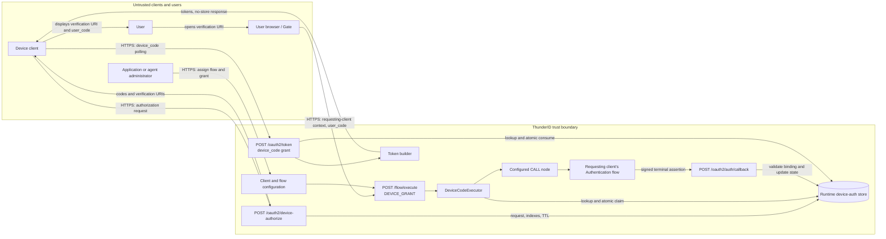
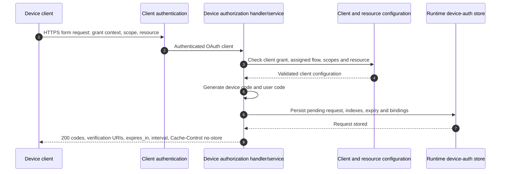
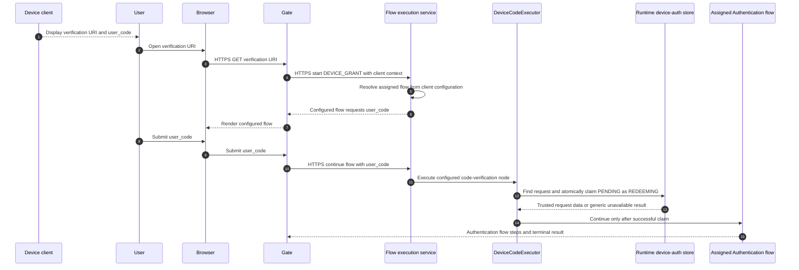
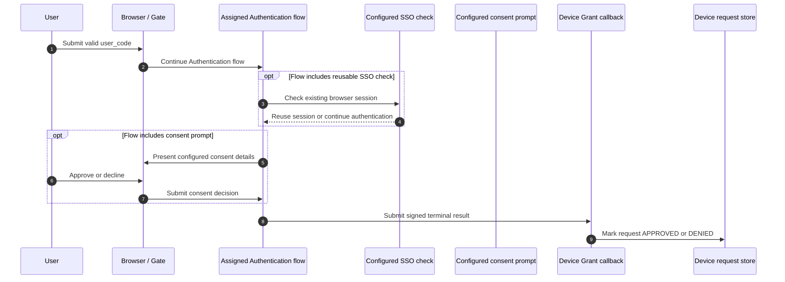
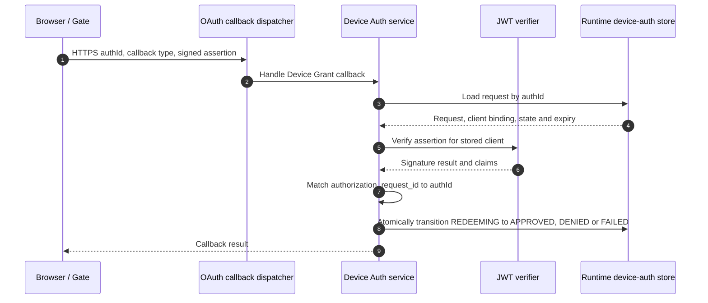
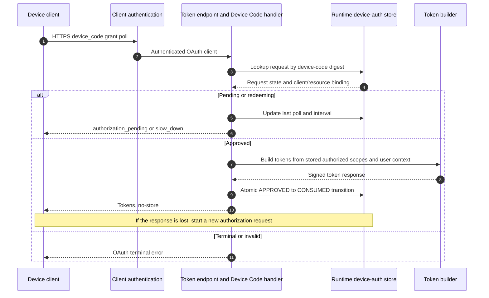
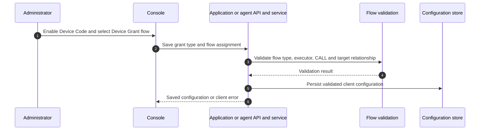

# OAuth 2.0 Device Authorization Grant Threat Model

This model covers the implementation of the Device Authorization Grant, from device authorization through browser verification and token issuance.

## Overview

The Device Authorization Grant lets a client with limited input obtain a short-lived device code and ask a user to complete authorization in a browser. ThunderID supports OAuth application clients and delegated agent clients. It binds the browser journey and token polling to one client, one device request, and one configured flow, and atomically transitions the request so it can be claimed and consumed once. For a delegated agent, the browser user authenticates through the agent's configured Authentication flow; the user is the token subject and the agent is the actor in the access token's `act` claim.

Cross-cutting concerns covered elsewhere: OAuth client authentication and token issuance are covered by the [OAuth authorization and core grants threat model](../oauth/authorization-and-core-grants/threat-model.md). Authentication mechanisms and the configured Authentication flow are handled by the Flow Execution model. Signing and validation of flow assertions are treated here as trust inputs, with the Device Grant request binding analysed in this model. Browser SDK transport and rendering concerns are covered by the [SDK Development threat model](../sdk-development/threat-model.md).

## Scope

This model covers:
- `POST /oauth2/device-authorize`: client and grant eligibility, requested scope/resource validation, code generation, request persistence, and response handling
- `POST /flow/execute` for `flowType: DEVICE_GRANT`: application or delegated-agent flow resolution, user-code verification, and the transition into the requesting client's Authentication flow
- `POST /oauth2/auth/callback` for the Device Code grant: assertion signature, request binding, and approval, denial, or failure state changes
- `POST /oauth2/token` for `grant_type=urn:ietf:params:oauth:grant-type:device_code`: client and resource binding, polling, terminal outcomes, and one-time token issuance
- Application or delegated-agent configuration that enables Device Code and assigns a Device Grant flow

Out of scope (see the referenced companion models):
- Client authentication methods and credential protection, covered by the OAuth authorization and core grants model
- Password, MFA, social login, consent implementation, and other Authentication flow steps, covered by the Flow Execution model
- General flow execution state, session handling, assertion signing keys, token signing, token revocation, and DPoP verification, covered by their respective flow, token, revocation, and DPoP models
- Browser SDK transport and rendering implementation, covered by the SDK Development model

## Architecture



### Components

| Component | Task |
| --- | --- |
| Device client | An OAuth application or delegated agent that requests authorization, protects the returned `device_code`, displays the user code and verification URI, and polls at the returned interval. |
| Device authorization handler and service | Requires an authenticated OAuth client, checks Device Code grant eligibility and assigned flow, validates scope and resource, generates codes, stores the request, and returns the effective expiry and interval. |
| Runtime device-auth store | Stores the request and lifecycle state with a TTL, with device-code, user-code, and request-ID lookup indexes. The user-code index is an unkeyed SHA-256 digest of the normalized code; the serialized request excludes the plaintext user code. |
| Gate and browser SDK | Starts the client-scoped Device Grant flow and renders its configured steps. `verification_uri_complete` can prefill the code, but the user must submit it. |
| Flow execution service | Resolves the Device Grant flow from the requesting client's configuration; the caller does not select a flow ID. |
| DeviceCodeExecutor | Looks up the submitted user code, checks client, expiry, and pending state, atomically claims the request, and places trusted request values into flow runtime data. |
| Configured Device Grant flow | Defines the prompt sequence, code executor, and fixed `CALL` node to the requesting client's Authentication flow. |
| OAuth callback dispatcher and Device Auth service | Verify the signed assertion against the client bound to the request, enforce request ID and state binding, and record approval, denial, or failure. |
| Device Code grant handler | Enforces client and resource bindings, polling interval and expiry, creates eligible tokens, and atomically consumes an approved request. |
| Application and agent configuration | Enables the grant and assigns a Device Grant flow whose `CALL` target matches the requesting client's Authentication flow. |

### Actors

| Actor | Starts with | Goal or capability |
| --- | --- | --- |
| Device client | OAuth client configuration and the ability to reach the authorization server. | Starts and polls a request as the bound client; receives tokens only after approval and one-time consumption. Public clients identify with their non-secret `client_id`; confidential clients use their configured authentication method. |
| Delegated agent client | Agent OAuth client configuration with Device Code enabled and an assigned Device Grant flow. | Starts and polls a request for delegated user access. The user authenticates through the agent's configured Authentication flow; issued access tokens name the user as `sub` and the agent as `act`. |
| Attacker controlling a public device client | The `client_id` of a public application with Device Code enabled; no client secret is needed. | Starts a request and gets its `user_code` and verification URI. May try to persuade a victim to submit that code and authenticate, so the bound device receives a token for the victim. |
| Attacker controlling a delegated agent | Control of a delegated agent configured for Device Code and its client authentication. | Starts a request for user access and may persuade a victim to submit the code and authenticate, so the agent receives a token for that user. |
| User in browser | The verification URI and user code displayed by a device client. | Submits the code and authenticates through the configured Authentication flow. The browser user does not start or poll the device request, and does not receive the device client's tokens. |
| Attacker observing or guessing a code | An observed or guessed unexpired `user_code` and the verification context for its client. | Claims the pending request before the intended user. May abandon it to block that request until expiry, or authenticate as themself so the bound client receives a token for the attacker's account. Does not receive the device token unless also controlling the bound device client. |
| Browser | The verification page and current flow session. | Untrusted. Submits requesting-client context, user code, and flow inputs, but cannot choose a flow ID or trusted request binding. |
| Application or agent administrator | Authorized Console or management API access. | Enables the grant and assigns client flows within their management permissions; a misconfiguration can change the authentication journey. |
| ThunderID services | Device authorization, flow, callback, token, and runtime-store components. | Trusted services enforce request state, bindings, expiry, and token issuance. |

#### Entitlement matrix

| Actor | Start device request | Submit browser user code | Configure assigned flow | Poll for tokens | Receive tokens |
| --- | --- | --- | --- | --- | --- |
| Device client | [Yes], if client authentication and grant checks pass | [No], as the device protocol client | [No] | [Yes], as the bound client | [Yes], after approval and one-time consumption |
| Delegated agent client | [Yes], if its client authentication and grant checks pass | [No], as the device protocol client | [No] | [Yes], as the bound client | [Yes], after the browser user completes the agent's Authentication flow and one-time consumption |
| Attacker controlling a public device client | [Yes], using the public `client_id` if Device Code is enabled | [Yes], for its request; a victim may submit it instead | [No] | [Yes], as the bound public client | [Yes], after approval and one-time consumption |
| Attacker controlling a delegated agent | [Yes], if Device Code is enabled and client authentication succeeds | [Yes], for its request; a victim may submit it instead | [No] | [Yes], as the bound client | [Yes], after the victim authenticates through the agent's flow and one-time consumption |
| User in browser | [No], a separate device client starts the request | [Yes] | [No] | [No] | [No], browser does not receive device-client tokens |
| Attacker observing or guessing a code | [No], unless also controlling a device client | [Yes], if the code is valid for the verification context | [No] | [No], unless also controlling the bound device client | [No], unless also controlling the bound device client |
| Application or agent administrator | [No] | [No] | [Yes], subject to management authorization | [No] | [No] |

### External Dependencies (not owned)

| Dependency | Description (usage, purpose, authentication, authorization, security) |
| --- | --- |
| OAuth client authentication | Authenticates confidential clients and resolves public clients. Covered by the OAuth authorization and core grants model. |
| Gate and browser SDK | Renders the configured flow and posts inputs to ThunderID. HTTPS and browser SDK security are assumed. |
| Runtime store provider | Holds transient device requests, code indexes, and state. The backend accesses it as a trusted persistence dependency; deployment access control, encryption, replication, and backup policy are operator concerns. |
| Flow engine and Authentication flow | Executes configured authentication and optional consent steps. These are security-critical trust inputs but are not re-analysed here. |
| Resource server configuration | Defines permitted audience and scopes. The request is validated and downscoped against this configuration before approval and token issuance. |
| Token and revocation services | Build signed tokens and apply applicable revocation rules. Their general controls are covered by companion token and revocation models. |

## Threats and mitigations

### Out-of-scope interactions and risks

- OAuth client credential theft, client authentication method weaknesses, and client identity resolution: OAuth authorization and core grants threat model.
- Authentication factor compromise, MFA policy, federation, password handling, and configured consent behavior: Flow Execution and relevant authentication mechanism models.
- General flow session integrity, CSRF protections, assertion signing key management, JWT validation framework, token signing, DPoP, and token revocation: their respective companion models.
- TLS configuration, runtime-store access policy and encryption at rest, backup security, ingress rate limiting, and availability architecture: deployment and operator controls.

### Interactions

#### 01: Device authorization request and code issuance

**Description**

An authenticated OAuth client submits `POST /oauth2/device-authorize`. The handler rejects repeated form parameters other than `resource`. The service checks the client's Device Code grant, resolves its application or delegated-agent configuration and assigned Device Grant flow, validates requested scopes and resource indicators, generates a 256-bit random device code and an eight-character user code, and persists a pending request before returning any codes. Defaults are 600 seconds for request lifetime and 5 seconds for the polling interval when configured values are unset or nonpositive. Responses set `Cache-Control: no-store` and `Pragma: no-cache`.

**Assets involved**

| Initiator | Intermediate | Target |
| --- | --- | --- |
| Application or delegated-agent client | Client-auth middleware, device authorization handler and service | Runtime request store; device client receives the device code and user code |

**Data flow**



**Security considerations**

| Area | Response | Comments |
| --- | --- | --- |
| Data confidentiality | [C-High] | The device code is a bearer-like secret used to poll for tokens. The response also contains a short user code. |
| Communication medium | [M-NT] | HTTP request and response; the runtime store is a separate persistence medium. |
| Transport security | TLS | TLS is required in deployment. |
| Authentication | OAuth client authentication | The handler requires the client identity in request context; public and confidential client methods are covered by the companion OAuth model. |
| Accessibility | Public | OAuth device authorization endpoint is externally reachable. |
| Authorization and Access Control | Grant, client, scope, resource and flow assignment checks | Only clients allowed the Device Code grant with an assigned Device Grant flow can create a request. Requested resources and scopes are validated and downscoped. |

**Threat assessment**

| ID | Category | Threat | Materializable | Mitigation / comment |
| --- | --- | --- | --- | --- |
| 1 | Spoofing | An attacker who obtains a public client's device code can poll using that client's public ID and receive tokens after approval. | Yes | The device code is a 256-bit bearer secret. Client ID binding rejects requests from other clients, but does not protect a leaked code presented with the bound public client ID. SHA-256 storage, `no-store` and `no-cache` responses, and TLS protect storage and transport, but not a copied code. DPoP binding of an issued token does not bind the device code to the client that initiated the request. Protect the plaintext code; see this model's residual risks. RFC 8628 Section 5.6 notes that device clients should be treated as public clients unless additional measures are taken. |
| 2 | Tampering | A client could request broader scopes or a different resource during authorization or polling and receive a token outside the intended grant. | No | Scope and resource indicators are validated at request creation; permission scopes are downscoped to the selected resource server. If supplied, the polling resource must match the stored resource, and issuance derives scopes and audiences from the stored request. |
| 3 | Information Disclosure | Exposure of the complete verification URI reveals the `user_code`, allowing another person to claim a pending browser flow. | Yes | The React DeviceGrant SDK removes `user_code` and `applicationId` from the current URL and history entry after the initial flow-start request succeeds. This does not protect the initial page request, which already reached the Gate server and any proxies, or their access logs. Gate does not set a `Referrer-Policy` response header; a deployment policy such as `no-referrer` can limit later referrer leakage, but cannot conceal the initial request URL from those systems. The device authorization response is `no-store` and `no-cache`; these headers do not apply to the subsequent Gate page request. Keep query strings out of server and proxy logs and set an appropriate referrer policy. |
| 4 | Denial of Service | A caller with a public application's `client_id` can repeatedly start device authorization requests without a client secret, consuming runtime-store capacity until the request entries expire. | Yes | Each successful request creates three runtime-store keys with expiry-based TTLs, but the Device Grant implementation has no per-client or per-application pending-request cap and no feature-specific request-rate limit. The five-attempt bound applies only to user-code collision retries for one request; it does not limit request volume. Operators should apply ingress rate limits and capacity controls. Consider a product-side cap on active requests and a maximum request lifetime. |

#### 02: Browser verification and request claim

**Description**

The user opens the `verification_uri` in a browser. Gate then starts `/flow/execute` with `flowType: DEVICE_GRANT` and the requesting client's context. ThunderID resolves the flow ID from the client's stored assignment rather than accepting a caller-selected ID. The configured flow prompts for `user_code`; the browser may prefill it from `verification_uri_complete`, but the user must submit it. The DeviceCodeExecutor verifies the normalized code against the client ID in the flow context, rejects unknown, expired, non-pending, or differently bound requests with a generic unavailable-code response, and atomically transitions a pending request to `REDEEMING`. It stores the trusted request ID, callback type, requested permissions, resource-server identifier, and required optional attributes in shared flow runtime data. The client ID remains in the flow context and is used for the binding check. A configured fixed `CALL` node then invokes the requesting client's Authentication flow. For a delegated agent, this is the agent's Authentication flow; the browser user authenticates as the token subject, and the agent acts for that user.

**Assets involved**

| Initiator | Intermediate | Target |
| --- | --- | --- |
| User and browser | Gate, flow execution service, DeviceCodeExecutor | Runtime request store and assigned Authentication flow |

**Data flow**



**Security considerations**

| Area | Response | Comments |
| --- | --- | --- |
| Data confidentiality | [C-Medium] | User code is a short-lived correlator. Browser flow inputs and authentication data are sensitive and handled by the broader flow model. |
| Communication medium | [M-NT] | Browser to Gate over HTTP transport; runtime store access is internal. |
| Transport security | TLS | Deployment must serve the browser and API over TLS. |
| Authentication | Browser flow session and user authentication | The browser itself is untrusted. Authentication is performed by the configured Authentication flow. |
| Accessibility | Public | Verification page and flow API are externally reachable. |
| Authorization and Access Control | Client-scoped flow plus atomic user-code claim | Flow selection is server-side. The code must belong to the requesting client context and be pending and unexpired; only one request can be claimed. |

**Threat assessment**

| ID | Category | Threat | Materializable | Mitigation / comment |
| --- | --- | --- | --- | --- |
| 1 | Spoofing | An attacker submits another client's user code or chooses a more permissive flow to authenticate against a victim's device request. | No | Device Grant flow resolution uses the requesting client's configured flow ID; request client ID must match the flow context; the caller cannot choose a flow ID. A fixed configured `CALL` target is validated against that client's Authentication flow. |
| 2 | Spoofing / Denial of Service | An attacker who observes or guesses a pending user code claims the request before the intended user, then either abandons the flow or completes authentication with the attacker's account. | Yes | The atomic `PENDING` to `REDEEMING` transition lets the first successful claimant proceed; a later browser cannot take over that request. There is no separate claim timeout, reclaim path, or explicit browser binding in the request state. If the claimant abandons the flow, the request stays unavailable until its normal expiry. The intended user cannot continue that same request, but can restart by asking the device client to create a new request. A short claim lease could bound the abandoned-claim lockout, but would not prevent a claimant who completes authentication from authorizing the request. Codes expire, but the implementation has no feature-specific attempt limit; generic errors and polling backoff do not prevent browser-code guessing. Operators should apply ingress rate limits. This includes the session-spying risk described in RFC 8628. |
| 3 | Information Disclosure | Differences in responses reveal whether a user code exists, is expired, already claimed, or belongs to another client. | No | These cases return a generic invalid or unavailable user-code response, avoiding request-state detail in the browser response. |
#### 03: Authentication, user review, and authorization decision

**Description**

After the user submits a valid code, the fixed `CALL` node continues the requesting client's configured Authentication flow. The user sees the steps defined by that flow. The Console selects the bootstrapped `default-device-grant-flow` when Device Code is enabled for an application or delegated agent. That flow prompts for the code, calls the client's Authentication flow, and then displays a success message. It does not show the requesting client, requested scopes, or a separate Device Grant approve/decline prompt. For a delegated agent, the person signing in through the browser is the token subject; the agent is the client acting for that user and appears in the access token's `act` claim. A custom flow may add a consent prompt with its configured details, but Device Grant does not enforce one. If the flow contains a `Check SSO Session` node and the browser has a reusable session, the flow may skip the authentication steps covered by that session; code entry alone does not guarantee a fresh sign-in prompt. The user can decline at a configured consent prompt. The consent node must be configured to fail the flow on denial for the Device Grant request to be denied; the callback then records `DENIED`. If the flow has no such consent or confirmation step, completing the flow can approve the request without a separate Device Grant decision. Closing the browser abandons the claimed request, which remains unavailable until its expiry.

**Assets involved**

| Initiator | Intermediate | Target |
| --- | --- | --- |
| User in browser | Assigned Authentication flow, configured SSO and consent steps | Device Grant authorization outcome and bound device request |

**Data flow**



**Security considerations**

| Area | Response | Comments |
| --- | --- | --- |
| Data confidentiality | [C-High] | The flow handles the user's identity, session, and authorization decision. |
| Communication medium | [M-NT] | Browser flow and callback traffic; session and consent implementation are covered by the Flow Execution model. |
| Transport security | TLS | TLS is required for browser and callback traffic. |
| Authentication | Configured Authentication flow | The assigned flow determines whether fresh authentication is required or an existing session can be reused. |
| Accessibility | Public | The user-facing browser flow is externally reachable. |
| Authorization and Access Control | Configured consent and flow outcome | Device Grant has no independent consent gate. The Console-selected default flow does not show request-specific client/scope details or an approve/decline prompt; only a custom flow can add this user review. |

**Threat assessment**

| ID | Category | Threat | Materializable | Mitigation / comment |
| --- | --- | --- | --- | --- |
| 1 | Spoofing | An attacker creates a request for an attacker-controlled application or delegated agent and persuades a victim to enter its code and authenticate, causing the client to receive tokens for the victim's account. | Yes | The Console-selected `default-device-grant-flow` proceeds from code verification to the Authentication flow and success message without showing the requesting client, requested scopes, or a separate approval decision. An application- or agent-scoped page does not establish that the request came from a device the user intended to authorize. Custom flows can add context and consent, but user recognition remains part of the mitigation. |
| 2 | Spoofing / Elevation of Privilege | A victim with a reusable browser SSO session submits a code and the configured application or agent flow reuses that session, potentially authorizing the client for the victim without a fresh credential prompt or review of the device request. | Yes | A configured `Check SSO Session` node can skip the authentication steps covered by a valid session. The Device Grant request is approved when the assigned flow completes successfully. Include an explicit consent or device confirmation step in the assigned flow when users must review each request; configure consent denial to fail the flow so the callback records `DENIED`. |

#### 04: Flow callback and authorization outcome

**Description**

At terminal flow completion, Gate submits the assertion and Device Grant request ID to `POST /oauth2/auth/callback`. The dispatcher selects Device Code handling from the callback type. The Device Auth service loads the request by request ID, rejects expired or non-`REDEEMING` requests, verifies the assertion signature against the requesting client ID stored on the request, and requires the assertion's `authorization_request_id` to equal the request ID. A valid success records user and authorization data and transitions to `APPROVED`; a signed end-user error becomes `DENIED`; other flow errors become `FAILED`.

**Assets involved**

| Initiator | Intermediate | Target |
| --- | --- | --- |
| Gate / browser SDK | Callback dispatcher and Device Auth service | Runtime device-auth request state |

**Data flow**



**Security considerations**

| Area | Response | Comments |
| --- | --- | --- |
| Data confidentiality | [C-High] | Assertions contain user identity and authentication context. |
| Communication medium | [M-NT] | Browser callback request and internal store access. |
| Transport security | TLS | TLS is required for callback traffic. |
| Authentication | Signed flow assertion | The assertion is verified against the requesting client ID stored on the device request. |
| Accessibility | Public | Callback endpoint is externally reachable and accepts browser-originated requests. |
| Authorization and Access Control | Signature, request ID, client and lifecycle binding | Only a valid assertion for a still-redeeming request can produce an outcome. |

**Threat assessment**

| ID | Category | Threat | Materializable | Mitigation / comment |
| --- | --- | --- | --- | --- |
| 1 | Tampering | A browser changes `authId`, callback type, or assertion contents to approve a different request or alter its authenticated subject. | No | The assertion signature is verified against the requesting client ID stored on the request; the `authorization_request_id` claim must match both callback request ID and stored request ID. The record must be unexpired and in `REDEEMING` state. |
| 2 | Spoofing | A forged or replayed callback marks a request approved without a successful authentication flow. | No | Invalid signatures are rejected. Callback processing accepts only a request in `REDEEMING`, and state changes use compare-and-swap. Repeated callbacks cannot transition an already completed request. |
| 3 | Denial of Service | A valid flow error or end-user denial is replayed to change an already approved request. | No | Terminal state changes require `REDEEMING`; approval and terminal failures cannot overwrite a completed state. The callback cannot extend request expiry. |

#### 05: Device polling and token issuance

**Description**

The device client, whether an application or delegated agent, submits its secret `device_code` to `POST /oauth2/token` with the Device Code grant. Client authentication runs before grant handling. The handler checks the stored client binding and rejects a mismatched resource. Pending or redeeming requests return `authorization_pending`; an early poll returns `slow_down` and adds five seconds to the interval. Denied, failed, expired, consumed, and unknown requests return terminal OAuth errors. For an approved request, the handler builds tokens from the stored subject, approved scopes, authentication time, session and cached user attributes, applies resource checks and the configured token-revocation check, and atomically changes `APPROVED` to `CONSUMED` before returning the token response. If that response is lost after consumption, a later poll receives a terminal error and cannot retrieve the same token set; the client must start a new device authorization request. The shared token builder applies the requesting client's configured user-attribute allowlist for access tokens and configured ID-token attributes when `openid` is granted. For delegated agents, the human who authenticated is the token subject, and the agent is added to the access token's `act` claim. Device Grant does not carry an authorization-code request's `claims` or `claims_locales`, or its resolved subject entity ID and category, into token building; token content therefore is not identical to Authorization Code in those respects. The callback stores the assertion subject and attribute-cache ID, but not the assertion's resolved subject identity fields or a separate sign-in organization-unit context. Any user organization-unit attributes available through the cached attributes are ordinary user attributes, not an OU selection bound by Device Grant. The handler does not reload the user's current account state during polling. The token service also issues a refresh token when the client allows the Refresh Token grant; Device Grant does not assign a token-family ID to these tokens.

**Assets involved**

| Initiator | Intermediate | Target |
| --- | --- | --- |
| Application or delegated-agent client | Client-auth middleware, Device Code grant handler, token builder | Runtime request store and the authenticated device client |

**Data flow**



**Security considerations**

| Area | Response | Comments |
| --- | --- | --- |
| Data confidentiality | [C-High] | The device code and issued access, ID, and optional refresh tokens are high-value secrets. |
| Communication medium | [M-NT] | OAuth token endpoint over HTTPS; runtime store is internal. |
| Transport security | TLS | TLS is required. Token responses use no-store behavior at the token endpoint. |
| Authentication | OAuth client authentication plus device code | Client authentication and token construction are covered by companion models. |
| Accessibility | Public | Token endpoint is externally reachable. |
| Authorization and Access Control | Client binding, stored resource/scope binding, approved state, atomic consume | Token issuance is limited to the authenticated client that initiated the request and the authorization decision persisted by the browser flow. |

**Threat assessment**

| ID | Category | Threat | Materializable | Mitigation / comment |
| --- | --- | --- | --- | --- |
| 1 | Spoofing | An attacker who obtains a public client's device code presents it with that client's public ID and redeems the request after approval. | Yes | The handler rejects a mismatched client ID, but a public client ID is not a secret and the check does not protect a leaked device code presented with the bound ID. The code's 256-bit entropy limits guessing, not use of a copied code. SHA-256 storage and one-time consumption do not prevent the first unauthorized redemption; DPoP binding of an issued token does not bind the device code to the initiating client. Protect the code and see this model's residual risks. RFC 8628 Section 5.6 notes that device clients should be treated as public clients unless additional measures are taken. The same client-binding limitation applies to delegated agents. |
| 2 | Elevation of Privilege | Concurrent token polls race to redeem an approved request and obtain multiple token sets. | No | The transition from `APPROVED` to `CONSUMED` is atomic and only one caller succeeds. A failed consume returns an invalid grant and does not return the generated token response. |
| 3 | Tampering | A poll supplies a different resource or broadens requested scopes after approval. | No | If a resource is supplied, it must match the request resource; audiences and scopes are resolved from the stored request and current resource-server configuration. |
| 4 | Denial of Service | A client that ignores `slow_down` repeatedly polls a pending request, consuming token-endpoint and runtime-store resources despite the advised interval. | Yes | Every pending or redeeming poll is processed and updates `LastPolledAt` and `PollInterval`. An early poll receives `slow_down` and increases the stored interval by five seconds, but the server does not delay or reject based on a poll count. The interval has no ceiling and there is no Device Grant-specific hard polling limit. Operators should apply endpoint rate limits and capacity controls. |
| 5 | Denial of Service | The token response is lost after the request changes to `CONSUMED`, leaving the client without the issued tokens and unable to retrieve them by polling again. | Yes | One-time consumption prevents the token set from being returned again. A later poll receives a terminal error. The client must discard the consumed request and start a new device authorization request. |
| 6 | Information Disclosure | Token response, device code, or user context is exposed through caches or logs. | Yes | Token endpoint cache controls prevent response caching, and Device Grant handlers do not intentionally log codes, tokens, or stored user attributes. These controls do not prevent servers, proxies, middleware, or clients from logging request or response data. Deployments must redact sensitive fields, avoid logging request and response bodies or sensitive query strings, restrict log access, and define suitable retention. Clients must protect device codes and tokens. |
| 7 | Elevation of Privilege | Device Grant access or refresh tokens remain usable after the authorizing SSO session is terminated, or refresh-token replay fails to revoke tokens rotated from the same grant. | Yes | Device Grant token construction does not propagate a `tfid` from the flow or create a grant-specific token-family ID. Access tokens therefore have no family claim; the optional refresh token may carry the flow `sid` but has no `tfid`. Session termination revokes recorded token families, while refresh-replay handling can revoke a family only when the replayed token contains `tfid`. The replayed refresh token is rejected by its JTI, but without a family ID the related access token and rotated refresh tokens are not invalidated by that family revocation. The request ID is also not carried in token claims. |
| 8 | Elevation of Privilege | An approved request is redeemed after the user becomes locked, deleted, or suspended, issuing tokens despite the changed account state. | Yes | Token issuance does not reload the user's current state; its revocation check uses the stored subject and `AuthTime`. With `oauth.token_revocation.enabled` (true by default), user deletion records a terminal subject revocation and suspension records a subject revocation at its cutoff, so an approved grant established before those actions is rejected. An ordinary account lock does not create a token revocation record and is not checked by this handler, so locking the user after browser-flow completion does not itself prevent issuance. If OAuth token revocation is disabled, the issuance-time revocation check is skipped. |

#### 06: Application and delegated-agent flow configuration

**Description**

An administrator enables the Device Code grant and assigns a Device Grant flow to an application or delegated agent. Configuration validation requires a flow, checks that it is a valid Device Grant flow, and checks that its fixed `CALL` node targets the requesting client's configured Authentication flow. For an agent, that target is the agent's Authentication flow. The Console selects the bootstrapped default flow when enabling the grant, while administrators can choose another flow.

**Assets involved**

| Initiator | Intermediate | Target |
| --- | --- | --- |
| Application or agent administrator | Console, client API and validation service | Inbound-client configuration and flow graph |

**Data flow**



**Security considerations**

| Area | Response | Comments |
| --- | --- | --- |
| Data confidentiality | [C-Low] | Flow IDs and grant configuration are not credentials, but reveal authentication architecture. |
| Communication medium | [M-NT] | Management UI and API traffic; configuration database. |
| Transport security | TLS | Management traffic must use TLS. |
| Authentication | Console or management API authentication | Administrative identity and session controls are covered by the management-plane model. |
| Accessibility | Restricted | Requires authorized management access. |
| Authorization and Access Control | Management permissions and server-side relationship validation | UI selection is not the security boundary; backend validation must enforce the flow relationship. |

**Threat assessment**

| ID | Category | Threat | Materializable | Mitigation / comment |
| --- | --- | --- | --- | --- |
| 1 | Tampering | An administrator or API caller assigns an unrelated, wrong-type, or cross-client flow, changing the authentication journey used by Device Grant. | No | The backend validates flow type, required executor and CALL relationship against the requesting client's configured flows; UI constraints are supplemental. |
| 2 | Spoofing / Elevation of Privilege | The Console-selected default Device Grant flow approves an attacker-controlled device request after Authentication completes, without showing the user who invoked the request, why it was initiated, the requested scopes, or an explicit approval decision. | Yes | The bootstrapped `default-device-grant-flow` goes from code verification to the default Authentication flow and then a success prompt; it contains no Device Grant consent step. The Console selects it by default when Device Code is enabled, so this risk exists under normal setup and does not depend on an administrator misconfiguring a custom flow. RFC 8628 Section 3.3 calls for informing the user about the action and asking them to approve or deny; RFC 10027 Section 6.1.14 recommends preserving who invoked the flow, why, and the consequence, with decline the default or equally prominent. Custom flows can add consent, but the shipped default remains vulnerable until it presents this context and requires an explicit decision. |
## Security Review Checklist

### Security considerations

| # | Consideration | State | Comments |
| --- | --- | --- | --- |
| 1 | Are all inputs and outputs validated (syntactic and semantic)? | [Yes] | Repeated form fields are rejected except `resource`; grant, client, scope, resource, user-code, flow, callback and state bindings are validated. |
| 2 | Are rate limits in place where necessary? | [Partial] | Early polls receive `slow_down`, but every request is still processed and updates the runtime store, so this does not limit incoming request volume. Device Grant has no feature-specific limit for authorization requests, user-code attempts, or token polls; use deployment-level ingress abuse controls. |
| 3 | Are permissions, roles, and entitlements defined on the principle of least privilege and business need? | [Yes] | Grant eligibility, authenticated client, configured flow, resource, and requested/authorized scopes constrain the request. |
| 4 | Are authentication and authorization validated at both the UI and API layers, front end and back end, before granting access to resources? | [Yes] | Console behavior is backed by service validation; callback and token paths independently enforce server-side bindings. |
| 5 | Are proper isolations in place between components to ensure least-privilege access and reduce the blast radius against lateral movement? | [Partial] | Requests are scoped to the requesting client and user. Runtime-store and service isolation depend on deployment configuration and are not validated here. |
| 6 | Have any default credentials been changed, and are default superuser or root accounts not in use (when using third-party components)? | [N/A] | Device Grant does not introduce credentials or default accounts. |
| 7 | Has the implementation followed best-practice guidelines (OWASP, Kubernetes, vendor, or technology provider)? | [Partial] | The grant implements expiry, polling, client binding and one-time use. The shipped default flow lacks request-specific authorization context and an explicit approve/decline step; see the materializable default-flow risk. |
| 8 | Are secrets, credentials, and internal-only material kept out of the public source tree and its git history? | [Yes] | No secret values are introduced by this feature. |
| 9 | Was a security-focused code review conducted for this change, and have the findings been addressed? | [Partial] | Security review findings are tracked in this model; separate code-review coverage is not recorded. |
| 10 | Is Static Analysis (SAST) or IaC scanning conducted, and are findings addressed? | [Yes] | Covered by the product scan. |
| 11 | Is Software Composition Analysis (SCA) conducted or integrated into the repository, and are findings addressed (for example FOSSA, Trivy)? | [Partial] | Dependency scanning does not cover the full dependency set. |
| 12 | Is Dynamic (DAST) or API scanning conducted on a non-production setup, and are findings addressed? | [No] | No DAST or API security scanning is configured for this feature. Integration and protocol-conformance tests exercise the APIs but are not vulnerability scans. |
| 13 | Are audit logs generated in a standardized format for critical functionality, and available to authorized users to trace critical events and aid incident response? Note the retention period in Comments. | [Partial] | Standardized audit events cover refused OAuth client authentication, token-request outcomes for all grants (including Device Code polls), and token-revocation outcomes. Expected `authorization_pending` and `slow_down` polls are omitted. Device Grant request creation, browser user-code claims, and callback approval or denial do not have lifecycle audit events. No audit retention period is specified. |
| 14 | Do audit logs for critical configuration changes record the difference between the old and new versions? | [No] | Configuration-change audit events do not record before-and-after values. |
| 15 | Are data in transit and at rest encrypted? | [Partial] | TLS is required for network paths. At-rest encryption for runtime and configuration stores depends on deployment configuration. |
| 16 | Are sensitive values such as credentials and keys stored in a secret store or vault? | [Partial] | Device codes are not stored in plaintext. Storage of OAuth client secrets and signing keys is covered by companion models. |
| 17 | Is personal, sensitive, or confidential data kept out of logs? | [Partial] | User codes and device codes are not intentionally logged by the Device Auth service; broader request logging and attribute handling depend on common middleware and deployment configuration. |
| 18 | Have users been given clear instructions for secure usage? | [Partial] | Device clients should protect `device_code`, and users should compare the submitted code with the code displayed by their device. The default flow does not show the requesting application or agent, or the requested scopes; deployments need a custom review step before users can verify that context and make an explicit authorization decision. |

### Business impact and resilience

| # | Consideration | State | Comments |
| --- | --- | --- | --- |
| 1 | Has a business impact analysis been done to identify resilience requirements (maximum tolerable downtime, uptime, RPO, RTO)? | [N/A] | Device Grant inherits deployment availability and recovery objectives; it does not define feature-specific RPO or RTO requirements. |

Resilience details to record:
- High availability: depends on the configured runtime store and ThunderID deployment topology.
- Disaster recovery: recover configuration and service dependencies according to operator policy; expired transient authorization requests should not be restored as usable approvals.
- Backups and retention: runtime request TTL is based on configured expiry, default 600 seconds, plus expired-record retention; backup and replication policy is operator-owned.
- Health checks: use deployment health checks for the API and runtime store.
- User banners: not applicable to this protocol feature.

### Dependency and component health

| # | Consideration | State | Comments |
| --- | --- | --- | --- |
| 1 | Are dependencies, base images, and runtimes monitored for known vulnerabilities and kept current (for example automated dependency scanning), and are findings addressed? | [Partial] | Dependency scanning does not cover the full dependency set; base-image and runtime monitoring depend on the deployment. |
| 2 | Are any End-of-Life or End-of-Service components in use? | [Partial] | End-of-life status depends on the runtimes and images selected by the deployment. |
| 3 | Is hardening guidance published for operators who deploy the project (optional)? | [Partial] | Operator guidance should cover TLS, ingress abuse controls, and protected runtime-store access. |

### Privacy considerations

| # | Consideration | State | Comments |
| --- | --- | --- | --- |
| 1 | Is the purpose and legal basis for processing personal data clearly defined? | [Partial] | The grant processes user identity and authentication context to issue the requested OAuth tokens. Legal basis is operator-specific. |
| 2 | Are the collection, storage, processing, sharing, archival, and disposal of personal data aligned with the data minimization principle? | [Partial] | The request stores user ID, approved scopes, requested attributes and authentication context needed for token issuance. Requests expire; retention and backup behavior depend on deployment controls. |
| 3 | Is personal data stored securely? | [Partial] | Request data resides in the runtime store; access controls and encryption at rest depend on deployment configuration. |
| 4 | Are privacy notices updated to reflect any new processing or changes to purpose and legal basis? | [N/A] | Application and agent operators own notices for their authentication journeys and attributes. |
| 5 | Is access to personal data granted on a need-to-know basis? | [Partial] | Backend services use the runtime store; access restrictions depend on deployment configuration. |
| 6 | Are data retention requirements considered? | [Yes] | Request records use an expiry-based TTL, default 600 seconds, with bounded expired-record retention in the store. |
| 7 | Is there a process to dispose of personal data on request in a timely manner while meeting retention requirements? | [N/A] | Device Grant request records are transient and expire automatically; individual data-subject request workflow is outside this feature. |
| 8 | Are records of personal-data processing maintained in the project's data inventory or records of processing? | [Partial] | Device Grant processes user identity and authentication context; coverage in the project's data inventory remains unverified. |

## Residual risks (open items)

- A public-client device code is a bearer secret. Anyone who copies it and knows the public `client_id` can redeem the request after approval. Its high entropy limits guessing, but not replay of a copied code. Hashing the code in storage and disabling response caching do not prevent that replay. DPoP on the token request can bind the resulting token to the poller's key, but Device Grant requests do not store an initiating key thumbprint or require the same key during polling. Treat this as an open product risk, not a mitigated or formally accepted exception. A product mitigation to evaluate is binding the device authorization request to a client-held key (for example, a DPoP key) and requiring proof of that same key on every poll. Source-network restrictions may supplement this where deployments have stable network boundaries, but are not a general substitute for cryptographic binding.
- An attacker who observes or guesses a pending user code can become the first claimant. The request state has no claim lease, reclaim path, or explicit browser binding: later browsers cannot take over, and an abandoned claim remains unavailable until the request expires. The intended user cannot complete that same request, but can restart immediately by having the device client create a new request. A short claim lease would bound abandonment lockout, but would not prevent a claimant who finishes authentication from authorizing the request. If the attacker completes authentication, the device receives tokens for the attacker's account. The eight-character code has finite entropy, and the implementation has no feature-specific attempt limit. Polling backoff does not limit browser-code attempts. Apply ingress rate limits and monitor abuse.
- Device Grant does not verify that the user controls the device displaying the code. A user can be tricked into authenticating for an attacker-controlled device. Any device possession and code comparison prompt must be implemented by the assigned flow, and remains dependent on user judgment.
- The complete verification URI includes `user_code` as a query parameter. The React DeviceGrant SDK removes it from the current address bar and history entry after the initial flow-start request succeeds, but this cannot undo the initial URL request or remove copies already recorded by Gate servers, proxies, or logs. Gate does not set a `Referrer-Policy`; deployments should set one to limit later referrer leakage and ensure access logs omit query strings. The code is short-lived and can only claim a request once, but remains sensitive until expiry or claim.
- The user-code lookup index is an unkeyed SHA-256 digest of the normalized code, and the plaintext code is excluded from the serialized request. The code uses eight characters from a 20-character alphabet, giving 20^8 (25.6 billion) candidates. An attacker able to read and enumerate runtime-store indexes can hash candidate codes offline and match codes for requests that are still valid. The default request lifetime is 600 seconds; the code remains usable only until its request expires. Restrict runtime-store read access; this risk requires access to enumerate the stored indexes.
- The Console-selected bootstrapped default flow does not display the requesting client, requested scopes, or an explicit Device Grant approval/decline prompt. It proceeds from code verification through Authentication to a success message. Until the default provides request context and a clear decision with decline as the default or equally prominent, users may authorize an attacker-controlled request without understanding who initiated it or why. Custom flows can add review steps, but that does not mitigate the shipped default.
- The Device Grant implementation has no per-client or per-application pending-request cap or feature-specific request-rate limit. Each accepted request reserves a request record and two lookup-index entries until their expiry-based TTLs elapse. The default request lifetime is 600 seconds, followed by 60 seconds of expired-record retention; configured lifetimes may change the exposure window. A product-side active-request cap and maximum lifetime could bound accumulation. Until then, ingress rate limits and runtime-store capacity controls are operator mitigations.
- Device polling has no server-enforced request-rate limit, early-poll count cap, or maximum `slow_down` interval. Every pending poll still reads and updates runtime state, while the returned `slow_down` only advises the client. A client that ignores it can continue consuming token-endpoint and runtime-store resources. Apply ingress rate limits and capacity controls; consider a server-side polling limit and bounded interval growth.
- Device Grant tokens are not linked to a token family or the originating request ID. The access token has no `tfid` or `sid`; an optional refresh token can carry the flow's `sid` but is issued without `tfid`. Session termination revokes token families recorded for session participants, and refresh-token replay revokes the family only when `tfid` is present. As a result, session-level sign-out and refresh replay do not reliably revoke all tokens from a Device Grant authorization. Consider assigning a family ID to each approved Device Grant request, propagating it to access and refresh tokens, and associating it with session termination. Until then, revoke the affected tokens individually or use broader subject-level revocation where appropriate.
- Token issuance for an approved Device Grant request does not reread current user state. With OAuth token revocation enabled, deletion and suspension revocations are checked against the request subject and authentication time. A regular account lock after browser-flow completion does not create a matching revocation record, so the approved request can still be redeemed until expiry. If policy requires locks to cancel approved requests, connect lock transitions to grant revocation or check current account state at issuance.
- Audit events cover refused OAuth client authentication, token-request outcomes for all grants (including Device Code polls), and token-revocation outcomes. Expected `authorization_pending` and `slow_down` poll responses are intentionally omitted. The events do not cover successful device-request creation, browser user-code claims, or callback approval and denial; token consumption is visible only through the resulting token-request outcome. Operators therefore cannot use these events to detect spikes in failed user-code submissions or identify the browser session or source location that claimed or approved a request. The implementation exposes no operator cancellation endpoint for an approved but unredeemed request; it remains redeemable until consumed or until its configured expiry (600 seconds by default). Runtime-store access control, encryption at rest, backup retention, broader API request logging, audit retention, and ingress rate limits require operator verification.

## Appendix

- Sample requests and configurations: see below.
- References: [RFC 8628](https://www.rfc-editor.org/rfc/rfc8628), [RFC 10027](https://www.rfc-editor.org/rfc/rfc10027)

### Sample deployment configuration

The server must allow the Device Code grant, and each application or delegated agent must also enable it in its OAuth grant types and assign a Device Grant flow. `oauth.allowed_grant_types` is a server-wide allow-list. To disable Device Code for a deployment that does not use it, configure a non-empty explicit list that omits the grant. An omitted or empty list is populated from the server's supported grant types, which include Device Code, so an empty list does not disable it. The following example enables the grant and configures the default authorization lifetime and polling interval:

```yaml
oauth:
  allowed_grant_types:
    - authorization_code
    - urn:ietf:params:oauth:grant-type:device_code
  device_grant:
    expires_in: 600
    interval: 5
```

### Sample application configuration

Enable Device Code for an application or delegated agent only where a constrained-input device needs cross-device authorization and other protocols are not viable. Do not enable it for clients protecting sensitive, high-value, or business-critical resources, or for same-device scenarios. Where it is used, deploy additional mitigations such as proximity checks or allowing only pre-registered devices. These recommendations follow [RFC 10027 Section 6.2.1.5](https://www.rfc-editor.org/rfc/rfc10027#section-6.2.1.5).

For an application approved for this use, assign a Device Grant flow whose configured `CALL` node targets the application's Authentication flow. This fragment shows a public OAuth client enabled for the Authorization Code and Device Code grants. The Authorization Code settings satisfy the backend's public-client PKCE validation:

```json
{
  "authFlowId": "<authentication-flow-id>",
  "deviceGrantFlowId": "<device-grant-flow-id>",
  "inboundAuthConfig": [
    {
      "type": "oauth2",
      "config": {
        "clientId": "device-client",
        "redirectUris": ["https://device.example.com/callback"],
        "grantTypes": [
          "authorization_code",
          "urn:ietf:params:oauth:grant-type:device_code"
        ],
        "responseTypes": ["code"],
        "tokenEndpointAuthMethod": "none",
        "publicClient": true,
        "pkceRequired": true,
        "scopes": ["openid", "profile"]
      }
    }
  ]
}
```

For a delegated agent, include `urn:ietf:params:oauth:grant-type:device_code` in the agent's `grantTypes` and assign its `deviceGrantFlowId`. The assigned flow's `CALL` node must target the agent's configured Authentication flow. The browser user authenticates through that flow and becomes the token subject; the agent is added to the access token's `act` claim.

### Sample device authorization request

The public client sends its `client_id` and requested scopes. ThunderID responds with `Cache-Control: no-store` and `Pragma: no-cache`:

```http
POST /oauth2/device-authorize
Content-Type: application/x-www-form-urlencoded

client_id=device-client&scope=openid%20profile
```

```json
{
  "device_code": "<opaque-device-code>",
  "user_code": "BCDF-GHJK",
  "verification_uri": "https://id.example.com/gate/device?applicationId=<application-id>",
  "verification_uri_complete": "https://id.example.com/gate/device?applicationId=<application-id>&user_code=BCDF-GHJK",
  "expires_in": 600,
  "interval": 5
}
```

The device client keeps `device_code` secret and asks the user to visit the verification URI. The browser may prefill `user_code` from the complete URI, but the user must submit it.

### Sample token polling request

The same public client polls the token endpoint using the device code:

```http
POST /oauth2/token
Content-Type: application/x-www-form-urlencoded

grant_type=urn:ietf:params:oauth:grant-type:device_code&client_id=device-client&device_code=<opaque-device-code>
```

Before the browser flow completes, the response is `authorization_pending`. After successful browser authorization, the response contains an access token and, when `openid` was authorized, an ID token:

```json
{
  "access_token": "<signed-access-token>",
  "token_type": "Bearer",
  "expires_in": 3600,
  "id_token": "<signed-id-token>",
  "scope": "openid profile"
}
```

## Change log

| Version | Date | Change |
|---|---|---|
| 1.0 | 2026-11-05 | Initial specification. |
