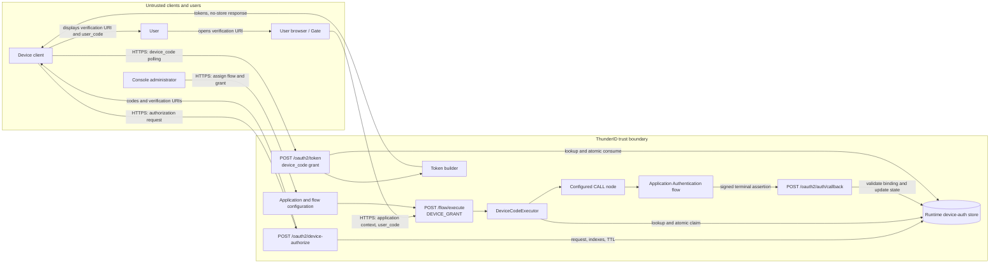
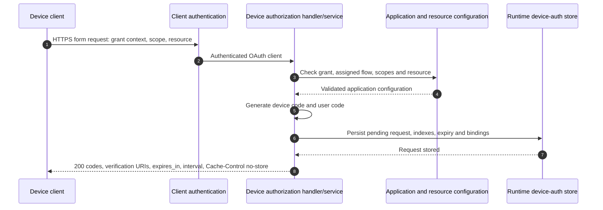
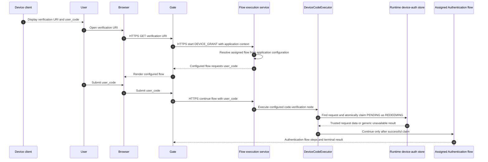
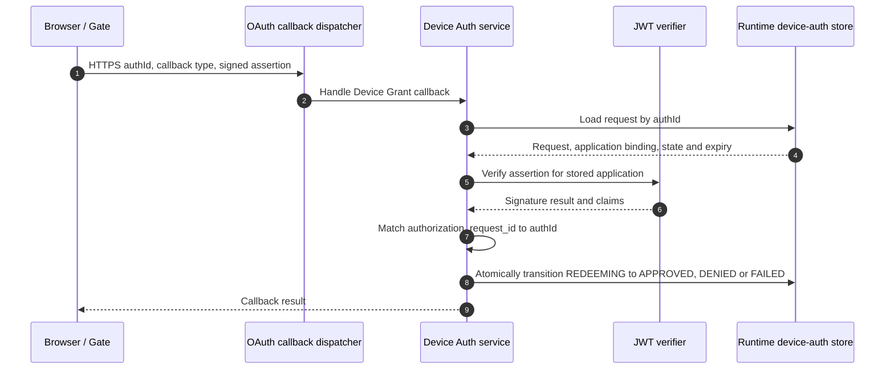
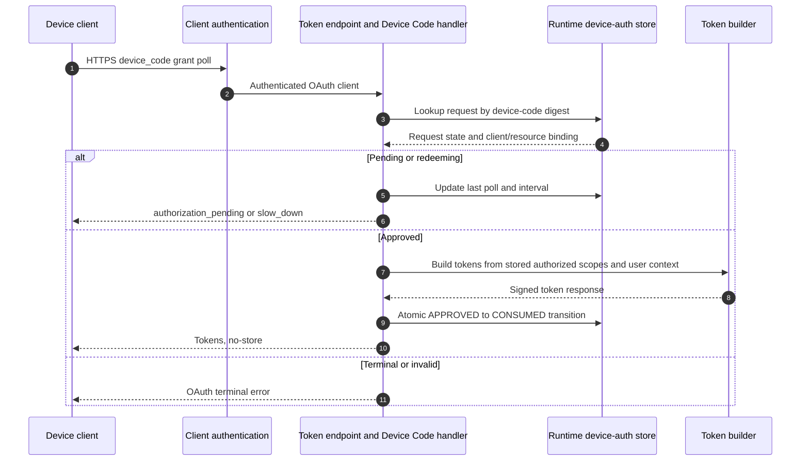
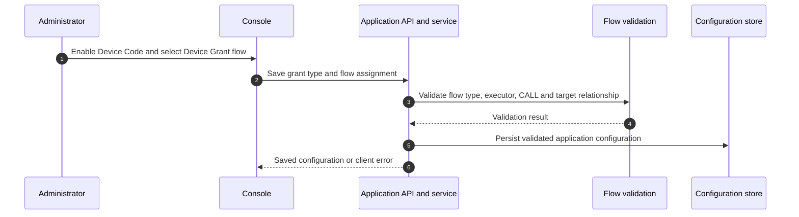

# OAuth 2.0 Device Authorization Grant Threat Model

This model covers the merged application implementation of the Device Authorization Grant, from device authorization through browser verification and token issuance.

## Overview

The Device Authorization Grant lets a client with limited input obtain a short-lived device code and ask a user to complete authorization in a browser. ThunderID binds the browser journey and token polling to one application, one device request, and one configured flow, and atomically transitions the request so it can be claimed and consumed once.

Cross-cutting concerns covered elsewhere: OAuth client authentication and token issuance are covered by the [OAuth authorization and core grants threat model](../oauth/authorization-and-core-grants/threat-model.md). Authentication mechanisms and the configured Authentication flow are handled by the Flow Execution model. Signing and validation of flow assertions are treated here as trust inputs, with the Device Grant request binding analysed in this model. Browser SDK transport and rendering concerns are covered by the [SDK Development threat model](../sdk-development/threat-model.md).

## Scope

This model covers:
- `POST /oauth2/device-authorize`: client and grant eligibility, requested scope/resource validation, code generation, request persistence, and response handling
- `POST /flow/execute` for `flowType: DEVICE_GRANT`: application flow resolution, user-code verification, and the transition into the application's Authentication flow
- `POST /oauth2/auth/callback` for the Device Code grant: assertion signature, request binding, and approval, denial, or failure state changes
- `POST /oauth2/token` for `grant_type=urn:ietf:params:oauth:grant-type:device_code`: client and resource binding, polling, terminal outcomes, and one-time token issuance
- Application configuration that enables Device Code and assigns a Device Grant flow

Out of scope (see the referenced companion models):
- Client authentication methods and credential protection, covered by the OAuth authorization and core grants model
- Password, MFA, social login, consent implementation, and other Authentication flow steps, covered by the Flow Execution model
- General flow execution state, session handling, assertion signing keys, token signing, token revocation, and DPoP verification, covered by their respective flow, token, revocation, and DPoP models
- Browser SDK transport and rendering implementation, covered by the SDK Development model

## Architecture



### Components

| Component | Task |
| --- | --- |
| Device client | Requests authorization, protects the returned `device_code`, displays the user code and verification URI, and polls at the returned interval. |
| Device authorization handler and service | Requires an authenticated OAuth client, checks Device Code grant eligibility and assigned flow, validates scope and resource, generates codes, stores the request, and returns the effective expiry and interval. |
| Runtime device-auth store | Stores the request and lifecycle state with a TTL, with device-code, user-code, and request-ID lookup indexes. The serialized request excludes the plaintext user code. |
| Gate and browser SDK | Starts the application-scoped Device Grant flow and renders its configured steps. `verification_uri_complete` can prefill the code, but the user must submit it. |
| Flow execution service | Resolves the Device Grant flow from the application configuration; the caller does not select a flow ID. |
| DeviceCodeExecutor | Looks up the submitted user code, checks application, expiry, and pending state, atomically claims the request, and places trusted request values into flow runtime data. |
| Configured Device Grant flow | Defines the prompt sequence, code executor, and fixed `CALL` node to the application's Authentication flow. |
| OAuth callback dispatcher and Device Auth service | Verify the signed assertion against the application, enforce request ID and state binding, and record approval, denial, or failure. |
| Device Code grant handler | Enforces client and resource bindings, polling interval and expiry, creates eligible tokens, and atomically consumes an approved request. |
| Application and flow configuration | Enables the grant and assigns a Device Grant flow whose `CALL` target matches the application's Authentication flow. |

### Actors

#### Actors

| Actor | Description | Roles or permissions |
| --- | --- | --- |
| Device client | OAuth client that initiates and polls a device request. | May act only as its authenticated client; the request's configured grants and approved scopes constrain token issuance. |
| User | Person completing the browser authentication journey. | Can authenticate through the configured Authentication flow. Approval semantics and any consent prompt depend on that flow. |
| Browser | User-controlled client rendering Gate and submitting flow inputs. | Untrusted. Supplies application context and user code, but cannot choose a flow ID or trusted request binding. |
| Application administrator | Configures OAuth grants and application flows in Console or through management APIs. | Can assign flows and grant types within their management permissions; a misconfiguration can change the authentication journey. |
| ThunderID services | Device authorization, flow, callback, token, and runtime-store components. | Trusted services enforce request state, bindings, expiry, and token issuance. |

#### Entitlement matrix

| Actor | Start device request | Submit browser user code | Configure assigned flow | Poll for tokens | Receive tokens |
| --- | --- | --- | --- | --- | --- |
| Device client | [Yes], if client auth and grant checks pass | [No] | [No] | [Yes], as the bound client | [Yes], after approval and one-time consumption |
| User in browser | [No] | [Yes] | [No] | [No] | [No], browser does not receive device-client tokens |
| Application administrator | [No] | [No] | [Yes], subject to management authorization | [No] | [No] |

### External Dependencies (not owned)

| Dependency | Description (usage, purpose, authentication, authorization, security) |
| --- | --- |
| OAuth client authentication | Authenticates confidential clients and resolves public clients. Covered by the OAuth authorization and core grants model. |
| Gate and browser SDK | Renders the configured flow and posts inputs to ThunderID. HTTPS and browser SDK security are assumed. |
| Runtime store provider | Holds transient device requests, code indexes, and state. The backend accesses it as a trusted persistence dependency; deployment access control, encryption, replication, and backup policy are operator concerns. |
| Flow engine and Authentication flow | Executes configured authentication and optional consent steps. These are security-critical trust inputs but are not re-analysed here. |
| Resource server configuration | Defines permitted audience and scopes. The request is validated and downscoped against this configuration before approval and token issuance. |
| Token and revocation services | Build signed tokens and apply applicable revocation rules. Their general controls are covered by companion token and revocation models. |

## Threats and mitigations

### Out-of-scope interactions and risks

- OAuth client credential theft, client authentication method weaknesses, and client identity resolution: OAuth authorization and core grants threat model.
- Authentication factor compromise, MFA policy, federation, password handling, and configured consent behavior: Flow Execution and relevant authentication mechanism models.
- General flow session integrity, CSRF protections, assertion signing key management, JWT validation framework, token signing, DPoP, and token revocation: their respective companion models.
- TLS configuration, runtime-store access policy and encryption at rest, backup security, ingress rate limiting, and availability architecture: deployment and operator controls.

### Interactions

#### 01: Device authorization request and code issuance

**Description**

An authenticated OAuth client submits `POST /oauth2/device-authorize`. The handler rejects repeated form parameters other than `resource`. The service checks the client's Device Code grant, resolves its application configuration and assigned Device Grant flow, validates requested scopes and resource indicators, generates a 256-bit random device code and an eight-character user code, and persists a pending request before returning any codes. Defaults are 600 seconds for request lifetime and 5 seconds for the polling interval when configured values are unset or nonpositive. Responses set `Cache-Control: no-store` and `Pragma: no-cache`.

**Assets involved**

| Initiator | Intermediate | Target |
| --- | --- | --- |
| Device client | Client-auth middleware, device authorization handler and service | Runtime request store; device client receives the device code and user code |

**Data flow**



**Security considerations**

| Area | Response | Comments |
| --- | --- | --- |
| Data confidentiality | [C-High] | The device code is a bearer-like secret used to poll for tokens. The response also contains a short user code. |
| Communication medium | [M-NT] | HTTP request and response; the runtime store is a separate persistence medium. |
| Transport security | TLS | TLS is required in deployment. |
| Authentication | OAuth client authentication | The handler requires the client identity in request context; public and confidential client methods are covered by the companion OAuth model. |
| Accessibility | Public | OAuth device authorization endpoint is externally reachable. |
| Authorization and Access Control | Grant, client, scope, resource and flow assignment checks | Only clients allowed the Device Code grant with an assigned Device Grant flow can create a request. Requested resources and scopes are validated and downscoped. |

**Threat assessment**

| ID | Category | Threat | Materializable | Mitigation / comment |
| --- | --- | --- | --- | --- |
| 1 | Spoofing | An attacker who obtains a public client's device code can poll using that client's public ID and receive tokens after approval. | Yes | The device code is a 256-bit bearer secret. Client ID binding rejects requests from other clients, but does not protect a leaked code presented with the bound public client ID. The server stores only its SHA-256 digest and marks responses `no-store` and `no-cache`; the client must protect the plaintext code and send it only over TLS. |
| 2 | Tampering | A client could request broader scopes or a different resource during authorization or polling and receive a token outside the intended grant. | No | Scope and resource indicators are validated at request creation; permission scopes are downscoped to the selected resource server. If supplied, the polling resource must match the stored resource, and issuance derives scopes and audiences from the stored request. |
| 3 | Information Disclosure | Exposure of the complete verification URI reveals the `user_code`, allowing another person to claim a pending browser flow. | Yes | The device authorization response is marked `no-store` and `no-cache`; the device code is stored as a SHA-256 digest and the request serializer excludes plaintext `UserCode`. These controls do not prevent leakage of the complete URI through browser history, referrer headers, or client and operator logs. Treat the URI as sensitive and apply suitable referrer and logging protections. |
| 4 | Denial of Service | Repeated device authorization requests could consume runtime-store capacity or create user-code contention. | No | Requests expire and the store applies TTLs; user-code collision attempts are bounded to five. No Device Grant-specific request-rate limit is established by this interaction. Operators should apply ingress abuse controls and capacity limits. |

#### 02: Browser verification and request claim

**Description**

The user opens the `verification_uri` in a browser. Gate then starts `/flow/execute` with `flowType: DEVICE_GRANT` and application context. ThunderID resolves the flow ID from the application's stored assignment rather than accepting a caller-selected ID. The configured flow prompts for `user_code`; the browser may prefill it from `verification_uri_complete`, but the user must submit it. The DeviceCodeExecutor verifies the normalized code against the application ID in the flow context, rejects unknown, expired, non-pending, or differently bound requests with a generic unavailable-code response, and atomically transitions a pending request to `REDEEMING`. It stores the trusted request ID, callback type, requested permissions, resource-server identifier, and required optional attributes in shared flow runtime data. The application ID remains in the flow context and is used for the binding check. A configured fixed `CALL` node then invokes the application's Authentication flow.

**Assets involved**

| Initiator | Intermediate | Target |
| --- | --- | --- |
| User and browser | Gate, flow execution service, DeviceCodeExecutor | Runtime request store and assigned Authentication flow |

**Data flow**



**Security considerations**

| Area | Response | Comments |
| --- | --- | --- |
| Data confidentiality | [C-Medium] | User code is a short-lived correlator. Browser flow inputs and authentication data are sensitive and handled by the broader flow model. |
| Communication medium | [M-NT] | Browser to Gate over HTTP transport; runtime store access is internal. |
| Transport security | TLS | Deployment must serve the browser and API over TLS. |
| Authentication | Browser flow session and user authentication | The browser itself is untrusted. Authentication is performed by the configured Authentication flow. |
| Accessibility | Public | Verification page and flow API are externally reachable. |
| Authorization and Access Control | Application-scoped flow plus atomic user-code claim | Flow selection is server-side. The code must belong to the application context and be pending and unexpired; only one request can be claimed. |

**Threat assessment**

| ID | Category | Threat | Materializable | Mitigation / comment |
| --- | --- | --- | --- | --- |
| 1 | Spoofing | An attacker submits another application's user code or chooses a more permissive flow to authenticate against a victim's device request. | No | Device Grant flow resolution uses the application's configured flow ID; request application ID must match the flow context; the caller cannot choose a flow ID. A fixed configured `CALL` target is validated against the application's Authentication flow. |
| 2 | Denial of Service | A person who observes the displayed user code claims the request first and abandons the browser flow, preventing the intended user from authorizing their device. | Yes | The request transitions atomically from `PENDING` to `REDEEMING`; only one execution proceeds. Later attempts receive a generic unavailable-code result. An abandoned claim remains unavailable until expiry. This is the session-spying risk described in [RFC 8628 Section 5.5](https://www.rfc-editor.org/rfc/rfc8628#section-5.5). |
| 3 | Information Disclosure | Differences in responses reveal whether a user code exists, is expired, already claimed, or belongs to another application. | No | These cases return a generic invalid or unavailable user-code response, avoiding request-state detail in the browser response. |
| 4 | Spoofing | A user is tricked into completing authentication for an attacker's device request, causing the device to receive tokens for the user's account. | Yes | The user should confirm the device showing the code is in their possession and compare its displayed code with the code in the browser. Device Grant has no built-in device-possession confirmation; the assigned flow must implement this prompt. The mitigation still depends on user judgment. |
| 5 | Spoofing | Before a pending request expires, an attacker guesses its user code and authorizes it with the attacker's own account, causing the device to receive tokens for that account. | Yes | User codes contain eight characters from a 20-character alphabet and expire, which limits the guessing window, but the Device Grant implementation does not impose a feature-specific attempt limit. Generic errors conceal match state but do not prevent guessing. Operators should apply ingress rate limits. |

#### 03: Flow callback and authorization outcome

**Description**

At terminal flow completion, Gate submits the assertion and Device Grant request ID to `POST /oauth2/auth/callback`. The dispatcher selects Device Code handling from the callback type. The Device Auth service loads the request by request ID, rejects expired or non-`REDEEMING` requests, verifies the assertion signature against the stored application ID, and requires the assertion's `authorization_request_id` to equal the request ID. A valid success records user and authorization data and transitions to `APPROVED`; a signed end-user error becomes `DENIED`; other flow errors become `FAILED`.

**Assets involved**

| Initiator | Intermediate | Target |
| --- | --- | --- |
| Gate / browser SDK | Callback dispatcher and Device Auth service | Runtime device-auth request state |

**Data flow**



**Security considerations**

| Area | Response | Comments |
| --- | --- | --- |
| Data confidentiality | [C-High] | Assertions contain user identity and authentication context. |
| Communication medium | [M-NT] | Browser callback request and internal store access. |
| Transport security | TLS | TLS is required for callback traffic. |
| Authentication | Signed flow assertion | The assertion is verified against the application ID stored on the device request. |
| Accessibility | Public | Callback endpoint is externally reachable and accepts browser-originated requests. |
| Authorization and Access Control | Signature, request ID, application and lifecycle binding | Only a valid assertion for a still-redeeming request can produce an outcome. |

**Threat assessment**

| ID | Category | Threat | Materializable | Mitigation / comment |
| --- | --- | --- | --- | --- |
| 1 | Tampering | A browser changes `authId`, callback type, or assertion contents to approve a different request or alter its authenticated subject. | No | The assertion signature is verified against the application ID stored on the request; the `authorization_request_id` claim must match both callback request ID and stored request ID. The record must be unexpired and in `REDEEMING` state. |
| 2 | Spoofing | A forged or replayed callback marks a request approved without a successful authentication flow. | No | Invalid signatures are rejected. Callback processing accepts only a request in `REDEEMING`, and state changes use compare-and-swap. Repeated callbacks cannot transition an already completed request. |
| 3 | Denial of Service | A valid flow error or end-user denial is replayed to change an already approved request. | No | Terminal state changes require `REDEEMING`; approval and terminal failures cannot overwrite a completed state. The callback cannot extend request expiry. |

#### 04: Device polling and token issuance

**Description**

The device client submits its secret `device_code` to `POST /oauth2/token` with the Device Code grant. Client authentication runs before grant handling. The handler checks the stored client binding and rejects a mismatched resource. Pending or redeeming requests return `authorization_pending`; an early poll returns `slow_down` and adds five seconds to the interval. Denied, failed, expired, consumed, and unknown requests return terminal OAuth errors. For an approved request, the handler builds tokens using stored authorization data, applies resource and revocation checks, and atomically changes `APPROVED` to `CONSUMED` before returning the token response.

**Assets involved**

| Initiator | Intermediate | Target |
| --- | --- | --- |
| Device client | Client-auth middleware, Device Code grant handler, token builder | Runtime request store and the authenticated device client |

**Data flow**



**Security considerations**

| Area | Response | Comments |
| --- | --- | --- |
| Data confidentiality | [C-High] | The device code and issued access, ID, and optional refresh tokens are high-value secrets. |
| Communication medium | [M-NT] | OAuth token endpoint over HTTPS; runtime store is internal. |
| Transport security | TLS | TLS is required. Token responses use no-store behavior at the token endpoint. |
| Authentication | OAuth client authentication plus device code | Client authentication and token construction are covered by companion models. |
| Accessibility | Public | Token endpoint is externally reachable. |
| Authorization and Access Control | Client binding, stored resource/scope binding, approved state, atomic consume | Token issuance is limited to the authenticated client that initiated the request and the authorization decision persisted by the browser flow. |

**Threat assessment**

| ID | Category | Threat | Materializable | Mitigation / comment |
| --- | --- | --- | --- | --- |
| 1 | Spoofing | An attacker who obtains a public client's device code presents it with that client's public ID and redeems the request after approval. | Yes | The handler rejects a mismatched client ID, but a public client ID is not a secret and the check does not protect a leaked device code presented with the bound ID. The code has 256 bits of random entropy, is stored by SHA-256 digest, and clients must protect it as a bearer secret. |
| 2 | Elevation of Privilege | Concurrent token polls race to redeem an approved request and obtain multiple token sets. | No | The transition from `APPROVED` to `CONSUMED` is atomic and only one caller succeeds. A failed consume returns an invalid grant and does not return the generated token response. |
| 3 | Tampering | A poll supplies a different resource or broadens requested scopes after approval. | No | If a resource is supplied, it must match the request resource; audiences and scopes are resolved from the stored request and current resource-server configuration. |
| 4 | Denial of Service | A client polls more frequently than requested, increasing token endpoint and runtime-store load. | No | The server returns `slow_down` and increments the required interval by five seconds after early polls. There is no Device Grant-specific hard polling ceiling in this handler; operators should use general endpoint controls and capacity limits. |
| 5 | Information Disclosure | Token response, device code, or user context is exposed through caches or logs. | No | Token endpoint cache controls prevent response caching; handlers return generic errors and do not include stored user attributes in errors. Clients must protect device codes and tokens. |

#### 05: Application flow configuration

**Description**

An administrator enables the Device Code grant and assigns a Device Grant flow. Configuration validation requires a flow, checks that it is a valid Device Grant flow, and checks that its fixed `CALL` node targets the application's configured Authentication flow. The Console selects the bootstrapped default flow when enabling the grant, while administrators can choose another flow.

**Assets involved**

| Initiator | Intermediate | Target |
| --- | --- | --- |
| Application administrator | Console, application API and validation service | Inbound-client configuration and flow graph |

**Data flow**



**Security considerations**

| Area | Response | Comments |
| --- | --- | --- |
| Data confidentiality | [C-Low] | Flow IDs and grant configuration are not credentials, but reveal authentication architecture. |
| Communication medium | [M-NT] | Management UI and API traffic; configuration database. |
| Transport security | TLS | Management traffic must use TLS. |
| Authentication | Console or management API authentication | Administrative identity and session controls are covered by the management-plane model. |
| Accessibility | Restricted | Requires authorized management access. |
| Authorization and Access Control | Management permissions and server-side relationship validation | UI selection is not the security boundary; backend validation must enforce the flow relationship. |

**Threat assessment**

| ID | Category | Threat | Materializable | Mitigation / comment |
| --- | --- | --- | --- | --- |
| 1 | Tampering | An administrator or API caller assigns an unrelated, wrong-type, or cross-application flow, changing the authentication journey used by Device Grant. | No | The backend validates flow type, required executor and CALL relationship against the application's configured flows; UI constraints are supplemental. Review the final validation behavior when using non-default flows. |
| 2 | Elevation of Privilege | An administrator configures a flow that omits a consent step while users interpret Device Grant as always presenting consent for requested permissions. | No | Device Grant deliberately uses the application's Authentication flow and does not force a separate consent policy. Administrators must configure required consent and clear prompts in that flow. This is an explicit configuration responsibility. |
## Security Review Checklist

### Security considerations

| # | Consideration | State | Comments |
| --- | --- | --- | --- |
| 1 | Are all inputs and outputs validated (syntactic and semantic)? | [Yes] | Repeated form fields are rejected except `resource`; grant, client, scope, resource, user-code, flow, callback and state bindings are validated. |
| 2 | Are rate limits in place where necessary? | [Partial] | Device polling enforces and increases the minimum interval. No Device Grant-specific authorization-request or user-code attempt limit is established here; use deployment-level ingress abuse controls. |
| 3 | Are permissions, roles, and entitlements defined on the principle of least privilege and business need? | [Yes] | Grant eligibility, authenticated client, configured flow, resource, and requested/authorized scopes constrain the request. |
| 4 | Are authentication and authorization validated at both the UI and API layers, front end and back end, before granting access to resources? | [Yes] | Console behavior is backed by service validation; callback and token paths independently enforce server-side bindings. |
| 5 | Are proper isolations in place between components to ensure least-privilege access and reduce the blast radius against lateral movement? | [Partial] | Requests are scoped to client and application. Runtime-store and service isolation depend on deployment configuration and are not validated here. |
| 6 | Have any default credentials been changed, and are default superuser or root accounts not in use (when using third-party components)? | [N/A] | Device Grant does not introduce credentials or default accounts. |
| 7 | Has the implementation followed best-practice guidelines (OWASP, Kubernetes, vendor, or technology provider)? | [Partial] | Implements the OAuth 2.0 Device Authorization Grant patterns for expiry, polling, client binding and one-time use. Full deployment review is outside this model. |
| 8 | Are secrets, credentials, and internal-only material kept out of the public source tree and its git history? | [Yes] | No secret values are introduced by this feature. |
| 9 | Was a security-focused code review conducted for this change, and have the findings been addressed? | [Partial] | This model is a security review aid. A separate formal security review of the merged application implementation was not established by this documentation review. |
| 10 | Is Static Analysis (SAST) or IaC scanning conducted, and are findings addressed? | [N/A] | No scan evidence was assessed as part of this model draft. |
| 11 | Is Software Composition Analysis (SCA) conducted or integrated into the repository, and are findings addressed (for example FOSSA, Trivy)? | [N/A] | Dependency scan status was not assessed as part of this model draft. |
| 12 | Is Dynamic (DAST) or API scanning conducted on a non-production setup, and are findings addressed? | [N/A] | DAST/API scan evidence was not assessed as part of this model draft. |
| 13 | Are audit logs generated in a standardized format for critical functionality, and available to authorized users to trace critical events and aid incident response? Note the retention period in Comments. | [Partial] | Service errors are logged, but event coverage and retention for request creation, claim, approval, denial, and token consumption were not established by this review. |
| 14 | Do audit logs for critical configuration changes record the difference between the old and new versions? | [N/A] | Configuration audit-diff behavior was not assessed in this feature review. |
| 15 | Are data in transit and at rest encrypted? | [Partial] | TLS is required for network paths. At-rest encryption for runtime and configuration stores is deployment-specific and was not verified. |
| 16 | Are sensitive values such as credentials and keys stored in a secret store or vault? | [Partial] | Device codes are not stored in plaintext. Storage of OAuth client secrets and signing keys is covered by companion models. |
| 17 | Is personal, sensitive, or confidential data kept out of logs? | [Partial] | User codes and device codes are not intentionally logged by the Device Auth service; broader request logging and attribute handling depend on common middleware and deployment configuration. |
| 18 | Have users been given clear instructions for secure usage? | [Partial] | Device clients should protect `device_code`; users should verify the code and application shown in the browser. Secure-use guidance should be checked in user documentation. |

### Business impact and resilience

| # | Consideration | State | Comments |
| --- | --- | --- | --- |
| 1 | Has a business impact analysis been done to identify resilience requirements (maximum tolerable downtime, uptime, RPO, RTO)? | [N/A] | Device Grant inherits deployment availability and recovery objectives; feature-specific RPO/RTO requirements were not established in this review. |

Resilience details to record:
- High availability: depends on the configured runtime store and ThunderID deployment topology.
- Disaster recovery: recover configuration and service dependencies according to operator policy; expired transient authorization requests should not be restored as usable approvals.
- Backups and retention: runtime request TTL is based on configured expiry, default 600 seconds, plus expired-record retention; backup and replication policy is operator-owned.
- Health checks: use deployment health checks for the API and runtime store.
- User banners: not applicable to this protocol feature.

### Dependency and component health

| # | Consideration | State | Comments |
| --- | --- | --- | --- |
| 1 | Are dependencies, base images, and runtimes monitored for known vulnerabilities and kept current (for example automated dependency scanning), and are findings addressed? | [N/A] | Dependency monitoring evidence was not assessed in this feature review. |
| 2 | Are any End-of-Life or End-of-Service components in use? | [N/A] | Runtime and deployment inventory was not assessed. |
| 3 | Is hardening guidance published for operators who deploy the project (optional)? | [Partial] | This model recommends TLS, ingress abuse controls, and protected runtime-store access; operator documentation should be checked for coverage. |

### Privacy considerations

| # | Consideration | State | Comments |
| --- | --- | --- | --- |
| 1 | Is the purpose and legal basis for processing personal data clearly defined? | [Partial] | The grant processes user identity and authentication context to issue the requested OAuth tokens. Legal basis is operator-specific. |
| 2 | Are the collection, storage, processing, sharing, archival, and disposal of personal data aligned with the data minimization principle? | [Partial] | The request stores user ID, approved scopes, requested attributes and authentication context needed for token issuance. Requests expire; deployment retention and backup behavior require operator review. |
| 3 | Is personal data stored securely? | [Partial] | Request data resides in the runtime store; access controls and encryption at rest depend on deployment configuration. |
| 4 | Are privacy notices updated to reflect any new processing or changes to purpose and legal basis? | [N/A] | Application operators own notices for their authentication journeys and attributes. |
| 5 | Is access to personal data granted on a need-to-know basis? | [Partial] | Backend services use the runtime store; deployment-level access restrictions were not verified. |
| 6 | Are data retention requirements considered? | [Yes] | Request records use an expiry-based TTL, default 600 seconds, with bounded expired-record retention in the store. |
| 7 | Is there a process to dispose of personal data on request in a timely manner while meeting retention requirements? | [N/A] | Device Grant request records are transient and expire automatically; individual data-subject request workflow is outside this feature. |
| 8 | Are records of personal-data processing maintained in the project's data inventory or records of processing? | [N/A] | Data inventory status was not assessed in this feature review. |

## Residual risks (open items)

- A person who observes the displayed user code can claim the request before the intended user and abandon the browser flow. The request then remains unavailable until expiry, so the intended user cannot complete that device request.
- Device Grant does not verify that the user controls the device displaying the code. A user can be tricked into authenticating for an attacker-controlled device. Any device possession and code comparison prompt must be implemented by the assigned flow, and remains dependent on user judgment.
- The complete verification URI includes `user_code` as a query parameter. Clients and operators should avoid logging or sharing it, and browser-facing deployments should apply suitable referrer and history protections. The code is short-lived and can only claim a request once, but it remains sensitive until expiry or claim.
- The eight-character user code has finite entropy and expires, but the Device Grant implementation has no feature-specific attempt limit. An attacker with enough guesses could claim a pending request and authorize it with their own account. Polling backoff does not limit browser code attempts. Operators should apply ingress rate limits and monitor abuse.
- The normalized user-code index is derived with SHA-256, and the plaintext code is excluded from the serialized request. Because the code space is finite, a reader of the runtime store could enumerate codes for unexpired requests. Restrict runtime-store access and apply ingress controls.
- Device Grant does not require a separate consent step. The assigned Authentication flow determines whether consent is shown and what the user sees before approval.
- Runtime-store access control, encryption at rest, backup retention, API request logging, audit event coverage, and ingress rate limits are deployment or shared-platform concerns that require operator verification.

## Appendix

- Sample requests and configurations: see below.
- References: [RFC 8628](https://www.rfc-editor.org/rfc/rfc8628)

### Sample deployment configuration

The server must allow the Device Code grant. The following settings configure the server-level grant and the default authorization lifetime and polling interval:

```yaml
oauth:
  allowed_grant_types:
    - authorization_code
    - urn:ietf:params:oauth:grant-type:device_code
  device_grant:
    expires_in: 600
    interval: 5
```

### Sample application configuration

The application must assign a Device Grant flow whose configured `CALL` node targets the application's Authentication flow. This fragment shows a public OAuth client enabled for the Authorization Code and Device Code grants. The Authorization Code settings satisfy the backend's public-client PKCE validation:

```json
{
  "authFlowId": "<authentication-flow-id>",
  "deviceGrantFlowId": "<device-grant-flow-id>",
  "inboundAuthConfig": [
    {
      "type": "oauth2",
      "config": {
        "clientId": "device-client",
        "redirectUris": ["https://device.example.com/callback"],
        "grantTypes": [
          "authorization_code",
          "urn:ietf:params:oauth:grant-type:device_code"
        ],
        "responseTypes": ["code"],
        "tokenEndpointAuthMethod": "none",
        "publicClient": true,
        "pkceRequired": true,
        "scopes": ["openid", "profile"]
      }
    }
  ]
}
```

### Sample device authorization request

The public client sends its `client_id` and requested scopes. ThunderID responds with `Cache-Control: no-store` and `Pragma: no-cache`:

```http
POST /oauth2/device-authorize
Content-Type: application/x-www-form-urlencoded

client_id=device-client&scope=openid%20profile
```

```json
{
  "device_code": "<opaque-device-code>",
  "user_code": "BCDF-GHJK",
  "verification_uri": "https://id.example.com/gate/device?applicationId=<application-id>",
  "verification_uri_complete": "https://id.example.com/gate/device?applicationId=<application-id>&user_code=BCDF-GHJK",
  "expires_in": 600,
  "interval": 5
}
```

The device client keeps `device_code` secret and asks the user to visit the verification URI. The browser may prefill `user_code` from the complete URI, but the user must submit it.

### Sample token polling request

The same public client polls the token endpoint using the device code:

```http
POST /oauth2/token
Content-Type: application/x-www-form-urlencoded

grant_type=urn:ietf:params:oauth:grant-type:device_code&client_id=device-client&device_code=<opaque-device-code>
```

Before the browser flow completes, the response is `authorization_pending`. After successful browser authorization, the response contains an access token and, when `openid` was authorized, an ID token:

```json
{
  "access_token": "<signed-access-token>",
  "token_type": "Bearer",
  "expires_in": 3600,
  "id_token": "<signed-id-token>",
  "scope": "openid profile"
}
```

## Change log

| Version | Date | Change |
|---|---|---|
| 1.0 | 2026-11-05 | Initial specification. |
