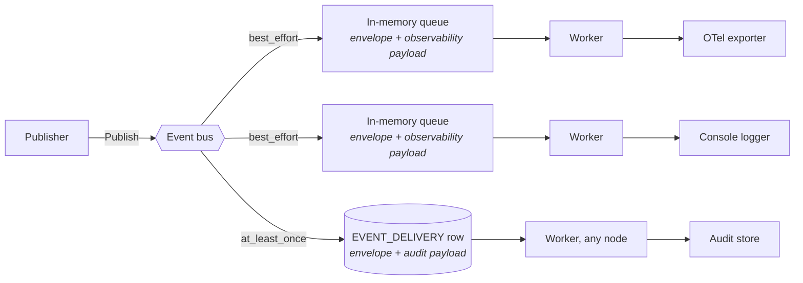
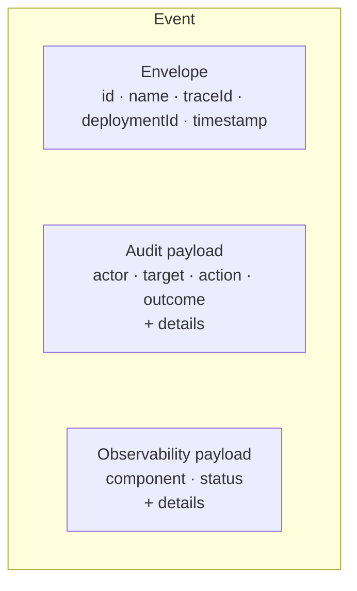
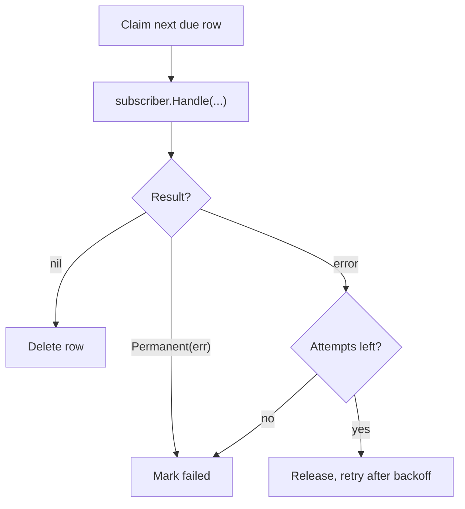

# Generic eventing framework specification

- **Status:** Draft
- **Version:** 0.1
- **Related documents:** [Issue #5588: Make the event delivery pipeline a generic eventing framework](https://github.com/thunder-id/thunderid/issues/5588), [Discussion #5590: Generic eventing framework](https://github.com/thunder-id/thunderid/discussions/5590), [Discussion #5601: Audit logging](https://github.com/thunder-id/thunderid/discussions/5601)

## Summary

ThunderID publishes events through a pipeline built for observability. It has three gaps:

- Nothing records what an event is for.
- Every event has the same shape: a few common fields and a free-form key-value map. Nothing guarantees that the fields a consumer needs are present.
- Every event is held in memory and lost on failure or restart.

Audit, the next feature to publish events, needs all three closed. One fact, such as a user being created, is both an audit record and an observability signal, and the two need different things:

| | Audit | Observability |
|---|---|---|
| Data | Actor, target, action and outcome. Can contain personal data, which must not reach observability sinks. | Component and status. |
| Cost of a lost event | A compliance gap. | None. |

This specification defines the **event bus**, a generic eventing framework in a new package, `internal/system/eventbus`. The design rests on these decisions:

| Decision | Reason |
|---|---|
| An event belongs to one or more **categories**, such as `audit` and `observability`. | One fact is published once. |
| Attaching a category's payload is what puts the event in that category. | An event cannot claim a category without carrying its data. |
| Required payload fields are constructor arguments. | A missing field is a compile error. |
| A subscriber belongs to exactly one category, and receives only the envelope and that category's payload. | Each subscriber has one payload type and one guarantee. Audit data never reaches observability sinks. |
| Each category has one delivery guarantee, `best_effort` or `at_least_once`. The owning feature sets the default, and the deployment can override it. | Deployments may weigh the cost of a lost event differently. |
| `Publish` never runs subscriber code. | A slow or failing subscriber never slows down or breaks a request. |
| An `at_least_once` delivery is a row in a table in the existing `runtime_persistent` database. | No new infrastructure, and any node can deliver any row. |
| `at_least_once` events are recorded **after** the change commits. | A transactional outbox would need a table and a relay in every database that holds changed data. That costs more than it gains. |

The last decision is an accepted trade-off. A crash between the commit and the recording, or an unavailable `runtime_persistent` database, loses the event.

Out of scope, each left for a future specification:

- Moving today's observability publishers and subscribers (console, file and OpenTelemetry) onto the bus, replacing `providers.ObservabilityProvider`, and folding today's `observability.*` categories into one `observability` category.
- The bus in the embedded engine (`pkg/thunderidengine`). The bus is server-only.
- The `audit` category's payload, subscriber and store, and the encryption and erasure of audit data. [#5601](https://github.com/thunder-id/thunderid/discussions/5601) defines these.
- Replaying or expiring permanently failed deliveries.
- A `persist` mode that writes straight to the final store.
- Subscriptions by event name, delivery to external subscribers such as webhooks, and ordered delivery.

## Architecture

### Terms

| Term | Meaning |
|---|---|
| Event | One fact that happened, such as `USER_CREATED`. |
| Category | A purpose an event serves, such as `audit`. Has one payload type and one guarantee. |
| Envelope | The fields every event has: ID, name, trace ID, deployment ID and timestamp. |
| Payload | A category's data for one event. |
| Subscriber | Code that receives the events of one category. |
| Sink | The system a subscriber writes to, such as an audit store. |
| Delivery | One event sent to one subscriber. |
| Worker | The goroutine that runs one subscriber's deliveries on one node. |
| Node | One running ThunderID server. |

### Components



| Component | Owns |
|---|---|
| `internal/system/eventbus` | The event model, the category registry, routing, delivery (queues, the `EVENT_DELIVERY` table and workers) and the worker lifecycle. It owns no category. |
| The feature that defines a category, such as `internal/audit` | The category, its payload type and the payload constructor. |
| The feature that owns a sink | The subscriber, and the decision, from its own configuration, whether to register it. |
| A publishing service | Its event name constants. It depends on `eventbus.Publisher` and on the category packages it uses, never on subscribers. |

### Package interface

The complete exported surface of `eventbus`. Everything else is unexported.

```go
// Categories
type Guarantee string

const (
    BestEffort  Guarantee = "best_effort"
    AtLeastOnce Guarantee = "at_least_once"
)

type Category[P Payload] struct{ /* unexported */ }

func NewCategory[P Payload](name string, defaultGuarantee Guarantee) Category[P]

// Events
type Payload interface {
    EventCategory() string
}

type Envelope struct {
    ID           string    `json:"id"`
    Name         string    `json:"name"`
    TraceID      string    `json:"traceId"`
    DeploymentID string    `json:"deploymentId"`
    Timestamp    time.Time `json:"timestamp"`
}

type Event struct{ /* unexported */ }

func NewEvent(ctx context.Context, name string) *Event
func (e *Event) With(payload Payload) *Event

// Publishing
type Publisher interface {
    Publish(ctx context.Context, event *Event) error
}

// Subscribing
type Subscriber[P Payload] interface {
    Handle(ctx context.Context, envelope Envelope, payload P) error
}

func Subscribe[P Payload](bus *Bus, category Category[P], id string, subscriber Subscriber[P]) error
func Permanent(err error) error

// Bus
type Bus struct{ /* unexported */ }

func Initialize(cfg config.EventingConfig, dbProvider provider.DBProviderInterface, deploymentID string) *Bus
func (b *Bus) Publish(ctx context.Context, event *Event) error
func (b *Bus) Start() error
func (b *Bus) Shutdown(ctx context.Context)

// Errors
var ErrInvalidEvent, ErrShutdown error
```

The package uses the flat backend layout:

| File | Contents |
|---|---|
| `category.go` | `Guarantee`, `Category`, `NewCategory` and the category registry. |
| `event.go` | `Payload`, `Envelope`, `Event`, `NewEvent`, `With` and event validation. |
| `bus.go` | `Bus`, `Initialize`, `Publish`, `Subscribe`, `Start` and `Shutdown`. |
| `subscriber.go` | `Subscriber`, `Permanent` and the per-delivery steps both workers share. |
| `best_effort_worker.go` | The in-memory queue worker. |
| `at_least_once_worker.go` | The claim, retry and fail loop. |
| `store.go`, `store_constants.go` | `EVENT_DELIVERY` queries. |
| `error_constants.go` | `ErrInvalidEvent` and `ErrShutdown`. |

### Server wiring

In `cmd/server/servicemanager.go` and `cmd/server/main.go`:

1. Call `Initialize` after the databases are initialized.
2. Pass the bus to the services that publish (as `eventbus.Publisher`) or subscribe (as `*eventbus.Bus`).
3. Call `Start` after every subscriber has registered.
4. In `gracefulShutdown`, call `Shutdown` with the shutdown context, after the HTTP server shuts down and before the database connections close.

## Detailed design

### Categories

A feature defines its category once, as a package variable:

```go
var Category = eventbus.NewCategory[Payload]("audit", eventbus.AtLeastOnce)
```

- **Name:** lowercase and unique in the process. `NewCategory` panics on a duplicate name.
- **Default guarantee:** set by the owning feature. The deployment can override it (see [Configuration](#configuration)). A change takes effect on restart, and deliveries in flight during the change may be lost:
  - Queued `best_effort` deliveries are dropped at shutdown.
  - `pending` rows of a category switched to `best_effort` are no longer delivered.
- **No sub-categories.** A subscriber that wants only some events of its category filters by event name.

An event in both a `best_effort` and an `at_least_once` category needs no special handling. Each subscriber follows its own category's path.

### Payloads

Each category package defines one payload type and one constructor that takes every required field as an argument:

- **Required fields are unexported**, so the constructor is the only way to build a payload. The type exposes them through getters.
- **The type implements `MarshalJSON` and `UnmarshalJSON`**, because `encoding/json` ignores unexported fields and `at_least_once` payloads are stored.
- **Details:** an optional key-value map for facts specific to one event, such as `reason` on `TOKEN_REVOKED`. It keeps payloads from growing a field for every event. Values must be JSON-serializable. Subscribers receive them as decoded JSON, so numbers arrive as `float64`.
- **Changes must be additive.** A field may be added, but not renamed, retyped or removed, because rows written by one release are read by the next.

### Events



An event is an envelope plus one payload for each of its categories. The publisher builds it like this:

```go
event := eventbus.NewEvent(ctx, "USER_CREATED").
    With(audit.NewPayload(admin, userRef, audit.ActionCreate, audit.OutcomeSuccess)).
    With(observability.NewPayload("user-service", observability.StatusSuccess))

if err := bus.Publish(ctx, event); err != nil {
    logger.Error(ctx, "Failed to publish event", log.Error(err))
}
```

The publisher must not change an event after passing it to `Publish`.

The bus fills in the envelope:

| Field | Value | Set by |
|---|---|---|
| `id` | A UUID v7. | `Publish` |
| `name` | Given by the publisher. | `NewEvent` |
| `traceId` | Read from the context. | `NewEvent` |
| `deploymentId` | The server's deployment ID. | `Publish` |
| `timestamp` | The current time, in UTC. | `NewEvent` |

`Publish` returns `ErrInvalidEvent` and delivers nothing when any of these is true:

- The event has no payload.
- A payload's category is not registered.
- A payload's type is not its category's payload type.
- Two payloads have the same category.
- A payload cannot be serialized.

The whole event is rejected, not only the invalid part, so one fact never reaches some categories and not others.

### Event naming

Event names are `UPPER_SNAKE_CASE`. A name starts with the object and ends with what happened to it, usually a past-tense verb or participle.

| Fact | Name |
|---|---|
| A user was created | `USER_CREATED` |
| A role was assigned | `ROLE_ASSIGNED` |
| A token was issued | `TOKEN_ISSUED` |
| Token issuance failed | `TOKEN_ISSUANCE_FAILED` |
| A flow node needs user input | `FLOW_USER_INPUT_REQUIRED` |

- **Existing names stay.** Every event published today already follows this form, so dashboards and collector filters keep working after the move to the bus.
- **The name describes the fact, not the category.** One name serves every category of the event. The name is also not the audit action. The audit payload's `action` field, such as `user.create` in #5601, is a separate catalogued value.
- **Names are constants** in the publishing package, so a typo is a compile error.

### Publishing

Services depend on `Publisher`, not on `*Bus`, so tests can replace it with a mock.

`Publish` performs these steps and returns:

1. Validate the event (see [Events](#events)).
2. If the bus is shutting down, return `ErrShutdown` when the event has an `at_least_once` category. Otherwise drop the event and return `nil`.
3. Set the envelope's `id` and `deploymentId`.
4. Serialize each payload to JSON once.
5. For each `best_effort` subscriber, offer the delivery to its in-memory queue without blocking. If the queue is full, drop the delivery and log it.
6. For each `at_least_once` subscriber, insert one `EVENT_DELIVERY` row. Insert all of the event's rows in one transaction, so either every subscriber gets a row or none does. Use `context.WithoutCancel(ctx)`, so a client that disconnects after the commit does not lose the event.

Categories with no subscribers are skipped.

`Publish` returns an error only for an invalid event (`ErrInvalidEvent`), a shutdown (`ErrShutdown`), or a failure to set the ID or write the rows. A `best_effort` delivery never blocks and never causes an error.

#### Publish after commit

Publishers call `Publish` after the change the event describes has committed. Events with no persisted change, such as a successful sign-in, follow the same rule.

If `Publish` fails, the change is already committed, so the publisher logs the error and does not fail the request.

This is the accepted loss window. The event is lost for every `at_least_once` subscriber when:

- the node crashes after the commit and before the rows are written, or
- the rows cannot be written, for example because `runtime_persistent` is unavailable.

Recording before the commit would be worse. It could record a change that never happened, and an append-only audit store cannot correct that.

### Subscribing

```go
eventbus.Subscribe(bus, audit.Category, "audit-store", auditStore) // auditStore: Subscriber[audit.Payload]
```

- **Typed handler:** the handler receives its category's payload type, so it cannot read another category's payload.
- **Stable ID:** unique on the bus and unchanged across restarts and releases. `at_least_once` rows store the subscriber ID, and workers on any node use it to find the subscriber.
- **Register before start:** `Subscribe` returns an error for a duplicate ID, or when called after `Start`.
- **A function, not a method,** because Go methods cannot have type parameters.

`Subscribe` stores each subscriber as a non-generic function that decodes the payload JSON into `P` and calls `Handle`. Both workers call that function, so the workers are not generic. Each subscriber therefore receives its own decoded copy of the payload on both paths, and subscribers share no memory.

| The subscriber must | The subscriber can rely on |
|---|---|
| return `nil` (delivered), `Permanent(err)` (failed, do not retry), or any other error (failed, retry if the guarantee allows) | receiving only the envelope and its own category's payload |
| ignore a duplicate delivery of the same event ID (`at_least_once`) | a deadline on `ctx` for each delivery |
| respect `ctx` and return when it is done | a panic being recovered and treated as an error |
| not depend on delivery order | one delivery at a time on each node, so it need not be goroutine-safe |

`Permanent(err)` is for failures that can never succeed, such as a payload the sink rejects. The worker detects it with `errors.As`.

### Workers

Each subscriber has one worker on each node. A worker handles one delivery at a time, so a slow subscriber slows only itself.

For each delivery, the worker:

1. creates a context with a `delivery_timeout` deadline and the envelope's trace ID,
2. calls the subscriber and waits for it to return, and
3. recovers a panic, logs it and treats it as an error.

A handler that respects its context returns an error at the deadline, which is handled like any other error. A handler that ignores its context blocks its worker until it returns. Meanwhile, its claim may expire and another node may deliver the row again.

### Best-effort delivery

Each `best_effort` subscriber has an in-memory queue of up to `best_effort.queue_size` deliveries, on the node that published the event. The worker takes the next delivery and calls the subscriber. A failed delivery, including `Permanent(err)`, is dropped and logged at debug level. Nothing is retried. Queued deliveries are lost if the node stops abruptly.

### At-least-once delivery

Each `at_least_once` delivery is one `EVENT_DELIVERY` row for an (event, subscriber) pair. Any node can deliver any row. Each subscriber retries independently of the others.



The worker loop:

1. **Claim.** Select the subscriber's oldest row that is `pending`, due (`NEXT_ATTEMPT_AT` has passed), and unclaimed or holding an expired claim. Claim it with a conditional update that sets `CLAIMED_BY` and `CLAIM_EXPIRES_AT` and increments `ATTEMPTS`. If the update changed no row, another node won the race, so select again. The conditional update works on PostgreSQL and SQLite without row locks.
2. **Poll.** If no row is due, wait `at_least_once.poll_interval` and go to step 1.
3. **Deliver** the row (see [Workers](#workers)).
4. **Record the result**, with a query conditioned on the worker's own claim:

| Result | Row afterwards |
|---|---|
| `nil` | Deleted. No cleanup job is needed. |
| `Permanent(err)` | `failed`, with the error in `LAST_ERROR`. |
| Any other error, after attempt `n` with attempts left | `pending`, claim released, error in `LAST_ERROR`, `NEXT_ATTEMPT_AT` set `min(max_backoff, initial_backoff × 2^(n−1))` later. |
| Any other error, after attempt `at_least_once.max_attempts` | `failed`, with the error in `LAST_ERROR`. With the defaults, this is about two hours after the first attempt. |

When a row becomes `failed`, the worker logs it at error level with the event ID, event name and subscriber ID.

- **Failed rows** stay in the table and are never claimed again, so no delivery disappears silently.
- **Crash recovery.** A claim expires after `at_least_once.claim_timeout`. If a node stops while holding a row, another node, or the same node after a restart, claims it then. `ATTEMPTS` is incremented at claim time, so a delivery that crashes its node every time still reaches the cap.
- **Duplicates.** A row is delivered again if the handler succeeded but the delete failed, or if the claim expired while the handler was still running. Subscribers deduplicate by event ID.
- **No jitter.** Each worker handles one row at a time, so a recovering sink receives at most one delivery per subscriber per node, however many rows are due. Jitter would not lower that peak.
- **Removed subscribers.** Rows for a subscriber ID that is no longer registered stay in the table.
- **Clocks.** Nodes compare claim and due times written by other nodes, so node clocks must be synchronized. Token expiry already assumes this.

Example: one `USER_CREATED` event goes to two `audit` subscribers, an audit store and a SIEM forwarder.

| Delivery row | Attempt 1 | Next |
|---|---|---|
| `USER_CREATED` → `audit-store` | `nil` | Deleted. |
| `USER_CREATED` → `siem-forwarder` | Timeout | Retried after backoff. |

Only the SIEM forwarder is retried. The audit store never sees a duplicate.

### Lifecycle

- **Start.** `Start` validates the configuration against the registered categories, resolves each category's guarantee, and starts one worker per subscriber. Invalid configuration fails server startup.
- **Shutdown.** After `Shutdown` is called:
  - `Publish` rejects or drops new events (see [Publishing](#publishing)).
  - Workers stop after their current delivery, or at the context deadline.
  - Queued `best_effort` deliveries are dropped.
  - An `at_least_once` row still in hand keeps its claim. The claim expires and the row is retried, so no row is lost.

### Data model

One new table in the `runtime_persistent` database, for PostgreSQL and SQLite. It holds operational state that must survive a restart, which is the purpose of `runtime_persistent`. No existing table changes.

```sql
-- Pending and permanently failed at-least-once deliveries, one row for each (event, subscriber).
-- Delivered rows are deleted. Part of the database.runtime_persistent classification.
CREATE TABLE "EVENT_DELIVERY" (
    DEPLOYMENT_ID VARCHAR(255) NOT NULL,
    ID VARCHAR(36) NOT NULL PRIMARY KEY,
    EVENT_ID VARCHAR(36) NOT NULL,
    SUBSCRIBER_ID VARCHAR(100) NOT NULL,
    ENVELOPE TEXT NOT NULL,
    PAYLOAD TEXT NOT NULL,
    STATUS VARCHAR(10) NOT NULL CHECK (STATUS IN ('pending', 'failed')),
    ATTEMPTS INTEGER NOT NULL DEFAULT 0,
    NEXT_ATTEMPT_AT TIMESTAMP NOT NULL,
    CLAIMED_BY VARCHAR(36),
    CLAIM_EXPIRES_AT TIMESTAMP,
    LAST_ERROR VARCHAR(1024),
    CREATED_AT TIMESTAMP NOT NULL
);

-- Backs each worker's claim query.
CREATE INDEX idx_event_delivery_due
    ON "EVENT_DELIVERY" (DEPLOYMENT_ID, SUBSCRIBER_ID, STATUS, NEXT_ATTEMPT_AT);
```

- `ENVELOPE` and `PAYLOAD` hold JSON. `PAYLOAD` holds only the row's own category's payload.
- `CLAIMED_BY` holds the claiming worker's ID, a UUID generated when the worker starts.
- `LAST_ERROR` is truncated to the column length.
- Every query filters by `DEPLOYMENT_ID`, passed as the last parameter.

### Configuration

A new top-level `eventing` section in `deployment.yaml`. Every setting is deployment-level and optional. The defaults are added to `default.json` and the Helm chart, and the section is documented in the configuration reference.

```yaml
eventing:
  categories:
    audit:
      guarantee: at_least_once
  delivery_timeout: 30s
  best_effort:
    queue_size: 1000
  at_least_once:
    max_attempts: 20
    initial_backoff: 1s
    max_backoff: 10m
    poll_interval: 5s
    claim_timeout: 5m
```

| Key | Default | Validation |
|---|---|---|
| `categories.<name>.guarantee` | The category's own default | `best_effort` or `at_least_once`. `<name>` must be a registered category. |
| `delivery_timeout` | `30s` | Greater than zero. |
| `best_effort.queue_size` | `1000` | At least 1. |
| `at_least_once.max_attempts` | `20` | At least 1. |
| `at_least_once.initial_backoff` | `1s` | Greater than zero. |
| `at_least_once.max_backoff` | `10m` | At least `initial_backoff`. |
| `at_least_once.poll_interval` | `5s` | Greater than zero. |
| `at_least_once.claim_timeout` | `5m` | Greater than `delivery_timeout`, so a claim never expires while its delivery can still run. |

An invalid configuration stops the server at startup, with an error that names the key.

## Requirements

### R1. Categories

**Requirement:** A feature can define a category with a typed payload and a default guarantee. An event can belong to several categories.

**Acceptance criteria:**

- **AC1.1:** Given a category is defined with a name that is already registered, when the package initializes, then it panics.
- **AC1.2:** Given categories `a` (`best_effort`) and `b` (`at_least_once`), each with one subscriber, when an event with payloads for both is published, then the `a` subscriber receives it from its queue and the `b` subscriber receives it from an `EVENT_DELIVERY` row.
- **AC1.3:** Given a category whose default guarantee is `best_effort` and a configuration that sets it to `at_least_once`, when an event in it is published, then an `EVENT_DELIVERY` row is written for its subscriber.

### R2. Event structure and validation

**Requirement:** Every event carries an envelope filled in by the bus and one payload for each of its categories. `Publish` rejects any event that does not.

**Acceptance criteria:**

- **AC2.1:** Given a context with a trace ID, when an event is built and published, then its subscriber receives an envelope with a UUID v7 `id`, the given `name`, that `traceId`, the server's `deploymentId` and a UTC `timestamp`.
- **AC2.2:** Given an event that breaks any validation rule in [Events](#events), when it is published, then `Publish` returns `ErrInvalidEvent` and no subscriber receives anything.
- **AC2.3:** Given a payload with details, when it is delivered on both paths, then both subscribers receive the same decoded details.
- **AC2.4:** Given a payload with required fields, when it is stored in an `EVENT_DELIVERY` row and delivered, then the subscriber receives every required field.

### R3. Payload isolation

**Requirement:** A subscriber receives only the envelope and its own category's payload, on either delivery path.

**Acceptance criteria:**

- **AC3.1:** Given an event with payloads for categories `a` and `b`, when it is delivered, then the `a` subscriber receives only the envelope and the `a` payload, and the `b` subscriber receives only the envelope and the `b` payload.
- **AC3.2:** Given an `at_least_once` category `a` and a `best_effort` category `b`, when an event with both payloads is published, then the `EVENT_DELIVERY` row holds the `a` payload and no data from the `b` payload.

### R4. Asynchronous publishing

**Requirement:** `Publish` never runs subscriber code and never blocks on a `best_effort` subscriber. It fails only when the event is invalid, the bus is shutting down, or `at_least_once` recording fails.

**Acceptance criteria:**

- **AC4.1:** Given a subscriber whose handler blocks, when an event in its category is published, then `Publish` returns without waiting for the handler.
- **AC4.2:** Given a `best_effort` subscriber whose queue is full, when an event in its category is published, then `Publish` returns `nil` and the delivery is dropped.
- **AC4.3:** Given an event with two `at_least_once` subscribers and a database that rejects the insert, when it is published, then `Publish` returns an error and no row is written for either subscriber.
- **AC4.4:** Given a category with no subscribers, when an event in it is published, then `Publish` returns `nil` and records nothing for that category.
- **AC4.5:** Given a context that is cancelled after the change commits, when an event with an `at_least_once` category is published with that context, then its rows are written.

### R5. Subscriptions

**Requirement:** A subscriber subscribes to exactly one category under a stable ID, with a handler typed for that category's payload. It handles one delivery at a time on each node.

**Acceptance criteria:**

- **AC5.1:** Given a subscriber is registered with an ID already on the bus, or after the bus has started, when `Subscribe` is called, then it returns an error and the subscriber is not registered.
- **AC5.2:** Given a subscriber and several events published at once, when they are delivered on one node, then no two of its `Handle` calls overlap.
- **AC5.3:** Given two subscribers in one category, where one handler blocks, when events are published, then the other subscriber still receives them.
- **AC5.4:** Given a handler that panics, when it is called, then the panic is recovered and the delivery is treated as a failed attempt.
- **AC5.5:** Given a handler that runs past `delivery_timeout`, when its context's deadline passes, then the context is cancelled.

### R6. Best-effort delivery

**Requirement:** A `best_effort` delivery is attempted once and dropped on failure.

**Acceptance criteria:**

- **AC6.1:** Given a `best_effort` subscriber whose handler returns an error, when an event is delivered, then the handler is not called again for that event.

### R7. At-least-once delivery

**Requirement:** An `at_least_once` delivery is stored until its subscriber accepts it. It is retried with exponential backoff up to a cap, marked failed at the cap or on a permanent error, and recovered after a node failure.

**Acceptance criteria:**

- **AC7.1:** Given a pending row, when its handler returns `nil`, then the row is deleted.
- **AC7.2:** Given a pending row with attempts left, when its handler returns an error, then the row stays `pending`, its claim is released, `ATTEMPTS` counts the attempt, `LAST_ERROR` holds the error, and `NEXT_ATTEMPT_AT` is `min(max_backoff, initial_backoff × 2^(ATTEMPTS−1))` after the failure.
- **AC7.3:** Given a pending row on its last attempt, when its handler returns an error, then the row is marked `failed` and an error is logged with the event ID, event name and subscriber ID.
- **AC7.4:** Given a pending row with attempts left, when its handler returns `Permanent(err)`, then the row is marked `failed` and an error is logged with the event ID, event name and subscriber ID.
- **AC7.5:** Given a `failed` row, when workers poll, then no worker claims it.
- **AC7.6:** Given an event with two `at_least_once` subscribers, where one succeeds and the other fails, when the failed row is retried, then only the failing subscriber's handler is called again.
- **AC7.7:** Given a row claimed by a worker that stops before finishing, when its claim expires, then another worker claims and delivers it.
- **AC7.8:** Given two workers for the same subscriber on different nodes, when both try to claim the same due row, then exactly one claim succeeds.
- **AC7.9:** Given a pending row that is not yet due, when a worker polls, then it does not claim the row.

### R8. Lifecycle

**Requirement:** Workers start with the server and stop without losing any `at_least_once` delivery.

**Acceptance criteria:**

- **AC8.1:** Given a configuration that breaks any rule in [Configuration](#configuration), when the server starts, then startup fails with an error that names the key.
- **AC8.2:** Given the bus is shutting down, when an event with an `at_least_once` category is published, then `Publish` returns `ErrShutdown` and writes no row.
- **AC8.3:** Given `best_effort` deliveries are queued at shutdown, when the bus shuts down, then they are dropped.
- **AC8.4:** Given `pending` rows exist at shutdown, when the server stops and restarts, then the rows are delivered after the restart.

## Change log

| Version | Date | Change |
|---|---|---|
| 0.1 | 2026-10-11 | Initial specification. |
