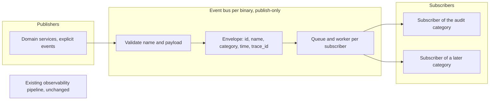

# Eventing Framework Specification

- **Status:** Draft
- **Version:** 0.14
- **Related documents:** design discussion #5590, feature issue #5588, umbrella #5438, audit logs specification (`docs-internals/audit-logs/spec.md`), eventing and audit logs threat model (#6297), delivery plan #6319

## Summary

ThunderID has diagnostic logging through a process-wide `slog` logger, and an observability pipeline that fans every event out to every subscriber with a goroutine per event and no queue. Neither can carry a record that must be kept apart from diagnostics, such as an audit record, or give a publisher a way to emit one fact for several readers.

This specification defines a small internal event bus beside the existing observability pipeline. The governing decision is that one mechanism describes what happened. A fact is published once as one event, and the perspectives (audit now, observability, diagnostics and analytics later) are categories whose payloads attach to that event. A subscriber belongs to exactly one category and sees only the envelope and its own payload. The first and only category is audit, which is specified in the audit logs specification. This document specifies the bus and nothing audit specific.

The design follows four principles, stated in full under Design principles: the bus is internal and is not a general-purpose bus, the product exposes the least surface it can, deployment-level identity belongs to the log collector and not the event, and events are published explicitly by domain services only.

Delivery is best effort. At-least-once delivery, a delivery database, replay, network forwarders and webhooks, retention, any API or UI, and moving the existing observability pipeline or diagnostic logging onto the bus are out of scope (see Open questions).

The existing `ObservabilityProvider` hook, the exported `providers.Event`, its event names, `component` and `status` values, `Data` keys and the `observability.*` configuration are unchanged. An external customer implements that hook, so nothing here removes or reshapes it.

## Implementation status

Status as of 2026-11-13. The audit increments that use the bus are tracked in the audit logs specification.

| Increment | Status | Reference |
|---|---|---|
| Event bus: envelope, categories, per-subscriber queue and worker, `TryPublish`, shutdown | Merged | #6341 |
| First subscriber: the audit category and its stdout sink, wired in the server and Control Plane binaries | Merged | #6475 |
| Public subscription option for an embedding application | Open | #6745 |
| At-least-once delivery | Not started | Open question 1 |

## Architecture



Components, all under `internal/system/eventbus`:

- **The bus.** `Initialize()` returns three interfaces, each held by its own unexported type: a publish-only `EventBusInterface` for services, a `RegistryInterface` for registering subscribers, and a `StopperInterface` for shutdown. It holds the envelope, the event, the typed payload contract, the per-subscriber queue and worker, the typed `Subscribe` function and the free function `TryPublish`.
- **The composition roots.** `cmd/server` and `cmd/cpserver` each build their own bus, inject the publish-only interface through constructors (like `observabilitySvc`), register subscribers, and stop the bus after the HTTP server. The embedded engine (`pkg/thunderidengine`) builds its own bus with no subscriber unless its embedder adds one (see the audit logs specification).

Existing seams used: the request context (trace), and the constructor-injection pattern of `Initialize` functions. The bus is a constructor dependency, never a global or a context value.

The repository already has `internal/system/eventlistener`, a typed hook where the producer calls each listener synchronously and waits for it. It has no queue, no isolation between listeners beyond panic recovery, and no categories, so it fits state-change notifications between services and not an event pipeline. The new bus does not build on it and does not replace it.

## Detailed design

### Design principles

- **The bus is internal and narrow.** It is a mechanism for audit now, and for observability, diagnostics and analytics later. It is not a general-purpose bus: it has no catalog, no delivery strategies, no counters API and no configuration.
- **Least surface.** Configuration keys, JSON field names and event names cannot be removed once released, so the product exposes as little as it can.
- **Deployment identity belongs to the collector.** An event carries no deployment, host, process or binary identifier. The log collector knows which container, pod and cluster a line came from and adds that identity itself, so the event does not duplicate it.
- **Events are published explicitly by domain services only.** No middleware, wrapper or route table derives or publishes events. A middleware pattern would be copied, by people and by AI agents, onto routes where it does not fit, and real cases would be skipped because the pattern appeared to cover them. The access log already records method, path and status for every request. An event says what a service knows: the resource, the real outcome and the reason. This rule binds every later category and increment.

### Event model and envelope

An event is built with a name and one or more payloads and published once:

```go
evt := eventbus.NewEvent(ctx, audit.EventUserCreate).
    With(audit.NewPayload(ctx, createdRef, audit.ActionCreate, audit.OutcomeSucceeded).WithSubject(createdRef))
err := bus.Publish(ctx, evt)
```

Services publish through `eventbus.TryPublish(ctx, bus, evt)`, a free function that calls `Publish` and logs a failed publish. A failed publish never fails the operation the event describes, so the caller has nothing to branch on. The bus stays an explicit argument, and the function carries no category-specific name, so later perspectives publish the same way.

A second perspective is one more `.With(...)` on the same chain. An event belongs to a category if and only if it carries that category's payload.

The bus fills the envelope. Publishers never set these fields:

| Field | Meaning | Value |
|---|---|---|
| `id` | Unique event ID, server generated | UUID v7, so IDs sort by time |
| `name` | The event name | `<resource>.<action>`, lowercase and dotted, with the action a present-tense verb such as `user.create`. The name is the attempted action and never the result, so the outcome says what happened. Two to four segments of lowercase letters, digits and underscores, starting with a letter, at most 64 characters |
| `category` | The category of the payload the subscriber receives | `audit` today |
| `time` | When the event was published | UTC, RFC 3339, fixed six fractional digits (microseconds) |
| `trace_id` | The request correlation ID | Same value as the access log line and the response header, taken from the request context and capped at 128 characters. Empty when the event is published outside a request |

The envelope has no deployment, host, process, binary, sequence or W3C trace context field. A consumer detects a lost event through the collector and the best-effort limits stated below, not through a counter in the event.

The bus assigns `id` and `time` when the event is published, not when it is built, and only when some subscriber exists for the category, so an event nobody receives costs only validation. Publishing the same event value twice produces two IDs. If the event ID cannot be generated, `Publish` returns an error and nothing is queued.

Validation in the bus: the event name grammar, a payload is present, a payload is not nil and not a pointer, and there is one payload per category. A pointer payload is rejected so a subscriber cannot change what another receives. A panic in a payload's `Category()` is recovered and returned as an error, so it never reaches the caller. Payloads are passed by value, and a subscriber must not retain or change shared state it receives, in particular a map, slice or pointer-typed field inside a payload. The bus holds no category knowledge: required fields and the allowlist of events of a category are checked by the category's own package, not by the bus.

`Publish(ctx, evt) error` validates, assigns the envelope, enqueues and returns. It never runs subscriber code and never waits for a subscriber. It returns an error only for the bus rules above. Rules a category enforces do not make `Publish` fail.

### Subscribers

A subscriber registers for one category under a stable ID that does not change across restarts or releases. The typed function `Subscribe[P Payload](registry, id, subscriber)` registers a `Subscriber[P]` for the category of `P`, and a payload of another type that reports the same category fails per event and is logged. Only the composition root holds the registry, so a service given the bus can publish and nothing else. A subscriber's `Handle` returns an error when delivery failed, and its context is cancelled when `Stop` gives up waiting.

### Queues, isolation and failure behaviour

- Each subscriber has its own queue of 1,024 events and one worker, started when the subscriber registers. A bus with no subscriber starts no goroutine. None of these values is configurable.
- A full queue drops the event for that subscriber and logs one warning for that overflow episode. The warning is armed again when the queue drains, so a sustained flood writes one warning and not one per drop. The drop warning is written after the bus lock is released, so logging never delays another publisher.
- A panic or an error in a subscriber is recovered and logged for each occurrence, and the worker continues with the next event. A slow, failing or panicking subscriber never delays or fails the publisher or another subscriber. There is no per-subscriber delivery time limit, so a handler that never returns keeps its own worker and affects only that subscriber.
- Only best-effort handling exists. There is no setting for a stronger guarantee. At-least-once can be added later without changing the publisher or subscriber contract, because `Publish` already returns an error and the single non-blocking send into a subscriber queue is the one place a stronger mode replaces.
- Shutdown is a `StopperInterface` that `Initialize` returns and only the composition root holds, so a holder of the publishing interface can neither register a subscriber nor stop the bus, even by type assertion. `Stop` closes the queues and waits a fixed 5 seconds for the workers. When the wait ends it cancels the context handed to subscribers and logs one warning. A second `Stop` returns at once, even while the first is still waiting. Undelivered best-effort events may be lost. Shutdown runs after the HTTP server stops so the last requests are published.
- A category that is switched off in configuration still has the bus built, so events are validated by the bus rules and dropped, and no worker starts. A service refuses a nil bus.

Reversibility: the bus is additive. With every category switched off, the server returns to exactly its earlier output. Diagnostic logging and the observability pipeline are untouched.

### Configuration

The bus has none. A category may define its own keys, which are specified with the category.

## Requirements

Each requirement lists its status as of 2026-11-13.

### R1. One event, several perspectives

**Requirement:** A publisher can emit one event that belongs to one or more categories, and the event is published once.

**Status:** Built, #6341.

**Acceptance criteria:**

- **AC1.1:** Given an event carrying a payload of two categories, when it is published, then each subscriber of those categories receives it once.
- **AC1.2:** Given an event with no payload, a nil payload or a pointer payload, when it is published, then `Publish` returns an error and nothing is queued.
- **AC1.3:** Given an event with two payloads of the same category, when it is published, then `Publish` returns an error.
- **AC1.4:** Given a name that breaks the grammar (lowercase dotted, two to four segments, at most 64 characters), when the event is published, then `Publish` returns an error.
- **AC1.5:** Given a payload whose `Category()` panics, when the event is built or published, then an error is returned and the caller does not panic.

### R2. The bus fills the envelope

**Requirement:** Every event has an envelope filled in by the bus, and publishers never set it. The envelope carries the id, name, category, time and trace ID only.

**Status:** Built, #6341.

**Acceptance criteria:**

- **AC2.1:** Given a published event, when a subscriber receives it, then it carries `id`, `name`, `category`, `time` and `trace_id`, and no other envelope field.
- **AC2.2:** Given a request context carrying a trace ID longer than 128 characters, when an event is published, then the envelope carries it cut to 128 characters. Given no request, then it is empty.
- **AC2.3:** Given a published event, when a subscriber receives it, then `id` is a UUID v7 and `time` is UTC with microsecond precision.

### R3. Subscribers receive only their own category, and only the bus owner controls them

**Requirement:** A subscriber belongs to one category with a stable ID and receives only the envelope and its own payload. A service given the bus can publish and nothing else.

**Status:** Built, #6341.

**Acceptance criteria:**

- **AC3.1:** Given an event with payloads of two categories, when a subscriber of one receives it, then it has no access to the payload of the other.
- **AC3.2:** Given a subscriber with an empty or duplicate ID, when it is registered, then registration fails.
- **AC3.3:** Given the publish-only interface a service holds, when it is inspected or asserted to another type, then a service can neither register a subscriber nor stop the bus.

### R4. Best-effort handling without blocking

**Requirement:** `Publish` never runs subscriber code or blocks on a subscriber, and a failing subscriber affects nobody else. The bus has no configuration.

**Status:** Built, #6341.

**Acceptance criteria:**

- **AC4.1:** Given a subscriber blocked inside its handler, when events are published, then `Publish` returns without delay and other subscribers still receive them.
- **AC4.2:** Given a full queue of 1,024 events, when events are published, then each is dropped for that subscriber and one warning is logged for the overflow episode, written after the bus lock is released. Given the queue then drains, when it overflows again, then a new warning is logged.
- **AC4.3:** Given a handler that panics or returns an error, when it happens, then it is recovered and logged for each occurrence and the worker handles the next event.
- **AC4.4:** Given `Stop`, when the bus stops, then it closes the queues and waits a fixed 5 seconds, cancels the context handed to subscribers and logs one warning if workers are still running, and a second `Stop` returns at once.
- **AC4.5:** Given a bus with no registered subscriber, when events are published, then no goroutine has been started.

### R5. Events are published explicitly by domain services only

**Requirement:** An event is published by the domain service that knows the resource and the outcome. No middleware, wrapper or route table derives or publishes events.

**Status:** Built, #6341 and every event increment since. A reviewer rejects a change that adds one.

**Acceptance criteria:**

- **AC5.1:** Given a request to a service that publishes no event for it, when the request is handled, then nothing is published for it and the access log line is the only record.
- **AC5.2:** Given a publish that fails, when a service calls `TryPublish`, then one warning is logged without caller-chosen text, and the operation the event describes is not affected.

### R6. Existing observability and diagnostic logging are unchanged

**Requirement:** The existing observability pipeline, its public types and the diagnostic logger behave as before.

**Status:** Built, #6341 and #6475.

**Acceptance criteria:**

- **AC6.1:** Given the existing observability tests, when they run, then they pass unchanged.
- **AC6.2:** Given an event of the audit category, when it is published, then the `ObservabilityProvider` does not receive it.
- **AC6.3:** Given the exported hook, event type, event names, `component` and `status` values, `Data` keys and `observability.*` configuration, when compared with the previous release, then none changed.
- **AC6.4:** Given the existing logger tests, when they run, then they pass unchanged, and no diagnostic or access log line gains a field.

### R7. No cost to the request path

**Requirement:** Publishing adds no blocking I/O to a request.

**Status:** Built, #6341.

**Acceptance criteria:**

- **AC7.1:** Given one subscriber, when `NewEvent` and `Publish` run, then they complete in about a microsecond with no blocking I/O (benchmark recorded).
- **AC7.2:** Given no subscriber for the category, when an event is published, then the cost is validation only and no goroutine runs.

## Open questions

These need a decision before approval. Each states the default this draft assumes.

1. **Which eventing framework specification stands.** Another open specification, #5736 (`docs-internals/eventing-framework/spec.md`), describes the same bus with two delivery guarantees, `best_effort` and `at_least_once`, and a delivery table in the runtime persistent database. This document describes the bus as merged in #6341, which is best effort only with no configuration, and keeps at-least-once as a later change behind the same publisher contract. The two need to become one document, and the audit design #5601 and the eventing design #5590 expect at-least-once for audit once a store exists.
2. **What happens to the existing observability pipeline and diagnostic logging.** This includes the marker value for diagnostic lines and the moving of diagnostics onto the bus. A later increment, decided with the affected customer. Until then neither changes.

## Change log

| Version | Date | Change |
|---|---|---|
| 0.1 | 2026-11-02 | Initial draft from a prototype, the requirements draft and a real stdout sample. |
| 0.2 | 2026-11-03 | Diagnostic logging and its marker removed from this cut, the marker is audit only. Client address is the TCP peer address. Services publish through a shared `TryPublish` helper. The unchanged-diagnostics criterion moved from R5 to R12. |
| 0.3 | 2026-11-03 | `catalogue` renamed to `catalog`, the spelling the linter and the repository use. Envelope assignment time, payload validation, sequence order, and ID, host name and source failures recorded, as implemented in the event bus. The existing `eventlistener` package noted. |
| 0.4 | 2026-11-04 | Review of the event bus: shutdown is a separate closer with its own budget that logs abandoned events, failure warnings are rate limited, timeouts and panics are counted separately, an all-zero trace ID or span ID is invalid, `trace_id` stays empty outside a request, payloads are passed by value, and the subscriber context carries the deployment ID. |
| 0.5 | 2026-11-04 | The actor type is best effort and no token issuance changes in this cut: `sub_type` when the token carries it, `user` otherwise. Open question 2 resolved and removed. |
| 0.6 | 2026-11-05 | A change is written once: the wrapper stays quiet when a service already published an audit event for the request, and still records a request that fails before any service. Added AC9.8 and AC9.9. |
| 0.7 | 2026-11-05 | Event names are the attempted action in the present tense (`user.create`), aligned with the audit design, and the outcome says what happened. A refused call uses the route's event with outcome `denied` and is rate limited. Target IDs are capped at 128 characters and a failed sign-in records no username. Pointer payloads are rejected and payload panics are recovered. The delivery strategy seam and the public counters are removed from this cut. The sequence of each subscriber's category, and the shutdown budget, are clarified. The catalog of this cut is fixed. |
| 0.8 | 2026-11-05 | The 128 character cap covers every ID in the line, and a refused call on an unmapped path is recorded with the target type `unmapped`, as built. |
| 0.9 | 2026-11-05 | Sign-in is audited once per credential check (`user.authenticate`, one name for every entity category, the method in `details`). Added the reason codes (AC10.6) and the known sign-in gaps. |
| 0.10 | 2026-11-05 | Embedders opt in: the engine's bus has no sink unless `WithAuditSink` adds one, so an upgrade changes nothing for an existing embedder and the engine needs no stop method. The shipped binaries keep audit on by default. The `source` value `engine` is added, and AC11.2 (disable the default) is removed. |
| 0.11 | 2026-11-05 | The import routes always record their own event beside the per-user events. Self-service, SCIM, flow provisioning, import and bootstrap user changes are audited through the user service, with an anonymous actor where no caller exists. The service's refusal reason is `forbidden`. Added AC9.11. |
| 0.12 | 2026-11-06 | Simplified to the design as built. The event bus is an internal mechanism with a publish-only interface and no configuration, and the envelope carries only the id, name, category, time and trace ID. Audit configuration is `audit.enabled` alone, with a fixed marker. Audit events are published explicitly by domain services only: the management wrapper, route table, rejection hook, bus catalog, payload validator, delivery configuration, counters, `traceparent` and the deployment and instance fields are removed. The audit package validates against an allowlist and drops what fails. Requirements R1 to R13 are reworked and R14 is added. The user events are the first increment, and the later increments follow the same rules. |
| 0.13 | 2026-11-06 | Application management events added (R15, AC15.1 to AC15.7, as built in #6492) with the application known gaps. The subject is the affected resource and is set on `succeeded` and `denied` only (as built in #6475), and `target.id` on a failed update or delete is the caller's path value, capped and escaped (AC7.9). The actor of a token with an `act` claim is `act.sub` and the token subject goes to `on_behalf_of`. The client middleware, `ClientMiddleware`, is a shared request-context middleware in `internal/system/middleware` and not an audit component, and the audit package only reads the client from the request context (as built in #6475). AC4.5 and AC5.3 renumbered to AC4.6 and AC5.4 so removed numbers are not reused. |
| 0.14 | 2026-11-13 | Split into two specifications. This one keeps the bus, the envelope, subscribers, queues, shutdown and the rules every category follows. Everything audit specific (the payload, the line, the marker, the allowlist, the stdout sink, the embedder option, `audit.enabled`, the events and their requirements) moved to the audit logs specification. Requirements renumbered to R1 to R7: R1 to R4 keep their numbers (old AC4.6 is AC4.5), old R12 is R6, old R13 is R7, and old AC14.1 is AC5.1 (the rest of old R14, and old R5 to R11 and R15, are in the audit logs specification). An implementation status table added, the stale known gaps removed, and the delivery plan #6319 and the competing specification #5736 recorded. |
