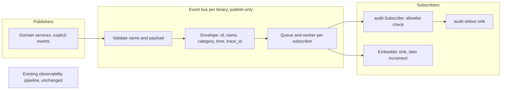

# Eventing Framework and Audit Logs Specification

- **Status:** Draft
- **Version:** 0.13
- **Related documents:** design discussion #5590, feature issue #5588, audit feature #5591, audit design #5601, umbrella #5438

## Summary

ThunderID has no audit log. It has diagnostic logging through a process-wide `slog` logger, and an observability pipeline that fans every event out to every subscriber with a goroutine per event and no queue. Neither can answer "who did what, to what, and was it allowed" in a cloud deployment where stdout is the only place an operator looks.

This specification adds a small internal event bus beside the existing observability pipeline, and the first perspective on it: audit events written to stdout as one JSON line each. The governing decision is that one mechanism describes what happened. A fact is published once as one event, and the perspectives (audit now, observability, diagnostics and analytics later) are categories whose payloads attach to that event. A subscriber belongs to exactly one category and sees only the envelope and its own payload. The first cut ships the audit category, a fixed type marker on each audit line, best-effort handling, and audit events for user and application changes. Diagnostic logging is not touched: it keeps its current output and its lines get no marker.

The design follows four principles, stated in full under Design principles: the bus is internal and is not a general-purpose bus, the product exposes the least surface it can, deployment-level identity belongs to the log collector and not the event, and audit events are published explicitly by domain services only.

Audit works by default in the shipped server and control plane: nobody implements anything to turn it on, and the one setting is `audit.enabled`. An application that embeds the engine gets no audit output until it adds a sink through one small public option in a later increment, so an upgrade never changes what an existing embedder prints.

Out of scope for this cut: at-least-once delivery and any audit database, replay, network forwarders and webhooks, any API or UI, retention and tamper evidence, moving the existing observability pipeline or diagnostic logging onto the bus, any change to diagnostic log lines, and audit events for any management resource other than users and applications (see Known gaps). This cut does not close #5591.

The existing `ObservabilityProvider` hook, the exported `providers.Event`, its event names, `component` and `status` values, `Data` keys and the `observability.*` configuration are unchanged. An external customer implements that hook, so nothing here removes or reshapes it.

## Architecture



Components:

- **`internal/system/eventbus`:** the bus. `Initialize()` returns three interfaces, each held by its own unexported type: a publish-only `EventBusInterface` for services, a `RegistryInterface` for registering subscribers, and a `StopperInterface` for shutdown. Envelope, event, typed payloads, per-subscriber queue and worker, and the free function `TryPublish`.
- **The audit package:** the audit payload, the allowlist of audited events (`auditedEvents`, event name to allowed detail keys), `audit.Subscribe`, actor resolution from the security context, and `audit.NewPayload`, which reads the client address and user agent from the request context.
- **The shared client middleware:** `ClientMiddleware` is a request-context middleware in `internal/system/middleware`, next to the correlation ID and deployment ID middlewares, and it is not an audit component. It records the TCP peer address and the user agent (capped at 256 characters with the shared `utils.TruncateRunes`) on the request context through `internal/system/context` (`WithClient` and `GetClient`, like the trace ID helpers). Forwarded headers are never read, and it makes no audit decision.
- **The stdout sink:** subscriber ID `audit-stdout`. One JSON line per event, standard library only.
- **`cmd/server`, `cmd/cpserver`:** each builds its own bus, injects the publish-only interface through constructors (like `observabilitySvc`), registers the audit subscriber, and stops the bus after the HTTP server. `application.Initialize` takes the publish-only bus like the user service does, and a nil bus is refused. Both binaries publish the user and application events. The embedded engine (`pkg/thunderidengine`) is not changed by the first cut.

Existing seams used: the request context (client, user agent, trace), the security context (actor), and the constructor-injection pattern of `Initialize` functions. The bus is a constructor dependency, never a global or a context value.

The repository already has `internal/system/eventlistener`, a typed hook where the producer calls each listener synchronously and waits for it. It has no queue, no isolation between listeners beyond panic recovery, and no categories, so it fits state-change notifications between services and not an event pipeline. The new bus does not build on it and does not replace it.

## Detailed design

### Design principles

- **The bus is internal and narrow.** It is a mechanism for audit now, and for observability, diagnostics and analytics later. It is not a general-purpose bus: it has no catalog, no delivery strategies, no counters API and no configuration.
- **Least surface.** Configuration keys, JSON field names and event names cannot be removed once released, so the product exposes as little as it can. Audit has one configuration key, a fixed marker, and a closed list of audited events that grows one reviewed entry at a time.
- **Deployment identity belongs to the collector.** The line carries no deployment, host, process or binary identifier. The log collector knows which container, pod and cluster a line came from and adds that identity itself, so the event does not duplicate it.
- **Audit events are published explicitly by domain services only.** No middleware, wrapper or route table derives or publishes audit events. A middleware pattern would be copied, by people and by AI agents, onto routes where it does not fit, and real audit cases would be skipped because the pattern appeared to cover them. The access log already records method, path and status for every request. An audit event says what a service knows: the resource, the real outcome and the reason. This rule binds every later increment, so a new audited resource is added by one explicit event in its service and one reviewed allowlist entry.

### Event model and envelope

An event is built with a name and one or more payloads and published once:

```go
evt := eventbus.NewEvent(ctx, audit.EventUserCreate).
    With(audit.NewPayload(ctx, createdRef, audit.ActionCreate, audit.OutcomeSucceeded).WithSubject(createdRef))
err := bus.Publish(ctx, evt)
```

Services publish through `eventbus.TryPublish(ctx, bus, evt)`, a free function that calls `Publish` and logs a failed publish. A failed publish never fails the operation the event describes, so the caller has nothing to branch on. The bus stays an explicit argument, and the function carries no category-specific name, so later perspectives publish the same way.

A second perspective is one more `.With(...)` on the same chain. An event belongs to a category if and only if it carries that category's payload.

The bus fills the envelope. Publishers never set these fields:

| Field | Meaning | Value |
|---|---|---|
| `id` | Unique event ID, server generated | UUID v7, so IDs sort by time |
| `name` | The event name, written as `event` on the audit line | `<resource>.<action>`, lowercase and dotted, with the action a present-tense verb such as `user.create`. The name is the attempted action and never the result, so the outcome says what happened. Two to four segments, at most 64 characters |
| `category` | The category of the payload the subscriber receives | `audit` for this cut |
| `time` | When the event was published | UTC, RFC 3339, fixed six fractional digits (microseconds) |
| `trace_id` | The request correlation ID | Same value as the access log line and the response header, taken from the request context and capped at 128 characters. Empty when the event is published outside a request |

The envelope has no deployment, host, process, binary, sequence or W3C trace context field. A consumer detects a lost event through the collector and the best-effort limits stated below, not through a counter in the line.

The bus assigns `id` and `time` when the event is published, not when it is built, and only when some subscriber exists for the category, so an event nobody receives costs only validation. Publishing the same event value twice produces two IDs. If the event ID cannot be generated, `Publish` returns an error and nothing is queued.

Validation in the bus: the event name grammar, a payload is present, a payload is not nil and not a pointer, and there is one payload per category. A pointer payload is rejected so a subscriber cannot change what another receives. A panic in a payload's `Category()` is recovered and returned as an error, so it never reaches the caller. Payloads are passed by value, and a subscriber must not retain or change shared state it receives. The bus holds no audit knowledge: required fields, the allowlist of events and the allowlist of detail keys are checked by the audit package, not by the bus.

`Publish(ctx, evt) error` validates, assigns the envelope, enqueues and returns. It never runs subscriber code and never waits for a subscriber. It returns an error only for the bus rules above. Event names and audit detail rules that the audit package enforces do not make `Publish` fail (see Audit validation).

### Queues, isolation and failure behaviour

- Each subscriber has its own queue of 1,024 events and one worker, started when the subscriber registers. A bus with no subscriber starts no goroutine. None of these values is configurable.
- A full queue drops the event for that subscriber and logs one warning for that overflow episode. The warning is armed again when the queue drains, so a sustained flood writes one warning and not one per drop. The drop warning is written after the bus lock is released, so logging never delays another publisher.
- A panic or an error in a subscriber is recovered and logged for each occurrence, and the worker continues with the next event. A slow, failing or panicking subscriber never delays or fails the publisher or another subscriber. There is no per-subscriber delivery time limit, so a handler that never returns keeps its own worker and affects only that subscriber.
- Only best-effort handling exists. There is no setting for a stronger guarantee. At-least-once can be added later without changing the publisher or subscriber contract, because `Publish` already returns an error and the single non-blocking send into a subscriber queue is the one place a stronger mode replaces.
- Shutdown is a `StopperInterface` that `Initialize` returns and only the composition root holds, so a holder of the publishing interface can neither register a subscriber nor stop the bus, even by type assertion. `Stop` closes the queues and waits a fixed 5 seconds for the workers. When the wait ends it cancels the context handed to subscribers and logs one warning. A second `Stop` returns at once, even while the first is still waiting. Undelivered best-effort events may be lost. Shutdown runs after the HTTP server stops so the last requests are published.
- With `audit.enabled: false`, the bus is still built, so events are validated by the bus rules and dropped, and no worker starts. A nil bus is refused by `user.Initialize` and `application.Initialize`.

Reversibility: the bus is additive. Setting `audit.enabled: false` returns the server to exactly today's output. Diagnostic logging is untouched.

### Audit type marker

Every audit line starts with the fixed marker `"log_type":"AUDIT"` as its first field, so a line identified by itself in any file or stream tells what kind of line it is. The sink writes it before the event body. It is a constant of the product and not a setting, and it does not come from the event, so no publisher or caller field can change it. Event values sit in named fields and `details` is a nested object, so none can occupy the top-level marker key. A `log.type.*` key in configuration is rejected at startup.

Diagnostic logging is out of this cut. Its lines keep their current format and carry no marker, and access lines are byte-for-byte unchanged. The value to use for diagnostic lines is decided with diagnostics on the bus in a later increment.

### Audit payload and line schema

An audit line is one JSON object on one line, written in a single write:

```json
{"log_type":"AUDIT","schema_version":1,"id":"01a1abc7-05b7-7620-9cd1-f8fe07860abd","time":"2026-11-05T12:55:09.495689Z","event":"user.create","trace_id":"16b3e5a1-ec78-4319-8f63-70711d4c2e8e","actor":{"type":"user","id":"01900000-0000-7000-8000-000000000030"},"subject":{"type":"user","id":"01a1abc7-0586-775f-949b-94f179f39d05"},"target":{"type":"user","id":"01a1abc7-0586-775f-949b-94f179f39d05"},"action":"create","outcome":{"result":"succeeded"},"client":{"address":"127.0.0.1","user_agent":"Go-http-client/1.1"}}
```

| Field | Required | Notes |
|---|---|---|
| `actor` | yes | `type` is `user`, `application`, `agent`, `system` or `anonymous`. The set is open. `id` is a system-generated UUID, or the fixed ID `management-api-key` for the management API key. Anonymous has no `id`. The `type` is resolved at publish time from the security context: anonymous when there is no caller, `system` for the management API key, `agent` for a token with an `act` claim, otherwise the `sub_type` claim value, otherwise `user`. The `id` is the token subject, except for a token with an `act` claim, where it is the `sub` of the `act` claim (RFC 8693, the party acting) and the token subject goes to `on_behalf_of`. |
| `on_behalf_of` | no | Present only when the token carries an `act` claim. It carries the token subject, the party the actor acts for. |
| `target` | yes | `type` is required and, where one exists, `id`. A failed create has no ID. On a failed update or delete the `id` is the path value the caller sent (see below). |
| `subject` | no | The affected resource. Set when the outcome is `succeeded` or `denied`, because the resource exists when a service refuses. On `failed` the event carries the target only and no subject, because the ID may be an unknown path value and a failed create has no ID. Empty when no resource applies. |
| `action` | yes | A present-tense verb. The event name is `<resource>.<action>`, as in the audit design (#5601), and the `action` field repeats the verb so a consumer can filter without parsing the name. This cut uses `create`, `update`, `delete`. Later increments add `authenticate`, `issue` and `revoke`. |
| `outcome` | yes | `result` is `succeeded`, `denied` (a security decision refused the attempt) or `failed` (allowed but not completed). `reason` is a stable code, required unless succeeded, never free text. |
| `client` | no | The TCP peer address (`RemoteAddr`, the value the access log uses, so a proxy's address behind a proxy) and the user agent, capped at 256 characters. Forwarded headers are not read. |
| `details` | no | Keys from the allowlist of that event name. Never request bodies, credentials, tokens or secrets. |

Every ID in the line (actor, subject, target and on-behalf-of) is capped at 128 characters.

For a failed `update` or `delete` the `target.id` is the path value the caller sent, capped at 128 characters and JSON-escaped, so it can be caller-chosen text and not a generated UUID. It shows which ID was probed, and a consumer must treat `target.id` on a failed event as untrusted text.

Rules for evolution: optional fields can be added within a schema version, and consumers must ignore unknown fields. A field is never renamed or removed within a version.

The actor is resolved at publish time from the security context, and the client address and user agent come from the request context, so a call site does not pass them. `ClientMiddleware`, a shared request-context middleware and not an audit component, records the TCP peer address and the capped user agent only, and makes no audit decision. The audit package only reads the client from the request context. It reads no `traceparent`.

### Audit validation

`audit.Subscribe` wraps the sink. It drops an event, logging the reason and never writing a line, when any of these hold: the event name is not in `auditedEvents`, a detail key is outside the allowlist of that event name, a `denied` or `failed` outcome has no reason, or the target has no type. The check lives in the audit package so the bus stays generic, which also means `Publish` returns no error for these cases. The allowlist is the one reviewable list of what is audited. Adding an audited event is a reviewed change to it.

### Default stdout sink

The sink writes each event as one JSON line in a single `Write` to stdout, whatever the diagnostic level or format. It uses the standard library only and has the fixed marker. A write failure never breaks the publisher.

Line integrity: a line is capped at 4,096 bytes. When an event would exceed it, `details` is truncated first and then the user agent. The guarantee is the pipe atomic write size (POSIX `PIPE_BUF`): 4,096 bytes on Linux and 512 on macOS. The prototype's real audit lines are 527 to 623 bytes, so on macOS they exceed the atomic size. The prototype saw no interleaving in 3,600 concurrent lines, but that is an observation, not a guarantee, so a container runtime on Linux is the supported target.

### Instrumentation

Audit events are published explicitly by domain services, and only by them. The rule has no exception: no HTTP middleware, wrapper, route table, security-layer hook or other mechanism derives or publishes an audit event from a request. Reasons are in Design principles. A reviewer rejects a change that adds one.

The first cut instruments the user service and the application service. The user service publishes `user.create`, `user.update` and `user.delete` for these paths, because they all reach the service:

- management API calls to create, update and delete a user,
- self-service `PUT /users/me`,
- SCIM,
- flow provisioning,
- import, which goes through the user service, and the importer looks the user up before it updates or creates it, so a create is not recorded as a failed update,
- bootstrap.

The application service publishes `application.create`, `application.update` and `application.delete` explicitly. Its public methods wrap private ones, and each public method publishes one event per action. The target type is `application` and the subject is the application. No detail key is allowed for these events, and a client secret, client ID, redirect URI or application name never appears in a line. They are published for these paths, because they all reach the service:

- management API calls to create, update and delete an application, and the same Control Plane routes,
- the MCP tools `create_application` and `update_application`,
- import, where the importer looks the application up before it updates or creates it, so a create is not recorded as a failed update,
- bootstrap,
- dynamic client registration (register, update and delete), in the server binary only,
- organization unit or project moves, recorded as `application.update`.

Both the server and the Control Plane binaries publish them.

Rules:

- An event describing a change is published after the change is committed.
- The event name is the attempted action in the present tense and never the result, so a failed or denied attempt keeps the name and the outcome says what happened: `succeeded`, `denied` with the reason `forbidden`, or `failed` with the reason taken from the service error code.
- An application `denied` outcome is a refusal raised inside the application service, with the reason `forbidden`. In practice that is a system-flow refusal on update and delete, because the access check is in the security layer. A caller without permission gets a 403 and nothing is written (AC14.3). Creating an application can never be denied.
- Bootstrap, flow provisioning and any other path without a caller publish with an anonymous actor.
- A user or application event carries the resource as target, and as subject when the outcome is `succeeded` or `denied`. A `failed` event carries the target only. On a failed update or delete the target ID is the path value the caller sent, capped at 128 characters and JSON-escaped, so it can be caller-chosen text and not a generated UUID. It shows which ID was probed, and a consumer must treat `target.id` on a failed event as untrusted text.
- A request writes the events its services publish and nothing else. A request that no service publishes for writes no audit line, and its method, path and status are in the access log.

Later increments follow the same rules: explicit domain events, no middleware, no new configuration key.

- `client.authenticate`, `token.issue` and `token.revoke` (client authentication and token increment).
- `user.authenticate` (sign-in increment): one event per credential check, so a password then one-time-passcode sign-in writes two, with the method in `details`. It is named `user.authenticate` for every entity category: on a success the actor and target type show whether the entity is a user, an agent or an application, and a failed attempt has no known category. A failed unauthenticated attempt (a failed sign-in, a refused client) still produces an event with an anonymous actor. A failed user sign-in does not record the attempted username, because people paste passwords into username fields, so its target is the user type with no ID. A refused client records the presented client ID as the target. The sign-in publisher sets the actor explicitly and never reads the request's security context, so a bearer token sent to a public endpoint cannot become the actor. Sign-in events will miss some outcomes, which are listed as gaps then: a refusal at grant time (a held account, an interaction required, a magic link claim mismatch), single sign-on reuse where no credential is presented, and an account expiry, which reads as `invalid_credentials`. Machine credentials (client and flow secrets) and recovery-flow proofs are not sign-in and write no event.
- `WithAuditSink(sink)` for embedders (see Embedder extension).

#### Known gaps

These are recorded limitations, not silent omissions.

- Every management resource other than users and applications is not audited yet: groups, roles, flows, variables, organization units, user types, import as an operation, server configuration and the rest. Each is added one service at a time by explicit events in that service.
- User changes that are not covered: direct database edits, declarative and file-backed users, `UpdateUserCredentials` (a password change), and sharing-policy create, update and delete.
- Application changes that are not covered: declarative and file-backed applications, sharing policies, localized variants and translations written through the i18n service, and direct database edits.
- Application secret handling: a client secret regeneration through the administration flow writes no event, and a rotation through an update is recorded only as a plain `application.update`.
- Application event accuracy: a dynamic client registration create is published inside its transaction, so a `succeeded` line can be written for a create that then rolls back. A delete of a missing ID is recorded as `succeeded`, because delete is idempotent by design. Creating an application can never be denied, because the access check is only in the security layer.
- Not recorded at all: calls the security layer refuses with 401 or 403, requests a handler rejects before they reach a service (for example invalid JSON), and sign-in, client and token events until their increments land.
- The stdout sink and a full queue are best effort, so events can be lost.
- `trace_id` comes from a caller-supplied header, capped at 128 characters, and is untrusted.

### Embedder extension

This is a later increment. An application embedding the engine opts in to audit by adding a sink through a public option, without importing an internal package. The public surface is small: a plain struct view of the envelope and audit payload in `pkg/thunderidengine/providers`, one `AuditSink` interface with one method, and one engine option, `WithAuditSink`, that adds a sink. There is no option to disable audit, because audit is on by default only in the shipped binaries. A sink has a stable ID, receives only the envelope and the audit payload, and follows the same queue and drop rules as internal subscribers.

The engine builds its own internal bus with no sink in the client authentication and token increment, because the services it builds take one. With no sink an event is validated and dropped, no worker runs, and the engine prints nothing, so an upgrade does not change an existing embedder's output. The engine needs no stop method: a worker exists only when the embedder passes a sink, and then lives as long as the process. The embedder's own providers, for example its user store, are outside ThunderID, so changes made through them are the embedder's to audit. The bus and audit packages add no sink or OpenTelemetry dependency to the engine. The engine already links the OpenTelemetry SDK through `internal/agent`, so "the engine links no OpenTelemetry SDK" is not a requirement of this change.

`ObservabilityProvider` is not an audit extension point. Audit events never reach it.

### Configuration

| Key | Default | Scope | Validation |
|---|---|---|---|
| `audit.enabled` | `true` in the shipped binaries | Deployment | boolean |

This is the only audit configuration. The strict configuration loader rejects any other `audit.*` key and any `log.type.*` key at startup. A new top-level `audit` key is used instead of a key under `observability`, because the existing `observability.*` configuration belongs to the unchanged pipeline.

## Example output

```text
time=2026-11-05T18:25:09.495+05:30 level=INFO msg="127.0.0.1 - - [05/Nov/2026:18:25:09 +0530] POST /users HTTP/1.1 201 ..." trace_id=16b3e5a1-ec78-4319-8f63-70711d4c2e8e
{"log_type":"AUDIT","schema_version":1,"id":"01a1abc7-05b7-7620-9cd1-f8fe07860abd","time":"2026-11-05T12:55:09.495689Z","event":"user.create","trace_id":"16b3e5a1-ec78-4319-8f63-70711d4c2e8e","actor":{"type":"user","id":"01900000-0000-7000-8000-000000000030"},"subject":{"type":"user","id":"01a1abc7-0586-775f-949b-94f179f39d05"},"target":{"type":"user","id":"01a1abc7-0586-775f-949b-94f179f39d05"},"action":"create","outcome":{"result":"succeeded"},"client":{"address":"127.0.0.1","user_agent":"Go-http-client/1.1"}}
{"log_type":"AUDIT","schema_version":1,"id":"01a1abc7-3c41-7e0a-8b52-2d6a9c1f40e7","time":"2026-11-05T12:58:41.207310Z","event":"user.delete","trace_id":"7d0c2f94-5b1a-4e83-9a6f-3c8e1b2a4d57","actor":{"type":"user","id":"01900000-0000-7000-8000-000000000044"},"subject":{"type":"user","id":"01a1abc7-0912-7b3d-a1c4-5e7f20d98b63"},"target":{"type":"user","id":"01a1abc7-0912-7b3d-a1c4-5e7f20d98b63"},"action":"delete","outcome":{"result":"denied","reason":"forbidden"},"client":{"address":"127.0.0.1","user_agent":"Go-http-client/1.1"}}
```

The first audit line is a real line from a run. The second shows a user manager scoped to one organization unit deleting a user in a sibling organization unit: the event keeps the attempted action `user.delete`, and the outcome says `denied` with the reason `forbidden`. The diagnostic and access lines are unchanged and carry no marker.

What the sample shows, and where each point is addressed in this specification:

| Observation | What it shows | Where addressed |
|---|---|---|
| Every audit line is one JSON line that starts with `"log_type":"AUDIT"`. | An audit line identifies itself in any file or stream. | Audit type marker |
| The audit line shares its `trace_id` with the access log line of the same request. | A reader can join them. | Envelope `trace_id` |
| The event is named `user.create`, and a refused delete keeps the name `user.delete`. | The name is the attempted action and the outcome says what happened. | Instrumentation rules |
| The create line has the new user as both subject and target, with the real ID. | The service knows the ID, so the line names the resource. | Instrumentation |
| The denied line carries the reason `forbidden`. | A refused attempt has a stable reason code. | Audit payload and line schema |
| The `client.address` is the TCP peer address. | A proxy's address appears behind a proxy. | Audit payload and line schema, Open questions |
| The line carries no deployment, host or process field. | Deployment identity belongs to the log collector. | Design principles |

## Requirements

### R1. One event, several perspectives

**Requirement:** A publisher can emit one event that belongs to one or more categories, and the event is published once.

**Acceptance criteria:**

- **AC1.1:** Given an event carrying an audit payload and a second category payload, when it is published, then each subscriber of those categories receives it once.
- **AC1.2:** Given an event with no payload, a nil payload or a pointer payload, when it is published, then `Publish` returns an error and nothing is queued.
- **AC1.3:** Given an event with two payloads of the same category, when it is published, then `Publish` returns an error.
- **AC1.4:** Given a name that breaks the grammar (lowercase dotted, two to four segments, at most 64 characters), when the event is published, then `Publish` returns an error.
- **AC1.5:** Given a payload whose `Category()` panics, when the event is built or published, then an error is returned and the caller does not panic.

### R2. The bus fills the envelope

**Requirement:** Every event has an envelope filled in by the bus, and publishers never set it. The envelope carries the id, name, category, time and trace ID only.

**Acceptance criteria:**

- **AC2.1:** Given a published event, when a subscriber receives it, then it carries `id`, `name`, `category`, `time` and `trace_id`, and no other envelope field.
- **AC2.2:** Given a request context carrying a trace ID longer than 128 characters, when an event is published, then the envelope carries it cut to 128 characters. Given no request, then it is empty.
- **AC2.3:** Given a published event, when a subscriber receives it, then `id` is a UUID v7 and `time` is UTC with microsecond precision.

### R3. Subscribers receive only their own category, and only the bus owner controls them

**Requirement:** A subscriber belongs to one category with a stable ID and receives only the envelope and its own payload. A service given the bus can publish and nothing else.

**Acceptance criteria:**

- **AC3.1:** Given an event with audit and observability payloads, when an audit subscriber receives it, then it has no access to the observability payload.
- **AC3.2:** Given a subscriber with an empty or duplicate ID, when it is registered, then registration fails.
- **AC3.3:** Given the publish-only interface a service holds, when it is inspected or asserted to another type, then a service can neither register a subscriber nor stop the bus.

### R4. Best-effort handling without blocking

**Requirement:** `Publish` never runs subscriber code or blocks on a subscriber, and a failing subscriber affects nobody else. The bus has no configuration.

**Acceptance criteria:**

- **AC4.1:** Given a subscriber blocked inside its handler, when events are published, then `Publish` returns without delay and other subscribers still receive them.
- **AC4.2:** Given a full queue of 1,024 events, when events are published, then each is dropped for that subscriber and one warning is logged for the overflow episode, written after the bus lock is released. Given the queue then drains, when it overflows again, then a new warning is logged.
- **AC4.3:** Given a handler that panics or returns an error, when it happens, then it is recovered and logged for each occurrence and the worker handles the next event.
- **AC4.4:** Given `Stop`, when the bus stops, then it closes the queues and waits a fixed 5 seconds, cancels the context handed to subscribers and logs one warning if workers are still running, and a second `Stop` returns at once.
- **AC4.6:** Given a bus with no registered subscriber, when events are published, then no goroutine has been started.

### R5. Audit type marker

**Requirement:** Every audit line starts with a fixed type marker, so it identifies its own kind.

**Acceptance criteria:**

- **AC5.1:** Given default configuration, when an audit line is written, then its first member is `"log_type":"AUDIT"`.
- **AC5.2:** Given an event whose `details` contains the key `log_type`, when the line is written, then the top-level marker is unchanged.
- **AC5.4:** Given a `log.type.*` key in configuration, when the server starts, then startup fails.

### R6. Audit on stdout by default

**Requirement:** Audit lines are written to stdout with no configuration, in both shipped binaries, and one setting, `audit.enabled`, turns them off. An embedded engine writes audit only when its embedder adds a sink.

**Acceptance criteria:**

- **AC6.1:** Given default configuration, when a covered event happens, then one JSON audit line appears on stdout.
- **AC6.2:** Given `audit.enabled: false`, when a covered event happens, then no audit line appears, no worker runs and the request succeeds.
- **AC6.3:** Given `log.level` set to its most restrictive value, or either log output format, when a covered event happens, then the audit line is still written as a line of its own.
- **AC6.4:** Given a stdout write failure, when an audit line is written, then the publisher is not affected.
- **AC6.5:** Given an embedded engine with no sink option, when a covered event happens, then no audit line is written and the engine works.
- **AC6.6:** Given any `audit.*` key other than `audit.enabled`, when the server starts, then the strict loader rejects it and startup fails.

### R7. Audit line content and validation

**Requirement:** Each audit line carries the marker, schema version, envelope fields, event name, actor, target, action and outcome, and optionally subject, client, on-behalf-of and details. The audit package writes only events that pass its checks.

**Acceptance criteria:**

- **AC7.1:** Given a succeeded event, when it is written, then `outcome.result` is `succeeded` and no reason is required.
- **AC7.2:** Given a `denied` or `failed` outcome without a reason, when it reaches the audit subscriber, then the event is dropped, the drop is logged and no line is written.
- **AC7.3:** Given an event with outcome `succeeded` or `denied`, when it is written, then `subject` carries the affected resource. Given an event with outcome `failed`, then the line carries the target only and no `subject`.
- **AC7.4:** Given an unknown field added in a later version, when an existing consumer parses the line, then the known fields are unchanged.
- **AC7.5:** Given any event, when it is written, then no credential, token, secret or request body appears. Given a detail key outside the allowlist of that event name, then the event is dropped and logged.
- **AC7.6:** Given an event whose line would exceed 4,096 bytes, when it is written, then `details` and then the user agent are truncated and the line stays under the limit.
- **AC7.7:** Given an actor, subject, target or on-behalf-of ID longer than 128 characters, when the line is written, then the ID is cut to 128 characters.
- **AC7.8:** Given an event name that is not in the audit package's allowlist, or an event whose target has no type, when it reaches the audit subscriber, then the event is dropped, the drop is logged and no line is written.
- **AC7.9:** Given a failed update or delete, when the line is written, then `target.id` is the path value the caller sent, capped at 128 characters and JSON-escaped, and a consumer treats it as untrusted text.

### R8. Actor, client and trace from the request context

**Requirement:** The actor is resolved at publish time from the security context, and the client address, user agent and trace come from the request context, so a call site does not pass them.

**Acceptance criteria:**

- **AC8.1:** Given an authenticated request whose token has no `act` claim, when an event is built from its context, then the actor is the token subject, and its type is the `sub_type` claim when the token carries it and `user` otherwise.
- **AC8.2:** Given the management API key, when it authenticates, then the actor is `system` with the fixed ID `management-api-key`.
- **AC8.3:** Given an unauthenticated request, when an event is built, then the actor is `anonymous` with no ID.
- **AC8.4:** Given the same request, when audit and the access log write lines, then they share `trace_id`.
- **AC8.5:** Given a token with an `act` claim, when an event is built, then the actor type is `agent`, the actor id is `act.sub` (the party acting, RFC 8693) and `on_behalf_of` carries the token subject. Given a token without an `act` claim, then `on_behalf_of` is absent.
- **AC8.6:** Given a request, when an event is built, then `client.address` is the TCP peer address and forwarded headers are not read, and `client.user_agent` is capped at 256 characters.

### R9. User change events

**Requirement:** The user service publishes `user.create`, `user.update` and `user.delete` explicitly, for every path that changes a user through the service.

**Acceptance criteria:**

- **AC9.1:** Given a management API call that creates, updates or deletes a user, when the change commits, then one event `user.create`, `user.update` or `user.delete` is written with outcome `succeeded`, the user as target and subject, and the event is published after the commit.
- **AC9.2:** Given a caller who may not change the user, for example a user manager scoped to one organization unit deleting a user in a sibling organization unit, when the call is refused, then the same event name is written with outcome `denied`, the reason `forbidden` and the user as target and subject.
- **AC9.3:** Given a change that is allowed but not completed, when it fails, then the same event name is written with outcome `failed`, the reason taken from the service error code and the target only, with no subject.
- **AC9.4:** Given a user change through self-service `PUT /users/me`, SCIM, flow provisioning, import or bootstrap, when it reaches the user service, then it is recorded like a management call, with an anonymous actor where there is no caller.
- **AC9.5:** Given an import that creates users, when it ends, then the importer has looked each user up before it updates or creates it, and a create is recorded as `user.create` and not as a failed `user.update`.

### R10. Later increments: sign-in, client and token events

**Requirement:** Facts that an HTTP call does not show are published by the service that knows the outcome, as explicit events, with no middleware and no new configuration key. These requirements land with their increments.

**Acceptance criteria:**

- **AC10.1:** Given a credential check during sign-in, when it succeeds, is refused or fails, then one `user.authenticate` event is written for that check with the matching outcome and the method in `details`. A success has the authenticated entity as actor, subject and target. A failure has an anonymous actor and the user type with no ID as target, and the attempted username is not recorded.
- **AC10.2:** Given a token request, when a token is issued or refused, then a token event is written with the grant type and the outcome.
- **AC10.3:** Given a refused client authentication, when the client is not valid, then an event with an anonymous actor, the presented client ID (at most 128 characters) as the target and outcome `denied` is written.
- **AC10.5:** Given every event in the audit allowlist, when its operation succeeds and fails, then the same name is written with different outcomes.
- **AC10.6:** Given a refused credential check, when the reason is known, then the reason is one of `invalid_credentials`, `user_not_found`, `invalid_request`, `ambiguous_user` or `server_error` for a `failed` outcome, and `account_locked`, `account_suspended` or `subject_not_allowed` for a `denied` outcome.

### R11. Customer extension

**Requirement:** An application embedding the engine can add an audit sink through a public option without importing an internal package. This lands in a later increment.

**Acceptance criteria:**

- **AC11.1:** Given a custom sink added through the option, when an audit event is published, then it receives the envelope and the audit payload.
- **AC11.2:** Given a slow custom sink, when events are published, then the publisher is unaffected and no other sink is delayed.
- **AC11.3:** Given an engine with no sink added, when it runs, then it writes no audit line, starts no worker, and works.
- **AC11.4:** Given the public surface, when its imports are listed, then no internal package is imported and the engine links no new sink or OpenTelemetry package because of the bus and audit packages.

### R12. Existing observability and diagnostic logging are unchanged

**Requirement:** The existing observability pipeline, its public types and the diagnostic logger behave as before.

**Acceptance criteria:**

- **AC12.1:** Given the existing observability tests, when they run, then they pass unchanged.
- **AC12.2:** Given an audit event, when it is published, then the `ObservabilityProvider` does not receive it.
- **AC12.3:** Given the exported hook, event type, event names, `component` and `status` values, `Data` keys and `observability.*` configuration, when compared with the previous release, then none changed.
- **AC12.4:** Given the existing logger tests, when they run, then they pass unchanged, and no diagnostic or access log line gains a field.

### R13. No cost to the request path

**Requirement:** Publishing adds no blocking I/O to a request.

**Acceptance criteria:**

- **AC13.1:** Given one subscriber, when `NewEvent` and `Publish` run, then they complete in about a microsecond with no blocking I/O (benchmark recorded).
- **AC13.2:** Given no subscriber for the category, when an event is published, then the cost is validation only and no goroutine runs.

### R14. Audit events are published explicitly by domain services only

**Requirement:** An audit event is published by the domain service that knows the resource and the outcome. No middleware, wrapper or route table derives or publishes audit events.

**Acceptance criteria:**

- **AC14.1:** Given a mutating request to a resource whose service publishes no audit event, when the request is handled, then no audit line is written and the access log line is the only record.
- **AC14.2:** Given `ClientMiddleware`, a shared request-context middleware outside the audit package, when a request passes through it, then it records only the TCP peer address and the capped user agent on the request context and publishes nothing, and the audit package only reads that client from the context.
- **AC14.3:** Given a request refused by the security layer with 401 or 403, or rejected by a handler before it reaches a service, when it ends, then no audit line is written. This is a recorded gap.

### R15. Application change events

**Requirement:** The application service publishes `application.create`, `application.update` and `application.delete` explicitly, for every path that changes an application through the service, from both the server and the Control Plane binaries.

**Acceptance criteria:**

- **AC15.1:** Given a management API call, a Control Plane route, an MCP tool (`create_application`, `update_application`), an import, bootstrap, a dynamic client registration (server binary only) or an organization unit or project move (recorded as `application.update`), when the change commits, then one event `application.create`, `application.update` or `application.delete` is written with outcome `succeeded`, target type `application`, and the application as target and subject.
- **AC15.2:** Given a change that is allowed but not completed, when it fails, then the same event name is written with outcome `failed`, the reason taken from the service error code and the target only, with no subject. For an update or delete the target ID is the path value the caller sent (AC7.9).
- **AC15.3:** Given a refusal raised inside the application service, which in practice is a system-flow refusal on update or delete, when the call is refused, then the same event name is written with outcome `denied`, the reason `forbidden` and the application as target and subject. Given a caller without permission, then the security layer returns 403 and no line is written (AC14.3). Given an application create, then it is never `denied`.
- **AC15.4:** Given any application event, when it is written, then no client secret, client ID, redirect URI or application name appears in the line, and no detail key is allowed, so an application event that carries one is dropped and logged.
- **AC15.5:** Given an import that creates applications, when it ends, then the importer has looked each application up before it updates or creates it, and a create is recorded as `application.create` and not as a failed `application.update`.
- **AC15.6:** Given the server and the Control Plane binaries, when an application is changed through either, then each writes the event, `application.Initialize` takes the publish-only bus, and a nil bus is refused.
- **AC15.7:** Given one application action through a public service method, when it completes, then exactly one event is published for it.

## Open questions

These need a decision before approval. Each states the default this draft assumes.

1. **PII policy.** Until decided, only IDs appear and no body, credential, token or secret is recorded. The policy for names and emails in actor or target is parked.
2. **Where the embedded engine's public sink type lives and its exact shape.** Feasible, not yet built.
3. **Linux as the supported target for line atomicity.** A macOS pipe guarantees only 512 bytes.
4. **Run or task ID for agent actions, and the MCP gate and AuthZEN events.** Not in this cut. The agent behaviour name space (`agent.*`, `token.exchange`, `consent.*`, `authz.*`, `tool.*`) is reserved by the name grammar and needs no renaming later.
5. **Client address behind a proxy.** The address is the TCP peer address, so behind a proxy or load balancer every line carries the proxy's. A trusted-proxy setting that honours a forwarded header is a later decision.
6. **What happens to the existing observability pipeline and diagnostic logging.** Including the marker value for diagnostic lines and the moving of diagnostics onto the bus. A later increment, decided with the affected customer.
7. **To confirm before the client authentication and token increment: the outcome for a refused client (AC10.3).** The text stays as in the earlier draft (`denied`), and whether a refused client is `denied` or `failed` is not decided here.
8. **To confirm before the client authentication and token increment: the actor ID for client actors.** The client ID or the entity UUID. The draft does not decide it.

## Change log

| Version | Date | Change |
|---|---|---|
| 0.1 | 2026-11-02 | Initial draft from a prototype, the requirements draft and a real stdout sample. |
| 0.2 | 2026-11-03 | Diagnostic logging and its marker removed from this cut, the marker is audit only. Client address is the TCP peer address. Services publish through a shared `TryPublish` helper. The unchanged-diagnostics criterion moved from R5 to R12. |
| 0.3 | 2026-11-03 | `catalogue` renamed to `catalog`, the spelling the linter and the repository use. Envelope assignment time, payload validation, sequence order, and ID, host name and source failures recorded, as implemented in the event bus. The existing `eventlistener` package noted. |
| 0.4 | 2026-11-04 | Review of the event bus: shutdown is a separate closer with its own budget that logs abandoned events, failure warnings are rate limited, timeouts and panics are counted separately, an all-zero trace ID or span ID is invalid, `trace_id` stays empty outside a request, payloads are passed by value, and the subscriber context carries the deployment ID. |
| 0.5 | 2026-11-04 | The actor type is best effort and no token issuance changes in this cut: `sub_type` when the token carries it, `user` otherwise. Open question 2 resolved and removed. |
| 0.6 | 2026-11-05 | A change is written once: the wrapper stays quiet when a service already published an audit event for the request, and still records a request that fails before any service. Added AC9.8 and AC9.9. |
| 0.7 | 2026-11-05 | Event names are the attempted action in the present tense (`user.create`), aligned with the audit design, and the outcome says what happened. A refused call uses the route's event with outcome `denied` and is rate limited. Target IDs are capped at 128 characters and a failed sign-in records no username. Pointer payloads are rejected and payload panics are recovered. The delivery strategy seam and the public counters are removed from this cut. The sequence of each subscriber's category, and the shutdown budget, are clarified. The catalog of this cut is fixed. |
| 0.8 | 2026-11-05 | The 128 character cap covers every ID in the line, and a refused call on an unmapped path is recorded with the target type `unmapped`, as built. |
| 0.9 | 2026-11-05 | Sign-in is audited once per credential check (`user.authenticate`, one name for every entity category, the method in `details`). Added the reason codes (AC10.6) and the known sign-in gaps. |
| 0.10 | 2026-11-05 | Embedders opt in: the engine's bus has no sink unless `WithAuditSink` adds one, so an upgrade changes nothing for an existing embedder and the engine needs no stop method. The shipped binaries keep audit on by default. The `source` value `engine` is added, and AC11.2 (disable the default) is removed. |
| 0.11 | 2026-11-05 | The import routes always record their own event beside the per-user events. Self-service, SCIM, flow provisioning, import and bootstrap user changes are audited through the user service, with an anonymous actor where no caller exists. The service's refusal reason is `forbidden`. Added AC9.11. |
| 0.12 | 2026-11-06 | Simplified to the design as built. The event bus is an internal mechanism with a publish-only interface and no configuration, and the envelope carries only the id, name, category, time and trace ID. Audit configuration is `audit.enabled` alone, with a fixed marker. Audit events are published explicitly by domain services only: the management wrapper, route table, rejection hook, bus catalog, payload validator, delivery configuration, counters, `traceparent` and the deployment and instance fields are removed. The audit package validates against an allowlist and drops what fails. Requirements R1 to R13 are reworked and R14 is added. The user events are the first increment, and the later increments follow the same rules. |
| 0.13 | 2026-11-06 | Application management events added (R15, AC15.1 to AC15.7, as built in #6492) with the application known gaps. The subject is the affected resource and is set on `succeeded` and `denied` only (as built in #6475), and `target.id` on a failed update or delete is the caller's path value, capped and escaped (AC7.9). The actor of a token with an `act` claim is `act.sub` and the token subject goes to `on_behalf_of`. The client middleware, `ClientMiddleware`, is a shared request-context middleware in `internal/system/middleware` and not an audit component, and the audit package only reads the client from the request context (as built in #6475). AC4.5 and AC5.3 renumbered to AC4.6 and AC5.4 so removed numbers are not reused. |
