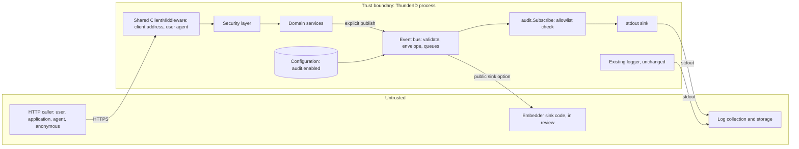
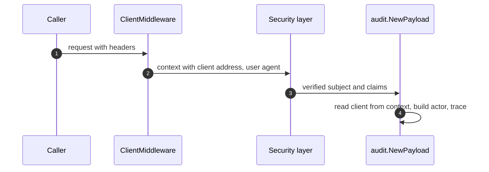
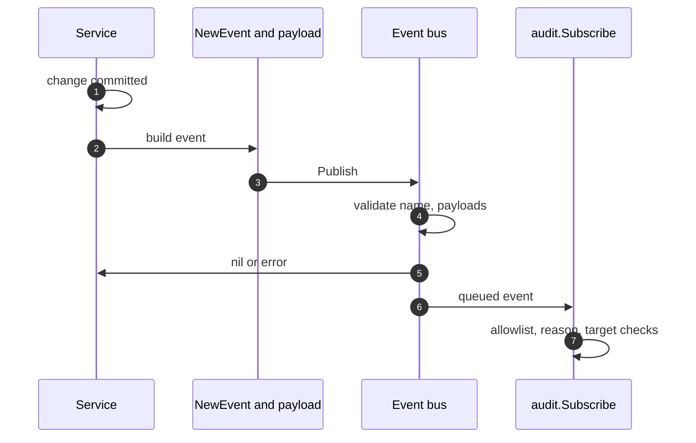
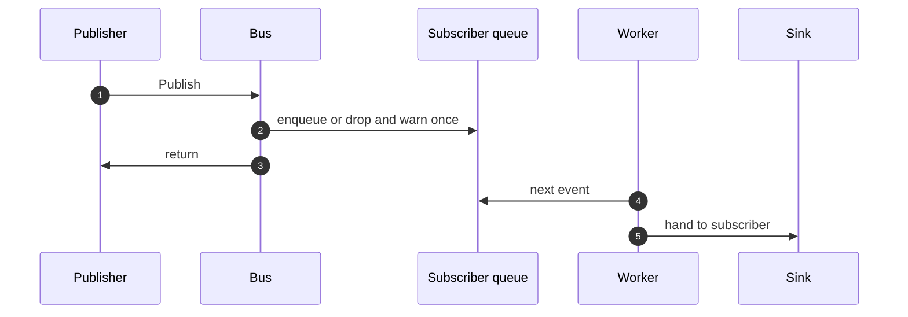
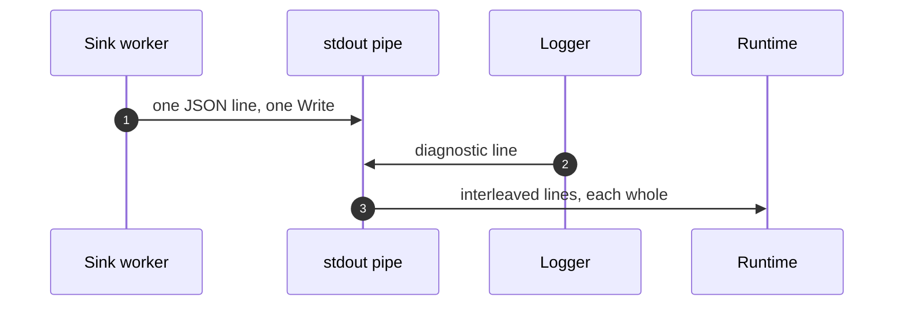
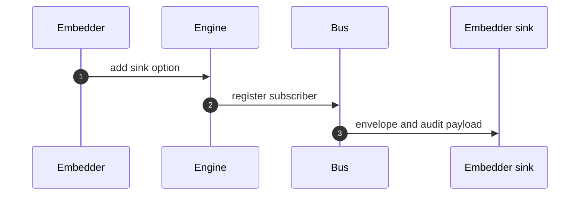
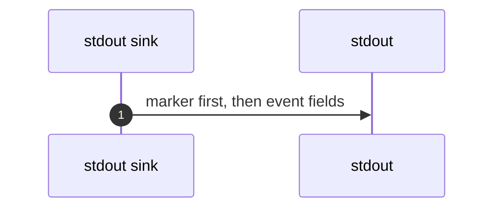
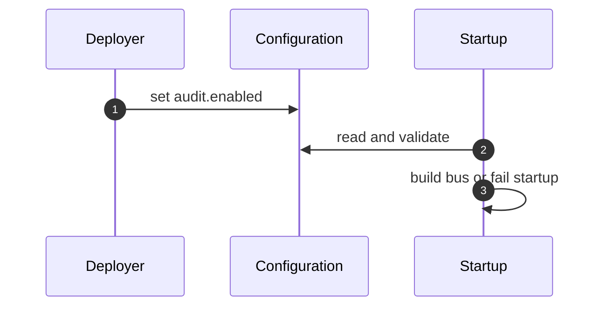
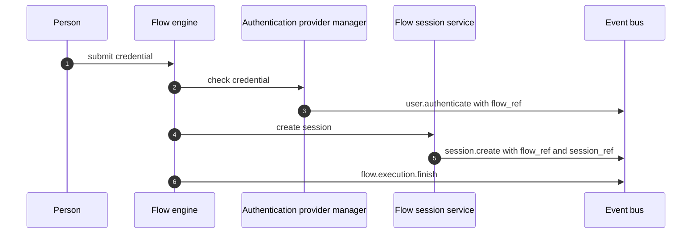
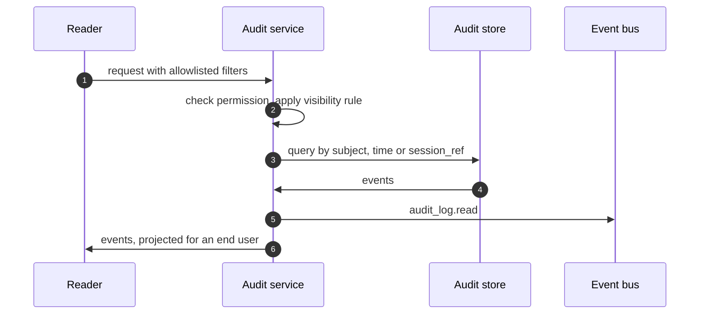

# Eventing Framework and Audit Logs Threat Model

This model covers the eventing framework (`docs-internals/eventing/spec.md`) and its first perspective, the audit logs (`docs-internals/audit-logs/spec.md`), in ThunderID: audit events published explicitly by domain services for management changes and for client and token events (merged or in review), the internal event bus and its per-subscriber queues, the default stdout sink, the fixed type marker on each audit line, the public embedder sink option (in review in #6745), the `audit.enabled` configuration, and the runtime events with their record context and read-side views, which are specified and not built.

## Overview

Audit events are the record an operator or investigator relies on to answer who did what, to what, and whether it was allowed. In a cloud deployment stdout is the only place that record exists, so the integrity, completeness and confidentiality of that stream is the security property this feature adds. Events are published by domain services on the request path, queued in memory, and written as one JSON line each by a sink. An embedder will be able to add a sink of its own in a later increment, which means third-party code will receive audit data.

The security-relevant behaviour is best effort. An event can be dropped when a queue is full, when a sink fails, or when the process stops. The line carries no sequence number, so a consumer cannot detect a lost event from the stream alone. The stream is not tamper-evident and has no retention. Coverage is also partial by design: only audit events that a domain service publishes explicitly exist. Management events exist for the resources listed in the audit logs specification (77 events merged and 43 in review), and the runtime events (sign-in, sessions, recovery, consent decision, flow outcome) are specified and not built. These limits are recorded as residual risks, not hidden.

The design removes mechanisms on purpose. No middleware, wrapper or route table derives audit events from requests, because such a pattern would be copied, by people and by AI agents, onto cases it does not fit and real audit cases would be skipped. The access log already records method, path and status. The line carries no deployment, host or process identity, because the log collector adds it.

Cross-cutting concerns covered elsewhere: authentication and token validation in the security layer (the actor is read from its result), the management API permission model, TLS termination, the container runtime's log collection and retention, and the existing observability pipeline. These are trust inputs here, not re-analysed.

## Scope

This model covers:

- Publishing events explicitly from domain services: the management services, the client authentication and token services, and, when they land, the runtime publishers (sign-in, sessions, verification, recovery, consent, flow outcome).
- Deriving the actor, client address, user agent and trace ID from the request.
- The event bus: name and payload validation, envelope, queues, workers, drop, panic and shutdown behaviour, and the separation of publish, register and stop.
- The audit package's allowlist checks and the default stdout sink and line format.
- The planned public engine option for an embedder's audit sink.
- The fixed type marker on audit lines.
- The `audit.enabled` configuration and the rejection of any other `audit.*` or `log.type.*` key.
- The runtime events and their record context (`application`, `ou`, `flow_ref`, `session_ref`), and the administrator and end-user views of the log as the specification requires them (Interactions 08 and 09). The views are designed and not built.

Out of scope (see the referenced companion models):

- Authentication, session and token security. Owned by the security layer and token models. The actor type is read from the verified token.
- Collection, forwarding, storage, retention and access control of stdout by the container runtime or log platform, and the deployment identity the collector attaches. Owned by the operator. See the residual risks.
- The existing observability pipeline and the `ObservabilityProvider` hook. Unchanged by this cut.
- Durable audit storage, tamper evidence, query APIs and Console views. A later increment. Interaction 09 records what the specification requires of them, and their own threats are analysed with that increment.
- Detection of unusual behaviour. ThunderID emits facts, the operator builds detection.

## Architecture

### Components

| Component | Task |
| --- | --- |
| `ClientMiddleware` (shared middleware package, not an audit component) | Records the TCP peer address, only when it is a public address, and the capped user agent on the request context through the shared context helpers. The audit package only reads the client from the context. It makes no audit decision and publishes nothing. Caller-supplied values are untrusted data. |
| Security layer | Authenticates the request and exposes the verified subject. It publishes nothing. |
| Domain services | Publish explicit events for the facts they know (management changes, client and token events, and later the runtime events), after the change commits. The only publishers of audit events. |
| Event bus | Validates the name and payload, fills the envelope, and hands each event to every subscriber of its categories through a bounded queue. Never runs subscriber code on the publisher. Services hold a publish-only interface, and only the composition root holds the registry and the stopper. |
| audit.Subscribe | Wraps the sink and drops an event whose name or detail keys are not on the allowlist, or that lacks a reason on a refusal or failure, or a target type. |
| stdout sink | Writes one JSON line per event in a single write. Caps the line size. |
| Embedder sink | Third-party code registered through a public option (in review in #6745). Receives the envelope and the audit payload only. |
| Existing logger | Writes diagnostic lines to the same stdout. Unchanged by this cut, so its lines carry no marker. |

### Actors

#### Actors

| Actor | Description | Roles or permissions |
| --- | --- | --- |
| Anonymous caller | Calls public endpoints or sends unauthenticated requests. Controls request headers, paths and bodies. | None |
| Authenticated user, application, agent | Calls management or protocol endpoints. Controls the same inputs within its permissions. | Per token |
| Administrator | Changes configuration and management resources. | Management permissions |
| Deployer or operator | Sets `audit.enabled`, owns the container runtime and the log platform. | Host and configuration access |
| Embedder | Builds the engine into its own application and may supply a sink. | Code in the process |
| End user | Reads the events about their own account through the activity endpoint, once it exists. | Own events only |
| Investigator or consumer | Reads the audit stream downstream. | Log platform access |

#### Entitlement matrix

| Actor | Cause an audit event | Read the audit stream | Change audit configuration | Suppress an audit event |
| --- | --- | --- | --- | --- |
| Anonymous caller | [Yes], through changes made without a caller, through refused client authentication, and later through failed sign-ins | [No] | [No] | [No] |
| Authenticated caller | [Yes] | [No] | [No] | [No] |
| Administrator | [Yes] | [No] today. With the audit read permission, once the endpoint exists | [No] through the API | [No] |
| End user | [Yes], by their own actions and by being the subject of an administrator's action | Own events only, once the endpoint exists | [No] | [No] |
| Deployer or operator | [Yes] | [Yes] | [Yes] | [Yes], by turning audit off or filtering the stream |
| Embedder | [No] | [Yes], receives events once it adds a sink | [Yes], in code | [Yes], by not adding a sink |

### External Dependencies (not owned)

| Dependency | Description (usage, purpose, authentication, authorization, security) |
| --- | --- |
| Container runtime and log platform | Captures stdout, and owns transport, storage, access control and retention of the stream, and the deployment, host and process identity attached to each line. ThunderID cannot enforce any of these. |
| Security layer | Source of the verified actor. A wrong actor classification here becomes a wrong audit line. |
| Operating system pipe | Provides the atomic write size (4,096 bytes on Linux, 512 on macOS) that keeps lines from interleaving. |
| Embedder code | Runs in the same process as the engine. It is trusted code, not a sandbox. |

## Threats and mitigations

### Out-of-scope interactions and risks

- Tampering with or deleting the stream after it leaves the process. Owned by the operator's log platform and the later tamper-evidence increment.
- Retention, access control and legal hold for audit data. Owned by the operator.
- Compromise of the host or container, which can rewrite stdout or the binary. Owned by the deployment model.
- Behaviour of the existing observability pipeline. Unchanged and covered by its own model.

### Interactions

#### 01: Deriving the actor and client from the request

**Description**

`ClientMiddleware`, a shared request-context middleware that sits beside the correlation ID and deployment ID middlewares and is not part of the audit package, records the TCP peer address, only when it is a public address, and the capped user agent on the request context and makes no audit decision. A private or loopback peer, such as a proxy, records no client. `audit.NewPayload` only reads the client from that context. The actor is resolved at publish time from the verified security context: no subject is anonymous, the management API key is a `system` actor with the ID `management-api-key`, a token with an `act` claim is an `agent` whose ID is `act.sub` (the party acting, RFC 8693) with the token subject in `on_behalf_of`, and otherwise the `sub_type` claim value, or `user`, gives the type. The request correlation ID becomes `trace_id`, capped at 128 characters. No W3C trace context is read. An OAuth endpoint authenticates a client and not a token, so its publisher sets the actor explicitly, by the ID of the application or agent entity, and a bearer token sent to the endpoint cannot become the actor.

**Assets involved**

| Initiator | Intermediate | Target |
| --- | --- | --- |
| HTTP caller | `ClientMiddleware`, security layer | Audit payload actor, client and trace fields |

**Data flow**

**Security considerations**

| Area | Response | Comments |
| --- | --- | --- |
| Data confidentiality | [C-Medium] | Client address and user agent are personal data in some jurisdictions |
| Communication medium | [M-IN] | In process |
| Transport security | [TLS] | On the inbound request |
| Authentication | The security layer's verified result | The actor is never read from a header or body |
| Accessibility | [Internal] | |
| Authorization and Access Control | N/A | Derivation only |

**Threat assessment**

| ID | Category | Threat | Materializable | Mitigation / comment |
| --- | --- | --- | --- | --- |
| 1 | [Spoofing] | A caller sets forwarded or identity headers so the audit line names another client address or actor | [No] | The actor comes only from the verified token. The client address is the TCP peer address (`RemoteAddr`), recorded only when it is public. The audit client path reads no `X-Forwarded-For`, `X-Real-IP` or `Forwarded` header, so a caller cannot set the address through a header |
| 1a | [Operational Risk] | Behind a proxy or load balancer the peer is a private address, so the line records no client, while sessions and the access log use the address resolved through `server.trusted_proxies`. An investigator has to know which address to rely on | [Yes] | Accepted. Recording the proxy as the client was removed in #6580 because it misled. One client address rule for audit, sessions and the access log is asked in #6775, and honouring a forwarded header needs an explicit trusted-proxy setting, because trusting it by default would let any caller spoof the address. Residual |
| 2 | [Spoofing] | A token without a `sub_type` claim is classified as a user, so an application that signed in without the claim is recorded as a user | [Yes] | The claim is emitted on client credentials tokens only, for clients that opted in. This cut changes no token. The specification states that the type is best effort, and the `id` is the verified token subject (or `act.sub` for a token with an `act` claim), so an investigator can still identify the caller. Residual |
| 3 | [Tampering] | A caller supplies a correlation ID to make its events join another request's trace, or to hide | [Yes], bounded | The value is untrusted data capped at 128 characters. The server-generated event `id` never comes from the caller, and the line is not keyed by the caller's value. The residual is that a consumer must not trust `trace_id` for security decisions |
| 4 | [Information Disclosure] | A long or hostile user agent bloats the line or carries markup or personal data | [Yes], bounded | The user agent is capped at 256 characters and is JSON-encoded by the sink. It is recorded as data only |
| 5 | [Repudiation] | A call with no `ClientMiddleware` installed records an empty client and no one notices | [Yes] | The middleware is installed in both binaries and a test asserts the order. A background caller records an anonymous actor by design. Recorded as an operational risk |
| 6 | [Spoofing] | A caller presents an `act` claim to be recorded as another acting party, or to attach another subject as `on_behalf_of` | [No] | The actor ID and `on_behalf_of` are read only from the verified token in the security context, never from a header or body. The claim is trusted exactly as far as the security layer's token validation, which is a trust input here. An investigator reads `on_behalf_of` as the token subject, not as proof of delegation beyond what the issuer asserted |

#### 02: Publishing explicit events from domain services

**Description**

Services build `eventbus.NewEvent(ctx, name).With(audit.NewPayload(...))` and publish through an injected publish-only bus after the change commits. Management services publish for the resources listed in the audit logs specification (users, applications, agents, roles and groups, flows and server configuration, connections and resource servers, organization units and projects, sharing policies, credential updates, import and export, and others), and the OAuth services publish `client.authenticate`, `token.issue` and `token.revoke`. A change reaches a service by the management API, the Control Plane routes, the MCP tools, import, bootstrap, flow provisioning, SCIM, self-service and dynamic client registration, and is recorded there. The event name is the attempted action, and the outcome is `succeeded`, `denied` (reason `forbidden` for a refusal raised inside the service, or the OAuth error code) or `failed` (reason from the service error code, or `item_failed` for a partial result). The subject is the affected resource, or the identity a record is kept for, and is set on `succeeded` and `denied` only, so a `failed` event carries the target only. The runtime events, specified and not built, follow the same rule. Nothing else publishes audit events: there is no middleware, wrapper, route table or security-layer hook.

**Assets involved**

| Initiator | Intermediate | Target |
| --- | --- | --- |
| Service code | Event builder | Event bus |

**Data flow**

**Security considerations**

| Area | Response | Comments |
| --- | --- | --- |
| Data confidentiality | [C-Medium] | Identifiers of users and applications |
| Communication medium | [M-IN] | |
| Transport security | N/A | In process |
| Authentication | N/A | |
| Accessibility | [Internal] | |
| Authorization and Access Control | N/A | |

**Threat assessment**

| ID | Category | Threat | Materializable | Mitigation / comment |
| --- | --- | --- | --- | --- |
| 1 | [Repudiation] | A publisher omits an event, so a change is unaudited | [Yes] | The allowlist in the audit package is the review reference and each audited event is tested for success and failure. A missed call site cannot be detected by the bus. Coverage is a review and test concern. Recorded as a residual |
| 2 | [Repudiation] | A middleware or wrapper pattern is added later and copied (by people or AI agents) onto routes where it does not fit, so real audit cases are skipped because the pattern appeared to cover them | [No], by design | The specification makes explicit publication by domain services the rule and forbids deriving events from requests. The access log covers method, path and status. Review rejects any change that adds a derivation mechanism. Recorded as a residual because the rule is enforced by review, not by the bus |
| 3 | [Repudiation] | A failed publish error is ignored, so the event is silently lost | [No] | Services publish through the `TryPublish` function, which logs a failed publish and never fails the operation. Best-effort drops are logged |
| 4 | [Information Disclosure] | A publisher puts a credential, token, secret or free-text error message in `details` or the reason | [No] | The reason is a stable code, `details` keys are an allowlist per event name and an event with another key is dropped and logged, and tests assert the absence of tokens and secrets. Free-text messages are never recorded |
| 5 | [Tampering] | An event is published with a wrong name or payload to fake a category or an audited fact | [No] | The category comes only from the payloads attached. The audit subscriber drops a name that is not on the allowlist and an event without a target type. Only domain services hold the publishing interface |
| 6 | [Denial of Service] | A caller drives many events to fill a queue and push out later events | [Yes], bounded | Each subscriber has a bounded queue. A full queue drops the new event and logs one warning per overflow episode, so memory is bounded and the loss is visible in the diagnostic log. Rate limiting is the responsibility of the endpoint. Recorded as a residual |
| 7 | [Repudiation] | An event is published before the change commits and the change then fails, so the record claims something that did not happen | [No] | A change event is published after the commit, and a failed change is recorded with outcome `failed` |
| 8 | [Repudiation] | A call the security layer refuses (401, 403), or a request a handler rejects before it reaches a service, leaves no audit event, so probing is invisible | [Yes] | The rejection hook that earlier drafts used is removed with the middleware pattern. These requests appear in the access log with method, path and status, and the audit subscriber sees only what a service publishes. A refusal inside the user service (for example a user manager acting outside the allowed organization unit) is recorded as `denied`. For applications the access check is in the security layer, so a caller without permission gets a 403 and nothing is written, and only a system-flow refusal on update or delete inside the service is `denied`. Residual |
| 9 | [Repudiation] | A change made outside the services, or through a service that does not publish yet, leaves no audit event | [Yes] | Direct database edits, declarative and file-backed resources, localized variants and translations written through the i18n service, and any management resource whose service has no audit event yet are not audited. Each is added by an explicit event in its service, and the open pull requests listed in the audit logs specification add more. A client secret regeneration is recorded as `application.update`, with no detail that tells it apart from another update. Residual |
| 10 | [Information Disclosure] | A failed sign-in records the attempted username, which can be a password pasted into the wrong field (later increment) | [No] | The attempted username is never recorded. A failed check names the account it resolved to by internal ID only, and none when the identifier resolves to no user or to more than one (Interaction 08). A refused client records the presented client ID. Every ID in the line is cut to 128 characters |
| 11 | [Repudiation] | A sign-in refusal at grant time, or a sign-in by single sign-on reuse, leaves no event (later increment) | [Yes], bounded | Events are written per credential check, so credential failures and holds are recorded. Grant-time refusals and single sign-on reuse are listed as gaps. Residual |
| 12 | [Spoofing] | A bearer token sent to a public sign-in endpoint puts that token's subject into the actor of the sign-in event (later increment) | [No] | The sign-in publisher sets the actor explicitly: anonymous on a failure, and the authenticated entity on a success. It never reads the request's security context |
| 13 | [Repudiation] | An import records a user or application create as a failed update, so the record misstates what happened | [No] | The importer looks the user or application up before it updates or creates it, so the service receives the right operation |
| 14 | [Tampering] | A caller probes IDs on a failed update or delete and the caller-chosen path value in `target.id` forges a second line, breaks the JSON or bloats the line | [Yes], bounded | On a failed update or delete the `target.id` is the path value the caller sent, so it can be caller-chosen text and not a generated UUID. It shows which ID was probed, which is the intent. The line cannot be broken because it is JSON and the encoder escapes the value, and the cap of 128 characters bounds its size. A consumer must treat `target.id` on a failed event as untrusted text and never as a trusted identifier. A failed event carries no subject, so an unknown path value is never presented as the affected resource. Residual |
| 15 | [Information Disclosure] | An application event records a client secret, client ID, redirect URI or application name | [No] | Application events allow no detail keys, so an event that carries one is dropped and logged. The target and subject are the application's generated ID only, and tests assert that no secret or identifying client data appears in a line |
| 16 | [Repudiation] | A dynamic client registration create is published inside its transaction, so a `succeeded` line is written for a create that then rolls back | [Yes], bounded | Recorded as a known gap and residual. The line can precede a rollback in that one path |
| 17 | [Repudiation] | A delete of a missing application ID is recorded as `succeeded`, so the line claims a deletion that did not happen | [Yes], bounded | Delete is idempotent by design, so the service reports success. The access log and the absence of the application beforehand distinguish it. Residual |

#### 03: Handling through the bus and queues

**Description**

`Publish` validates the name and payloads, assigns the id and time, and enqueues the event for each subscriber of its categories. Each subscriber has a bounded queue of 1,024 and one worker started when it registers, so a bus with no subscriber starts no goroutine. A full queue drops the event and logs one warning per overflow episode, written after the bus lock is released. A panic or error in a subscriber is recovered and logged per occurrence. `Stop` closes the queues, waits a fixed 5 seconds, then cancels the context handed to subscribers and logs one warning. Nothing about this is configurable. The bus is a publish-only interface for services, with registration and stopping held by separate types.

**Assets involved**

| Initiator | Intermediate | Target |
| --- | --- | --- |
| Publisher | Bus, queue, worker | Subscriber |

**Data flow**

**Security considerations**

| Area | Response | Comments |
| --- | --- | --- |
| Data confidentiality | [C-Medium] | Events sit in process memory until written |
| Communication medium | [M-IN] | |
| Transport security | N/A | |
| Authentication | N/A | |
| Accessibility | [Internal] | |
| Authorization and Access Control | Subscriber sees only the envelope and its own payload. A publisher cannot register a subscriber or stop the bus | |

**Threat assessment**

| ID | Category | Threat | Materializable | Mitigation / comment |
| --- | --- | --- | --- | --- |
| 1 | [Repudiation] | Events are dropped under load or at shutdown and an investigation finds a hole | [Yes] | Best-effort by design in this cut. The line has no sequence number, so the consumer cannot see a gap in the stream, and the only record of a drop is one warning per overflow episode in the diagnostic log. At-least-once is a later increment. Recorded as a residual and stated in the documentation |
| 2 | [Repudiation] | An attacker deliberately fills the queue to hide a following action | [Yes], bounded | The attacker needs enough request volume to fill 1,024 entries faster than the sink drains them. The overflow is logged once per episode. Residual |
| 3 | [Denial of Service] | A slow or stuck subscriber blocks request handling or other subscribers | [No] | `Publish` never runs subscriber code or waits. Each subscriber has its own queue and worker. There is no time limit on a handler, so a handler that never returns keeps its own worker, which affects only that subscriber |
| 4 | [Denial of Service] | A panic in a subscriber crashes the process | [No] | A panic is recovered and logged, and the worker continues |
| 5 | [Denial of Service] | Memory grows without bound under a flood | [No] | Queues are bounded. The drop warning is logged once per overflow episode and re-armed when the queue drains, so a flood does not flood the log |
| 6 | [Denial of Service] | The drop warning is written while the bus lock is held, so a slow logger stalls every publisher | [No] | The warning is written after the lock is released |
| 7 | [Information Disclosure] | A subscriber of one category reads another category's payload | [No] | A subscriber receives only the envelope and its own payload, and tests assert it |
| 8 | [Tampering] | A publisher or caller sets the event id or time to hide or reorder an event | [No] | Both are assigned by the bus at publish time. The envelope carries no sequence or process identifier a caller could target |
| 9 | [Denial of Service] | A service stops the bus, or registers a subscriber to read every event, and silences or copies audit | [No] | `Initialize` returns three interfaces, each held by its own unexported type. A service holds the publish-only interface, so it cannot register a subscriber or stop the bus, not even by type assertion. Only the composition root holds the registry and the stopper |
| 10 | [Tampering] | A subscriber changes an event another subscriber receives | [No] | Payloads are passed by value and a pointer payload is rejected |
| 11 | [Repudiation] | Events queued at shutdown are lost | [Yes], bounded | `Stop` waits a fixed 5 seconds, then cancels the context handed to subscribers and logs one warning. Shutdown runs after the HTTP server stops so the last requests are published. Best-effort loss is a residual |

#### 04: Writing the audit line to stdout

**Description**

The default sink, subscriber `audit-stdout`, writes each event as one JSON line with a single `Write` call, whatever the diagnostic level or format, and caps the line at 4,096 bytes: details are dropped largest first, then the user agent is cut, then every free-form field is capped at 256 bytes, and a line that is still too long is not written. The container runtime captures stdout. Diagnostic lines from the logger share the same stream.

**Assets involved**

| Initiator | Intermediate | Target |
| --- | --- | --- |
| Sink worker | Process stdout pipe | Container runtime and log platform |

**Data flow**

**Security considerations**

| Area | Response | Comments |
| --- | --- | --- |
| Data confidentiality | [C-High] | The stream names who did what and from where |
| Communication medium | [M-FS] | Process stdout, captured by the runtime |
| Transport security | [Not Encrypted] | Inside the host. Protection in transit and at rest is the operator's |
| Authentication | N/A | |
| Accessibility | [Restricted] | Whoever can read container logs |
| Authorization and Access Control | Owned by the operator's platform | |

**Threat assessment**

| ID | Category | Threat | Materializable | Mitigation / comment |
| --- | --- | --- | --- | --- |
| 1 | [Tampering] | Attacker-controlled text in a field forges a second audit line or breaks the JSON | [No] | Fields are encoded by the JSON encoder, so newlines and quotes are escaped, and each event is exactly one line |
| 2 | [Spoofing] | A diagnostic message containing audit-looking text is read by a consumer as an audit line | [No] | Diagnostic lines are unchanged and carry no marker. The logger quotes a message, so embedded audit-looking text is escaped. Consumers should treat only lines that parse as JSON and start with the marker as audit lines, and not search for a substring |
| 3 | [Tampering] | Two writers interleave bytes and corrupt a line | [Yes], bounded | Safe up to the pipe's atomic write size: 4,096 bytes on Linux, 512 on macOS. Lines are capped at 4,096 bytes and written in one call. The prototype's real lines (527 to 623 bytes) exceed the macOS limit, so Linux is the supported target. The prototype saw no interleaving in 3,600 concurrent lines, which is an observation and not a guarantee. Residual |
| 4 | [Information Disclosure] | Personal data (client address, user agent, user IDs) is retained or exposed by the log platform | [Yes] | IDs are system-generated UUIDs and no names, emails, credentials or bodies are recorded. Address and user agent remain personal data under some regimes. The PII policy is an open question and retention is the operator's. Residual |
| 5 | [Repudiation] | Audit lines are lost because the runtime rotates or drops stdout, or the collector is down | [Yes] | Outside ThunderID's control. Documentation tells operators to collect stdout reliably. Residual |
| 6 | [Tampering] | The stream is edited or deleted after it leaves the process | [Yes] | Not tamper-evident in this cut. The event ID lets a consumer correlate lines but not detect forgery or gaps. Owned by the operator and the later increment. Residual |
| 7 | [Denial of Service] | stdout blocks because the reader stalls, and the sink worker stops | [Yes], bounded | The sink has its own worker and queue, so the publisher is never blocked. The queue fills and events drop with one warning per overflow episode. A write failure never panics and never fails the publisher |
| 8 | [Information Disclosure] | Audit lines are mixed into diagnostic output and shown to people who may see only diagnostics | [No] | Audit lines carry the marker and diagnostic lines do not, so an operator can route audit lines by it. Separation of access is the operator's |
| 9 | [Repudiation] | Lines from several instances or deployments reach one stream and cannot be told apart, because the line carries no deployment, host or process identifier | [Yes] | Deployment identity belongs to the log collector, which knows the container, pod and cluster and adds them. An operator who collects without that metadata cannot attribute lines to an instance. Documentation states it. Residual |

#### 05: The embedder sink (in review in #6745)

**Description**

An application embedding the engine registers a sink through a public option, `WithAuditSink`, in review in #6745. The option can be passed more than once, a nil sink is refused when the engine is built, and each sink has a stable ID and its own copy of the details. The sink receives the envelope and the audit payload as a plain struct view, with its own queue and worker. No sink is registered unless the embedder passes one, so an embedder gets no audit output by default, and there is no option to disable audit. The engine builds an internal bus with no sink unless the embedder passes one, which already holds for the client authentication and token events.

**Assets involved**

| Initiator | Intermediate | Target |
| --- | --- | --- |
| Embedder | Public option, bus | Embedder sink code |

**Data flow**

**Security considerations**

| Area | Response | Comments |
| --- | --- | --- |
| Data confidentiality | [C-High] | The sink receives every audit event |
| Communication medium | [M-IN] | Same process |
| Transport security | N/A | The sink decides where it sends data |
| Authentication | Code in the process is trusted | |
| Accessibility | [Internal] | |
| Authorization and Access Control | Chosen by the embedder at build time | |

**Threat assessment**

| ID | Category | Threat | Materializable | Mitigation / comment |
| --- | --- | --- | --- | --- |
| 1 | [Information Disclosure] | A sink forwards audit data to an insecure destination | [Yes] | The embedder owns the sink and its transport. The documentation states that the sink receives personal identifiers. Residual |
| 2 | [Repudiation] | An embedder adds no sink, or a sink that drops events, so there is no audit | [Yes] | A deliberate choice by the party who owns the deployment. An embedded engine writes no audit unless a sink is added, which is documented. Residual |
| 3 | [Denial of Service] | A slow or panicking sink degrades the engine | [No] | Own queue and worker, recovered panics, drops logged. Other subscribers and the publisher are unaffected |
| 4 | [Elevation of Privilege] | A sink reads another category's data or mutates the event | [No] | It receives only the envelope and the audit payload, by value, and payloads are passed by value, so a sink cannot change what another receives. Tests assert it |
| 5 | [Security Risk] | Audit events reach the existing `ObservabilityProvider`, exposing them to a customer who only expected observability data | [No] | Audit events never go to the existing provider, and a test asserts it. The provider's events and shape are unchanged |
| 6 | [Security Risk] | The new public surface becomes a compatibility burden or leaks internals | [No] | The public surface is the envelope view, the audit view, one interface and one option. Internal generics stay internal, and a test asserts the public package imports no internal package |

#### 06: The audit type marker

**Description**

The stdout sink writes the fixed marker `"log_type":"AUDIT"` as the first member of every audit line, so a line identifies its own kind in any file or stream. The marker is a constant of the product, not configuration and not part of the event. Diagnostic lines are unchanged and carry no marker in this cut. A `log.type.*` key in configuration is rejected at startup.

**Assets involved**

| Initiator | Intermediate | Target |
| --- | --- | --- |
| Sink | Stdout sink | Audit line |

**Data flow**

**Security considerations**

| Area | Response | Comments |
| --- | --- | --- |
| Data confidentiality | [C-Low] | A constant string |
| Communication medium | [M-FS] | |
| Transport security | N/A | |
| Authentication | N/A | |
| Accessibility | [Internal] | |
| Authorization and Access Control | N/A | |

**Threat assessment**

| ID | Category | Threat | Materializable | Mitigation / comment |
| --- | --- | --- | --- | --- |
| 1 | [Spoofing] | A publisher or request-controlled value sets the marker key, so a line claims another type | [No] | The marker is written by the sink before the event body. Event values sit in named fields and `details` is a nested object, so none can occupy the top-level marker key. A test asserts it |
| 2 | [Spoofing] | A diagnostic line is taken for an audit line, or the reverse | [Yes], bounded | Diagnostic lines carry no marker in this cut, so an audit line is identified by its marker and a diagnostic line by its absence. Consumers should parse JSON and check the marker. Residual |
| 3 | [Operational Risk] | A misconfigured marker hides lines from a filter | [No] | The marker is not configurable, and a `log.type.*` key fails startup, so a collector filter on it stays valid |

#### 07: Configuration of audit

**Description**

`audit.enabled` is the only audit key, a deployment-level boolean in the server configuration. It is on by default in the shipped binaries. The strict configuration loader rejects any other `audit.*` key and any `log.type.*` key at startup. With `audit.enabled: false` the bus is still built, events are validated by the bus rules and dropped, and no worker starts.

**Assets involved**

| Initiator | Intermediate | Target |
| --- | --- | --- |
| Deployer | Configuration file or environment | Bus and sink behaviour |

**Data flow**

**Security considerations**

| Area | Response | Comments |
| --- | --- | --- |
| Data confidentiality | [C-Low] | |
| Communication medium | [M-FS] | |
| Transport security | N/A | |
| Authentication | Host access | |
| Accessibility | [Restricted] | |
| Authorization and Access Control | Operator | Not changeable through the management API |

**Threat assessment**

| ID | Category | Threat | Materializable | Mitigation / comment |
| --- | --- | --- | --- | --- |
| 1 | [Repudiation] | Audit is turned off and the change is not recorded | [Yes] | The setting is deployment configuration owned by the operator. The server writes one diagnostic line at startup stating whether audit is on. Residual |
| 2 | [Security Risk] | An unsafe value or an unknown key weakens or breaks audit | [No] | The only setting is a boolean. The strict loader rejects any other `audit.*` or `log.type.*` key, so queue sizes and similar knobs cannot be set |
| 3 | [Security Risk] | An insecure default | [No] | Audit is on by default in the shipped binaries and nobody implements anything to enable it |

#### 08: Runtime events and the record context (specified, not built)

**Description**

The runtime events record what a person or a client does through the running system. The authentication provider manager publishes `user.authenticate` for each credential check and the account link event, the flow session service publishes `session.create`, `session.reuse` and `session.end`, the identity governance service publishes the account lifecycle events (in review in #6619, with an anonymous actor for a lock formed by failed sign-ins and for a recovery unlock), attribute verification and the user service publish the verification and credential removal events, the consent service publishes the consent record events (`consent.create` and `consent.update`, in review in #6693), and the flow engine publishes `flow.execution.finish`. The record gains `application`, `ou`, `session_ref` and `flow_ref`. A failed credential check names the account it resolved to as subject, by internal ID, so the event appears in that account's own log, and never records what the person typed. `flow_ref` joins the requests of one login and `session_ref` joins the events of one session, where the trace ID cannot, and each is an identifier distinct from the handle the client presents or a keyed hash of it. The steps of a flow stay in diagnostics.

**Assets involved**

| Initiator | Intermediate | Target |
| --- | --- | --- |
| Person, client or administrator | Authentication provider manager, flow session service, flow engine, governance service, consent executor | Audit payload and its record context |

**Data flow**

**Security considerations**

| Area | Response | Comments |
| --- | --- | --- |
| Data confidentiality | [C-High] | Sign-in history, account state and the application a person uses |
| Communication medium | [M-IN] | |
| Transport security | N/A | In process |
| Authentication | The publisher sets the actor explicitly | A bearer token sent to a public endpoint is never the actor |
| Accessibility | [Internal] | |
| Authorization and Access Control | Applied on the read side (Interaction 09) | Nothing is filtered at write time |

**Threat assessment**

| ID | Category | Threat | Materializable | Mitigation / comment |
| --- | --- | --- | --- | --- |
| 1 | [Information Disclosure] | A failed sign-in records the attempted username, which can be a password pasted into the wrong field | [No] | The text the person typed never appears in a line. The subject is the internal ID of the resolved account, and when the identifier resolves to no user or to more than one the event has no subject and the target is the user type with no ID |
| 2 | [Denial of Service] | A caller types another person's identifier repeatedly so failed attempts fill that person's own log and bury a real event | [Yes], bounded | The count of failed checks that reach the check is bounded by the account lockout, and the administrator view filters by event and outcome. The account owner sees the attempts, which is the intent. Naming the account needs a security review (open question 2). Residual |
| 3 | [Spoofing] | A bearer token sent to a public sign-in endpoint becomes the actor of the sign-in event | [No] | The publisher sets the actor explicitly, anonymous on a failure and the authenticated entity on a success, and never reads the security context of the request |
| 4 | [Elevation of Privilege] | A reader of the log uses `flow_ref` or `session_ref` to act as the person, or to resume a login or a session | [No], by design | A line carries no session ID, flow execution ID or token. A reference is an identifier that is distinct from the handle the client presents, or a keyed hash of the handle, so a copy of a line gives no access. Residual: which of the two applies to each is confirmed in the first increment (open question 7), and a keyed hash needs a key managed like the other server secrets, because an unkeyed hash of a guessable handle can be reversed. A test must show that a reference cannot be presented as a handle |
| 5 | [Tampering] | The display name of an application or a target, copied into the record, carries markup, a newline or hostile text | [Yes], bounded | Names are capped at 128 characters and JSON-escaped, and a consumer treats them as untrusted text. The Console renders them as text |
| 6 | [Information Disclosure] | A verification event reveals which attributes a person holds | [Yes], bounded | Only attribute names are recorded, never values, and the allowlist of detail keys rejects anything else. The names are visible to the administrator and to the person only. Residual |
| 7 | [Information Disclosure] | A credential event narrows an attacker's guesses by naming the kind of credential | [No] | The merged credential events record no credential, hash or type. Recording the kind needs a decision (open question 14) |
| 8 | [Repudiation] | After diagnostics expire, an investigator cannot tell which node of a flow failed, because the steps are not audit | [Yes] | Accepted by design. The audit record keeps the outcome, the people involved and the references that join it to the diagnostic events while they exist. Stated in the specification |
| 9 | [Repudiation] | An expired session leaves no event | [Yes] | Expiry is found only when a session is presented, and the idle deadline slides, so it cannot be derived from `session.create`. Whether it needs an event is open question 17. A restarted or replayed flow and a successful client authentication stay in diagnostics by decision, the latter because of the volume. Residual |
| 10 | [Repudiation] | An automatic lock or a recovery unlock has an anonymous actor, so the record does not say who caused it | [Yes], bounded | The subject names the account, the trace ID links to the request, and the lock records the method. Whether to name `system` or the user is open question 15. Residual |
| 11 | [Information Disclosure] | A `denied` reason such as `account_locked` or `account_suspended` reveals account state to someone who should not know it | [No] | The reason appears only in the audit read views, which need the audit read permission, or to the person for their own account as a category. The sign-in response a caller sees is unchanged |
| 12 | [Denial of Service] | A failing publisher blocks or changes a sign-in, a token request or a consent decision | [No] | `TryPublish` never fails the operation. A full queue drops the event with one warning. The response is the same as with audit off |

#### 09: Reading the audit log: administrator and end-user views (designed in #5601, not built)

**Description**

The audit store of #5601 will serve two endpoints. `GET /audit-events` needs the audit read permission, accepts allowlisted filters only (and the new `sessionRef` and `flowRef`), and never accepts a free-form query. `GET /users/me/activity` returns the events whose subject is the caller and no other, through an end-user projection. Which reader sees which events is decided on the read side from the stored subject, the organization unit and the event name, and nothing is filtered at write time. Each read of the audit log is itself recorded as `audit_log.read` with the filter names and never their values. This interaction records what the specification requires of the store and the endpoints. Their own threat analysis belongs to the increment that builds them.

**Assets involved**

| Initiator | Intermediate | Target |
| --- | --- | --- |
| Administrator, compliance officer or end user | Audit service, audit store | Stored audit events |

**Data flow**

**Security considerations**

| Area | Response | Comments |
| --- | --- | --- |
| Data confidentiality | [C-High] | Everyone's activity and the client address and user agent of each event |
| Communication medium | [M-IN] | The store is in the runtime persistent database |
| Transport security | [TLS] | On the API |
| Authentication | Bearer token through the security layer | |
| Accessibility | [Restricted] | The audit read permission, or the caller's own events |
| Authorization and Access Control | Permission for the administrator view, subject equals caller for the end-user view | Organization unit scoping is open question 5 |

**Threat assessment**

| ID | Category | Threat | Materializable | Mitigation / comment |
| --- | --- | --- | --- | --- |
| 1 | [Elevation of Privilege] | An end user reads another person's events, or an event where they were only the actor on someone else's resource | [No], by requirement | The endpoint returns only events whose stored subject is the caller, and no request parameter selects the subject (R22) |
| 2 | [Information Disclosure] | The end-user view discloses an administrator's ID or name, an internal reason code, the trace ID, a reference, a target ID or the organization unit | [No], by requirement | The projection shows "an administrator" or "the system", a reason category, and none of the internal fields (R22) |
| 3 | [Information Disclosure] | A caller without the permission reads the log, or a free-form filter reaches beyond the allowed fields | [No], by requirement | The permission is checked first, filters are an allowlist, and a refused read is recorded as `audit_log.read` with the outcome `denied` (R23) |
| 4 | [Repudiation] | An administrator reads the log and nothing records it | [No], by requirement | Each read writes `audit_log.read` with the filter names and never their values |
| 5 | [Elevation of Privilege] | An administrator scoped to an organization unit reads events outside their subtree | [Yes] until decided | Open question 5. The specification records the organization unit on every event so the scope can be applied, and deployment-wide events are visible to the platform administrator and the compliance officer only. Residual |
| 6 | [Tampering] | A filter value or a stored text becomes part of a query | [No], by requirement | Filters are an allowlist, queries are parameterized, and stored text is JSON-escaped data |
| 7 | [Information Disclosure] | One deployment reads another deployment's events | [No], by requirement | Every table has `DEPLOYMENT_ID` in its primary key and every query filters by it |
| 8 | [Denial of Service] | A broad query over the store degrades the runtime database | [Yes], bounded | Access paths are required on the subject within a time range and on the session reference within a time range, and results are paged. Residual until the store is built |
| 9 | [Information Disclosure] | The store keeps personal data for longer than allowed, and an immutable record conflicts with a request to erase it | [Yes] | The PII policy and retention are decided with the store (open question 10). Residual |

## Security Review Checklist

A review aid that complements the threat models and the self-assessment. Guidance follows the [OWASP Top 10 Proactive Controls](https://top10proactive.owasp.org/).

### Security considerations

| # | Consideration | State | Comments |
| --- | --- | --- | --- |
| 1 | Are all inputs and outputs validated (syntactic and semantic)? | [Yes] | Event names against a grammar, payloads in the bus, event names, detail keys, outcome reasons and target types against the audit allowlist, configuration at startup (unknown keys rejected). Caller headers are treated as untrusted data and capped |
| 2 | Are rate limits in place where necessary? | [N/A] | The feature adds no endpoint. Bounded queues cap memory under a flood |
| 3 | Are permissions, roles, and entitlements defined on the principle of least privilege and business need? | [Yes] | A subscriber sees only the envelope and its own payload. The sink option is code-level |
| 4 | Are authentication and authorization validated at both the UI and API layers, front end and back end, before granting access to resources? | [N/A] | No new endpoint or UI |
| 5 | Are proper isolations in place between components to ensure least-privilege access and reduce the blast radius against lateral movement? | [Yes] | Per-subscriber queue and worker, recovered panics, no shared mutable event, and a publish-only interface for services |
| 6 | Have any default credentials been changed, and are default superuser or root accounts not in use (when using third-party components)? | [N/A] | No third-party component |
| 7 | Has the implementation followed best-practice guidelines (OWASP, Kubernetes, vendor, or technology provider)? | [Yes] | OWASP logging guidance: structured lines, no secrets, one event per line, a timestamp, an actor and an outcome |
| 8 | Are secrets, credentials, and internal-only material kept out of the public source tree and its git history? | [Yes] | |
| 9 | Was a security-focused code review conducted for this change, and have the findings been addressed? | [No] | Pending, at the implementation increments |
| 10 | Is Static Analysis (SAST) or IaC scanning conducted, and are findings addressed? | [Yes] | The repository's existing pipeline |
| 11 | Is Software Composition Analysis (SCA) conducted or integrated into the repository, and are findings addressed (for example FOSSA, Trivy)? | [Yes] | No new dependency is added |
| 12 | Is Dynamic (DAST) or API scanning conducted on a non-production setup, and are findings addressed? | [N/A] | No new endpoint |
| 13 | Are audit logs generated in a standardized format for critical functionality, and available to authorized users to trace critical events and aid incident response? Note the retention period in Comments. | [Partial] | One JSON line per event with a versioned schema, for management changes and for client and token events across the resources in the audit logs specification. Runtime events are specified and not built. Availability and retention belong to the operator's log platform. ThunderID stores nothing yet |
| 14 | Do audit logs for critical configuration changes record the difference between the old and new versions? | [No] | Not in this cut. A later increment, tracked as a residual |
| 15 | Are data in transit and at rest encrypted? | [N/A] | The process writes to stdout. Encryption in transit and at rest is the operator's |
| 16 | Are sensitive values such as credentials and keys stored in a secret store or vault? | [N/A] | No credentials are handled |
| 17 | Is personal, sensitive, or confidential data kept out of logs? | [Partial] | Only system-generated IDs, the client address (public peers only) and a capped user agent are recorded, and display names are planned for the runtime record. No emails, credentials, tokens or bodies. The PII policy is an open question |
| 18 | Have users been given clear instructions for secure usage? | [Yes] | Documentation lands in a follow-up PR: best-effort limit, collecting stdout reliably, personal data in lines |

### Business impact and resilience

| # | Consideration | State | Comments |
| --- | --- | --- | --- |
| 1 | Has a business impact analysis been done to identify resilience requirements (maximum tolerable downtime, uptime, RPO, RTO)? | [N/A] | Left to the deployer |

Resilience details to record:

- **High availability:** each node writes its own stream and nodes need no coordination. A node failure loses that node's undelivered events.
- **Disaster recovery:** none provided. Events are not stored by ThunderID.
- **Backups and retention:** none. The operator's log platform owns retention.
- **Health checks:** none added. A drop writes one diagnostic warning per overflow episode, and a subscriber panic or error is logged per occurrence.
- **User banners:** none.

### Dependency and component health

| # | Consideration | State | Comments |
| --- | --- | --- | --- |
| 1 | Are dependencies, base images, and runtimes monitored for known vulnerabilities and kept current (for example automated dependency scanning), and are findings addressed? | [Yes] | The existing process. The feature adds no dependency |
| 2 | Are any End-of-Life or End-of-Service components in use? | [No] | |
| 3 | Is hardening guidance published for operators who deploy the project (optional)? | [Yes] | The documentation follow-up covers collecting and protecting the stream |

### Privacy considerations

| # | Consideration | State | Comments |
| --- | --- | --- | --- |
| 1 | Is the purpose and legal basis for processing personal data clearly defined? | [Partial] | Purpose is security accountability. The legal basis is the deployer's |
| 2 | Are the collection, storage, processing, sharing, archival, and disposal of personal data aligned with the data minimization principle? | [Yes] | IDs only, no names or emails, a capped user agent |
| 3 | Is personal data stored securely? | [N/A] | ThunderID stores nothing |
| 4 | Are privacy notices updated to reflect any new processing or changes to purpose and legal basis? | [N/A] | The deployer's |
| 5 | Is access to personal data granted on a need-to-know basis? | [N/A] | The operator's platform |
| 6 | Are data retention requirements considered? | [Partial] | Not set here. Documented as the operator's |
| 7 | Is there a process to dispose of personal data on request in a timely manner while meeting retention requirements? | [N/A] | Not stored by ThunderID. Audit lines are immutable records, so disposal is the operator's decision |
| 8 | Are records of personal-data processing maintained in the project's data inventory or records of processing? | [Partial] | To be added with the documentation |

## Residual risks (open items)

- **Best-effort loss.** Events can be dropped on a full queue, a sink failure or shutdown. The line has no sequence number, so a consumer cannot detect the loss from the stream, and the only record is one diagnostic warning per overflow episode. Closed by the at-least-once increment.
- **No tamper evidence and no retention.** The stream can be altered or deleted after it leaves the process, and ThunderID keeps nothing. Owned by the operator until a later increment.
- **Partial coverage by design.** Audit events exist only where a domain service publishes them explicitly. Management events cover the resources in the audit logs specification (77 events merged, 43 in review), and a resource whose service has no event yet is not audited. Runtime events are specified and not built.
- **Changes that are not covered.** Direct database edits, declarative and file-backed resources, and localized variants and translations written through the i18n service. A client secret regeneration is recorded as `application.update`, with no detail that tells it apart from another update.
- **Gaps in the application events.** A dynamic client registration create is published inside its transaction, so a `succeeded` line can precede a rollback. A delete of a missing ID is recorded as `succeeded` because delete is idempotent by design. Creating an application can never be denied, because the access check is only in the security layer.
- **Account lifecycle events are in review.** `<type>.lock`, `<type>.unlock`, `<type>.suspend` and `<type>.unsuspend` (#6619) write nothing for an identity that was never read, a lock that lapses on its own, or a repeated suspend, and a lock and a recovery unlock have an anonymous actor.
- **`target.id` on a failed event is untrusted.** On a failed update or delete it is the path value the caller sent, capped at 128 characters and JSON-escaped, so it can be caller-chosen text. A consumer must treat it as untrusted text.
- **Refusals before a service are not recorded.** Calls the security layer refuses with 401 or 403, and requests a handler rejects before they reach a service (for example invalid JSON), write no audit line. Their method, path and status are in the access log. Sign-in and the other runtime events are not recorded until their increments land.
- **Explicit publication is a rule enforced by review.** The bus cannot detect a service that forgot to publish, and it cannot stop someone from adding a middleware or wrapper that derives events. The specification forbids it, because a derivation pattern would be copied, by people and AI agents, onto cases it does not fit and real audit cases would be skipped. Review must reject such a change.
- **No deployment identity in the line.** Deployment, host and process identity belong to the log collector. An operator who collects without that metadata cannot attribute lines to an instance.
- **Anonymous actors without a caller.** Bootstrap and flow provisioning write user and application events with an anonymous actor, because no authenticated caller exists. A `system` actor needs a bootstrap-specific context marker and is a later change.
- **Sign-in gaps (later increment).** Refusals at grant time and single sign-on reuse will write no event, and an account expiry reads as `invalid_credentials`. A follow-up can add an event at the grant points.
- **No old-to-new difference.** Configuration changes record that a change happened, not what changed (checklist item 14).
- **Actor type is best effort.** A token without `sub_type` is classified as a user, so an application that signed in without the claim is mislabelled. The actor ID is still the verified token subject, or `act.sub` for a token with an `act` claim. Emitting the claim on every token is a later, separate change.
- **`trace_id` is untrusted.** It comes from a caller-supplied header, capped at 128 characters. A consumer must not use it for security decisions.
- **Client address behind a proxy.** The line carries the TCP peer address only when it is public and reads no forwarded header, so behind a proxy or load balancer it records no client, while sessions and the access log use the trusted-proxy address. One rule for both is asked in #6775.
- **Atomic line writes depend on the pipe.** Guaranteed up to 4,096 bytes on Linux and 512 on macOS. Linux is the supported target.
- **Audit can be turned off** by the operator, with no audit of that choice beyond a startup diagnostic line. An embedder gets no audit at all unless it adds a sink (#6745).
- **Personal data in lines.** Address and user agent are personal data under some regimes. The PII policy is parked.
- **A failed sign-in names the account (specified, not built).** It places failed attempts in the account's own log and lets someone fill that log by typing the identifier. It needs a security review before the sign-in increment (open question 2).
- **The session and flow references (specified, not built).** A reference must not work as the session or the flow. Whether it is a distinct stored identifier or a keyed hash is confirmed in the first runtime increment, and a keyed hash needs a managed key.
- **The read side is not built.** Organization unit scoping, the end-user projection, retention, erasure and query cost are decided with the store (Interaction 09).
- **No subscriber time limit.** A handler that never returns keeps its own worker. Only that subscriber is affected.
- **Diagnostic lines are unmarked.** Diagnostic logging is untouched in this cut, so only audit lines carry a type marker. The marker on diagnostic lines is decided with diagnostics on the bus.

## Appendix

- Sample output: the stdout sample in the specification, from a real session.
- References: the eventing framework specification, the audit logs specification, OWASP Logging Cheat Sheet, the OWASP Top 10 Proactive Controls.

## Change log

| Version | Date | Change |
|---|---|---|
| 0.1 | 2026-11-02 | Initial draft from the specification draft and prototype findings. |
| 0.2 | 2026-11-03 | The type marker is audit only and the logger is unchanged. Client address is the TCP peer address, with the proxy case recorded. Services publish through a shared helper. |
| 0.3 | 2026-11-03 | `catalogue` renamed to `catalog`. |
| 0.4 | 2026-11-04 | Shutdown moved to a separate closer, abandoned events are reported at shutdown, and payloads are passed by value. |
| 0.5 | 2026-11-04 | The actor type is best effort and no token changes in this cut. |
| 0.6 | 2026-11-05 | The wrapper dedupes against service events with a per-request marker. |
| 0.7 | 2026-11-05 | Refused-call events are rate limited, attempted identifiers are capped and a failed sign-in records no username, and the stopper is a type of its own. |
| 0.8 | 2026-11-05 | The 128 character cap covers every ID in the line. |
| 0.9 | 2026-11-05 | Added the sign-in threats: grant-time gaps and the actor being set explicitly. |
| 0.10 | 2026-11-05 | Embedders opt in to audit, so an embedder with no sink writes nothing. |
| 0.11 | 2026-11-05 | The import routes are always recorded, and bootstrap and provisioning events carry an anonymous actor. |
| 0.12 | 2026-11-06 | Simplified to the design as built. Audit events are published explicitly by domain services only: the management wrapper, route table and security-layer rejection hook, the per-request marker, the bus catalog, delivery configuration, counters, sequence and process fields, `traceparent` and the configurable marker are removed from the model. The bus separates publish, register and stop. Configuration is `audit.enabled` alone. Added the threats and residual risks for partial coverage, unrecorded refusals, explicit publication enforced by review, and no deployment identity in the line. |
| 0.13 | 2026-11-06 | Application change events are in the first cut: coverage, Interaction 02, residual risks and checklist item 13 now say users and applications. Added the threats for caller-chosen `target.id` on a failed event, application data in a line, the DCR rollback line and the idempotent delete, and the application known gaps. The subject is set on `succeeded` and `denied` only. The actor of a token with an `act` claim is `act.sub`, with the token subject in `on_behalf_of`, and a threat for the `act` claim is added. The client middleware, `ClientMiddleware`, is a shared request-context middleware in `internal/system/middleware` and not an audit component, and the audit package only reads the client from the request context (as built in #6475). |
| 0.14 | 2026-11-13 | Updated for the two specifications (eventing framework and audit logs). Coverage now says management events across the resources in the audit logs specification and the client and token events, with the open pull requests. The client is recorded only for a public address (#6580), and the proxy case points to #6775. The line truncation order is as built. The embedder sink is in review (#6745). The stale coverage statements and the secret regeneration gap are corrected. Added Interaction 08 (runtime events and the record context, specified) and Interaction 09 (the administrator and end-user views, designed in #5601), the end user as an actor, and the new residual risks. |
| 0.15 | 2026-11-13 | Follows the audit logs specification 0.2: `consent.decide` is removed and consent is covered by the consent record events, expiry of a session is an open question and no longer derivable from `session.create`, and flow replay and a successful client authentication stay in diagnostics by decision. |
