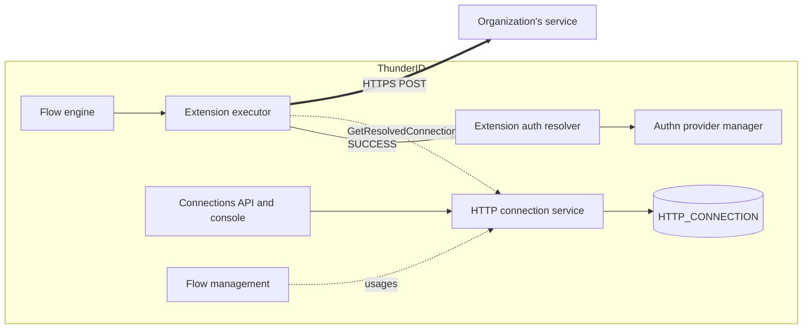

# Extension Executor Specification

- **Status:** Draft
- **Version:** 0.7
- **Related documents:**
  - Discovery issue #5555 (ThunderID Extensibility: extension model and authentication)
  - Design discussion #5659 (Extension executor: architecture, response contract and custom authentication)
  - Threat model: [threat-model.md](threat-model.md), added in #5746
  - Flow conditions issue #5145

## Summary

Organizations need ThunderID flows to consult their own services: to stop a sign-in a risk engine rejects, to check a credential against an internal list, to authenticate with a method ThunderID does not implement, or to bring in data that only their systems hold. Today the only outbound call in a flow is the HTTP request executor. It fails open by default, passes upstream error text to users, and has no outcome contract.

This specification adds three things:

- an **extension executor**, a flow step that calls an organization's service and acts on a fixed response contract. The request mirrors the step's own flow context and the response mirrors the step's own result, so an HTTP extension sees and answers what an in-process extension would;
- an **HTTP endpoint connection**, a connection type that holds where and how to reach that service;
- an **extension auth resolver**, an authentication step that turns a service's verified answer into a session for a local user.

**The governing design decision:** the extension executor is blind to identity. It can only add data to the flow, under a closed set of four outcomes. Anything that changes who the user is lives in a separate, explicitly placed step (the resolver), so the power to sign a user in is never a property of an ordinary extension.

**In scope:**

- flows of every type;
- server-to-server calls from ThunderID;
- the console and API to configure them.

**Out of scope** (future specifications):

- asynchronous approval;
- non-blocking notifications;
- surfaces outside flows;
- recording an authentication method and assurance level for logins through the resolver;
- OAuth client credentials or mutual TLS on the back channel;
- branching on returned values (#5145).

## Architecture



| Component | Owner package | Responsibility | Existing seam used |
|---|---|---|---|
| Extension executor | `internal/flow/executor` | Build the request, call the service, evaluate the response, route the flow, store data | Executor registry and catalog (`executormeta`), `ExecutorDependencies` |
| HTTP connection service | `internal/connection/httpconnection` | Store, validate and resolve HTTP endpoint connections | Connection routes, declarative resources, export and import, `cmodels` encryption |
| Extension auth resolver | `internal/flow/executor` | Resolve and authenticate the user a service verified | Entity provider, authn provider manager |
| `extensionVerifiedEntityID` credential type | `internal/authnprovider` | The internal path the resolver authenticates through | `InternalCredentialTypes`, default provider dispatch |
| Usage tracking | `internal/flow/mgt`, `internal/system/resourcedependency` | Report flows that reference a connection; block its deletion | Dependency registry |
| Console and flow builder | `frontend/packages/configure-connections`, `configure-flows` | Configure connections and the two steps | Connection wizard, executor property panels |

The extension executor is a utility executor and cannot set the authenticated user. The resolver is an authentication executor, which is what allows it to.

## Detailed design

### Extension executor: node properties

| Property | Type | Default | Meaning |
|---|---|---|---|
| `connectionId` | string | required | The HTTP endpoint connection to call. |
| `inputKeys` | string array | empty | The user inputs to send. See *Request construction*. |
| `runtimeDataKeys` | string array | unset | Restricts the runtime data sent. See *Request construction*. |
| `responseKeys` | string array, or a comma-separated string | unset | The response fields to store. Unset stores all fields that are allowed. |

Validation:

- The step calls only through an HTTP endpoint connection; there is no inline URL. A flow whose extension step has no `connectionId` is refused at save. A step that still reaches run time without one fails with `ErrExtensionConfigInvalid` (configuration invalid) before any call.
- `inputKeys` and `runtimeDataKeys` must be string arrays. `responseKeys` may be a string array or a comma-separated string.
- Keeping every endpoint in a connection means credentials are always stored encrypted and the `https` rule (AC2.7) always applies. For local development, use a connection with authentication `none` and an `http` URL.

### Extension executor: endpoint resolution

- The executor calls `GetResolvedConnection` on every execution. That returns the URL, the timeout and the final header map, with the authentication header applied and secrets decrypted in memory only. A step with no connection configured, or whose connection does not exist, fails the node with `ErrExtensionConfigInvalid`, and no call is made. A connection that exists but cannot be resolved is a failure inside ThunderID: the node fails with `ErrExtensionCallFailed`, with `errorKind` `internal` in the audit event, and no call is made.
- The embedded engine (`pkg/thunderidengine`) has no connection resolver, so an extension step run there fails with `ErrExtensionConfigInvalid`.

### Extension executor: request construction

The request is a `POST` with:

- `Content-Type: application/json`;
- `X-Correlation-ID`, the flow's trace ID, unless a configured header supplies it;
- the connection's headers, with its authentication applied.

The body mirrors the step's flow context (`providers.NodeContext`), field for field and under the same names, so that a service written for HTTP and an extension running inside ThunderID see the same information. Only the parts that are safe to leave the server are carried:

```json
{
  "version": "1",
  "executionId": "019a1b2c-3d4e-7f60-8a9b-0c1d2e3f4a5b",
  "flowType": "AUTHENTICATION",
  "currentAction": "<action>",
  "currentNodeId": "<node id>",
  "userInputs":  { "<inputKey>": "<value>" },
  "runtimeData": { "<key>": "<value>" },
  "application": { "id": "<id>", "ouId": "<ou id>", "name": "<name>", "type": "<type>" },
  "authUser": {
    "<provider>": {
      "entityReference": { "entityId": "<id>", "entityCategory": "user", "entityType": "<type>", "ouId": "<ou id>" }
    }
  }
}
```

| Field | Source | Notes |
|---|---|---|
| `version` | contract | Fixed at `"1"` by this specification. A future incompatible contract uses a new value; ThunderID never changes the meaning of a published version. |
| `executionId` | `ExecutionID` | The same on every call within one flow execution, so a service can correlate calls, including the call made when a redirected user returns. |
| `flowType`, `currentAction`, `currentNodeId` | the fields of the same name | `currentAction` is omitted when empty. |
| `userInputs` | `UserInputs` | Filtered by `inputKeys`, below. |
| `runtimeData` | `RuntimeData` | Filtered by class and by `runtimeDataKeys`, below. |
| `application` | `Application` | `id`, `ouId`, `name` and `type` only. The inbound authentication configuration, which carries client secrets, is never sent. |
| `authUser` | `AuthUser` | The same layout, provider name to state, with each state reduced to its `entityReference`. Provider tokens and attributes are never sent. `{}` before anyone is authenticated. |

Never sent: node properties, shared runtime data, forwarded data, the execution history, the executor mode, and the node's declared inputs.

**User inputs:**

- Only the inputs named in `inputKeys` are sent, and only those present in the flow.
- An unset or empty `inputKeys` sends `{}`.
- Credentials (password and OTP inputs) are therefore sent only when an administrator names them on that node, for example on an extension that performs authentication.

**Runtime data**, in three classes:

| Class | Members | Sent |
|---|---|---|
| Secret engine state | `otpSessionToken`, `consent_session_token`, `oauthState`, `oidcNonce`, `magicLinkUsedJti`, `storedInviteToken`, `inviteLink`, `magicLinkURL`, `ssoSessionHandle`, `ssoSessionId`, `tokenFamilyId`, `candidateUsers`, `failureReasonJSON`, `openid4vpVerificationState`, `passkeySessionToken`, `linkingCheckpoint`, and every SSO checkpoint key (names starting with an SSO session key followed by a checkpoint suffix) | Never, even when named. |
| Other engine keys | Every other key on the reserved list (see *Response storage*), for example `clientId`, `requested_permissions`, `ouId`, `externalIdentity`, `linkingCandidateUserIds`, `linkingVerificationRequested`, `ownerId`, `categoryType`, `defaultOUID` | Only when named in `runtimeDataKeys`. Exception: `applicationId` and `userID` are sent by default when present. |
| Flow data | Every key not on the reserved list, such as data stored by earlier extensions | Only when named in `runtimeDataKeys`. |

Without `runtimeDataKeys`, a service therefore receives only `applicationId` and `userID`. Data an earlier extension stored never reaches a later one unless an administrator names it on that later step, so one service cannot read another's answers by default.

### Extension executor: the call

- The HTTP client does not follow HTTP redirects. A 3xx response is evaluated like any other status. Following one would resend the request's headers, including its credential, to another host. This is separate from sending the user's browser to a service's page, which the response asks for explicitly (see *Redirect to the service's page*).
- The client uses the server's TLS settings.
- Private and loopback addresses are allowed, because endpoints are set only by administrators. This allows on-premise services.
- The response body is read up to 64 KiB (65 536 bytes). A larger body makes the outcome `ERROR` without being parsed.
- A timeout is not retried.

### Extension executor: response format

A service answers with HTTP status 2xx and a JSON object. This is what a service author implements:

| Field | When | Meaning |
|---|---|---|
| `actionStatus` | Always | `SUCCESS`, `FAILED`, `INCOMPLETE` or `ERROR`. Case-sensitive. |
| `failureReason` | With `FAILED` or `INCOMPLETE`, optional | A machine-readable code, up to 64 characters from `[A-Za-z0-9_.-]`. Passed to the client application as `params.reason`, except for a credential failure (see *Failure information and user messages*). |
| `failureDescription` | With `FAILED` or `INCOMPLETE`, optional | Text for the user, shown as plain text and cut to 256 characters. |
| `redirectUrl` | With `INCOMPLETE`, optional | An absolute `http` or `https` URL to send the user's browser to (see *Redirect to the service's page*). |
| Any other top-level field | Optional | Data for later steps, stored as text when allowed by `responseKeys`. It must not use a reserved key (see *Response storage*). |

Allow the user through, and give later steps data:

```json
{
  "actionStatus": "SUCCESS",
  "riskScore": "12",
  "riskReason": "known_device"
}
```

Refuse, with a message for the user:

```json
{
  "actionStatus": "FAILED",
  "failureReason": "high_risk",
  "failureDescription": "Sign-in blocked. Contact support."
}
```

Ask for more input through the step's `onIncomplete` prompt:

```json
{
  "actionStatus": "INCOMPLETE",
  "failureReason": "otp_required",
  "failureDescription": "Enter the code we sent you."
}
```

Send the user to the service's own page, then answer `SUCCESS` or `FAILED` when the step calls again for the same `executionId`:

```json
{
  "actionStatus": "INCOMPLETE",
  "redirectUrl": "https://pin.example.com/entry?flowId=019a1b2c-3d4e-7f60-8a9b-0c1d2e3f4a5b"
}
```

Report that the service could not decide; the user sees only a generic error:

```json
{
  "actionStatus": "ERROR",
  "failureReason": "upstream_unavailable"
}
```

An answer that breaks these rules is treated as `ERROR`, as the next section sets out.

### Extension executor: response evaluation

The outcome is decided in this order:

1. The status code is outside 200 to 299: **`ERROR`**.
2. The body is empty, is not a JSON object, or exceeds the size cap: **`ERROR`**.
3. `actionStatus` is missing, is not a string, or is not one of the four values (the comparison is case-sensitive): **`ERROR`**.
4. `actionStatus` is `INCOMPLETE` and `redirectUrl` is present, not empty and not `null`, but is not an absolute `http` or `https` URL: **`ERROR`**.
5. Otherwise, the value of `actionStatus`.

| Outcome | Executor status | Flow continues at | Client error | Runtime data |
|---|---|---|---|---|
| `SUCCESS` | complete | `onSuccess` | none | Response fields stored; earlier `failureReason` and `failureDescription` reset to `""` |
| `FAILED` | failure | `onFailure`, or ends the flow with an error if none is set | `ErrExtensionActionFailed`, or `ErrInvalidCredentials` for a credential failure | `failureReason` and `failureDescription` stored |
| `INCOMPLETE` | user input required | `onIncomplete`, which must lead to a prompt; without `onIncomplete`, the flow ends with ThunderID's internal server error | `ErrExtensionInputRequired` when a message exists, or `ErrInvalidCredentials` for a credential failure | Response fields plus `failureReason` and `failureDescription` stored; nothing is stored when the step has no `onIncomplete` |
| `INCOMPLETE` with `redirectUrl` | external redirection | The user's browser goes to `redirectUrl`; the flow pauses on this step and runs it again when the browser returns | none | Response fields stored |
| `ERROR` | failure | `onFailure`, or ends the flow with an error | `ErrExtensionCallFailed` (generic) | unchanged |

On `ERROR`, nothing from the response reaches the client. `failureReason` appears only in the audit event (see *Audit event*); `failureDescription` is not recorded.

### Extension executor: redirect to the service's page

Some services collect input on their own page, such as a PIN pad or a document upload, and need the user's browser there. A service asks for that by answering `INCOMPLETE` with `redirectUrl`:

```json
{
  "actionStatus": "INCOMPLETE",
  "redirectUrl": "https://pin.example.com/entry?flowId=<executionId>"
}
```

- The step returns external redirection with `redirectUrl` as the redirect URL, as the federated authentication steps do. ThunderID's client SDK adds a random `state` to the URL and stores it.
- The service sends the browser back to the ThunderID gate's callback, `<gate>/callback?code=<value>&state=<the same state>`. The gate checks `state`, and the SDK resumes the flow with the stored execution ID and the input `code`.
- The step runs again. The new request carries the same `executionId`, so the service can return the outcome it recorded for that execution, which is evaluated as usual. `code` is a user input like any other: it is sent only when `inputKeys` names it, for a service that binds the return to it.
- `redirectUrl` must be an absolute `http` or `https` URL. `javascript:` and `data:` URLs would run in the sign-in page instead of leaving it, so they, relative URLs and non-string values make the outcome `ERROR`. An empty or `null` value means no redirect.
- Any `http` or `https` destination is accepted. The service is configured by an administrator, and services commonly host their page on another origin from their API.
- `redirectUrl` is part of the contract and is never stored as data. With any status other than `INCOMPLETE` it is ignored.
- Until custom authentication (redirect) is delivered, an `INCOMPLETE` with a non-empty `redirectUrl` is treated as `ERROR`, with `errorKind` `contract`.

### Extension executor: response storage

**Rendering.**

- Top-level response fields are stored as strings.
- Numbers keep their exact text, and booleans become `true` or `false`.
- Objects and arrays are stored as compact JSON.
- `null` values are skipped.
- `actionStatus`, `failureReason`, `failureDescription` and `redirectUrl` are never stored as data. On `FAILED` and `INCOMPLETE` the two failure fields are stored under their own names, as the table above describes.

**Allowlist.** When `responseKeys` is set, only the fields it names are stored. Fields outside it are dropped without error, so upstream tokens never enter the flow.

**Reserved keys.**

- The executor keeps a single list of runtime-data keys that the engine or a built-in step relies on:
  - every `RuntimeKey*` constant in `internal/flow/common`;
  - the identity keys `userID`, `userId` and `ouId`;
  - `groups`, since authorization reads it before the user store;
  - `password`, so that a service cannot plant a credential;
  - `applicationId`;
  - `failureReasonJSON`;
  - `authorized_permissions`;
  - the keys each built-in executor defines for its own state, including `defaultOUID`, `categoryType`, `ownerId`, `idpId`, `senderId` and `passkeySessionToken`;
  - SSO checkpoint keys, matched by prefix because their names carry a checkpoint suffix.
- Profile attributes such as `username`, `email`, `given_name` and `family_name` are not reserved and stay storable, since provisioning after the resolver relies on them (pattern 2).
- A unit test fails if any `RuntimeKey*` constant in `internal/flow/common`, or any runtime-key constant in `internal/flow/executor`, is missing from the list, so the list cannot fall behind as the engine grows.
- **A response that contains a reserved key as a top-level field is `ERROR`.** That holds even when `responseKeys` would have dropped the field, so a misbehaving service is always visible. Nothing from such a response is stored.
- The proof of concept showed why this matters: the `{{userId}}` placeholder resolves from `runtimeData.userId` before the authenticated user, so a service that returned its own user ID under that name would be taken for the signed-in user by every later step that uses the placeholder.

### Extension executor: failure information and user messages

- **`failureReason`:**
  - passed as `params.reason`;
  - limited to 64 characters from `[A-Za-z0-9_.-]`;
  - a value outside that is dropped.
- **`failureDescription`:**
  - shown as the error description and passed as `params.description`;
  - control characters are removed and whitespace runs collapsed;
  - cut to 256 characters;
  - always rendered as text, never as markup.
- **Defaults:** if `failureDescription` is missing or empty after cleaning:
  - `FAILED` uses "The request was rejected";
  - `INCOMPLETE` returns no error.
- **Credential failures:**
  - When `failureReason` is `invalid_credentials` or `user_not_found`, with `FAILED` or `INCOMPLETE`, the step returns ThunderID's own `ErrInvalidCredentials`, exactly as the built-in credential steps do, with no params, whatever the service sent.
  - The reason is kept only in runtime data and the audit event.
  - The same error for both cases, identical to a native credential failure, stops an extension from revealing which accounts exist.

### Extension executor: audit event

Every execution publishes one event, `EXTENSION_CALL`, on ThunderID's observability event bus, in the flows category, so that it reaches the deployment's configured outputs (console, file or OpenTelemetry) with the engine's own flow events. The executor receives the observability provider through its dependencies; when observability is disabled, no event is published. The event carries these data fields, reusing the bus's existing keys where one exists:

- `executionId`, `nodeId`, `flowType`;
- `connectionId`;
- `outcome`;
- `failureReason`, when the service sent one in the allowed form;
- `httpStatus`, when a response was received;
- the call's duration, as the bus's existing duration key;
- `errorKind`, for `ERROR`: `timeout`, `transport`, `status`, `body`, `contract`, `reserved_key` or `internal`. It is absent when the service itself answered `ERROR`.

The event never contains URLs, header values, request or response bodies, user inputs, runtime-data values or `failureDescription`. Configuration failures (`ErrExtensionConfigInvalid`) emit the same event with `outcome` set to `CONFIG_ERROR`.

### Extension executor: errors

Errors are named here by their constant. Numeric codes are assigned from the next free `FET-` and `CON-` ranges at implementation, so that other in-flight changes cannot collide with this spec.

| Error | When | Client sees |
|---|---|---|
| `ErrExtensionConfigInvalid` | No connection configured, or the connection does not exist | "Configuration error", generic description |
| `ErrExtensionCallFailed` | Outcome `ERROR` for any reason, including an unsafe `redirectUrl` and a connection that exists but cannot be resolved | "Extension call failed", generic description |
| `ErrExtensionActionFailed` | Outcome `FAILED` | "Request rejected"; description from `failureDescription`; `params.description`, `params.reason` |
| `ErrInvalidCredentials` (existing) | Outcome `FAILED` or `INCOMPLETE` with `failureReason` `invalid_credentials` or `user_not_found` | ThunderID's own invalid-credentials error, with no params |
| `ErrExtensionInputRequired` | Outcome `INCOMPLETE` with a message | "Additional input required"; `params.description`, `params.reason` |

### HTTP endpoint connection

A connection of type `http`. Fields and validation:

| Field | Rule | Error |
|---|---|---|
| `name` | Required, unique per deployment, at most 255 characters | `httpconnection.ErrorInvalidName`; `httpconnection.ErrorAlreadyExists` when duplicate |
| `description` | Optional, at most 500 characters | `httpconnection.ErrorInvalidDescription` |
| `url` | Required, absolute `http` or `https` URL with a valid host and a port from 1 to 65535, and no user name or password. Must be `https` when `authentication.type` is not `none`, so that a stored credential never crosses the network in clear. `http` remains for services that receive no credential, such as a local development service. Stored canonicalized: scheme and host in lower case, default port removed. The URL, including its query string, is not secret: it is stored and returned in clear, so a credential must not be put in it. | `httpconnection.ErrorInvalidURL` |
| `timeoutMs` | 1 to 20 000; `0` or omitted means 10 000 | `httpconnection.ErrorInvalidTimeout` |
| `headers` | `[{name, value}]`; names valid and unique (case-insensitive); values without line breaks. A PUT replaces the whole list, so omitted means none. Names that carry credentials or that the HTTP stack manages are refused: `Authorization`, `Proxy-Authorization`, `Cookie`, `Host`, `Content-Length`, `Content-Type`, `Transfer-Encoding`, `Connection`, `TE`, `Trailer`, `Upgrade`, `Keep-Alive` and `Expect`. A credential belongs in `authentication`, where it is encrypted and masked. | `httpconnection.ErrorInvalidHeaders` |
| `authentication` | Optional outbound authentication object, the same one SMTP email connections use (`internal/system/outboundauth`): `{"type": "none" \| "basic", "properties": {...}}`. Omitted means `none`, on update as much as on create. `basic` requires `username` and `password`; for HTTP the username may not contain a colon, since HTTP Basic joins the two with one (RFC 7617). | `httpconnection.ErrorInvalidAuthentication`; `connection.ErrorInvalidAuthenticationType` when the type is not one the server implements |

Authentication reuses the shared outbound authentication model rather than defining its own, so every connection that dials out with credentials stores, masks and validates them the same way, and the console renders the methods the server reports through `GET /connections/meta`. The model offers `none` and `basic` today. Bearer token and API-key methods are added to the shared model by a follow-up feature (#5789), after which HTTP endpoint connections offer them without a change here.

**Secrets** are the outbound authentication's credential fields; with `basic`, the password.

- **Storage:** encrypted with the server's configuration key and stored in the connection's properties, never in plain text.
- **Reads:** every read returns each secret as `******`. The basic username is returned in clear.
- **Updates** follow the shared rule for outbound credentials. A secret that is omitted keeps its stored value only while the credential's target is unchanged: the same authentication type, the same non-secret properties (the username) and the same URL **origin** (scheme, host and port, with default ports normalized). Otherwise the stored secret is dropped and must be supplied again, or the update fails with `httpconnection.ErrorInvalidAuthentication`. This stops an editor from pointing a connection at their own server, or changing the user it signs in as, and collecting its stored password. A secret value is never compared with the mask: `******` sent back is taken as the new value, as for every outbound credential, so clients omit a secret to keep it.

**Resolution for calls.** Plain headers first, then the outbound authentication's HTTP binding adds the credential. With `basic`, that is `Authorization: Basic base64(username:password)`. Decrypted values exist only in the outgoing request, for the duration of the call.

**Lifecycle.**

- Delete is refused with `httpconnection.ErrorHasBlockingDependencies` while any flow references the connection through `connectionId`. Flow management reports those references through the dependency registry. A failure to determine usages also refuses the delete.
- Connections defined in declarative YAML are read-only (update and delete fail as declarative resources).
- Export writes each secret as a `.env` parameter, as for SMTP connections. Import accepts the same shape.

### Extension auth resolver

| Property | Default | Meaning |
|---|---|---|
| `sourceKey` | required | The runtime-data key holding the identifier the service verified. |
| `matchAttribute` | `username` | The local user attribute to match. `userID` matches by entity ID. |
| `allowAuthenticationWithoutLocalUser` | `false` | When no local user matches, continue so that a provisioning step can create the user. Same name and meaning as on the federated authentication steps. |

Steps:

1. Read `runtimeData[sourceKey]`. If it's missing or empty, fail with "user not authenticated".
2. Resolve the entity:
   - by ID when `matchAttribute` is `userID`;
   - otherwise through the entity provider, filtered on `matchAttribute`.
   - Not found fails with `ErrEntityNotFound`; more than one match fails with `ErrAmbiguousEntityIdentity`.
   - Not found, in an authentication flow with `allowAuthenticationWithoutLocalUser`, instead sets `runtimeData.userEligibleForProvisioning` to `"true"`, authenticates no one and completes. Only an attribute lookup that matches no entity at all qualifies. A match that is not a user, an ambiguous match and a lookup by `userID` still fail, since a new user could not satisfy them.
3. Load the entity. It must be of category `user` and in state `ACTIVE`. Anything else fails with `ErrEntityNotFound`, the same answer credential authentication gives, so a caller cannot use the resolver to tell which accounts exist.
4. Authenticate through `AuthenticateUser`, with the credential `extensionVerifiedEntityID: <id>`. Failure fails with `ErrEntityAuthFailed`.
5. Complete, and copy the authenticated claims into runtime data.

A missing `sourceKey` property fails with `ErrExtensionAuthResolverConfigInvalid` (configuration invalid).

The resolver trusts whatever value sits under `sourceKey`. The flow builder places it directly after the extension that authenticates, and the threat model records this as an accepted trust.

**Placement.** In a custom authentication flow the order is extension, then resolver, then the authorization step:

```text
Prompt → Extension (onSuccess) → Extension auth resolver → Authorization → Assertion
```

The authorization step requires an authenticated user and fails with `ErrUserNotAuthenticated` without one. The extension executor never authenticates a user, so an extension followed directly by authorization fails there. The resolver is the step that resolves the local user and authenticates them, and authorization then evaluates that user's groups, roles and permissions as it does after any built-in authenticator.

### Custom authentication flow patterns

The proof of concept ran each of these against a PIN service that collects the PIN on its own page, through an HTTP endpoint connection named *PIN Authenticator* with authentication `none`. Step names are the flow builder's labels, with the executor name in brackets. Every step not listed as a route target ends the flow with its error.

**Common to all three.** The service answers the first call for an `executionId` with `INCOMPLETE` and `redirectUrl` (its PIN page). Its page sends the browser to the gate's `/callback` with `code` and the `state` the SDK added. The step then calls again with the same `executionId`, and the service answers `SUCCESS` or `FAILED` once.

The sample responses below are the PIN service's answers from the proof of concept run, with user IDs and addresses replaced by example values. The service's user ID field is shown under the names this specification requires, since the run predates the reserved-key rule.

First call, in every pattern:

```json
{
  "actionStatus": "INCOMPLETE",
  "redirectUrl": "http://localhost:3000/api/pin-entry?flowId=019a1b2c-3d4e-7f60-8a9b-0c1d2e3f4a5b"
}
```

Second call, when the PIN did not match, in every pattern:

```json
{
  "actionStatus": "FAILED",
  "failureReason": "userNotFound",
  "failureDescription": "Unable to find user for given credentials."
}
```

#### Pattern 1: users who exist in ThunderID

| # | Step | Configuration | Routes |
|---|---|---|---|
| 1 | Extension (`ExtensionExecutor`) | Connection: PIN Authenticator. Inputs to send: none. Stored response fields: `verifiedUserId` | `onSuccess` → 2; `onFailure` → a prompt showing the failure |
| 2 | Extension Auth Resolver (`ExtensionAuthResolver`) | Source key: `verifiedUserId`. Match attribute: `userID`. Allow authentication without a local user: off | `onSuccess` → 3; `onFailure` → a prompt showing the failure |
| 3 | Authorization (`AuthorizationExecutor`) | Defaults | `onSuccess` → 4 |
| 4 | Auth Assertion Generator (`AuthAssertExecutor`) | Defaults | `onSuccess` → End |

- The service reads `executionId` and `application.ouId`, and answers `{"actionStatus":"SUCCESS","verifiedUserId":"<ThunderID user ID>"}`. It must know each user's ThunderID ID, or answer a username and use Match attribute `username` instead.
- The identifier must not use a reserved key such as `userID` or `userId`: a response containing one is `ERROR` (see *Response storage*).

Second call, when the PIN matched:

```json
{
  "actionStatus": "SUCCESS",
  "verifiedUserId": "cea777f1-0000-4000-8000-000000000001",
  "username": "emily@example.com",
  "email": "emily@example.com",
  "given_name": "Emily",
  "family_name": "Ellon"
}
```

Only `verifiedUserId` is stored, because Stored response fields names only it.

#### Pattern 2: users who do not exist in ThunderID yet

| # | Step | Configuration | Routes |
|---|---|---|---|
| 1 | Extension (`ExtensionExecutor`) | Connection: PIN Authenticator. Inputs to send: none. Stored response fields: `username`, `email`, `given_name`, `family_name` | `onSuccess` → 2; `onFailure` → a prompt showing the failure |
| 2 | Extension Auth Resolver (`ExtensionAuthResolver`) | Source key: `username`. Match attribute: `username`. Allow authentication without a local user: **on** | `onSuccess` → 3; `onFailure` → a prompt showing the failure |
| 3 | Provision User (`ProvisioningExecutor`, mode `user`) | Defaults. Optionally Assign group or Assign role | `onSuccess` → 4 |
| 4 | Authorization (`AuthorizationExecutor`) | Defaults | `onSuccess` → 5 |
| 5 | Auth Assertion Generator (`AuthAssertExecutor`) | Defaults | `onSuccess` → End |

- The service answers `SUCCESS` with flat attribute fields, for example `{"actionStatus":"SUCCESS","username":"…","email":"…","given_name":"…","family_name":"…"}`.
- The application needs an allowed user type whose schema has `username`. Provisioning uses the stored fields whose names match schema attributes and prompts for any required attribute missing.
- On a user's first sign-in the resolver marks them for provisioning and Provision User creates and signs them in. On later sign-ins the resolver signs in the existing user and provisioning skips. Either way it is one sign-in.
- The service must not return its own user ID under a reserved key such as `userId`. A response containing a reserved key is `ERROR`, even when Stored response fields would leave it out. Use a name of its own, such as `serviceUserId`, if later steps need it.

Second call, when the PIN matched:

```json
{
  "actionStatus": "SUCCESS",
  "serviceUserId": "8a2b49b5-0000-4000-8000-000000000002",
  "username": "peter@example.com",
  "email": "peter@example.com",
  "given_name": "Peter",
  "family_name": "Parker"
}
```

`serviceUserId` is not stored, because Stored response fields leaves it out. On the first sign-in, Provision User creates `peter@example.com` from the four stored fields.

#### Pattern 3: second factor after password

| # | Step | Configuration | Routes |
|---|---|---|---|
| 1 | Prompt | Inputs `username` and `password`, with a submit action | → 2 |
| 2 | Identifier + Password (`CredentialsAuthExecutor`) | Defaults | `onSuccess` → 3; `onFailure` → 1 |
| 3 | Extension (`ExtensionExecutor`) | Connection: PIN Authenticator. Inputs to send: none. Runtime data to send: default | `onSuccess` → 4; `onFailure` → a prompt showing the failure |
| 4 | Authorization (`AuthorizationExecutor`) | Defaults | `onSuccess` → 5 |
| 5 | Auth Assertion Generator (`AuthAssertExecutor`) | Defaults | `onSuccess` → End |

- No resolver and no provisioning. Step 2 signs the user in; the extension's `SUCCESS` only lets the flow continue, and the extension executor cannot change the user, so the service cannot switch identities.
- The service reads the signed-in user from `runtimeData.userID`, which the default runtime-data selection sends, or from `authUser.<provider>.entityReference.entityId`, and checks the PIN of that user. With no signed-in user it answers `ERROR`.
- The password is not sent: Inputs to send names nothing, and the engine has already cleared it.

Second call, when the PIN matched for the signed-in user:

```json
{
  "actionStatus": "SUCCESS",
  "verifiedUserId": "cea777f1-0000-4000-8000-000000000001",
  "username": "emily@example.com",
  "email": "emily@example.com",
  "given_name": "Emily",
  "family_name": "Ellon"
}
```

The returned fields are stored as flow data, which no later step reads; the flow continues with the user signed in at step 2. When no user is signed in, the service refuses the first call with HTTP `400`, which the step treats as `ERROR`:

```json
{
  "actionStatus": "ERROR",
  "errorMessage": "missingUser",
  "errorDescription": "No authenticated user for second-factor authentication."
}
```

In every pattern ThunderID records neither the method nor the extra factor; that is the assurance work listed as out of scope.

### Internal credential type `extensionVerifiedEntityID`

- The default authn provider accepts `extensionVerifiedEntityID` with a non-empty user ID and returns that ID as the authenticated entity, as it already does for `provisionedEntityID`.
- The type is on `InternalCredentialTypes`, so the credentials authentication API rejects it from API clients. The existing test that every dispatched credential type is on that list covers it.

### Data model

A new table in the configuration database.

PostgreSQL:

```sql
CREATE TABLE "HTTP_CONNECTION" (
    DEPLOYMENT_ID VARCHAR(255) NOT NULL,
    ID            VARCHAR(36)  NOT NULL,
    NAME          VARCHAR(255) NOT NULL,
    DESCRIPTION   VARCHAR(500),
    PROPERTIES    JSONB        NOT NULL,
    CREATED_AT    TIMESTAMPTZ  DEFAULT NOW(),
    UPDATED_AT    TIMESTAMPTZ  DEFAULT NOW(),
    PRIMARY KEY (DEPLOYMENT_ID, ID)
);
CREATE UNIQUE INDEX idx_http_connection_name_deployment ON "HTTP_CONNECTION" (DEPLOYMENT_ID, NAME);
```

SQLite:

```sql
CREATE TABLE "HTTP_CONNECTION" (
    DEPLOYMENT_ID VARCHAR(255) NOT NULL,
    ID            VARCHAR(36)  NOT NULL,
    NAME          VARCHAR(255) NOT NULL,
    DESCRIPTION   VARCHAR(500),
    PROPERTIES    TEXT         NOT NULL,
    CREATED_AT    TEXT         DEFAULT (datetime('now')),
    UPDATED_AT    TEXT         DEFAULT (datetime('now')),
    PRIMARY KEY (DEPLOYMENT_ID, ID)
);
CREATE UNIQUE INDEX idx_http_connection_name_deployment ON "HTTP_CONNECTION" (DEPLOYMENT_ID, NAME);
```

- `PROPERTIES` is a JSON object `{url, timeoutMs, headers, authentication}`. `authentication` is the property array the shared outbound authentication model writes: the authentication type, the username, and the password marked secret and encrypted. It is omitted when the connection has no authentication. No other secret is stored.
- The table is added to the SQLite and Postgres configuration scripts. There is no migration framework, so the release notes carry the DDL for existing deployments.
- No other table changes.

### API

All routes require the same authorization as the other connection routes.

| Method and path | Request | Response |
|---|---|---|
| `GET /connections/http` | none | `200`, a list of connection summaries |
| `POST /connections/http` | `HTTPConnectionCreateRequest` | `201`, `HTTPConnectionResponse` |
| `GET /connections/http/{id}` | none | `200`, `HTTPConnectionResponse`; `404 httpconnection.ErrorNotFound` |
| `PUT /connections/http/{id}` | `HTTPConnectionUpdateRequest` | `200`; `400`, one of the validation errors in the field table above; `404`; `409 httpconnection.ErrorAlreadyExists` |
| `DELETE /connections/http/{id}` | none | `204`; `404`; `409 httpconnection.ErrorHasBlockingDependencies` |
| `GET /connections/http/{id}/usages` | none | `200`, `{totalResults, summary, usages[]}` |
| `GET /connections?category=http` | none | `200`, the standard paginated list |

The request and response bodies have the fields in *HTTP endpoint connection*. Responses carry `id` and `type: "http"`, with secrets masked. `api/connections.yaml` defines these schemas, the `http` category and the `http` type.

### UI

**Connections, create.** "HTTP Endpoint" in the custom section of the wizard. The steps are name, then URL and authentication, which offers the same methods as on the detail page and defaults to `none`. Timeout and headers use defaults on create and can be edited afterwards.

**Connections, detail page:**

```text
HTTP Endpoint · Risk Engine                                   [Delete]
┌ General ───────────────────────────────────────────────────────────┐
│ URL      [https://risk.example.com/evaluate                      ] │
│ Timeout  [5000] ms                                                  │
│ Headers  [X-Tenant      ] [acme          ] ×                        │
│          +                                                          │
└────────────────────────────────────────────────────────────────────┘
┌ Authentication ────────────────────────────────────────────────────┐
│ Method   [Username and Password ▾]                                  │
│ Username [svc-extension    ]                                        │
│ Password [••••••••]  (Replace)                                      │
│ Changing the URL host requires re-entering the password.            │
└────────────────────────────────────────────────────────────────────┘
┌ Usages ────────────────────────────────────────────────────────────┐
│ Flow  Default sign-in                                               │
└────────────────────────────────────────────────────────────────────┘
```

When the URL's origin is edited, the Save button stays disabled until every secret field of the current method holds a new value.

**Flow builder, extension step:**

```text
Extension
 Connection        [Risk Engine ▾]                   ← required
 Inputs to send    [username ×] [password ×]  +     ← user inputs; none by default
 Runtime data      [riskTier ×]  +                   ← application and user ID by default
 Stored fields     [riskScore, challengeId        ]
 The service must answer with actionStatus SUCCESS, FAILED, INCOMPLETE or ERROR.
```


**Flow builder, extension auth resolver:** Source key (required), Match attribute (default `username`), and Allow authentication without a local user (off by default).

### Configuration

| Key | Level | Default | Meaning |
|---|---|---|---|
| `http_connection.store` | deployment | the global declarative mode | `mutable`, `declarative` or `composite` storage for HTTP connections, as for other connection types |

The connection's timeout bounds and the 64 KiB cap are constants, not configuration.

## Requirements

### R1. An administrator can call an organization's service from any flow

**Requirement:** An administrator can add an extension step to any flow, pointing at an HTTP endpoint connection, without a server restart.

**Acceptance criteria:**

- **AC1.1:** Given a flow with an extension step that references a connection, when the flow reaches the step, then ThunderID POSTs to the connection's URL with the connection's headers and timeout.
- **AC1.2:** Given a flow whose extension step has no `connectionId`, when the flow is saved, then the save is refused.
- **AC1.3:** Given an extension step that references a deleted connection, when the flow reaches it, then the step fails with `ErrExtensionConfigInvalid` and no request is sent.

### R2. Endpoints are reusable and secrets are protected

**Requirement:** An administrator defines a service endpoint once, as an HTTP endpoint connection, with back-channel credentials that ThunderID never discloses.

**Acceptance criteria:**

- **AC2.1:** Given a connection with `basic` authentication, when it is read through any API, then every secret value is `******`, and the stored record contains no secret in plain text.
- **AC2.2:** Given a stored connection, when it is updated with the password omitted, the same authentication type, the same username and the same URL origin, then the next call carries the original secret.
- **AC2.3:** Given a stored connection with `basic` authentication, when its username changes and the password is omitted, then the update fails with `400 httpconnection.ErrorInvalidAuthentication` and the connection is unchanged.
- **AC2.4:** Given a stored connection with authentication other than `none`, when its URL host, port or scheme changes and the password is omitted, then the update fails with `400 httpconnection.ErrorInvalidAuthentication`.
- **AC2.5:** Given a connection that is updated, when a flow next calls it, then the new URL, headers and secrets are used without editing the flow.
- **AC2.6:** Given a connection, when it is exported, then each secret appears as a `.env` parameter and not in the YAML.
- **AC2.7:** Given a connection with authentication other than `none`, when it is created or updated with an `http` URL, then the request fails with `400 httpconnection.ErrorInvalidURL`; with `none`, an `http` URL is accepted.
- **AC2.8:** Given a connection, when it is created or updated with a plain header named `Authorization`, `Cookie`, `Host` or another refused name, in any case, then the request fails with `400 httpconnection.ErrorInvalidHeaders`.

### R3. Connections in use cannot be deleted

**Requirement:** An administrator can see which flows use a connection, and cannot delete a connection that a flow uses.

**Acceptance criteria:**

- **AC3.1:** Given a flow whose extension step references a connection, when its usages are requested, then the flow is listed.
- **AC3.2:** Given that reference, when the connection is deleted, then the request fails with `409 httpconnection.ErrorHasBlockingDependencies`.
- **AC3.3:** Given no references, when the connection is deleted, then it returns `204`, and a later read returns `404 httpconnection.ErrorNotFound`.

### R4. A service answers with a fixed contract and the flow routes on it

**Requirement:** A service reports its decision with `actionStatus` (`SUCCESS`, `FAILED`, `INCOMPLETE`, `ERROR`), and the flow continues at the matching path. With `INCOMPLETE` it can send the user's browser to its own page and receive the outcome when the user returns.

**Acceptance criteria:**

- **AC4.1:** Given `SUCCESS`, when the step completes, then the flow continues at `onSuccess`.
- **AC4.2:** Given `FAILED` with `failureReason` and `failureDescription`, when the step has `onFailure`, then the flow continues there. The client receives `ErrExtensionActionFailed` with the description and `params.reason`.
- **AC4.3:** Given `INCOMPLETE` with a `failureDescription`, when the step has `onIncomplete` leading to a prompt, then that prompt is shown with `ErrExtensionInputRequired` and the description.
- **AC4.4:** Given `ERROR`, a missing, non-string or unknown `actionStatus`, a non-2xx status, a 3xx redirect, an empty or non-object body, a body over 64 KiB, a timeout, or an unreachable service, when the step evaluates the answer, then the outcome is `ERROR` with `ErrExtensionCallFailed`. The client response contains nothing from the service's body, and a redirect target is never called.
- **AC4.5:** Given `INCOMPLETE` with an absolute `https` `redirectUrl`, when the step evaluates it, then the client receives a redirection to that URL, and when the browser returns through the gate callback, the step calls the service again with the same `executionId`, and with `userInputs.code` only when `inputKeys` names `code`.
- **AC4.6:** Given `INCOMPLETE` with a `redirectUrl` that is `javascript:`, `data:`, relative, scheme-less or not a string, when the step evaluates it, then the outcome is `ERROR` and no redirection is returned.
- **AC4.7:** Given any response carrying `redirectUrl`, when the step stores data, then `redirectUrl` is not stored.

### R5. Only what the administrator selects is sent

**Requirement:** An extension receives the contract version and the safe parts of the step's flow context, the user inputs the administrator names, and runtime data within the configured selection. Secret engine state, client secrets and provider tokens are never sent.

**Acceptance criteria:**

- **AC5.1:** Given an extension step with no `inputKeys`, when it calls the service, then `userInputs` is `{}`, even when the flow holds a password.
- **AC5.2:** Given `inputKeys: [username, password]`, when it calls the service, then `userInputs` holds exactly those two inputs.
- **AC5.3:** Given runtime data holding `otpSessionToken` and `oauthState`, when any extension step calls the service, even with both named in `runtimeDataKeys`, then neither key is sent.
- **AC5.4:** Given no `runtimeDataKeys`, and runtime data holding `applicationId`, `userID`, `clientId` and `riskTier` (stored by an earlier extension), when the step calls the service, then `runtimeData` holds `applicationId` and `userID` only.
- **AC5.5:** Given `runtimeDataKeys: [clientId, riskScore]`, when the step calls the service, then `runtimeData` holds only those keys that are present.
- **AC5.6:** Given any call, when the request is sent, then the body carries `"version": "1"`.
- **AC5.7:** Given any call, when the request is sent, then the body carries `executionId`, `flowType`, `currentNodeId`, and `application` with only `id`, `ouId`, `name` and `type`.
- **AC5.8:** Given an application with an OAuth client secret and an authenticated user with provider tokens and attributes, when the step calls the service, then the body contains neither the secret, the tokens nor the attributes, and `authUser` carries each provider's `entityReference` only.

### R6. Returned data is stored safely

**Requirement:** Data a service returns is available to later steps, within an allowlist, and can never overwrite state the engine trusts.

**Acceptance criteria:**

- **AC6.1:** Given `SUCCESS` with fields `risk` and `claims`, when the step completes, then a later step's `runtimeData` holds `risk` as text and `claims` as compact JSON. `actionStatus` is not stored.
- **AC6.2:** Given `responseKeys: [username]` and a response that also carries `accessToken`, when the step completes, then only `username` is stored.
- **AC6.3:** Given a response containing a reserved key (for example `mapped_role_ids` or `userID`) as a top-level field, when the step evaluates it, then the outcome is `ERROR` and nothing from the response is stored.
- **AC6.4:** Given a reserved-key list in the executor, when a `RuntimeKey*` constant in `internal/flow/common` or a runtime-key constant in `internal/flow/executor` is missing from it, then the unit test suite fails.
- **AC6.5:** Given `FAILED` followed in the same execution by `SUCCESS`, when a later step reads runtime data, then `failureReason` and `failureDescription` are empty.

### R7. User-facing failure text is bounded and cannot reveal accounts

**Requirement:** Text a service sends for users is plain and bounded, and a credential failure returns ThunderID's own invalid-credentials error.

**Acceptance criteria:**

- **AC7.1:** Given a `failureDescription` of 300 characters containing control characters, when it is shown, then the user sees at most 256 characters, with no control characters.
- **AC7.2:** Given `FAILED` with `failureReason` `user_not_found`, and separately with `invalid_credentials`, when each is returned, then both return the same `ErrInvalidCredentials`, without `params.reason`.
- **AC7.3:** Given `FAILED` with no `failureDescription`, when it is shown, then the description is "The request was rejected".
- **AC7.4:** Given a `failureReason` containing characters outside `[A-Za-z0-9_.-]` or longer than 64 characters, when the error is returned, then `params.reason` is absent.

### R8. Every call is audited without sensitive data

**Requirement:** Each extension execution leaves one record an operator can use to tell a refusal from a broken service.

**Acceptance criteria:**

- **AC8.1:** Given observability is enabled, when any execution ends, then exactly one `EXTENSION_CALL` event is published in the flows category with `executionId`, `nodeId`, `connectionId`, `outcome`, the duration, and `httpStatus` when a response was received.
- **AC8.2:** Given an `ERROR` caused by a timeout, when the event is emitted, then `errorKind` is `timeout`.
- **AC8.3:** Given any execution, when the event is emitted, then it contains no URL, header value, request or response body, user input, runtime-data value or `failureDescription`.

### R9. A service can authenticate a user

**Requirement:** An administrator can let a service perform authentication, so that the local user the service verified is resolved before authorization, and the flow ends with a normal session for that user.

**Acceptance criteria:**

- **AC9.1:** Given an extension that answers `SUCCESS` with `authenticatedUsername: jdoe`, followed by a resolver with `sourceKey: authenticatedUsername`, when the flow completes, then the assertion's subject is the local user `jdoe`, even though the user's stored password was never checked.
- **AC9.2:** Given the same flow, when the service answers `FAILED`, then no user is authenticated, and the flow follows `onFailure`.
- **AC9.3:** Given a resolver whose source value is missing, matches no user, matches more than one, matches a non-user entity, or matches a user that is not `ACTIVE`, when it runs, then it fails and authenticates no one. The not-found, non-user and inactive cases give the same error.
- **AC9.4:** Given the credentials authentication API, when a client sends credential type `extensionVerifiedEntityID`, then the request is rejected.
- **AC9.5:** Given a resolver with no `sourceKey` property, when it runs, then it fails with `ErrExtensionAuthResolverConfigInvalid`.
- **AC9.6:** Given an extension, a resolver and then an authorization step, when the flow runs, then authorization evaluates the resolved user's groups and roles, and the assertion carries the permissions granted to that user.
- **AC9.7:** Given an extension followed directly by an authorization step, with no resolver, when the service answers `SUCCESS`, then the authorization step fails with `ErrUserNotAuthenticated` and no session is created.
- **AC9.8:** Given a resolver with `allowAuthenticationWithoutLocalUser` followed by Provision User, when the service answers `SUCCESS` for a username that no local user has, then one sign-in creates that user from the stored attributes and authenticates them.
- **AC9.9:** Given the same flow and a username that a local user already has, when the user signs in, then the resolver authenticates that user and provisioning creates nothing.
- **AC9.10:** Given `allowAuthenticationWithoutLocalUser`, when the identifier matches a non-user entity, matches more than one entity, or is looked up by `userID`, then the resolver fails and does not mark the user for provisioning.
- **AC9.11:** Given a user signed in by password, followed by an extension, when the service answers `SUCCESS`, then the flow continues with the same user, and the request carried that user's ID in `runtimeData.userID` and `authUser`.

### R10. Administrators configure everything in the console

**Requirement:** An administrator can create and edit HTTP endpoint connections and both steps without writing JSON.

**Acceptance criteria:**

- **AC10.1:** Given the connection wizard, when an administrator chooses HTTP Endpoint and enters a name and URL, then a connection is created with timeout 10 000 ms and authentication `none`.
- **AC10.2:** Given a connection's detail page, when the administrator edits the URL origin, then Save stays disabled until each secret of the current method is re-entered.
- **AC10.3:** Given the flow builder, when an administrator adds an extension step, then a connection must be selected before the flow can be saved, and the step offers no URL, headers or timeout fields.
- **AC10.4:** Given the flow builder, when an administrator adds inputs to send, then `inputKeys` stores them. With none chosen, `inputKeys` is empty.
- **AC10.5:** Given the flow builder, when an administrator ticks Allow authentication without a local user on a resolver, then `allowAuthenticationWithoutLocalUser` is stored as `true`.

## Change log

| Version | Date | Change |
|---|---|---|
| 0.1 | 2026-10-09 | Initial specification, from design discussion #5659 and the proof of concept. |
| 0.2 | 2026-10-12 | The request mirrors the flow context, with `inputKeys` and `runtimeDataKeys` as filters. Added the redirect to a service's page (moved into scope), provisioning after the resolver, and the custom authentication flow patterns with the step-by-step setup of each, from the proof of concept's run against a PIN service. |
| 0.3 | 2026-10-13 | Review fixes: pattern 1 uses `verifiedUserId`, since `userId` is reserved; a service must not return reserved keys; a connection with authentication requires an `https` URL (AC2.7); separate PostgreSQL and SQLite schemas; flow data is sent only when named in `runtimeDataKeys` (AC5.4); a response format section for service authors; sample PIN service responses for each custom authentication pattern. |
| 0.4 | 2026-10-13 | The inline endpoint is removed; an extension step calls only through an HTTP endpoint connection (AC1.1 to AC1.3, AC10.3). The audit event is published on the observability event bus as `EXTENSION_CALL` (R8). The never-sent and reserved lists add `passkeySessionToken`, executor-owned keys and SSO checkpoint keys (AC6.4). |
| 0.5 | 2026-10-13 | Connection authentication reuses the shared outbound authentication model (`none` and `basic` today; bearer token and API key follow in a separate feature), with its secret-retention rule and the URL origin as the credential target. Plain headers refuse credential-carrying and HTTP-managed names (AC2.8). URL host and port are validated and the URL stored canonicalized. A separate error for an invalid description. The URL and its query string are documented as not secret. An omitted secret is kept under the shared rule; `******` is not treated as a kept value. |
| 0.6 | 2026-10-14 | Aligned with the HTTP endpoint connection implementation: `PROPERTIES` stores the shared model's authentication property array, not a separate `secrets` array; connection errors are named by their `httpconnection.Error*` constants, and an unsupported authentication type returns the existing `connection.ErrorInvalidAuthenticationType`; the create wizard includes authentication; the primary key is `(DEPLOYMENT_ID, ID)`, as in the other configuration tables. |
| 0.7 | 2026-10-15 | Aligned with the extension executor implementation: `groups` and `password` are reserved, while profile attributes stay storable; a credential failure returns ThunderID's own `ErrInvalidCredentials` with no params (AC7.2); a connection that exists but cannot be resolved is `ErrExtensionCallFailed` with `errorKind` `internal`; the audit event carries `failureReason` but never `failureDescription`; a flow whose extension step has no connection is refused at save (AC1.2); property types for `inputKeys`, `runtimeDataKeys` and `responseKeys`; an `INCOMPLETE` without `onIncomplete` ends the flow with an internal server error; a redirect is treated as `ERROR` until custom authentication is delivered; the embedded engine has no connection resolver; the never-sent and engine-key lists add the linking, ownership and OU keys the executor classifies. |
