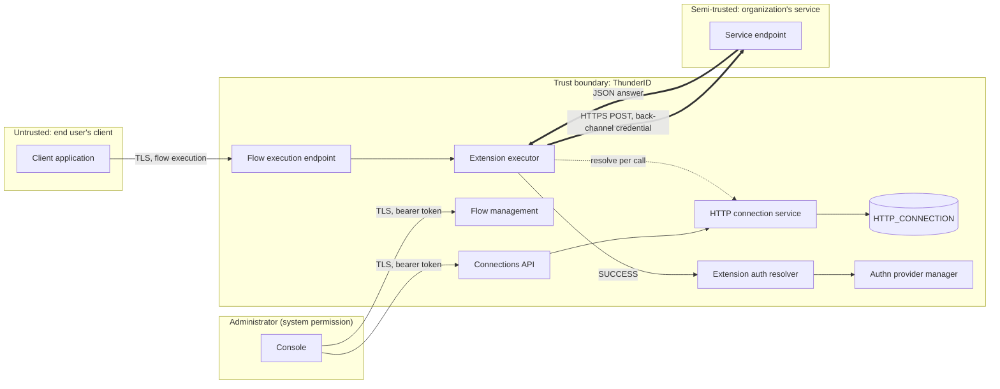
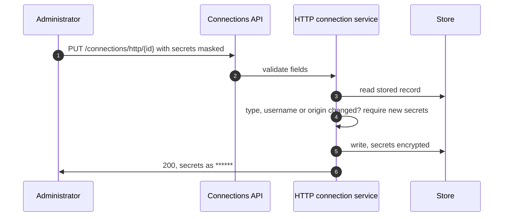
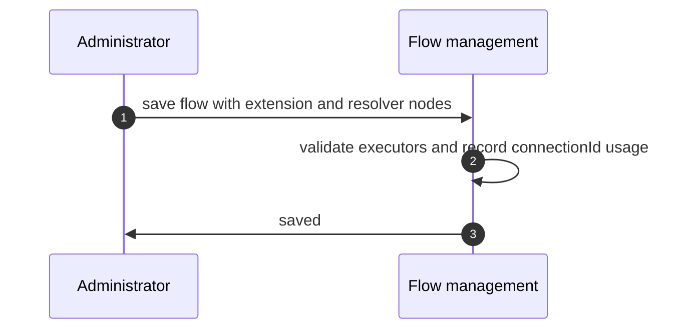
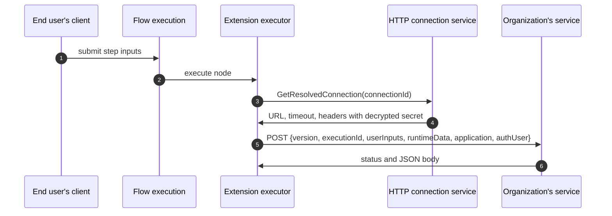
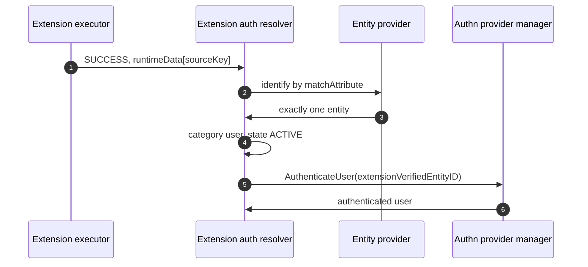
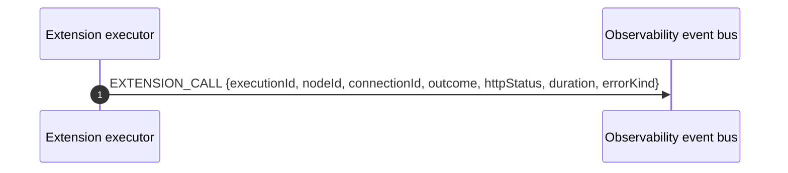
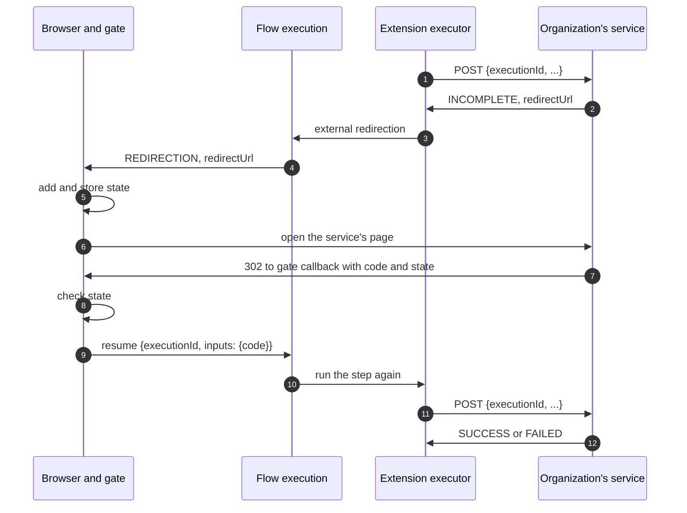

# Extension Executor Threat Model

This model covers the extension executor, the HTTP endpoint connection, and the extension auth resolver defined in [spec.md](spec.md): the outbound call from a flow to an organization's service, the evaluation of that service's answer, and the authentication of a local user on the strength of it.

## Overview

The extension executor makes ThunderID call a service it does not own, in the middle of a flow, and act on what comes back. That creates two new trust boundaries. Outbound, ThunderID sends user inputs and flow state, together with stored back-channel credentials, to an administrator-chosen endpoint. Inbound, an answer from that endpoint decides how the flow continues and what data later steps see, and through the extension auth resolver it can decide which local user is signed in.

The entry points are the connection management routes under `/connections/http`, the flow definitions that place the two steps, the flow execution endpoint that runs them, and the response of the organization's service.

Cross-cutting concerns covered elsewhere: authentication and authorization of the management API, the flow execution endpoint and its session handling, the authn provider manager, encryption of stored properties with the server's configuration key, and token issuance after a flow completes. These are trust inputs here, not re-analysed.

## Scope

This model covers:

- Creating, reading, updating, deleting, exporting and importing HTTP endpoint connections.
- Placing and configuring an extension step and an extension auth resolver in a flow.
- The outbound request: endpoint resolution, request construction, and the call.
- Evaluation of the response and storage of returned data in the flow.
- Authentication of a local user through the extension auth resolver, and creation of a user that does not exist yet through the resolver and a provisioning step.
- The user's browser being sent to a service's own page and returning to resume the flow.
- An extension used as a second factor after password authentication.
- The `EXTENSION_CALL` audit event on the observability event bus.

Out of scope:

- The security of the organization's service itself, including how it authenticates the user and stores what it receives. ThunderID cannot observe or enforce it.
- The management API's authentication and permission model, owned by the system security model.
- The HTTP request executor, which is an existing step with its own behaviour.
- Asynchronous approval and notifications, which are future specifications.

## Architecture



The organization's service is semi-trusted. An administrator chose it and gave it a credential, so ThunderID trusts its decision on the questions it was asked. ThunderID does not trust the shape of its answer, and never lets that answer change engine state other than through the fixed contract.

### Components

| Component | Task |
| --- | --- |
| Connections API and HTTP connection service | Validate, store and resolve HTTP endpoint connections. Encrypt secrets at rest and mask them on every read |
| Flow management | Store flow definitions that place the two steps, and report which flows use a connection |
| Extension executor | Build the request from selected inputs and runtime data, call the service, evaluate the answer, route the flow, store allowed data |
| Extension auth resolver | Map a value the service verified to a single active local user, and authenticate that user through an internal credential type |
| Authn provider manager | Accept the internal `extensionVerifiedEntityID` credential type from the resolver only |

### Actors

#### Actors

| Actor | Description | Roles or permissions |
| --- | --- | --- |
| Administrator | Manages connections and flows in the console or through the API | The root `system` permission, which the connection and flow management routes require |
| End user | Runs a flow through a client application | None; the flow execution endpoint is public |
| Organization's service | Answers extension calls | The back-channel credential stored on the connection |
| Network attacker | Positioned between ThunderID and the service | Observation, and modification without TLS |

#### Entitlement matrix

| Actor | Manage connections | Read a stored secret | Place an extension or resolver | Run a flow | Decide an extension outcome | Choose the authenticated user |
| --- | --- | --- | --- | --- | --- | --- |
| Administrator | [Yes] | [No] | [Yes] | [Yes] | [No] | [No] |
| End user | [No] | [No] | [No] | [Yes] | [No] | [No] |
| Organization's service | [No] | [No] | [No] | [No] | [Yes] | [Yes], only where a resolver follows its step |
| Network attacker | [No] | [No] | [No] | [Yes] | [No] | [No] |

### External Dependencies (not owned)

| Dependency | Description |
| --- | --- |
| Organization's service | Receives the request and returns the contract answer. Authenticates ThunderID with the connection's outbound authentication: a basic credential today, with bearer token and API key planned for the shared model |
| TLS stack and the server's TLS settings | Certificate verification and the minimum TLS version for the outbound call |
| Server configuration key | Encrypts connection secrets at rest, owned by the configuration encryption model |
| Configuration database or declarative files | Hold connection records, depending on `http_connection.store` |

## Threats and mitigations

### Out-of-scope interactions and risks

- Compromise of an administrator account, owned by the management API model. An administrator can already configure flows and users directly.
- How the organization's service authenticates users and protects what it receives.
- Brute force against the flow execution endpoint, owned by the flow execution model.

### Interactions

#### 01: Administrator manages HTTP endpoint connections

**Description**

An administrator creates, reads, updates, deletes, exports or imports a connection. The service validates the URL, timeout, headers and authentication, encrypts secrets, masks them on read, keeps a masked secret only when the authentication type, the username and the URL origin are unchanged, and refuses deletion while a flow references the connection. Authentication uses the shared outbound authentication model (`internal/system/outboundauth`), the same as SMTP email connections.

**Assets involved**

| Initiator | Intermediate | Target |
| --- | --- | --- |
| Administrator | Connections API | HTTP connection service, `HTTP_CONNECTION` or declarative files |

**Data flow**



**Security considerations**

| Area | Response | Comments |
| --- | --- | --- |
| Data confidentiality | [C-High] | Back-channel credentials for the organization's service |
| Communication medium | [M-NT], [M-DB], [M-FS] | Files in declarative mode and on export |
| Transport security | [TLS] | |
| Authentication | Bearer token of an administrator | |
| Accessibility | [Restricted] | |
| Authorization and Access Control | The root `system` permission | |

**Threat assessment**

| ID | Category | Threat | Materializable | Mitigation / comment |
| --- | --- | --- | --- | --- |
| 1 | [Information Disclosure] | A stored token is read back through the API or the console and reused outside ThunderID | [No] | Every read masks each secret as `******`; the stored record holds only encrypted values (AC2.1) |
| 2 | [Information Disclosure] | An administrator who can edit but should not learn a secret points the connection's URL at a server they control, keeps the masked secret, and collects the token from the next call | [No] | A change of URL origin with a authentication other than `none` requires every secret to be entered again (AC2.4, AC10.2) |
| 3 | [Information Disclosure] | A change of authentication type or username keeps the stored password, so it is sent for a different user or method | [No] | The shared outbound-credential rule drops a stored secret when the type or any non-secret property changes, and the update then requires the secret again (AC2.3) |
| 4 | [Tampering] | A header value with a line break injects further headers into the outbound request | [No] | Header names are validated and values with line breaks are rejected |
| 5 | [Information Disclosure] | An export file carries secrets in plain text into source control | [No] | Secrets are written as `.env` parameters, not into the YAML (AC2.6) |
| 6 | [Operational Risk] | A connection is deleted while a flow uses it, breaking sign-in | [No] | Deletion is refused while any flow references it, and also when usages cannot be determined (AC3.2) |
| 7 | [Repudiation] | A connection's URL or credential is changed and no record says who changed what | [Yes] | Connection changes are recorded only in the general server log. A management audit trail with old and new values is outside this feature. See *Residual risks* |
| 8 | [Information Disclosure] | A credential is put in a plain header such as `Authorization` or `Cookie`, where it is stored and returned in clear, follows any URL change and can travel over `http` | [No] | Plain headers refuse credential-carrying and HTTP-managed names; credentials go only in `authentication`, where they are encrypted, masked and bound to the URL origin (AC2.8) |

#### 02: Administrator places an extension step or a resolver in a flow

**Description**

An administrator adds an extension step that references an HTTP endpoint connection (there is no inline URL), chooses the inputs and runtime data it sends and the response fields it stores, and optionally places an extension auth resolver after it.

**Assets involved**

| Initiator | Intermediate | Target |
| --- | --- | --- |
| Administrator | Flow management | Flow definition |

**Data flow**



**Security considerations**

| Area | Response | Comments |
| --- | --- | --- |
| Data confidentiality | [C-Low] | The flow definition holds only the connection's ID; endpoints and credentials stay in the connection |
| Communication medium | [M-NT], [M-DB] | |
| Transport security | [TLS] | |
| Authentication | Bearer token of an administrator | |
| Accessibility | [Restricted] | |
| Authorization and Access Control | The root `system` permission | |

**Threat assessment**

| ID | Category | Threat | Materializable | Mitigation / comment |
| --- | --- | --- | --- | --- |
| 1 | [Security Risk] | An administrator points an extension at an internal address and uses ThunderID to reach a host they could not otherwise reach | [No] | Only holders of the root `system` permission can set endpoints, and they already control the deployment's configuration. Private addresses are allowed on purpose, for on-premise services. Recorded as a residual |
| 2 | [Elevation of Privilege] | A resolver is placed after an extension that does not authenticate, so any value that service returns signs a user in | [No] | Requires an administrator to build that flow. The resolver acts only on the `sourceKey` it is given, and the console describes it as following an authenticating extension |

#### 03: Flow calls the organization's service

**Description**

When a flow reaches an extension step, the executor resolves the endpoint from the connection on every execution, builds a JSON body that mirrors the step's flow context (the contract version, the execution ID, the flow type and node, the selected user inputs, the selected runtime data, the application's identifiers and the authenticated user's entity reference), and sends a `POST` with the connection's headers. It does not follow HTTP redirects, and it applies the timeout and a 64 KiB response cap.

**Assets involved**

| Initiator | Intermediate | Target |
| --- | --- | --- |
| End user through the flow execution endpoint | Extension executor, HTTP connection service | Organization's service |

**Data flow**



**Security considerations**

| Area | Response | Comments |
| --- | --- | --- |
| Data confidentiality | [C-High] | The request can carry credentials the administrator chose to send, and always carries the back-channel credential |
| Communication medium | [M-NT] | |
| Transport security | [TLS] | Certificates are verified with the server's TLS settings. A connection with authentication must use an `https` URL (AC2.7). An `http` URL is accepted only for a connection that sends no credential, and then the call is not encrypted |
| Authentication | ThunderID to the service: the connection's outbound authentication, a basic credential today. The service to ThunderID: TLS server certificate | |
| Accessibility | [Internal] | Server to server |
| Authorization and Access Control | Only an administrator-configured endpoint can be called | |

**Threat assessment**

| ID | Category | Threat | Materializable | Mitigation / comment |
| --- | --- | --- | --- | --- |
| 1 | [Information Disclosure] | Every extension receives the user's password and one-time codes, so a risk or enrichment service holds credentials it never needed | [No] | Only the inputs named in `inputKeys` are sent, and none by default (AC5.1, AC5.2) |
| 2 | [Information Disclosure] | Engine secrets in runtime data, such as OTP session tokens, OAuth state, nonces or SSO handles, are sent to the service and replayed against ThunderID | [No] | Secret engine state is never sent, even when named (AC5.3). Other engine keys are sent only when named (AC5.4, AC5.5) |
| 3 | [Information Disclosure] | The service answers with a redirect to another host, and the client resends the back-channel credential there | [No] | HTTP redirects are not followed; a 3xx is `ERROR` (AC4.4) |
| 4 | [Information Disclosure] | A network attacker reads the request or the credential | [Yes] for an `http` endpoint; [No] for `https` | TLS with certificate verification protects `https` endpoints. A connection that holds a credential is refused an `http` URL (AC2.7), so a stored credential never crosses the network in clear. A connection without a credential may still use `http`, and then the selected inputs and the answer are readable on the network. See *Residual risks* |
| 5 | [Spoofing] | An attacker impersonates the service and answers `SUCCESS` | [Yes] for an `http` endpoint; [No] for `https` | TLS server certificate verification protects `https` endpoints. Over `http` a network attacker can answer in place of the service, and where a resolver follows, that answer signs in the user it names. Use `https` for any service that authenticates users. See *Residual risks* |
| 6 | [Denial of Service] | A slow or unresponsive service holds flow executions open and exhausts server resources | [No] | The timeout is at most 20 seconds, the call is not retried, and the body is read up to 64 KiB (AC4.4) |
| 7 | [Denial of Service] | A service that is down blocks every sign-in that uses it | [Yes] | By design the step fails closed (`ERROR`). An administrator can route `onFailure` elsewhere for non-critical extensions. No circuit breaker exists. See *Residual risks* |
| 8 | [Tampering] | A connection is edited during a flow and later calls use stale values | [No] | The connection is resolved on every execution (AC2.5) |
| 9 | [Information Disclosure] | Mirroring the flow context sends the application's OAuth client secret, or the authenticated user's provider tokens and attributes, to the service | [No] | `application` carries only `id`, `ouId`, `name` and `type`, and `authUser` only each provider's entity reference. A unit test fails if anything else appears (AC5.7, AC5.8) |
| 10 | [Denial of Service] | Many concurrent flow executions reach an extension step at once, through the public flow execution endpoint, and the in-flight calls, each held for up to 20 seconds, exhaust server connections and goroutines or overwhelm the organization's service | [Yes] | The per-call limits (timeout, no retry, 64 KiB cap) bound one call, not how many run at once, and ThunderID applies no rate limit to `/flow/execute`. The control is at the deployment: rate-limit `/flow/execute` at the gateway or front door, as the production guidelines advise for the other public authentication routes. A concurrency cap per connection is a candidate follow-up. See *Residual risks* |
| 11 | [Information Disclosure] | Data an earlier extension stored, such as a risk score, a reference or a token another service returned, is sent to every later extension, so one organization service reads another's answers | [No] | Flow data is sent only when named in `runtimeDataKeys`; by default a service receives `applicationId` and `userID` only (AC5.4). `responseKeys` also limits what an extension stores in the first place (AC6.2) |

#### 04: Evaluating the answer and storing returned data

**Description**

The executor decides one of four outcomes from `actionStatus`, treating anything outside the contract as `ERROR`, routes the flow, shows bounded failure text to the user, and stores allowed fields in runtime data as strings.

**Assets involved**

| Initiator | Intermediate | Target |
| --- | --- | --- |
| Organization's service | Extension executor | Flow runtime data, end user's client |

**Data flow**

```mermaid
sequenceDiagram
  autonumber
  participant S as Organization's service
  participant EX as Extension executor
  participant RD as Runtime data
  participant U as End user's client
  S->>EX: {actionStatus, failureReason, failureDescription, fields}
  EX->>EX: status 2xx, object body, size, known actionStatus, no reserved key
  EX->>RD: allowed fields as strings
  EX->>U: route; bounded description on FAILED or INCOMPLETE; generic error on ERROR
```

**Security considerations**

| Area | Response | Comments |
| --- | --- | --- |
| Data confidentiality | [C-Medium] | Returned fields may hold personal data and tokens |
| Communication medium | [M-IN] | In memory and in the flow's stored context |
| Transport security | [TLS] | |
| Authentication | As interaction 03 | |
| Accessibility | [Internal] | |
| Authorization and Access Control | The response can only add data and pick one of four outcomes | |

**Threat assessment**

| ID | Category | Threat | Materializable | Mitigation / comment |
| --- | --- | --- | --- | --- |
| 1 | [Elevation of Privilege] | The response writes `userID`, `ouId`, `groups`, `password`, role mappings or another engine key, and a later step trusts it | [No] | A response containing any reserved key, including `groups` (which authorization reads before the user store) and `password` (so a service cannot plant a credential), is `ERROR` and nothing is stored, even when `responseKeys` would drop it (AC6.3). A unit test keeps the reserved list complete (AC6.4) |
| 2 | [Security Risk] | A malformed, empty or unexpected answer is treated as success, and the flow fails open | [No] | Only an exact `SUCCESS` in a 2xx JSON object completes the step. Everything else is `ERROR` (AC4.4) |
| 3 | [Information Disclosure] | An upstream error page, stack trace or token reaches the end user | [No] | `ERROR` returns a generic message only. Nothing from the body reaches the client (AC4.4) |
| 4 | [Information Disclosure] | Tokens in the response are stored in the flow and sent to later extensions | [No] | `responseKeys` restricts what is stored (AC6.2); runtime data sent onwards is subject to `runtimeDataKeys` |
| 5 | [Information Disclosure] | Different failure text for unknown accounts and wrong passwords lets an attacker enumerate accounts through the extension | [No] | For `invalid_credentials` and `user_not_found` the step returns ThunderID's native `ErrInvalidCredentials` with no reason param, so the response is identical for both reasons and to a native credential failure (AC7.2) |
| 6 | [Tampering] | `failureDescription` carries markup or control characters that the client renders | [No] | Control characters are removed, the text is cut to 256 characters, and it is always rendered as text (AC7.1). `failureReason` is restricted to `[A-Za-z0-9_.-]` and 64 characters (AC7.4) |
| 7 | [Tampering] | A failure from an earlier attempt remains in runtime data and misleads a later step | [No] | `SUCCESS` resets both failure fields (AC6.5) |
| 8 | [Denial of Service] | A very large body exhausts memory | [No] | The body is read up to 64 KiB; anything larger is `ERROR` |

#### 05: Authenticating a user through the extension auth resolver

**Description**

After an extension answers `SUCCESS`, the resolver reads the identifier the service verified from runtime data, resolves exactly one local user in state `ACTIVE`, and authenticates that user through the internal `extensionVerifiedEntityID` credential type.

**Assets involved**

| Initiator | Intermediate | Target |
| --- | --- | --- |
| Organization's service, through runtime data | Extension auth resolver, entity provider | Authn provider manager, the flow's authenticated user |

**Data flow**



**Security considerations**

| Area | Response | Comments |
| --- | --- | --- |
| Data confidentiality | [C-Medium] | A user identifier |
| Communication medium | [M-IN] | |
| Transport security | [N/A] | In process |
| Authentication | The service's answer, trusted by configuration | |
| Accessibility | [Internal] | |
| Authorization and Access Control | Only where an administrator placed a resolver | |

**Threat assessment**

| ID | Category | Threat | Materializable | Mitigation / comment |
| --- | --- | --- | --- | --- |
| 1 | [Spoofing] | A compromised or malicious service answers `SUCCESS` with any username and signs in as that user | [Yes] | Accepted trust: delegating authentication to a service means trusting its answer. Bounded by the resolver being explicit and administrator-placed, by TLS and the back-channel credential, and by the `ACTIVE` and single-match checks. See *Residual risks* |
| 2 | [Spoofing] | An API client sends `extensionVerifiedEntityID` to the credentials authentication API and signs in as any user | [No] | The type is on `InternalCredentialTypes`, which the API rejects (AC9.4) |
| 3 | [Elevation of Privilege] | The service's answer writes the authenticated user directly, without the resolver | [No] | The extension executor is a utility step and cannot set the user. `userID` is a reserved key, so such a response is `ERROR` (AC6.3) |
| 4 | [Spoofing] | An ambiguous identifier matches several users and the first is signed in | [No] | More than one match fails (AC9.3) |
| 5 | [Elevation of Privilege] | A disabled or locked user, or a non-user entity, is signed in through the service | [No] | Only a `user` in state `ACTIVE` is accepted (AC9.3) |
| 6 | [Information Disclosure] | The resolver's answers reveal which accounts exist | [No] | Not found, non-user and inactive give the same error (AC9.3) |
| 7 | [Security Risk] | A downstream relying party cannot tell that the user authenticated through an external service rather than a password, or that a second factor was used | [Yes] | Recording an authentication method and assurance level is out of scope for this specification. See *Residual risks* |
| 8 | [Spoofing] | With `allowAuthenticationWithoutLocalUser`, the service returns the username of an existing local account, and the resolver signs into that account instead of creating a new one | [Yes] | Matching on an attribute merges the service's user namespace with local accounts. Accepted with threat 1, and bounded by the option being off by default. See *Residual risks* |
| 9 | [Tampering] | A user is created from attributes the service supplied, so a service can set any attribute the user schema allows | [No] | Provisioning creates only schema attributes, `responseKeys` restricts what is stored, and reserved keys make the response `ERROR` (AC6.2, AC6.3). Creation happens only after the resolver marked the user eligible (AC9.8, AC9.10) |
| 10 | [Elevation of Privilege] | Used as a second factor, the service answers `SUCCESS` for a different user and switches the signed-in identity | [No] | The extension executor cannot set the user, and no resolver is placed in this pattern, so the user from the password step stays signed in (AC9.11) |

#### 06: Audit event

**Description**

Every execution publishes one `EXTENSION_CALL` event on ThunderID's observability event bus, in the flows category, with the outcome, the HTTP status, the duration and an error kind, and never with URLs, header values, bodies, inputs or runtime-data values. The bus delivers it to the deployment's configured outputs (console, file or OpenTelemetry).

**Assets involved**

| Initiator | Intermediate | Target |
| --- | --- | --- |
| Extension executor | Observability event bus | Configured outputs: console, file or OpenTelemetry collector |

**Data flow**



**Security considerations**

| Area | Response | Comments |
| --- | --- | --- |
| Data confidentiality | [C-Low] | Identifiers and outcomes only |
| Communication medium | [M-IN], [M-FS], [M-NT] | In process to the bus; file or network depending on the configured output |
| Transport security | [N/A] | |
| Authentication | [N/A] | |
| Accessibility | [Restricted] | Operators with access to the configured outputs |
| Authorization and Access Control | The deployment's access controls on its observability outputs | |

**Threat assessment**

| ID | Category | Threat | Materializable | Mitigation / comment |
| --- | --- | --- | --- | --- |
| 1 | [Information Disclosure] | Secrets, credentials or personal data reach the observability outputs | [No] | The event's fields are fixed and exclude URLs, header values, bodies, user inputs, runtime-data values and `failureDescription` (AC8.3) |
| 2 | [Repudiation] | An operator cannot tell a refusal by the service from a broken service | [No] | `outcome` and `errorKind` distinguish them (AC8.1, AC8.2) |

#### 07: Sending the user to the service's page and resuming

**Description**

A service answers `INCOMPLETE` with `redirectUrl`. The step returns an external redirection, the client SDK adds a random `state` and sends the browser to the service's page. When the user is done, the service sends the browser to the gate's callback with `code` and the same `state`. The gate checks `state`, the SDK resumes the flow with the stored execution ID, and the step calls the service again for the outcome.

**Assets involved**

| Initiator | Intermediate | Target |
| --- | --- | --- |
| Organization's service | Extension executor, client SDK, end user's browser | Gate callback, flow execution endpoint |

**Data flow**



**Security considerations**

| Area | Response | Comments |
| --- | --- | --- |
| Data confidentiality | [C-Medium] | The execution ID appears in the service's URL |
| Communication medium | [M-NT] | |
| Transport security | [TLS] | The service's page is `http` only if the administrator's service is |
| Authentication | `state` binds the return to the browser that left; the outcome comes from the server-to-server call | |
| Accessibility | [Public] | The callback and the service's page are reached by the browser |
| Authorization and Access Control | Only an administrator-configured service can ask for a redirect | |

**Threat assessment**

| ID | Category | Threat | Materializable | Mitigation / comment |
| --- | --- | --- | --- | --- |
| 1 | [Tampering] | The service returns a `javascript:` or `data:` URL, which runs script in the sign-in page | [No] | Only absolute `http` and `https` URLs are accepted; anything else is `ERROR` and nothing reaches the browser (AC4.6) |
| 2 | [Spoofing] | A compromised service sends users to a phishing page that imitates the sign-in page | [Yes] | Any `http` or `https` destination is accepted, because services commonly host their page apart from their API. Bounded by the service being administrator-configured. See *Residual risks* |
| 3 | [Spoofing] | Someone who sees the execution ID in the service's URL, or forges the callback with their own `code`, resumes another user's flow and receives its outcome | [No] | Resuming needs the flow's challenge token, which ThunderID rotates on every step and only the original browser session holds; the execution ID alone is not enough. The gate also accepts the return only with the `state` stored in that session. The outcome is decided by the second server-to-server call, not by `code` |
| 4 | [Tampering] | A forged or replayed return makes the step treat a pending authentication as done | [No] | The step asks the service again on every return. A service must answer the outcome for that `executionId` only once it has one, as the reference service does |
| 5 | [Information Disclosure] | `redirectUrl` is stored in runtime data and sent to later extensions | [No] | It is a contract field and never stored (AC4.7) |

## Security Review Checklist

### Security considerations

| # | Consideration | State | Comments |
| --- | --- | --- | --- |
| 1 | Are all inputs and outputs validated (syntactic and semantic)? | [Yes] | Connection fields on write; the service's answer against the fixed contract, size cap and reserved keys; user-facing text bounded |
| 2 | Are rate limits in place where necessary? | [Partial] | Each call is bounded by a 20-second timeout, no retry and a 64 KiB cap. Concurrency depends on the deployment rate-limiting `/flow/execute`; ThunderID has no per-connection concurrency cap or circuit breaker |
| 3 | Are permissions, roles, and entitlements defined on the principle of least privilege and business need? | [Partial] | Only the root `system` permission manages connections. No narrower permission for connections exists |
| 4 | Are authentication and authorization validated at both the UI and API layers, front end and back end, before granting access to resources? | [Yes] | The console uses the same management API, which enforces the permission |
| 5 | Are proper isolations in place between components to ensure least-privilege access and reduce the blast radius against lateral movement? | [Yes] | The extension executor cannot set the user; the resolver is separate and explicit; secret engine state is never sent |
| 6 | Have any default credentials been changed, and are default superuser or root accounts not in use? | [N/A] | No default connection or credential ships |
| 7 | Has the implementation followed best-practice guidelines? | [Yes] | OWASP guidance on server-side requests, output encoding and logging |
| 8 | Are secrets, credentials, and internal-only material kept out of the public source tree and its git history? | [Yes] | Export writes secrets as `.env` parameters |
| 9 | Was a security-focused code review conducted for this change, and have the findings been addressed? | [N/A] | This change introduces documents. It applies to the implementation that follows |
| 10 | Is Static Analysis (SAST) or IaC scanning conducted, and are findings addressed? | [Yes] | The repository's lint and security checks run on every pull request |
| 11 | Is Software Composition Analysis (SCA) conducted or integrated into the repository, and are findings addressed? | [Yes] | No new dependency is introduced |
| 12 | Is Dynamic (DAST) or API scanning conducted on a non-production setup, and are findings addressed? | [No] | Integration tests cover the contract and the connection API |
| 13 | Are audit logs generated in a standardized format for critical functionality? | [Partial] | Every execution publishes `EXTENSION_CALL` on the observability event bus, alongside the engine's flow events. Retention is the deployer's choice for the configured outputs |
| 14 | Do audit logs for critical configuration changes record the difference between the old and new versions? | [No] | Connection changes have no management audit trail |
| 15 | Are data in transit and at rest encrypted? | [Partial] | Secrets are encrypted at rest, and a connection with a credential must use `https`. A connection without a credential may still use `http` |
| 16 | Are sensitive values such as credentials and keys stored in a secret store or vault? | [Partial] | Encrypted with the server's configuration key in the configuration store, not an external vault |
| 17 | Is personal, sensitive, or confidential data kept out of logs? | [Yes] | See interaction 06 |
| 18 | Have users been given clear instructions for secure usage? | [Partial] | User documentation is delivered with the feature and must cover `https`, credential handling and placing the resolver |

### Business impact and resilience

| # | Consideration | State | Comments |
| --- | --- | --- | --- |
| 1 | Has a business impact analysis been done to identify resilience requirements? | [N/A] | A flow that uses an extension depends on the organization's service. Its availability is owned by that organization |

Resilience characteristics that do belong to this feature: the step fails closed, a timeout is bounded and not retried, and an administrator can route `onFailure` to a fallback path.

### Dependency and component health

| # | Consideration | State | Comments |
| --- | --- | --- | --- |
| 1 | Are dependencies, base images, and runtimes monitored for known vulnerabilities and kept current? | [Yes] | No new dependency |
| 2 | Are any End-of-Life or End-of-Service components in use? | [No] | |
| 3 | Is hardening guidance published for operators who deploy the project? | [No] | See checklist item 18 |

### Privacy considerations

The extension executor sends personal data to a service outside ThunderID: the user inputs and runtime data an administrator selects.

| # | Consideration | State | Comments |
| --- | --- | --- | --- |
| 1 | Is the purpose and legal basis for processing personal data clearly defined? | [N/A] | Determined by the deploying organization, which chooses the service and what it receives |
| 2 | Are the collection, storage, processing, sharing, archival, and disposal of personal data aligned with the data minimization principle? | [Yes] | No user inputs are sent by default, runtime data can be restricted, and returned data can be allowlisted |
| 3 | Is personal data stored securely? | [Yes] | Returned data lives in the flow context for the life of the flow |
| 4 | Are privacy notices updated to reflect any new processing or changes to purpose and legal basis? | [N/A] | Owned by the deploying organization |
| 5 | Is access to personal data granted on a need-to-know basis? | [Yes] | Per-step selection of inputs and runtime data |
| 6 | Are data retention requirements considered? | [Yes] | ThunderID keeps no copy beyond the flow context |
| 7 | Is there a process to dispose of personal data on request in a timely manner? | [N/A] | Data held by the organization's service is outside ThunderID |
| 8 | Are records of personal-data processing maintained? | [N/A] | Owned by the deploying organization |

## Residual risks (open items)

- **Delegated authentication trusts the service.** Where a resolver follows an extension, a compromised service or a stolen back-channel credential with a spoofed endpoint can sign in any active local user. This is the nature of delegating authentication, and it is accepted. It is bounded by TLS, the back-channel credential, an explicit administrator-placed resolver, and single-match `ACTIVE` users. Signed answers or mutual TLS would narrow it and are future specifications.
- **No authentication method or assurance level is recorded** for logins through the resolver, or for a second factor performed by an extension, so a relying party cannot apply a policy that depends on how the user authenticated.
- **Creating users on first sign-in merges namespaces.** With `allowAuthenticationWithoutLocalUser`, a username the service returns that a local account already has signs into that account. The option is off by default; administrators who enable it should match on an attribute the service owns.
- **The service chooses where the browser goes.** Any `http` or `https` page is accepted, so a compromised service could send users to a phishing page. Restricting destinations to the service's own origin was considered and not taken, because services commonly host their page apart from their API.
- **Plain `http` URLs are accepted without a credential.** A connection with authentication must use `https`, but one without may use `http`. Its selected inputs and the answer then travel unencrypted, and a network attacker can answer in place of the service, which signs a user in where a resolver follows (interaction 03, threats 4 and 5). Documentation must recommend `https` for any service that authenticates users.
- **Private and loopback addresses are reachable** by design, so an administrator can direct calls to internal hosts. Only holders of the root `system` permission can do this.
- **No management audit trail** records who changed a connection and what changed.
- **No circuit breaker or per-connection rate limit.** A failing service fails every flow step that uses it until it recovers, within the 20-second timeout per call.
- **A path change keeps the stored password.** The credential target is the URL origin, so an editor can move a connection to another path on the same host and keep its password. On a host shared between tenants, such as one gateway serving each tenant under its own path, that sends the credential to another tenant's service. Use a host per tenant for services that receive a credential; binding retention to the full URL instead of the origin is a candidate change.
- **The URL query string is not secret.** It is stored and returned in clear, so a key put in it, such as `?api_key=`, is not encrypted or masked and follows the URL. The specification says credentials must not be put in the URL; the API cannot tell a key from an ordinary parameter, so this rests on the administrator.
- **Concurrent extension calls are bounded only by the deployment.** ThunderID does not limit how many flow executions call an extension at once. Deployments must rate-limit `/flow/execute` at the front door. The production guidelines' rate-limiting section does not list `/flow/execute` yet; adding it is a documentation follow-up, and a per-connection concurrency cap a candidate feature.
- **Static back-channel credentials** have no rotation support beyond editing the connection.

## Appendix

- Sample request and answer: see [spec.md](spec.md#extension-executor-request-construction).
- References: [OWASP Server-Side Request Forgery Prevention Cheat Sheet](https://cheatsheetseries.owasp.org/cheatsheets/Server_Side_Request_Forgery_Prevention_Cheat_Sheet.html), [OWASP Logging Cheat Sheet](https://cheatsheetseries.owasp.org/cheatsheets/Logging_Cheat_Sheet.html), [OWASP Top 10 Proactive Controls](https://top10proactive.owasp.org/).
- Companion document: [spec.md](spec.md).

## Change log

| Version | Date | Change |
|---|---|---|
| 0.1 | 2026-10-10 | Initial threat model. |
| 0.2 | 2026-10-12 | The request mirrors the flow context. Added interaction 07 for the redirect to a service's page, and the provisioning and second-factor threats to interaction 05. |
| 0.3 | 2026-10-13 | Review fixes: aggregate concurrency of extension calls (interaction 03, threat 10, and a residual); a connection with a credential requires `https`; flow data from earlier extensions is not sent by default (interaction 03, threat 11). |
| 0.4 | 2026-10-13 | The inline endpoint is removed, with its threat and residual. Threats 4 and 5 of interaction 03 are materializable for `http` endpoints. The audit event is published on the observability event bus (interaction 06). |
| 0.5 | 2026-10-13 | Connection authentication uses the shared outbound authentication model (basic today); credential and HTTP-managed plain header names are refused (interaction 01, threat 8); the retention rule covers type, username and origin; residuals for a path change on a shared host and for credentials in the URL query string. |
| 0.6 | 2026-10-15 | Aligned with the extension executor implementation: `groups` and `password` are reserved keys (interaction 04, threat 1); a credential failure returns the native `ErrInvalidCredentials` with no reason param (interaction 04, threat 5). |
