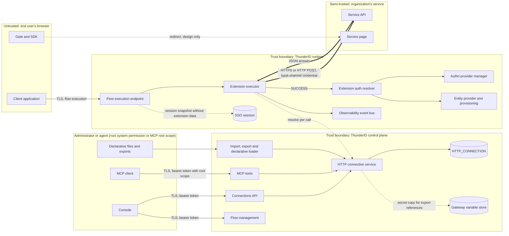
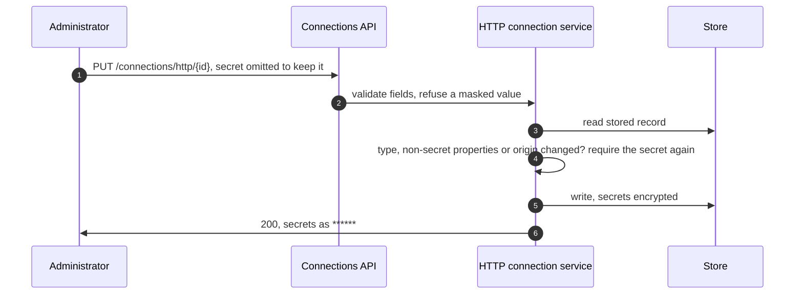
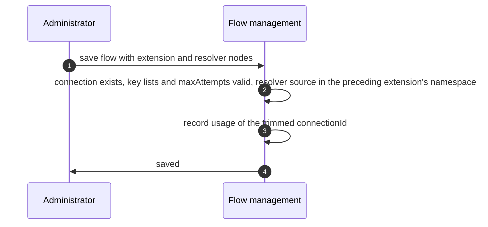
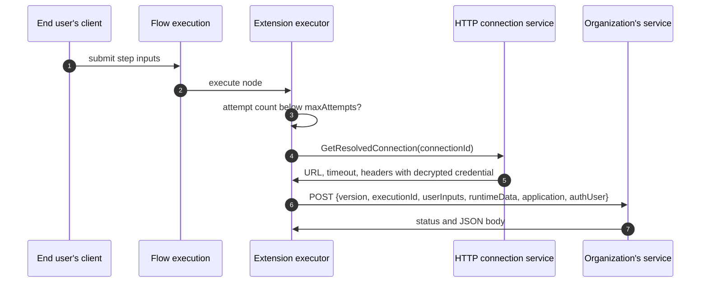
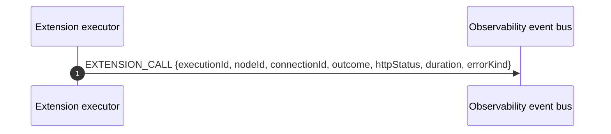
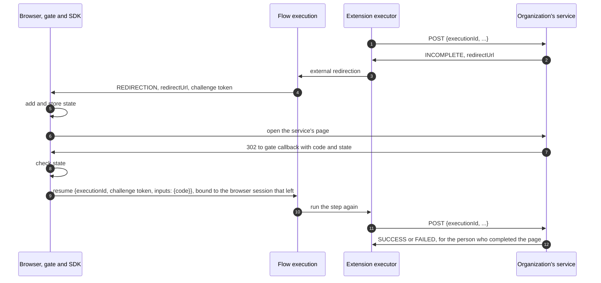
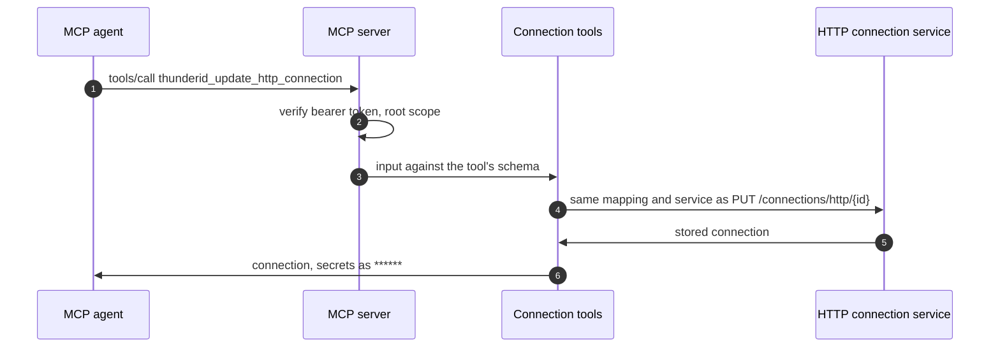
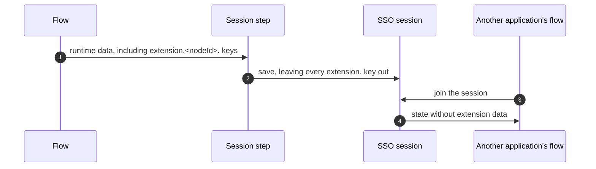

# Extension Executor Threat Model

This model covers the extension executor, the HTTP endpoint connection, and the extension auth resolver defined in [spec.md](spec.md): the outbound call from a flow to an organization's service, the evaluation of that service's answer, and the authentication of a local user on the strength of it. It follows specification version 0.8; mitigations cite the specification's sections and acceptance criteria.

## Status

| Interaction | Built | Where |
| --- | --- | --- |
| 01 Connection management | Yes | #5799; declarative configuration, import and export in #5843 |
| 02 Placing the steps | Yes, the extension step | #5831; the resolver is a design requirement |
| 03 Outbound call | Yes | #5831 |
| 04 Evaluating and storing the answer | Yes | #5831 |
| 05 Resolver, provisioning after it, second factor | No, design requirements | Custom authentication increment (PR 4 of #5727) |
| 06 Audit event | Yes | #5831 |
| 07 Redirect to the service's page | No, design requirements | Custom authentication increment (PR 4 of #5727). Today an `INCOMPLETE` answer with a non-empty `redirectUrl` is `ERROR` |
| 08 Connection management through MCP tools | Yes | #5799 |
| 09 Declarative configuration, import, export and the gateway copy | Yes | #5843 |
| 10 Extension in a registration flow followed by provisioning | Yes, the extension step | #5831 |
| 11 SSO session | Yes | #5831 |

Where a mitigation cites a specification control that a listed pull request has not implemented yet, the pull request implements it before it merges. Rows of interactions 05 and 07 are design requirements: they bind the custom authentication increment and are not claims about current behaviour.

## Overview

The extension executor makes ThunderID call a service it does not own, in the middle of a flow, and act on what comes back. That creates two new trust boundaries. Outbound, ThunderID sends user inputs and flow state, together with stored back-channel credentials, to an administrator-chosen endpoint. Inbound, an answer from that endpoint decides how the flow continues and what data later steps see, and through the extension auth resolver it can decide which local user is signed in.

The entry points are the connection management routes under `/connections/http`, the MCP tools that manage the same connections, declarative files and import, the flow definitions that place the two steps, the flow execution endpoint that runs them, and the response of the organization's service.

Cross-cutting concerns covered elsewhere and used here as trust inputs: authentication and authorization of the management API and the MCP server, encryption of stored properties with the server's configuration key, and the observability outputs. No companion model covers the following yet, so this model states what it relies on from each:

- **The authn provider manager.** Interaction 05 threat 2 relies on it rejecting internal credential types from API clients. The specification adds that flows cannot declare an internal credential type as an input, at save or at run time (*Extension auth resolver*, AC9.15).
- **The flow execution endpoint and its session handling.** Interaction 07 threat 3 relies on resuming being bound to the browser that left. Today's challenge token rotates per step but is returned in the response body and is not bound to a browser session, so the specification requires a binding for the redirect (*Redirect to the service's page*, AC4.11).
- **Token issuance after a flow completes.** Interaction 04 threat 9 relies on the assertion never taking a claim from extension data except through an explicit mapping (*Response storage*, AC6.7).

## Scope

This model covers:

- Creating, reading, updating, deleting, exporting and importing HTTP endpoint connections, through the API, the MCP tools and declarative files, including the copy of a secret kept for export references.
- Placing and configuring an extension step and an extension auth resolver in a flow.
- The outbound request: endpoint resolution, request construction, and the call.
- Evaluation of the response, storage of returned data in the flow, and what later steps, the assertion and the SSO session can read of it.
- Repeated calls to a step within one execution.
- Authentication of a local user through the extension auth resolver, and creation of a user that does not exist yet through the resolver and a provisioning step.
- An extension in a registration flow that provisions a user.
- The user's browser being sent to a service's own page and returning to resume the flow.
- An extension used as a second factor after password authentication.
- The `EXTENSION_CALL` audit event on the observability event bus.

Out of scope:

- The security of the organization's service itself, including how it authenticates the user and stores what it receives. ThunderID cannot observe or enforce it; the production guidance states what a service must do.
- The management API's authentication and permission model, owned by the system security model.
- The HTTP request executor, which is an existing step with its own behaviour.
- Asynchronous approval and notifications, which are future specifications.

## Architecture



The control plane, where connections and flows are authored, and the runtime, where flows call out, can run in separate server processes; they share the configuration store. Interactions 05 and 07 are design requirements.

The organization's service is semi-trusted, and what it is trusted for is narrow. By default it is trusted only for the decision it is asked to make and for data that later steps read when they name it; its answer cannot change the signed-in user, their stored attributes or credentials, the claims ThunderID asserts, or engine state (*Response storage*, AC6.3, AC6.7). It is trusted for identity only where an administrator places an extension auth resolver after it. ThunderID never trusts the shape of its answer.

### Components

| Component | Task |
| --- | --- |
| Connections API, MCP tools and HTTP connection service | Validate, store and resolve HTTP endpoint connections. Encrypt secrets at rest, mask them on every read, refuse a masked value sent back, and refuse credential-carrying plain header names |
| Import, export and declarative loader | Read declared connections as read-only, import and export connections with secrets as `.env` parameters, and keep a copy of each secret for export references in the default gateway's variable store |
| Flow management | Store flow definitions that place the two steps, validate their properties and connection references, and report which flows use a connection |
| Extension executor | Build the request from selected inputs and runtime data, call the service, evaluate the answer, count attempts, route the flow, store allowed data under the step's namespace |
| Extension auth resolver (design) | Map a value the immediately preceding extension verified to a single local user the application allows, and authenticate that user through an internal credential type |
| Authn provider manager | Accept the internal `extensionVerifiedEntityID` credential type from the resolver only |
| Entity provider and provisioning | Identify users for the resolver; create users, taking extension data only through the resolver's attribute mapping |
| SSO session | Keep the flow's state for later sign-ins at other applications, without extension data |
| Observability event bus | Deliver `EXTENSION_CALL` to the configured outputs when observability is enabled |

### Actors

#### Actors

| Actor | Description | Roles or permissions |
| --- | --- | --- |
| Administrator | Manages connections and flows in the console, through the API or with declarative files and imports | The root `system` permission, which the connection and flow management routes and import require |
| Flow designer | The administrator in the role of composing flows. How `onFailure` is routed decides whether a failing service denies or lets the user through | As administrator |
| MCP agent | An AI agent that manages connections through the MCP tools on an administrator's behalf | A token with the MCP root scope |
| End user | Runs a flow through a client application | None; the flow execution endpoint is public |
| Organization's service | Answers extension calls and, in the redirect design, hosts the page the browser is sent to | The back-channel credential stored on the connection |
| Network attacker | Positioned between ThunderID and the service | Observation, and modification without TLS |
| Observability operator | Reads the configured observability outputs | Access to those outputs |
| Gateway store operator | Administers the default gateway's variable store | Access to that store |
| Holder of an execution ID (design) | Anyone who sees the execution ID on the service's side once the redirect ships: the service's logs, analytics, or a third party through the referrer | None |

#### Entitlement matrix

| Actor | Manage connections | Read a stored secret | Place an extension or resolver | Run a flow | Observe or alter the outbound call | Decide an extension outcome | Choose the authenticated user |
| --- | --- | --- | --- | --- | --- | --- | --- |
| Administrator or flow designer | [Yes] | [No] | [Yes] | [Yes] | [No] | [No] | [No] |
| MCP agent | [Yes], no delete | [No] | [No] | [No] | [No] | [No] | [No] |
| End user | [No] | [No] | [No] | [Yes] | [No] | [No] | [No] |
| Organization's service | [No] | [No] | [No] | [No] | [No] | [Yes] | [Yes], only where a resolver follows its step |
| Network attacker | [No] | [No] | [No] | [No] | [Yes] for an `http` endpoint; [No] for `https` | [Yes] for an `http` endpoint; [No] for `https` | [Yes] for an `http` endpoint followed by a resolver; [No] otherwise |
| Observability operator | [No] | [No] | [No] | [No] | [No] | [No] | [No] |
| Gateway store operator | [No] | [Yes], the copy kept for export references | [No] | [No] | [No] | [No] | [No] |

A network attacker who also runs a flow does so as an end user.

### External Dependencies (not owned)

| Dependency | Description |
| --- | --- |
| Organization's service | Receives the request and returns the contract answer. Authenticates ThunderID with the connection's outbound authentication: `basic`, `bearer` or `api_key` through the shared outbound authentication model and its HTTP binding (*HTTP endpoint connection*, AC2.9, AC10.6) |
| TLS stack and the server's TLS settings | Certificate verification and the minimum TLS version for the outbound call |
| Server configuration key | Encrypts connection secrets at rest and the copy in the gateway variable store, owned by the configuration encryption model |
| Configuration database or declarative files | Hold connection records, depending on `http_connection.store` (default `composite`) |
| MCP server | Authenticates agents and enforces the root scope on the tools |
| Observability outputs | Console, file or OpenTelemetry collector, when observability is enabled |

## Threats and mitigations

### Out-of-scope interactions and risks

- Compromise of an administrator account or an agent token with the root scope, owned by the management API and MCP models. An administrator can already configure flows and users directly.
- How the organization's service authenticates users and protects what it receives.
- Brute force against the flow execution endpoint as a whole, owned by the flow execution model. Guessing through an extension step is covered in interaction 03.

### Interactions

#### 01: Administrator manages HTTP endpoint connections

**Description**

An administrator creates, reads, updates, deletes, exports or imports a connection through the API (the MCP tools and declarative files are interactions 08 and 09). The service validates the URL, timeout, headers and authentication, encrypts secrets, masks them on read, refuses a masked value sent back, keeps an omitted secret only while the authentication type, the non-secret properties and the URL origin are unchanged, and refuses deletion while a flow references the connection. Authentication uses the shared outbound authentication model and its HTTP binding, the same as the other connection types.

**Assets involved**

| Initiator | Intermediate | Target |
| --- | --- | --- |
| Administrator | Connections API | HTTP connection service, `HTTP_CONNECTION`, the gateway variable store copy |

**Data flow**



**Security considerations**

| Area | Response | Comments |
| --- | --- | --- |
| Data confidentiality | [C-High] | Back-channel credentials for the organization's service |
| Communication medium | [M-NT], [M-DB], [M-FS] | Files in declarative mode and on export |
| Transport security | [TLS] | |
| Authentication | Bearer token of an administrator | |
| Accessibility | [Restricted] | |
| Authorization and Access Control | The root `system` permission | |

**Threat assessment**

| ID | Category | Threat | Materializable | Mitigation / comment |
| --- | --- | --- | --- | --- |
| 1 | [Information Disclosure] | A stored token is read back through the API or the console and reused outside ThunderID | [No] | Every read masks each secret as `******`, including `bearer` tokens and `api_key` header values; the stored record holds only encrypted values (AC2.1, AC2.9) |
| 2 | [Information Disclosure] | An administrator who can edit but should not learn a secret points the connection's URL at a server they control, keeps the secret, and collects it from the next call | [No] | A change of URL origin with an authentication other than `none` requires every secret to be entered again (AC2.4, AC10.2). The rule is applied by the callers of the service; see *Residual risks* |
| 3 | [Information Disclosure] | A change of authentication type or username keeps the stored secret, so it is sent for a different user or method | [No] | The shared outbound-credential rule drops a stored secret when the type or any non-secret property changes, and the update then requires the secret again (AC2.3) |
| 4 | [Tampering] | A header value with a line break injects further headers into the outbound request | [No] | Header names are validated and values with line breaks are rejected |
| 5 | [Information Disclosure] | An export file carries secrets in plain text into source control | [No] | Every secret, including each `api_key` header value, is written as a `.env` parameter, not into the YAML (AC2.6, AC2.9). Plain header values are exported as they are, which is safe only because credential-carrying names are refused (threat 8) |
| 6 | [Operational Risk] | A connection is deleted while a flow uses it, breaking sign-in, or a flow references a connection that does not exist | [No] | Deletion is refused while any flow references it, and also when usages cannot be determined (AC3.2); usages are counted on the trimmed ID (AC3.4). Flow save refuses a connection that does not exist (AC1.4). The usage check arrives with #5831, so protection needs both #5799 and #5831; any dangling reference fails closed with `ErrExtensionConfigInvalid` |
| 7 | [Repudiation] | A connection's URL or credential is changed and no record says who changed what | [Yes] | Connection changes are recorded only in the general server log. A management audit trail with old and new values is outside this feature. See *Residual risks* |
| 8 | [Information Disclosure] | A credential is put in a plain header, where it is stored and returned in clear, exported as is, follows any URL change and can travel over `http` | [No] | Plain headers refuse credential-carrying names (`Authorization`, `Proxy-Authorization`, `Cookie`, `X-Api-Key`, `Api-Key`, `X-Auth-Token`, `X-Access-Token`, in any case) and HTTP-managed names (AC2.8, AC2.10). Credentials go only in `authentication`, which offers `basic`, `bearer` and `api_key`, encrypted, masked and bound to the URL origin (AC2.9, AC10.6). A service that expects a custom header name not on the list still depends on the administrator; see *Residual risks* |
| 9 | [Operational Risk] | A client that reads a connection and sends it back sets the password or token to `******`, so every sign-in through it fails | [No] | A masked `basic` password or `bearer` token is refused, and a client omits a secret to keep it; a masked `api_key` value on update keeps the stored one, as the shared HTTP binding defines (*HTTP endpoint connection*, AC2.11) |
| 10 | [Process Risk] | A connection or flow change takes effect at once, with no approval, so a single mistaken or malicious edit redirects every sign-in that uses the connection | [Yes] | Accepted for this feature: changes require the root permission and take effect immediately, as for other connection types. Change control belongs to a deployment's review of declarative files or to a future approval feature. See *Residual risks* |

#### 02: Administrator places an extension step or a resolver in a flow

**Description**

An administrator adds an extension step that references an HTTP endpoint connection (there is no inline URL), chooses the inputs and runtime data it sends, the response fields it stores and the attempt limit, and, in the custom authentication increment, places an extension auth resolver after it. Flow save checks the connection exists, the key lists and `maxAttempts` are well formed, and, for the resolver, that its source is the preceding extension's namespace.

**Assets involved**

| Initiator | Intermediate | Target |
| --- | --- | --- |
| Administrator | Flow management | Flow definition |

**Data flow**



**Security considerations**

| Area | Response | Comments |
| --- | --- | --- |
| Data confidentiality | [C-Low] | The flow definition holds only the connection's ID; endpoints and credentials stay in the connection |
| Communication medium | [M-NT], [M-DB] | |
| Transport security | [TLS] | |
| Authentication | Bearer token of an administrator | |
| Accessibility | [Restricted] | |
| Authorization and Access Control | The root `system` permission | |

**Threat assessment**

| ID | Category | Threat | Materializable | Mitigation / comment |
| --- | --- | --- | --- | --- |
| 1 | [Security Risk] | An administrator points an extension at an internal address and uses ThunderID to reach a host they could not otherwise reach | [No] | This server holds one deployment, and only holders of the root `system` permission can set endpoints; they already control the deployment's configuration. Private addresses are allowed on purpose, for on-premises services. In a hosted build that serves several deployments, a deployment's administrator is not the platform operator; that case is a residual with an operator-level egress allowlist as follow-up. See *Residual risks* |
| 2 | [Elevation of Privilege] | A resolver is placed after an extension that does not authenticate, or reads a value another step wrote, so any value that service returns signs a user in (design requirement) | [No] | Flow save refuses a resolver whose `sourceKey` is not in the namespace of the extension that routes to it through `onSuccess` (*Extension auth resolver*, AC9.12). Placing it after a non-authenticating extension still requires an administrator to build that flow |
| 3 | [Security Risk] | A malformed allowlist, such as an empty `responseKeys`, a blank name or a non-string value, is read as unset and every returned field is stored | [No] | Flow save refuses such a value, and one that reaches run time is a configuration error before any call (*Node properties*, AC1.5, AC1.6) |

#### 03: Flow calls the organization's service

**Description**

When a flow reaches an extension step, the executor checks the step's attempt count, resolves the endpoint from the connection on every execution, builds a JSON body that mirrors the step's flow context (the contract version, the execution ID, the flow type and node, the selected user inputs, the selected runtime data, the application's identifiers and the authenticated user's entity reference), and sends a `POST` with the connection's headers and authentication. It does not follow HTTP redirects, and it applies the timeout and a 64 KiB response cap.

**Assets involved**

| Initiator | Intermediate | Target |
| --- | --- | --- |
| End user through the flow execution endpoint | Extension executor, HTTP connection service | Organization's service |

**Data flow**



**Security considerations**

| Area | Response | Comments |
| --- | --- | --- |
| Data confidentiality | [C-High] | The request can carry inputs the administrator chose to send, and carries the back-channel credential when one is configured |
| Communication medium | [M-NT] | |
| Transport security | [TLS] for `https`; none for `http` | Certificates are verified with the server's TLS settings. A connection with any authentication other than `none` must use an `https` URL (AC2.7). An `http` URL is accepted only for a connection that sends no credential, and then the call is not encrypted. The call does not use an egress proxy from the environment; see *Residual risks* |
| Authentication | ThunderID to the service: the connection's outbound authentication (`basic`, `bearer` or `api_key`), or none. The service to ThunderID: the TLS server certificate for an `https` endpoint; nothing for an `http` endpoint | |
| Accessibility | [Internal] | Server to server |
| Authorization and Access Control | Only an administrator-configured endpoint can be called | |

**Threat assessment**

| ID | Category | Threat | Materializable | Mitigation / comment |
| --- | --- | --- | --- | --- |
| 1 | [Information Disclosure] | Every extension receives the user's password and one-time codes, so a risk or enrichment service holds credentials it never needed | [No] | Only the inputs named in `inputKeys` are sent, and none by default (AC5.1, AC5.2) |
| 2 | [Information Disclosure] | Engine secrets in runtime data, such as OTP session tokens, OAuth state, nonces or SSO handles, are sent to the service and replayed against ThunderID | [No] | Secret engine state is never sent, even when named (AC5.3). Other engine keys are sent only when named (AC5.4, AC5.5) |
| 3 | [Information Disclosure] | The service answers with a redirect to another host, and the client resends the back-channel credential there | [No] | HTTP redirects are not followed; a 3xx is `ERROR` (AC4.4) |
| 4 | [Information Disclosure] | A network attacker reads the request or the credential | [Yes] for an `http` endpoint; [No] for `https` | TLS with certificate verification protects `https` endpoints. A connection that holds a credential is refused an `http` URL (AC2.7), so a stored credential never crosses the network in clear. A connection without a credential may still use `http`, and then the selected inputs and the answer are readable on the network. See *Residual risks* |
| 5 | [Spoofing] | An attacker impersonates the service and answers `SUCCESS` | [Yes] for an `http` endpoint; [No] for `https` | TLS server certificate verification protects `https` endpoints. Over `http` a network attacker can answer in place of the service, and where a resolver follows, that answer signs in the user it names. Use `https` for any service that authenticates users. See *Residual risks* |
| 6 | [Denial of Service] | A slow or unresponsive service holds flow executions open and exhausts server resources | [No] | The timeout is at most 20 seconds, the call is not retried, and the body is read up to 64 KiB (AC4.4) |
| 7 | [Denial of Service] | A service that is down blocks every sign-in that uses it | [Yes] | By design the step fails closed (`ERROR`). An administrator can route `onFailure` elsewhere for non-critical extensions; for an authenticating or second-factor extension `onFailure` must lead to a path that denies. No circuit breaker exists. See *Residual risks* |
| 8 | [Tampering] | A connection is edited during a flow and later calls use stale values | [No] | The connection is resolved on every execution (AC2.5) |
| 9 | [Information Disclosure] | Mirroring the flow context sends the application's OAuth client secret, or the authenticated user's provider tokens and attributes, to the service | [No] | `application` carries only `id`, `ouId`, `name` and `type`, and `authUser` only each provider's entity reference. A unit test fails if anything else appears (AC5.7, AC5.8) |
| 10 | [Denial of Service] | Many concurrent flow executions reach an extension step at once, through the public flow execution endpoint, and the in-flight calls, each held for up to 20 seconds, exhaust server connections and goroutines or overwhelm the organization's service | [Yes] | The per-call limits (timeout, no retry, 64 KiB cap) bound one call, not how many run at once, and ThunderID applies no rate limit to `/flow/execute`. The control is at the deployment: rate-limit `/flow/execute` at the gateway or front door. A concurrency cap per connection is a candidate follow-up. See *Residual risks* |
| 11 | [Information Disclosure] | Data an earlier extension stored, such as a risk score, a reference or a token another service returned, is sent to every later extension, so one organization service reads another's answers | [No] | Flow data is sent only when named in `runtimeDataKeys`; by default a service receives `applicationId` and `userID` only (AC5.4). `responseKeys` also limits what an extension stores in the first place (AC6.2) |
| 12 | [Spoofing] | An end user returns to an extension step that verifies a secret, such as a PIN or a code, again and again within one execution, and guesses it | [No] | The step counts `FAILED` and `INCOMPLETE` answers in one execution; after `maxAttempts`, 5 by default and at most 20, every later arrival fails with `ErrExtensionAttemptsExceeded` without calling the service (*Attempt limit*, AC4.8, AC4.9). The counter cannot stop new executions, so a service that verifies a secret must enforce its own lockout across executions; see *Security guidelines for production deployment* |

#### 04: Evaluating the answer and storing returned data

**Description**

The executor decides one of four outcomes from `actionStatus`, treating anything outside the contract as `ERROR`, routes the flow, shows bounded failure text to the user, and stores allowed fields as strings under the step's namespace, `extension.<nodeId>.<field>`, replacing what the step stored before. A later step, the assertion or provisioning reads that data only when it names the namespaced key.

**Assets involved**

| Initiator | Intermediate | Target |
| --- | --- | --- |
| Organization's service | Extension executor | Flow runtime data, end user's client |

**Data flow**

```mermaid
sequenceDiagram
  autonumber
  participant S as Organization's service
  participant EX as Extension executor
  participant RD as Runtime data
  participant U as End user's client
  S->>EX: {actionStatus, failureReason, failureDescription, fields}
  EX->>EX: status 2xx, object body, size, known actionStatus, no reserved key among the stored fields
  EX->>RD: clear extension.<nodeId>., then store allowed fields under it
  EX->>U: route; bounded description on FAILED or INCOMPLETE; generic error on ERROR
```

**Security considerations**

| Area | Response | Comments |
| --- | --- | --- |
| Data confidentiality | [C-Medium] | Returned fields may hold personal data and tokens |
| Communication medium | [M-IN] | In memory and in the flow's stored context; never in the SSO session |
| Transport security | [TLS] | |
| Authentication | As interaction 03 | |
| Accessibility | [Internal] | |
| Authorization and Access Control | The response can only add data under its own namespace and pick one of four outcomes | |

**Threat assessment**

| ID | Category | Threat | Materializable | Mitigation / comment |
| --- | --- | --- | --- | --- |
| 1 | [Elevation of Privilege] | The response writes `userID`, `ouId`, `groups`, `password`, role mappings or another engine key, and a later step trusts it | [No] | Returned fields are stored only under the step's namespace, so they cannot take an engine key's place (*Response storage*, AC6.1). As defence in depth, a response that would store a reserved key is `ERROR` and nothing is stored (AC6.3); a field `responseKeys` leaves out is never stored, so it is not checked; a unit test keeps the reserved list complete (AC6.4) |
| 2 | [Security Risk] | A malformed, empty or unexpected answer is treated as success, and the flow fails open | [No] | Only an exact `SUCCESS` in a 2xx JSON object completes the step. Everything else is `ERROR` (AC4.4) |
| 3 | [Information Disclosure] | An upstream error page, stack trace or token reaches the end user | [No] | `ERROR` returns a generic message only. Nothing from the body reaches the client (AC4.4) |
| 4 | [Information Disclosure] | Tokens in the response are stored in the flow and sent to later extensions | [No] | `responseKeys` restricts what is stored (AC6.2), and an unusable value is refused rather than read as unset (AC1.5, AC1.6). Runtime data sent onwards is subject to `runtimeDataKeys` |
| 5 | [Information Disclosure] | Different failure text for unknown accounts and wrong passwords lets an attacker enumerate accounts through the extension | [No] | For `invalid_credentials` and `user_not_found` the step returns ThunderID's native `ErrInvalidCredentials` with no reason param, so the response is identical for both reasons and to a native credential failure (AC7.2) |
| 6 | [Tampering] | `failureDescription` carries markup, control characters or format characters, such as bidirectional overrides or zero-width characters, so the sign-in page shows something other than the text | [No] | Control and Unicode format characters are removed, the text is cut to 256 characters (AC7.1, AC7.5), and `failureReason` is restricted to `[A-Za-z0-9_.-]` and 64 characters (AC7.4). The description must be rendered as text, never as markup, by the gate and the SDKs that display it; see *Residual risks* |
| 7 | [Tampering] | A failure or a field from an earlier attempt remains in runtime data and misleads a later step | [No] | `SUCCESS` resets both failure fields (AC6.5), and each call replaces the step's namespace, so it holds only the latest answer (AC6.8) |
| 8 | [Denial of Service] | A very large body exhausts memory | [No] | The body is read up to 64 KiB; anything larger is `ERROR` |
| 9 | [Elevation of Privilege] | A service that is compromised, misconfigured or echoes what it holds returns a field named like a profile attribute, such as `email`, and the claims ThunderID signs for the signed-in user change; a relying party that links accounts by email opens the wrong account | [No] | A returned `email` is stored as `extension.<nodeId>.email`, and the assertion and provisioning never take a claim from a namespaced key except through an explicit mapping (*Response storage*, AC6.7). Which flow data the engine treats as trusted once external services write it is tracked for the engine as a whole; see *Residual risks* |
| 10 | [Elevation of Privilege] | A service returns a credential attribute the user type defines, such as a PIN, and a later provisioning step gives it to a new account | [No] | The value is stored under the namespace and never read as a credential (AC6.7); the resolver's attribute mapping cannot map a credential attribute (*Extension auth resolver*) |

#### 05: Authenticating a user through the extension auth resolver (design requirements)

**Description**

Not built yet; these rows are requirements for the custom authentication increment. After an extension answers `SUCCESS`, the resolver reads the identifier the service verified from that extension's namespace, under `sourceKey`, resolves exactly one local user the application allows, and authenticates that user through the internal `extensionVerifiedEntityID` credential type. With `allowAuthenticationWithoutLocalUser`, a provisioning step can create the user, taking attributes from the extension only through the resolver's `attributeMapping`. Without a resolver, an extension after a password step acts as a second factor.

**Assets involved**

| Initiator | Intermediate | Target |
| --- | --- | --- |
| Organization's service, through the extension's namespace | Extension auth resolver, entity provider | Authn provider manager, the flow's authenticated user |

**Data flow**

```mermaid
sequenceDiagram
  autonumber
  participant EX as Extension executor
  participant RS as Extension auth resolver
  participant EP as Entity provider
  participant AP as Authn provider manager
  EX->>RS: SUCCESS; runtimeData[extension.<nodeId>.<field>] from this pass
  RS->>EP: identify by matchAttribute
  EP->>RS: exactly one entity
  RS->>RS: category user, allowed user type and organization unit, state ACTIVE
  RS->>AP: AuthenticateUser(extensionVerifiedEntityID)
  AP->>RS: authenticated user
```

**Security considerations**

| Area | Response | Comments |
| --- | --- | --- |
| Data confidentiality | [C-Medium] | A user identifier |
| Communication medium | [M-IN] | |
| Transport security | [N/A] | In process |
| Authentication | The service's answer, trusted by configuration | |
| Accessibility | [Internal] | |
| Authorization and Access Control | Only where an administrator placed a resolver | |

**Threat assessment**

| ID | Category | Threat | Materializable | Mitigation / comment |
| --- | --- | --- | --- | --- |
| 1 | [Spoofing] | A compromised or malicious service answers `SUCCESS` with any username and signs in as that user | [Yes] | Accepted trust: delegating authentication to a service means trusting its answer. Bounded by the resolver being explicit and administrator-placed, by the single-match check, and by the user being one the application allows (AC9.13). TLS and the back-channel credential bound it only for an `https` endpoint with authentication; an `http` endpoint with authentication `none` is allowed and has neither. See *Residual risks* |
| 2 | [Spoofing] | An API client or a flow input supplies `extensionVerifiedEntityID` and signs in as any user | [No] | The type is on `InternalCredentialTypes`, which the credentials API rejects (AC9.4), and flow save and the credentials step refuse an internal credential type declared as an input (AC9.15) |
| 3 | [Elevation of Privilege] | The service's answer writes the authenticated user directly, without the resolver | [No] | The extension executor is a utility step and cannot set the user; its fields are stored only under its namespace, and `userID` is a reserved key, so a response that would store it is `ERROR` (AC6.1, AC6.3) |
| 4 | [Spoofing] | An ambiguous identifier matches several users and the first is signed in | [No] | More than one match fails (AC9.3). The increment must also detect ambiguity across the database and declarative user stores, and define whether matching is case-sensitive |
| 5 | [Elevation of Privilege] | A disabled or locked user, or a non-user entity, is signed in through the service | [No] | Only a `user` in state `ACTIVE` is accepted (AC9.3). Today `ACTIVE` is the only entity state, so the check cannot yet reject a disabled or locked user; the control depends on those states existing. See *Residual risks* |
| 6 | [Information Disclosure] | The resolver's answers reveal which accounts exist | [No] | Not found, non-user, inactive and not allowed give the same error (AC9.3, AC9.13) |
| 7 | [Security Risk] | A relying party cannot tell that the user authenticated through an external service, or receives an `acr` that suggests a method nothing recorded | [Yes] | The assertion claims no authentication method or assurance level stronger than the flow recorded (AC9.16). An administrator can still map the prompt action that leads to the extension to an `acr`; recording a new method is out of scope. See *Residual risks* |
| 8 | [Spoofing] | With `allowAuthenticationWithoutLocalUser`, the service returns the username of an existing local account, and the resolver signs into that account instead of creating a new one | [Yes] | Matching on an attribute merges the service's user namespace with local accounts. Accepted with threat 1, and bounded by the option being off by default. See *Residual risks* |
| 9 | [Tampering] | A user is created from attributes the service supplied, so a service can set any attribute the user schema allows | [No] | Provisioning takes attributes from the extension only through the resolver's `attributeMapping`, never a credential attribute, and only schema attributes (*Extension auth resolver*, AC6.7). Creation happens only after the resolver marked the user eligible (AC9.8, AC9.10) |
| 10 | [Elevation of Privilege] | Used as a second factor, the service answers `SUCCESS` for a different user and switches the signed-in identity, or changes the signed-in user's claims, or a service outage skips the second factor | [No] | The extension executor cannot set the user, no resolver is placed in this pattern (AC9.11), and its fields cannot change claims (AC6.7). `FAILED` and `ERROR` both continue at `onFailure`, so `onFailure` of a second-factor extension must lead to a path that denies (*Custom authentication flow patterns*, pattern 3) |
| 11 | [Spoofing] | The resolver signs in whatever value sits under its source key: one an earlier extension wrote, or one left by an earlier answer of the same service, although this attempt's authenticating call never returned it | [No] | Flow save refuses a `sourceKey` outside the namespace of the extension that routes to the resolver through `onSuccess` (AC9.12), and each call replaces that namespace (AC6.8), so the value is the one that extension returned with `SUCCESS` in this pass |
| 12 | [Lateral Movement] | A service trusted by one application's flow names a user of another organization unit or user type, including an administrator, and the authorization step then evaluates that user's roles | [No] | The resolver signs in only a user of an allowed user type in an organization unit the application serves (AC9.13). How extensions behave across organization units is tracked separately; see *Residual risks* |
| 13 | [Spoofing] | A local user sets their own attribute, such as `email`, to the value the service will verify for someone who has no local account yet, and that person's sign-in resolves to the first user's account | [No] | `matchAttribute` is `userID`, `username` or an attribute users cannot change through self-service; flow save refuses any other (AC9.14). How a user-type schema marks such attributes is defined by the increment |
| 14 | [Repudiation] | A sign-in through the resolver leaves only `EXTENSION_CALL`, so an investigation cannot tell how the user signed in | [No] | A sign-in through the resolver publishes an authentication event naming the resolver (AC9.16) |

#### 06: Audit event

**Description**

When observability is enabled, every execution publishes one `EXTENSION_CALL` event on ThunderID's observability event bus, in the flows category, with the outcome, the HTTP status, the duration and an error kind, and never with URLs, header values, bodies, inputs or runtime-data values. The bus delivers it to the deployment's configured outputs (console, file or OpenTelemetry). Observability is disabled in the default configuration.

**Assets involved**

| Initiator | Intermediate | Target |
| --- | --- | --- |
| Extension executor | Observability event bus | Configured outputs: console, file or OpenTelemetry collector |

**Data flow**



**Security considerations**

| Area | Response | Comments |
| --- | --- | --- |
| Data confidentiality | [C-Low] | Identifiers and outcomes only |
| Communication medium | [M-IN], [M-FS], [M-NT] | In process to the bus; file or network depending on the configured output |
| Transport security | [N/A] | |
| Authentication | [N/A] | |
| Accessibility | [Restricted] | Observability operators |
| Authorization and Access Control | The deployment's access controls on its observability outputs | |

**Threat assessment**

| ID | Category | Threat | Materializable | Mitigation / comment |
| --- | --- | --- | --- | --- |
| 1 | [Information Disclosure] | Secrets, credentials or personal data reach the observability outputs | [No] | The event's fields are fixed and exclude URLs, header values, bodies, user inputs, runtime-data values and `failureDescription` (AC8.3) |
| 2 | [Repudiation] | An operator cannot tell a refusal by the service from a broken service, or a step that stopped at its attempt limit | [No] | `outcome` and `errorKind` distinguish them, including `ATTEMPTS_EXCEEDED` (AC8.1, AC8.2, AC8.4) |
| 3 | [Repudiation] | A default deployment publishes no `EXTENSION_CALL`, so extension calls leave no audit record | [Yes] | Observability is disabled by default; the event exists only after a deployer enables it (*Audit event*). The production guidance says to enable it. An always-on audit log is a candidate follow-up. See *Residual risks* |

#### 07: Sending the user to the service's page and resuming (design requirements)

**Description**

Not built yet; these rows are requirements for the custom authentication increment. Today an `INCOMPLETE` answer with a non-empty `redirectUrl` is `ERROR`. In the design, a service answers `INCOMPLETE` with `redirectUrl`. The step returns an external redirection, the client SDK adds a random `state` and sends the browser to the service's page. When the user is done, the service sends the browser to the gate's callback with `code` and the same `state`. The gate checks `state`, the SDK resumes the flow, and the step calls the service again for the outcome.

**Assets involved**

| Initiator | Intermediate | Target |
| --- | --- | --- |
| Organization's service | Extension executor, client SDK, end user's browser | Gate callback, flow execution endpoint |

**Data flow**



**Security considerations**

| Area | Response | Comments |
| --- | --- | --- |
| Data confidentiality | [C-Medium] | The execution ID appears in the service's URL, where the service's logs, analytics or a third party through the referrer can see it |
| Communication medium | [M-NT] | |
| Transport security | [TLS] | The service's page is `http` only if the administrator's service is |
| Authentication | Resuming is bound to the browser session that left (AC4.11), and the outcome to the person who completed the page (AC4.10); the outcome comes from the server-to-server call | |
| Accessibility | [Public] | The callback and the service's page are reached by the browser |
| Authorization and Access Control | Only an administrator-configured service can ask for a redirect | |

**Threat assessment**

| ID | Category | Threat | Materializable | Mitigation / comment |
| --- | --- | --- | --- | --- |
| 1 | [Tampering] | The service returns a `javascript:` or `data:` URL, which runs script in the sign-in page | [No] | Only absolute `http` and `https` URLs are accepted; anything else is `ERROR` and nothing reaches the browser (AC4.6) |
| 2 | [Spoofing] | A compromised service sends users to a phishing page that imitates the sign-in page | [Yes] | Any `http` or `https` destination is accepted, because services commonly host their page apart from their API. Per-connection allowed page origins and an interstitial that shows the destination before the browser leaves were considered; the increment decides between them. Bounded by the service being administrator-configured. See *Residual risks* |
| 3 | [Spoofing] | Someone who sees the execution ID in the service's URL, or forges the callback with their own `code`, resumes another user's flow and receives its outcome | [No] | Resuming must require proof held only by the browser session that left, so a copied execution ID and challenge value alone cannot resume it (*Redirect to the service's page*, AC4.11). Today's challenge token rotates on every step but is returned in the response body and is not bound to a session, so the increment adds that binding. The gate also accepts the return only with the `state` stored in that session, and the outcome is decided by the second server-to-server call |
| 4 | [Tampering] | A forged or replayed return makes the step treat a pending authentication as done | [No] | The step asks the service again on every return. A service must answer the outcome for that `executionId` only once it has one |
| 5 | [Information Disclosure] | `redirectUrl` is stored in runtime data and sent to later extensions | [No] | It is a contract field and never stored (AC4.7) |
| 6 | [Spoofing] | Someone starts a sign-in, copies the service page link their own browser is sent to, and gets another person to complete it; their own browser then resumes and receives that person's outcome, which signs them in where a resolver follows | [No] | The outcome must describe the person who completed the page in the browser that left, not merely the holder of the `executionId` (AC4.10); `state` and the challenge token do not help here, since the browser that left is the one that returns. The increment chooses the mechanism, for example always forwarding `code` that the service verifies it issued to the browser that completed its page, or a signed short-lived token naming the user |
| 7 | [Denial of Service] | A service answers with a redirect on every call, so the flow never completes | [No] | A redirect-only `INCOMPLETE` is not counted by `maxAttempts` (*Attempt limit*), so the increment must bound redirects in one execution. See *Residual risks* |

#### 08: Connection management through MCP tools

**Description**

An AI agent lists, reads, creates and updates HTTP endpoint connections through four MCP tools, on an administrator's behalf, with a token that holds the MCP root scope. Each tool goes through the same request mapping and service as its API call. There is no delete tool.

**Assets involved**

| Initiator | Intermediate | Target |
| --- | --- | --- |
| MCP agent | MCP server, connection tools | HTTP connection service, `HTTP_CONNECTION` |

**Data flow**



**Security considerations**

| Area | Response | Comments |
| --- | --- | --- |
| Data confidentiality | [C-High] | Back-channel credentials pass through the tool input |
| Communication medium | [M-NT] | |
| Transport security | [TLS] | |
| Authentication | Bearer token with the MCP root scope | |
| Accessibility | [Restricted] | |
| Authorization and Access Control | The same authorization as the connection routes | |

**Threat assessment**

| ID | Category | Threat | Materializable | Mitigation / comment |
| --- | --- | --- | --- | --- |
| 1 | [Information Disclosure] | A tool returns a stored secret to the agent, where it lands in the model's context and the client's history | [No] | No tool output contains a secret; every read is masked as the API's is (*MCP tools*, AC11.2) |
| 2 | [Information Disclosure] | An update through a tool skips a rule the API applies, such as keeping the stored password after an origin change | [No] | Each tool goes through the same mapping and service as its API call, so validation, refused header names, the retention rule and the refusal of the mask are identical (AC11.3) |
| 3 | [Operational Risk] | An agent follows "send the complete object back" and sets the password to `******` | [No] | A masked password or token is refused (AC2.11, AC11.3), and the tool tells agents to omit a secret to keep it |
| 4 | [Information Disclosure] | A secret an agent supplies passes through the model's context and the client's logs | [Yes] | Accepted for now: the tool takes the secret as an argument, as the other MCP tools that take secrets do. Collecting secrets out of band, such as through URL-mode elicitation, is a candidate follow-up. See *Residual risks* |
| 5 | [Repudiation] | A connection change made by an agent cannot be told apart from one an administrator made | [Yes] | Agents act with the administrator's token and are not attributed separately, as for interaction 01 threat 7. See *Residual risks* |

#### 09: Declarative configuration, import, export and the gateway copy

**Description**

Connections can be declared in files, imported and exported. Declared connections are read-only. Export writes each secret as a `.env` parameter; import accepts the same shape and keeps the document's ID. On the control plane, every write keeps a copy of each secret in the default gateway's variable store so export references can resolve, and every update, delete, import upsert and prune removes the copies the connection no longer refers to.

**Assets involved**

| Initiator | Intermediate | Target |
| --- | --- | --- |
| Administrator, a deployment pipeline | Import, export and declarative loader | HTTP connection service, `HTTP_CONNECTION`, the gateway variable store |

**Data flow**

```mermaid
sequenceDiagram
  autonumber
  participant A as Administrator or pipeline
  participant I as Import and declarative loader
  participant S as HTTP connection service
  participant V as Gateway variable store
  A->>I: YAML with secrets as .env parameters
  I->>I: validate as the API does; refuse a declared ID or name
  I->>S: create or update, retention rule on update
  S->>V: keep a copy of each secret for export references
  A->>I: prune, or an upsert that drops a secret
  I->>S: delete or update through the same path as the API
  S->>V: remove the copies the connection no longer refers to
  A->>I: export
  I->>A: YAML, secrets as parameters, and .env
```

**Security considerations**

| Area | Response | Comments |
| --- | --- | --- |
| Data confidentiality | [C-High] | Back-channel credentials in `.env` files and in the gateway store copy |
| Communication medium | [M-FS], [M-DB], [M-NT] | Files, often in source control |
| Transport security | [TLS] | For the import and export routes |
| Authentication | Bearer token of an administrator | |
| Accessibility | [Restricted] | |
| Authorization and Access Control | The root `system` permission | |

**Threat assessment**

| ID | Category | Threat | Materializable | Mitigation / comment |
| --- | --- | --- | --- | --- |
| 1 | [Information Disclosure] | An exported file in source control carries a secret | [No] | Every secret, including each `api_key` header value, is a `.env` parameter (AC2.6, AC2.9). An `api_key` header name that cannot be written as its own parameter, because it contains a dot or derives the same name as another header, makes the export refuse the connection rather than write the value in the YAML (AC2.13) |
| 2 | [Information Disclosure] | An import update that omits the password keeps it after the URL origin changes | [No] | Import writes through the same update path as the API, which applies the retention rule. The rule sits in the connection package rather than in the HTTP connection service; see *Residual risks* |
| 3 | [Tampering] | An import reuses a declared connection's ID or name and shadows the read-only declared connection that flows reference | [No] | A database connection cannot take a declared connection's ID or name, and declared connections cannot be updated or deleted |
| 4 | [Information Disclosure] | The copy of a secret kept for export references outlives the connection, or the secret dropped after an origin change | [No] | Deleting the connection removes the copy, and dropping the stored secret under the retention rule removes or replaces it (*HTTP endpoint connection*, AC2.12). The API, the MCP tools, import upserts and prunes all go through that path. The copy is encrypted with the configuration key, and the variable store's read API returns metadata only. Removal is best effort and logged: a gateway that is no longer the default keeps its copy; see *Residual risks* |
| 6 | [Denial of Service] | Removing a copy deletes a value that this or another resource still refers to, so the next gateway apply fails | [No] | Only names the connection's own export writes are removed, minus every name it still refers to, including through a `sec:` reference; a reference to another name is never removed. Connections of different types with the same name derive the same names and share a copy; see *Residual risks* |
| 5 | [Tampering] | A declared file carries a connection the API would refuse, such as a credential over `http` or a reserved header | [No] | Declared files are validated with the API's rules at load |

#### 10: Extension in a registration flow followed by provisioning

**Description**

A registration flow calls an extension, for example to check eligibility or enrich data, and then a provisioning step creates the user from what the person entered.

**Assets involved**

| Initiator | Intermediate | Target |
| --- | --- | --- |
| End user, organization's service | Extension executor, provisioning | A new user account |

**Data flow**

```mermaid
sequenceDiagram
  autonumber
  participant U as End user's client
  participant EX as Extension executor
  participant P as Provisioning
  U->>EX: registration inputs
  EX->>EX: call the service; store fields under extension.<nodeId>.
  EX->>P: continue
  P->>P: create the user; extension data only through an explicit mapping
```

**Security considerations**

| Area | Response | Comments |
| --- | --- | --- |
| Data confidentiality | [C-Medium] | Registration data and the service's answer |
| Communication medium | [M-IN] | |
| Transport security | As interaction 03 | |
| Authentication | [N/A] | Registration is public |
| Accessibility | [Public] | |
| Authorization and Access Control | Only an administrator-configured service is called | |

**Threat assessment**

| ID | Category | Threat | Materializable | Mitigation / comment |
| --- | --- | --- | --- | --- |
| 1 | [Elevation of Privilege] | The service returns a credential attribute, such as a PIN, and the new account gets it, so the service or anyone it shares it with can sign in later without the extension | [No] | Returned fields are stored under the step's namespace and provisioning never takes a credential from a namespaced key (*Response storage*, AC6.7) |
| 2 | [Tampering] | The service sets attributes of the new user, such as `email`, that the person never entered | [No] | Provisioning takes extension data only through an explicit mapping; the attribute mapping exists only on the resolver (interaction 05) (AC6.7) |

#### 11: SSO session

**Description**

The session step saves the flow's state so that a later sign-in at another application can join the session. Extension data is not part of what it saves.

**Assets involved**

| Initiator | Intermediate | Target |
| --- | --- | --- |
| Flow execution | Session step | SSO session, later flows of other applications |

**Data flow**



**Security considerations**

| Area | Response | Comments |
| --- | --- | --- |
| Data confidentiality | [C-Medium] | Session state |
| Communication medium | [M-DB] | |
| Transport security | [N/A] | In process |
| Authentication | [N/A] | |
| Accessibility | [Internal] | |
| Authorization and Access Control | Session handling | |

**Threat assessment**

| ID | Category | Threat | Materializable | Mitigation / comment |
| --- | --- | --- | --- | --- |
| 1 | [Privacy Risk] | Data an extension returned for one application, such as a risk score or CRM attributes, is kept for the life of the SSO session and reaches every application that joins it, without the service being called again | [No] | The session step leaves every `extension.` key, and the `failureReason` and `failureDescription` an extension stored, out of the session it saves; an application that needs the data calls its own extension (*Response storage*, AC6.6) |
| 2 | [Elevation of Privilege] | A value an extension stored in one application's flow changes claims in another application's assertion | [No] | Extension data is not saved with the session (AC6.6) and never becomes a claim except through an explicit mapping (AC6.7) |

## Security Review Checklist

### Security considerations

| # | Consideration | State | Comments |
| --- | --- | --- | --- |
| 1 | Are all inputs and outputs validated (syntactic and semantic)? | [Yes] | Connection fields on write, through the API, the MCP tools and declarative files; step properties at flow save; the service's answer against the fixed contract, size cap and reserved keys; user-facing text bounded |
| 2 | Are rate limits in place where necessary? | [Partial] | Each call is bounded by a 20-second timeout, no retry and a 64 KiB cap, and `maxAttempts` bounds repeated calls in one execution. Concurrency depends on the deployment rate-limiting `/flow/execute`; ThunderID has no per-connection concurrency cap or circuit breaker |
| 3 | Are permissions, roles, and entitlements defined on the principle of least privilege and business need? | [Partial] | Only the root `system` permission, or the MCP root scope, manages connections. No narrower permission for connections exists |
| 4 | Are authentication and authorization validated at both the UI and API layers, front end and back end, before granting access to resources? | [Yes] | The console uses the same management API, and the MCP tools the same service, which enforce the permission |
| 5 | Are proper isolations in place between components to ensure least-privilege access and reduce the blast radius against lateral movement? | [Yes] | The extension executor cannot set the user and stores data only under its namespace; the resolver is separate and explicit; secret engine state is never sent; extension data stays out of the SSO session |
| 6 | Have any default credentials been changed, and are default superuser or root accounts not in use? | [N/A] | No default connection or credential ships |
| 7 | Has the implementation followed best-practice guidelines? | [Yes] | OWASP guidance on server-side requests, output encoding and logging |
| 8 | Are secrets, credentials, and internal-only material kept out of the public source tree and its git history? | [Yes] | Export writes secrets as `.env` parameters |
| 9 | Was a security-focused code review conducted for this change, and have the findings been addressed? | [Partial] | A security review of the connection, extension step and declarative pull requests was conducted; its findings are addressed through specification version 0.8 and the implementation pull requests |
| 10 | Is Static Analysis (SAST) or IaC scanning conducted, and are findings addressed? | [Yes] | The repository's lint and security checks run on every pull request |
| 11 | Is Software Composition Analysis (SCA) conducted or integrated into the repository, and are findings addressed? | [Yes] | No new dependency is introduced |
| 12 | Is Dynamic (DAST) or API scanning conducted on a non-production setup, and are findings addressed? | [No] | Integration tests cover the contract, the connection API and the MCP tools |
| 13 | Are audit logs generated in a standardized format for critical functionality? | [Partial] | When observability is enabled, every execution publishes `EXTENSION_CALL`; observability is disabled by default (interaction 06, threat 3). A resolver sign-in publishes an authentication event (design) |
| 14 | Do audit logs for critical configuration changes record the difference between the old and new versions? | [No] | Connection changes have no management audit trail |
| 15 | Are data in transit and at rest encrypted? | [Partial] | Secrets are encrypted at rest, including the gateway copy, and a connection with a credential must use `https`. A connection without a credential may still use `http` |
| 16 | Are sensitive values such as credentials and keys stored in a secret store or vault? | [Partial] | Encrypted with the server's configuration key in the configuration store and the gateway variable store, not an external vault |
| 17 | Is personal, sensitive, or confidential data kept out of logs? | [Yes] | See interaction 06 |
| 18 | Have users been given clear instructions for secure usage? | [Partial] | See *Security guidelines for production deployment*; the user documentation is delivered with the feature |

### Business impact and resilience

| # | Consideration | State | Comments |
| --- | --- | --- | --- |
| 1 | Has a business impact analysis been done to identify resilience requirements? | [N/A] | A flow that uses an extension depends on the organization's service. Its availability is owned by that organization |

Resilience characteristics that do belong to this feature: the step fails closed, a timeout is bounded and not retried, repeated calls are bounded per execution, and an administrator can route `onFailure` to a fallback path for non-critical extensions.

### Dependency and component health

| # | Consideration | State | Comments |
| --- | --- | --- | --- |
| 1 | Are dependencies, base images, and runtimes monitored for known vulnerabilities and kept current? | [Yes] | No new dependency |
| 2 | Are any End-of-Life or End-of-Service components in use? | [No] | |
| 3 | Is hardening guidance published for operators who deploy the project? | [Partial] | See *Security guidelines for production deployment* |

### Privacy considerations

The extension executor sends personal data to a service outside ThunderID: the user inputs and runtime data an administrator selects, `userID` and the application's identifiers. The service may be in another jurisdiction; that transfer is the deploying organization's decision. What the service returns is kept in the flow context under the step's namespace for the life of the flow, and is not saved with the SSO session.

| # | Consideration | State | Comments |
| --- | --- | --- | --- |
| 1 | Is the purpose and legal basis for processing personal data clearly defined? | [N/A] | Determined by the deploying organization, which chooses the service and what it receives |
| 2 | Are the collection, storage, processing, sharing, archival, and disposal of personal data aligned with the data minimization principle? | [Yes] | No user inputs are sent by default, runtime data can be restricted, and returned data can be allowlisted |
| 3 | Is personal data stored securely? | [Yes] | Returned data lives in the flow context for the life of the flow, under the step's namespace |
| 4 | Are privacy notices updated to reflect any new processing or changes to purpose and legal basis? | [N/A] | Owned by the deploying organization |
| 5 | Is access to personal data granted on a need-to-know basis? | [Yes] | Per-step selection of inputs and runtime data; later steps read returned data only by naming it |
| 6 | Are data retention requirements considered? | [Yes] | Returned data is kept only in the flow context and is never saved with the SSO session (AC6.6). The back-channel credential's copy in the gateway variable store is kept while the connection exists and removed with it (AC2.12) |
| 7 | Is there a process to dispose of personal data on request in a timely manner? | [N/A] | Data held by the organization's service is outside ThunderID |
| 8 | Are records of personal-data processing maintained? | [N/A] | Owned by the deploying organization |

## Security guidelines for production deployment

What the threats above rely on, for deployers and for organizations that build services:

- Use `https` for any service that authenticates users or receives personal data (interaction 03, threats 4 and 5).
- Always set `responseKeys` to the fields later steps need (interaction 04, threat 4).
- Never put credentials in plain headers or in the URL query string; use the connection's authentication (interaction 01, threat 8).
- Rate-limit `/flow/execute` at the gateway or front door (interaction 03, threat 10).
- A service that verifies a secret, such as a PIN or a one-time code, must enforce its own lockout across executions (interaction 03, threat 12).
- In the redirect design, a service must bind each outcome to the execution and to the person who completed its page (interaction 07, threat 6).
- Enable observability to receive `EXTENSION_CALL` (interaction 06, threat 3).
- Route `onFailure` of an authenticating or second-factor extension to a path that denies (interaction 03, threat 7; interaction 05, threat 10).
- Place extensions that receive personal data after the SSO step where the flow allows, so a later application that joins the session does not need to call the service.
- Control egress at the network layer, with an egress proxy or an allowlist, since the extension call does not use a proxy from the environment.

## Residual risks (open items)

- **Delegated authentication trusts the service (design).** Where a resolver follows an extension, a compromised service, or anyone answering for an `http` endpoint, can sign in any user the application allows. This is the nature of delegating authentication, and it is accepted. It is bounded by an explicit administrator-placed resolver, single-match `ACTIVE` users the application allows, and, for `https` endpoints with authentication, TLS and the back-channel credential. Signed answers or mutual TLS would narrow it and are future specifications (tracking: #5577)
- **Extensions across organization units.** The resolver signs in only users the application allows, but how extensions behave across organization units is still open (tracking: #5585)
- **Which flow data the engine trusts.** The namespace keeps extension data out of claims and credentials; which other flow data the engine should treat as trusted once external services can write it is tracked for the engine (tracking: #5577)
- **No authentication method or assurance level is recorded** for logins through the resolver or for a second factor performed by an extension, and an administrator can still map the prompt action that leads to the extension to an `acr` (tracking: #5920)
- **Disabled and locked users.** `ACTIVE` is the only entity state today, so the resolver's state check cannot yet reject a disabled or locked user (tracking: #5920)
- **Creating users on first sign-in merges namespaces.** With `allowAuthenticationWithoutLocalUser`, a username the service returns that a local account already has signs into that account. The option is off by default; administrators who enable it should match on an attribute the service owns and users cannot edit (tracking: #5920)
- **The service chooses where the browser goes (design).** Any `http` or `https` page is accepted, so a compromised service could send users to a phishing page; allowed page origins per connection or an interstitial are the options for the increment (tracking: #5920)
- **Repeated redirects (design).** A redirect-only `INCOMPLETE` is not counted by `maxAttempts`, so the increment must bound redirects in one execution (tracking: #5920)
- **Plain `http` URLs are accepted without a credential.** A connection with authentication must use `https`, but one without may use `http`. Its selected inputs and the answer then travel unencrypted, and a network attacker can answer in place of the service, which signs a user in where a resolver follows (interaction 03, threats 4 and 5) (tracking: #5921)
- **Private and loopback addresses are reachable** by design, for on-premises services, and only holders of the root `system` permission can set them. This assumes the administrator operates the deployment; a hosted build that serves several deployments needs an operator-level egress allowlist (tracking: #5921)
- **The extension call does not use an egress proxy from the environment**, so a deployment that forces outbound traffic through a proxy sees these calls go direct or fail; control egress at the network layer (tracking: #5921)
- **The retention rule lives in the connection package.** The API, the MCP tools and import apply the rule that keeps a stored secret only while its target is unchanged through the connection package's update path; a write straight to the HTTP connection service would bypass it until the rule moves into the services that own the credentials (tracking: #5840)
- **Gateway copies are removed on a best-effort basis.** A gateway that has stopped being the default keeps the copies captured while it was, concurrent updates of one connection can leave the copies of the earlier write, and other resource types do not yet remove their copies. Connections of different types that share a name derive the same parameter names, so their copies overwrite each other
- **Custom credential header names.** Well-known credential header names are refused, but a service that expects a key in a custom header name not on the list depends on the administrator using `api_key` authentication instead (tracking: #5922)
- **Rendering failure text.** `failureDescription` must be rendered as text by the gate and every SDK that displays it (tracking: #5923)
- **No management audit trail** records who changed a connection and what changed, and agent changes are not attributed separately from the administrator's (tracking: #5922)
- **No change control** for connections and flows beyond the root permission (tracking: #5922)
- **Secrets supplied through MCP tools** pass through the agent's model context; collecting them out of band is a candidate follow-up (tracking: #5922)
- **Observability is disabled by default,** so a default deployment publishes no `EXTENSION_CALL` (tracking: #5921)
- **No circuit breaker or per-connection rate limit.** A failing service fails every flow step that uses it until it recovers, within the 20-second timeout per call (tracking: #5921)
- **A path change keeps the stored password.** The credential target is the URL origin, so an editor can move a connection to another path on the same host and keep its password. On a host shared between tenants, that sends the credential to another tenant's service. Use a host per tenant for services that receive a credential; binding retention to the full URL instead of the origin is a candidate change (tracking: #5922)
- **The URL query string is not secret.** It is stored and returned in clear, so a key put in it is not encrypted or masked and follows the URL. The specification says credentials must not be put in the URL (tracking: #5922)
- **Concurrent extension calls are bounded only by the deployment.** Deployments must rate-limit `/flow/execute` at the front door; a per-connection concurrency cap is a candidate feature (tracking: #5921)
- **Static back-channel credentials** have no rotation support beyond editing the connection (tracking: #5922)

## Appendix

- Sample request and answer: see [spec.md](spec.md#extension-executor-request-construction).
- References: [OWASP Server-Side Request Forgery Prevention Cheat Sheet](https://cheatsheetseries.owasp.org/cheatsheets/Server_Side_Request_Forgery_Prevention_Cheat_Sheet.html), [OWASP Unvalidated Redirects and Forwards Cheat Sheet](https://cheatsheetseries.owasp.org/cheatsheets/Unvalidated_Redirects_and_Forwards_Cheat_Sheet.html), [OWASP Authentication Cheat Sheet](https://cheatsheetseries.owasp.org/cheatsheets/Authentication_Cheat_Sheet.html), [OWASP Logging Cheat Sheet](https://cheatsheetseries.owasp.org/cheatsheets/Logging_Cheat_Sheet.html), [OWASP Top 10 Proactive Controls](https://top10proactive.owasp.org/).
- Companion document: [spec.md](spec.md).

## Change log

| Version | Date | Change |
|---|---|---|
| 0.1 | 2026-10-10 | Initial threat model. |
| 0.2 | 2026-10-12 | The request mirrors the flow context. Added interaction 07 for the redirect to a service's page, and the provisioning and second-factor threats to interaction 05. |
| 0.3 | 2026-10-13 | Review fixes: aggregate concurrency of extension calls (interaction 03, threat 10, and a residual); a connection with a credential requires `https`; flow data from earlier extensions is not sent by default (interaction 03, threat 11). |
| 0.4 | 2026-10-13 | The inline endpoint is removed, with its threat and residual. Threats 4 and 5 of interaction 03 are materializable for `http` endpoints. The audit event is published on the observability event bus (interaction 06). |
| 0.5 | 2026-10-13 | Connection authentication uses the shared outbound authentication model (basic today); credential and HTTP-managed plain header names are refused (interaction 01, threat 8); the retention rule covers type, username and origin; residuals for a path change on a shared host and for credentials in the URL query string. |
| 0.6 | 2026-10-15 | Aligned with the extension executor implementation: `groups` and `password` are reserved keys (interaction 04, threat 1); a credential failure returns the native `ErrInvalidCredentials` with no reason param (interaction 04, threat 5). |
| 0.7 | 2026-10-18 | Revised after the security review, against specification version 0.8: a status table of built and designed interactions, with interactions 05 and 07 as design requirements; dependencies on the authn provider manager, the flow execution session handling and token issuance stated; architecture with the control plane, runtime, MCP tools, declarative files, the gateway copy, observability, the gate and SDK, provisioning and the SSO session; new actors (flow designer, MCP agent, observability and gateway store operators, holders of an execution ID); bearer and API-key authentication, refused credential header names and a refused mask (interaction 01, threats 8 and 9); flow save checks (interaction 02, threats 2 and 3); attempt limit (interaction 03, threat 12); namespaced extension data that cannot change claims or credentials (interaction 04, threats 1, 9 and 10); resolver source binding, allowed users, self-editable match attributes and an authentication event (interaction 05, threats 11 to 14); observability off by default (interaction 06, threat 3); outcome binding against relay through the service's page and repeated redirects (interaction 07, threats 6 and 7); new interactions 08 to 11 for the MCP tools, declarative configuration and the gateway copy, registration flows and the SSO session; Process Risk, Lateral Movement and Privacy Risk rows; production guidance; tracking on every residual. |
