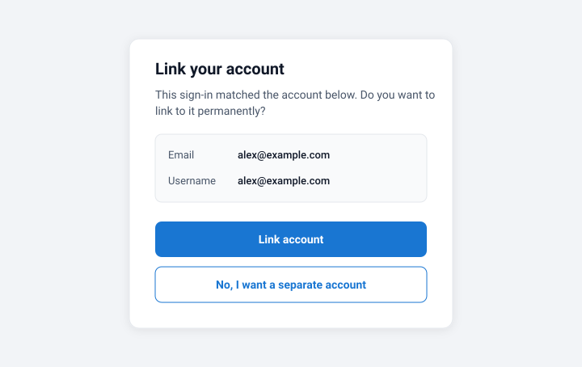
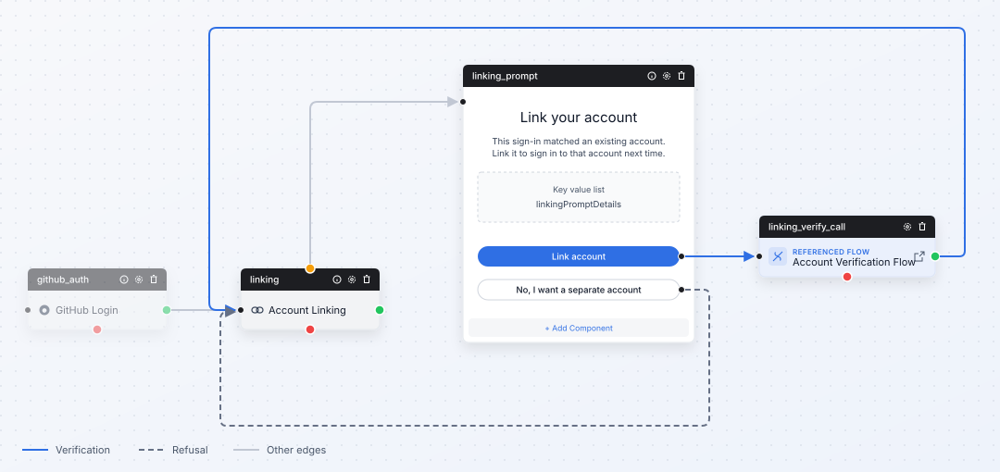
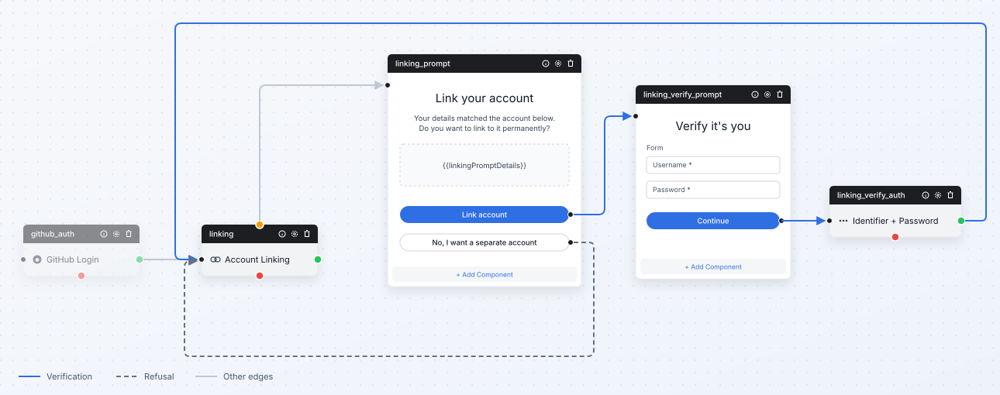

# Federated Account Linking Specification

- **Status:** Draft
- **Version:** 0.3
- **Related documents:** [Threat model](threat-model.md), multi-value support for the `ENTITY_IDENTIFIER` table (prerequisite), [Flows: advanced configurations](../../docs/content/guides/flows/advanced-configurations.mdx), [Add an OIDC provider](../../docs/content/guides/identity-providers/add-oidc-provider.mdx), [User type reference](../../docs/content/guides/users/user-type-reference.mdx), [OpenID Connect Core, Section 2](https://openid.net/specs/openid-connect-core-1_0.html#IDToken)

The key words MUST, MUST NOT, SHOULD and MAY are to be interpreted as described in [RFC 2119](https://www.rfc-editor.org/rfc/rfc2119).

## Summary

A federated sign-in has to decide which local account, if any, the incoming identity becomes. Today ThunderID answers that by looking the identity up on user attributes: a `sub` attribute, then the connection's account-linking attributes. Any unique match signs the End-User in. An external provider that asserts a victim's email therefore signs its user in as the victim.

This specification proposes that a federated identity resolves a local account only through a recorded `(connection, subject)` link. The link lives on the entity as a server-owned system attribute and is indexed for lookup. Several accounts MAY hold one identity's link, such as one account in each of several organization units. A sign-in that finds several asks the End-User which one to continue with, and offers only those accounts.

An identity with no link MAY be matched against existing accounts on the connection's account-linking attributes. The match happens in one place, a new Account Linking flow node, and it only names candidates. The node shows the End-User the values that matched and asks whether to link or to continue with a separate account. Linking runs a verification sign-in chosen by the flow author, either as a separate flow through a `CALL` node or as steps in the same flow. The node records the link only when the End-User authenticates there as one of the candidates. Refusing drops the candidates, and the flow continues as a new user.

The federated executors hand the identity and its claims to later nodes as one `RuntimeData` entry, `externalIdentity`, and never write a claim under its own name. A claim therefore cannot take the place of the state executors use to steer the flow.

Three paths write links. The Account Linking node writes one for a verified candidate, and the user service writes one for the user provisioning creates, in the same write that creates the user. For the duration of a migration window, the default authn provider also writes one when it migrates a user from before links were recorded, who holds the federated subject only in the schema attribute `sub`. Apart from that migration, the direct federated authentication API resolves recorded links and never writes one.

Out of scope: unlinking an identity, an administrative API to list or revoke links, and removing links when a connection is deleted.

## Architecture

| Component | Responsibility |
| --- | --- |
| Entity service and stores (`internal/entity`) | Store links in the `linkedIds` system attribute, index each subject as an `ENTITY_IDENTIFIER` row, resolve a pair to every entity that holds it, and migrate legacy `sub` holders to links. The entity provider (`internal/entityprovider`) lists those entities, with their OU handles, for the executors. |
| Federated authn services (`internal/authn/oauth`, and the OIDC, Google and GitHub services built on it) | Exchange the code, map the claims, and build the federated token with its account-linking filters. They resolve nothing. |
| Identity provider management (`internal/idp`) | Derive the account-linking filters from a connection's configuration, and reject reserved linking attributes when a connection is saved. |
| Default authn provider (`internal/authnprovider/defaultprovider`) | Resolve a federated token through a recorded link only, migrate legacy `sub` holders when no link exists, leave it pending when no entity or several entities hold the link, list the entities an ambiguous attribute lookup matches, and write links, except to a declarative entity. |
| REST authn provider (`internal/authnprovider/restprovider`) | Forward link writes to the custom provider service. |
| Authn provider manager (`internal/authnprovider/manager`) | Resolve candidates from the account-linking filters, and route a link write to the provider that holds the user. |
| Flow core (`internal/flow/core`) | Decode the `externalIdentity` entry for the executors and prompts that read claims. |
| Flow executors (`internal/flow/executor`) | The federated executors publish the identity and its claims as the `externalIdentity` entry, and record in `entityState` whether one entity, none or several hold its link. `IdentifyingExecutor` answers from the link's holders after a federated sign-in, and in resolve mode lets the End-User pick between several. `AccountLinkingExecutor` matches, prompts, saves and restores the checkpoint around verification, checks the verification, rolls the `AuthUser` back when the wrong account verified, and writes the link. `ProvisioningExecutor` creates and links a new user, refuses to create one while candidates are unsettled or while several holders are left unpicked, and applies the existing-user rules to the link's holders at registration. |
| Flow management (`internal/flow/mgt`) | Validate the wiring around a linking node when a flow is saved. |
| Authentication service (`internal/authn`) | Serve the direct federated API from recorded links only. |
| Console (`frontend/apps/console`) and flow renderer (`frontend/packages/design`) | Author the linking node, its prompt and its verification step through two widgets, one of which also adds the link holder picker, and render the matched values at runtime. |

The design reuses two existing seams without modifying them.

- The `ENTITY_IDENTIFIER` table, with the multi-value primary key `(ENTITY_ID, DEPLOYMENT_ID, NAME, VALUE)` from the prerequisite change, holds one row per linked subject.
- The flow engine's `CALL` node runs a called verification flow in a frame of its own. The called flow starts with an empty `RuntimeData`, and the engine restores the caller's `RuntimeData` when it returns. The `AuthUser` and `UserInputs` are shared across both frames.

In-frame verification needs no engine change. Executors hold the engine's own `RuntimeData` map, so the linking node saves and restores it itself (see [The checkpoint](#the-checkpoint)). The engine adopts any authenticated `AuthUser` an executor returns, so the linking node can also put back the `AuthUser` it saved.

## Detailed design

### Link storage

A link MUST live in the entity's server-owned system attributes under `linkedIds`, keyed by connection id and then by subject:

```json
{ "linkedIds": { "<idpId>": { "<sub>": {} } } }
```

An entity MAY hold several subjects for one connection. Each subject maps to an object holding that link's own data. The object is empty today. Later per-link data, such as when the link was last synced, goes inside it.

`EntityService.LinkAccount(entityID, idpID, sub)` MUST require all three arguments. It MUST run as one transaction that:

1. holds a write lock on the entity for the rest of the transaction, and reads the entity from the database under that lock;
2. adds the subject under the connection with an empty object;
3. writes the system attributes back.

Other entities MAY already hold the pair, for example accounts in other organization units, and `LinkAccount` records it for this entity as well. Recording a subject the entity already holds MUST be a no-op. The lock stops two concurrent writes to the same entity from losing a subject. The read in step 1 MUST NOT come from the entity cache, which a concurrent reader can fill with a value from before the other writer committed. The database store answers the lock with a new query, `ASQ-ENTITY_MGT-31`, a no-op update of the entity row, and then reads the row. Writes of one pair to two different entities do not conflict, since each entity holds its own link.

A new subject MUST be refused with `ErrIndexedValueLimitExceeded` when the entity already holds `maxIndexedValuesPerAttribute` subjects across all connections, since each subject is one identifier row. A stored `linkedIds`, or a stored connection entry, that is not an object MUST fail the write rather than be replaced, since replacing it would silently drop what it holds.

`linkedIds` and `credentialUpdatedAt` are the reserved system attribute keys. A service that replaces an entity's system attributes wholesale MUST carry both over, reading their current values from the database under the entity lock. A value the caller sends for a reserved key is replaced by the stored one, or dropped when nothing is stored, so no update path can add or change a link. Only creating the entity and `LinkAccount` write one.

Each subject MUST be indexed as its own `ENTITY_IDENTIFIER` row with name `linkedIds.<idpId>`, value `<sub>`, and `SOURCE = 'system'`. The per-link object MUST NOT be indexed. The write path and the read path MUST derive the name the same way. Links MUST be indexed whatever `user.indexed_attributes` holds. A malformed entry in the attribute MUST be skipped when the rows are built.

The user API MUST NOT return `linkedIds`.

### Link resolution

`EntityService.ResolveLinkedAccounts(idpID, sub)` MUST require both halves of the pair, failing with `ErrBadAttributesInRequest` otherwise, and return the ids of every entity that holds the pair. A pair no entity holds returns an empty list, not an error. Callers decide what none, one or several holders mean.

`EntityService.GetLinkedEntities(idpID, sub)` returns the same holders as entities, read through `GetEntitiesByIDs`, with `OUHandle` populated so a caller can tell holders in different organization units apart. The entity provider exposes it as `GetLinkedEntities`. The disabled entity provider answers it with not-implemented.

The database store MUST answer from the index with a new query, `ASQ-ENTITY_MGT-30`, which matches `NAME` and `VALUE` exactly, only on rows with `SOURCE = 'system'`, and is scoped by `DEPLOYMENT_ID`. It MUST NOT scan attributes. The file-based store reads `linkedIds` from each declarative resource's system attributes. The composite store MUST return the union of the database store's and the file-based store's holders. An entity both stores return is listed once, so it does not read as several holders. A link is never written to a declarative entity, since a declarative entity is read-only (see [Link writes](#link-writes)). The cache-backed store MUST pass the call through without caching, so a changed link set takes effect on the next sign-in.

### The federated token

Every federated authenticator (OAuth, OIDC, Google, GitHub) MUST exit through one shared builder. It maps the claims through the connection's attribute mappings and returns a token that names the identity:

```json
{
  "federatedIdpId": "<idpId>",
  "sub": "<sub>",
  "accountLinkingFilters": [{ "<localAttr>": "<value>" }, { "<localAttr>": "<value>" }]
}
```

The mapped claims come back alongside the token as the authenticated claims. After the filters are built, the builder MUST set the authenticated claims' `sub` to the token's `sub`. A connection MAY map any claim onto the local attribute `sub`, and the flow links the `sub` it publishes, so the mappings must not be able to change it. `accountLinkingFilters` MUST be present only when the connection has account-linking attributes and at least one filter could be built. A token counts as federated only when `federatedIdpId` and `sub` are both non-empty strings. The filters sit under their own key, apart from `federatedIdpId`, `sub` and `userID`, so a filter can never name an account by id.

Change from current behavior: the OAuth service resolves the identity itself. It looks up a `sub` user attribute, then the account-linking attribute values, and returns the matched user's id in the token. `GetInternalUser` looks users up by `sub`. The service MUST stop resolving, and `GetInternalUser` is removed. A `sub` attribute an existing deployment's users carry is read only by the legacy-subject migration (see [Migrating legacy subjects](#migrating-legacy-subjects)), which removes it from each user it migrates. The default `person` user type and `user.indexed_attributes` keep `sub` until the migration is removed, since the migration finds its users through that index.

### Account-linking filters

The filters are built from the connection's `AccountLinking.Attributes`, the mapped claims, and the attribute mappings.

Each linking attribute is an external claim name. Its match targets are the local attributes that carry a value, in this order:

1. every local attribute the claim is mapped to, in mapping order;
2. the local attribute that has the claim's own name, when that name contains only letters, digits and underscores and, for a mapped claim, no other claim is mapped onto it.

A reserved name MUST NOT be a target.

Every linking attribute that has a target MUST match, and any one of its targets MAY. The result is one flat filter per combination of targets, and a target already in a filter is not added twice. A filter matches only when all its entries match, and the filters are alternatives. A linking attribute that has a value but no target MUST make the whole connection match nobody. A linking attribute with no value is skipped. Values MUST be compared verbatim, with no case folding and no trimming.

For example, linking on `email` with `email` mapped to `username` yields `[{"username": "<email>"}, {"email": "<email>"}]`.

The reserved linking names are `userID`, `federatedIdpId`, `credentialUpdatedAt`, `linkedIds`, and any name that starts with `linkedIds.`. Saving a connection MUST fail with an invalid attribute configuration error when a linking attribute is empty, is reserved, or is mapped to a reserved local attribute. It MUST also fail when a linking attribute whose name has characters other than letters, digits and underscores is not mapped in every user type's mappings, since that attribute has no target for a user type it is not mapped for. A user type the connection resolves to without a mappings entry is not checked. Saving also fails when the combinations for any user type exceed 10 filters. These checks run on the create and update APIs only. A connection loaded declaratively is not checked: the runtime still never targets a reserved name, and more than 10 filters fails candidate matching with an internal server error.

### Provider-side resolution

When the default provider authenticates a federated credential, it MUST handle the token as follows.

- **Exactly one entity holds the link.** The result carries that entity's reference and attributes.
- **No entity holds the link.** The provider first runs the legacy-subject migration (see [Migrating legacy subjects](#migrating-legacy-subjects)). The users it migrates now hold the link and are handled as the holders below. When it migrates nobody, the identity is pending.
- **No entity after the migration, or several entities, hold the link.** The token comes back unchanged as both the entity reference token and the attribute token. The `AuthUser` reads as authenticated but resolves to no single entity. This is the pending federated identity. Authentication does not fail when several entities hold the link, so a later node can let the End-User pick one.

A custom provider MAY still fail authentication with its ambiguous-user code, `AUP-0007`. For a federated credential, the manager's `AuthenticateUser` MUST map `AUP-0007` to `AUTHN-MGR-1009` (`ErrorAmbiguousUser`), and the federated executor fails the flow with it. For every other credential, `AUP-0007` stays `AUTHN-MGR-1001`, as the credential flows expect.

Resolving an entity from a federated token that carries no `userID` MUST go through the recorded links only. No holder answers user-not-found (`AUP-0003`), one holder answers that entity, and several holders answer `AUP-0007`, which the manager's `GetEntityReference` maps to `AUTHN-MGR-1009`. The provider MUST NOT pass a federated token to `IdentifyEntity`, so a pending identity is never resolved on attributes.

The manager's `GetEntityReference` resolves every provider state in the `AuthUser`. It MUST fail when any state does not resolve, or when two states resolve to different entities, which is an internal server error. A later authentication at the same provider replaces that provider's state. So a pending federated identity next to an earlier authentication at a different provider reads as nobody authenticated.

Change from current behavior: the default provider passes the federated token to `IdentifyEntity` as an attribute filter, and the manager falls back to disambiguating on `sub`. Both MUST go.

#### Migrating legacy subjects

Users federated before links were recorded hold their federated subject only in the schema attribute `sub`, and no link. Without a link, a federated sign-in cannot resolve them, and some have no other way to sign in. Only a sign-in knows which connection presented the subject, so these users cannot be migrated offline. The default provider migrates them on sign-in instead. The migration is temporary and is removed, together with the `sub` schema attribute and its index, once the migration window closes.

When the default provider authenticates a federated credential and no entity holds the link, it MUST call `EntityService.ClaimLegacySubject(idpID, sub)` before treating the identity as pending. The method requires both halves of the pair, failing with `ErrBadAttributesInRequest` otherwise. It:

1. searches the entities whose `sub` attribute equals the subject. None returns an empty list;
2. in one transaction, for each entity found, takes the write lock that `LinkAccount` takes and reads the entity under it. An entity the lock cannot find is skipped: the search also returns declarative entities, which only the database store can lock, and an entity may be deleted after the search. An entity whose `sub` no longer equals the subject under the lock is skipped, so a concurrent migration or edit is not overwritten;
3. records the link at the connection that presented the subject, beside any links the entity already holds, and removes `sub` from its attributes;
4. returns the ids of the entities it migrated.

Every entity that holds the subject is migrated, whatever credentials or links it already holds, as a sign-in matched `sub` before links were recorded. The match does not depend on the connection, for the same reason: the attribute never recorded which connection issued it. The subject limit of `LinkAccount` applies, and an entity at the limit fails the sign-in with an internal server error.

The migrated entities resolve as recorded holders do. One signs in, and several leave the identity pending with `entityState` set to `ambiguous`. A recorded link always wins: an identity that any entity holds a link for never consults `sub`. Resolving an entity from a federated token after sign-in reads recorded links only and never migrates anyone.

Two rules keep a client from planting a `sub` that a later sign-in would migrate:

- Provisioning MUST read `sub` only from the external identity's claims, never from `UserInputs` or `RuntimeData`. A flow accepts inputs that no node asked for, so a client registering could otherwise send another person's subject as `sub`, and that person's first federated sign-in would migrate the client's account. In practice the claims never carry `sub`, since the federated executors drop the `sub` claim.
- The self-service profile update (`PUT /users/me`) MUST carry over a stored `sub` that the request omits, and MUST reject a request that adds or changes it. The update replaces the attributes whole, so without the carry-over it would drop the value a legacy user needs for the migration. Administrative updates are unchanged.

### Candidate matching

`AuthnProviderManager.ResolveLinkCandidates(authUser)` MUST take the first provider state whose entity reference token is a federated token carrying filters, and resolve each filter through that provider.

| Provider answer for one filter | Result |
| --- | --- |
| One entity | That entity is a candidate. |
| User not found | No candidate from this filter. |
| Ambiguous | The manager lists the matches through the provider's `SearchEntityReferences`, and every listed entity is a candidate. A provider that answers `AUP-0005` (not implemented), or a listing with fewer than two entities, fails as ambiguous. Any other listing error is an internal server error. Only the default provider lists matches; the REST provider answers `AUP-0005`. |
| Server error, or any other client error | Internal server error. |

Candidates from all filters are unioned and sorted by id. `MatchedAttributes` holds the entries of every filter that matched, keyed by local attribute name, with the value the identity supplied. More than 10 candidates MUST fail as ambiguous. An `AuthUser` with no pending federated identity, or with no filter that matches, returns `nil`.

Candidate matching MUST NOT modify the `AuthUser` or write anything.

### The Account Linking node

`AccountLinkingExecutor` is a utility executor for authentication and registration flows. It has no properties and MUST have `onIncomplete`. It runs a first pass and then settling passes, told apart by `RuntimeData["linkingVerificationRequested"]`. Settling repeats only when the wrong account verified. Every other settling outcome ends the cycle (see [Ending the cycle](#ending-the-cycle)).

**First pass.** When `entityState` is `ambiguous`, several entities already hold the identity's link, and there is nothing to link. The node MUST complete without matching, prompting or writing. Picking between the holders is the identifying executor's job (see [Resolving between link holders](#resolving-between-link-holders)). Otherwise:

1. When the `AuthUser` resolves to an entity, the identity already carries its link. The node sets `entityState = exists` and completes without writing. A client error from that lookup reads as nobody authenticated, and a server error is an internal server error.
2. It calls `ResolveLinkCandidates`. A client error MUST fail the node with `FET-1002` (`ErrFailedToIdentifyEntity`). That covers ambiguity and more than 10 candidates. A server error is an internal server error.
3. With no candidates, the node completes and the flow continues as a new user.
4. With candidates, the node stores their entity ids in `RuntimeData["linkingCandidateUserIds"]` as a JSON array, sets `linkingVerificationRequested = true`, saves the checkpoint, publishes the prompt details, and returns `USER_INPUT_REQUIRED`, which routes to `onIncomplete`.

The prompt details go to `AdditionalData["linkingPromptDetails"]` as a JSON array of `{"label", "value"}` objects. There is one object per entry in `MatchedAttributes`, ordered by attribute name, and labelled with the attribute's `displayName` from the schema of the first candidate user type that defines one, falling back to the attribute name. The values MUST be the ones the federated identity supplied, never values read from an account. The details MUST NOT reveal how many accounts matched. With no matched attributes, nothing is published.

**Settling pass.** The node first restores the checkpoint. It then reads `ForwardedData["actionType"]`. A prompt node sets it to the `action.type` of the button that was pressed and hands it only to the node that action points at.

| Condition | Outcome | Edge | Cycle |
| --- | --- | --- | --- |
| The action type is `REJECT` | Clear `linkingCandidateUserIds` and complete. The flow continues as a new user. | `onSuccess` | Ends |
| Nobody authenticated | Fail with `FET-1094` (`ErrVerificationNotCompleted`). | `onFailure` | Ends |
| Resolving the authenticated entity fails with a server error | Internal server error. | None | n/a |
| The authenticated entity is not in `linkingCandidateUserIds` | Return `USER_INPUT_REQUIRED` with `FET-1093` (`ErrNonCandidateVerified`), and roll the `AuthUser` back (see [Retrying after the wrong account](#retrying-after-the-wrong-account)). | `onIncomplete` | Stays armed |
| The authenticated entity is a candidate | Write the link, set `entityState = exists`, clear `linkingCandidateUserIds`, and complete. | `onSuccess` | Ends |
| The link write fails with a client error | Fail with `FET-1096` (`ErrLinkingWriteFailed`). | `onFailure` | Ends |
| The link write fails with a server error | Internal server error. | None | n/a |

The node MUST ignore every action type other than `REJECT`, `CONFIRM` included, and read who authenticated. A client that submits `CONFIRM` without verifying therefore gets `FET-1094`.

`onIncomplete` carries the outcomes the End-User can retry, and `onFailure` carries the ones they cannot. Choosing the wrong account is the only retryable one. A wrong password is retried inside verification, before it reaches this node. Nobody authenticating means the verification path ended without a sign-in, which is a fault in the flow. A link conflict is permanent, and a storage fault is a server error.

The link is written with the pair from the restored `externalIdentity` entry (see [Carrying the identity through the flow](#carrying-the-identity-through-the-flow)), through `AuthnProviderManager.LinkAccount`, against the entity the `AuthUser` now names. A restored entry with no connection or subject is an internal server error.

### The checkpoint

The checkpoint lets verification run in the same frame as the linking node and still see what a called flow sees. The node saves and restores it for both wirings, so it does not need to know which one the flow uses.

**Save.** In step 4 of the first pass, the node MUST write `RuntimeData["linkingCheckpoint"]` as the JSON encoding of an object with four members:

- `runtimeData`: every `RuntimeData` entry as it stands with the pass's own writes, `externalIdentity` included, and `linkingCheckpoint` excluded;
- `authUser`: the `AuthUser` as the first pass found it, which holds the pending federated identity;
- `userInputs`: the `UserInputs` as the first pass found them, before verification collects any;
- `promptDetails`: the encoded prompt details the pass published. `AdditionalData` is not kept between requests, so a retry has to publish them again.

It MUST then set `externalIdentity` to the empty string. While verification runs, the pending identity and its claims are therefore absent from `RuntimeData`:

- no claim fills a verification input, and the End-User types the identifier;
- a federated verification step finds no earlier identity to compare its own with, so `validateFederatedIdentifierConsistency` passes it without a special case. Its comparisons of the linking attributes' local values against `RuntimeData`, `UserInputs` and the authenticated user still apply, as they do inside a called flow.

The candidates and `linkingVerificationRequested` stay in `RuntimeData`. A path that leaves verification without reaching the linking node, such as a `CALL` node's `onFailure`, therefore never writes a link: link writers find no identity. Provisioning fails with `FET-1095` unless the flow is an authentication flow and verification signed somebody in. Then provisioning completes as that account, which its End-User proved, with no link written (see [Provisioning](#provisioning)).

**Restore.** Before it reads anything else in a settling pass, the node MUST remove every `RuntimeData` entry that the saved `runtimeData` does not hold, other than `linkingCheckpoint`, and set every entry it holds back to its saved value. The checkpoint stays, so a retry after the wrong account can restore from it again. The node removes entries from the context's map directly, as the federated executors already do with their state key. A missing or malformed checkpoint is an internal error. The `AuthUser` and `UserInputs` are not restored here, because the `AuthUser` carries the verification result. Both are rolled back only when the wrong account verified.

After the restore, whatever the verification steps wrote is gone. That includes a `userID` a step resolved, OTP and passkey session keys, the completed auth class, the entry a federated verification step wrote, and the `failureReasonJSON` of an earlier wrong-account retry. The original `externalIdentity` entry is back for the link write, and for provisioning after a refusal.

#### Retrying after the wrong account

When the authenticated entity is not a candidate, the node MUST return the saved `authUser` as the response's `AuthUser`, put `UserInputs` back to the saved `userInputs` in the context's map, publish the saved `promptDetails` under `linkingPromptDetails` again, set `externalIdentity` to the empty string again, and keep `linkingVerificationRequested` and `linkingCheckpoint`. The engine adopts the saved `AuthUser`, because a pending federated identity reads as authenticated, and the non-candidate's authentication is discarded. The task node forwards to `onIncomplete` with `FET-1093` as `failureReasonJSON`, so the linking prompt shows the error and offers `CONFIRM` and `REJECT` again.

The retry therefore starts from the state the first verification attempt started from. Every verification method behaves as it did the first time. `UserInputs` live for the whole execution and are shared with a called flow, so without their rollback the identifier the first attempt collected would satisfy the retry's identifier input, and the retry would verify the same account again. Without the `AuthUser` rollback, the non-candidate would stay authenticated. The OTP and magic-link steps would then target that account, a federated step would fail the consistency check against its attributes, and a `REJECT` would continue signed in as it.

Before it rolls back, the node MUST check that the saved `authUser` reads as authenticated and resolves to nobody. A first pass that found somebody authenticated completes without saving a checkpoint, so a saved `AuthUser` always holds only the pending identity. One that fails the check MUST end the cycle and fail with `FET-1093` through `onFailure`. A server error from that check is an internal server error. The engine would ignore an `AuthUser` that does not read as authenticated. One that resolves to an entity would sign the flow in as that entity.

#### Ending the cycle

Every settling outcome except the wrong-account retry MUST end the cycle by setting `linkingVerificationRequested` and `linkingCheckpoint` to the empty string. A later linking node in the same execution then starts a first pass of its own.

The candidates are cleared on success and on refusal. On failure they stay, so a path from `onFailure` into provisioning fails with `FET-1095` when nobody is signed in (`FET-1094`), and in every registration flow. After `FET-1096`, or `FET-1093` through `onFailure`, an authentication flow still has the verified account signed in, and provisioning completes as it with no link written.

A cycle that ends on failure leaves whoever verified authenticated. A path from `onFailure` that came straight back to the linking node would run a first pass, find that account authenticated, and complete as it with no link written. [Flow validation](#flow-validation) therefore requires such a path to sign in at a connection again first.

### Verification

The prompt's `CONFIRM` action starts verification. It MUST be wired in one of two ways.

- **Called flow.** `CONFIRM` points at a `CALL` node, and that node's `onSuccess` points back at the linking node. The called flow is an ordinary authentication flow that the flow author picks.
- **In-frame steps.** `CONFIRM` points at a node in the same flow, and the nodes it reaches lead back to the linking node (see [Flow validation](#flow-validation)). These nodes are the verification segment.

Any branch that authenticates a candidate satisfies the linking node: a password step, a passkey, an OTP, another federated connection, or a `LOGIN_OPTIONS` chooser offering several.

Both wirings give the verification steps the same guarantees. The engine's frame provides them for a called flow. The checkpoint provides them for in-frame steps, and again after a called flow returns.

- The steps see an ordinary sign-in, with none of the claims the connection published, and the End-User types the identifier.
- No authenticator needs a linking special case beyond running with its authentication behaviour during in-frame verification in a registration flow (see below).
- A federated authentication during verification cannot change the identity linked. A called flow's `RuntimeData` is discarded, and an in-frame step's entry is overwritten by the restore. Either way the identity linked is the one that started the flow.
- Nothing the steps resolved reaches the linking decision or provisioning.
- The linking node's settling pass reads whoever the steps authenticated.

In-frame steps in a registration flow run in the registration flow's frame, where some executors treat an existing user as a conflict rather than signing them in. While `linkingVerificationRequested` is set, `CredentialsAuthExecutor`, `OTPExecutor` and `MagicLinkExecutor` MUST apply their authentication behaviour in every flow type: the password step checks the password, the OTP step sends the code only to an account it finds, and the magic link step sends the link to the account it finds. A called flow is an authentication flow and needs no such rule. Once the cycle settles, the flag is cleared and later steps in a registration flow keep their registration behaviour.

Change from current behavior: these executors branch on the flow type alone. In a registration flow, an in-frame password step fails with `FET-1007` for the account being verified without checking the password, and an in-frame magic link step skips delivery to it, so neither can verify a candidate.

Verification MUST authenticate the candidate through the authn provider that holds the pending federated identity. Authentication through a different provider leaves the pending state in the `AuthUser`, the `AuthUser` resolves to nobody, and the node fails with `FET-1094`.

A wrong password during verification returns `USER_INPUT_REQUIRED` with `FET-1005` and re-prompts. It does not reach the linking node. A federated step during verification authenticates only through a recorded link at its own connection.

### Carrying the identity through the flow

After a successful authentication, the OAuth and OIDC executors, and the Google and GitHub executors built on them, MUST write one `RuntimeData` entry, `externalIdentity`, holding the JSON encoding of:

```json
{
  "idpId": "<the connection the federated authentication ran against>",
  "sub": "<the token's sub>",
  "claims": { "<claim>": "<value, with its JSON type>" }
}
```

`sub` is the `sub` of the authenticated claims, which the shared builder sets to the token's `sub`. `claims` holds the mapped claims with their JSON types, so arrays and booleans survive. Token metadata (`aud`, `exp`, `iat`, `nbf`, `iss`, `jti`, `at_hash`, `c_hash`, `azp`, `nonce`) is dropped from `claims`, and so is the `sub` claim whenever `sub` is set. The OpenID4VP verifier writes the same entry with `claims` only. An entry that cannot be encoded is an internal server error in every one of these executors. A new entry MUST replace an earlier one whole, so the claims of two sign-ins are never mixed. No executor MAY write a claim into `RuntimeData` under the claim's own name.

Link writers read the pair from the entry. They treat the identity as absent when the entry is missing or empty, or when `idpId` or `sub` is empty. Non-federated flows never set `idpId`.

**Reading claims.** Flow core provides `GetExternalIdentity(runtimeData)`, which decodes the entry, and `GetExternalClaim(runtimeData, name)`, which returns one claim as a string. A missing, empty or malformed entry reads as absent. Each reader consults claims right after its own `RuntimeData` lookup, the position flat claims used to hold. A value an executor set in `RuntimeData` therefore wins over a claim of the same name, and every other precedence is unchanged, with three exceptions:

- The auth assertion reads claims after the authenticated user's stored attributes, so a claim fills only an attribute the user does not hold. A linked sign-in resolves to a local user, and the external provider MUST NOT rewrite that user's profile values in the token.
- The email recipient reads claims after `UserInputs` as well, so an address the End-User typed wins over a claim.
- Email and SMS template data start from the claims and let every `RuntimeData` entry other than `externalIdentity` override them. An empty `RuntimeData` value does not hide a claim of the same name.

`ResolvePlaceholder` consults claims only when its caller asks. Node conditions never do, so an identity provider cannot select or skip a node by asserting a claim. The HTTP request executor does, for its URL, headers and body, for every key except `userId` and `ouId`.

| Reader | Consults claims |
| --- | --- |
| Attribute values: provisioning's non-credential attributes, the attribute collector, the auth assertion's token attributes, prompt and executor input satisfaction, `{{ctx(name)}}` placeholders in the HTTP request executor, email and SMS template data | Yes |
| Node conditions | No |
| Delivery targets: the email and SMS recipient, the OTP destination | Yes |
| Identity resolution after a federated sign-in: the identifying executor in every mode | MUST NOT |
| Identity resolution otherwise: the identifying executor's and the OTP executor's user search | Yes, for now |
| Credentials: provisioning's credential attributes, and a `PASSWORD_INPUT` in executor and prompt input satisfaction | MUST NOT |
| Flow control state: executor prerequisites, `userID`, `userId`, `ouId`, `categoryType`, `ownerId`, and every key an executor keeps flow control state under | MUST NOT |

A credential an external party chose is not one the End-User set, so a claim never fills one. A claim does not satisfy a credential either: provisioning prompts for a credential attribute, and input satisfaction asks for a `PASSWORD_INPUT`, even when a claim of that name holds a value. The prompt node applies the same rule when it adds inputs forwarded to it and when it re-prompts after a validation failure.

A forwarded input that offers a choice between options MUST NOT be satisfied from a claim either, so the prompt node shows it even when a claim of that name holds a value. The End-User always makes the choice. The executors that forward such a choice, such as the identifying executor's link picker and the user type chooser, read only `UserInputs`, so a claim that suppressed the input would leave the choice unmade and the executor prompting again.

After a federated sign-in, the identifying executor already ignores claims and typed inputs alike, because it answers from the link before it reads any input (see [Resolving between link holders](#resolving-between-link-holders)). Elsewhere, identity resolution SHOULD stop consulting claims, because picking a local account by a value the external provider asserted is the unverified match that the Account Linking node replaces. It cannot stop on its own. Executors decide whether an input is present through the same input satisfaction that prompts use, which consults claims. An identifying executor that ignored claims would treat a claim-satisfied input as present, search with nothing, and never prompt. Cutting identity resolution off from claims needs input satisfaction per executor, and is a separate change.

`validateFederatedIdentifierConsistency` MUST run before the new entry is written. It MUST fail when the earlier entry has a non-empty `sub` and its `idpId` or `sub` differs from the new connection and subject: subjects are unique only within a connection, so the two are compared together, and an entry without a subject, as OpenID4VP publishes, is not compared. For each local attribute the connection's account-linking attributes target, it MUST compare the new value with `RuntimeData`, the earlier entry's claims, `UserInputs`, and the values of the authenticated user's attributes, failing on any non-empty value that differs. A connection with no account-linking attributes compares only the connection and subject. It MUST NOT compare `sub` under its own name in `RuntimeData`, `UserInputs` or the user's attributes, which hold local values rather than a subject the connection issued.

The executors MUST also:

- remove the authorization `code` and `state` from `UserInputs` before processing the callback, keeping the returned state for validation, so the next federated node in the same execution cannot consume them as its own;
- set `entityState` through `setFederatedEntityState`: `exists` when the `AuthUser` resolves to an entity, `ambiguous` when resolving it fails with `AUTHN-MGR-1009` because several entities hold the link, and `not_exists` otherwise. An unauthenticated `AuthUser` is `not_exists` without the lookup.

Change from current behavior: the executors copy every mapped claim into `RuntimeData` under its own name, holding back only the three mapped-authorization keys. They leave `code` and `state` in `UserInputs` and do not record the connection id. The identifying and OTP executors resolve users from those claims.

### Resolving between link holders

`IdentifyingExecutor` MUST answer from the link's holders, listed through the entity provider's `GetLinkedEntities`, whenever `externalIdentity` names a connection and a subject. In every mode it then ignores its typed inputs, the login hint and the identity's claims, and never matches on attributes. An entry with no connection or subject, as OpenID4VP writes, and the empty entry during verification, leave the executor's ordinary behavior in place.

- **resolve.** Only in an authentication flow with `entityState` set to `ambiguous`. In every other case the node completes without resolving anyone: an identity with at most one holder needs no pick, and a registration flow settles the holders at provisioning (see [Provisioning](#provisioning)). Otherwise the node:
  1. loads the holders from the link on every round. It MUST NOT read them from stored `candidateUsers`, which an attribute-based resolve may have filled with accounts that do not hold this link, and it does not store them there;
  2. offers, through `onIncomplete`, the attributes whose values tell the holders apart, such as `ouHandle` or `userType`. Holders that no attribute tells apart fail with `FET-1002`;
  3. narrows the holders by the offered attributes only, reading the End-User's picks from `UserInputs`. No other input filters them, so the End-User can pick only a holder. A pick that matches no holder offers the holders' options again with `FET-1001`;
  4. when one holder remains, binds it. The node authenticates it through the authn provider manager with the provisioned-entity credential, as provisioning does for an entity it created, sets `userID`, and sets `entityState` to `exists`. A client error from that binding fails with `FET-1002`, and a server error is an internal server error.

  No link holder at all fails with `FET-1001`, and a listing error fails with `FET-1002`.
- **check_state.** Sets `entityState` from the holder count: none is `not_exists`, one is `exists`, several is `ambiguous`. An entity provider that cannot list holders (not implemented) keeps the state the federated executor recorded. Any other listing error fails with `FET-1002`.
- **identify** (the default mode). No holder fails with `FET-1001` without prompting, since a typed identifier would name an account the sign-in never proved. One holder sets `userID`. Several holders fail with `FET-1003` (`ErrAmbiguousEntityIdentity`), since picking between them is resolve mode's job.

The resolve node belongs between the federated executor and the Account Linking node, which completes without action while the state is `ambiguous`. The Account Linking with Verification and Account Selection widget places it there (see [UI](#ui)).

Change from current behavior: the identifying executor resolves users from its inputs, which input satisfaction fills from claims, after a federated sign-in as well.

### Link writes

| Outcome | Writer |
| --- | --- |
| A candidate verified at the Account Linking node | `AccountLinkingExecutor` |
| A new user created for a federated identity | `ProvisioningExecutor` |
| A legacy user whose `sub` equals an identity with no link | The default authn provider, through `ClaimLegacySubject` |
| A returning identity that already carries its link | None |
| The direct federated API | None, apart from the legacy-subject migration |

`AuthnProviderManager.LinkAccount(authUser, idpID, sub)` MUST:

1. require both `idpID` and `sub`, and fail with `AUTHN-MGR-1008` (`ErrorInvalidRequest`) otherwise;
2. fail with `AUTHN-MGR-1001` when the `AuthUser` holds no provider state;
3. pick the provider. With one provider state it is that one. With several, it is the provider that owns the `federated` credential (the default provider unless a custom provider claims it), and otherwise the first state by provider name;
4. pass that provider's entity reference token, or `{"userID": <entity id>}` built from the resolved reference. A state that names no entity fails with `AUTHN-MGR-1008`;
5. map the answer. Success is success. The provider's not-implemented code, `AUP-0005`, means the provider does not store links and counts as success. A server error is an internal server error. Any other client error is `AUTHN-MGR-1012` (`ErrorLinkAccountFailed`).

The default provider resolves the entity from the token and calls the entity service. It records a pair other entities hold as well, and answers the subject limit with `AUP-0006`, which the manager maps to `AUTHN-MGR-1012`. The REST provider posts to `/link-account`.

The default provider MUST NOT write a link to a read-only (declarative) entity, and answers `AUP-0005` without calling the entity service. The manager counts that as success, so a verified declarative candidate completes the sign-in as that account with no link recorded. Later sign-ins through the same connection match and verify again. A declarative entity's links can only be declared with the entity. Writing runtime state for it would break its read-only contract.

### Provisioning

`ProvisioningExecutor` MUST check these before anything else, in this order:

- In an authentication flow, when the flow has a user, it completes without provisioning or linking. The user comes from the `AuthUser`, or from `userID` in `RuntimeData`, and a lookup error reads as no user. The linking node has already written a verified candidate's link, and a resolve node has already bound the holder the End-User picked.
- In an authentication flow with no user, when `entityState` is still `ambiguous`, several entities hold the link and no resolve node picked one. It fails with `FET-1003` (`ErrAmbiguousEntityIdentity`) rather than create yet another holder.
- In every flow type, when `linkingCandidateUserIds` is non-empty, it fails with `FET-1095` (`ErrUnverifiedLinkingCandidate`). A refusal clears the candidates, so it is not mistaken for an unsettled match.
- In a registration or user onboarding flow with a federated identity, the link's holders decide the outcome before any attribute is collected. The holders that count are every holder, or with `allowCrossOUProvisioning` only the holders in the target OU:
  - more than one counted holder fails with `FET-1007` (`ErrEntityAlreadyExists`);
  - exactly one completes as that user when registration with an existing user is allowed, and fails with `FET-1007` otherwise. When `entityState` is `ambiguous`, the `AuthUser` names nobody yet, so the node first authenticates that holder as it authenticates an entity it created;
  - none proceeds to create a new user with the link. Registering into an OU where nobody holds the link therefore creates a second holder of the same link.

  An entity provider that cannot list holders (not implemented) leaves the authn provider's resolution as the only answer: a user the `AuthUser` resolves to counts as the one holder.

Existing-user detection for users, in every flow type:

1. A user this execution already resolved is the existing user.
2. For a federated identity, the attribute lookup MUST be skipped. A federated identity is never matched on attributes.
3. Otherwise, the existing combined lookup over the identifying attributes the flow collected is unchanged. Which attributes that lookup should use is out of scope here and is settled in [thunder-id/thunderid#5328](https://github.com/thunder-id/thunderid/pull/5328).

For a federated identity with no existing user, the node MUST pass the connection and subject as `User.LinkedAccount` to `UserMgtProvider.CreateUser`. The user service writes them as the `linkedIds` system attribute, and the entity service creates the user and its link in one transaction. Other entities MAY already hold the pair, and the create records it for the new user as well. No user is left without its link, so the next sign-in neither prompts to link a leftover account nor provisions a duplicate. `LinkedAccount` is never read from or written to an API body. A create that collides with a unique attribute fails with the unique-conflict error. That is what happens when the End-User refuses a match on a unique attribute such as email.

Provisioning MUST read the `sub` attribute only from the external identity's claims (see [Migrating legacy subjects](#migrating-legacy-subjects)). Every other non-credential attribute keeps its order: `UserInputs`, then `RuntimeData`, then claims.

Change from current behavior: provisioning identifies an existing user by one combined lookup over every identifying attribute the flow collected, federated or not, and does not write links. A federated identity MUST NOT use that lookup.

### Direct federated API

`FinishIDPAuthentication` authenticates the federated credential and then calls `GetEntityReference`. A link one entity holds returns that user, and a link several entities hold fails with `AUTHN-MGR-1009`, since this API cannot ask which. An identity with no link fails user-not-found (`AUTHN-MGR-1007`), and answers `AUTHN-FED-1001` (`ErrorFederatedAuthenticationFailed`). The ambiguous-user and entity-reference client errors (`AUTHN-MGR-1001`, `1008`, `1009` and `1010`) MUST map to the same code. This API cannot prompt, so it MUST NOT match on account-linking attributes, and it writes a link only through the legacy-subject migration that authentication runs. Several migrated users fail with `AUTHN-MGR-1009`, as several holders do.

Change from current behavior: the API signs in any user that the account-linking attributes match uniquely.

### Flow validation

Saving a flow MUST run these checks for every `AccountLinkingExecutor` node:

- `onIncomplete` is present.
- On the node `onIncomplete` points at, every prompt action of type `REJECT` has `nextNode` equal to the linking node. A forwarded action type reaches only the node its action points at, so a refusal routed anywhere else never arrives.
- On that node, every prompt action of type `CONFIRM` is wired in one of two ways:
  - it points at a `CALL` node, and that `CALL` node's `onSuccess` returns to the linking node; or
  - it points at an in-frame verification segment. The segment is every node reachable from the action's target without passing through the linking node, following every outgoing edge and prompt action. The segment MUST NOT contain an `END` node, another `AccountLinkingExecutor`, a `ProvisioningExecutor` or an `AuthAssertExecutor`, and at least one of its edges MUST lead to the linking node.
- When the node has `onFailure`, every path from its target that reaches the linking node again MUST first pass through a federated authentication executor (`OAuthExecutor`, `OIDCAuthExecutor`, `GoogleOIDCAuthExecutor` or `GithubOAuthExecutor`). The search follows every outgoing edge and prompt action from the `onFailure` target, except a federated executor's `onSuccess`. Only that edge follows a sign-in, so a federated executor's `onFailure` is followed. Flows loaded declaratively are validated the same way.

The segment rule makes every way out of verification pass through the linking node, which restores the checkpoint before anything else runs. A path that ends the flow, provisions or signs in from inside the segment would carry what the steps wrote past the restore, or skip the candidate check.

The `onFailure` rule covers the cycle ending on failure (see [Ending the cycle](#ending-the-cycle)). The documented pattern, `onFailure` pointing at the sign-in prompt, is still accepted: the End-User signs in at a connection again, which replaces the verified account's provider state with the new federated result before the linking node runs. A path that loops back without a federated sign-in is rejected. That includes a retry action on the error prompt that points straight at the linking node.

A missing `onIncomplete` target or `CONFIRM` target is left to the rule that validates node references. Other action types are not checked.

Change from current behavior: `FederatedAuthResolverExecutor`, which disambiguates attribute matches by asking the End-User for more attributes, is removed. Saving a flow that references it fails, because the executor is not registered.

### Error classification in the auth assertion

When the entity reference or attribute fetch returns a client error, `AuthAssertExecutor` MUST set `FET-1002` (`ErrFailedToIdentifyEntity`) or `FET-1062` (`ErrAttributeRetrievalFailed`) on the response, and the flow ends in `ERROR` with that code. A server error MUST return a 500. A federated identity with no local user and no allowance to proceed lands here.

Change from current behavior: a client error from either fetch returns a 500.

### Data model

This specification adds no table, column or index. Links reuse the `ENTITY_IDENTIFIER` table and the multi-value primary key from the prerequisite change, and the existing `(NAME, VALUE)` lookup index answers link resolution. It adds two queries: `ASQ-ENTITY_MGT-30` resolves a link, and `ASQ-ENTITY_MGT-31` locks the entity for a link write. The legacy-subject migration finds its users through the existing `sub` row in `ENTITY_IDENTIFIER`. A pair is not unique across entities, since several entities MAY hold it. A database created with the earlier unique index `idx_entity_identifier_linked_id` MUST drop it before one identity can link to several entities.

### API

**Provider interface.** `AuthnProviderInterface` in `pkg/thunderidengine/providers` gains `StoreAccountLink` and `SearchEntityReferences`, and `AuthnProviderManager` gains `ResolveLinkCandidates` and `LinkAccount`. Every implementation outside this repository MUST add them, so this is a breaking change to the public package. A provider that supports neither provider method MUST return `AUP-0005` from both.

**Custom authn provider contract.** A custom provider that stores links MUST implement:

```
POST {baseURL}/link-account
```

```json
{ "entityReferenceToken": <the provider's own token, or {"userID": "<entity id>"} for a resolved state>, "idpId": "<idpId>", "sub": "<sub>" }
```

A `200` is success, any body is ignored, and the call MUST be idempotent. Any other status, `204` included, is read as an error. A provider that does not store links answers the not-implemented code `AUP-0005`, and the sign-in proceeds. A malformed request answers `AUP-0006` and fails the sign-in. A rejected API key or entity reference token answers `401`. Other users may already hold the subject, for example accounts in different organization units, and the call records it for this user as well. A provider that allows only one user per subject MAY answer `AUP-0007`, and the account linking step then fails. Any other client error fails the sign-in. `AUP-0005` and `AUP-0007` count as client answers only with a `4xx` status. With a `5xx` they are server errors. A response whose error body does not decode, such as a bare `404`, is a server error. A REST provider does not list ambiguous matches, so a filter that matches several of its users fails as ambiguous. The endpoint MUST be added to `api/extensions/authn-provider.yaml`.

**Connections API.** The `AccountLinking` description in `api/connections.yaml` MUST state that the attributes match an identity that has no recorded link, that every configured attribute with a value must match, and that each attribute matches on the local attributes it is mapped to and on the local attribute of the same name.

### UI

**Account Linking executor.** A task execution node with `onSuccess`, `onFailure` and `onIncomplete` handles and no properties.

**Link Prompt View.** A step holding:

| Region | Element |
| --- | --- |
| Heading | `TEXT`, `HEADING_3`, `forms.link_prompt.title` |
| Explanatory line | `TEXT`, `BODY_1`, `forms.link_prompt.description` |
| Matched values | `KEY_VALUE_LIST`, `source: linkingPromptDetails` |
| Link button | `ACTION`, `PRIMARY`, submit, `actionType: CONFIRM`, `forms.link_prompt.actions.confirm.label` |
| Separate account button | `ACTION`, `SECONDARY`, submit, `actionType: REJECT`, `forms.link_prompt.actions.reject.label` |

The buttons sit in a `BLOCK`. The `forms.link_prompt.*` strings are runtime translations in the `elements` namespace of the default bootstrap resources: "Link your account", "Your details matched the account below. Do you want to link to it permanently?", "Link account" and "No, I want a separate account".



**Link Picker View.** A step holding:

| Region | Element |
| --- | --- |
| Heading | `TEXT`, `HEADING_3`, `forms.link_picker.title` |
| Explanatory line | `TEXT`, `BODY_1`, `forms.link_picker.description` |
| Account picker | `SELECT`, required, `ref: ouHandle`, `forms.link_picker.fields.ou.label` and `forms.link_picker.fields.ou.placeholder`. The options are the ones the Resolve User step forwards. |
| Continue button | `ACTION`, `PRIMARY`, submit, `forms.link_picker.actions.continue.label` |

The field and button sit in a `BLOCK`. The `forms.link_picker.*` strings are runtime translations in the `elements` namespace of the default bootstrap resources: "Choose your account", "This sign-in is linked to more than one account. Choose the one to continue with.", "Organization", "Select an organization" and "Continue".

**`KEY_VALUE_LIST` element.** Renders label and value rows, read at runtime from the `AdditionalData` key named in `source`, which MAY hold an array or its JSON encoding. Entries that are not objects are skipped. A label or value that is not a string reads as an empty string, rows with an empty value are dropped, and a row with an empty label still renders its value. An empty list renders nothing. Row labels are translated. An optional element `label` renders as a caption above the rows. Values MUST render as text, never as HTML. On the canvas the element shows the bound key as ``.

**Account Linking with Verification widget** (`ACCOUNT_LINKING_VERIFICATION`). Drops in after a Google, GitHub, OIDC or OAuth executor, before provisioning or the auth assertion. Its entry is the linking node. It adds:

- the linking node, with `onIncomplete` pointing at the Link Prompt View;
- the Link Prompt View, with `CONFIRM` pointing at the `CALL` step and `REJECT` pointing at the linking node;
- a `CALL` step that offers authentication flows, with `onSuccess` pointing at the linking node. The flow author picks the verification flow it calls.

The widget leaves the linking node's and the `CALL` step's `onFailure` unwired.



In either widget, an author MAY replace the `CALL` step with verification steps in the same flow, wiring `CONFIRM` to the first of them and the last back to the linking node.



**Account Linking with Verification and Account Selection widget** (`ACCOUNT_LINKING_VERIFICATION_WITH_SELECTION`). Drops in at the same place, for connections whose identity MAY be linked to several accounts. It adds everything the Account Linking with Verification widget adds, and in front of the linking node:

- a Resolve User step, an `IdentifyingExecutor` in `resolve` mode, which is the widget's entry, with `onSuccess` pointing at the linking node and `onIncomplete` pointing at the Link Picker View;
- the Link Picker View, whose submit action returns to the Resolve User step.

It leaves the Resolve User step's `onFailure` unwired, as well as the linking node's and the `CALL` step's.

**`REJECT` action type.** The button action selector offers "Reject Action" alongside "Confirm Action". Both set a submit button's `actionType`, which is saved as the prompt action's `type`. Switching to a plain action clears either.

**Canvas warning.** In authentication flows that contain a linking node, the Console MUST warn on every `REJECT` button that has no outgoing edge, or whose edge does not lead to a linking node. It SHOULD also warn on an in-frame verification segment that breaks the segment rule in [Flow validation](#flow-validation). It does not yet, and `CONFIRM` wiring is checked only when the flow is saved. Registration flows get no canvas warning and rely on save-time validation.

**Chooser inputs.** When the Console serializes an executor that follows a prompt, the executor's inputs MUST come from the prompt action that routes to it, when there is one. A `LOGIN_OPTIONS` verification flow offers several branches from one screen, and each executor would otherwise demand the inputs of every branch. A screen with no routing prompt falls back to all its inputs. A routing prompt action with no inputs gives the executor none. When several prompt actions on the screen route to the same executor, the executor's inputs are the ones every routing action collects, matched by identifier. Each action already requires its own fields before it submits, so requiring the rest would stall the actions that lack them.

**Sample graphs.** `verifiedLinkingFlowNodes()` in `tests/e2e/utils/server-setup/social-login-setup.ts` follows the widget's shape and calls the flow that `verifyPasswordFlowNodes()` in the same file builds, a username and password sign-in. The integration tests build the same graphs, and an in-frame variant, in `tests/integration/flow/common/linking.go` (`VerifiedLinkingFlow`, `VerifyPasswordFlow`, `InFrameLinkingFlow`).

**SDKs.** The React, Vue, iOS, Android and Flutter SDKs drive the linking prompt in embedded sign-in and sign-up:

- They render `KEY_VALUE_LIST` as above, and a `SECONDARY` action as an outlined button, so the separate account button reads as the alternative to linking.
- A `REDIRECTION` step opens its `redirectURL` in a browser session, in sign-up as well as sign-in. The SDK resubmits the callback's `code` and `state` with the step's flow id, challenge token and the action that led to it. The response to that submission MAY be another `REDIRECTION`, as when a federated sign-up leads into a verification that signs in at a provider again. The SDK MUST follow it the same way, and MUST NOT render it as an empty step.
- The SDK MUST NOT submit a callback that lacks a `code` or a `state`. A mobile SDK, whose callback scheme any app can open, MUST also reject a callback whose `state` differs from the `state` in `redirectURL`, and every callback to a `redirectURL` that has no `state` or an empty one. The server checks the state only when the client sends one, so a callback accepted without one is checked nowhere. The server always puts a state in `redirectURL`, so the rule rejects no genuine callback.
- A redirect that cannot start, because `redirectURL` is malformed or no callback scheme is configured, fails with the translated `signIn.federatedError` or `signUp.federatedError` string.
- A flow error MUST show the translation of `error.message.key`, with its `params` substituted in one pass, before falling back to `defaultValue` and `failureReason`.

### Error codes

| Code | Name | Raised when |
| --- | --- | --- |
| `FET-1001` | `ErrEntityNotFound` | After a federated sign-in, the identifying executor found no link holder, or a resolve pick matched no holder (the node re-prompts). |
| `FET-1002` | `ErrFailedToIdentifyEntity` | Candidate matching failed (ambiguous or more than 10), the auth assertion could not resolve a user, or the identifying executor could not list, tell apart or bind the link's holders. |
| `FET-1003` | `ErrAmbiguousEntityIdentity` | Several entities hold the link and none was picked: the identifying executor in identify mode, or provisioning in an authentication flow. |
| `FET-1007` | `ErrEntityAlreadyExists` | Registration found more than one counted link holder, or one where registration with an existing user is not allowed. |
| `FET-1005` | `ErrInvalidCredentials` | A wrong password in the verification flow. The step re-prompts. |
| `FET-1062` | `ErrAttributeRetrievalFailed` | The auth assertion's attribute fetch returned a client error. |
| `FET-1093` | `ErrNonCandidateVerified` | The account that verified is not a candidate. The node re-prompts through `onIncomplete`, and fails through `onFailure` only when the saved `AuthUser` cannot be restored. |
| `FET-1094` | `ErrVerificationNotCompleted` | A settling pass found nobody authenticated and no `REJECT`. |
| `FET-1014` | `ErrInvalidFederatedUser` | The consistency check failed for a second federated sign-in in the frame. |
| `FET-1095` | `ErrUnverifiedLinkingCandidate` | Provisioning ran with candidates still set and, in an authentication flow, no user signed in. |
| `FET-1096` | `ErrLinkingWriteFailed` | The provider rejected the linking node's link write with a client error. A server error is a 500 instead. |
| `AUTHN-MGR-1001` | `ErrorAuthenticationFailed` | A link write was requested for an `AuthUser` with no provider state. |
| `AUTHN-MGR-1008` | `ErrorInvalidRequest` | A link write was requested without a connection id or subject, or for a state that names no entity. |
| `AUTHN-MGR-1009` | `ErrorAmbiguousUser` | Resolving a pending identity found several entities holding the recorded pair. The federated executors record it as `entityState = ambiguous` rather than failing. Also a custom provider's `AUP-0007` for a federated authentication. |
| `AUTHN-MGR-1012` | `ErrorLinkAccountFailed` | The provider rejected a link write with a client error other than `AUP-0005`. |
| `AUTHN-FED-1001` | `ErrorFederatedAuthenticationFailed` | The direct federated API found no recorded link, or an ambiguous one. |

## Requirements

### R1. A federated identity resolves a local user only through a recorded link

**Requirement:** A federated sign-in MUST resolve a local account only from a recorded `(connection, subject)` link, and never from attribute values. The one exception is the temporary legacy-subject migration, which turns a matching `sub` attribute into a recorded link before resolving.

**Acceptance criteria:**

- **AC1.1:** Given a connection with account-linking attributes and a local user holding a matching value, when an unlinked identity authenticates through a flow with no Account Linking node, then no local user is resolved.
- **AC1.2:** Given a recorded link for `(connection, subject)`, when that identity authenticates, then the linked account is resolved with no prompt, whether or not its attributes still match.
- **AC1.3:** Given two entities holding the same `(connection, subject)`, when that identity authenticates, then no entity is resolved and `entityState` is `ambiguous`.
- **AC1.4:** Given the direct federated API and an identity with no recorded link, when the authentication finishes, then it fails with `AUTHN-FED-1001`, even when an account matches the linking attributes.
- **AC1.5:** Given two entities holding the same `(connection, subject)` in different OUs and a resolve node after the federated executor, when the End-User picks one holder's `ouHandle`, then that holder is signed in, `userID` names it, and `entityState` is `exists`.
- **AC1.6:** Given a resolve node after a federated sign-in, when the End-User submits a value that matches no holder, or an input other than an offered attribute names another account, then no account outside the link's holders is offered or bound, and a pick that matches no holder is offered again with `FET-1001`.
- **AC1.7:** Given holders that no attribute tells apart, when the resolve node runs, then it fails with `FET-1002`.
- **AC1.8:** Given a federated sign-in, when an identifying node runs in `check_state` mode, then `entityState` is `not_exists`, `exists` or `ambiguous` for zero, one or several holders, whatever its inputs and the identity's claims hold. When it runs in identify mode, zero holders fail with `FET-1001` without a prompt, one sets `userID`, and several fail with `FET-1003`.
- **AC1.9:** Given a resolve node in a registration flow, or in an authentication flow whose `entityState` is not `ambiguous`, when it runs after a federated sign-in, then it completes without resolving anyone.
- **AC1.10:** Given a user with no link whose `sub` attribute equals the subject, when that identity authenticates, then the link is recorded at the presenting connection, `sub` is removed, and the user is resolved. This holds whatever credentials or other links the user holds, and for the direct federated API.
- **AC1.11:** Given two users with no link whose `sub` equals the subject, when that identity authenticates, then both are migrated and `entityState` is `ambiguous`.
- **AC1.12:** Given an identity that one entity holds a link for and another user whose `sub` equals its subject, when it authenticates, then the linked entity is resolved and the other user keeps `sub` with no link.
- **AC1.13:** Given a declarative user whose `sub` equals the subject, when that identity authenticates, then the user is not migrated.

### R2. Links are durable, indexed and per connection

**Requirement:** A link MUST persist on the entity, be indexed per subject, and be scoped to the connection that asserted it.

**Acceptance criteria:**

- **AC2.1:** Given an entity with no links, when a link is recorded, then `linkedIds` holds the subject under the connection id and one `ENTITY_IDENTIFIER` row `linkedIds.<idpId>` exists for it.
- **AC2.2:** Given an entity linked at a connection, when a second subject at that connection is recorded, then the entity holds both and both resolve to it.
- **AC2.3:** Given an entity already holding a subject, when it is recorded again, then nothing changes.
- **AC2.4:** Given an entity with links, when another service replaces its system attributes, then `linkedIds` is preserved.
- **AC2.5:** Given a declarative entity carrying `linkedIds`, when that identity authenticates, then the entity resolves.
- **AC2.6:** Given two concurrent link writes of different subjects to one entity, when both commit, then the entity holds both subjects.
- **AC2.7:** Given an entity that holds a pair, when a link write records the same pair against another entity, then both entities hold it and both resolve as holders.
- **AC2.8:** Given an entity that holds a pair in both the database and the declarative store, when the pair is resolved, then it is returned once.
- **AC2.9:** Given a declarative candidate, when the End-User verifies it, then the sign-in completes as that account and no link is recorded.
- **AC2.10:** Given a user with a stored `sub`, when a self-service update omits `sub`, then the stored value is kept. When it adds or changes `sub`, then the update is rejected.

### R3. Account-linking filters follow the attribute mappings

**Requirement:** The filters MUST target local attributes derived from the connection's mappings, and no claim MAY steer an account id or flow control state.

**Acceptance criteria:**

- **AC3.1:** Given a linking attribute mapped to one or more local attributes, when filters are built, then there is one alternative per local attribute that carries a value, plus the same-named local attribute where eligible.
- **AC3.2:** Given several linking attributes, when filters are built, then each filter requires all of them to match.
- **AC3.3:** Given a linking attribute with a value and no local attribute to match on, when filters are built, then the connection matches nobody.
- **AC3.4:** Given a connection whose linking attribute is, or maps to, a reserved name, when it is saved, then the save is rejected, and at runtime the reserved name is never a target.
- **AC3.5:** Given any claim, when the federated executor publishes claims, then no `RuntimeData` entry is written under the claim's name, and a claim named after flow control state (for example `categoryType`, `ouId` or `linkingCandidateUserIds`) does not change the entity type, the OU, or the linking decision.
- **AC3.6:** Given a connection that maps another claim onto the local attribute `sub`, when a link is written, then the subject recorded is the federated token's `sub`.
- **AC3.7:** Given a claim that an input needs, when a prompt, provisioning or the auth assertion reads that input, then the claim's value is used where nothing the End-User typed or an executor set takes precedence.
- **AC3.8:** Given a claim named after a credential attribute of the user type, when provisioning creates the user, then the claim is not used as the credential and provisioning prompts for it. Given a claim named after a `PASSWORD_INPUT`, then the claim does not satisfy that input.
- **AC3.9:** Given a federated sign-in that follows another in the same frame, outside verification, when the second comes from a different connection, asserts a different `sub`, or supplies a different value for a local attribute its account-linking attributes target, then it fails with `ErrInvalidFederatedUser`.
- **AC3.10:** Given two federated sign-ins in one frame, when the second completes, then `externalIdentity` holds only the second one's claims.

### R4. A match is linked only after the End-User verifies a candidate

**Requirement:** An attribute match MUST NOT sign anyone in. The identity MUST be linked only after the End-User authenticates as a candidate during verification, whether it runs as a called flow or as in-frame steps. Unless an AC names one wiring, it applies to both.

**Acceptance criteria:**

- **AC4.1:** Given one or more matching accounts, when the identity reaches the Account Linking node, then the node forwards to `onIncomplete` with the matched values in `linkingPromptDetails`, and nobody is signed in.
- **AC4.2:** Given the prompt, when the End-User confirms and authenticates as a candidate, then the link is recorded and the flow completes as that account.
- **AC4.3:** Given several candidates, when the End-User verifies any one of them, then that one is linked.
- **AC4.4:** Given the prompt, when the verification authenticates an account that is not a candidate, then the node forwards to `onIncomplete` with `FET-1093`, the `AuthUser` is the one the first pass saved, and nothing is linked.
- **AC4.5:** Given the prompt, when the linking node runs again with nobody authenticated and no `REJECT`, then the flow fails with `FET-1094`.
- **AC4.6:** Given a wrong password during verification, then the step re-prompts with `FET-1005` and nothing is linked.
- **AC4.7:** Given a verification that authenticates at another connection linked to a candidate, when it reaches the linking node, then the consistency check has passed, and the identity linked is the one that started the flow.
- **AC4.8:** Given verification, when its steps run, then `externalIdentity` is empty, and a claim the connection published does not fill the identifier.
- **AC4.9:** Given more than 10 candidates, or a provider that cannot list an ambiguous match, when the node runs, then it fails with `FET-1002`.
- **AC4.10:** Given a verification that authenticates a candidate through a provider other than the one holding the pending identity, when it reaches the linking node, then the node fails with `FET-1094` and nothing is linked.
- **AC4.11:** Given in-frame verification steps that write `RuntimeData` entries (for example a `userID` from an identifying step), when the linking node's settling pass runs, then those entries are gone and `RuntimeData` matches the saved `runtimeData`.
- **AC4.12:** Given a settling pass with no checkpoint, or a checkpoint that does not decode, then the node returns an internal error and nothing is linked.
- **AC4.13:** Given a wrong-account retry, then the prompt shows the matched values again, and verification asks for the identifier again. When the End-User then authenticates as a candidate, that candidate is linked with the original `externalIdentity` entry. This holds for any number of earlier wrong-account attempts, and for every verification method, OTP and magic link included.
- **AC4.14:** Given a wrong-account retry, when the End-User refuses, then the flow continues as a new user and is not signed in as the account that verified.
- **AC4.15:** Given a checkpoint whose saved `AuthUser` does not read as authenticated, or resolves to an entity, when the wrong account verifies, then the node fails with `FET-1093` through `onFailure`, ends the cycle, and does not adopt that `AuthUser`.
- **AC4.16:** Given a settling pass that links, refuses or fails, then `linkingVerificationRequested` and `linkingCheckpoint` are empty afterwards, and a later linking node in the same execution runs a first pass instead of failing on a missing checkpoint.
- **AC4.17:** Given a settling pass that fails, then `linkingCandidateUserIds` still holds the candidates, and provisioning reached from `onFailure` fails with `FET-1095` when nobody is signed in or the flow is a registration flow.
- **AC4.18:** Given a registration flow with in-frame verification, when the End-User authenticates as a candidate with a password, an OTP or a magic link, then the step signs them in as it would in an authentication flow, and the link is recorded. A wrong password re-prompts with `FET-1005` and nothing is linked.
- **AC4.19:** Given a registration flow with in-frame verification, when the End-User enters an identifier that matches no account, then the step answers as it would in an authentication flow: the password step re-prompts with `FET-1005`, the OTP step fails, and the magic link step completes without delivery.
- **AC4.20:** Given `entityState` set to `ambiguous`, when the Account Linking node runs, then it completes without matching, prompting or writing.

### R5. Refusal continues as a new user

**Requirement:** The End-User MUST be able to refuse a match and continue as a new user.

**Acceptance criteria:**

- **AC5.1:** Given the prompt, when the End-User refuses, then the checkpoint is restored, the candidates are cleared, and the flow continues to provisioning with the original `externalIdentity` entry. Where the matched attribute is unique, provisioning fails on the uniqueness rule and nothing is linked.
- **AC5.2:** Given a refused match, when the same identity signs in again, then the prompt is shown again.

### R6. Each settling outcome records its link once

**Requirement:** A verified candidate and a newly provisioned user MUST each get exactly one link write, and a failed write MUST fail the flow without leaving partial state.

**Acceptance criteria:**

- **AC6.1:** Given a verified candidate, then `AccountLinkingExecutor` records the link before completing. A write the provider rejects with a client error fails through `onFailure` with `FET-1096`, and a server error returns a 500.
- **AC6.2:** Given a new user created for a federated identity, then the user and its link are written in one transaction, whether or not another entity already holds the link.
- **AC6.3:** Given a returning identity with a recorded link, when the linking node runs, then no write is attempted.
- **AC6.4:** Given an `AuthUser` holding several provider states, when a link is recorded, then the provider that owns the federated credential writes it.
- **AC6.5:** Given a custom provider that answers `AUP-0005`, when a link is recorded, then the sign-in succeeds. Given one that answers `AUP-0006`, then the sign-in fails.

### R7. Provisioning does not duplicate an account

**Requirement:** Provisioning MUST NOT create an account that shadows an unsettled candidate, and MUST NOT adopt an existing account on an attribute for a federated identity.

**Acceptance criteria:**

- **AC7.1:** Given a user this execution already resolved, then that user is reported as existing without an attribute lookup.
- **AC7.2:** Given a federated identity, then no attribute lookup is performed.
- **AC7.3:** Given linking candidates still set and, in an authentication flow, no user signed in, when provisioning is reached, then it fails with `FET-1095`.
- **AC7.4:** Given a registration or user onboarding flow and a federated identity, when provisioning runs, then the link's counted holders decide the outcome before any attribute is collected: more than one fails with `FET-1007`, one completes as that user only when registration with an existing user is allowed and fails with `FET-1007` otherwise, and none creates a new user with the link.
- **AC7.5:** Given `allowCrossOUProvisioning` and a federated identity whose link is held only by a user in another OU, when the End-User registers into the target OU, then a second user is created in the target OU holding the same link.
- **AC7.6:** Given an authentication flow where several entities hold the link and no resolve node picked one, when provisioning is reached, then it fails with `FET-1003` and creates nothing.
- **AC7.7:** Given a `sub` value in `UserInputs` or `RuntimeData`, when provisioning creates a user, then the user is created without that `sub`.

### R8. A linking graph that cannot work is rejected before it runs

**Requirement:** Saving a flow MUST reject linking wiring that the runtime cannot honor, and the Console SHOULD warn while the flow is authored.

**Acceptance criteria:**

- **AC8.1:** Given a linking node with no `onIncomplete`, when the flow is saved, then the save is rejected, naming the node.
- **AC8.2:** Given a `REJECT` action on the linking prompt that points anywhere other than the linking node, when the flow is saved, then the save is rejected, naming the action and the prompt.
- **AC8.3:** Given a `CONFIRM` action on the linking prompt that points at a node in the same flow, when its verification segment contains an `END` node, another linking node, a `ProvisioningExecutor` or an `AuthAssertExecutor`, or has no edge back to the linking node, then the save is rejected, naming the action, the prompt and the offending node.
- **AC8.4:** Given a `CONFIRM` action whose `CALL` node's `onSuccess` does not return to the linking node, when the flow is saved, then the save is rejected, naming the `CALL` node.
- **AC8.5:** Given an authentication flow with a linking node, when a `REJECT` button is unwired or leads elsewhere, then the Console warns on the canvas.
- **AC8.6:** Given a `CONFIRM` action wired to a valid in-frame verification segment, when the flow is saved, then the save succeeds.
- **AC8.7:** Given a linking node whose `onFailure` target has a path back to the linking node that does not take a federated authentication executor's `onSuccess`, including one through a federated executor's `onFailure`, when the flow is saved, then the save is rejected, naming the linking node and the `onFailure` target.
- **AC8.8:** Given a linking node whose `onFailure` points at a sign-in prompt, and every path from there to the linking node passes through a federated authentication executor, when the flow is saved, then the save succeeds.

### R9. A federated identity with no local user is a client error

**Requirement:** The auth assertion MUST report an unresolvable user as a flow error, and keep 500s for server failures.

**Acceptance criteria:**

- **AC9.1:** Given a federated identity with no local user and no allowance, when the auth assertion runs, then the flow ends in `ERROR` with `FET-1002`.
- **AC9.2:** Given a server-type provider failure, when the auth assertion runs, then the response is a 500.

### R10. An SDK follows every federated redirect and submits only a callback it can check

**Requirement:** An SDK MUST follow each `REDIRECTION` step in an embedded sign-in or sign-up flow, including one returned for a callback it submitted, and MUST submit only a callback that carries a `code` and a `state`. A mobile SDK MUST submit only a callback whose `state` equals the non-empty `state` of the request.

**Acceptance criteria:**

- **AC10.1:** Given a sign-up flow that returns a `REDIRECTION` step, when the SDK handles it, then it opens `redirectURL` and resubmits the callback's `code` and `state` with the step's flow id and challenge token.
- **AC10.2:** Given a submitted callback whose response is another `REDIRECTION`, when the SDK handles the response, then it opens the new `redirectURL` instead of rendering an empty step.
- **AC10.3:** Given a callback without a `code` or a `state`, when it reaches any SDK, then nothing is submitted and the flow reports an error.
- **AC10.4:** Given a mobile SDK and a `redirectURL` with no `state` or an empty one, when a callback arrives for it, then the callback is rejected with `invalidGrant` and nothing is submitted.
- **AC10.5:** Given a mobile SDK and a callback whose `state` differs from the request's, when it arrives, then the callback is rejected with `invalidGrant` and nothing is submitted.

## Change log

| Version | Date | Change |
|---|---|---|
| 0.1 | 2026-10-07 | Initial specification. |
| 0.2 | 2026-10-15 | One federated identity can be linked to several users, for example accounts in different organization units. Removed the unique index on linked IDs, the held-pair conflict on link writes, and FET-1097 and USR-1029. Link resolution returns every holder. Several holders set `entityState` to `ambiguous`, and a Resolve User node lets the End-User pick between them. Check State and Identify User use the link after a federated sign-in. Account Linking skips an ambiguous identity. Provisioning fails at authentication when the identity is ambiguous and counts only target OU holders at registration with cross-OU provisioning. An input that offers options is never answered from a claim. Added the Account Linking with Verification and Account Selection widget. |
| 0.3 | 2026-10-21 | Sign-in migrates users from before links were recorded, who hold the federated subject only in the `sub` attribute, to recorded links. The default `person` user type and `user.indexed_attributes` keep `sub` while the migration exists. Provisioning reads `sub` only from claims, and the self-service update preserves it. The direct federated API writes links only through the migration. A link is never stored for a declarative user, and its sign-in completes without one. |
