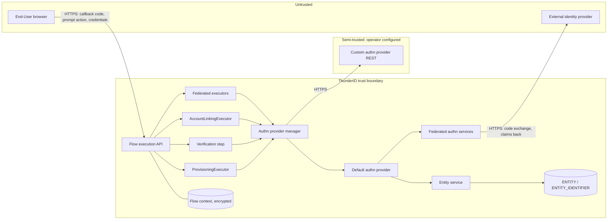
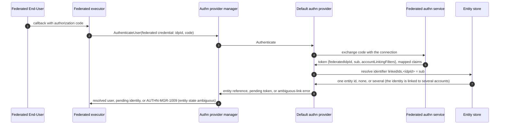
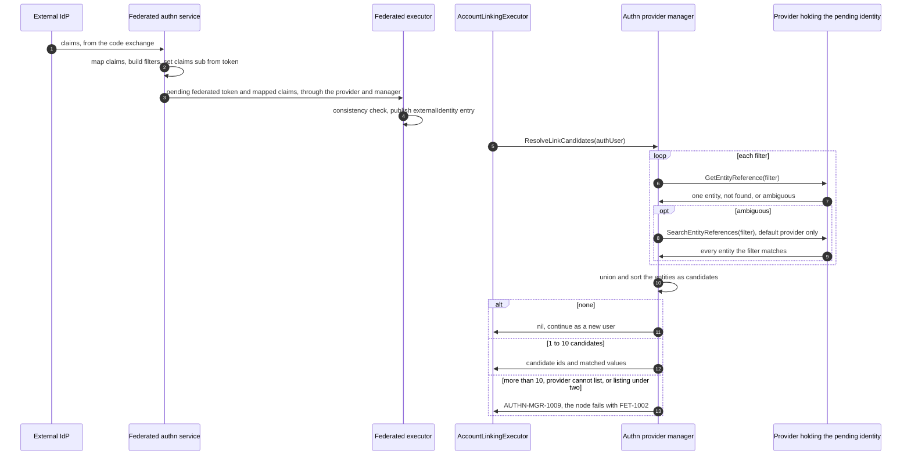
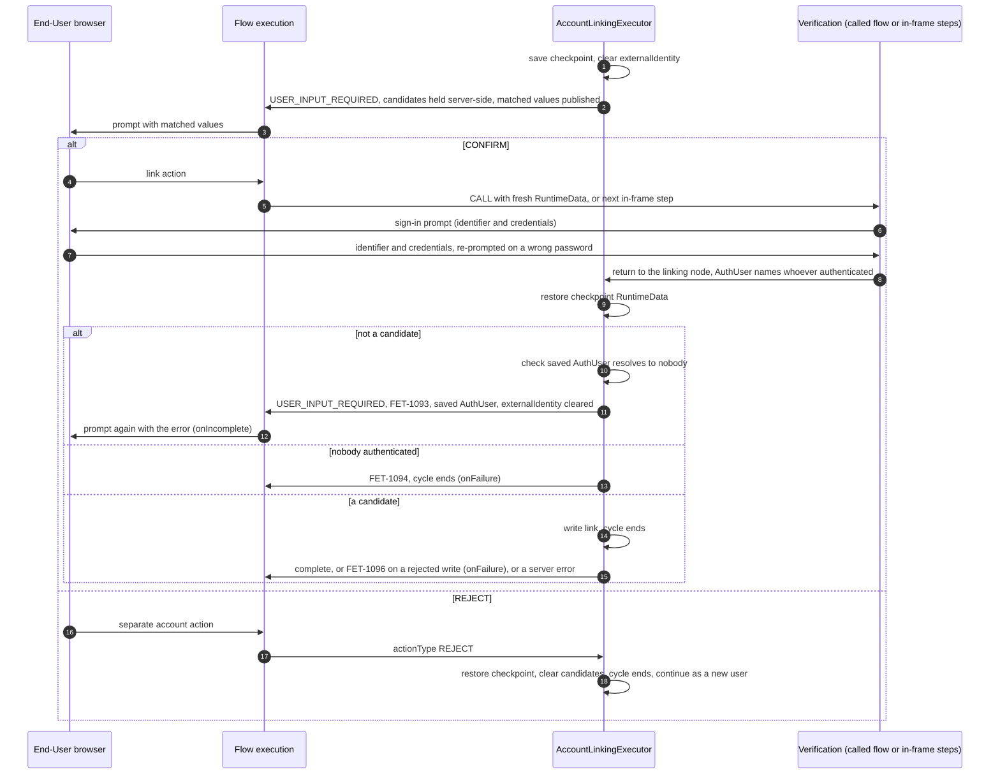
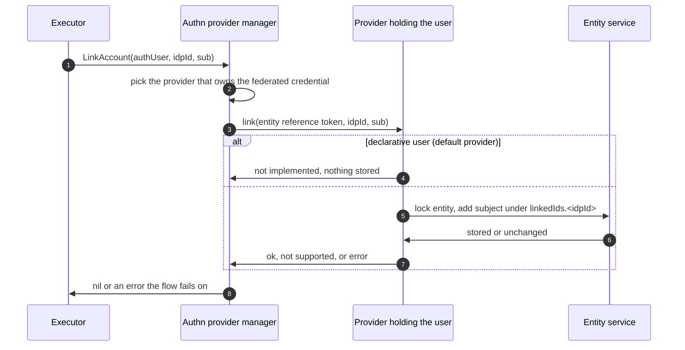

# Federated Account Linking Threat Model

This model covers how a federated identity comes to be associated with a local ThunderID account. It covers the `(connection, subject)` link and its storage, the candidate match on a connection's account-linking attributes, the Account Linking flow node with its prompt and verification, and the two executors that write a link. It accompanies the [federated account linking specification](spec.md).

## Overview

A federated sign-in arrives holding claims that an external identity provider asserted. The most security-relevant decision in this area is which local account, if any, that identity may become. A wrong answer is an account takeover by anyone who can make an external provider assert the right claim.

ThunderID resolves a federated identity to a local account only through a recorded `(connection, subject)` link. An identity with no link can be matched on the connection's account-linking attributes, but the match only names candidates. The Account Linking node shows the matched values and links the identity only after the End-User authenticates as one of the candidates during verification. Verification runs either as a separate flow that the node calls or as steps in the same flow. Refusing the match continues as a new user.

The federated executors hand the identity and its claims to later nodes as one `RuntimeData` entry, `externalIdentity`. No claim is written under its own name, so no claim overwrites flow control state. Node conditions never read the claims.

The entry point is the flow execution API. It carries the federated callback that resumes a paused execution, the linking prompt submission, and the verification steps' submissions.

Cross-cutting concerns covered elsewhere, and treated here as trust inputs: the OAuth2 and OIDC exchange itself (code exchange, ID token signature, nonce and state), flow execution context storage and encryption, session issuance and token signing, the entity store's access control, credential verification inside the password, passkey and OTP authenticators, and Console administrative authentication.

## Scope

This model covers:

- Recording a link, and the storage and indexing of `linkedIds`.
- Resolving a federated identity to a local entity through a recorded link.
- Building account-linking filters from a connection's configuration, and matching an unlinked identity against existing accounts.
- Publishing the federated identity and claims as the `externalIdentity` entry, and which executors may read claims from it.
- The linking prompt, the decision it asks for, and the values it discloses.
- Verification, as a called flow or as in-frame steps, the checkpoint the linking node saves and restores around it, the check that the account that verified is a candidate, and the retry after the wrong account verified.
- Provisioning's refusal to create an account that duplicates a candidate.
- The link write on the custom (REST) authn provider contract.

Out of scope (owned by the companion threat models named):

- The federated authentication exchange that produces the claims. Owned by the federated authentication model.
- The direct federated authentication API. Owned by the federated authentication model.
- Size limits on the provider's response and injection handling in the code exchange. Owned by the federated authentication model.
- Whether a claim asserted by an external provider is true. That is the provider's assurance, not ThunderID's.
- Flow context confidentiality, integrity and expiry. Owned by the flow execution model.
- Session and token issuance after a successful sign-in. Owned by the session and OAuth2 models.
- Console authentication and authorization for editing flows and connections. Owned by the Console and management API models.
- Account state (disabled, locked or suspended) of a holder or a candidate. Owned by the account lock and suspension model.
- Pre-hijacking through self-registration that lets an account claim an email without proving it. Owned by the flow execution model.
- What a `CALL` node's called flow contains, and the HTTP request executor's `{{ctx(key)}}` fallback to the `externalIdentity` claims. Owned by the flow execution model.
- What the auth assertion and the email and SMS executors do with a claim they read as a fallback, for example a value placed in a token or an email. Owned by the flow execution model.
- Rate limiting and attempt caps on repeated sign-ins and retries. Owned by the flow execution and authentication models.
- Entity store caching and uniqueness constraints on user attributes (`FET-1080`). Owned by the entity and user management model.
- Rendering of values in the Console and the login UI, and logging of identifiers outside the linking paths. Owned by the Console model and platform logging.

## Architecture



### Components

The federated executors hand the identity to the Account Linking node through the server-side flow context. The node and provisioning both reach the stores through the authn provider manager, which routes each call to the provider that holds the user.

| Component | Task |
| --- | --- |
| Flow execution API | Resumes a paused execution. Holds the `AuthUser` and `RuntimeData` in the server-side flow context. The End-User never sees or supplies either directly. |
| Federated executors (OAuth, OIDC, Google, GitHub) | Hand the callback's code to the authn provider manager as a `federated` credential, run the consistency check on the claims that come back, and publish one `externalIdentity` entry holding the connection, the token's subject and the mapped claims. |
| Federated authn services (OAuth, OIDC, Google, GitHub) | Called by the default provider. Exchange the code with the connection, map the claims, derive the account-linking filters, and build the federated token. |
| `AccountLinkingExecutor` | Matches an unlinked identity, stores the candidate ids server-side, saves a checkpoint of `RuntimeData`, the `AuthUser`, the `UserInputs` and the prompt details, clears `externalIdentity`, and forwards to the prompt. On re-entry it restores the checkpoint's `RuntimeData`, then links only when the authenticated entity is a candidate. When the wrong account verified, it rolls the `AuthUser` and the `UserInputs` back and re-prompts. Every other outcome ends the cycle. |
| Verification | The steps that run after `CONFIRM`, chosen by the flow author. Either a flow that a `CALL` node runs with a `RuntimeData` of its own, which the engine discards on return, or in-frame steps whose writes the linking node's restore discards. The `AuthUser` and `UserInputs` are shared in both. The linking node puts the `AuthUser` back only after a non-candidate verified. |
| `ProvisioningExecutor` | Creates the account for an identity that matched nothing, with its link written in the same transaction. Refuses to run while candidates are unsettled. |
| Authn provider manager | Routes the `federated` credential to the default provider, or to a custom provider that claims it. `ResolveLinkCandidates` matches, turns an ambiguous lookup into candidates, and never authenticates. `LinkAccount` routes the write to the provider holding the user. |
| Default authn provider | Resolves a federated token through the recorded link only. Lists the entities an ambiguous attribute lookup matches, the only provider that can. Writes links through the entity service, and stores none for a declarative user. |
| Entity service and store | Stores `linkedIds` as a reserved system attribute under an entity lock, indexes each subject, and lists every entity holding a pair. Several entities may hold one pair, one per account the identity is linked to (for example in different OUs). |
| Custom authn provider (REST) | Optionally holds the user and the link, and resolves its own links when it claims the `federated` credential. Cannot list an ambiguous match. Runs outside the ThunderID process. |

### Actors

#### Actors

| Actor | Description | Roles or permissions |
| --- | --- | --- |
| Federated End-User | Arrives holding claims asserted by an external connection. May or may not own a local account. | None until resolved or linked |
| Local account owner | Holds an existing account that an incoming identity's attributes match. Often not present in the flow. | Their own account |
| Flow author | Administrator who places the Account Linking node and chooses the verification. | Console flow management |
| Connection administrator | Administrator who configures a connection's account-linking attributes and attribute mappings. | Console identity provider management |
| External identity provider | Asserts the subject and the claims the match is made on. | Trusted only as far as the connection's configuration assumes |
| Custom authn provider | External service that may hold the user and the link. | Operator-configured |

#### Entitlement matrix

| Actor | Resolve a local user through a link | Cause a candidate match | Settle a match into a link | Write a link | Choose the verification |
| --- | --- | --- | --- | --- | --- |
| Federated End-User | [Yes] (their own recorded link) | [Yes] (by the claims their provider asserts) | [Yes] only by authenticating as a candidate | [No] directly | [No] |
| Local account owner | [Yes] (their own) | [No] | [Yes] (by completing verification) | [No] directly | [No] |
| Flow author | [No] | [No] | [No] | [No] | [Yes] |
| Connection administrator | [No] | [Yes] (by choosing which attributes match) | [No] | [No] | [No] |
| External identity provider | [No] | [Yes] (by what it asserts) | [No] | [No] | [No] |

### External Dependencies (not owned)

| Dependency | Description (usage, purpose, authentication, authorization, security) |
| --- | --- |
| External identity provider (OIDC, OAuth2, Google, GitHub) | Asserts the subject and the claims a candidate match is made on. Whether a claim such as `email` is verified depends on the provider. Owned by the federated authentication model. |
| Custom authn provider (REST) | Receives `POST /link-account` with its own entity reference token. Transport and service authentication are the operator's. |
| Entity database | Stores `linkedIds` and the identifier index. Encryption at rest and access control are the deployment's. |

## Threats and mitigations

### Out-of-scope interactions and risks for this threat model

- Forged or replayed authorization codes, ID tokens, `state` and `nonce`: federated authentication model.
- The direct federated authentication API: federated authentication model.
- Size limits on the provider's response and injection handling in the code exchange: federated authentication model.
- Theft of the flow execution id or challenge token, and flow context confidentiality or expiry: flow execution model.
- Session fixation and token theft after sign-in: session and OAuth2 models.
- Unauthorized edits to a flow or a connection: Console and management API models.
- Account state (disabled, locked or suspended) of a holder or a candidate: account lock and suspension model. Linking adds no path around it.
- Pre-hijacking through self-registration that lets an account claim an email without proving it: flow execution model.
- What a `CALL` node's called flow contains, for example a registration flow with provisioning: flow execution model.
- Entity store caching and uniqueness constraints on user attributes (`FET-1080`): entity and user management model.
- Rendering of values in the Console and the login UI, such as script injection: Console model.
- Logging of identifiers outside the linking paths: platform logging.
- The HTTP request executor's `{{ctx(key)}}` fallback to the `externalIdentity` claims: flow execution model.
- What the auth assertion and the email and SMS executors do with a claim they read as a fallback, for example a value placed in a token or an email: flow execution model.
- Rate limiting and attempt caps on repeated sign-ins and retries: flow execution and authentication models.

### Interactions

#### [01]: Resolving a federated identity through a recorded link

**Description**

The federated executor passes the callback's code to the authn provider manager, which routes it to the default provider. The provider's federated authn service exchanges the code with the connection and returns a federated token naming the connection and the subject. The provider then looks up the identifier `linkedIds.<idpId>` with the subject as the value, scoped to the deployment. One hit resolves the entity. A miss returns the token as a pending identity that resolves to nobody. Several hits mean the identity is linked to several accounts, for example in different OUs. The manager answers `AUTHN-MGR-1009`, the federated executor records the entity state as ambiguous, and no account is chosen: the Account Linking node skips, and a Resolve User node (the identifying executor in resolve mode) lets the End-User pick between the holders and binds the one picked. A federated token is never resolved by attribute lookup. Several accounts sharing a linking attribute is a different case, handled in [02].

**Assets involved**

| Initiator | Intermediate | Target |
| --- | --- | --- |
| Federated End-User | Flow execution, authn provider manager, default authn provider | Local entity, identifier index |

**Data flow**



**Security considerations**

| Area | Response | Comments |
| --- | --- | --- |
| Data confidentiality | [C-High] | The pair authenticates a user, so a wrong resolution is an account takeover. |
| Communication medium | [M-DB] | Index read inside the deployment. |
| Transport security | [TLS] | Browser and provider legs. Database transport is per deployment. |
| Authentication | Federated authentication completed for this connection | The subject is only as trustworthy as the connection that asserted it. |
| Accessibility | [Internal] | No API exposes the link index. |
| Authorization and Access Control | Deployment-scoped query | Links never cross deployments. |

**Threat assessment**

| ID | Category | Threat | Materializable | Mitigation / comment |
| --- | --- | --- | --- | --- |
| 1 | [Spoofing] | A subject asserted by one connection resolves a link recorded for another, and signs in as that account. | [No] | The identifier name carries the connection id, and every layer requires both halves of the pair. |
| 2 | [Spoofing] | Several entities hold the same pair and the sign-in resolves one the End-User did not prove. | [No] | Several holders are allowed, so one identity can reach its accounts in several OUs, and each was linked by verifying as that account or by provisioning it for this identity, so the identity's owner proved it. Resolution never picks one. The entity state becomes ambiguous, the Account Linking node skips, and the Resolve User node offers only the holders' own options and binds the one picked. Without a pick, provisioning refuses in an authentication flow. Concurrent first sign-ins of one identity can each provision a user and leave two holders in one OU, which the picker then resolves. That is a duplicate account created by the identity's owner, not a takeover. |
| 3 | [Spoofing] | A federated token with no link falls back to an attribute lookup, in sign-in or in provisioning, and authenticates or completes as whoever shares an attribute. | [No] | A federated token that its link did not resolve answers user-not-found and is never passed to `IdentifyEntity`. The account-linking filters are read only by candidate matching in [02], which names and never authenticates. Provisioning does the same: for a federated identity it never looks an existing user up by attribute, in any flow type, and only a recorded link resolves an existing user. |
| 4 | [Spoofing] | The provider reassigns a subject to another person, or a plain OAuth provider's `id` is a value its owner can give up (a username or an email), and the new holder signs in to the earlier owner's account through the recorded link. | [Yes] | A recorded link authenticates with no match or verification, so ThunderID cannot tell. The subject is read from the provider's response before any mapping: the ID token `sub` (OIDC, Google), or the profile `sub` with `id` as the fallback (OAuth, GitHub). Fields that can change hands, such as a GitHub `login`, `preferred_username` or `email`, are never the subject. GitHub's subject is its numeric `id`, which survives a rename. OIDC Core requires a subject never to be reassigned within its issuer, but OAuth has no such requirement. Inherently upto the federated provider. Documented to make sure that the federated provider is having an immutable `sub` value. Accepted. |
| 5 | [Operational Risk] | The provider returns the same person's subject, or a linking attribute value differs, in a different case or with different whitespace on a later sign-in, and the link or the account is missed. | [Yes] | Subjects are compared exactly, in the database and in the declarative store, as OIDC Core requires of a case-sensitive string. Folding them would let two people whose subjects differ only in case resolve to one account. Linking attribute values are compared verbatim too, as the entity store compares them, which is a product decision on how to compare values. A miss runs the match again or provisions a new account, never someone else's. Accepted. |
| 6 | [Spoofing] | Two different subjects end up as the same value, through truncation of a long subject in storage or loss of precision in a numeric `id` above 2^53, and the second identity resolves the first one's link. | [No] | A numeric `id` used as the subject keeps the literal text the provider sent rather than a decoded `float64`. A numeric `sub` is rejected, since the subject must be a string. The subject is stored as `TEXT` and looked up by exact equality. The identifier name is at most 46 characters in a `VARCHAR(255)` column. PostgreSQL rejects an over-length value rather than truncating it, and SQLite does not enforce lengths. Several holders of one pair are allowed (threat 2), so no unique constraint would catch a collision. Safety rests on no truncation happening, and a database that truncates silently would need this revisited. The subject's length is not capped: one over about 2.7 KB exceeds the PostgreSQL index row limit and the link write fails. Accepted. |
| 7 | [Information Disclosure] | The Resolve User prompt shows the attributes of every account the identity holds, for example `ouHandle` and `userType`, to someone who has not proved each one. | [Yes] | The prompt offers the values the holders differ on, taken only from the users holding this identity's link, and never a credential (`password`, `code`, `otp`, tokens). The viewer has authenticated as the identity, and every holder was linked by verifying as that account or by provisioning it for this identity, so the viewer is the identity's owner. A link recorded for an account the owner no longer controls, for example a subject the provider reassigned (threat 4), discloses that account's differing values to the new holder. This follows from threat 4, which depends on the provider keeping the subject immutable, and the recorded link already signs that holder in to the account. Accepted. |

#### [02]: Building filters and matching candidates

**Description**

The shared federated token builder, which every federated authn service calls, maps the claims and derives the account-linking filters from the connection's linking attributes and mappings. The token carries `federatedIdpId`, `sub` and, when the connection has linking attributes, `accountLinkingFilters`, apart from each other. The builder then sets the claims' `sub` to the token's `sub`. The federated executor runs the consistency check and publishes the connection, the subject and the mapped claims as one `externalIdentity` entry, replacing any earlier one whole.

Readers of attribute values fall back to the entry's claims after their own sources: executor and prompt input satisfaction, the attribute collector, provisioning's attributes, the auth assertion's requested attributes, and the email and SMS recipients and templates. The order varies by reader. User searches never read the claims (threat 14). So does `{{ctx(key)}}` placeholder resolution in the HTTP request executor's URL, headers and body, for every key except `userId` and `ouId`. Node conditions resolve placeholders without the claims. Provisioning never reads a credential attribute from the claims, and no claim satisfies a credential: provisioning prompts for a credential attribute, and executor and prompt input satisfaction, including the prompt node's forwarded inputs and its re-prompt after a validation failure, ask for a `PASSWORD_INPUT` (threat 27). Executors that read a flow control key directly from `RuntimeData`, such as the candidates, the checkpoint and `userEligibleForProvisioning` at provisioning, never consult it.

At the Account Linking node the manager resolves each filter through the provider holding the pending identity. A filter that names one entity adds it. A filter the provider finds ambiguous is listed through `SearchEntityReferences`, and every entity listed is a candidate. The union across filters, up to 10, comes back with the values that matched. Several matches are candidates, not an error. The match fails only when there are more than 10, when the provider cannot list an ambiguous match (every provider except the default one), or when the listing names fewer than two. Nothing is written and the `AuthUser` is untouched.

**Assets involved**

| Initiator | Intermediate | Target |
| --- | --- | --- |
| Federated End-User, external identity provider | Federated executor, authn provider manager, default authn provider | Local entities (named, not entered), `RuntimeData` |

**Data flow**



**Security considerations**

| Area | Response | Comments |
| --- | --- | --- |
| Data confidentiality | [C-High] | The match decides which accounts the End-User may try to verify. |
| Communication medium | [M-DB] | |
| Transport security | [TLS] | |
| Authentication | None. A match is not an authentication. | |
| Accessibility | [Internal] | |
| Authorization and Access Control | No caller names the filter. It comes from the connection's configuration and the asserted claims. | |

**Threat assessment**

| ID | Category | Threat | Materializable | Mitigation / comment |
| --- | --- | --- | --- | --- |
| 8 | [Spoofing] | A provider asserts an unverified claim, typically `email`, that matches a victim's account, and the match signs the attacker in. | [No] | A match never authenticates. The identity is linked only after the End-User authenticates as a candidate in [03]. Verification's own strength is the flow author's choice by design: any step that authenticates a candidate links the identity, so the link is only as strong as the weakest method offered after `CONFIRM`, and the linked identity then reaches every application and role the account holds. The guides say so. |
| 9 | [Spoofing] | A claim named `userID`, `federatedIdpId` or a system attribute becomes part of a filter, so the provider picks the account by id instead of by attribute. | [No] | Filters live under their own token key. Reserved names (`userID`, `federatedIdpId`, `credentialUpdatedAt`, `linkedIds` and `linkedIds.*`) are never targets. A valued linking attribute whose only targets are reserved has no target, so the connection builds no filters at all. Saving a connection through the API rejects a linking attribute that is, or maps to, a reserved name. A declaratively loaded connection skips that check, and the 10-filter cap, and relies on the runtime drop. |
| 10 | [Denial of Service] | A linking attribute that barely tells accounts apart names a large number of candidates. | [No] | More than 10 candidates fails the node with `FET-1002`. A provider that cannot list an ambiguous match fails closed the same way. The listing is a separate query from the lookup. In the database it matches the attributes JSON, or the identifier row for an indexed attribute, and is capped at 100. The declarative store is not capped and also matches system attributes, and the composite store unions both. The candidate cap still applies to the union. A listing that names fewer than two entities also fails closed with `FET-1002`, so a legitimate owner is then refused rather than mismatched. |
| 11 | [Information Disclosure] | An attacker learns whether an account holds a value, or how many accounts matched, by watching whether the prompt appears, what it shows, or what verification and its error say. | [Yes] | The attacker has to get the connection to assert the value, and learns only that some account holds a value they supplied. Neither the prompt nor verification reveals how many accounts matched: verification is an ordinary sign-in and asks for the same inputs whatever matched. The `FET-1093` error tells the End-User that the account they verified is not the matched one, which they proved themselves, and it names neither the candidates nor how many matched. Accepted. |
| 12 | [Elevation of Privilege] | A claim named after flow control state (for example `userID`, `groups`, `ouId`, `categoryType`, `userEligibleForProvisioning`, `linkingCandidateUserIds`) changes which account, entity type, OU or branch a later node acts on. | [Yes] | No claim is written to `RuntimeData` under its own name, and executors that read a flow control key straight from `RuntimeData` never consult the claims. Node conditions resolve placeholders without the claims, so a claim cannot select or skip a node. The HTTP request executor's `{{ctx(key)}}` placeholders do fall back to the claims when `RuntimeData` holds no value for the key, for every key except `userId` and `ouId`. A claim named, for example, `userID` (capital D) or `userEligibleForProvisioning` can therefore change what an HTTP request sends when the flow has not set that key. It cannot select or skip a node directly. It can indirectly, when that request goes to a service whose response mapping writes a key a later condition reads. The placeholder fallback belongs to the HTTP request executor, owned by the flow execution model. |
| 13 | [Spoofing] | A mapping onto the local attribute `sub` (for example `email` to `sub`) makes the flow link a value other than the provider's subject. A later identity that asserts that value then resolves the account. | [No] | The shared builder overwrites the authenticated claims' `sub` with the token's `sub` after mapping, so the published `sub` is always the provider's subject. The filters are built before that overwrite, so a linking attribute on local `sub` matches the mapped value. That only names candidates, which still need verification. The subject itself is read from the provider's response before any mapping, so no connection setting selects it (threat 4). |
| 14 | [Spoofing] | A user search after a federated sign-in (an identifying, OTP or magic link executor) matches a local user on a claim the provider asserted (for example an unverified `email`) and resolves the victim's account without the Account Linking node. | [No] | User searches never read the `externalIdentity` claims. While the entry names a federated identity, the identifying executor reads only the users holding its link, in every mode: identify fails when no user or several hold it, check state counts the holders, and resolve acts only on an ambiguous link in an authentication flow, where the End-User picks between the holders. The OTP executor searches only on values the End-User submitted or the flow set, and the magic link executor only on submitted values. A registration flow still sends an OTP to a destination a claim supplied, without searching on it. |
| 15 | [Tampering] | Two federated sign-ins in one frame leave a mix of both providers' claims, and provisioning builds an account from it. | [No] | A new `externalIdentity` entry replaces the earlier one whole. A second sign-in fails the consistency check first with `FET-1014` when the earlier entry names a different connection or subject. It also fails when the new value of a local attribute that the connection's account-linking attributes target differs from the earlier entry's claims, the same key in `RuntimeData` or `UserInputs`, or the value of the authenticated user's attribute. A connection with no account-linking attributes compares only the connection and subject. Connection and subject are compared together, so a sign-in at a second connection fails even when the two subjects happen to be equal. |

#### [03]: The linking prompt and verification

**Description**

With candidates, the node stores their ids in the server-side flow context, publishes the matched values under `linkingPromptDetails`, saves a checkpoint of `RuntimeData`, clears `externalIdentity`, and forwards to the prompt. The prompt has two buttons. `REJECT` points back at the node and clears the candidates. `CONFIRM` starts verification, wired in one of two ways:

- a `CALL` node that runs a verification flow, an ordinary authentication flow, in a frame of its own. The engine restores the caller's `RuntimeData` when it returns;
- verification steps in the same flow, the verification segment, whose every way out leads back to the linking node.

Either way, the steps find none of the connection's claims and no earlier subject in `RuntimeData`, and the End-User types the identifier. On re-entry the node restores the checkpoint's `RuntimeData`, which removes whatever the steps wrote and brings back the original `externalIdentity`. It then requires the `AuthUser` to resolve to an entity in the candidate list before it writes the link.

The checkpoint also holds the `AuthUser` as the first pass found it, the pending federated identity, the `UserInputs` from before verification, and the prompt details. When a non-candidate verified, the node hands that `AuthUser` back, puts the `UserInputs` back, publishes the prompt details again, clears `externalIdentity` again, and returns `USER_INPUT_REQUIRED` with `FET-1093`. The engine adopts it, the non-candidate's authentication is discarded, and `onIncomplete` shows the prompt again with the error. The retry starts from the state the first attempt started from. The node first checks that the saved `AuthUser` resolves to nobody.

Every other outcome ends the cycle by clearing `linkingVerificationRequested` and `linkingCheckpoint`. Linking and refusal complete and clear the candidates. Nobody authenticated (`FET-1094`) and a rejected link write (`FET-1096`) fail through `onFailure` and keep the candidates. A storage fault on the write is a server error.

**Assets involved**

| Initiator | Intermediate | Target |
| --- | --- | --- |
| Federated End-User | Prompt node, verification steps, `AccountLinkingExecutor`, flow context | Candidate accounts, the `AuthUser` |

**Data flow**



**Security considerations**

| Area | Response | Comments |
| --- | --- | --- |
| Data confidentiality | [C-High] | The prompt shows only values the viewer's own connection supplied. |
| Communication medium | [M-NT] | The prompt, the action and the credentials cross the network. Candidate ids do not. |
| Transport security | [TLS] | |
| Authentication | A completed authentication as a candidate | |
| Accessibility | [Public] | The prompt is rendered to an unauthenticated browser. |
| Authorization and Access Control | Candidate ids live only in the encrypted server-side flow context. The client supplies only which action it chose and its credentials. | |

**Threat assessment**

| ID | Category | Threat | Materializable | Mitigation / comment |
| --- | --- | --- | --- | --- |
| 16 | [Tampering] | A client submits `CONFIRM`, or forges any action, to have the node link without verification. | [No] | The node ignores every action type except `REJECT`. On re-entry it reads only who authenticated, and nobody authenticated fails with `FET-1094`. |
| 17 | [Tampering] | A `REJECT` action is wired to another node, so the refusal is lost and the End-User can never continue as a new user. | [No] | A forwarded action type reaches only the node its action points at, and the type always comes from the server-side action definition. Saving a flow of any type rejects a `REJECT` on the linking prompt that does not point back at the linking node. The Console also warns, but only in authentication flows, and it accepts any linking node as the target. Other actions on the prompt are not validated. A graph that gets past both writes no link: `FET-1094` at the linking node, or `FET-1095` at provisioning. |
| 18 | [Information Disclosure] | The prompt discloses attributes of a matched account the viewer has not proved. | [No] | The prompt shows only the matched attribute names and the values the identity supplied. Nothing is read from the accounts. |
| 19 | [Spoofing] | Verification authenticates an account that is not a candidate (the attacker's own local account, or a second account linked at the verification connection), and the identity is linked to it. | [No] | The node requires the authenticated entity to be in the candidate list. Otherwise it writes nothing, rolls the `AuthUser` back (threat 26), and re-prompts with `FET-1093`. |
| 20 | [Tampering] | A verification that authenticates at another connection overwrites the identity being linked, so the verifying identity is linked instead, or a value verification resolved (for example a `userID` from `IdentifyingExecutor` in resolve mode) leaks into the linking decision or into provisioning. | [No] | The checkpoint restore puts the original `externalIdentity` entry back before the link write, whether the other connection ran in a called flow or in-frame. A called flow's `RuntimeData`, entry included, is discarded when it returns. In-frame steps' writes are removed by the same restore, which runs before the node reads anything else. The node reads only who the `AuthUser` names and checks it against the candidate list. |
| 21 | [Spoofing] | A claim mapped onto the identifier input fills it on the End-User's behalf. | [No] | The linking node clears `externalIdentity` before verification, and again before each wrong-account retry. No claim is written under its own name, so no claim is there to fill an input. A called flow also starts with an empty `RuntimeData`. The End-User types the identifier. |
| 22 | [Operational Risk] | Verification authenticates the candidate through a different authn provider from the one holding the pending identity, so a legitimate owner can never link. | [No] | Fails closed. The pending state stays in the `AuthUser`, which resolves to nobody, and the node answers `FET-1094`. The specification requires verification through the same provider, and the guides need to say so. |
| 23 | [Tampering] | An in-frame verification segment has a way out that skips the linking node (to an `END` node, provisioning or the auth assertion), so what the steps wrote survives, or the candidate check never runs. | [No] | Saving a flow rejects a segment that contains an `END` node, another linking node, a `ProvisioningExecutor` or an `AuthAssertExecutor`, or that has no edge back to the linking node. The segment is every node reachable from the `CONFIRM` target without passing through the linking node. A graph that gets past validation writes no link, because `externalIdentity` is empty. The candidates are still set, so provisioning answers `FET-1095` in every flow type, whether or not verification signed somebody in (threat 38). |
| 24 | [Tampering] | Clearing `externalIdentity` for verification switches off the consistency check for a second federated sign-in that is not a verification. The reverse also needs care: a legitimate owner who verifies through a second connection linked to their account must not be rejected because its `sub` differs from the pending identity's. | [No] | Only the linking node clears the entry, and only while its cycle is armed: from the first pass until a settling pass ends the cycle, wrong-account retries included. Outside that window the check reads the entry as usual (spec AC3.9). Inside it, the candidate check is the stronger rule. The pending identity is in the checkpoint, not in `RuntimeData`, so the check has no earlier subject to compare with, and the pending `AuthUser` resolves no attributes either. Only the comparisons of the second connection's linking-attribute values against `RuntimeData` and `UserInputs` still run, as they do inside a called flow. |
| 25 | [Tampering] | A verification step overwrites `linkingCheckpoint`, or the checkpoint is forged or corrupted, so the restore brings back state the step chose, including an `AuthUser` that names an entity (the flow then continues signed in as it) and the `UserInputs` a wrong-account retry hands back. | [No] | Only two kinds of executor write a `RuntimeData` key named by configuration: the attribute collector and credential steps, by user schema attribute, and the HTTP request executor, by response mapping target. Saving rejects a schema attribute or a response mapping target named `externalIdentity`, `linkingCheckpoint` or `linkingVerificationRequested`, through the API and for declaratively loaded resources. The check matters because the value is not the administrator's: the attribute collector copies the authenticated user's stored profile value, which during in-frame verification is the candidate's own, and a response mapping copies the remote service's. Residual 2. The node also checks that the saved `AuthUser` resolves to nobody before it hands it back, and fails with `FET-1093` through `onFailure` otherwise. That always holds legitimately: a first pass that finds somebody authenticated completes without saving a checkpoint. The checkpoint lives only in the encrypted flow context. |
| 26 | [Spoofing] | After a non-candidate verifies, their authentication carries into the retry. A `REJECT` then continues signed in as that account, because provisioning sees an existing user. OTP and magic-link retries target that account, a federated retry fails the consistency check against its attributes, and the identifier the attempt collected fills the retry's identifier input, so the retry verifies the same account. | [No] | The node hands back the `AuthUser` its checkpoint saved, the pending federated identity, and the engine adopts it, so the non-candidate's authentication is discarded. It also puts the `UserInputs` back to what they were before verification. If the saved `AuthUser` would not be adopted, because it does not read as authenticated, the node fails with `FET-1093` through `onFailure` instead of offering the retry. |
| 27 | [Spoofing] | A claim named after a credential (for example `password`) satisfies the credential input, so the End-User never sets one, or the account is created with a credential the external provider chose. | [No] | Provisioning takes a credential only from `UserInputs` or `RuntimeData` and prompts for a credential attribute a claim holds. Input satisfaction never counts a claim for a `PASSWORD_INPUT`, in executors and in the prompt node, including the inputs forwarded to it and its re-prompt after a validation failure. |
| 28 | [Operational Risk] | In a registration flow, in-frame verification steps keep their registration behaviour. The password step fails with `FET-1007` for the account being verified without checking the password, and the magic link step skips delivery to it, so a legitimate owner can never link. | [No] | While `linkingVerificationRequested` is set, the password, OTP and magic link executors apply their authentication behaviour in every flow type. Only the linking node's first pass sets the flag, saving rejects a schema attribute or response mapping target named after it (threat 25), and a settling pass clears it, so steps after the cycle keep their registration behaviour. |
| 29 | [Information Disclosure] | Running verification steps with authentication behaviour in a registration flow reveals whether an identifier is registered, which their registration behaviour hides (the magic link step skips delivery to an existing user without saying so). | [No] | The steps answer as the ordinary sign-in does: the magic link step completes without delivery for an unknown identifier, and the password step answers `FET-1005` whether or not the account exists. Verification is reachable only after a federated sign-in matched candidates, and reveals no more than the sign-in flow already does, so threat 11 holds. |

#### [04]: Recording the link

**Description**

`AccountLinkingExecutor` writes the link for a verified candidate, and `ProvisioningExecutor` writes it for a user it just created. Both read the pair from the `externalIdentity` entry and call the manager, which picks the provider holding the user and passes that provider's own entity reference. The entity service locks the entity and adds the subject inside one transaction. Other entities may already hold the pair. A subject already recorded is a no-op. A declarative user is read-only, so the default provider stores no link for it and reports the link as not stored.

**Assets involved**

| Initiator | Intermediate | Target |
| --- | --- | --- |
| `AccountLinkingExecutor` | Authn provider manager, default or REST provider | `linkedIds` system attribute, identifier index |
| `ProvisioningExecutor` | User management provider, user service | `linkedIds` system attribute, identifier index |

**Data flow**



**Security considerations**

| Area | Response | Comments |
| --- | --- | --- |
| Data confidentiality | [C-High] | A wrongly written link is a durable takeover. |
| Communication medium | [M-DB], [M-NT] for a custom provider | |
| Transport security | [TLS] | The custom provider leg is the operator's to secure. |
| Authentication | Reached only after verification as a candidate, or after creating the user | |
| Accessibility | [Internal] | No public API writes a link. |
| Authorization and Access Control | The target is the entity the `AuthUser` already names | |

**Threat assessment**

| ID | Category | Threat | Materializable | Mitigation / comment |
| --- | --- | --- | --- | --- |
| 30 | [Tampering] | A link is written against an account other than the one the flow settled on. | [No] | The provider resolves the target from its own entity reference on the `AuthUser`. A reference that names no entity fails the write. |
| 31 | [Tampering] | Two concurrent link writes to one entity each read the old `linkedIds` and the later commit drops the other's subject, so that identity stops resolving. | [No] | The write takes a row lock on the entity (`ASQ-ENTITY_MGT-31`, a no-op `UPDATE` inside the transaction) and then reads the row from the database, not the cache, for the whole read, add and write. The index re-sync reads from the database too. |
| 32 | [Tampering] | An unrelated write that rebuilds an entity's system attributes drops `linkedIds`, so the next sign-in resolves nothing. | [No] | `linkedIds` is a reserved system attribute. The carry-over reads its current value from the database under the entity lock, and a value the caller sends for it is replaced by the stored one. The list is maintained by hand, residual 2. |
| 33 | [Spoofing] | A path other than the linking node and provisioning writes `linkedIds`, such as the user management API, SCIM, a profile update, a registration flow, or a declarative user, so a link is created without verification. | [No] | Every write reaches the store through the entity service, which owns the key. Creating an entity drops a `linkedIds` value the caller sends, and writes only the link provisioning passes from `externalIdentity`. Updating an entity or its system attributes replaces a sent `linkedIds` with the stored value under the entity lock, or drops it when none is stored. The user API and SCIM keep the stored system attributes, profile updates and registration write only schema attributes, and declarative users carry no system attributes. A schema attribute named `linkedIds` or `linkedIds.*` stays a schema attribute, and its index rows are never read as links, since resolution reads only system attributes. The guard depends on the reserved list (residual 2). |
| 34 | [Operational Risk] | The verified candidate is a declarative user, which cannot be written to, so the link write fails and the legitimate owner can never sign in through the connection. | [No] | The default provider answers not-implemented for a read-only user without calling the entity service, and the manager reads that as nothing to record. The sign-in completes as the candidate the End-User proved, and `ACCOUNT_LINKED` is still published (residual 1). No link is stored, so each later sign-in at the connection matches and asks for verification again. |
| 35 | [Operational Risk] | A link write fails and the sign-in completes anyway, or leaves a created user behind, so the next sign-in prompts to link that leftover account or provisions a duplicate. A flow author who routes the linking node's `onFailure` back to the node causes the same: after `FET-1096` the verified candidate is still authenticated, so the first pass completes as that account with no link written. | [No] | A failed write ends the flow in both writers: `FET-1096` through `onFailure` at the linking node for a rejected write, a server error for a storage fault, and at provisioning a create that writes the user and its link in one transaction, so a failed link leaves no user behind. Saving a flow, declaratively loaded flows included, rejects a path from the linking node's `onFailure` target back to the node that does not take a federated authentication executor's `onSuccess`. A federated executor's `onFailure` does not count, since nobody signed in. A path that does take it, such as the documented `onFailure` to the sign-in prompt, signs in at a connection again, and that replaces the verified account's provider state with the new federated result before the node runs. Even without the check this is not a takeover, since that candidate proved their credentials. |
| 36 | [Security Risk] | A custom provider that does not store links fails every federated sign-in through it. | [No] | The not-implemented code `AUP-0005`, with a `4xx` status, reads as "nothing to record". Any other client error, `AUP-0006` included, fails the flow with `AUTHN-MGR-1012`. A service that lacks the endpoint and answers a 404 without the error body is read as a server error and fails the sign-in. |
| 37 | [Repudiation] | A link is created with no durable record of the flow, connection and verification that produced it. | [Yes] | Every settled verification publishes an observability event in the authentication category: `ACCOUNT_LINKED` (with `link_method` `verified`, or `provisioned` from provisioning), `ACCOUNT_LINK_REJECTED`, or `ACCOUNT_LINK_FAILED` with the error code. Each carries the execution id, the flow type, the connection as `idp_id`, the number of candidates, and the local account as `sub` when one authenticated. The federated subject is left out, since observability sinks must not hold it, and the stored link names it. Delivery is best effort and the events are not stored by ThunderID, so a lost event leaves no record. Residual 1. |

#### [05]: Provisioning an identity that matched nothing

**Description**

With no link and no candidates, or after a refusal, provisioning creates the account, and the entity service writes its link in the same transaction. For a federated identity it does not look an existing user up by attributes. In any flow type it refuses to run while candidates are set.

**Assets involved**

| Initiator | Intermediate | Target |
| --- | --- | --- |
| Federated End-User | `ProvisioningExecutor` | New local entity, identifier index |

**Data flow**

```mermaid
sequenceDiagram
  autonumber
  participant L as AccountLinkingExecutor
  participant P as ProvisioningExecutor
  participant E as Entity service
  L->>P: complete, no candidates held
  P->>P: fail FET-1095 if candidates are still set; authentication flow: complete if a user is signed in, skip unless eligible
  P->>E: create the user with its link, in one transaction
  E->>P: created, or rejected on a unique attribute (FET-1080)
```

**Security considerations**

| Area | Response | Comments |
| --- | --- | --- |
| Data confidentiality | [C-Medium] | Creates an account holding the claims the connection mapped. |
| Communication medium | [M-DB] | |
| Transport security | [TLS] | |
| Authentication | The federated authentication that produced the claims | |
| Accessibility | [Internal] | |
| Authorization and Access Control | Gated by the flow's provisioning allowance and the user type configuration | |

**Threat assessment**

| ID | Category | Threat | Materializable | Mitigation / comment |
| --- | --- | --- | --- | --- |
| 38 | [Spoofing] | Provisioning runs while candidates were named and never settled, or after a settling pass failed with somebody signed in (`FET-1096`, `FET-1093` through `onFailure`, or a `CALL` node's `onFailure` after the called flow signed somebody in), creating an account that shadows a candidate or completing as the signed-in account with no link written. | [No] | Refused with `FET-1095` in every flow type. Provisioning checks for unsettled candidates before it checks for a signed-in user, so an account that a failed verification signed in does not complete the flow either: not through the existing-user rules in a registration flow, and not through the signed-in shortcut in an authentication flow. Every one of these failures keeps the candidates. A refusal clears the candidates, so it is not mistaken for an unsettled match. The linking node's first pass clears candidates an earlier cycle left, so signing in at a connection again after `onFailure` completes as usual. |
| 39 | [Spoofing] | A registration flow provisions a second account for an identity that already carries its link. | [No] | Registration applies the existing-user rules to the link's holders before prompting: one holder completes as that user only where the flow allows registration with an existing user, and several fail. With cross-OU provisioning only holders in the target OU count, so registering into an OU where nobody holds the link creates a new holder there, which is the intended multi-OU outcome. |

## Security Review Checklist

A review aid that complements the threat models and the self-assessment. Guidance follows the [OWASP Top 10 Proactive Controls](https://top10proactive.owasp.org/).

### Security considerations

| # | Consideration | State | Comments |
| --- | --- | --- | --- |
| 1 | Are all inputs and outputs validated (syntactic and semantic)? | [Partial] | Every layer requires both halves of a pair. Linking attributes are validated when a connection is saved through the API, and dropped at runtime for a declarative one. Claims reach `RuntimeData` only inside the `externalIdentity` entry, and the published `sub` is the token's, but HTTP request placeholders fall back to the claims, which the flow execution model owns. User schema attribute names and HTTP request response mapping targets cannot name `externalIdentity`, `linkingCheckpoint` or `linkingVerificationRequested`. Linking graphs, including in-frame verification segments and paths from the linking node's `onFailure`, are validated when a flow is saved. The content of a called verification flow is not, and is owned by the flow execution model. |
| 2 | Are rate limits in place where necessary? | [N/A] | No new endpoint. Rate limiting of repeated sign-ins and retries is owned by the flow execution and authentication models. |
| 3 | Are permissions, roles, and entitlements defined on the principle of least privilege and business need? | [Yes] | A match names candidates and nothing more. Only authenticating as a candidate links. The write target is the entity the `AuthUser` names. |
| 4 | Are authentication and authorization validated at both the UI and API layers, front end and back end, before granting access to resources? | [Yes] | The Console warning is an authoring aid, shown in authentication flows only. The server validates on save for every flow type, and the runtime fails closed. |
| 5 | Are proper isolations in place between components to ensure least-privilege access and reduce the blast radius against lateral movement? | [Yes] | Links are scoped by connection and deployment. The provider that holds a user stores its links. |
| 6 | Have any default credentials been changed, and are default superuser or root accounts not in use (when using third-party components)? | [N/A] | No credentials introduced. |
| 7 | Has the implementation followed best-practice guidelines (OWASP, Kubernetes, vendor, or technology provider)? | [Yes] | A subject is interpreted only within its issuer (OIDC Core). Linking on a claim requires proof of the local account. |
| 8 | Are secrets, credentials, and internal-only material kept out of the public source tree and its git history? | [Yes] | No secrets added. |
| 9 | Was a security-focused code review conducted for this change, and have the findings been addressed? | [No] | This model is its input. |
| 10 | Is Static Analysis (SAST) or IaC scanning conducted, and are findings addressed? | [Yes] | Covered by the repository-wide CI scan. |
| 11 | Is Software Composition Analysis (SCA) conducted or integrated into the repository, and are findings addressed (for example FOSSA, Trivy)? | [Yes] | Covered by the repository-wide CI scan. No dependency added. |
| 12 | Is Dynamic (DAST) or API scanning conducted on a non-production setup, and are findings addressed? | [N/A] | No new endpoint. |
| 13 | Are audit logs generated in a standardized format for critical functionality, and available to authorized users to trace critical events and aid incident response? Note the retention period in Comments. | [Partial] | Linking publishes `ACCOUNT_LINKED`, `ACCOUNT_LINK_REJECTED` and `ACCOUNT_LINK_FAILED` events to the configured observability sinks (threat 37). Delivery is best effort, and retention is the sink's. Residual 1. |
| 14 | Do audit logs for critical configuration changes record the difference between the old and new versions? | [N/A] | Flow and connection edits are owned by the management API model. |
| 15 | Are data in transit and at rest encrypted? | [Partial] | Transit is TLS. The flow context holding the pending identity, the candidates and the checkpoint, with its copies of the pending `AuthUser` and the `UserInputs`, is encrypted before storage. Entity database encryption at rest is the deployment's. |
| 16 | Are sensitive values such as credentials and keys stored in a secret store or vault? | [N/A] | A link is an identifier pair, not a credential. |
| 17 | Is personal, sensitive, or confidential data kept out of logs? | [Partial] | On the linking paths, entity ids are masked and the subject is not logged. The subject-type check logs an unmasked entity id at debug level. |
| 18 | Have users been given clear instructions for secure usage? | [Partial] | The flow and connection guides describe the node, the prompt, verification, the methods that satisfy it, several candidates, and declarative users. They do not yet say which methods are strong enough, the same-provider requirement, or that a connection's subject must be stable (threat 4). |

### Business impact and resilience

For an open-source component, most of these are shared with the operator who deploys it.

| # | Consideration | State | Comments |
| --- | --- | --- | --- |
| 1 | Has a business impact analysis been done to identify resilience requirements (maximum tolerable downtime, uptime, RPO, RTO)? | [N/A] | No service of its own. |

Resilience details to record:

- High availability: no new component. The link read is one indexed query.
- Disaster recovery: links live in the entity database and are restored with it. A restore that predates a link makes the next sign-in match again and prompt for verification.
- Backups: covered by the entity database's backup policy.
- Health checks: none added.
- User banners: not applicable.

### Dependency and component health

| # | Consideration | State | Comments |
| --- | --- | --- | --- |
| 1 | Are dependencies, base images, and runtimes monitored for known vulnerabilities and kept current (for example automated dependency scanning), and are findings addressed? | [Yes] | Repository-wide. No dependency added. |
| 2 | Are any End-of-Life or End-of-Service components in use? | [No] | |
| 3 | Is hardening guidance published for operators who deploy the project (optional)? | [Partial] | Verification strength and the same-provider requirement need guidance. |

### Privacy considerations

| # | Consideration | State | Comments |
| --- | --- | --- | --- |
| 1 | Is the purpose and legal basis for processing personal data clearly defined? | [Yes] | The subject is stored to authenticate the same person at the same connection later. |
| 2 | Are the collection, storage, processing, sharing, archival, and disposal of personal data aligned with the data minimization principle? | [Yes] | Only the connection id and the subject are stored. |
| 3 | Is personal data stored securely? | [Partial] | A server-owned system attribute that the user API does not return. Encryption at rest is the deployment's. |
| 4 | Are privacy notices updated to reflect any new processing or changes to purpose and legal basis? | [N/A] | Deployment-owned. |
| 5 | Is access to personal data granted on a need-to-know basis? | [Yes] | No endpoint lists links. |
| 6 | Are data retention requirements considered? | [Partial] | A link lives as long as the entity. Residual 3. |
| 7 | Is there a process to dispose of personal data on request in a timely manner while meeting retention requirements? | [Partial] | Deleting the entity removes its links and index rows. A single link cannot be removed. Residual 3. |
| 8 | Are records of personal-data processing maintained in the project's data inventory or records of processing? | [N/A] | Deployment-owned. |

## Residual risks (open items)

1. **No durable audit record for a link.** Linking outcomes are published as observability events (threat 37), which are delivered best effort to external sinks. ThunderID does not store them, cannot guarantee delivery, and does not protect them against tampering. A provider that does not store links (a declarative user, or a custom provider answering not-implemented) still reports `ACCOUNT_LINKED`. A durable, queryable audit trail is tracked in #5591. (tracking: #5591)
2. **Hand-maintained reserved lists.** Reserved system attributes, which protect `linkedIds`, are an explicit list, and a new server-owned system attribute left off it is dropped by unrelated updates. The reserved `RuntimeData` keys that configuration cannot write (`externalIdentity`, `linkingCheckpoint` and `linkingVerificationRequested`) are also an explicit list, and a new linking key left off it can be written by a schema attribute or a response mapping. Email and SMS template data carry `linkingCheckpoint`, so a template that names it sends it. (tracking: #6176)
3. **No unlink.** A link cannot be removed without deleting the entity, and deleting a connection leaves its links behind. A connection recreated under the same id inherits them. (tracking: #6177)

## Appendix

- Sample configuration: `verifiedLinkingFlowNodes()` in `tests/e2e/utils/server-setup/social-login-setup.ts`, a linking node with its prompt and a `CALL` to the username and password verification flow that `verifyPasswordFlowNodes()` builds. No sample offers a `LOGIN_OPTIONS` chooser or a second connection for verification. In-frame verification has no e2e sample. The integration tests build one as `InFrameLinkingFlow` in `tests/integration/flow/common/linking.go`.
- References:
  - [Federated account linking specification](spec.md)
  - [OpenID Connect Core, Section 2](https://openid.net/specs/openid-connect-core-1_0.html#IDToken), on the subject being unique only within its issuer
  - [Flows: advanced configurations](../../docs/content/guides/flows/advanced-configurations.mdx)
  - [Add an OIDC provider](../../docs/content/guides/identity-providers/add-oidc-provider.mdx)

## Change log

| Version | Date | Change |
|---|---|---|
| 0.1 | 2026-10-07 | Initial threat model. |
| 0.2 | 2026-10-28 | Added multi-OU linking: several entities may hold one `(connection, subject)` pair, the Resolve User node picks between the holders, and the identifying and OTP executors read only the holders of the link. Reduced the model to threats caused by federated account linking, moved generic flow, authentication and platform risks to the out-of-scope lists |
