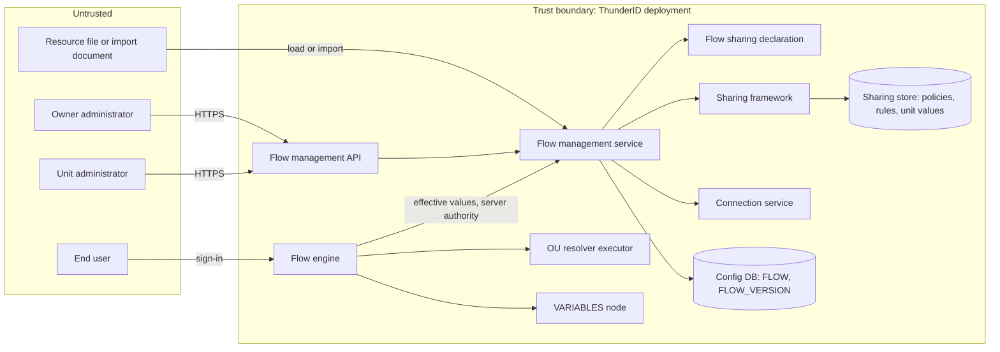
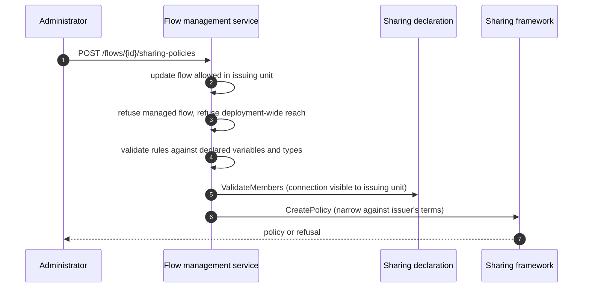
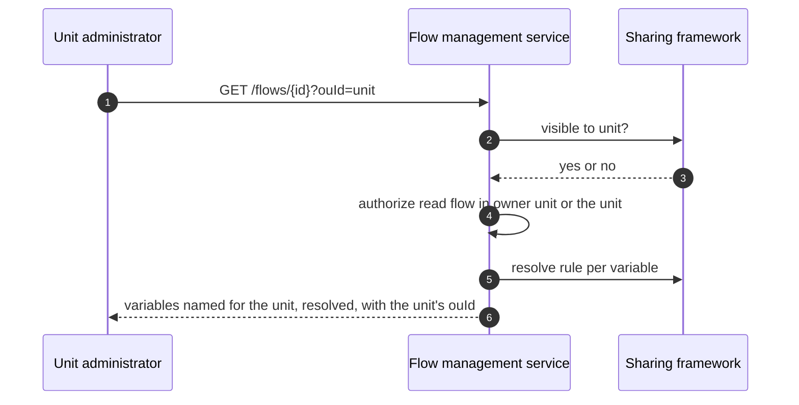
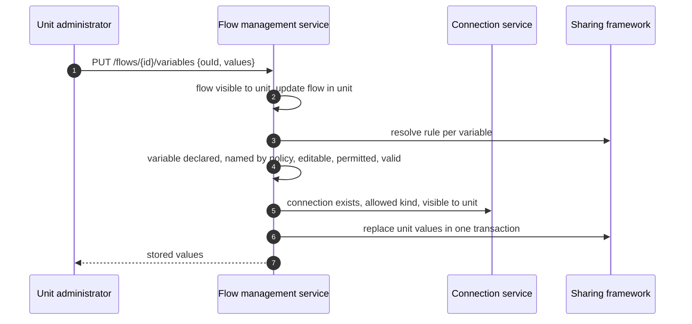
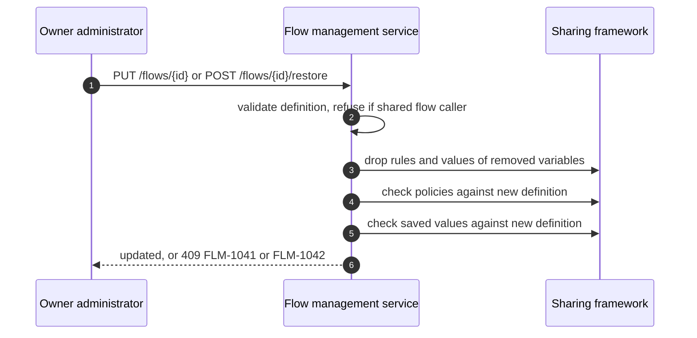
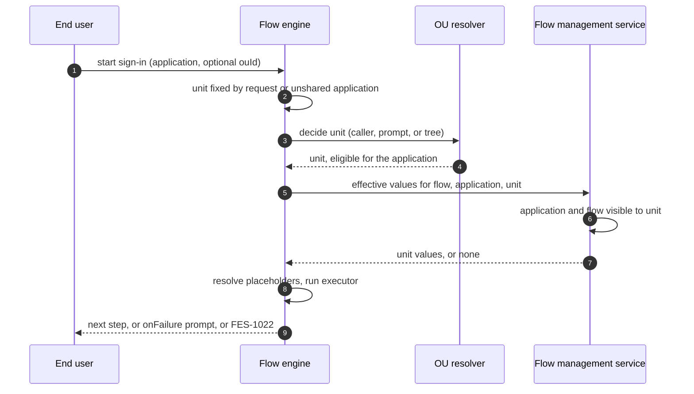
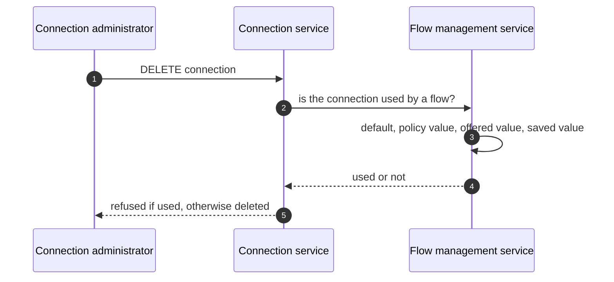
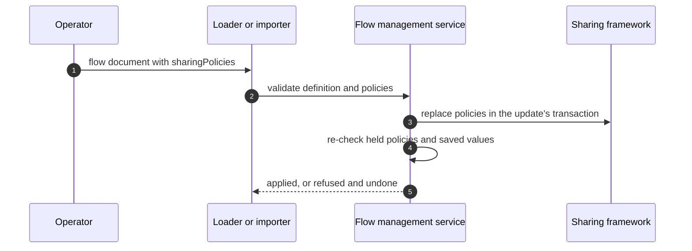
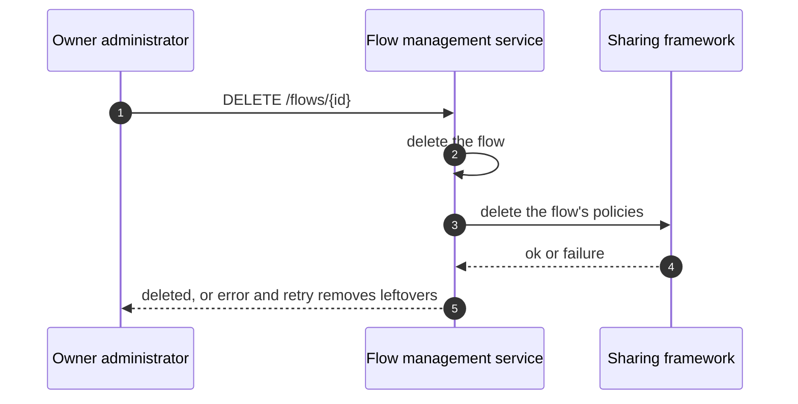

# Flow Sharing and Variable Overrides Threat Model

This model covers sharing a flow with other organization units, the per-unit variable overrides that sharing allows, and the runtime resolution of those variables during sign-in.

## Overview

Flow sharing lets one organization unit (the owner) define a flow and lets units beneath it run that flow with their own values for the variables the owner declares. The owner writes a sharing policy per variable and per unit (editable or pinned, a starting value, a set to choose from). A unit stores its own values. At sign-in the engine resolves each variable to the value of the unit the sign-in runs under. A variable can name an identity provider connection, so a unit's value can decide which external system authenticates its users.

This matters for security because the feature moves a tenant boundary inside one definition. Three things cross it: the flow's definition (private to the owner, partly shown to a unit), a unit's values (private to the unit, read by the engine for end users who hold no permissions), and the connections those values select (a credential-bearing resource that the owner or the unit owns). The entry points are the flow management API (`/flows`, `/flows/{id}/sharing-policies`, `/overlay-rules`, `/variables`), declarative files and import, and the sign-in path through the `VARIABLES` node and the OU resolver executor.

Cross-cutting concerns covered elsewhere: the resource sharing framework's reach, narrowing, and visibility algebra; authentication and authorization of management API callers; organization unit hierarchy and deletion; connection storage and secret handling; the authentication flow engine's session handling; token issuance. These are referenced here as trust inputs, not re-analysed.

## Scope

This model covers:
- Creating, changing, resharing, and deleting a sharing policy for a flow, including the flow-specific validation of variable terms and connection members.
- The shared view a unit gets of a flow, and the listing and read endpoints that serve it.
- A unit's reads and writes of its own variable values.
- Keeping the definition, the policies, and the saved values consistent when the flow is updated, restored, or deleted, and when a connection or organization unit is deleted.
- Selection of the unit a sign-in runs under, the engine's lookup of that unit's values, and the failure path when a connection is unset.
- Sharing declared in resource files and imports.

Out of scope (see the referenced companion models or the owning area):
- The sharing framework's policy algebra (reach, exclusions, narrowing, cycle and ancestor rules) and its storage. Owned by the resource sharing area. Here its answers are trust inputs.
- Authentication and authorization of the caller of the management API, and the scope or token claims that confine a caller to a unit.
- Secrets held by a connection and the authenticity of the external identity provider that a connection points to.
- Flow definition content other than variables: node validation, executor behaviour, and the security of each executor.
- The OU hierarchy model and how an OU is created, moved, or deleted.
- Sharing of resource types other than flows.

## Architecture



### Components

| Component | Task |
| --- | --- |
| Flow management service | Owns the definition and enforces its consistency with policies and values. Serves the per-unit reads and writes. Authorizes by action and unit |
| Flow sharing declaration | Registers flows with the sharing framework. Resolves the owner of a flow and refuses connection members the issuing unit cannot see |
| Sharing framework | Stores policies and unit values. Decides visibility, effective rules, and narrowing. Runs one transaction per policy change |
| Flow engine | Decides the unit of a sign-in, loads the unit's effective values, resolves placeholders, and handles the unset-connection failure |
| `VARIABLES` node | Declares the variables. Lowered to a task that resolves them into runtime data |
| OU resolver executor | Selects the unit from the caller, a prompt, or the full tree. Keeps a unit fixed before the flow ran |
| Connection service | Owns connections and their visibility. Treats a flow variable as a use of a connection |
| Console | Edits variables and terms. A convenience over the API, never a security control |

### Actors

#### Actors

| Actor | Description | Roles or permissions |
| --- | --- | --- |
| Owner administrator | Administers the flow's owning unit. Defines the flow, its variables, and the policies | `read flow`, `update flow`, delete in the owner unit |
| Resharing unit administrator | Administers a unit that received the flow by `reach: unit` and shares it onward | `update flow` in its own unit |
| Unit administrator (delegated) | Administers a unit the flow was shared with. Sets the unit's own values | `read flow` and `update flow` in its own unit |
| Platform administrator | Administers the deployment. May hold the management API key | Deployment-wide management permissions |
| End user | Signs in through an application that uses the flow | None. The engine reads values on their behalf |
| Application | A client whose authentication flow is the shared flow. Owned by, or shared with, a unit | N/A |
| Declarative loader or importer | Applies policies from a file or document | The permissions of whoever starts the load or import |

#### Entitlement matrix

| Actor | Read whole definition | Change or delete flow | Write policy | Read shared view | Set own values |
| --- | --- | --- | --- | --- | --- |
| Owner administrator | [Yes] | [Yes] | [Yes] | [Yes] | [No], the owner has defaults, not overrides |
| Resharing unit administrator | [No] | [No] | [Yes], `childUnits` only, narrowing | [Yes] | [Yes], within terms |
| Unit administrator (delegated) | [No] | [No] | [No] | [Yes] | [Yes], within terms |
| Administrator of an unrelated unit | [No] | [No] | [No] | [No] | [No] |
| Platform administrator | [Yes] | [Yes] | [Yes], deployment-wide reach through files and imports only | [Yes] | [Yes] |
| End user | [No] | [No] | [No] | [No] | [No] |

### External Dependencies (not owned)

| Dependency | Description (usage, purpose, authentication, authorization, security) |
| --- | --- |
| Resource sharing framework | Source of visibility, effective rules, and narrowing. Its answers decide what a unit sees and may set. Owned by the resource sharing area |
| Organization unit service | Source of unit existence, ancestry, and application eligibility for a unit (`IsEligibleOU`, `IsApplicationShared`) |
| Authorization service | Source of `read flow` and `update flow` decisions for a caller in a unit |
| Connection service and external identity providers | A connection variable selects one. The external provider's trustworthiness is owned by the connection area |
| Config database and sharing store | Persist the definition and the sharing records. Not transactional with one another |

## Threats and mitigations

### Out-of-scope interactions and risks

- Narrowing, reach computation, and cycle prevention inside the sharing framework. Owned by the resource sharing area.
- Compromise of a management credential. Owned by the management API and token models.
- Trust placed in the external identity provider a connection names.
- A malicious or vulnerable executor in the flow. Owned by the flow engine area.

### Interactions

#### [01]: Owner writes or changes a sharing policy

**Description**

An owner, or a unit reached by `reach: unit`, creates, replaces, or deletes a policy on a flow. The service loads the flow, checks `update flow` in the unit that issues the policy, refuses a flow managed by a file or the control plane, validates every variable rule against the definition, and hands the policy to the sharing framework, which narrows it against what the issuer holds. Through the API a policy with deployment-wide reach is refused.

**Assets involved**

| Initiator | Intermediate | Target |
| --- | --- | --- |
| Owner or resharing unit administrator | Flow management service, flow sharing declaration, sharing framework | Policy and overlay rule records, the visibility of the flow |

**Data flow**



**Security considerations**

| Area | Response | Comments |
| --- | --- | --- |
| Data confidentiality | [C-Medium] | The policy reveals which units a flow reaches and which connection IDs it names |
| Communication medium | [M-NT] | Management API over the network |
| Transport security | [TLS] | |
| Authentication | Management token or API key | Owned by the management API |
| Accessibility | [Restricted] | Owner or resharing unit only |
| Authorization and Access Control | `update flow` in the issuing unit | Evaluated against the unit that issues the policy, not the owner, so a resharing unit cannot act as the owner |

**Threat assessment**

| ID | Category | Threat | Materializable | Mitigation / comment |
| --- | --- | --- | --- | --- |
| 1 | Elevation of Privilege | A resharing unit widens the terms it was given for the units beneath it, for example by making a pinned variable editable | No | The sharing framework narrows every requested rule against the issuer's own effective rule. A request that asks for more is refused or clamped |
| 2 | Elevation of Privilege | An owner or resharing unit names a connection it cannot see in a policy, so a downstream unit runs on a connection the issuer was never entitled to | No | `ValidateMembers` checks each connection named as `value` or `allowedValues` against the issuing unit's visibility. The unit must own it or have it shared |
| 3 | Elevation of Privilege | A unit grants reach outside its subtree by stating `allUnits` or `otherTreeRoots` | No | Resharing policies state `childUnits` only. The API refuses deployment-wide reach (`FLM-1043`). A parent-owned flow needs `resource_sharing.allow_child_ou_cross_tree_sharing` for files and imports |
| 4 | Tampering | A policy names a variable that the flow does not declare, or a value that is invalid for the variable, so a unit later runs on an unusable or unintended value | No | `validatePolicyVariables` refuses a rule for an undeclared variable, more than one `value`, and any value invalid for the type. Connection values must exist and be of an allowed kind |
| 5 | Tampering | A caller edits the sharing of a flow that a file or the control plane manages, so the next reload silently reverts it, or two sources disagree | No | `refuseManaged` refuses the change (`FLM-1048` for the control plane). A declared policy cannot be deleted through the API |
| 6 | Repudiation | A change of terms is made without enough evidence to say who widened a unit's access | Yes | Policy changes are recorded in application logs for replay from files. Whether a structured audit event with the before and after terms exists for API changes should be confirmed. See residual risk R-3 |
| 7 | Information Disclosure | A policy read by a unit reveals other units a flow reaches | No | A unit reads its own terms from `/overlay-rules`. `GET /sharing-policies` is for the owner and a resharing unit. A unit no policy reaches gets `404` |
| 8 | Denial of Service | A very large policy (many units, many rules) slows policy resolution at every sign-in | No | Resolution results are cached and cleared on change. Policy size is bounded by the flow's own variable count and the units named. Whether the API caps the number of units or rules in one policy should be confirmed |

#### [02]: A unit reads a shared flow

**Description**

A caller lists flows for a unit, reads one flow with `ouId`, or reads `/overlay-rules` or `/variables`. For a flow the caller does not own, the service returns a reduced view: only the variables a policy names for the unit, resolved for it, under the unit's own `ouId`. A caller confined to a unit by its token gets that unit's view when the request names none.

**Assets involved**

| Initiator | Intermediate | Target |
| --- | --- | --- |
| Unit administrator | Flow management service, sharing framework | The owner's definition, variables, and the unit's terms |

**Data flow**



**Security considerations**

| Area | Response | Comments |
| --- | --- | --- |
| Data confidentiality | [C-High] | The definition may expose internal topology, connection IDs, and tenant structure |
| Communication medium | [M-NT] | |
| Transport security | [TLS] | |
| Authentication | Management token | |
| Accessibility | [Restricted] | |
| Authorization and Access Control | `read flow` in the owner or the requested unit, and visibility of the flow to that unit | An unreachable flow answers like a flow that does not exist |

**Threat assessment**

| ID | Category | Threat | Materializable | Mitigation / comment |
| --- | --- | --- | --- | --- |
| 1 | Information Disclosure | A unit reads nodes, interceptors, executor properties, or layout of a flow it does not own | No | A shared read returns variables only. Nodes, interceptors, layout, versions, and timestamps stay with the owner in every endpoint. `/versions`, `/restore`, and `/usages` answer `404` for a read and `403` for a write |
| 2 | Information Disclosure | A unit sees options, defaults, or variables the owner did not open to it | No | A variable no policy names for the unit is omitted. A `SELECT` lists only permitted options. The default shown is the value the unit's rule sets, or the owner's default when the rule sets none |
| 3 | Information Disclosure | A unit enumerates flows of other units by probing IDs, learning whether they exist | No | An unreachable flow, a nonexistent flow, and a different unit's flow give the same answer for a read. A request naming another unit than the token's lists nothing or is refused |
| 4 | Information Disclosure | A shared flow's `ouId` reveals the owner | No | The response carries the requesting unit's `ouId` (#6315). The owner is learned only from a policy the caller may read |
| 5 | Spoofing | A caller names a unit it does not administer in `ouId` to read that unit's view | No | The caller must hold `read flow` in the owner or in the named unit. A caller confined by token acts in its own unit |
| 6 | Privacy Risk | A default value holds a connection ID or a value that identifies a customer of the owner | Yes | A default that the unit sees is the owner's own choice. Owners should not place customer-identifying values in a default shown to other units. See residual risk R-5 |

#### [03]: A unit sets its own variable values

**Description**

A unit administrator sends `PUT /flows/{id}/variables` with the unit and its values. The service checks the flow is visible to the unit, authorizes `update flow` in the unit, validates every value against the variable and the unit's rule, checks a connection exists and is visible to the unit, and replaces the unit's values in one transaction.

**Assets involved**

| Initiator | Intermediate | Target |
| --- | --- | --- |
| Unit administrator | Flow management service, connection service, sharing framework | The unit's stored values, and later the sign-in behaviour of every application that runs under the unit |

**Data flow**



**Security considerations**

| Area | Response | Comments |
| --- | --- | --- |
| Data confidentiality | [C-Medium] | Values may be connection IDs, option names, or toggles that reveal configuration |
| Communication medium | [M-NT] | |
| Transport security | [TLS] | |
| Authentication | Management token | |
| Accessibility | [Restricted] | |
| Authorization and Access Control | `update flow` in the target unit, a policy that names the variable, `editable: true` | Writing for another unit is refused |

**Threat assessment**

| ID | Category | Threat | Materializable | Mitigation / comment |
| --- | --- | --- | --- | --- |
| 1 | Elevation of Privilege | A unit sets a variable the owner pinned or never opened to it | No | A variable that no policy names is rejected as unknown. A variable whose rule is not editable is rejected |
| 2 | Elevation of Privilege | A unit chooses a value outside what the owner permits | No | `permitted` enforces `allowedValues` and `excludedValues`. The whole request is checked before anything is written |
| 3 | Elevation of Privilege | A unit selects a connection it does not own or was not shared, to authenticate its users against a provider it does not control or to read through another tenant's connection | No | A connection value must exist, be an allowed kind, and be visible to the unit (owned or shared) |
| 4 | Tampering | A unit writes values for another unit by changing `ouId` in the body | No | `update flow` is evaluated for the unit named, and a caller confined to a unit cannot name another |
| 5 | Tampering | A partial write leaves a unit with an inconsistent set (some values new, some old) | No | One transaction in the sharing store replaces the unit's values. A failed write leaves the previous set |
| 6 | Tampering | A value of the wrong type or a null is stored, and later breaks sign-in | No | `RawFromJSONValue` and `ValidateRaw` check the type and constraints. Null is refused |
| 7 | Denial of Service | A unit saves a value that makes every sign-in under it fail, for example by selecting a connection that is later invalid | Yes | The connection delete guard counts a unit's saved value as a use, and a flow update that invalidates saved values is refused. A connection that becomes unreachable by other means (a share withdrawn) is checked at write, not continuously. See residual risk R-2 |
| 8 | Repudiation | A change of a unit's values cannot be attributed | Yes | Same as interaction 01. See residual risk R-3 |

#### [04]: The owner changes or restores the flow definition

**Description**

The owner updates a flow or restores a version. The service validates the new definition, then checks it against every recorded policy and every value a unit saved. A variable the change drops loses its policy rules and saved values first. A change that breaks a policy is refused with `FLM-1041` and one that breaks a saved value with `FLM-1042`.

**Assets involved**

| Initiator | Intermediate | Target |
| --- | --- | --- |
| Owner administrator | Flow management service, sharing framework | The definition, the policies, the units' saved values, running applications |

**Data flow**



**Security considerations**

| Area | Response | Comments |
| --- | --- | --- |
| Data confidentiality | [C-Medium] | The conflict message names units and variables |
| Communication medium | [M-NT] | |
| Transport security | [TLS] | |
| Authentication | Management token | |
| Accessibility | [Restricted] | |
| Authorization and Access Control | `update flow` in the owner unit | A unit the flow is shared with is refused with `FLM-1039` |

**Threat assessment**

| ID | Category | Threat | Materializable | Mitigation / comment |
| --- | --- | --- | --- | --- |
| 1 | Tampering | An owner changes the type or constraints of a variable so that a unit's saved value, or a policy's pinned value, is now invalid, and sign-ins under the unit break or take an unintended value | No | `checkSharingPolicies` and `checkSavedValues` refuse the change before it is stored. The check runs in the update's transaction |
| 2 | Tampering | A variable is removed and later re-created with a different meaning, and a unit's old value silently applies to the new variable | No | Removing a variable removes its rules and every unit's value in the same change |
| 3 | Elevation of Privilege | A caller who only holds a unit the flow is shared with edits the definition | No | `PUT` and `DELETE` on a flow of another unit answer `403`. A shared unit gets `FLM-1039` |
| 4 | Information Disclosure | The conflict message discloses which other units hold values that block the change | No | Only the owner sees it, and the owner already administers those units' terms. The number of conflicts listed is bounded |
| 5 | Denial of Service | A restore of an old version fails, and the owner cannot roll back an incident | Yes | A restore is held to the same checks, so a restore can be refused. The owner must clear the conflicting terms first. See residual risk R-4 |
| 6 | Operational Risk | A removed variable still used by a placeholder leaves a broken flow | No | The owner cannot remove a variable a `{{var(...)}}` placeholder uses |

#### [05]: A sign-in runs through a shared flow

**Description**

An end user signs in through an application whose authentication flow is shared. The engine fixes the unit from the request or from an unshared application. Otherwise the OU resolver decides it from the caller, the user's pick, or the tree. The engine then reads the unit's effective values, only if the application and the flow are visible to the unit, and applies them in place of the defaults. Placeholders resolve in executor properties just before the executor runs. If a connection variable is unset, the flow ends, or goes to the node's `onFailure` prompt.

**Assets involved**

| Initiator | Intermediate | Target |
| --- | --- | --- |
| End user | Flow engine, OU resolver executor, `VARIABLES` node, flow management service | The values of the chosen unit, the connection that authenticates the user, the unit the user is placed in |

**Data flow**



**Security considerations**

| Area | Response | Comments |
| --- | --- | --- |
| Data confidentiality | [C-Medium] | The unit's values are not returned to the user, but the sign-in's behaviour reveals the chosen provider |
| Communication medium | [M-NT] | |
| Transport security | [TLS] | |
| Authentication | The sign-in itself | |
| Accessibility | [Public] | The sign-in is reachable by any user of the application |
| Authorization and Access Control | Application eligibility for the unit, flow visibility to the unit | The lookup runs with the server's authority and is bounded by those two checks |

**Threat assessment**

| ID | Category | Threat | Materializable | Mitigation / comment |
| --- | --- | --- | --- | --- |
| 1 | Spoofing | A user names or picks a unit the application is not shared with, to authenticate through a different tenant's connection or settings | No | A named unit is checked with `IsEligibleOU`. A picked unit must be eligible for the application. The lookup returns no values when the application is not visible to the unit. The same refusal answers a missing unit and an unshared one |
| 2 | Elevation of Privilege | A step of the flow moves the sign-in to a unit outside its boundary after the request or an unshared application fixed it | No | A unit fixed before the flow ran is marked `ouFixed` and kept. A failure retry forgets a unit only when a step of the flow picked it |
| 3 | Elevation of Privilege | The unit of a sign-in is taken from a session that was saved earlier, so a user inherits a stale or another user's unit | No | An OU resolver cannot follow a save or load session node (`FLM-1044`). `ouFixed` is dropped from a saved snapshot |
| 4 | Information Disclosure | The OU picker lists units the user is not eligible for | No | Units are filtered by eligibility for the application and the user before the pick is offered |
| 5 | Information Disclosure | Error behaviour reveals which units exist or which have no connection | Yes | `FES-1022` is shown only after the unit is known. A user can discover that a unit they are eligible for has no connection configured. This is limited to units the user can already pick, and the message does not name the connection |
| 6 | Denial of Service | A unit with an unset connection ends every sign-in under it with a server error | Yes | By design when the owner declares an empty connection default. The owner's own applications fail the same way. The `onFailure` prompt lets a person pick another unit. See residual risk R-1 |
| 7 | Denial of Service | Each sign-in reads policies and values from the store, so a burst of sign-ins loads the sharing store | No | Cheap answers come first: the application's own unit skips the lookup, visibility is cached, and values are read only when a policy names a variable |
| 8 | Tampering | A placeholder in user-controlled input is resolved, and an end user injects a variable reference | No | Resolution is limited to executor `properties` defined by the flow author. Prompt `meta`, user inputs, and conditions are not resolved |
| 9 | Security Risk | A failure to read a unit's values falls back to the owner's values, which belong to a different tenant | No | A lookup failure fails the sign-in with a server error. Only an absent value falls back to the owner's default |

#### [06]: A connection a flow uses changes or is deleted

**Description**

A connection can be a variable's default, a policy's value or offered value, or a unit's saved value. Deleting the connection, deleting the owner unit, or withdrawing a share can leave one of these pointing at something that is gone or no longer visible.

**Assets involved**

| Initiator | Intermediate | Target |
| --- | --- | --- |
| Administrator of a connection or unit | Connection service, flow management service, sharing framework | The sign-in behaviour of units that use the connection |

**Data flow**



**Security considerations**

| Area | Response | Comments |
| --- | --- | --- |
| Data confidentiality | [C-Medium] | Connection IDs, not secrets, are held in flow data |
| Communication medium | [M-DB] | |
| Transport security | [TLS] | Database transport is the deployment's concern |
| Authentication | Management token | |
| Accessibility | [Restricted] | |
| Authorization and Access Control | Connection administration rights in the connection's unit | |

**Threat assessment**

| ID | Category | Threat | Materializable | Mitigation / comment |
| --- | --- | --- | --- | --- |
| 1 | Tampering | A connection a flow uses is deleted, and sign-ins fail or a later connection with the same ID takes its place | No | A connection a flow variable names cannot be deleted. A policy that only withholds the connection is not a use |
| 2 | Elevation of Privilege | The owner's default names a connection that the unit cannot see, so a flow shared with a unit runs on a connection from another tenant | Yes | By design: the default is the owner's choice and is not checked per unit, so the shared flow keeps running on the owner's connection. The visibility check applies to what a policy names and what a unit sets. See residual risk R-5 |
| 3 | Operational Risk | A share of a connection is withdrawn from a unit whose saved value names it, and sign-ins under the unit fail | Yes | Unit values are checked when written. A later withdrawal is not blocked by a flow's saved values. The failure surfaces as an unset or unusable connection at sign-in. See residual risk R-2 |
| 4 | Lateral Movement | A compromised unit changes its value to a connection it can see in order to reach another system the connection authenticates to | No | A unit can only choose from what the owner permits and what it owns or was shared. It gains no more access than that connection already gave it |
| 5 | Operational Risk | An owner unit that owns flows is deleted and leaves shared flows without an owner | No | Deleting a unit that owns a flow is refused (`OU-1006`) |

#### [07]: Sharing declared in a file or import

**Description**

A flow document carries `sharingPolicies`. Loading it, or importing it, validates the policies against the new definition, applies them in the update's transaction, then re-checks the flow against policies the document does not name. A policy for a unit that already has a declared policy is skipped with a warning, and policies removed to match the document are logged. A dry run applies the same checks.

**Assets involved**

| Initiator | Intermediate | Target |
| --- | --- | --- |
| Operator or importer | Declarative loader, flow management service, sharing framework | Policies and units' reach across the deployment |

**Data flow**



**Security considerations**

| Area | Response | Comments |
| --- | --- | --- |
| Data confidentiality | [C-Low] | A document holds IDs and handles, not secrets |
| Communication medium | [M-FS] | Files, or the import API |
| Transport security | [TLS] | The import API only |
| Authentication | Import permission, or file system access for files | |
| Accessibility | [Restricted] | |
| Authorization and Access Control | Import and update permissions | File policies may state deployment-wide reach, which the API refuses |

**Threat assessment**

| ID | Category | Threat | Materializable | Mitigation / comment |
| --- | --- | --- | --- | --- |
| 1 | Elevation of Privilege | An importer states `allUnits` and shares a flow with every unit, including future ones | No | Deployment-wide reach is a deliberate file or import capability. For an owner that has a parent unit it needs `resource_sharing.allow_child_ou_cross_tree_sharing`. The operator who can import is already trusted with the deployment |
| 2 | Tampering | A file policy silently overrides a policy an administrator made through the API for the same unit, or the reverse | No | A policy for a unit with a declared policy is skipped with a warning. A declared policy cannot be deleted through the API |
| 3 | Tampering | A malformed document passes the dry run and fails at import, or the reverse | No | The dry run runs the same resolution and validation as the import |
| 4 | Tampering | A document names a variable, value, or connection that is not valid | No | The same `validatePolicyVariables` runs on file policies as on API policies |
| 5 | Repudiation | A policy is removed to match a document and nobody can say why | No | Each removal and each skipped policy is logged with the flow, policy, and unit |
| 6 | Security Risk | A document without an owner is loaded and runs with an unintended owner | No | A flow document must name `ouId` or `ouHandle`. A missing owner fails the load, and the server fails at startup |

#### [08]: A shared flow is deleted

**Description**

The owner deletes a flow. The flow row is deleted first, then its policies and the state that follows from them. The two cannot share a transaction, so a failure of the second step leaves policies for a flow that no longer exists, and the caller is told. A retry removes them.

**Assets involved**

| Initiator | Intermediate | Target |
| --- | --- | --- |
| Owner administrator | Flow management service, sharing framework | Policies and units' saved values for the deleted flow |

**Data flow**



**Security considerations**

| Area | Response | Comments |
| --- | --- | --- |
| Data confidentiality | [C-Low] | |
| Communication medium | [M-DB] | |
| Transport security | [TLS] | |
| Authentication | Management token | |
| Accessibility | [Restricted] | |
| Authorization and Access Control | Delete in the owner unit | A shared unit gets `FLM-1039` |

**Threat assessment**

| ID | Category | Threat | Materializable | Mitigation / comment |
| --- | --- | --- | --- | --- |
| 1 | Elevation of Privilege | A flow created later with the same ID comes back already shared, with the earlier unit values | No | Policies are deleted after the flow, and a retry sweeps leftovers when the flow is found gone. Flow IDs are generated, so a collision is not reachable through the API |
| 2 | Operational Risk | A failed cleanup leaves orphaned policies and saved values that are never removed because nobody retries | Yes | The caller is told. Orphans are inert because visibility resolves the owner through the flow, and a missing flow has no owner. See residual risk R-6 |
| 3 | Denial of Service | A flow is deleted while applications still use it, and their sign-in breaks | Yes | Application usage of a flow is owned by the flow and application areas, and this model does not re-analyse it. Confirm the delete guard covers a flow used by an application of a unit it was shared with. See residual risk R-7 |

## Security Review Checklist

A review aid that complements the threat models and the self-assessment. Guidance follows the [OWASP Top 10 Proactive Controls](https://top10proactive.owasp.org/).

### Security considerations

| # | Consideration | State | Comments |
| --- | --- | --- | --- |
| 1 | Are all inputs and outputs validated (syntactic and semantic)? | [Yes] | Variable identifiers, types, constraints, and values are validated at write. Policies are validated against the definition. Unknown fields in a policy fail the document |
| 2 | Are rate limits in place where necessary? | [Partial] | The management API relies on the deployment's rate limiting. Sign-in lookups are bounded by caching and by reading values only when a policy names a variable |
| 3 | Are permissions, roles, and entitlements defined on the principle of least privilege and business need? | [Yes] | A unit sees and sets only what a policy names for it. A resharing unit can only narrow |
| 4 | Are authentication and authorization validated at both the UI and API layers, front end and back end, before granting access to resources? | [Yes] | The Console is a convenience. The service authorizes every call by action and unit |
| 5 | Are proper isolations in place between components to ensure least-privilege access and reduce the blast radius against lateral movement? | [Yes] | A unit's values are read only for the unit the sign-in runs under. The engine lookup is bounded by application and flow visibility |
| 6 | Have any default credentials been changed, and are default superuser or root accounts not in use (when using third-party components)? | [N/A] | |
| 7 | Has the implementation followed best-practice guidelines (OWASP, Kubernetes, vendor, or technology provider)? | [Yes] | |
| 8 | Are secrets, credentials, and internal-only material kept out of the public source tree and its git history? | [Yes] | Flow data holds connection IDs, never secrets |
| 9 | Was a security-focused code review conducted for this change, and have the findings been addressed? | [Partial] | The changes were reviewed in their pull requests. A dedicated security review of this model's findings is pending |
| 10 | Is Static Analysis (SAST) or IaC scanning conducted, and are findings addressed? | [Yes] | Repository CI |
| 11 | Is Software Composition Analysis (SCA) conducted or integrated into the repository, and are findings addressed (for example FOSSA, Trivy)? | [Yes] | Repository CI |
| 12 | Is Dynamic (DAST) or API scanning conducted on a non-production setup, and are findings addressed? | [N/A] | Not specific to this feature |
| 13 | Are audit logs generated in a standardized format for critical functionality, and available to authorized users to trace critical events and aid incident response? Note the retention period in Comments. | [Partial] | Declarative replay and policy removal are logged. Confirm structured audit events for API policy and value changes. Retention is the operator's choice |
| 14 | Do audit logs for critical configuration changes record the difference between the old and new versions? | [Partial] | Not recorded for API changes of terms and values today. See residual risk R-3 |
| 15 | Are data in transit and at rest encrypted? | [Yes] | TLS in transit. Encryption at rest is the database deployment's concern |
| 16 | Are sensitive values such as credentials and keys stored in a secret store or vault? | [N/A] | No secret is stored by this feature |
| 17 | Is personal, sensitive, or confidential data kept out of logs? | [Yes] | Logs carry flow, unit, and variable identifiers and error codes. Values of variables are not logged |
| 18 | Have users been given clear instructions for secure usage? | [Yes] | See the Share a Flow guide and the resource sharing concept page |

### Business impact and resilience

| # | Consideration | State | Comments |
| --- | --- | --- | --- |
| 1 | Has a business impact analysis been done to identify resilience requirements (maximum tolerable downtime, uptime, RPO, RTO)? | [N/A] | Left to the deployer. A flow that cannot resolve its unit's values fails sign-in for that unit, so the sharing store has the availability needs of the sign-in path |

Resilience details to record:
- High availability requirements: the sharing store and config database are read at sign-in for a shared flow.
- Disaster recovery requirements: a restore of the config database and the sharing store must be taken together, since policies and values refer to flow IDs and variable identifiers.
- Backups: the two stores are backed up with the rest of the deployment databases.
- Health checks: owned by the deployment.

### Dependency and component health

| # | Consideration | State | Comments |
| --- | --- | --- | --- |
| 1 | Are dependencies, base images, and runtimes monitored for known vulnerabilities and kept current (for example automated dependency scanning), and are findings addressed? | [Yes] | No new dependencies |
| 2 | Are any End-of-Life or End-of-Service components in use? | [No] | |
| 3 | Is hardening guidance published for operators who deploy the project (optional)? | [Partial] | The sharing guides describe terms. A hardening note on connection defaults and cross-tree sharing is advisable |

### Privacy considerations

| # | Consideration | State | Comments |
| --- | --- | --- | --- |
| 1 | Is the purpose and legal basis for processing personal data clearly defined? | [N/A] | The feature stores configuration, not personal data |
| 2 | Are the collection, storage, processing, sharing, archival, and disposal of personal data aligned with the data minimization principle? | [N/A] | |
| 3 | Is personal data stored securely? | [N/A] | |
| 4 | Are privacy notices updated to reflect any new processing or changes to purpose and legal basis? | [N/A] | |
| 5 | Is access to personal data granted on a need-to-know basis? | [N/A] | |
| 6 | Are data retention requirements considered? | [N/A] | |
| 7 | Is there a process to dispose of personal data on request in a timely manner while meeting retention requirements? | [N/A] | |
| 8 | Are records of personal-data processing maintained in the project's data inventory or records of processing? | [N/A] | |

## Residual risks (open items)

- **R-1.** A connection variable with an empty default ends sign-in under any unit that has not set its own, including the owner's applications. It is by design, to force each unit to bring its own connection. Guidance: set `onFailure` to a prompt, and set the owner's own values before sharing.
- **R-2.** A unit's saved connection value is checked when written, not continuously. Withdrawing a share of the connection from a unit, or a connection becoming invalid by other means, surfaces at sign-in rather than at the change. Guidance: withdraw a connection from a unit only after the unit has changed its value.
- **R-3.** Changes to terms and values through the API record no before-and-after difference. Declarative replay is logged. Recording the difference is a follow-up for the audit area.
- **R-4.** A restore of an older flow version is held to the same checks as an update, so it can be refused while terms conflict. An owner reacting to an incident may need to clear terms first. Guidance: keep the previous definition exportable.
- **R-5.** The owner's default for a variable, including a connection default, is not checked against what a unit can see. A flow shared with a unit runs on the owner's connection unless the unit overrides it. Guidance: the owner should treat every default as visible to every unit the flow reaches.
- **R-6.** Flow and sharing records live in separate stores and cannot be deleted in one transaction. A failed policy cleanup leaves inert orphans until the delete is retried.
- **R-7.** A flow shared with a unit may be used by an application of that unit. Whether deleting the flow is refused while such an application uses it needs confirming.

## Appendix

- Sample policy: pin the identity provider for one unit and let another choose from two.

```yaml
resource_type: flow
ouHandle: acme
handle: customer-sign-in
sharingPolicies:
  - id: customers
    childUnits:
      mode: selected
      units:
        - ouId: customer-a
          reach: unit
          overlayRules:
            variables.idp:
              editable: false
              value: ["<connection-id-a>"]
        - ouId: customer-b
          reach: unit
          overlayRules:
            variables.idp:
              editable: true
              allowedValues: ["<connection-id-b1>", "<connection-id-b2>"]
```

- References: [Share a Flow](../../docs/content/guides/flows/share-a-flow.mdx), [Resource Sharing Across Organization Units](../../docs/content/key-concepts/resource-sharing.mdx), [spec.md](spec.md), and the changes #6076, #6138, #6219, #6315, #6571, and #6722.

## Change log

| Version | Date | Change |
|---|---|---|
| 0.1 | 2026-11-16 | Initial threat model. |
