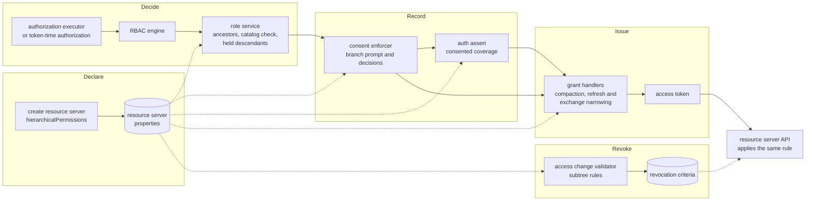

# Hierarchical Permissions Specification

- **Status:** Final
- **Version:** 1.1
- **Related documents:** [Design Discussion #5990: Hierarchical permissions for resource servers](https://github.com/thunder-id/thunderid/discussions/5990), [PR #6318: Add hierarchical permissions for resource servers](https://github.com/thunder-id/thunderid/pull/6318).

## Summary

A resource server's permission strings are already built as paths. A resource's permission is its handle joined to its parent's permission by the server's delimiter, and an action's permission is its handle joined to its resource's permission, so a booking API has `reservations`, `reservations:create`, and `reservations:history:export`. Before this feature that shape meant nothing at runtime. Matching was exact: a role had to list every leaf, every new action needed every role updated, and granting `reservations` authorized the string `reservations` and nothing else. The delegated-administration guard meanwhile already treated `:` as a hierarchy, so the two disagreed about what a parent grant means.

This specification makes the shape meaningful where the resource server asks for it. A resource server gains one setting, `hierarchicalPermissions`, off by default. On a server that sets it, one rule holds everywhere:

> A held permission authorizes itself and every permission the catalog declares beneath it, on that resource server only, and never a permission above it.

On a hierarchical server, every component that decides, records, or revokes a permission applies that rule: the RBAC decision, the consent prompt and the decisions it records, the scopes a token carries, refresh and token exchange narrowing, the delegated-administration guard, and revocation. One decision governs the rest:

> Whether a resource server's permissions nest is declared by the resource server, once, when it is created, and every component reads that stored setting. No request, token, or caller supplies it.

Three consequences follow. The setting cannot be turned on later to widen every existing role at once. A caller of the authorization provider, such as an AuthZEN client, cannot ask for hierarchical matching on a server that did not declare it. And when the setting cannot be read, runtime authorization stays exact. Consent and refresh fail when their resource server cannot be resolved, and revocation planning refuses the change. Delegated administration retains its legacy `:` coverage on exact servers; it uses exact matching when the server cannot be read. Tokens carry no hierarchy, so the API that enforces a token has to apply the same delimiter and setting, which it reads from the resource server.

Out of scope: changing the setting after creation; runtime permission inheritance on a server that did not declare it; inheritance configured per role or per permission; wildcard permissions; a consent approval that excludes one permission beneath an approved one; carrying the hierarchy inside a token; subtree revocation when an action is deleted; and making an external policy service follow the hierarchy.

## Architecture

The feature adds no package and no table. It extends the components that already handle permissions, and puts the coverage rule in one place in the system security package.

| Component | Responsibility |
|---|---|
| Resource service | Accepts the setting on create, stores it beside the delimiter, keeps it on every update and import, returns it on every read, and lists the declared permissions beneath a set of roots |
| Coverage rule | `PermissionCovers`, `AnyPermissionCovers`, and `AncestorPermissions` in the system security package. An empty delimiter means exact matching |
| Delimiter resolver | Reads a resource server's setting for the role service and the delegated-administration guard, and falls back to exact matching when the server cannot be read |
| Role service | Authorizes a requested permission through its ancestors, refuses one held only through an ancestor when the catalog does not declare it, lists held descendants for a refused parent, and plans revocation |
| RBAC engine | Returns each decision, and for a refused permission the held descendants as alternatives |
| AuthZEN PDP engine | Passes an external decision through and never adds alternatives |
| Authorization executor and token-time authorization | Add the alternatives to the authorized set. The executor records the bound resource server in flow runtime data |
| Consent enforcer | Builds branch prompts and the display tree, applies one decision per branch, and suppresses or supersedes stored approvals by coverage |
| Auth assert executor | Keeps the authorized permissions that a consented permission covers |
| Grant handlers | Compact the issued scopes, and narrow refresh and token exchange requests by coverage |
| Delegated-administration guard | Checks that a caller covers what it grants, with the delimiter each resource server resolves to |
| Access change validator and revocation | Write subtree rules for a lost branch, and derive subtree keys from every token scope at enforcement |
| Console | The setting on the create step, a read-only view on the Advanced tab, and branch selection in the role permission catalog |
| Gate | Renders a hierarchical consent purpose as one switch per branch |

The feature uses these existing seams:

| Seam | Use |
|---|---|
| Resource server properties | The setting is stored in the existing properties JSON column beside the delimiter, so there is no migration and an existing row reads back exact |
| Role permission lookup | Ancestors are added to the candidate list of the existing exact-match query, so the index stays exact and no pattern match reaches the database |
| Catalog validation | The existing check that permissions are declared, over resources and actions in both the database and declarative stores, gates inherited grants |
| Authorization provider contract | The access evaluation response gains an internal field for alternatives. It is never serialized, so the AuthZEN API is unchanged |
| Consent session token | Already signed and already capturing the prompted elements. It now also captures each purpose's delimiter |
| Flow runtime data | The bound resource server's ID joins the request-scoped keys that a replayed snapshot cannot restore |
| Revocation criteria | A new criterion type in the existing store and revocation cache, evaluated beside the exact scope rules |

## Detailed design

### The coverage rule

`held` covers `required` only when both are non-empty and the two are equal, or when both are non-empty, the delimiter is not empty, and `required` begins with `held` immediately followed by the delimiter. An empty delimiter permits equality only. Coverage never works upwards. A role's permissions are looked up on the one resource server a request is bound to, so a grant on one server never covers a permission on another.

| Held through a role | Required | Hierarchical server | Exact server |
|---|---|---|---|
| `reservations` | `reservations` | Covered | Covered |
| `reservations` | `reservations:create` | Covered, if declared | Not covered |
| `reservations` | `reservations:history:export` | Covered, if declared | Not covered |
| `reservations:create` | `reservations` | Not covered | Not covered |
| `reservations` | `reservationsX`, `reservations-archive` | Not covered | Not covered |
| `reservations` on server A | `reservations:create` on server B | Not covered | Not covered |

A prefix at a delimiter boundary is always a real ancestor. Handles may not contain their server's delimiter, a rule enforced on the management API and on declarative resources alike, and the delimiter is fixed at creation, so a handle that passed that check stays valid. A permission with two delimiters therefore sits exactly two levels below its root, and its ancestors are exactly its prefixes that end before a delimiter.

The delimiter each path uses:

| Path | Hierarchical server | Exact server | Server cannot be read |
|---|---|---|---|
| Runtime authorization and held descendants | The server's delimiter | Exact | Exact |
| Consent prompt and the recorded permission claim | The server's delimiter | Exact | The sign-in step fails |
| Refresh narrowing and compaction | The server's delimiter | Exact | `server_error`, or `invalid_target` when the server no longer exists |
| Token exchange narrowing | The target server's delimiter | Exact | Exact |
| Revocation planning | Subtree rules on the server's delimiter | Exact rules | The change is refused |
| Delegated administration | The server's delimiter | `:`, as before this feature | Exact |
| Delegated administration of System permissions | `:` | `:` | `:` |

### Declaring a resource server hierarchical

The setting is a boolean on the resource server, set when it is created and fixed afterwards.

| Path | Behaviour |
|---|---|
| Management API create | `hierarchicalPermissions` on the create request, default `false` |
| Console | A checkbox on the permission settings step of the create wizard, beside the delimiter |
| Declarative resources | `hierarchicalPermissions: true` in the resource server YAML. Export writes it back |
| Importer | Creates the server with the value it carries |
| Management API update | The update request has no such field, and a value sent anyway is ignored |
| Update and re-import of an existing server | The stored value is kept, as the delimiter and type already are |
| Read | Every response carries the field, `false` included, so a client can tell exact from absent |

It is stored in the resource server's properties JSON beside the delimiter. A row written before this feature has no key and reads back `false`. The built-in System resource server is created hierarchical, with `:`, by the bootstrap resources.

**Deployments upgraded from an earlier release.** The System resource server of a deployment set up before this feature was created without it, so it reads back `false`, and importing the bootstrap document with `options.upsert` goes through the update path, which keeps the stored value. On such a deployment:

- The management APIs and the delegated-administration guard behave as on a fresh deployment, because they always cover System permissions with `:`.
- Runtime matching for System permissions stays as it was before the upgrade. A token request for a System permission is authorized only when a role holds that permission by name, and a refused parent returns no held descendants.

**Why it cannot change after creation.** Turning it on would widen every existing grant of a resource permission at once, with no review of what each role then reaches. Turning it off would narrow tokens without notice and break every API that accepts compacted tokens, since those carry only the parent. Either way the resource server and its APIs would disagree for as long as the change took to roll out. An administrator who needs the other behaviour creates a second resource server and moves roles to it.

### Authorizing a requested permission

The role service decides a batch of requested permissions for one subject on one resource server, which is the call the RBAC engine makes for the authorization step, token-time authorization, and the AuthZEN evaluation endpoint.

1. Resolve the delimiter from the stored resource server. A hierarchical server gives its delimiter. An exact server, or one that cannot be read, gives none, and the read failure is logged at debug.
2. Build the candidates: each requested permission, followed by its ancestors, nearest first. Each candidate remembers which requested permissions it would cover.
3. Run the existing exact-match lookup once over the candidates, for the subject's own assignments, its groups, and its roles, limited to assignments made in the request's organization unit when one is given.
4. A requested permission is authorized when it or any of its ancestors matched.
5. A requested permission authorized only through an ancestor must be declared in the catalog: a resource or an action on that server, in the database or the declarative store. An undeclared one is refused. If the catalog cannot be read, every inherited permission in the batch is refused and the failure is logged as an error. A permission matched by name is not re-checked, which keeps the behaviour that existed before this feature.

The catalog check keeps a parent from authorizing strings nobody defined. Without it, a client holding `reservations` could request `reservations:anything` and receive a token naming a permission no administrator created.

The setting is read inside the role service, from the stored server. Callers of the authorization provider, including the AuthZEN evaluation endpoint and policy engines, pass a resource server ID only and cannot ask for hierarchical matching. An external AuthZEN policy service decides for itself: ThunderID neither expands nor substitutes its decisions. Consent and compaction still apply the configured hierarchy to what it allows, so its policy must follow the same parent-grant rule. The resource servers guide says so.

### Held descendants for a refused parent

When a requested permission is refused on a hierarchical server, the RBAC engine asks the role service for the subject's held descendants of it.

1. List every permission the subject holds on that server, in one query, limited to the request's organization unit when one is given.
2. Keep those beneath a refused permission.
3. Keep those the catalog declares. The built-in System permissions count as declared, since the server defines them in code rather than in the catalog.
4. Return them per refused permission, sorted.

The decision for the refused permission stays `false`. The descendants travel on an internal field of the evaluation response that is never serialized, so the AuthZEN API still answers `false` for the parent and reveals nothing beneath it. The AuthZEN PDP engine builds each response from the external decision and context alone, so an external policy service cannot supply alternatives.

The authorization step, client credentials, refresh re-authorization, and mapped token exchange add the alternatives to the authorized set, deduplicated and in request order. A client that asks for `reservations` while the subject holds `reservations:create` and `reservations:view` receives those two. The token response's `scope` always states the issued scopes, which RFC 6749 section 3.3 requires when they differ from the request. An exact server returns no alternatives.

### Consent

The authorization step records the bound resource server's ID in flow runtime data. The key is on the snapshot deny list, so a flow replayed from a snapshot resolves its own binding rather than restoring another request's. The consent step hands the authorized permissions to the consent enforcer together with that ID. The enforcer accepts one resource server per call, reads its setting itself, and fails the step when the server cannot be read.

**Prompt.** On a hierarchical server:

- A permission is already consented when it, or one of its ancestors, has an active approval in this application's permission purpose.
- Each prompted permission belongs to a branch whose root is its shortest ancestor among the authorized permissions. If any permission in a branch is still undecided, the whole branch is prompted again, so a branch is always decided as one.
- The purpose carries `permissionDelimiter`, and each element names its nearest prompted ancestor as `parent`.
- The purpose also carries `displayElements`: the prompted permissions plus every permission the catalog declares beneath a branch root, read in one query. They are for display only. They are never decided and never become scopes. If they cannot be loaded, the prompt is shown without them and a warning is logged.

**Session.** The prompt is captured in the signed consent session token as before, and each permission purpose now also records its delimiter. Recording reads the delimiter from the verified session, never from the submission.

**Recording.** After verification, missing purposes are recorded as denied and a denied purpose denies its elements, as before. Then, for each hierarchical permission purpose:

- Each branch takes its root's submitted decision. The root counts as approved only when the purpose and the overall decision are approved and every occurrence of the root's name in the submission approves it.
- Every prompted permission in the branch is recorded with that decision. A submitted decision for a non-root permission, or for a display-only element, has no effect.
- Stored elements that the new prompt covers are replaced by the new decisions.
- A stored approval that covers a newly refused permission is removed, so a later refusal is not overridden by an older approval of its parent.

A branch is approved or refused whole. The token would carry the root, which covers every permission beneath it, so an exception for one child could not be expressed in the token and a switch offering one would mislead the user.

**Claim.** The assertion carries the authorized permissions that some consented permission covers, under the server's delimiter. An approval stored for a permission the subject no longer holds therefore adds nothing.

**Exact servers** keep the existing behaviour: one decision per permission, and `parent` links built by the existing rollup on any delimiter character.

**Gate.** A purpose that carries `permissionDelimiter` renders one switch per branch root, with the permissions beneath it listed read-only and indented, taken from `displayElements` when present and `optional` otherwise. An information notice reads "Granting a resource includes current and future permissions beneath it." The consent guide states that refusing a child also removes a remembered parent approval that covers it.

### Token issuance

**Compaction.** After authorization and consent, a grant handler issuing for a hierarchical resource server drops every permission scope that another issued permission scope covers. OIDC scopes take no part: they are never dropped and never cover. Compaction runs for the authorization code, client credentials, refresh token, token exchange, device code, CIBA, and JWT bearer grants, so the access token, the token response, and the refresh token carry the same set. A request for `openid reservations reservations:create`, with `reservations` held, issues `openid reservations`. An exact server is not compacted.

**Refresh narrowing.** The refresh token's audience names the resource server, read by its identifier. A `client_id` audience means a grant with OIDC scopes only, matched exactly. A requested scope must be in the refresh token's grant or, on a hierarchical server, covered by one of its permission scopes. A requested OIDC scope needs an exact grant, and an OIDC grant covers nothing. The result is then cut down to the server's declared permissions, re-authorized against the subject's current roles, with held descendants substituted as above, and compacted.

**Token exchange narrowing.** Without an authorization mapping, requested scopes must match the subject token's scopes exactly or, for permissions, be covered by them under the target server's hierarchy. OIDC scopes always match exactly. If the hierarchy lookup fails, matching stays exact. Permission-bearing tokens still require a resolved target; their permission scopes are filtered against its catalog and compacted, and their audience is its identifier.

With a mapping, mapped roles and groups use RBAC; directly mapped permissions match exactly during scope selection. Any parent permission issued on a hierarchical server still covers its descendants.

### Delegated administration

The guard that stops a caller from granting more than it holds is unchanged in shape: a caller may change a role's permissions, a role or group membership, or an entity only when, on each resource server, its own permissions cover everything that change confers. Holders of the root `system` permission are exempt, as before. What changes is the delimiter it covers with:

| Resource server | Coverage delimiter |
|---|---|
| Hierarchical | The server's own delimiter |
| Exact | `:`, as before this feature, so delegated administrators keep the grants they could already make |
| Cannot be read | None. Coverage is exact, so a grant that depended on coverage is refused |
| The built-in System resource server, for a permission under the `system` root | `:`, whatever the server's setting |

The fixed `:` rule applies only to the built-in System resource server, identified by its ID, and only beneath the `system` root. A custom server's permission that happens to be named `system` gets no special rule.

The Console's role permission catalog follows the setting. On a hierarchical server, selecting a resource stores that one permission, and the permissions beneath it are shown as covered and disabled. Clearing it also clears any selected ancestor and any descendant selected on its own. On an exact server, selecting a resource lists each permission beneath it, as before. The server enforces the guard regardless of what the Console sends.

### Revoking a branch

Revocation flows already revoke the scopes a principal loses when a role's permissions change, a role is deleted, a role assignment is removed, a group is deleted, a group membership is removed, a role is unshared from an organization unit, or a user share stops mandating a role in one. This feature changes what they plan, not when they run.

1. For each resource server the role names, read the server. A read failure refuses the whole change, so a revocation can never be planned narrower than the loss. A server with no identifier is skipped, since no token can name it as an audience.
2. A permission is lost when the role's new permissions no longer cover it under the server's setting. Dropping a child that a kept parent still covers loses nothing.
3. On a hierarchical server, the lost permissions are reduced to roots, the ones no other lost permission covers. Each root becomes a subtree rule of type `entity.scope.subtree`, whose value is a digest of the principal, the audience, the root, and the delimiter. On an exact server, each lost permission becomes an exact `entity.scope` rule, as before. A loss confined to one organization unit, from an unshare or a dropped mandate, writes `entity.scope.subtree.ou` and `entity.scope.ou` instead, with the unit in the digest, so only tokens issued in that unit match.
4. Every rule is bounded: it revokes tokens established at or before the change.

At enforcement, every token scope yields lookup keys for every permitted delimiter (`.`, `_`, `:`, `-`, `/`): one for the scope itself and one for each prefix of it that ends before that delimiter, per audience. Matching needs no catalog read and no resource server read, and both enforcement paths, the deny-list check and the resource server revocation cache, derive the keys the same way. Because the delimiter is in the digest, a rule recorded for `:` cannot match a scope that only splits on `_`.

These guarantees require the enforcing API or gateway to consult revocation state. Signature and expiry validation alone does not detect these changes.

The cost is over-revocation by design: every token for the branch issued before the change is revoked, including tokens that carry a descendant the role still grants on its own. The client obtains a new token, which carries what the role now grants.

Deleting an action records an exact deployment-wide revocation rule for that action's permission. It does not revoke tokens carrying only an ancestor permission. To stop access to the deleted operation, the API owner must disable or remove the corresponding API operation. Removing a permission from the catalog alone does not disable the API operation.

### Consumers of issued tokens

A token carries scope strings and no hierarchy. The API that enforces it must apply the delimiter and the setting of the resource server the token is for, which `GET /resource-servers/{id}` returns as `delimiter` and `hierarchicalPermissions`. On a hierarchical server tokens are compacted, so an API that matches exactly will refuse a descendant the subject holds through its parent. The Console warns about this on the create step.

Clients that render consent themselves receive `permissionDelimiter` and `displayElements` on the prompt. A renderer that ignores them falls back to one switch per element of `optional`, and the server still records one decision per branch.

### Data model

No table and no column is added.

- The resource server's properties JSON gains `hierarchicalPermissions`. Absent reads as `false`.
- Consent records keep their shape. A permission purpose is still `permissions:<application ID>`, and its elements are permission strings.
- The revocation criteria store gains the criterion type `entity.scope.subtree`, and `entity.scope.subtree.ou` for a loss confined to one organization unit, held in the existing columns.

### API

| Specification | Change |
|---|---|
| `api/resource.yaml` | `hierarchicalPermissions` on the resource server response, always present, and optional on the create request with a default of `false`. The update request is unchanged |
| Flow execution response | A permission purpose in a consent prompt gains `permissionDelimiter` and `displayElements`. Both are omitted on an exact server |

The AuthZEN evaluation API is unchanged: its decisions follow the setting, and it never returns alternatives. There are no new error codes.

## Requirements

### R1. Declare whether a resource server's permissions nest

**Requirement:** As the owner of a resource server, I want to declare once that a permission grants the permissions beneath it, so that roles grant a resource instead of listing every action it contains.

**Acceptance criteria:**

- **AC1.1:** Given a create request with `hierarchicalPermissions` set to `true`, when the resource server is read, then it returns `true` with the delimiter it was created with.
- **AC1.2:** Given a create request without the field, when the resource server is read, then it returns `false`.
- **AC1.3:** Given an existing resource server, when an update request or a re-import carries a different value, then the stored value is unchanged.
- **AC1.4:** Given a declarative resource server with `hierarchicalPermissions: true`, when it is loaded and exported, then it is hierarchical and the export carries the setting.
- **AC1.5:** Given a resource server stored before this feature, when it is read, then it returns `false` and matches exactly.
- **AC1.6:** Given a fresh deployment, when the built-in System resource server is read, then it is hierarchical with `:`.

### R2. A held permission authorizes the declared permissions beneath it

**Requirement:** As a subject holding a resource permission on a hierarchical server, I want requests for the actions beneath it to succeed, so that one grant covers the resource.

**Acceptance criteria:**

- **AC2.1:** Given a hierarchical server where the subject holds `reservations`, when `reservations:create` is requested and declared, then it is authorized.
- **AC2.2:** Given the same subject, when a permission beneath `reservations` that the catalog does not declare is requested, then it is refused.
- **AC2.3:** Given an exact server where the subject holds `reservations`, when `reservations:create` is requested, then it is refused.
- **AC2.4:** Given a subject holding only `reservations:create`, when `reservations` is requested, then the decision for `reservations` is `false`.
- **AC2.5:** Given a subject holding `reservations`, when `reservationsX` or `reservations-archive` is requested, then it is refused.
- **AC2.6:** Given a subject holding `reservations` on one resource server, when `reservations:create` is requested on another, then it is refused.
- **AC2.7:** Given a shared user whose role is assigned in one organization unit, when a request is evaluated in a different organization unit, then that assignment authorizes nothing, directly or through an ancestor.
- **AC2.8:** Given the AuthZEN evaluation endpoint, when the cases in AC2.1, AC2.3, and AC2.4 are evaluated, then it returns the same decisions.
- **AC2.9:** Given a resource server that cannot be read, when a permission is requested, then matching is exact.
- **AC2.10:** Given a catalog that cannot be read, when permissions are requested, then those held only through an ancestor are refused and those held by name are authorized.

### R3. A refused parent returns the held permissions beneath it

**Requirement:** As a client requesting a broad permission, I want the parts of it the subject holds rather than nothing, so that one request serves subjects with different grants.

**Acceptance criteria:**

- **AC3.1:** Given a hierarchical server where the subject holds `reservations:create` and `reservations:view`, when `reservations` is requested, then the token carries `reservations:create` and `reservations:view`, and never `reservations`.
- **AC3.2:** Given the same grants on an exact server, when `reservations` is requested, then no permission scope is issued.
- **AC3.3:** Given the AuthZEN evaluation endpoint, when `reservations` is evaluated for that subject, then the decision is `false` and the response names no descendant.
- **AC3.4:** Given an external AuthZEN policy service, when it refuses a permission, then no alternatives are issued in its place.
- **AC3.5:** Given a held descendant the catalog no longer declares, when its parent is refused, then that descendant is not returned.

### R4. Consent decides a branch

**Requirement:** As an end user, I want to approve or refuse a resource as a whole and see what it covers, so that my decision matches what the token will carry.

**Acceptance criteria:**

- **AC4.1:** Given a first sign-in on a hierarchical server, when the prompt is shown, then there is one switch per branch root, the permissions beneath each are listed read-only, and the inheritance notice is shown.
- **AC4.2:** Given the user approves the root `reservations`, when the token is issued, then it carries `reservations`.
- **AC4.3:** Given an active approval of `reservations`, when the application later requests `reservations:create` alone, then no prompt is shown.
- **AC4.4:** Given a submission that refuses `reservations` and approves `reservations:create`, when it is recorded, then `reservations:create` is withheld.
- **AC4.5:** Given a submission that names `reservations` twice with conflicting decisions, when it is recorded, then the branch is refused.
- **AC4.6:** Given an active approval of `reservations`, when a later decision refusing `reservations:create` is recorded, then the approval of `reservations` is removed.
- **AC4.7:** Given the display tree cannot be loaded, when the prompt is built, then it is shown with the authorized permissions and a warning is logged.
- **AC4.8:** Given an exact server, when the prompt is shown, then each permission has its own switch, and refusing `reservations` leaves an approved `reservations:create` in the token.
- **AC4.9:** Given an approval stored for a permission the subject no longer holds, when the token is issued, then that permission is not in it.

### R5. Tokens carry the covering set

**Requirement:** As a resource server, I want tokens that name the broadest permission granted, so that a token stays small and a grant covers permissions added later.

**Acceptance criteria:**

- **AC5.1:** Given a hierarchical server where `reservations` is held, when `openid reservations reservations:create` is requested, then the access token, the token response, and the refresh token all carry `openid reservations`.
- **AC5.2:** Given the same request on an exact server, when the token is issued, then `reservations` is the only permission scope issued, since `reservations:create` is not held.
- **AC5.3:** Given an OIDC scope whose name is a prefix of a permission, when tokens are issued or refreshed, then the OIDC scope neither covers the permission nor is covered by it.
- **AC5.4:** Given a refresh token carrying `reservations` on a hierarchical server, when `reservations:create` is requested, then it is issued; on an exact server the request fails with `invalid_scope`.
- **AC5.5:** Given a refresh token carrying `reservations:create`, when `reservations` is requested, then the request fails with `invalid_scope`.
- **AC5.6:** Given a subject token carrying `reservations`, when an exchange for the same hierarchical server requests `reservations:create`, then it is issued; for an exact server no permission scope is issued.
- **AC5.7:** Given a federated mapping that grants `reservations` directly, when `reservations:create` is requested, then the mapping does not grant it.

### R6. Delegated administrators grant only what they cover

**Requirement:** As an organization administrator, I want a delegated administrator to grant only what their own permissions cover, under the resource server's administrative coverage rule. Hierarchical servers use their configured delimiter; exact servers retain legacy colon-based coverage.

**Acceptance criteria:**

- **AC6.1:** Given a hierarchical server, when an administrator holding `reservations` grants `reservations:create`, then it is allowed; when they grant a permission outside `reservations`, then it is refused; and an administrator holding only `reservations:create` cannot grant `reservations`.
- **AC6.2:** Given an exact server, when an administrator holding `reservations` grants `reservations:create`, then it is allowed, as before this feature.
- **AC6.3:** Given the System resource server, when an administrator holding `system:ou` grants `system:ou:view`, then it is allowed, and `system:user` is refused. A custom server's permission named `system` gains no such coverage.
- **AC6.4:** Given a resource server that cannot be read, when a grant relies on coverage, then it is refused.
- **AC6.5:** Given the Console role permission catalog on a hierarchical server, when a resource is selected, then that one permission is stored and the permissions beneath it are shown covered and disabled.

### R7. Losing a parent revokes its branch

**Requirement:** As a security administrator, I want tokens issued before a parent grant is removed to be rejected by revocation-aware enforcement, so that they cannot retain access to the removed branch.

**Acceptance criteria:**

- **AC7.1:** Given a role on a hierarchical server that loses `license` through a revocation flow, when tokens issued before the change are checked, then those carrying `license`, `license:view`, or `license:edit:x` are revoked, and tokens carrying `licenseX`, tokens for other audiences, and other principals' tokens stay valid.
- **AC7.2:** Given a role whose `license` is replaced by `license:view`, when tokens are checked, then tokens issued before the change are revoked and a token issued after it is valid.
- **AC7.3:** Given a role that drops a child its kept parent covers, when the change is planned, then nothing is revoked.
- **AC7.4:** Given an exact server, when a role loses permissions, then each lost permission gets an exact rule, as before this feature.
- **AC7.5:** Given a role deletion, an assignment removal, or a group membership removal on a hierarchical server, when it is planned, then the branch is revoked for the affected principals only.
- **AC7.6:** Given a resource server that cannot be read while a change is planned, when the change is submitted, then it is refused, nothing is written, and the role is unchanged.
- **AC7.7:** Given any of the above, when the deny-list check and the resource server revocation cache are compared, then they agree.
- **AC7.8:** Given an action that is deleted, when tokens are checked, then tokens carrying that action's permission are revoked and tokens carrying only its parent are not.

### R8. Documented where it is configured

**Requirement:** As an administrator or an API developer, I want to know what the setting does before I choose it and what my API must do afterwards, so that the API and ThunderID agree.

**Acceptance criteria:**

- **AC8.1:** Given the create wizard, when hierarchy-aware matching is selected, then the warning states that a parent grant includes permissions added later, that the API must enforce the hierarchy with the selected delimiter, and that the setting cannot be changed.
- **AC8.2:** Given the Advanced tab, when it is read, then it shows the matching mode and the delimiter, read-only.
- **AC8.3:** Given the resource servers guide, when it is read, then it describes the setting, the scope request, consent, token, and revocation behaviour, and the obligations of an external policy service and the API.
- **AC8.4:** Given the consent guide and the role management guide, when they are read, then they describe the refusal rule and the delegated-administration delimiters.

## Change log

| Version | Date | Change |
|---|---|---|
| 0.1 | 2026-11-15 | Initial Specification. |
| 1.1 | 2026-11-26 | Unsharing a role from an organization unit, and a user share that stops mandating one, write subtree rules confined to that unit (`entity.scope.subtree.ou`). |
