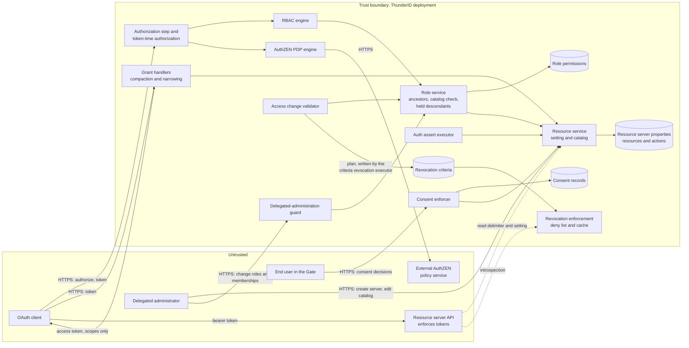
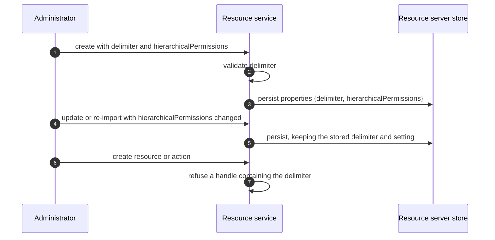
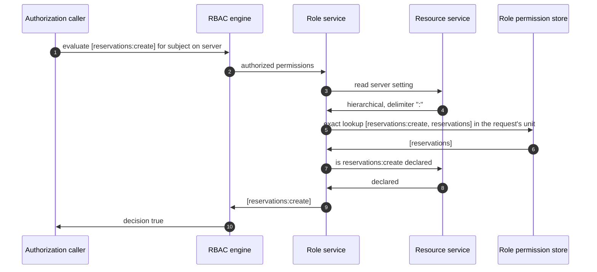
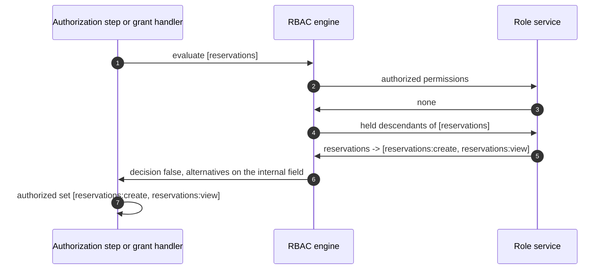
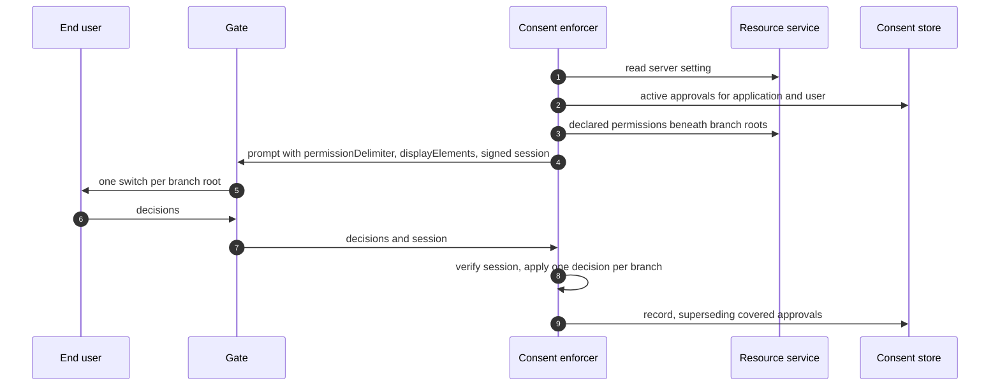
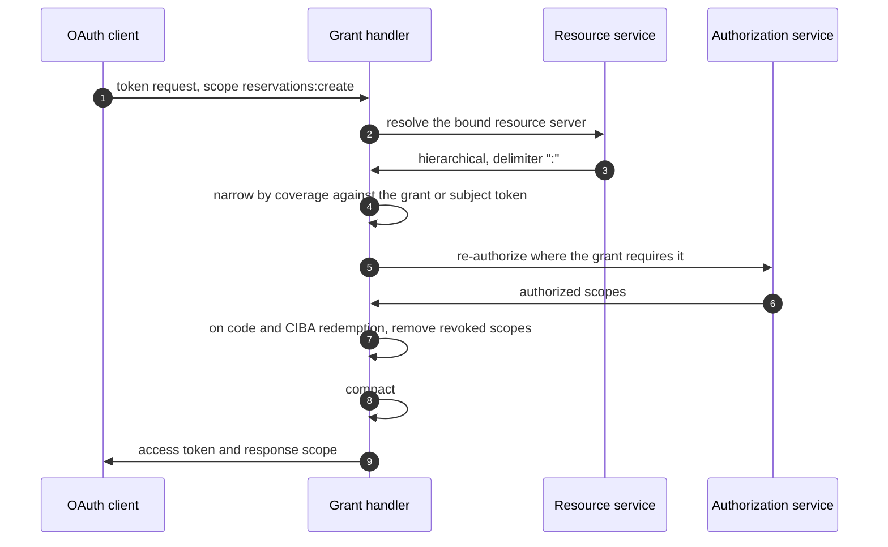
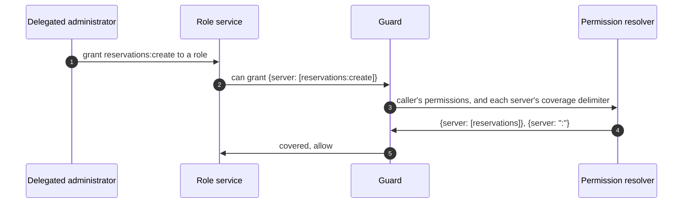
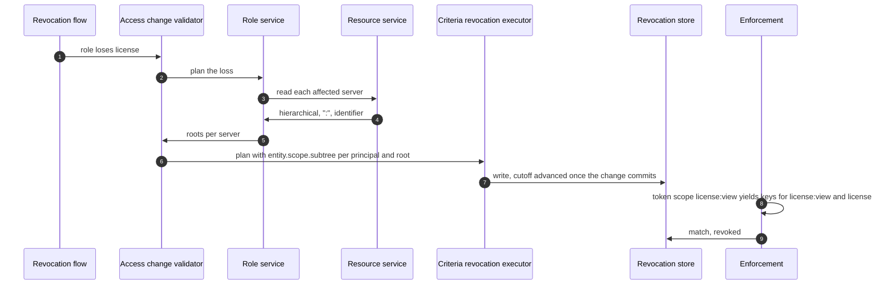
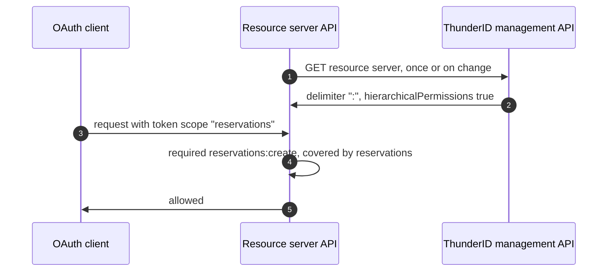

# Hierarchical Permissions Threat Model

This model covers hierarchical permission matching in ThunderID: the `hierarchicalPermissions` setting on a resource server, the runtime rule that lets a held permission authorize the declared permissions beneath it, the held descendants returned for a refused parent, branch consent, scope compaction and narrowing at the token endpoint, the delegated-administration coverage check, and branch revocation.

## Overview

A resource server that declares its permissions hierarchical makes a grant of `reservations` authorize `reservations:create`, `reservations:history:export`, and every other permission its catalog declares beneath it, including permissions added later. The setting is chosen when the server is created and never changes. On such a server the RBAC decision accepts a requested permission when the subject holds it or one of its ancestors, a refused parent yields the descendants the subject does hold, consent is decided per branch, tokens carry only the broadest issued permission of each branch, a delegated administrator may grant what their own permissions cover, and losing a parent revokes every token for the branch. On every other server, runtime matching stays exact.

The security-relevant shift is that one grant now authorizes an open-ended set, and that what a scope string means depends on a per-server setting the token does not carry. Two consequences drive the rest of this document. Every component inside ThunderID has to read the same setting from the same place, or two of them will disagree about what a grant reaches: hence a setting fixed at creation, read only from storage, never accepted from a caller, and exact or refused whenever it cannot be read. And the API that enforces a token has to apply the same rule, which ThunderID can document but not enforce: hence several of the residual risks sit at that boundary.

Cross-cutting concerns covered elsewhere: grant-type processing, resource indicators, and client authentication at the token endpoint; token exchange subject and actor token validation; the authentication flow and the consent record store; the revocation store, its cutoff semantics, and token validation; the system authorization service and the effective permission resolver; the AuthZEN evaluation endpoint and external policy service integration; the client SDKs. These are trust inputs here, not re-analysed.

## Scope

This model covers:

- The `hierarchicalPermissions` setting: create, read, update, import, and declarative paths, and its storage.
- The coverage rule and the delimiter each path resolves.
- RBAC evaluation of a requested permission through its ancestors, including the catalog check on inherited grants and organization unit scoping.
- Held descendants returned for a refused parent, through the RBAC engine, the authorization step, and token-time authorization.
- The permission consent prompt on a hierarchical server: branch shaping, the display tree, branch decisions, prompt suppression, superseding of stored approvals, and the permission claim.
- Scope compaction for every grant, and narrowing on refresh and token exchange.
- The delegated-administration coverage check and the Console's role permission catalog.
- Revocation planning for a lost branch, and the derivation of subtree keys at enforcement.
- The obligations the feature places on an API that enforces a token, and on an external AuthZEN policy service.

Out of scope (see the referenced companion models or the owning area):

- Grant-type processing, PKCE, client authentication, resource indicator binding, and refresh token rotation. Owned by the OAuth 2.0 Authorization and Core Grants model; this model analyses only what changes in scope handling.
- Token exchange subject and actor token validation, issuer trust, and delegation chains. Owned by the Token and Protocol Features model, except the exchange of a token across resource servers in [05]-6, which a hierarchical target widens.
- The consent record store, its lifecycle, and its access control. Owned by the consent area.
- The revocation store, the bounded-cutoff semantics, the revocation cache's synchronization, and whether an external API checks revocation at all. Owned by the token revocation area.
- The permission resolver behind the delegated-administration guard, and the root `system` exemption. Owned by the system authorization area.
- What an external AuthZEN policy service decides. Owned by its operator.
- The client SDKs' permission helpers and consent components. Owned by the SDK model.

## Architecture



The trust boundary sits at the deployment edge. Inside it, the setting has exactly one source, the stored resource server, and every component that applies the rule reads it there. Three things cross the boundary. Requests from clients, users, and administrators name permissions, and are matched against the stored setting rather than trusted to describe it. Decisions from an external policy service are taken as decisions only: nothing it returns can add a permission. And tokens leave carrying scope strings with no hierarchy, so the API on the far side must apply the rule itself. That last crossing is the one this feature cannot close from inside, and it is where the residual risks concentrate.

### Components

| Component | Task |
| --- | --- |
| Resource service | Accepts the setting on create, stores it in the resource server's properties beside the delimiter, keeps it on every update and import, and returns it on every read. Lists the declared permissions beneath a set of roots for the consent display tree. Validates that no handle contains its server's delimiter |
| Coverage rule | `PermissionCovers` and its helpers. `held` covers `required` when both are non-empty and equal, or when `required` begins with `held` followed by a non-empty delimiter. Never upwards. An empty delimiter means exact |
| Delimiter resolver | Reads the setting for the role service and the delegated-administration guard. A hierarchical server gives its delimiter, an exact server none at runtime and `:` for administration, an unreadable server none |
| Role service | Adds ancestors to the candidates of the existing exact-match lookup, refuses an inherited permission the catalog does not declare, lists held descendants of a refused parent, and plans revocation by coverage |
| RBAC engine | Returns each decision unchanged and, for a refused permission, the held descendants on an internal field that is never serialized |
| AuthZEN PDP engine | Builds each response from the external decision and context only, so an external service cannot supply alternatives |
| Authorization step and token-time authorization | Add the alternatives to the authorized set. The authorization step records the bound resource server's ID in flow runtime data, on the snapshot deny list |
| Consent enforcer | Reads the setting for the one bound resource server, shapes branch prompts, loads the display tree, records one decision per branch from the signed session, and supersedes stored approvals by coverage |
| Auth assert executor | Puts in the assertion only the authorized permissions that a consented permission covers |
| Grant handlers | Compact issued scopes on a hierarchical server, after authorization, consent, and, on authorization code and CIBA redemption, revocation filtering, and narrow refresh and token exchange requests by coverage, with OIDC scopes matched exactly |
| Delegated-administration guard | Refuses a grant the caller's own permissions do not cover, with each server's resolved delimiter and a fixed `:` for System permissions |
| Access change validator | Plans a subtree rule per lost root on a hierarchical server and exact rules elsewhere, which the criteria revocation executor writes. A server read failure refuses the change |
| Revocation enforcement | Derives subtree keys from every token scope for every permitted delimiter, without reading the catalog or the resource server. Used by the deny-list check behind token validation and introspection, and by the revocation cache in front of ThunderID's own APIs |
| Console and Gate | Present the setting and its warning at creation, show it read-only afterwards, store a selected root in the role catalog, and render consent per branch. None of them is an enforcement point |

### Actors

#### Actors

| Actor | Description | Roles or permissions |
| --- | --- | --- |
| Resource server administrator | Creates a resource server, chooses the setting, and maintains its catalog of resources and actions | Resource server create and update permissions in the server's organization unit |
| Delegated administrator | Changes role permissions, role assignments, and group memberships | Role and group management permissions, bounded by the coverage guard |
| End user | Signs in through an application and decides consent | Their own roles; no permission over this feature |
| OAuth client | Requests permission scopes on authorization, client credentials, refresh, token exchange, and the other grants | Whatever its grants and its subject's roles allow |
| API developer | Builds the API that enforces tokens for a resource server | Reads the resource server's settings; holds no ThunderID permission through this feature |
| External policy service operator | Runs an AuthZEN policy service configured as a resource server's authorization engine | Decides access for that server |
| Operator | Deploys and upgrades ThunderID, including declarative resource files | Deployment configuration |

#### Entitlement matrix

| Actor | Choose the setting | Change the setting later | Reach descendants through a parent | Grant a descendant held only through a parent | Decide consent per branch | Exempt one permission from an approved branch |
| --- | --- | --- | --- | --- | --- | --- |
| Resource server administrator | [Yes], at creation | [No] | [Yes], when granted the parent | [Yes], when also a delegated administrator | [No] | [No] |
| Delegated administrator | [No] | [No] | [Yes], when granted the parent | [Yes], on a hierarchical server, and on an exact server for `:`-separated names | [No] | [No] |
| End user | [No] | [No] | [Yes], when granted the parent | [No] | [Yes] | [No] |
| OAuth client | [No] | [No] | [Yes], within its subject's grants | [No] | [No] | [No] |
| API developer | [No] | [No] | [No] | [No] | [No] | [No] |
| Operator | [Yes], for declarative servers | [Yes], for declarative servers, by editing the file | [No] | [No] | [No] | [No] |

### External Dependencies (not owned)

| Dependency | Description (usage, purpose, authentication, authorization, security) |
| --- | --- |
| Resource server API | Receives tokens whose scopes carry no hierarchy, and must apply the delimiter and setting it reads from `GET /resource-servers/{id}`. ThunderID cannot see how it matches. Branch revocation reaches it only if it consults revocation state, which is the token revocation area's concern |
| External AuthZEN policy service | Decides each requested permission for a server that uses it as its authorization engine. ThunderID neither expands nor substitutes its decisions, while consent and compaction still apply the configured hierarchy |
| Consent record store | Persists permission purposes per application and user, with permission strings as elements. Reused without schema change |
| Revocation criteria store and cache | Hold the `entity.scope.subtree` criterion type beside the existing ones. Owned by the token revocation area |
| Effective permission resolver | Supplies the caller's and the target's permissions to the delegated-administration guard. Owned by the system authorization area |
| Client SDKs | Offer permission helpers that take the delimiter and the setting, defaulting to `:` with hierarchy on. Owned by the SDK model |

## Threats and mitigations

### Out-of-scope interactions and risks

- Bypass of the resource server or role management permission checks. Owned by the resource and role areas. This model takes "the administrator is authorized" as a trust input and analyses what an authorized administrator can then cause.
- Token theft, replay, and audience confusion at the token endpoint. Owned by the OAuth models; nothing here changes how a token is bound to its audience.
- An external API that does not check revocation, or checks it only at intervals. Owned by the token revocation area. A revoked branch is only as revoked at such an API as its revocation checks make it.
- The root `system` permission's exemption from the coverage guard. Owned by the system authorization area, and unchanged.
- What a policy service decides, and how. Its obligation under this feature is recorded in [02].
- How an SDK helper is configured by the application that calls it. Owned by the SDK model; the obligation is recorded in [08].
- Rate limiting and request size limits on the OAuth and management endpoints: applied at the deployment or gateway layer, see the Production Deployment Guidelines.

### Interactions

#### [01]: Declaring a resource server hierarchical

**Description**

A resource server administrator sets `hierarchicalPermissions` on the create request, through the Console's create wizard, or in a declarative resource file. The resource service stores it in the server's properties JSON beside the delimiter. The update request has no such field, a value sent anyway is ignored, and update and re-import keep the stored value. Every read returns the field, `false` included. A row written before this feature reads back `false`. Handles of resources and actions may not contain the server's delimiter, on the management API and in declarative files alike.

**Assets involved**

| Initiator | Intermediate | Target |
| --- | --- | --- |
| Resource server administrator or operator | Console, resource service, importer, declarative loader | Resource server properties, resources, actions |

**Data flow**



**Security considerations**

| Area | Response | Comments |
| --- | --- | --- |
| Data confidentiality | [C-Low] | Configuration, readable by anyone who may read the resource server |
| Communication medium | [M-NT], [M-DB], [M-FS] | Management API, configuration database, declarative files |
| Transport security | [TLS] | On the management API listener |
| Authentication | Management API authentication | |
| Accessibility | [Restricted] | |
| Authorization and Access Control | Resource server create and update permissions in the server's organization unit | |

**Threat assessment**

| ID | Category | Threat | Materializable | Mitigation / comment |
| --- | --- | --- | --- | --- |
| 1 | [Elevation of Privilege] | An administrator turns hierarchy on for an existing server, so every role that grants a resource permission silently reaches that resource's whole subtree, with no review of any role. Turning it off would instead narrow every token and break every API that accepts compacted ones | [No] | The setting is fixed at creation. The update request does not carry it, a value sent anyway is ignored, and update and re-import keep the stored value, as they already do for the delimiter and the type. A declarative server's setting is whatever its file says, so changing it is a deployment change made by the operator outside the API. The remedy for the other behaviour is a second resource server |
| 2 | [Elevation of Privilege] | A permission poses as a descendant of an unrelated one: a root resource whose handle is `a:b` would sit beneath `a`, or `reservations` would cover `reservationsX` by plain prefix | [No] | No handle may contain its server's delimiter, on the API and the declarative path, and the delimiter is fixed, so a handle that passed the check stays valid and every prefix of a permission at a delimiter boundary is a real ancestor. Coverage requires the delimiter immediately after the held permission, so `reservations` never covers `reservationsX`, nor `reservations-archive` on a server whose delimiter is `:` |
| 3 | [Elevation of Privilege] | On an API or custom server, an action and a child resource under the same parent share a handle and so derive the same permission string. Granting what an administrator reads as one action then grants the child resource and everything beneath it | [Yes] | Handle uniqueness is checked within each kind, resources among resources and actions among actions. The check across kinds exists only for MCP servers. Before this feature the shared string authorized only itself; on a hierarchical server it also covers the child resource's subtree. Creating the collision needs catalog write permission, and both entries are visible in the catalog. See Residual risks |
| 4 | [Elevation of Privilege] | A principal who holds a parent and can also write the catalog adds a resource or action beneath it, and holds the new permission at once, with no role change and no grant check | [Yes] | By design: a parent grant covers permissions added later, and the create wizard, the consent notice, and the resource servers guide all say so. Writing the catalog needs resource server update permission in the server's organization unit, which is separate from role management, and resource and action changes are audited events. An administrator who needs a fixed set grants the children individually. See Residual risks |
| 5 | [Repudiation] | Nobody can later tell whether a server was created hierarchical, or when | [No] | The setting cannot change after creation, so the current value is the value at creation, and the creation itself is an audited event. Every read returns the value |

#### [02]: Authorizing a requested permission

**Description**

The role service decides a batch of requested permissions for one subject on one resource server. It reads the setting from the stored server, builds candidates from each requested permission and its ancestors, and runs the existing exact-match lookup once, limited to the request's organization unit when one is given. A requested permission is authorized when it or an ancestor matched. One authorized only through an ancestor must be declared in the catalog, and if the catalog cannot be read, every inherited permission is refused. A server that cannot be read matches exactly. The authorization step, token-time authorization, and the AuthZEN evaluation endpoint all reach this through the RBAC engine. A server configured with an external AuthZEN policy service is decided by that service instead.

**Assets involved**

| Initiator | Intermediate | Target |
| --- | --- | --- |
| OAuth client, AuthZEN caller | Authorization service, RBAC engine, role service, resource service | Role permissions, the catalog |

**Data flow**



**Security considerations**

| Area | Response | Comments |
| --- | --- | --- |
| Data confidentiality | [C-Medium] | The subject's permissions on one server |
| Communication medium | [M-IN], [M-DB] | In process, then the configuration database |
| Transport security | [Not Encrypted] | In process. Database transport is the deployment's |
| Authentication | The caller's authentication: the flow, client authentication, or the AuthZEN endpoint's | |
| Accessibility | [Internal] | Reached only through the authorization provider |
| Authorization and Access Control | The resource server ID binds the lookup. The setting is read from storage, never taken from the caller | |

**Threat assessment**

| ID | Category | Threat | Materializable | Mitigation / comment |
| --- | --- | --- | --- | --- |
| 1 | [Elevation of Privilege] | A held parent authorizes a string nobody declared, such as `reservations:anything`, putting an invented scope in a token that a prefix-matching API might honour, or that later collides with a permission created for another purpose | [No] | A permission authorized only through an ancestor must be declared on that server, as a resource or an action, in the database or the declarative store. A catalog read failure refuses every inherited permission and is logged as an error. Permissions matched by name keep their existing behaviour |
| 2 | [Elevation of Privilege] | Coverage works upwards, so a subject holding every child receives the parent, and with it every permission added beneath the parent later | [No] | Coverage is a prefix test in one direction only. The candidates are the requested permission and its ancestors, never its descendants. An integration test asserts that holding `booking:approve` does not confer `booking` through the AuthZEN API |
| 3 | [Elevation of Privilege] | A role's grant on one resource server covers a permission of the same name on another | [No] | The lookup is bound to one resource server ID, and the delimiter is read from that server |
| 4 | [Elevation of Privilege] | A caller of the authorization provider asks for hierarchical matching on a server that did not declare it, or the rule is inferred from the shape of the permission string | [No] | Callers pass a resource server ID only. The role service reads the setting from the stored server, and a server that cannot be read matches exactly. The shape of a string never decides anything: `a:b` on an exact server is just a name |
| 5 | [Elevation of Privilege] | Inheritance counts role assignments made in a different organization unit, so a shared user holding a parent in one unit reaches its children in another | [No] | The organization unit filter applies to the ancestor lookup and to the descendant enumeration in [03], the same filter that already applies to exact lookups |
| 6 | [Elevation of Privilege] | A federated authorization mapping that grants a parent directly widens to the parent's whole subtree | [No] | A directly mapped permission target grants that exact permission only, at sign-in and on refresh, which a unit test asserts. A mapped role or group goes through the RBAC engine, where it behaves as a local role does |
| 7 | [Security Risk] | An external policy service decides each permission without the hierarchy, while consent and compaction apply it. If the service allows `reservations` and refuses `reservations:create` for a subject, the token carries `reservations`, and an API applying the hierarchy allows the create the service refused | [Yes] | ThunderID neither expands nor substitutes an external decision, so the service's allows and refusals are issued as given. A refusal beneath an allowed parent is the one decision the token cannot express. The resource servers guide states that the policy service and the API must follow the same parent-grant rule. See Residual risks |
| 8 | [Denial of Service] | A request naming many deeply nested permissions multiplies the lookups behind one decision | [No] | One exact-match query per batch, whose candidate list grows linearly with each permission's depth, plus one resource server read and, only when something was inherited, one catalog query. The index stays exact; no pattern match reaches the database |

#### [03]: Returning held descendants for a refused parent

**Description**

When a requested permission is refused on a hierarchical server, the RBAC engine asks the role service for the subject's held permissions beneath it: one enumeration of what the subject holds on that server, limited to the request's organization unit, filtered to permissions beneath the refused one, and checked against the catalog, with the built-in System permissions counting as declared. The decision for the refused permission stays `false`. The descendants travel on an internal field that is never serialized. The authorization step, client credentials, refresh re-authorization, and mapped token exchange add them to the authorized set.

**Assets involved**

| Initiator | Intermediate | Target |
| --- | --- | --- |
| OAuth client | RBAC engine, role service, authorization step or grant handler | The issued scopes |

**Data flow**



**Security considerations**

| Area | Response | Comments |
| --- | --- | --- |
| Data confidentiality | [C-Medium] | Which descendants a subject holds |
| Communication medium | [M-IN], [M-DB] | |
| Transport security | [Not Encrypted] | In process |
| Authentication | As [02] | |
| Accessibility | [Internal] | The field is not part of any API |
| Authorization and Access Control | Only permissions the subject already holds on that server, in that unit | |

**Threat assessment**

| ID | Category | Threat | Materializable | Mitigation / comment |
| --- | --- | --- | --- | --- |
| 1 | [Elevation of Privilege] | A subject that holds only children is issued the parent it requested | [No] | The decision for the parent stays `false`. Only permissions the subject holds are returned, and only those beneath the refused one |
| 2 | [Tampering] | An external policy service returns alternatives in its response, adding permissions it was never asked about | [No] | The AuthZEN PDP engine builds each response from the external decision and context alone. The alternatives field carries `json:"-"` and is never read from or written to JSON |
| 3 | [Information Disclosure] | The AuthZEN evaluation API reveals which permissions a subject holds beneath a parent the caller asked about | [No] | The field is never serialized. The API answers `false` for the parent and nothing more, as before this feature |
| 4 | [Elevation of Privilege] | A permission the subject still holds by name, but which the catalog no longer declares, is issued in place of its refused parent | [No] | Every candidate is checked against the catalog in one batch. The built-in System permissions count as declared, since the server defines them in code rather than in the catalog |
| 5 | [Security Risk] | A client that asked for `reservations` and received its children assumes it received `reservations`, and acts on more than it was granted | [No] | The token response's `scope` always states the issued scopes, which RFC 6749 section 3.3 requires when they differ from the request, and the access token's scope claim matches it |

#### [04]: Consent for a permission branch

**Description**

The consent enforcer reads the setting for the one resource server the authorization step bound, and fails the step when it cannot. A permission is already consented when it or an ancestor has an active approval in the application's permission purpose. Each prompted permission belongs to a branch rooted at its shortest authorized ancestor, and a branch with any undecided permission is prompted whole. The purpose carries `permissionDelimiter` and, for display only, `displayElements`: the prompted permissions plus everything the catalog declares beneath each root. The signed consent session token records each purpose's prompted elements and delimiter. On recording, each branch takes its root's decision, stored elements the prompt covers are replaced, and a stored approval that covers a fresh refusal is removed. The assertion keeps only the authorized permissions that a consented permission covers.

**Assets involved**

| Initiator | Intermediate | Target |
| --- | --- | --- |
| End user | Gate, flow engine, consent enforcer, resource service | Consent records, the assertion's permissions |

**Data flow**



**Security considerations**

| Area | Response | Comments |
| --- | --- | --- |
| Data confidentiality | [C-Medium] | The user's decisions and the permissions they hold |
| Communication medium | [M-NT], [M-DB] | Browser to the flow API, then the runtime database |
| Transport security | [TLS] | |
| Authentication | The authenticated flow, and the signed consent session token | |
| Accessibility | [Restricted] | The user's own flow |
| Authorization and Access Control | Only permissions already authorized for the user are prompted | |

**Threat assessment**

| ID | Category | Threat | Materializable | Mitigation / comment |
| --- | --- | --- | --- | --- |
| 1 | [Tampering] | A crafted submission approves a child while refusing its root, or approves a display-only element, so the token carries something the user refused or was never asked | [No] | Decisions are checked against the signed consent session token. Each branch takes its root's decision and every prompted permission in it is recorded with that decision, so a submitted decision for a non-root permission has no effect. Display-only elements are not in the session and are never decided. A root named more than once is approved only if every occurrence approves it |
| 2 | [Tampering] | The submission changes the delimiter, so branches are computed differently at recording than they were at prompting | [No] | Recording reads the delimiter from the verified session token, never from the submission |
| 3 | [Privacy Risk] | The user approves a branch without seeing what it covers | [No] | The display tree lists every declared permission beneath each root, read-only. The notice that a grant includes current and future permissions is shown whenever the purpose carries a delimiter, whether or not the tree loaded. If the tree cannot be loaded, the authorized permissions are still shown and a warning is logged |
| 4 | [Privacy Risk] | An approval of a branch covers permissions added to it after the user approved, which the user never saw | [Yes] | By design, and stated in the prompt's notice. The token still carries only what the user holds, and adding to the catalog needs resource server update permission. A client that requests the children rather than the parent, or a role that grants the children individually, gets consent for those permissions only, so later additions are not covered. See Residual risks |
| 5 | [Privacy Risk] | A user refuses a child, and an older approval of its parent keeps authorizing it, so the user's latest decision is silently overridden | [No] | Recording a refusal removes every stored approval in the purpose that covers it |
| 6 | [Elevation of Privilege] | An approval stored for a permission the subject no longer holds re-enters the token | [No] | The assertion keeps only authorized permissions that a consented permission covers, and is empty when no authorization step ran. Consent narrows what was authorized and never adds to it |
| 7 | [Tampering] | A flow replayed from a snapshot carries another request's resource server binding, so consent and the claim are computed against the wrong server's setting | [No] | The binding is on the request-scoped snapshot deny list, so a replayed flow resolves its own |
| 8 | [Privacy Risk] | An approval a user gave for one resource server also counts for a permission of the same name, or one beneath an approved parent, that the same application requests on another server, so the user is not asked again | [Yes] | Nothing is granted by it: the assertion still carries only permissions the user holds on the bound server, and only the prompt is skipped. Approvals are stored per application and user without the resource server, which predates this feature. Where the flow lets the user choose, a decision the user chooses not to remember is recorded for one second, so it cannot skip a later prompt. See Residual risks |

#### [05]: Issuing, refreshing, and exchanging tokens

**Description**

After authorization and consent, a grant handler issuing for a hierarchical server drops every permission scope that another issued permission scope covers. OIDC scopes neither cover nor are covered. Compaction runs for the authorization code, client credentials, refresh token, token exchange, device code, CIBA, and JWT bearer grants; on authorization code and CIBA redemption it runs after the scopes revoked since the decision are removed, and the stored code and CIBA request keep the uncompacted approved set. On refresh, a requested scope must be in the grant or covered by one of its permission scopes on the refresh token's audience, and the result is cut to the server's declared permissions and re-authorized against current roles. On token exchange with a subject token ThunderID issued, a requested scope must equal or be covered by a subject token scope under the target server's setting, and the result is cut to the target's declared permissions. An external subject token's permission scopes come only from its connection's authorization mapping, and none without one.

**Assets involved**

| Initiator | Intermediate | Target |
| --- | --- | --- |
| OAuth client | Token endpoint, grant handlers, resource service, authorization service | Access token, refresh token |

**Data flow**



**Security considerations**

| Area | Response | Comments |
| --- | --- | --- |
| Data confidentiality | [C-High] | Tokens |
| Communication medium | [M-NT] | |
| Transport security | [TLS] | |
| Authentication | Client authentication per grant | |
| Accessibility | [Public] | The token endpoint |
| Authorization and Access Control | As each grant already enforces, with coverage only downwards | |

**Threat assessment**

| ID | Category | Threat | Materializable | Mitigation / comment |
| --- | --- | --- | --- | --- |
| 1 | [Elevation of Privilege] | Compaction drops a child on the strength of a parent that was refused, revoked, or never issued | [No] | Compaction runs on the final issued set, after authorization, consent, and, on authorization code and CIBA redemption, revocation filtering, and drops a scope only when another scope in that set covers it |
| 2 | [Elevation of Privilege] | An OIDC scope takes part in coverage: a custom OIDC scope named like a permission covers permissions beneath it, or a held permission covers a requested OIDC scope such as `reservations:history` | [No] | Narrowing requires an exact grant for a requested OIDC scope and never lets an OIDC grant cover anything. Compaction leaves OIDC scopes out of the comparison |
| 3 | [Elevation of Privilege] | A refresh request widens the grant: it asks for the parent of a granted child, or for a permission the subject has lost since the refresh token was issued | [No] | Coverage only works downwards. The narrowed scopes are cut to the server's declared permissions and re-authorized against the subject's current roles, on the server the refresh token's audience names |
| 4 | [Elevation of Privilege] | A token exchange request widens the subject token: it asks for the parent of a granted child, or for a descendant that no administrator declared | [No] | Coverage only works downwards, under the target server's setting, and the result is cut to the target's declared permissions before it is issued. Exchanging into a different resource server is [05]-6 |
| 5 | [Operational Risk] | The resource server a refresh token is bound to is deleted or cannot be read, and narrowing falls back to some other rule | [No] | Refresh fails with `invalid_target` when the server no longer exists and `server_error` when it cannot be read, rather than narrowing under a guessed setting |
| 6 | [Elevation of Privilege] | A client allowed to use the token exchange grant presents a token ThunderID issued for one resource server and names another as the resource, and receives permission names both servers declare without the subject's roles on the target being checked | [Yes] | Bounded: the request needs a client allowed to use the grant and a valid subject token, and the result is cut to the permissions the target declares, so only names both servers share carry over. For a subject token ThunderID issued, its scope claim is the authority for the exchange and its audience is not compared with the target, which predates this feature. On a hierarchical target, a parent in the subject token also covers the target's declared descendants of that name. See Residual risks |

#### [06]: Delegated administration

**Description**

The delegated-administration guard refuses a change to role permissions, a role or group membership, or an entity unless the caller's own permissions cover everything the change confers, per resource server. It covers with the server's delimiter on a hierarchical server, with `:` on an exact server as before this feature, exactly when the server cannot be read, and always with `:` for a permission under the `system` root on the built-in System resource server. The Console's role permission catalog stores a selected root on a hierarchical server and shows its descendants as covered and disabled.

**Assets involved**

| Initiator | Intermediate | Target |
| --- | --- | --- |
| Delegated administrator | Role and group services, system authorization service, permission resolver | Role permissions, assignments, memberships |

**Data flow**



**Security considerations**

| Area | Response | Comments |
| --- | --- | --- |
| Data confidentiality | [C-Medium] | |
| Communication medium | [M-NT], [M-IN], [M-DB] | |
| Transport security | [TLS] | |
| Authentication | Management API authentication | |
| Accessibility | [Restricted] | |
| Authorization and Access Control | Role and group management permissions, then the coverage guard | |

**Threat assessment**

| ID | Category | Threat | Materializable | Mitigation / comment |
| --- | --- | --- | --- | --- |
| 1 | [Elevation of Privilege] | A delegated administrator holding a child grants the parent, and with it every sibling and every permission added later | [No] | Coverage only works downwards, on every server |
| 2 | [Elevation of Privilege] | A custom server's permission named `system` inherits the System resource server's fixed `:` coverage | [No] | The fixed rule applies only to the built-in System resource server, matched by its ID, and only beneath the `system` root |
| 3 | [Elevation of Privilege] | On an exact server, a delegated administrator holding `reservations` grants `reservations:create`, which their own grant does not authorize at runtime, and so can confer it, including on a role they hold themselves | [Yes] | Exact servers keep the `:` coverage the guard applied before this feature, so delegated administrators keep the grants they could already make. It needs role management permission, applies only to names separated by `:`, and is documented in the role management guide. See Residual risks |
| 4 | [Elevation of Privilege] | A resource server that cannot be read makes the guard cover with a broader rule than the server's | [No] | An unreadable server is left out of the delimiter map, so its coverage is exact and a grant that depended on coverage is refused |
| 5 | [Security Risk] | The Console's covered-and-disabled display is taken for the enforcement point, and a request built outside the Console grants more | [No] | The guard runs on the server for every path. The Console's selection is presentation |

#### [07]: Revoking a branch

**Description**

When a revocation flow removes role permissions, deletes a role, removes an assignment, deletes a group, or removes a membership, or a role is unshared from an organization unit, the role service reads each affected server and works out which permissions each principal loses by coverage. On a hierarchical server the lost permissions are reduced to roots and each root becomes a bounded `entity.scope.subtree` rule, a digest of the principal, the audience, the root, and the delimiter. A server read failure refuses the change. A role deletion also keeps the planned scopes, so a principal assigned the role while the deletion ran loses the same branch. At enforcement, each token scope yields keys for every permitted delimiter, one for the scope and one for each prefix ending before that delimiter, with no catalog or server read. Deleting an action still writes an exact deployment-wide rule.

**Assets involved**

| Initiator | Intermediate | Target |
| --- | --- | --- |
| Delegated administrator, through a revocation flow | Access change validator, role service, resource service, criteria revocation executor | Revocation criteria, then every token checked against them |

**Data flow**



**Security considerations**

| Area | Response | Comments |
| --- | --- | --- |
| Data confidentiality | [C-Low] | Digests, not permission names |
| Communication medium | [M-IN], [M-DB] | |
| Transport security | [Not Encrypted] | In process. Database transport is the deployment's |
| Authentication | The administration flow's | |
| Accessibility | [Internal] | |
| Authorization and Access Control | The revocation flow's permissions | |

**Threat assessment**

| ID | Category | Threat | Materializable | Mitigation / comment |
| --- | --- | --- | --- | --- |
| 1 | [Elevation of Privilege] | Removing a parent revokes only tokens carrying the parent string, so tokens carrying descendants, issued while the parent was held, stay valid | [No] | A lost root becomes a subtree rule, and every token scope yields a key for each of its ancestors, so a descendant token matches its root's rule without any catalog read |
| 2 | [Tampering] | A subtree rule matches scopes outside its branch, or misses scopes inside it because they split on a different delimiter | [No] | The digest binds the principal, the audience, the root, and the delimiter, and keys are derived only at delimiter boundaries, so `license` does not match `licenseX`, another audience, or another principal. Keys are derived for every permitted delimiter, so the rule matches whichever one the scope uses |
| 3 | [Elevation of Privilege] | A failed resource server read during planning narrows the plan to exact rules, leaving descendant tokens valid | [No] | A read failure refuses the whole change, so nothing is written and the role is unchanged. A plan is never narrower than the loss |
| 4 | [Elevation of Privilege] | A principal assigned a role while its deletion runs keeps tokens for the branch, because the plan was made before they held it | [No] | A role deletion keeps the planned scopes, subtree rules included, and the post flow revokes them for every holder it did not plan for |
| 5 | [Elevation of Privilege] | Deleting an action revokes only tokens carrying that exact permission. A token carrying only the parent stays valid, and an API applying the hierarchy keeps accepting it for the deleted operation | [Yes] | Deployment-wide rules stay exact. A new token can no longer name the deleted permission, since an inherited grant must be declared, but a parent token never named it. The specification states that the API owner must disable or remove the operation itself. See Residual risks |
| 6 | [Denial of Service] | Deriving subtree keys on every revocation check makes each token check expensive | [No] | The keys are hashes computed in memory, bounded by the token's scopes, the five permitted delimiters, and each scope's depth. No catalog or resource server read is involved |

#### [08]: Enforcing a token at the resource server

**Description**

A token leaves ThunderID carrying scope strings and no hierarchy. The API that enforces it reads its server's `delimiter` and `hierarchicalPermissions` from the management API and must apply the same rule. On a hierarchical server tokens are compacted, so an API that matches exactly refuses descendants the subject holds. Branch revocation reaches the API only if it consults revocation state. The client SDKs offer permission helpers that take the delimiter and the setting.

**Assets involved**

| Initiator | Intermediate | Target |
| --- | --- | --- |
| OAuth client | Network | Resource server API |

**Data flow**



**Security considerations**

| Area | Response | Comments |
| --- | --- | --- |
| Data confidentiality | [C-High] | Tokens |
| Communication medium | [M-NT] | |
| Transport security | [TLS] | The API's own listener |
| Authentication | The token's signature and audience, validated by the API | |
| Accessibility | [Public] | |
| Authorization and Access Control | The API's matching, outside ThunderID | |

**Threat assessment**

| ID | Category | Threat | Materializable | Mitigation / comment |
| --- | --- | --- | --- | --- |
| 1 | [Elevation of Privilege] | An API applies hierarchical matching to the tokens of an exact server, so `reservations` passes a check for `reservations:create` that ThunderID would refuse | [Yes] | The setting is published on every resource server read, and the SDK helpers take it as an argument. `hasPermission` defaults to `:` with hierarchy on, the System resource server's rule, so an application checking a custom exact server's permissions must pass that server's setting. The Nuxt middleware's `requireScopes` defaults to exact matching. See Residual risks |
| 2 | [Elevation of Privilege] | An API matches on a bare prefix, without the delimiter boundary, so `reservations` passes a check for `reservationsX` | [No] | Outside ThunderID's control. The SDK helpers require the delimiter after the held permission, and the guide states the rule |
| 3 | [Elevation of Privilege] | An API protects an operation with a permission the catalog does not declare, so every holder of its parent passes, although ThunderID would never issue that permission through the parent | [Yes] | ThunderID refuses an undeclared permission at issuance, but the token carries only the parent, and only the API knows which operations it protects with which permissions. The API owner declares an operation's permission before requiring it. See Residual risks |

## Security Review Checklist

A review aid that complements the threat model. Guidance follows the [OWASP Top 10 Proactive Controls](https://top10proactive.owasp.org/).

### Security considerations

| # | Consideration | State | Comments |
| --- | --- | --- | --- |
| 1 | Are all inputs and outputs validated (syntactic and semantic)? | [Yes] | The setting is a boolean on create and is ignored on update. The delimiter comes from a fixed set, and no handle may contain it. A misspelled key on create is dropped and leaves the server exact, which fails toward refusal. Consent decisions are checked against the signed session token. Permission lookups use exact matches and parameterized prefix comparisons, never a pattern built from input |
| 2 | Are rate limits in place where necessary? | [N/A] | The feature adds no endpoint. The work it adds per request is a bounded number of queries, described in [02] threat 8 |
| 3 | Are permissions, roles, and entitlements defined on the principle of least privilege and business need? | [Partial] | The setting is off by default and fixed. A parent grant covers future descendants by design, and exact servers keep the `:` coverage the delegated-administration guard applied before this feature. Both are residual risks |
| 4 | Are authentication and authorization validated at both the UI and API layers, front end and back end, before granting access to resources? | [Yes] | The Console's warning, read-only view, and covered selections, and the Gate's branch switches, are presentation. Immutability, coverage, the catalog check, branch decisions, and the guard all run on the server |
| 5 | Are proper isolations in place between components to ensure least-privilege access and reduce the blast radius against lateral movement? | [Yes] | Role lookups are per resource server, the setting is read from storage by the component that applies it, and an external policy service cannot add alternatives. The token carries no hierarchy, so the API's own matching is the remaining boundary |
| 6 | Have any default credentials been changed, and are default superuser or root accounts not in use (when using third-party components)? | [N/A] | No credentials and no third-party component |
| 7 | Has the implementation followed best-practice guidelines (OWASP, Kubernetes, vendor, or technology provider)? | [Yes] | RFC 6749 section 3.3: the issued scope is always stated when it differs from the request. RFC 8707: tokens stay bound to one resource server |
| 8 | Are secrets, credentials, and internal-only material kept out of the public source tree and its git history? | [Yes] | The feature introduces no secret material |
| 9 | Was a security-focused code review conducted for this change, and have the findings been addressed? | [Partial] | Applies to #6318. The points to verify are that the setting is never taken from a request, that inherited grants require the catalog, that alternatives are never serialized, and that a server read failure fails toward exact matching or refusal on every path |
| 10 | Is Static Analysis (SAST) or IaC scanning conducted, and are findings addressed? | [Yes] | `gosec` runs as part of the backend golangci-lint configuration, which `make pr_checks` gates on |
| 11 | Is Software Composition Analysis (SCA) conducted or integrated into the repository, and are findings addressed (for example FOSSA, Trivy)? | [Partial] | Go dependency changes are validated on every pull request that touches `go.mod`, and npm advisories have a documented remediation workflow. There is no continuous scan of the full dependency set. This feature adds no dependency |
| 12 | Is Dynamic (DAST) or API scanning conducted on a non-production setup, and are findings addressed? | [No] | No DAST pipeline exists. The behaviour is covered by integration tests for client credentials, refresh, token exchange, permission consent, AuthZEN evaluation, and administration flows |
| 13 | Are audit logs generated in a standardized format for critical functionality, and available to authorized users to trace critical events and aid incident response? Note the retention period in Comments. | [Partial] | Resource server, resource, action, and role changes are published as audit events. They record which resource changed, how, and who changed it, not field values, so the setting is not in the event; it cannot change after creation, so the current value is the creation value. Revocation rules are stored with the reason of the change that wrote them. Retention is the operator's |
| 14 | Do audit logs for critical configuration changes record the difference between the old and new versions? | [No] | Role permission changes are audited without an old-to-new difference. On a hierarchical server one changed parent reaches a whole branch, so it is a change worth diffing. Pre-existing gap in the role service |
| 15 | Are data in transit and at rest encrypted? | [N/A] | Nothing new is transmitted or stored beyond a boolean in an existing column and a criterion type in an existing table. Transport and storage encryption are the deployment's |
| 16 | Are sensitive values such as credentials and keys stored in a secret store or vault? | [N/A] | No new key or secret |
| 17 | Is personal, sensitive, or confidential data kept out of logs? | [Yes] | New log lines carry resource server IDs, counts, and masked user IDs. No permission list, token, or consent decision is logged |
| 18 | Have users been given clear instructions for secure usage? | [Partial] | The resource servers, consent, and role management guides describe the setting, the API's and policy service's obligations, and the revocation behaviour, and the create wizard warns at the point of choice. The SDK development specification does not yet record the SDK helpers' matching settings |

### Business impact and resilience

For an open-source component, most of these are shared with the operator who deploys it.

| # | Consideration | State | Comments |
| --- | --- | --- | --- |
| 1 | Has a business impact analysis been done to identify resilience requirements (maximum tolerable downtime, uptime, RPO, RTO)? | [N/A] | Owned by the deployer. What this design fixes is the failure direction: when the setting or the catalog cannot be read, runtime matching becomes exact, inherited grants are refused, consent and refresh fail, and revocation planning refuses the change. A dependency failure narrows access and never widens it |

Resilience details for this area:

- High availability: no new state and no coordination. Every replica reads the same stored setting.
- Disaster recovery: the setting is part of the resource server row, and subtree rules are part of the revocation store, both restored with their databases.
- Backups and retention: no new table and no new retention requirement.
- Health checks: none specific. A run of catalog read failures shows as error log lines from the role service.
- User banners: not applicable.

### Dependency and component health

| # | Consideration | State | Comments |
| --- | --- | --- | --- |
| 1 | Are dependencies, base images, and runtimes monitored for known vulnerabilities and kept current (for example automated dependency scanning), and are findings addressed? | [Partial] | As checklist item 11. This feature adds no dependency |
| 2 | Are any End-of-Life or End-of-Service components in use? | [No] | |
| 3 | Is hardening guidance published for operators who deploy the project (optional)? | [Partial] | The resource servers guide states what an API and a policy service must do. There is no guidance yet on auditing a catalog for action and resource handles that collide |

### Privacy considerations

The feature changes how permission consent decisions are prompted and recorded. Consent records are personal data.

| # | Consideration | State | Comments |
| --- | --- | --- | --- |
| 1 | Is the purpose and legal basis for processing personal data clearly defined? | [Yes] | Consent decides which of the user's permissions an application may act on. The controller is the deployer |
| 2 | Are the collection, storage, processing, sharing, archival, and disposal of personal data aligned with the data minimization principle? | [Yes] | Records keep their shape: permission strings and approvals. The display tree is shown, not stored. Superseding removes stored approvals a newer decision replaced |
| 3 | Is personal data stored securely? | [Yes] | In the existing consent store, unchanged |
| 4 | Are privacy notices updated to reflect any new processing or changes to purpose and legal basis? | [N/A] | Owned by the deployer. The prompt itself states that a grant covers current and future permissions beneath it |
| 5 | Is access to personal data granted on a need-to-know basis? | [Yes] | Unchanged |
| 6 | Are data retention requirements considered? | [N/A] | Owned by the consent area; unchanged |
| 7 | Is there a process to dispose of personal data on request in a timely manner while meeting retention requirements? | [N/A] | Owned by the consent area; unchanged |
| 8 | Are records of personal-data processing maintained in the project's data inventory or records of processing? | [N/A] | Owned by the deployer |

## Production Deployment Guidelines

The general guidance is in the [Production Deployment Guidelines](../../docs/content/deployment/production-guidelines.mdx). For hierarchical permissions:

- Turn the setting on only for a resource server whose permissions nest, and whose APIs apply the same delimiter and rule.
- Have every API read `delimiter` and `hierarchicalPermissions` from its resource server, and pass both to the SDK permission helpers; the helpers' default is the System resource server's rule.
- Declare a permission in the catalog before an API requires it, and disable or remove an API operation itself when its action is deleted.
- Have APIs consult revocation state, through introspection or a revocation-aware gateway, so that branch revocation reaches them.
- Grant children individually to a role that must not reach permissions added later.
- Keep resource server update permission, which writes the catalog, separate from roles that hold broad parents.
- On an API or custom hierarchical server, do not give an action and a child resource under the same parent the same handle.
- Make role changes that should end existing access through a revocation flow.
- Configure an external AuthZEN policy service to follow the same parent-grant rule as the resource server.
- Allow the token exchange grant only for clients that need it, and avoid reusing permission names across resource servers that the same subjects and applications reach.

## Residual risks (open items)

| Risk | Description | Current Status | Recommendation |
| --- | --- | --- | --- |
| Action and child resource share a permission | On an API or custom server, an action and a child resource under the same parent can share a handle, so they derive one permission string, and granting the action grants the child resource's subtree ([01]-3). | Accepted and bounded. Creating it needs catalog write permission, and both entries are visible in the catalog. | Apply the check MCP servers already run, which refuses a handle the other kind uses under the same parent, to hierarchical servers. |
| A parent covers permissions added later | A principal who holds a parent and can write the catalog extends their own reach without a role change, and a user's consent to a branch covers additions they never saw ([01]-4, [04]-4). | Accepted by design; stated at creation and in the consent notice. | Keep catalog write permission separate from broad roles, and grant children individually where a fixed set is needed. Consider an audit event naming the roles a new catalog entry extends. |
| Legacy `:` coverage on exact servers | A delegated administrator holding `reservations` on an exact server may grant `reservations:create`, which their own grant does not authorize at runtime ([06]-3). | Accepted; kept so existing delegated administrators keep their grants, and documented in the role management guide. | Aligning the guard with runtime matching on exact servers would close it, at the cost of refusing grants that work today. |
| External policy service semantics | A policy service can refuse a child beneath a parent it allows, and the token cannot express that ([02]-7). | Accepted; documented in the resource servers guide. | Configure the policy service to follow the parent-grant rule. |
| The API must apply the same rule | Tokens carry no hierarchy. An API that applies the hierarchy to an exact server's tokens grants more than ThunderID would, and one that protects an operation with an undeclared permission opens it to every holder of the parent ([08]-1, [08]-3). | Accepted; documented at creation and in the resource servers guide. | APIs read the setting and pass it to the SDK helpers, and declare a permission before requiring it. Record the helpers' matching settings in the SDK development specification. |
| Deleting an action keeps parent tokens | A token carrying only the parent stays valid for a deleted action ([07]-5). | Accepted; documented in the specification. | The API owner disables or removes the operation itself. |
| Token exchange across resource servers | A client allowed to use the token exchange grant can exchange a subject token ThunderID issued for one resource server for a token on another, limited to the permission names both servers declare. On a hierarchical target, a parent also carries its declared descendants ([05]-6). | Predates this feature. Bounded to clients allowed the grant and to permission names both servers share. | Require a subject token ThunderID issued to name the target resource server in its audience, or re-authorize the requested permissions against the subject's roles on the target, as refresh does. |
| Consent is not scoped to a resource server | An approval given for one resource server can stand in for the same permission, or one beneath an approved parent, on another server for the same application ([04]-8). | Predates this feature. Affects only whether the user is asked, never what is granted. | Record the resource server with each permission approval, or include it in the purpose name. |

## Appendix

- Sample: creating a hierarchical resource server.

  ```bash
  curl -kL -X POST https://localhost:8090/resource-servers \
    -H 'Authorization: Bearer <token>' -H 'Content-Type: application/json' \
    -d '{"name": "Booking API", "identifier": "https://api.example.com/booking",
         "delimiter": ":", "hierarchicalPermissions": true}'
  ```

- Sample: a permission purpose in a consent prompt on that server, for a user holding `reservations` and `payments:refund`.

  ```json
  {
    "purposeName": "permissions:<application ID>",
    "purposeId": "<purpose ID>",
    "type": "permissions",
    "essential": [],
    "optional": [
      {"name": "payments:refund"},
      {"name": "reservations"}
    ],
    "permissionDelimiter": ":",
    "displayElements": [
      {"name": "payments:refund"},
      {"name": "reservations"},
      {"name": "reservations:create", "parent": "reservations"},
      {"name": "reservations:view", "parent": "reservations"}
    ]
  }
  ```

- References: [RFC 6749 section 3.3](https://datatracker.ietf.org/doc/html/rfc6749#section-3.3), [RFC 8707](https://datatracker.ietf.org/doc/html/rfc8707), [RFC 8693](https://datatracker.ietf.org/doc/html/rfc8693), [AuthZEN](https://openid.github.io/authzen/), [OWASP Top 10 Proactive Controls](https://top10proactive.owasp.org/). Companion documents: [spec.md](spec.md), the [OAuth 2.0 Authorization and Core Grants threat model](../oauth/authorization-and-core-grants/threat-model.md), and the [SDK development threat model](../sdk-development/threat-model.md).
- Design discussion: [Hierarchical permissions for resource servers](https://github.com/thunder-id/thunderid/discussions/5990), the feature issue [#5988](https://github.com/thunder-id/thunderid/issues/5988), and the implementation [#6318](https://github.com/thunder-id/thunderid/pull/6318).

## Change log

| Version | Date | Change |
|---|---|---|
| 0.1 | 2026-11-25 | Initial threat model. |
