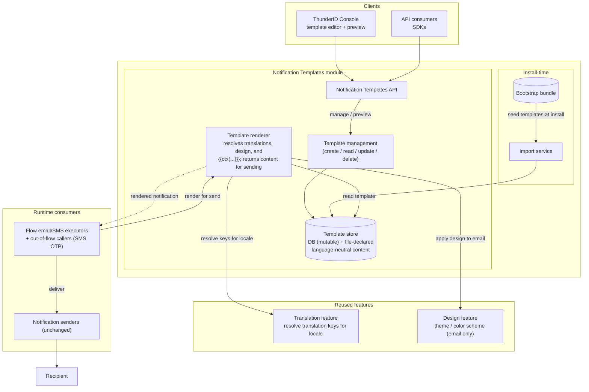
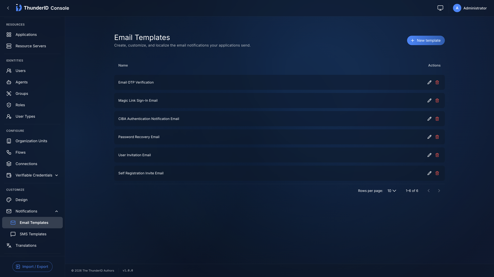
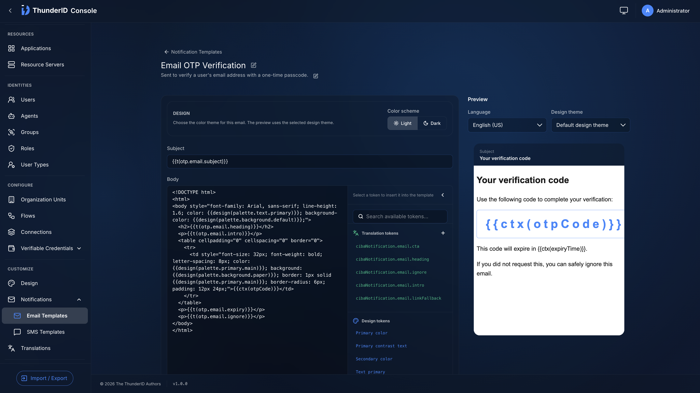

# Notification Templates Specification

- **Status:** Draft
- **Version:** 0.3
- **Related documents:** [Feature issue #5337](https://github.com/thunder-id/thunderid/issues/5337), [design discussion #5388](https://github.com/thunder-id/thunderid/discussions/5388)

## Summary

ThunderID ships fixed email and SMS templates. Changing their content requires editing server files and restarting the service. Administrators cannot manage or preview templates through the Console or an API. This specification adds runtime template management and live previews, with language and design support: a template references translation keys and a design rather than embedding its own copy or branding. Authoring new translations or customizing the design itself is out of scope for this phase; a template reuses the translations and designs the Translation and Design features already provide.

Each template stores one content definition rather than separate content per language, and it can reference translation keys so the same template localizes through the Translation feature. The Design feature supplies the applicable design when an email is rendered. The template stores a color scheme selection and references a design rather than embedding the design itself.

A flow node selects the template to send, and notifications dispatched outside a flow use the same managed templates: the SMS OTP authentication endpoint, for example, selects a template by the fixed handle `otp` through the same renderer. Resolving the recipient's own language is future work; this phase renders in the system default language, the `en-US` constant rather than a configured value. The render order and escaping behaviour are described under Rendering and delivery.

## Architecture

A template belongs to a notification channel, currently email or SMS. An administrator selects a template for a flow’s notification node, and the corresponding channel executor uses it. An email executor cannot use an SMS template, or vice versa.

Template content belongs to an organization unit and is independent of language and design. Its message content can reference translation keys; the resolved translation text, which can contain `{{ctx(...)}}` placeholders, is produced by the Translation feature at render time. The template stores the selected color scheme; the Design feature supplies the applicable design when the notification is rendered or previewed.

The Notification Templates module manages templates and coordinates rendering. It uses the Translation feature to resolve localized text and the Design feature to apply the relevant design. Runtime consumers invoke the template renderer, which returns the fully resolved notification content ready for sending. They do not call the Translation or Design features themselves to resolve template placeholders; the renderer has already applied them.

Templates required by flows, which are themselves created at bootstrap, are imported through the existing bootstrap path into the database. After import they are managed like any other database template. In `declarative` store mode the service refuses every create, so templates come only from file declarations, which are read-only.



| Component | Responsibility |
|---|---|
| Notification Templates module | Manage templates and coordinate rendering |
| Template renderer | Return fully resolved notification content (translations and design applied) for sending, so runtime consumers do not call the Translation or Design features directly |
| Template store | Persist templates and their content |
| Bootstrap and import | Seed templates required by bootstrapped flows as declarative resources (`resource_type: notification_template`) |
| Translation feature | Resolve `notification`-namespace translation keys for the target language (system default this phase) |
| Design feature | Apply the applicable design based on given themes, color schemes |
| Flow executors | Select a template and, through the template renderer, supply the design theme and the runtime (flow) context; the locale is left empty in this phase |
| Notification senders | Deliver rendered email or SMS |
| Console | Manage templates and show the template-editor preview |

## Detailed design

### Module and interfaces

The feature lives in the `internal/notificationtemplate` package (a single flat package with the API handler, service, DB store, file-based store, composite store, cache-backed store, and renderer). It reuses `internal/system/i18n/mgt` for translations, `internal/design/resolve` for design, `internal/notification` for delivery, and `internal/system/importer` for declarative bootstrap import.

Management goes through the service interface; runtime consumers (flow executors and out-of-flow callers) depend only on the narrow renderer interface, never on the management service directly.

```go
// Management surface.
type NotificationTemplateServiceInterface interface {
    ListTemplates(ctx, channel ChannelType, limit, offset int) (*TemplateListResponse, *ServiceError)
    CreateTemplate(ctx, channel ChannelType, req CreateTemplateRequest) (*Template, *ServiceError)
    GetTemplate(ctx, channel ChannelType, id string) (*Template, *ServiceError)
    GetTemplateByHandle(ctx, channel ChannelType, handle string) (*Template, *ServiceError)
    ValidateTemplate(ctx, channel ChannelType, req CreateTemplateRequest) *ServiceError
    UpdateTemplate(ctx, channel ChannelType, id string, req UpdateTemplateRequest) (*Template, *ServiceError)
    DeleteTemplate(ctx, channel ChannelType, id string) *ServiceError
    // Injected after construction to avoid a cyclic import with the dependency registry.
    SetDependencyRegistry(r resourcedependency.Registry)
}

// Runtime renderer: the only surface flow executors and out-of-flow callers use.
type TemplateRendererInterface interface {
    Resolve(ctx, channel ChannelType, handle string, in RenderInput) (*ResolvedContent, *ServiceError)
    // Injected after construction because the design resolve service is built after the renderer.
    SetDesignResolver(resolver designResolver)
}
```

DTO and model shapes:

```go
type Template struct {
    ID, OUID, Handle, DisplayName, Description string
    IsReadOnly bool             // true for file-declared templates (read-only via the API)
    Design     *TemplateDesign  // email only; nil for SMS
    Content    TemplateContent
}
type TemplateContent struct { Subject, Body string } // Subject empty for SMS
type TemplateDesign  struct { ColorScheme string }   // "light" | "dark"

type CreateTemplateRequest struct { // OUID is required and immutable, set only at creation
    OUID, Handle, DisplayName, Description string
    Design  *TemplateDesign
    Content TemplateContent
}
type UpdateTemplateRequest struct { // Handle omitted: it is immutable
    DisplayName, Description string
    Design  *TemplateDesign
    Content TemplateContent
}

// Render input supplied by the caller; ResolvedContent is returned ready to send.
type RenderInput    struct { Locale string; Data map[string]string; ThemeID string }
type ResolvedContent struct { Subject, Body string }
```

`channel` is taken from the request path, not the body. Delivery clients expose their own provider interfaces in `internal/notification/client` (`EmailClientInterface`, `MessageClientInterface`).

### Template configuration and management

Each template belongs to an organization unit (`ouId`, required and immutable). Attaching a template to an organization unit records ownership; access control by organization unit is not enforced in this phase. The handle is unique per channel across the deployment, so a flow's reference by handle resolves to a single template; per-organization-unit or per-application overrides of the same handle are not supported in this phase.

Editability depends on the template store mode, selected by `notification.template.store` (`mutable`, `declarative`, or `composite`). When it is unset, the mode follows the global declarative setting: `declarative` when declarative mode is enabled deployment-wide, otherwise `mutable`. An explicit value always wins, and an unrecognized one fails server startup. In `mutable` mode the bootstrap templates are seeded into the database and are ordinary editable templates. In `declarative` and `composite` modes, templates declared in files are read-only (`isReadOnly: true`): a create, update, or delete that targets a file-declared template returns `403` (`NTM-1022`), and in `declarative`-only mode creating any template through the API is refused with `403` (`NTM-1024`). A read-only template can still be read, listed, rendered, and previewed.

Administrators can create, list, read, update, and delete editable templates through the API or Console. A template referenced by a flow cannot be deleted: the service checks the resource dependency registry and returns `409` while an active flow references the template. The reserved SMS `otp` template used by the SMS OTP endpoint is protected the same way. When a delete is rejected, the template and flow remain unchanged.

Flow create and update do not validate the template handle. A flow whose handle matches no template fails at send time with template not found.

The creation wizard offers sample templates (hardcoded in the Console and kept in sync with the bootstrap defaults) alongside a **Start from scratch** option. A sample supplies starting content for a new template and has no special status after creation.

### Content and localization

An email template has a subject and body. An SMS template has a body only. A content field is a string that can embed three kinds of placeholder, none, one, or many, alongside literal text:

- `{{t(...)}}`: a translation key, resolved to localized text by the Translation feature.
- `{{ctx(...)}}`: a runtime value the sender injects, substituted at send time (see below). The values the runtime supplies are `appName`, `otpCode`, `expiryTime`, `magicLink`, `inviteLink`, and `bindingMessage`, and the Console token catalog offers these for authoring. Write-time validation checks only that the placeholder is well-formed, not that its key is in this set; a `{{ctx(...)}}` key the runtime does not supply is caught at send time, where the render fails closed (see Rendering and delivery).
- `{{design(...)}}`: a design token (for example `{{design(palette.primary.main)}}`), resolved against the applicable design. Allowed only in the email body, never in a subject or in SMS.

Placeholders are validated when a template is created or updated. A malformed or unsupported placeholder (`NTM-1020`), or a `{{design(...)}}` placeholder in a subject or in SMS (`NTM-1021`), is rejected with `400` before the template is stored, so a template whose placeholder grammar would fail to render cannot be saved. The validator checks placeholder syntax and design placement; it does not verify that a `{{t(...)}}` key exists or that a `{{ctx(...)}}` key is one the runtime injects, so those are resolved (and can fail closed) at render time.

The renderer resolves `{{t(...)}}` keys through the Translation feature (`internal/system/i18n/mgt`) under a dedicated `notification` translation namespace (`ResolveTranslationsForKey(ctx, language, "notification", key)`), so a template authored with translation keys is localized at render time. The default templates seeded at bootstrap use `{{t(...)}}` keys for their copy and `{{design(...)}}` tokens for colors, and bootstrap seeds the `notification` namespace with their `en-US` values.

The resolved translation text can contain `{{ctx(...)}}` placeholders for values supplied at runtime. A flow is one such caller, but not the only one: an out-of-flow sender such as the SMS OTP endpoint supplies the same values. These placeholders are substituted when the notification is sent, and remain visible in previews because a preview has no runtime context.

Notification layouts are outside the scope of this phase; the resolved body provides the full content.

### Rendering and delivery

When a flow reaches a notification node, its executor calls the template renderer (`Resolve`) with the channel, the template handle, the runtime context values (`Data`), and the theme ID; the locale is left empty in this phase (see below). The renderer resolves translation keys, resolves the design tokens against the theme (email body only), and substitutes context placeholders, then returns the fully resolved content ready for sending. Only `{{ctx(...)}}` values are HTML-escaped, and only in an email (HTML) body, because they carry untrusted runtime input; translation and design values are inserted as is. The executor therefore never calls the Translation or Design features itself; it receives finished content and hands it to the existing notification sender for delivery.

Delivery reuses the existing notification sender service (`internal/notification`) unchanged. Both executors hand the rendered content, plus the provider (sender) named on the node, to the sender service: the email executor (`internal/flow/executor/email_executor.go`) calls `SendEmail`, and the SMS executor (`internal/flow/executor/sms_executor.go`) calls `SendMessage`. The sender service resolves the managed sender by ID and dispatches through the matching client in `internal/notification/client`: the SMTP client for email, or Twilio, Vonage, or a custom provider for SMS. Providers are managed through the connections APIs (for example `/connections/email-smtp`); there is no deployment-wide default, so a node that names no usable provider fails at execution rather than sending. Only the content these executors send changes; the transport packages are not modified.

The renderer currently renders in the system default language (`en-US`): the recipient's own locale is not yet resolved at send time, so each executor passes an empty locale and the renderer falls back to the system language. Resolving the recipient locale (and falling back to the default when no variant matches) is future work. Within a language, the Translation feature still falls back to the best available match for a key, so a key translated only in the system language renders.

Rendering is fail-closed for translations and context: the notification is **not** sent when a referenced translation key or a required `{{ctx(...)}}` value cannot be resolved, when a translation value embeds a placeholder other than `{{ctx(...)}}`, or when rendering otherwise fails. In those cases the error is surfaced to the caller (the flow execution, or the out-of-flow sender) and no partially rendered message is delivered.

Design tokens are not fail-closed. A `{{design(...)}}` token that cannot be resolved, because the application has no theme or the theme does not define the token, is replaced with an empty string and the email is sent. Only a failure to load or resolve the theme itself fails the render.

### Data model

A database template is identified by a server-assigned UUID; a file-declared template keeps the `id` given in its file, which can be any non-empty string. A template belongs to an organization unit recorded in its `ouId`, set at creation and immutable. Each template also carries a unique, immutable `handle` and a human-readable `displayName`, following the same convention as themes, layouts, and flows. It stores a channel, an optional description, and one channel-specific content definition. A single flat entity holds a template and its content; content is language-neutral, so there are no per-locale rows.

The `handle` is unique per channel across the deployment: creating a second template with an existing handle in the same channel returns `409`, regardless of organization unit, so a handle resolves to a single template and there is no per-organization-unit override in this phase. The `displayName` is not unique and can be edited freely.

Flows reference a template by its `handle` rather than its UUID. Because the handle is stable and deployment-independent, bootstrapped flows stay valid without fixed UUIDs, and a flow exported from one deployment remains valid when imported into another.

Templates persist in the **config database** (the store uses the config DB client; the table ships in `dbscripts/configdb`). The DB store backs `mutable` mode; the file store is not removed but retained for `declarative` and `composite` modes, which load file-declared templates at startup (composite mode serves both the file store and the DB store). File-declared templates are YAML files in the `notification_templates` declarative resource directory, each with `id`, `channel`, `handle`, `ouId`, `displayName`, `description`, `content`, and `design`. A database template is a single flat row, with content and design held as JSON columns, so there are no per-locale rows:

```sql
CREATE TABLE NOTIFICATION_TEMPLATE (
    DEPLOYMENT_ID VARCHAR(255) NOT NULL,
    ID            VARCHAR(36)  NOT NULL,            -- server-assigned UUIDv7
    CHANNEL       VARCHAR(16)  NOT NULL,            -- email | sms
    HANDLE        VARCHAR(255) NOT NULL,
    OU_ID         VARCHAR(36)  NOT NULL,            -- owning organization unit
    DISPLAY_NAME  VARCHAR(255) NOT NULL,
    DESCRIPTION   VARCHAR(512),
    CONTENT       JSONB        NOT NULL,            -- { subject, body }
    DESIGN        JSONB        NOT NULL DEFAULT '{}', -- { colorScheme }, email only
    CREATED_AT    TIMESTAMPTZ  DEFAULT NOW(),
    UPDATED_AT    TIMESTAMPTZ  DEFAULT NOW(),
    PRIMARY KEY (DEPLOYMENT_ID, ID),
    UNIQUE (DEPLOYMENT_ID, CHANNEL, HANDLE)
);
```

Scoping columns are `DEPLOYMENT_ID` and the owning `OU_ID`; the `UNIQUE (DEPLOYMENT_ID, CHANNEL, HANDLE)` constraint keeps a handle unique per channel across the deployment, and the runtime lookup is by channel and handle, not by organization unit. There is no per-application column in this phase.

Templates are seeded and kept up to date as **declarative resources** (`resource_type: notification_template`) through the existing bootstrap importer (`internal/system/importer`), matched by handle for idempotent upsert. The runtime lookup (`GetTemplateByHandle`) is served through a read-through cache keyed by `channel:handle`; writes keep it coherent (create and update re-populate the entry, delete invalidates it), while list and get-by-id bypass the cache. Migration is handled by the declarative resource import itself; there is no separate code-level migration. Bootstrap always imports with upsert, so a re-run updates an existing seeded template with the bundle content, overwriting any administrator edits to it.

Templates are also exportable through the existing export API as `notification_template` resources. An exported file uses the declarative file format, so it can be loaded back as a file-declared template. The Console Import / Export does not list notification templates.

### API

The Notification Templates API manages templates by channel. The `channel` path parameter accepts `email` or `sms`, and `id` is the template id (a server-assigned UUID, or the declared id for a file-declared template). Read operations (list, get) require the `system:notificationtemplate:view` scope; write operations (create, update, delete) require the `system:notificationtemplate` scope.

| Method | Path | Description |
|---|---|---|
| `GET` | `/notification-templates/{channel}/templates` | List template summaries for the channel, with `limit` (1 to 100, default 30) and `offset` pagination. |
| `POST` | `/notification-templates/{channel}/templates` | Create a template with its content. |
| `GET` | `/notification-templates/{channel}/templates/{id}` | Get a template. |
| `PUT` | `/notification-templates/{channel}/templates/{id}` | Update a template. The `handle` is immutable and cannot be changed. |
| `DELETE` | `/notification-templates/{channel}/templates/{id}` | Delete a template. Idempotent, and rejected if a flow references it. |

A template carries a required, immutable `ouId` (the owning organization unit), a unique, immutable `handle`, a `displayName`, an optional `description`, a read-only `isReadOnly` flag (true for file-declared templates), and channel-specific content. Email content has a `subject` and `body`; SMS content has a `body` only (plain text, no subject or design configuration). Each content field is a string that may embed `{{t(...)}}` translation placeholders and `{{ctx(...)}}` context placeholders, so a field can reference none, one, or multiple translation keys alongside literal text. An email template may also carry a `design` with a `light` or `dark` `colorScheme`, which selects the scheme its `{{design(...)}}` tokens resolve against (the theme's default scheme when no design is set); SMS supports neither a design nor a subject, and supplying either is rejected on create and update (`NTM-1013` for a design, `NTM-1012` for a subject). The `handle` and `ouId` are set at creation and are not accepted on update; a `handle` is a lowercase identifier of up to 255 characters made of letters, digits, dashes, and underscores that starts and ends with an alphanumeric, and an email template requires a `subject`.

An email template response (the seeded `otp` default, body abbreviated):

```json
{
  "id": "3fa85f64-5717-4562-b3fc-2c963f66afa6",
  "ouId": "a1b2c3d4-0000-4000-8000-000000000001",
  "handle": "otp",
  "displayName": "Email OTP Verification",
  "description": "Sent to verify a user's email address with a one-time passcode.",
  "isReadOnly": false,
  "content": {
    "subject": "{{t(otp.email.subject)}}",
    "body": "<h2>{{t(otp.email.heading)}}</h2><p>{{t(otp.email.intro)}}</p><td style=\"color: {{design(palette.primary.main)}};\">{{ctx(otpCode)}}</td><p>{{t(otp.email.expiry)}}</p>"
  }
}
```

An SMS template response (the seeded `otp` default):

```json
{
  "id": "0db4e64e-57aa-49cb-9b8e-1f3044ed5e17",
  "ouId": "a1b2c3d4-0000-4000-8000-000000000001",
  "handle": "otp",
  "displayName": "SMS OTP Verification",
  "description": "Sent to verify a user's phone number with a one-time passcode.",
  "isReadOnly": false,
  "content": {
    "body": "{{t(otp.sms.body)}}"
  }
}
```

Invalid requests return `400`, unauthorized requests `401`, forbidden requests `403`, and missing templates `404`. Placeholder validation runs on create and update: a malformed or unsupported placeholder (`NTM-1020`) or a `{{design(...)}}` placeholder in a subject or SMS (`NTM-1021`) returns `400` and the template is not stored. A write that targets a file-declared, read-only template returns `403` (`NTM-1022`), and a create attempted while the store runs in declarative-only mode returns `403` (`NTM-1024`). Creating a template whose handle already exists in the channel returns `409` (`NTM-1009`), as does deleting a template a flow references (`NTM-1010`). A create or update whose `ouId` does not reference an existing organization unit returns `400` (`NTM-1025`), and a list request with a `limit` outside 1 to 100 or a negative `offset` returns `400`. Delete is idempotent: deleting a template that does not exist still returns `204`. Errors use the shared `Error` response shape with the `NTM-XXXX` code prefix for template-specific failures.

Previews are produced in the Console (see Preview).

### Preview

Previews show how a notification will appear for a selected language and applicable design, leaving `{{ctx(...)}}` placeholders visible. Generating a preview never sends a notification.

Preview is available in the **template editor**; it updates as the administrator edits the template or changes the preview language and design theme. A flow-editor preview of the selected template is future work.

The preview applies the same translation and design resolution as delivery, but it is not fail-closed. An unresolved `{{t(...)}}` token renders literally, an unresolved `{{design(...)}}` token renders empty (as in delivery), and every `{{ctx(...)}}` placeholder stays visible (no runtime values exist at preview time). The preview differs from delivery in two cases:

- A template with no `design` previews with the `light` scheme, while delivery uses the theme's default scheme.
- A translation value that embeds `{{t(...)}}` or `{{design(...)}}` is substituted in the preview, while delivery fails the send.

The preview flags an unsupported or malformed token, a design token in a field that does not allow one, a design token outside the offered catalog, a missing translation, and a `{{ctx(...)}}` key outside the catalog.





### UI

The Console adds a Notification Templates section alongside Design & Branding. The list shows templates by channel and provides actions to create, open, and delete them. The Console does not distinguish read-only templates: edit and delete show for every template, and a write to a file-declared one fails with `403`. List items do not carry `isReadOnly`. On a deployment with more than one organization unit, the creation wizard starts with an organization-unit step (skipped when there is a single OU); it then offers a **Start from scratch** option and sample templates (hardcoded in the Console and kept in sync with the bootstrap defaults).

The editor provides content controls appropriate to the channel, the context-token catalog and design tokens, and a live preview with language and design theme selection. The preview validates the content live and shows the warnings described under Preview. Warnings do not block saving: **Save** (editor) and **Create** (wizard) are disabled only while a required field is empty (the subject of an email, or the body). The server-side write validation enforces only placeholder syntax and design placement.

The flow editor lists templates for the selected notification node’s channel so an administrator can pick one.

## Requirements

### R1. Manage notification templates at runtime

**Requirement:** Privileged (authorized) users can manage notification templates without editing server files or restarting ThunderID.

**Acceptance criteria:**

- **AC1.1:** Given a privileged, authorized user, when they create or update a template through the API or Console, then later reads and sends use its saved content without a restart.
- **AC1.2:** Given a bootstrap template seeded in `mutable` store mode, when an administrator edits it, then it is updated like an administrator-created template, with no special classification.
- **AC1.3:** Given a template that is in use, for example referenced by a flow, when deletion is requested, then the API returns `409` and the template remains available to its consumers.
- **AC1.4:** Given a create or update whose content has a malformed or unsupported placeholder, or a design token in a subject or SMS, when it is submitted, then the API returns `400` and nothing is saved.
- **AC1.5:** Given a file-declared, read-only template, when a write targets it (or a create is attempted in declarative-only mode), then the API returns `403` and nothing is changed.

### R2. Localize content through translations

**Requirement:** A single template definition can produce content in a target language using translation keys. This phase renders in the system default language; resolving the recipient's own locale is future work.

**Acceptance criteria:**

- **AC2.1:** Given a template whose subject and body reference translation keys, when it is rendered for a language with corresponding translations, then the output contains the resolved text without changing the stored template.
- **AC2.2:** Given a key with no translation for the target language but a value in the system language, when rendering runs, then the notification is sent using the system-language fallback.
- **AC2.3:** Given a referenced key with no translation in any language, or a required `{{ctx(...)}}` value that cannot be resolved, when rendering runs, then the notification is not sent and the error is surfaced.
- **AC2.4:** Given an email body with a `{{design(...)}}` token that the application's theme does not define, or an application with no theme, when rendering runs, then the token renders empty and the email is sent.

### R3. Apply design at send time

**Requirement:** Emails apply the applicable design at render time by resolving the `{{design(...)}}` tokens in the body against the theme, using the template's stored `colorScheme`, without embedding the design itself in the content. Design is resolved against the theme supplied at render time.

**Acceptance criteria:**

- **AC3.1:** Given the same template rendered with two different themes, when each sends an email, then each email uses the design of its theme.
- **AC3.2:** Given a theme's design changes, when a later email is rendered with that theme, then it reflects the change without updating the template.
- **AC3.3:** Given an SMS template, when it is rendered, then its output is plain text without design markup.

### R4. Preview notifications

**Requirement:** Administrators can inspect notifications in the template editor. A flow-editor preview of the selected template is future work.

**Acceptance criteria:**

- **AC4.1:** Given a template and selected language and design context, when its preview loads in the template editor, then it shows the resolved translations and applicable design while leaving `{{ctx(...)}}` placeholders visible, and no notification is sent.
- **AC4.2:** Given an email or SMS notification node, when its template picker opens, then it lists templates for that node’s channel.
- **AC4.3:** Given the editor preview reports a warning (an unsupported token, a missing translation, or a context key outside the catalog), when the template is shown, then the warning is listed with the offending token.

### R5. Provision templates used by flows

**Requirement:** Flows and out-of-flow senders that require a notification template have a corresponding manageable template.

**Acceptance criteria:**

- **AC5.1:** Given a fresh installation, when bootstrap runs, then it seeds the default templates required by its shipped flows and notification endpoints as declarative resources (`resource_type: notification_template`), idempotently upserted by handle.

### R6. Deliver rendered notifications through the selected provider

**Requirement:** A fully rendered notification is delivered through the provider selected for the sending node, reusing the existing notification sender service and clients.

**Acceptance criteria:**

- **AC6.1:** Given a node with a selected provider, when a template renders successfully, then the sender service dispatches the rendered content through that provider's client (SMTP for email; Twilio, Vonage, or custom for SMS).
- **AC6.2:** Given a sending node that names no usable provider, when it executes, then delivery fails and the error is surfaced, rather than silently dropping the notification.

## Change log

| Version | Date | Change |
|---|---|---|
| 0.1 | 2026-09-24 | Initial specification based on the notification templates design discussion. |
| 0.2 | 2026-10-15 | Aligned with the implemented feature: templates carry an owning organization unit (`ouId`, required and immutable) instead of being global; the runtime surface is the template renderer (not a provider); design is resolved against a theme rather than an application; the render order is translations, then design, then context. Added store modes (mutable/declarative/composite) and read-only file-declared templates (403, `NTM-1022`/`NTM-1024`), declarative-resource seeding and the read-through cache, split scopes (`system:notificationtemplate:view` read, `system:notificationtemplate` write), and a template-editor-only preview; write-time validation covers placeholder syntax and design placement, with translation and context keys resolved at render time. |
| 0.3 | 2026-10-24 | Aligned with the shipped defaults and rendering: seeded templates use translation and design tokens, unresolved design tokens render empty, file-declared template ids and format, bootstrap upsert, export, and preview and Console behaviour. |
