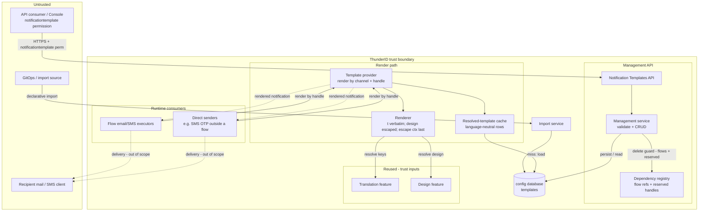
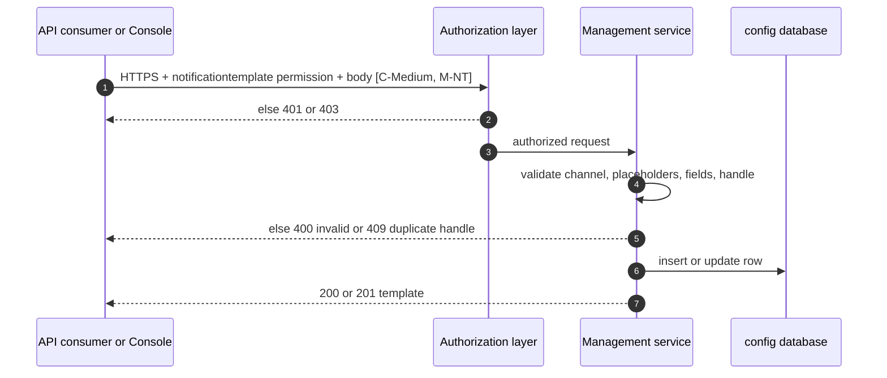
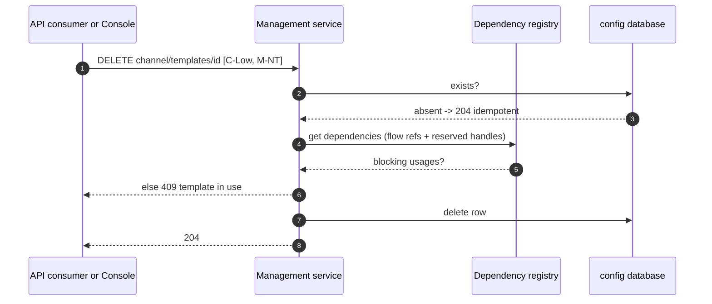
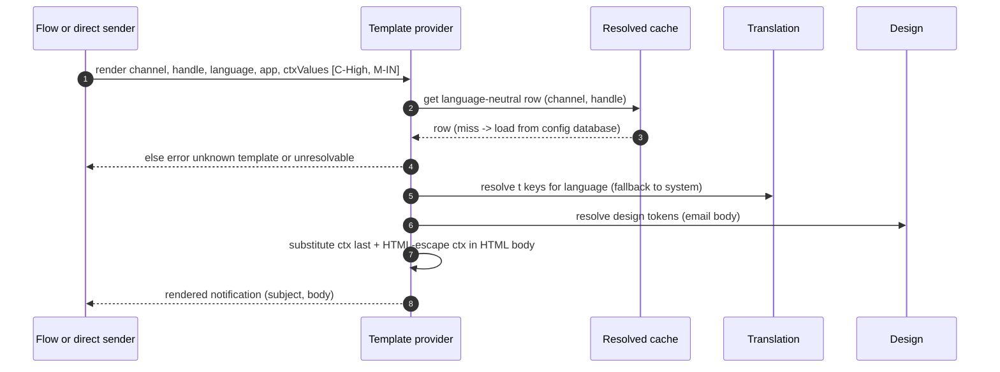
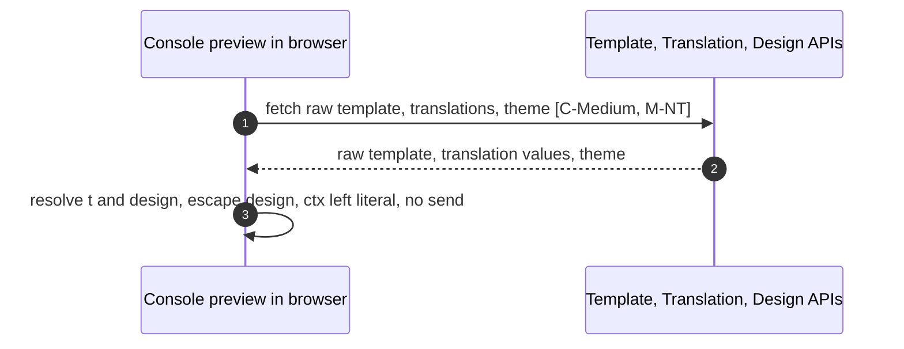

# Notification Templates Threat Model

This model covers the Notification Templates feature: the management API that administers email and SMS templates, the template provider that renders them for runtime consumers, and the Console preview. See the [specification](spec.md) for the feature design.

## Overview

ThunderID renders email and SMS notifications from templates whose content is authored by a privileged user (or provisioned at bootstrap) and stored in the template store. A template is language-neutral: its `subject`/`body` are strings embedding `{{t(...)}}` translation-key references, `{{ctx(...)}}` runtime-value placeholders, and (email body only) `{{design(...)}}` tokens that reference the applicable design's values. At render the provider resolves translations, resolves design tokens (per the selected color scheme), substitutes the runtime values last, and returns finished content to the consumer: a flow executor or a direct sender such as the SMS OTP sender.

What makes this security-relevant: the feature composes privileged-authored content with runtime values into a message delivered to a recipient, and that message can carry high-value data such as an OTP. The main concerns are therefore authorization of the management surface, safe substitution and output encoding at render, and the integrity and availability of template updates.

Cross-cutting concerns covered elsewhere, referenced here as trust inputs, not re-analysed:

- **API client authentication and the system resource-server permissions** that gate every management operation: covered by the [OAuth 2.0 Authorization and Core Grants](../oauth/authorization-and-core-grants/threat-model.md) model and the Token and Protocol Features model.
- **Flow execution** that selects a template and supplies `{{ctx(...)}}` values: covered by the Flow Execution model. The flow context is consumed here as a trust input, but its *rendering* into output is analysed here.
- **Translation resolution and authoring** that supply `{{t(...)}}` values: owned by the Translation feature, including its write permissions and value validation. Values are consumed here as trusted input.
- **Design resolution and authoring** that supply `{{design(...)}}` values and branding: owned by the Design feature, including its write permissions and value validation. Values are consumed here as trusted input.

## Conventions

**Materializable.** `Yes` marks a real threat that is **not fully prevented by a control in this design**: a bounded residual, carried in [Residual risks](#residual-risks-open-items). `No` marks a threat prevented by a control described in this model. A `Yes` that is an exploitable, unfixed hole does not belong in this public file; it is routed to a private advisory. The `Yes` rows here are accepted, bounded residuals or open design decisions.

**Confidentiality `[C-*]`:** `[C-High]` credential/OTP/PII-grade; `[C-Medium]` authored content that reaches users; `[C-Low]` identifiers only.

**Communication medium `[M-*]`:** `[M-NT]` network transport; `[M-DB]` database; `[M-FS]` filesystem; `[M-IN]` in-process / internal call.

## Permissions

Management is gated by fine-grained permissions under the `system` resource server, mapped per action and enforced by the authorization layer before the handler runs:

| Operation | Required permission |
| --- | --- |
| List / Read | `system:notificationtemplate:view` |
| Create | `system:notificationtemplate` |
| Update / Delete | `system:notificationtemplate` |

The `system` root permission is an ancestor that implies both. A read-only (`:view`) tier is therefore distinct from the write tier. The model does **not** add any per-application or per-organization-unit dimension: any holder of the write permission can modify **every** template in the deployment (see [01]-3 and Residual risks).

## Scope

This model covers:

- The template management lifecycle (create, read, update, delete, list), its fine-grained authorization, input/placeholder validation, and the delete dependency guard
- The provider render path: translation resolution, `{{ctx(...)}}` substitution, design-token resolution, output encoding, and return of rendered content to the consumer
- The Console preview render path, which renders without sending
- Storage of templates across the store modes: the config database (mutable mode) and file-based declarative templates (declarative and composite modes, where a file template wins handle lookups)

Out of scope (see the referenced companion models or the owning area):

- Access-token issuance and the permissions that authorize the API. Covered by the OAuth and Token and Protocol Features models.
- The authentication flow and the *composition* of the `{{ctx(...)}}` values a flow supplies (their *rendering* into output is in scope here). Covered by the Flow Execution model.
- Authoring and validation of `{{t(...)}}` and `{{design(...)}}` values. Owned by the Translation and Design features; consumed here as trusted input per the [HTML-content policy](#html-content-policy).
- Notification senders, transport, and delivery: SMTP/SMS transport security, the third-party providers (Twilio, Vonage, custom), message assembly, CR/LF header-injection handling, and the recipient client's rendering and sanitization after the message leaves ThunderID. Owned by the sender packages and the recipient's client.
- Integrity of the declarative import source (GitOps repository/pipeline). Deployer-owned; imported content still flows through the render path.
- Database and filesystem encryption and access control. Managed at the infrastructure layer.
- API rate limiting and bot detection. Applied at the deployment or gateway layer.

## Architecture



### Components

| Component | Task |
| --- | --- |
| Notification Templates API | REST surface for the template lifecycle. Each route requires the matching `notificationtemplate` permission (read vs write), enforced by the authorization layer, not in the handler. |
| Management service | Validates channel, placeholder syntax, required fields, color scheme, and `handle` uniqueness; performs create/read/update/delete. `handle` is immutable: it is not part of the update body, so a changed handle is ignored rather than rejected. Per-channel content-length limits are enforced on `subject`/`body` (email subject, email body, SMS body), with configurable maxima under `notification.template` (defaults 1000 / 50000 / 4096 characters), measured by rune count and returning `400` when exceeded. |
| Dependency registry | Fans delete-time dependency lookups to providers: the flow service reports a template referenced **by a flow** (resolving the flow's handle to the template id), and the template service reports a **system-reserved handle** required by a built-in endpoint (e.g. SMS `otp`). A delete of either is rejected with `409`. A non-reserved direct-sender usage is not covered ([02]). |
| Template provider | The narrow, read-only interface runtime consumers use. Resolves a template by its channel and handle, localizes, resolves design tokens, substitutes `{{ctx(...)}}`, and returns finished content, failing closed on any unresolved placeholder. Consumers never call the management service, Translation, or Design directly. |
| Renderer | Resolves placeholders in a fixed order (`t` → `design` → `ctx`) in a single pass with no re-evaluation of resolved `ctx`, **HTML-escaping the untrusted `{{ctx(...)}}` values (and only in an HTML body)**; translation values are inserted verbatim and design values are HTML-escaped at resolution (see the [HTML-content policy](#html-content-policy)). |
| Resolved-template cache | A write-through read cache over the store, serving the hot render path from cached **language-neutral template rows**, never substituted output. Create/update re-cache the row, delete invalidates; list/count/uniqueness resolve from the source of truth. |
| Translation feature | Resolves `{{t(...)}}` keys for the requested language, with fallback. Trust input; authoring and validation owned by the Translation feature. |
| Design feature | Resolves `{{design(...)}}` tokens and branding composed onto email, at the application tier in this model. Trust input; authoring and validation owned by the Design feature. |
| Import service | Imports deployer-supplied templates (declarative files at startup and the system bulk importer). It seeds nothing on its own; bootstrap provisions those templates separately. Imported content is rendered through the same path, so the HTML-content policy applies to it; import-source integrity is deployer-owned (Out of scope). Import can delete a template, but only when the request explicitly lists it under `deletions` (by id); a template merely dropped from an import payload is not auto-pruned. In declarative mode the file store is rebuilt from the source each start, so a removed file entry is retired on restart. See [05]. |
| Template store (config database / file) | Deployment-scoped store of templates and their language-neutral content. The store mode is operator-selected: `mutable` (config database), `declarative` (read-only templates loaded from deployer files at startup), or `composite` (file templates win handle lookups, database takes writes). The declarative loader runs the same content validation as the management API (the shared `buildValidatedDAO` routine) and additionally resolves environment references into content before parsing. |

### Actors

| Actor | Description | Roles or permissions |
| --- | --- | --- |
| Template administrator | Creates, edits, and deletes templates through the API or Console. | `system:notificationtemplate` (write) |
| Template viewer | Reads/lists templates (for example a read-only operator or dashboard). | `system:notificationtemplate:view` |
| Recipient (end user) | Receives the rendered email or SMS. Does not touch the management surface; is the target of the content trust boundary, and the source of some `{{ctx(...)}}` values (for example a self-registered display name). | N/A |
| Malicious actor | External, or an authenticated lower-privileged user, attempting to inject HTML/script or phishing content through an untrusted ctx value, break a consumer by deleting a referenced template, or disrupt rendering. | N/A |
| Untrusted ctx source | Supplies `{{ctx(...)}}` values that reach rendered output but never touches the management surface: self-asserted profile values and federated-identity claims the flow executor copies into template data, and client-supplied values such as the CIBA `binding_message`. | N/A |
| Operator | Chooses the store mode (mutable / declarative / composite) and cache settings, which decides whether a compromised API token can change delivered content and whether file templates override it. | Deployment configuration |

#### Entitlement matrix

| Actor | Read / list | Create / update | Delete |
| --- | --- | --- | --- |
| Template administrator | Yes (`:view` implied) | Yes (file-declared is read-only → `403`; create blocked in declarative-only mode → `403`) | Yes, unless file-declared (`403`), flow-referenced, or system-reserved (`409`) |
| Template viewer | Yes (`:view`) | No | No |
| Recipient (end user) | No | No | No (but influences ctx values) |
| Malicious actor | Only with a stolen `:view` token | Only with a stolen write token | Only with a stolen write token |

### External Dependencies (not owned)

| Dependency | Description |
| --- | --- |
| OAuth token service and system permissions | Issue and validate the access token and the `notificationtemplate` permissions that authorize each call. Decision authority for API access. OAuth / Token and Protocol Features models. |
| Translation feature | Resolves `{{t(...)}}` keys with fallback; its stored values reach delivered content. Authoring, write permissions, and validation are owned by the Translation feature. |
| Design feature | Resolves `{{design(...)}}` tokens and branding (CSS, logo URLs) composed into email. Authoring, write permissions, and validation are owned by the Design feature. |
| Flow engine / direct senders | Supply the template identifier (channel and handle), language, application context, and `{{ctx(...)}}` values at render. Values are a trust input; the OTP value is sensitive. Flow Execution model. |
| GitOps / import source | Supplies declarative template definitions. Integrity of the source repository/pipeline is deployer-owned (Out of scope). |
| Config database | Stores template rows. Encryption at rest and access control are infrastructure-layer. |

## Threats and mitigations

### HTML-content policy

An email body is assembled from several inputs that are not equally trusted. The rule: the privileged-authored body and translation values are inserted verbatim, design values are HTML-escaped at resolution (defense in depth over the Design feature's write boundary), and the runtime `{{ctx(...)}}` values (which may come from an end user) are HTML-escaped. Inputs are resolved in a fixed order (translations, then design tokens, then `{{ctx(...)}}` last), so a runtime value is filled in after everything else and cannot be re-read as a placeholder by a later step. The table gives the policy per input.

| Source | Trust | Render policy for email |
| --- | --- | --- |
| Authored `body` (HTML) | Trusted: author holding the write permission (`system:notificationtemplate`) | Inserted **verbatim** (exactly as stored, with no escaping or sanitizing) as the message HTML; markup is intended. No sanitizer cleans dangerous HTML from the body before sending, so integrity rests on the write permission (and, as a residual, audit logging). |
| `{{t(...)}}` values | Trusted: admin-authored, may legitimately contain markup | Inserted **verbatim**. A translation value may also embed `{{ctx(...)}}` placeholders, which are substituted (and HTML-escaped in an HTML body) at render, so a translation writer can place runtime values (including an OTP) into output, not only markup. The control is the Translation feature's write boundary, not encoding (see Residual risks). |
| `{{design(...)}}` values | Trusted: theme-authored, with the design service's own defense in depth | **HTML-escaped at resolution** by the design resolve service (so a token value is safe inside the HTML attributes the body places it in), then substituted before context. A design value may itself embed `{{ctx(...)}}`, which the later context pass fills. Primary control is the Design feature's write boundary; the resolution-time escaping is defense in depth. |
| `{{ctx(...)}}` values | **Untrusted**: caller/flow data, may originate from an end user | **HTML-escaped** in the HTML (email) body, and substituted **last** so no later pass reinterprets it. URL-scheme validation for a ctx value placed in a link/`src` is **not** part of the escaping contract; see [03]-3. |
| `subject` / SMS body | Plain text | Not an HTML context, so ctx is substituted without HTML escaping. |

### Interactions

#### [01]: Template lifecycle management

**Description**

An administrator creates, reads, updates, or deletes a template through the API (the Console calls the same API). The matching permission is enforced before the handler (`:view` to read, `system:notificationtemplate` to write). The management service validates the channel, placeholder syntax, required fields, color scheme, and per-channel `handle` uniqueness, treats `handle` as immutable (it is not part of the update body), and persists the row.

**Assets involved**

| Initiator | Intermediate | Target |
| --- | --- | --- |
| API consumer / Console (privileged) | Authorization layer | Management service and the template store |

**Data flow**



**Security considerations**

| Area | Response | Comments |
| --- | --- | --- |
| Data confidentiality | [C-Medium] | Authored config, not secret, but it determines delivered content; integrity matters more than confidentiality. |
| Communication medium | [M-NT] | |
| Transport security | TLS | |
| Authentication | `notificationtemplate` permission | Read tier (`:view`) vs write tier. |
| Accessibility | Restricted | No anonymous path. |
| Authorization and Access Control | Two-tier permission (read vs write); no resource-level isolation | Read routes require `:view`; create/update/delete all require `system:notificationtemplate` (one write tier, not a distinct permission per action). `handle` is immutable and unique per channel (`409` on conflict). No per-app/per-OU dimension: any writer can edit every template ([01]-3). |

**Threat assessment**

| ID | Category | Threat | Materializable | Mitigation / comment |
| --- | --- | --- | --- | --- |
| 1 | Elevation of privilege | An unauthorized or read-only caller creates or edits a template. | No | Write routes require `system:notificationtemplate`; read routes require `:view`. Enforced before the handler. |
| 2 | Repudiation | A template is changed with no record of who changed it or what changed. | Yes | No standardized audit log of create/update/delete or before/after content; a malicious or mistaken change (for example a phishing link) cannot be attributed or diffed. Residual. |
| 3 | Elevation of privilege | Coarse authority: any holder of `system:notificationtemplate` can modify **every** template globally, with no per-application or per-OU isolation. | Yes | The write permission is deployment-wide; a single over-granted token can rewrite all notifications. Residual: a narrower resource-scoped permission and least-privilege issuance. |
| 4 | Denial of service | An oversized `subject`/`body` (multi-megabyte content, created directly or seeded via declarative/import) bloats storage and the resolved-template cache and degrades every render on the OTP/recovery path. | No | Per-channel content-length limits are enforced at create/update validation and inherited by the declarative loader and importer (the shared validated-DAO path): the email subject, email body, and SMS body each have a configurable maximum (`notification.template.max_subject_length` / `max_email_body_length` / `max_sms_body_length`; defaults 1000 / 50000 / 4096 characters), measured by rune count and returning `400` when exceeded; a negative configured limit fails startup. A request-size cap is still deployment/gateway-layer (product-wide; Out of scope). |

#### [02]: Template deletion with dependency guard

**Description**

An administrator deletes a template through the API (the Console calls the same API). The delete is idempotent (absent → success) and is rejected with `409` when the dependency registry reports the template in use. Two providers answer: the flow service reports a flow that references the template (resolving the flow's email/SMS template handle to the template id), and the template service reports a system-reserved handle required by a built-in out-of-flow endpoint (currently the SMS `otp` handle).

**Assets involved**

| Initiator | Intermediate | Target |
| --- | --- | --- |
| API consumer / Console (privileged) | Dependency registry (flow refs + reserved handles) | Management service and the template store |

**Data flow**



**Security considerations**

| Area | Response | Comments |
| --- | --- | --- |
| Data confidentiality | [C-Low] | A delete carries only an identifier. |
| Communication medium | [M-NT] | |
| Transport security | TLS | |
| Authentication | `system:notificationtemplate` (write) | |
| Accessibility | Restricted | |
| Authorization and Access Control | Write permission + dependency guard (flow refs + reserved handles) | A flow-referenced template and a system-reserved handle (SMS `otp`) cannot be deleted; the guard fails closed on a resolution error. A non-reserved direct-sender usage is still not covered ([02]-2). |

**Threat assessment**

| ID | Category | Threat | Materializable | Mitigation / comment |
| --- | --- | --- | --- | --- |
| 1 | Denial of service | Deleting a template a **flow** sends, breaking that flow's notification. | No | The flow provider resolves each flow's email/SMS template handle to its id and matches the delete target; a blocking usage returns `409` and an incomplete dependency response fails closed. The check runs just before, not inside, the delete transaction, so a flow that starts referencing the template between check and delete is not caught (a narrow TOCTOU, smaller residual). |
| 2 | Denial of service | Deleting a template a **direct sender** (out-of-flow) is configured to use silently breaks that notification. | No for reserved handles; Yes otherwise | The SMS OTP path renders the hard-coded handle `otp`; `main` registers `otp` in the reserved-template set and the template service reports it as a blocking dependency, so its delete returns `409`. The guard is a **fixed list**, so a future out-of-flow sender using a non-reserved handle is not covered until it is added. Residual: register every direct-sender handle (or model direct-sender usage generally). |

#### [03]: Rendering through the provider

**Description**

A runtime consumer (flow executor or direct sender) calls the provider with the template's channel and handle, the application context for design, and the `{{ctx(...)}}` values; this phase supplies no per-call language, so the renderer resolves in the system language (spec R2). The provider resolves placeholders in a fixed order: `{{t(...)}}` translations, then `{{design(...)}}` tokens (email body only), then `{{ctx(...)}}` values last, HTML-escaping the `{{ctx(...)}}` values in an HTML body per the [HTML-content policy](#html-content-policy). It fails closed on any unresolved placeholder and returns the rendered content to the consumer.

**Assets involved**

| Initiator | Intermediate | Target |
| --- | --- | --- |
| Flow executor / direct sender | Template provider, renderer, Translation, Design | Rendered notification returned to the consumer |

**Data flow**



**Security considerations**

| Area | Response | Comments |
| --- | --- | --- |
| Data confidentiality | [C-High] | The rendered notification can carry an OTP or other sensitive `{{ctx(...)}}` value. |
| Communication medium | [M-IN] | In-process; delivery to the recipient is owned by the senders (Out of scope). |
| Transport security | N/A | In-process call. |
| Authentication | None at the provider | Internal interface; callers are trusted runtime components, not reachable externally. |
| Accessibility | Internal | Not exposed as an API. |
| Authorization and Access Control | Caller-supplied channel + handle + context | The provider renders exactly the requested template with no extra authorization; the caller is trusted. Safety rests on the source-trust escaping model and the ctx-exposure policy, not authorization. |

**Threat assessment**

| ID | Category | Threat | Materializable | Mitigation / comment |
| --- | --- | --- | --- | --- |
| 1 | Elevation of privilege | Stored XSS / unwanted markup injected by a **non-privileged** actor via the email body. | No | A non-privileged actor cannot author the body: it requires `system:notificationtemplate`, and runtime `{{ctx(...)}}` data is HTML-escaped. (The authored body itself is trusted and inserted verbatim, with no sanitizer, so a *compromised/over-granted author* is a separate residual, [01]-2/3.) |
| 2 | Information disclosure | HTML/attribute injection via a `{{ctx(...)}}` value (for example a self-registered display name containing `<...>` or `"`) leading to markup breakout in the body. | No (with a caveat) | Ctx values are HTML-escaped (`html.EscapeString`: `< > & ' "`) and substituted last, so in element text and **quoted** attributes a value is emitted as data, never as new markup. The escaping does **not** neutralize an **unquoted** attribute value or a `style` value, where a space or CSS payload can inject an attribute/property without an escaped character; an author placing a ctx value outside quotes or in `style` is a residual (the bootstrap-provisioned templates quote everything). Context-aware encoding (e.g. Go `html/template`) would remove the caveat. |
| 3 | Spoofing | URL-scheme injection: an end-user-influenced `{{ctx(...)}}` value placed in a link/`src` by the template author is `javascript:` or `data:`. | Yes | HTML-escaping does not neutralize a URL scheme, and scheme validation is not part of the escaping contract (the renderer does not parse HTML to know where a placeholder sits). Accepted residual, bounded by author responsibility: place only server-generated values (for example a magic-link URL) in URL attributes, and keep user-influenced ctx keys out of them. The per-purpose ctx allowlist (see Residual risks) limits which keys a template can reference. |
| 4 | Elevation of privilege | Template injection: a ctx/t/design value containing `{{...}}` is re-evaluated. | No | The single context pass fills a `{{ctx(...)}}` embedded in a resolved translation/design value (by design), but already-resolved ctx values are not re-scanned and an embedded `{{t}}`/`{{design}}` is rejected (fails closed), so substitution terminates in one pass, no recursion. The placeholder key charset is restricted at authoring. |
| 5 | Denial of service | Template expansion: nested/self-referencing values are re-evaluated (recursive blow-up). | No | The fixed order (`t` → `design` → `ctx`) is applied once and resolved values are not re-scanned, so a `{{...}}` appearing inside a resolved value is not re-substituted. |
| 6 | Denial of service | An unresolvable template/key delivers an empty/half-rendered OTP or blocks the notification. | No | This phase renders in the system language (spec R2; no per-call language is supplied, so there is no best-match step yet). An unknown template, a key missing in the system language, or a missing required ctx value fails the render closed with a surfaced error rather than returning empty/fabricated content (spec AC2.3). |
| 7 | Information disclosure | A render error message leaks template internals or a ctx value to the **end user**. | No | Errors surface to the caller and logs only; they never enter rendered content and do not echo ctx values or internal keys. |
| 8 | Information disclosure | A ctx value (OTP) is logged on the render path. | No | The render path logs identifiers, not resolved content or ctx values. |
| 9 | Tampering | A stale cache serves superseded template content after an update. | No | The read cache is write-through (create/update re-cache, delete invalidates), holds only unresolved rows, and resolves list/count/uniqueness from the source of truth. By default the cache is **in-memory per node** (1-hour TTL), so a write invalidates only the handling node and another replica can serve superseded content until its TTL; configuring the shared **Redis** backend makes invalidation global. This is a by-design, product-wide trait of the shared `system/cache` component (Redis is the coherent option), not a control missing here. Separately, a cache `Set`/`Delete` failure is logged and not propagated, so a failed re-cache or invalidation can leave a superseded entry served even on a single node until its TTL. |
| 10 | Information disclosure | Over-exposed ctx: the executors pass the **entire** flow runtime data as ctx (every runtime value, every federated identity claim, and any forwarded template data), not a curated set. Sensitive values present in runtime data (session data, the raw invite token, mapped permissions) are therefore reachable by any template or translation value and can be emitted into a message delivered through a third-party SMTP/SMS provider. | Yes | Default behavior; bounded only by what the template/translation actually references. Residual: expose ctx through a **per-purpose allowlist** rather than the whole flow context, so a template can reference only the keys its purpose needs. |
| 11 | Spoofing | Phishing via attacker-controlled ctx text: a non-privileged actor cannot author the body but controls ctx *text*: profile attributes and federated claims become ctx values, and string attributes are unscreened unless an author sets a pattern. If an author places such a value in a pre-verification email (e.g. a sign-up or invite greeting "Hello {{ctx(name)}}"), an attacker can register or trigger an invite with a victim's address and a "name" that is a phishing sentence, a visible link, or bidi/look-alike text, delivered from the deployment's own domain. HTML-escaping stops markup but not phishing text, and no send-rate limit slows it. | Yes | Bounded by authored content (the bootstrap-provisioned templates print no user values). Residual + guidance: restrict which ctx values may appear in messages sent before an address is verified, and screen user-supplied attributes. Rate limiting is deployment/gateway-layer (Out of scope). |

#### [04]: Preview in the Console

**Description**

A privileged user previews a template or a flow's selected template. The preview is rendered client-side in the Console from the raw template, the translations it fetches, and a caller-supplied theme; it is not produced by the template provider. It resolves `{{t(...)}}` against the fetched translations and `{{design(...)}}` against the theme (email body only, HTML-escaped by an `escapeHtml` that matches the backend `html.EscapeString`), leaves `{{ctx(...)}}` literal, and never sends.

**Assets involved**

| Initiator | Intermediate | Target |
| --- | --- | --- |
| Console (privileged) | Preview render path (no send) | Rendered preview shown in the browser |

**Data flow**



**Security considerations**

| Area | Response | Comments |
| --- | --- | --- |
| Data confidentiality | [C-Medium] | Reflects authored content/design; no runtime context, so no OTP/recipient data. |
| Communication medium | [M-NT] | |
| Transport security | TLS | |
| Authentication | `notificationtemplate` permission | A preview reads a template, so at least `:view`. |
| Accessibility | Restricted | |
| Authorization and Access Control | Permission + no side effects | Preview never sends and never substitutes ctx, so no runtime data is exposed. |

**Threat assessment**

| ID | Category | Threat | Materializable | Mitigation / comment |
| --- | --- | --- | --- | --- |
| 1 | Tampering | Authored/translated HTML executes script in the Console origin when previewed (DOM XSS against the admin). | No | The preview renders in a sandboxed iframe without `allow-scripts`, and the Console's enforcing CSP (no inline-script execution) applies, so content cannot run script in the Console origin. |
| 2 | Information disclosure | Preview loads remote resources (image `src`, CSS) leading to a tracking pixel or admin-IP/host leak to a third party. | No for the default Console; open for delivered email | The shipped Console CSP is enforcing and limits `img-src` to `'self'` and `data:` on `/console/`; a `srcdoc` preview iframe inherits it, so cross-host images do not load in the default preview. Residual: a deployment that relaxes the CSP or serves the Console separately, and the same remote-resource policy for **delivered** email (owned by the sender; see Residual risks). |
| 3 | Information disclosure | Preview leaks runtime recipient data. | No | Preview has no runtime context; ctx placeholders are shown literally and nothing is sent. |
| 4 | Tampering | An author approves content in preview that renders differently when sent. | No | The client-side preview resolves translations and design tokens and HTML-escapes design values to mirror the send path (its `escapeHtml` matches the backend `html.EscapeString` character-for-character); only `{{ctx(...)}}` is left literal, since runtime values are not available at authoring (accepted for this phase). One concrete divergence beyond ctx: the preview substitutes a `{{t(...)}}` value without re-scanning it, so a nested `{{t(...)}}`/`{{design(...)}}` or malformed placeholder inside a translation value renders literally in the preview but **fails the send** (the backend's `unresolvedBeforeContext` check rejects any leftover `t`/`design` placeholder). This fails closed — a preview-fidelity gap, not unsafe output. The residual concern is implementation drift between the two renderers, not a missing control. |

#### [05]: Declarative and imported templates

**Description**

Templates also arrive outside the management API. The declarative store loads read-only templates from deployer files at startup, and the system bulk importer (`POST /import`) writes templates into the config database; in composite mode a file template wins handle lookups over a database template. Both paths run the same content validation as the management API (`buildValidatedDAO` / `ValidateTemplate`), and the declarative loader additionally resolves environment references into content before parsing. Import deletes a template only via an explicit `deletions` directive (resourceType + id); in declarative mode the file store is rebuilt from the source each start.

**Assets involved**

| Initiator | Intermediate | Target |
| --- | --- | --- |
| Deployer (files / `POST /import`) | Declarative loader / import service | Template store (config database or file) |

**Threat assessment**

| ID | Category | Threat | Materializable | Mitigation / comment |
| --- | --- | --- | --- | --- |
| 1 | Tampering | A declaratively loaded or imported template carries deployer-supplied content into the render path; the declarative loader additionally resolves environment references into that content before parsing. | No | Declarative and imported templates pass the **same** content validation as the API (the shared `buildValidatedDAO` / `ValidateTemplate` routines). Source-file and environment-value integrity are deployer-owned (Out of scope). |
| 2 | Denial of service | A template dropped from a bulk-import payload is not auto-pruned; the importer deletes only what the request explicitly lists under `deletions` (resourceType + id), not what is absent. | No (by design) | Expected behaviour: deletions are explicit; GitOps tooling must emit a deletion directive (or remove via the management API). Declarative mode differs: the file store is rebuilt each start, so a removed file entry is retired on restart. |
| 3 | Tampering | A bulk-imported template reuses the handle of an existing template. | No | Per-channel `handle` uniqueness applies; in composite mode the file template wins handle lookups by design (documented precedence). |

## Security Review Checklist

A review aid that complements the threat model. Guidance follows the [OWASP Top 10 Proactive Controls](https://top10proactive.owasp.org/).

### Security considerations

| # | Consideration | State | Comments |
| --- | --- | --- | --- |
| 1 | Are all inputs and outputs validated (syntactic and semantic)? | Partial | Inputs validated at create/update (channel, placeholder syntax, fields, color scheme, handle uniqueness, and per-channel `subject`/`body` content-length limits). On output, untrusted `{{ctx(...)}}` values are HTML-escaped per the source-trust [HTML-content policy](#html-content-policy); trusted sources are verbatim, so the URL-scheme and remote-resource decisions ([03]-3, [04]-2) remain open. Translation and design write boundaries are owned by those features. |
| 2 | Are rate limits in place where necessary? | N/A | Applied at the deployment/gateway layer, not by this feature. |
| 3 | Are permissions, roles, and entitlements defined on least privilege and business need? | Partial | Fine-grained read (`:view`) vs write (`system:notificationtemplate`) exists, but the write permission is deployment-wide (no per-app/OU) ([01]-3). Translation and design writers are separate boundaries owned by those features. |
| 4 | Are authN and authZ validated at both UI and API layers, before granting access? | Yes | Each route is gated by the matching `notificationtemplate` permission; the Console calls the same API. |
| 5 | Are isolations in place to reduce blast radius / lateral movement? | Partial | Runtime consumers depend only on the read-only provider, not the management service; but a single write permission spans all templates ([01]-3). |
| 6 | Default credentials changed / no default superuser (third-party components)? | N/A | |
| 7 | Followed best-practice guidelines (OWASP, etc.)? | Partial | A source-trust escaping model (untrusted ctx HTML-escaped, substituted last, single pass) and preview sandboxing follow OWASP injection/XSS guidance; URL-scheme allowlisting for ctx values in link/`src` attributes is not part of the contract ([03]-3). |
| 8 | Secrets/credentials kept out of the source tree and git history? | Partial | Templates require no secrets — ctx values (OTPs) are supplied at runtime, never stored — but `subject`/`body` are free-form strings and declarative templates are files in the GitOps source, so the feature cannot prevent an author embedding a secret in template content. |
| 9 | Security-focused code review conducted and findings addressed? | Yes | Covered by the product scan and this review. |
| 10 | SAST / IaC scanning conducted and findings addressed? | Yes | Covered by the product scan. |
| 11 | SCA conducted/integrated and findings addressed? | Yes | Covered by the product scan. |
| 12 | DAST / API scanning on a non-production setup? | Yes | Covered by the product scan. |
| 13 | Standardized audit logs for critical functionality? | No | Create/update/delete of templates are not audit-logged. Residual ([01]-2). |
| 14 | Do audit logs record before/after for critical config changes? | No | No before/after capture of template content. Residual. |
| 15 | Data in transit and at rest encrypted? | Partial | TLS in transit (deployer-configured); at-rest encryption of the config database is infrastructure-layer. |
| 16 | Secrets stored in a vault/secret store? | N/A | Templates store no secrets. |
| 17 | Personal/sensitive data kept out of logs? | Yes | The render path logs only identifiers, not resolved content or ctx values ([03]-8). |
| 18 | Clear instructions for secure usage? | Partial | Operator guidance to publish: least-privilege issuance of `notificationtemplate`; keep the Console CSP enforcing; don't use the in-memory cache with multiple replicas (use Redis); review the bootstrap-provisioned templates before go-live; use declarative mode where templates must not change at runtime; always quote any attribute holding a ctx value and place only server-generated values in URL attributes; don't embed secrets or hostile remote resources; and watch template changes while there is no audit log. |

### Business impact and resilience

For an open-source component, most of these are shared with the deployer.

| # | Consideration | State | Comments |
| --- | --- | --- | --- |
| 1 | Business impact analysis for resilience (MTD, uptime, RPO, RTO)? | N/A | Left to the deployer. Template availability gates notification rendering (for example OTP email), so templates and the config database belong in the deployer's backup/HA scope. |

Resilience details to record:
- High availability / disaster recovery: not defined at the project level
- Backups: in mutable mode templates live in the config database (covered by that database's backup policy); in declarative/composite mode the runtime-authoritative templates are deployer files (the GitOps source), so a database-only restore omits file-declared templates — the source files must be backed up alongside the database (deployer-owned)
- Health checks / user banners: not applicable at the project level

### Dependency and component health

| # | Consideration | State | Comments |
| --- | --- | --- | --- |
| 1 | Dependencies/base images/runtimes monitored and current? | Yes | Covered by the product's SCA. |
| 2 | Any EOL/EOS components in use? | No | |
| 3 | Hardening guidance published for operators? | No | Not yet published for this feature. |

### Privacy considerations

| # | Consideration | State | Comments |
| --- | --- | --- | --- |
| 1 | Purpose/legal basis for personal-data processing defined? | Partial | Templates hold no personal data, but **rendering** pulls in runtime values and claims and composes names, addresses, OTPs, and links that are then handed to third-party SMTP/SMS providers ([03]-10). That processing and sharing should be in privacy review. |
| 2 | Collection/storage/processing aligned with data minimization? | Partial | The template stores no recipient data and ctx values are substituted transiently at render (not persisted here), but the executors pass the **entire** flow runtime context as ctx rather than a minimized set ([03]-10), so the processing is not minimized. Residual: expose ctx through a per-purpose allowlist. |
| 3 | Personal data stored securely? | N/A | No personal data stored by the template store. |
| 4 | Privacy notices updated? | N/A | No new persisted processing. |
| 5 | Access to personal data on need-to-know? | Partial | Rendered content is returned only to the requesting runtime consumer, and is then shared with the configured third-party SMTP/SMS provider. In the default Console the preview CSP bounds remote-resource leakage ([04]-2), but ctx over-exposure ([03]-10) and remote resources in **delivered** email remain open. |
| 6 | Data retention considered? | N/A | Templates are configuration; no recipient data retained. |
| 7 | Timely disposal of personal data on request? | N/A | No recipient data persisted. |
| 8 | Records of processing in the data inventory? | N/A | |

## Residual risks (open items)

Each open residual should carry a tracking issue; file and link them here. Audit logging and resource-scoped write authorization are tracked in [#6366](https://github.com/thunder-id/thunderid/issues/6366).

| Risk | Description | Current status | Recommendation |
| --- | --- | --- | --- |
| Remote resources in email leak recipient data | A remote `img`/`src` in the authored body or a design value causes the recipient's client to call a third-party host on open, leaking IP/open data and (if a ctx value is in the URL) the substituted value ([04]-2). Output encoding constrains markup but not a well-formed external URL. Impact: recipient-privacy leakage to a third party, not a server compromise. | Open design decision. | Expose ctx to templates through a **per-purpose allowlist** rather than the whole flow context; add a remote-resource policy (allowlist/proxy external hosts) for email bodies and preview. |
| Untrusted ctx values in URL attributes | Untrusted `{{ctx(...)}}` values are HTML-escaped in the body, but a ctx value used in a link/`src` is not scheme-validated ([03]-3). Enforcing this at render would require HTML parsing and cannot distinguish a legitimate `href="{{ctx(link)}}"` from a risky one. A server-generated key an author trusts can also be filled by a same-named IdP claim when the runtime value is empty; that claim-merge is the Flow executor's (owned by the Flow model), surfaced here because its value is rendered into a URL. | Accepted. | Author guidance: place only server-generated values in URL attributes. Limit exposure with the per-purpose ctx allowlist; the Flow model should namespace claims so one cannot fill a server-generated key. |
| Verbatim trusted content and its writer boundaries | The authored body and `{{t(...)}}` values are inserted verbatim (no sanitizer); design values are HTML-escaped at resolution. Integrity rests on the write boundaries: template ([01]), translation and design (their own features). A compromised/over-granted writer can inject markup/active content; a translation writer can also embed `{{ctx(...)}}` to surface runtime values (incl. an OTP), not only markup. A writer can equally **remove** a required `{{ctx(...)}}` (e.g. delete `{{ctx(otp)}}` from the OTP template): no placeholder is mandatory, so the render does not fail and the message sends without the value. | Open / accepted. | Least-privilege issuance; consider sanitizing authored output as defense in depth; pair with audit logging. |
| Delete guard misses out-of-flow direct senders | The guard blocks a template referenced by a flow (handle→id) and a system-reserved handle, but the reserved set is a hard-coded list holding only SMS `otp`. Other out-of-flow senders are **not** covered: the identity-governance lock/suspend notifier renders email templates directly (`account-locked`, `authentication-method-locked`, `account-suspended`, `account-unlocked`, and their `-permanent` variants), so deleting one is not blocked and silently breaks that notification ([02]-2). The flow-reference check also runs just before, not inside, the delete transaction, a narrow TOCTOU window ([02]-1). Impact: availability of a specific notification, not a compromise. | Open. | Register every out-of-flow sender's handle with the reserved-template provider (or model direct-sender usage generally); run the dependency check and delete in one transaction. |
| Coarse, global write permission | `system:notificationtemplate` grants edit over every template in the deployment; no per-app/OU scoping ([01]-3). | Accepted this phase. | Add a narrower/resource-scoped permission; issue the write permission sparingly. Tracked in [#6366](https://github.com/thunder-id/thunderid/issues/6366). |
| No standardized audit logging | Create/update/delete of templates are not audit-logged, with no before/after diff ([01]-2). | Accepted; product-wide gap. | Add structured audit logging with actor and before/after values and a retention policy. Tracked in [#6366](https://github.com/thunder-id/thunderid/issues/6366) (under the audit-log framework [#5591](https://github.com/thunder-id/thunderid/issues/5591) / [#6320](https://github.com/thunder-id/thunderid/issues/6320)). |
| Ctx over-exposure | The flow executors pass the entire runtime data as ctx, including sensitive values (session data, raw invite token, mapped permissions), so any template/translation referencing such a key emits it to the recipient and third-party provider ([03]-10). Composition is the Flow executor's; rendering is in scope here. | Open. | Expose ctx through a per-purpose allowlist (control sits at the flow/template boundary). |
| Phishing via end-user-controlled ctx | An author echoing a user/IdP-controlled ctx value into a message sent to an **unverified** address lets an attacker deliver phishing text/links from the deployment's own signed domain ([03]-11). Escaping blocks markup, so **no deployment compromise**; the harm is recipient deception and sending-domain reputation. Author-dependent (bootstrap templates print no user values). | Open. | Restrict which ctx values may appear in pre-verification messages; bound length/charset and strip control/bidi characters before substitution. |
| Unquoted-attribute / `style` escaping gap | `html.EscapeString` is safe in text and quoted attributes but not in an unquoted attribute or a `style` value, where a ctx value can inject an attribute/CSS property without an escaped character ([03]-2). | Accepted (the bootstrap-provisioned templates quote everything; author-dependent). | Author guidance: always quote attributes and avoid ctx in `style`; consider context-aware encoding (Go `html/template`). |

## Appendix

- Sample requests and configurations: see the API examples in [spec.md](spec.md#api).
- References: [Notification Templates specification](spec.md); design [discussion #5388](https://github.com/thunder-id/thunderid/discussions/5388); OWASP Top 10 Proactive Controls. Companion models: [OAuth 2.0 Authorization and Core Grants](../oauth/authorization-and-core-grants/threat-model.md) (published); Token and Protocol Features, Flow Execution, Translation, and Design (planned, not yet authored, so handoffs to them are forward references).

A minimal email-template create request (requires `system:notificationtemplate`):

```http
POST /notification-templates/email/templates
Authorization: Bearer <access token with system:notificationtemplate>
Content-Type: application/json

{
  "handle": "otp-verification",
  "displayName": "OTP Verification",
  "description": "One-time passcode sent to verify a user's email address.",
  "design": { "colorScheme": "light" },
  "content": {
    "subject": "{{t(notification.otp.email.subject)}}",
    "body": "<p>{{t(notification.otp.email.message)}}</p><p>{{ctx(otp)}}</p>"
  }
}
```

### Sample audit logs

N/A. See Residual risks (no standardized audit logging yet).

## Change log

| Version | Date | Change |
| --- | --- | --- |
| 0.1 | 2026-10-04 | Initial threat model for the notification templates feature, authored alongside the specification. |
| 0.2 | 2026-11-04 | Record the per-channel `subject`/`body` content-length limits ([01]-4); remove the unbounded-size residual now that the control ships. |
