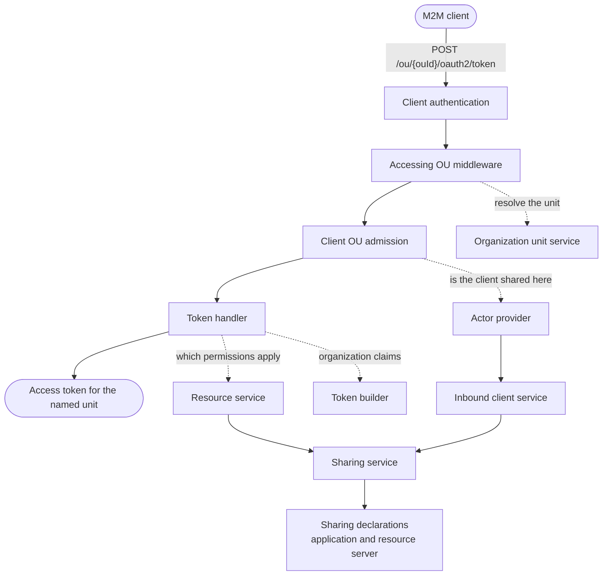
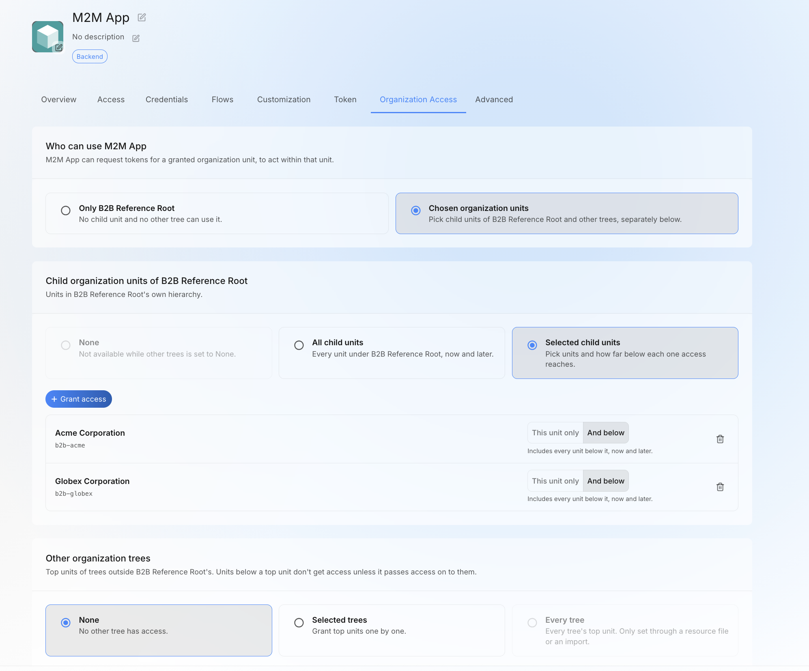
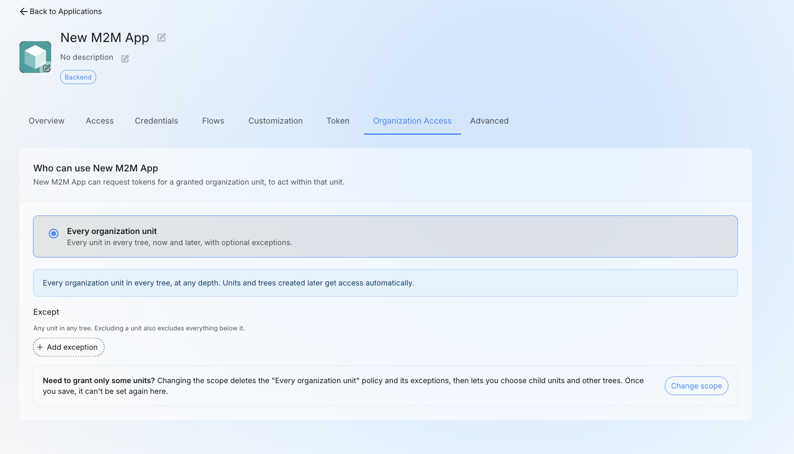
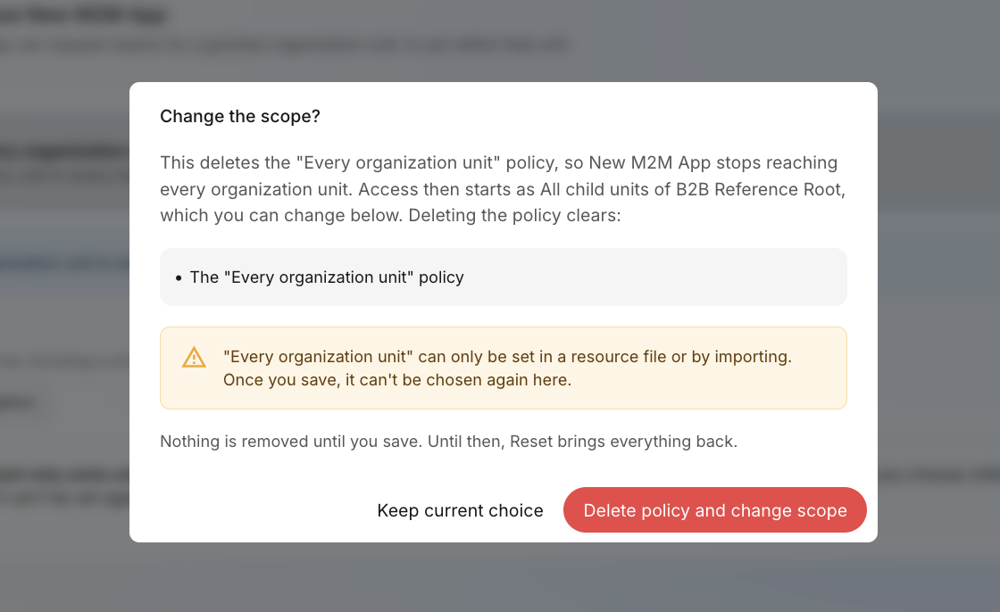
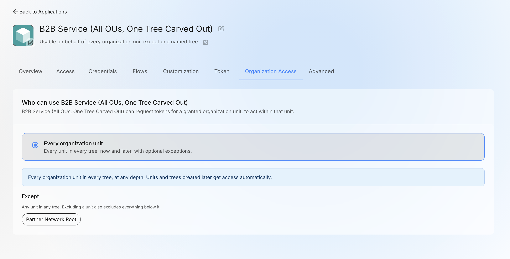

# Machine-to-Machine Access Across Organization Units Specification

- **Status:** Draft
- **Version:** 0.3
- **Related documents:** [Discussion #5461: Machine-to-Machine (M2M) service working across OUs](https://github.com/thunder-id/thunderid/discussions/5461), [Issue #4037: Allow trusted machine clients to obtain an access token scoped to a chosen Organization Unit (without a per-OU application)](https://github.com/thunder-id/thunderid/issues/4037)

## Summary

A service acting for many customer organizations needs one registration, not one per customer. Today it needs one per customer: credentials multiply, rotation fans out, and the operator keeps an application inventory that mirrors the customer list.

This feature gives one application one credential pair and an organization-unit-qualified token endpoint.

```
POST /oauth2/token                # unchanged
POST /ou/{ouId}/oauth2/token      # token scoped to the named organization unit
```

The application owner declares which organization units the credential may act for, as a policy on the resource sharing framework. Sharing an M2M application grants one thing: a named organization unit may be given as the accessing organization unit on a token request. That service account is not editable, or deletable from the sharee organization unit.

The token is issued for the organization unit the request named: its claims carry that unit, and its scopes narrow to what the unit may reach. The resource server therefore knows which organization the service is acting for, and the token cannot carry more than that organization holds.

## Architecture

A solid arrow is the request moving to the next step. A dotted arrow is a step consulting a service for an answer.



| Component | Responsibility |
|---|---|
| Accessing OU middleware | Reads `{ouId}` from the path, resolves it through the organization unit service, and records it on the request context. A route carrying no such segment passes through untouched. Owns the refusal for an id that resolves to nothing |
| Client OU admission middleware | Asks whether the authenticated client may act for the organization unit the request named. Mounted after client authentication, so a caller that cannot authenticate never reaches it |
| Actor provider | Carries `IsOAuthClientAccessibleFromOU`, the one question the OAuth layer asks about organization units. The embeddable engine hosts no application management, so this is the seam rather than a new provider interface |
| Inbound client service | Answers that question from the sharing framework, short-circuiting on the client's own organization unit |
| Application sharing declaration | Registers applications as a sharing resource type. Declares no fields, resolves ownership, and implements nothing else |
| Resource service | Downscopes requested scopes to the target resource server's permissions, and in the same pass drops the ones the accessing organization unit may not use. Reads the accessing unit from the request context rather than taking it as a parameter |
| Sharing framework | Owns policies, sections, exclusions, and visibility. |
| Resource server sharing declaration | Registers resource servers as a sharing resource type, declaring one field, `permissions`, as a hierarchy over the server's permission strings |
| Token builder | Emits `ouId`, `ouName` and `ouHandle` for the accessing organization unit rather than the application's owner, where the application opted into those claims |

## Detailed design

### The organization-unit-qualified token endpoint

`POST /ou/{ouId}/oauth2/token` is registered beside `POST /oauth2/token`, against the same handler. The bare endpoint is unchanged in every respect, which is the backwards-compatibility guarantee: a request that names no organization unit behaves exactly as it did before the prefix existed, and needs no policy.

Both routes are public paths, because the caller authenticates with its own client credentials rather than a bearer token.

The accessing organization unit sits in the path rather than in a header or a request parameter. Organization-specific branded URLs are a requirement in their own right, and a path segment is what makes organization partitioning and per-organization deployment scaling possible. Every API that needs branding follows the same convention in future.

The OU qualified route is registered only where the deployment turned it on. For the ThunderID server the setting defaults to on, because the actor provider enforces the association anyway. An engine embedder that implements no organization-unit-bound sharing leaves it off, so the route does not exist at all.

### Middleware ordering

The three middlewares run in a fixed order, and the order is a security property rather than a convenience:

1. **Client authentication.** A caller with no valid credential is refused `invalid_client` with `401`, whichever organization unit it named, before anything about that unit is consulted.
2. **Accessing organization unit resolution.** The id is resolved through the organization unit service and recorded on the context.
3. **Client OU admission.** The authenticated client is checked against the sharing policies for that unit.

Putting resolution behind authentication is what stops the endpoint being probed for which organization units exist. Putting admission after resolution is what lets an unknown id and an ungranted one answer identically: both are refused in step 2 or step 3 with the same status, code, and description.

### Admission

`IsOAuthClientAccessibleFromOU` answers three ways:

- No accessing organization unit on the context: admitted. This is the bare token endpoint.
- The client's own organization unit: admitted without consulting the sharing framework. The framework would answer the same, but only after resolving ownership and reading the application, and this is the common path for every token an application takes in its own organization unit.
- Otherwise: `IsVisible` on the sharing framework, for the application resource type and the client's resource id.

A client whose entity category has no registered sharing resource type is usable in its own organization unit alone. It cannot be shared, so there is nothing for a policy to say about it.

The check is fused into the request path rather than offered as a separate endpoint, so there is no way to reach the token handler without passing it.

### What a sharing policy may say about an application

- A policy naming an organization unit lets that unit be given as the accessing organization unit. Nothing more.

A policy states up to three sections, and each one covers one group of organization units. A section either reaches a whole group or names the units it reaches:

| Section | `mode` | Reaches |
|---|---|---|
| `allUnits` | none | Every organization unit in the deployment, including units created later. Declarative or file import only |
| `childUnits` | `all` | Everything beneath the owning unit, at any depth, including units created later |
| `childUnits` | `selected` | The units listed under `units`, each directly beneath the owner. An entry with `reach: unit` stops at the named unit; one with `reach: subtree` carries on to everything below it |
| `otherTreeRoots` | `all` | The root organization unit of every other tree, including trees created later. Declarative or file import only |
| `otherTreeRoots` | `selected` | The root organization units listed under `units`, and nothing below them |

Four rules from the framework bear directly on how an operator writes these:

- **A policy reaches a unit once.** `allUnits` stands alone: a policy that states it states neither of the other two. `childUnits` and `otherTreeRoots` reach different parts of the deployment and may be stated together. A unit is listed only once, and a unit cannot be excluded from a section that reaches a whole group and then named beside it. To give customers different reach, name them under `mode: selected`, each with its own `reach`.
- **Exclusions belong to a section that reaches a whole group.** `excludedOuIds` is accepted on `allUnits` and on a section with `mode: all`, and an excluded unit takes everything beneath it out of reach. `childUnits` may only exclude units directly beneath the owner, and `otherTreeRoots` only root units. A section with `mode: selected` takes no exclusions: a unit is withheld there by leaving it out of `units`.
- **Another tree is reached at its root only.** A unit below another tree's root cannot be named; it is reached only when its own root passes the application on. The root of the owner's own tree is not another tree and is never reached through `otherTreeRoots`.
- **Deployment-wide reach is declarative or import only.** `allUnits` and `otherTreeRoots` with `mode: all` cannot be created through the management API, because a reach not bounded by the issuer's own position in the tree is a deployment decision rather than a request. A policy that already holds one, from a resource file or an import, can restate it in an edit to change its exclusions. The sharing framework accepts both on every path; the refusal is the API's.

Reaching outside the owner's own tree, by `allUnits` or `otherTreeRoots`, is additionally gated on `resource_sharing.allow_child_ou_cross_tree_sharing` when the owner sits below a root.

### Declaring policies in a resource file

An application's resource file declares its own policies, in the `applications` directory alongside the application itself:

```yaml title="applications/billing-service.yaml"
resource_type: application
id: billing-service
name: Billing Service
ouId: acme-root
type: m2m
sharingPolicies:
  - id: billing-service-customers
    childUnits:
      mode: all
      excludedOuIds:
        - acme-trial-customers
```

A sharing policy declaration carries its own id, so a reshare beneath it points at the same policy on every restart. Declared policies are held in memory for the life of the process and never written to the database: the file is their source of truth, and persisting them would strand rows when the file changes and duplicate them on the next start. Re-applying a file replaces what it declared, keyed on the resource and the initiating organization unit, so replaying every file on every start is idempotent.

A declaration the framework refuses is fatal at startup, naming the application, the policy index and the organization unit, because a silent skip leaves an operator with a service that cannot act for anyone and no indication why.

A policy field the format does not declare is refused, at any level of the policy, rather than ignored. A misspelled `excludedOuIds` would otherwise read as a section with no exclusions and share the application with the unit the file meant to withhold. The same decoding applies to a document imported through the import API, which fails that document.

Where a declared application's sharing is managed depends on the application store mode:

| Store mode | Owner policy | Reshares |
|---|---|---|
| `declarative` | The resource file only | The resource file only. Every sharing write through the API is refused |
| `composite`, declared application | The resource file only. The API refuses an owner policy | Through the API, by a unit the declared policy shares with, or in the resource file |
| `composite` or `mutable`, application created through the API or an import | Through the API or an import | Through the API or an import |

A reshare declared in a resource file comes after the policy that reaches its issuer, and names that issuer in `initiatingOuId`.

### Import and export

An exported application carries its sharing policies in the same document, under `sharingPolicies`. The owner's own policy is written without `initiatingOuId`, so it is given to whichever unit owns the application where the document lands.

Importing the document replays the policies against the stored ones:

- A policy is matched by its issuing organization unit, not by its id.
- A policy the unit does not hold yet is created, starting at version 1. Its id is kept, unless another application's policy holds that id, in which case it is given a fresh one.
- A policy the unit already holds is skipped when the document says the same, and otherwise edited under the same rules as the management API. A section cannot switch between naming units and reaching a whole group, or be dropped while it reaches a whole group; that takes deleting the policy through the API first, and the refusal says so.
- The document applies as a whole or not at all. A policy the document does not name is kept, unless an edit that narrows reach removes it with the units it stops reaching.

### Lifecycle

- Deleting an application deletes its stored sharing policies, and the reshares beneath them.
- An organization unit that issued a sharing policy cannot be deleted until the policy is withdrawn.
- An application that has sharing policies cannot be moved to another organization unit, because its policies were issued against the unit that owns it. The update is refused until the policies are deleted.
- A policy naming an organization unit that was deleted stays editable and deletable.

### Claims naming the accessing organization unit

Where an application opted into the organization claims, the token names the organization unit it was issued for rather than the application's owner.

The claims are resolved apart from the subject attributes and handed to the token builder in a field of their own, so the accessing unit takes precedence without the two sources racing. A request with no accessing organization unit falls back to the application's own, unchanged, which is what keeps the other grant types working: only the client credentials grant carries an accessing organization unit today.

The claims stay gated by the application's own `clientConfig.attributes` allow-list. An application that did not ask for `ouId`, `ouName` or `ouHandle` gets a token without them, qualified endpoint or not.

An application with no organization unit of its own still answers for one a request named, which is why the guard checks the application and the accessing unit separately rather than together.

### Scopes available to the accessing organization unit

A token issued for an organization unit must not carry permissions that unit may not use. The accessing unit travels on the request context, so the resource service reads it while downscoping rather than taking it as a parameter:

1. Requested scopes are downscoped to the permissions the target resource server defines.
2. In the same pass, a permission the accessing organization unit may not use is treated as undefined and dropped.
3. The application's own entitlement is evaluated afterwards, unchanged.

What the accessing unit may use comes from the resource server's own sharing policy. A resource server declares one field, `permissions`, as a hierarchy over its permission strings, so naming a resource shares it together with everything beneath it. The field is pinned: the sharing organization unit decides what is shared, and a reached unit has nothing of its own to choose.

Three cases decide a permission:

- The accessing unit owns the resource server. Every permission is available.
- The resource server carries no sharing policy at all. Every permission is available, as before sharing existed. This is temporary, until resource servers can be shared through the API and the Console.
- Otherwise the permission is available only where the unit's resolved rule grants it, and a unit the server never reached gets none.

### Refusals

Every refusal on this path is in the vocabulary of the OAuth 2.0 token endpoint.

| Condition | Status | `error` | `error_description` |
|---|---|---|---|
| Client credentials are wrong or missing | 401 | `invalid_client` | the client authentication failure |
| Organization unit id resolves to nothing | 400 | `unauthorized_client` | `Client is not authorized for the requested organization unit` |
| Client is not shared to the organization unit | 400 | `unauthorized_client` | `Client is not authorized for the requested organization unit` |
| Grant other than `client_credentials` on the qualified route | 400 | `invalid_request` | `The grant type is not supported on the organization unit scoped token endpoint` |
| Organization unit lookup failed | 500 | `server_error` | `Failed to resolve the organization unit` |
| Sharing lookup failed | 500 | `server_error` | `Failed to resolve the organization unit access` |

The second and third rows are byte-identical on purpose, naming no organization unit at all. An authenticated client that could tell "does not exist" from "you may not act for it" could enumerate the deployment's organization units one request at a time.

The first row is deliberately distinct from the other two. Client authentication is not bypassed or weakened by the organization unit logic, and a caller needs to be able to tell a bad secret from an ungranted organization unit.

### Data model

No new tables. The feature stores nothing of its own: the accessing organization unit lives on the request context for the life of one request, and the grant is a sharing policy in the framework's existing tables.

### API

The token endpoint is specified above. The application management API is improved to manage sharing-policies as a sub resource.

All six operations are mounted under the application they govern, because a sharing policy has no life of its own: it is one organization unit's decision about one application.

| Method | Path | Purpose |
|---|---|---|
| `POST` | `/applications/{id}/sharing-policies` | Record a sharing policy |
| `GET` | `/applications/{id}/sharing-policies` | List an application's sharing policies |
| `GET` | `/applications/{id}/sharing-policies/{policyId}` | Get one sharing policy |
| `PUT` | `/applications/{id}/sharing-policies/{policyId}` | Replace a sharing policy |
| `DELETE` | `/applications/{id}/sharing-policies/{policyId}` | Delete a sharing policy |
| `GET` | `/applications/{id}/overlay-rules?ouId={id}` | Resolve the overlay rules for an organization unit |

**Request model.** A create carries `initiatingOuId` (omitted for the owner) and the sections it states (`childUnits`, `otherTreeRoots`); a `version` on a create is ignored. An edit carries the sections and the `version` it is editing, which must be the policy's current one. It carries no `initiatingOuId`, since whose decision a policy is cannot change. There is no policy-wide exclusion list and no policy-wide rule list; exclusions sit on the section they are withheld from, and terms on the section or the named unit they apply to.

```json
{
  "initiatingOuId": "acme-root",
  "childUnits": {
    "mode": "all",
    "excludedOuIds": ["acme-customer-a"]
  }
}
```

Each section is one of the shapes below, chosen by its `mode` and expressed as a `oneOf` with a discriminator on `mode` and `additionalProperties: false` on each branch, so a misspelled field, or a field the mode does not take, is caught rather than ignored:

| Branch | Section | `mode` | `units` | `excludedOuIds` |
|---|---|---|---|---|
| `ChildUnitsAll` | `childUnits` | `all` | must be absent | optional |
| `ChildUnitsSelected` | `childUnits` | `selected` | required; each entry carries `ouId` and `reach` (`unit` or `subtree`) | must be absent |
| `OtherTreeRootsSelected` | `otherTreeRoots` | `selected` | required; each entry carries `ouId` | must be absent |

`allUnits`, and `otherTreeRoots` with `mode: all`, have no branch in the create schema, so a create cannot state them. The update schema has them, so a policy that already holds one can restate it to change its exclusions.

**Authorization.** The operations are management APIs, authorized the way the rest of the application API is. A policy may only be issued by an organization unit that may act on the application: its owner, or a sharee the resource already reached and stopped at. The framework enforces the second condition; the API layer does not re-derive it. For a declared application, the owner policy comes from its resource file only, and in the `declarative` store mode every sharing write is refused.

**Validation and errors.** Validation is the framework's, so the API and a resource file refuse the same request for the same reason. The API answers in the application's own error codes, carrying the framework's description of what is wrong.

| Status | Condition |
|---|---|
| 400 | Malformed request, or a field the schema does not list, including `initiatingOuId` on an edit |
| 400 | No section stated, or a section carrying a field its `mode` does not take |
| 400 | A named unit that is not a direct child of the initiator, is not the root of another tree, or is listed twice; or a section only the owner may state |
| 400 | Reach outside the initiator's own tree, with cross-tree sharing off |
| 400 | `allUnits`, or `otherTreeRoots` with `mode: all`, in a create |
| 400 | An owner policy for a declared application, or any write in the `declarative` store mode |
| 400 | An edit that widens reach over an organization unit which has its own sharing policy for the application |
| 400 | An exclusion the section stating it does not reach |
| 400 | An exclusion from `childUnits` that is not a direct child of the initiator |
| 400 | A reshare from an organization unit the application never reached |
| 404 | No such application |
| 404 | No such policy |
| 409 | The organization unit already holds a policy for this application |
| 409 | The policy changed since it was read |

A declared policy is visible through `GET` and refused by `PUT` and `DELETE`, because its existence belongs to the file that declares it. Deleting a policy the application does not hold answers `204`; deleting under an application that does not exist answers `404`.

### UI

The application page has an **Organization Access** tab, just before Advanced. It shows only for an application with the `client_credentials` grant now, because a policy only affects token requests today. Changes are kept until the page's Save, and Reset discards them.

**Chosen organization units.** The option named after the owning organization unit means the application has no policy. "Chosen organization units" splits the policy into its two sections: child units of the owner, all of them or selected ones with a reach each, and other trees, picked one by one. Both sections can't be None at once. "Every tree" is shown but can only be set through a resource file or an import.



**Every organization unit, imported.** `allUnits` can't be created in the console. When an imported application holds it, the tab shows only that option and its exceptions, which stay editable.



**Change scope.** Change scope deletes the `allUnits` policy, and access then starts as all child units of the owner. The confirmation warns that once saved, every organization unit can't be chosen again.



**Every organization unit, declared.** A declared application's owner policy comes from its resource file, so the tab is read-only.



### Configuration

| Key | Level | Default | Effect |
|---|---|---|---|
| `server.enable_ou_qualified_endpoints` | Deployment | `true` on the ThunderID server; `false` for an engine embedder | Registers `POST /ou/{ouId}/oauth2/token`. When off, the route does not exist and the bare endpoint is unaffected |
| `resource_sharing.allow_child_ou_cross_tree_sharing` | Deployment | `false` | Lets an application owned below a root reach outside its own tree, which `allUnits` and `otherTreeRoots` both require |

The qualified-endpoint setting is a server setting rather than an OAuth setting, and is resolved once at configuration load. The route either exists for the process or it does not; deciding per request would mean a config read on the token path for an answer that cannot change.

An application opts into the organization claims per application, not per deployment:

```yaml
inboundAuthConfig:
  - type: oauth2
    config:
      token:
        accessToken:
          clientConfig:
            attributes: [ ouId, ouName, ouHandle ]
```

## Requirements

### R1. One registration serves many organization units

**Requirement:** A single application with a single credential pair can obtain tokens bound to any organization unit its owner has granted it, without an application being registered in those units.

**Acceptance criteria:**

- **AC1.1:** Given an application owned by A with a policy reaching B, when the client requests a token at `/ou/B/oauth2/token` with its own credentials, then a token is issued.
- **AC1.2:** Given the same application, when the client requests a token at `/oauth2/token`, then a token is issued with no policy consulted.
- **AC1.3:** Given an application with no policy at all, when its owner requests a token at `/ou/{owner}/oauth2/token`, then a token is issued, because an organization unit needs no policy to act for itself.
- **AC1.4:** Given a deployment where `server.enable_ou_qualified_endpoints` is off, when any client requests `/ou/{ouId}/oauth2/token`, then the route is not registered and the bare endpoint still works.
- **AC1.5:** Given an application with a policy reaching B, when the client sends a grant other than client credentials to `/ou/B/oauth2/token`, then the request is refused with `invalid_request` and no token is issued.

### R2. The grant is visibility only

**Requirement:** This requirement covers machine-to-machine (M2M) applications. Sharing an M2M application with an organization unit permits that unit to be named as the accessing organization unit and nothing else. The application stays invisible inside the organization units it is shared to.

**Acceptance criteria:**

- **AC2.1:** Given an M2M application shared to B, when a delegated administrator in B lists applications, then the application is absent.
- **AC2.2:** Given an M2M application shared to B, when a delegated administrator in B attempts to read, edit, or delete it, then the attempt is refused.
- **AC2.3:** Given a policy on an M2M application that names any overlay rule, when it is created, then the request is refused, because the shared M2M applications should not be changed by sharee organization unit.

### R3. The owner controls which organization units are reached

**Requirement:** The owner states reach as a sharing policy, in the same section vocabulary every resource type uses.

**Acceptance criteria:**

- **AC3.1:** Given a policy with `childUnits` set to `mode: all`, when any unit beneath the owner requests a token for itself, then a token is issued, including for units created after the policy was written.
- **AC3.2:** Given that policy with `excludedOuIds` naming one direct child, when that child requests a token, then the request is refused, and so is every request from beneath it.
- **AC3.3:** Given a policy with `childUnits` set to `mode: selected` that names children individually, when a sibling the policy does not name requests a token, then the request is refused.
- **AC3.4:** Given a policy naming B with `reach: unit`, when a unit beneath B requests a token, then the request is refused, because `reach: unit` stops at the unit it names.
- **AC3.5:** Given a policy that states `allUnits` together with another section, or a section with `mode: all` that also lists `units`, when it is written, then the request is refused, because a policy reaches a unit only once.
- **AC3.6:** Given a resource file or an import declaring `allUnits`, or `otherTreeRoots` with `mode: all`, when it is loaded, then the policy is created; and when either is stated in a create through the management API, then the request is refused.

### R4. An organization unit the client may not act for is indistinguishable from one that does not exist

**Requirement:** The endpoint cannot be used to discover which organization units a deployment contains.

**Acceptance criteria:**

- **AC4.1:** Given an authenticated client, when it names an organization unit that does not exist and one it was not granted, then the two responses are identical in status, `error` and `error_description`, and name no organization unit.
- **AC4.2:** Given a caller with an invalid client secret, when it names an organization unit that exists and one that does not, then both responses are `401 invalid_client` and identical, because the unit is resolved behind client authentication.
- **AC4.3:** Given a caller with an invalid client secret, when it names an organization unit the client would have been granted, then the response is `401 invalid_client` and not `400 unauthorized_client`, so client authentication stays distinguishable from an organization unit refusal.

### R5. The token states which organization unit it was issued for

**Requirement:** A resource server receiving the token can tell which organization the service is acting for, without inferring it from the client id.

**Acceptance criteria:**

- **AC5.1:** Given an application that opted into the organization claims, when it requests a token at `/ou/B/oauth2/token`, then `ouId`, `ouName` and `ouHandle` name B rather than the application's owner.
- **AC5.2:** Given the same application, when it requests a token at `/oauth2/token`, then those claims name the application's own organization unit.
- **AC5.3:** Given an application that did not opt into the organization claims, when it requests a token at `/ou/B/oauth2/token`, then the token carries none of them.
- **AC5.4:** Given a grant other than client credentials at `/oauth2/token`, when the organization claims are requested, then the subject's organization unit is returned and the grant is unaffected.

### R6. A token carries no more than the accessing organization unit may reach

**Requirement:** The scopes on a token issued for an organization unit are bounded by what that organization unit may use on the target resource server, as well as by the application's own entitlement.

**Acceptance criteria:**

- **AC6.1:** Given a resource server the accessing organization unit reaches in part, when a token is requested for that unit naming a permission outside that part, then the permission is absent from the issued token.
- **AC6.2:** Given a resource server carrying at least one sharing policy and an accessing organization unit it never reached, when a token is requested for that unit, then the token carries none of that resource server's permissions.
- **AC6.3:** Given a resource server carrying no sharing policy at all, when a token is requested for any organization unit, then every permission the application is entitled to is carried, as before sharing existed.
- **AC6.4:** Given the resource server's own owner as the accessing organization unit, when a token is requested, then every permission the application is entitled to is carried.
- **AC6.5:** Given a permission the application is not entitled to, when any organization unit is named, then the permission is absent, so the accessing unit never widens.
- **AC6.6:** Given a permission an organization unit may not use, when a role is created in that unit naming it, then the request is refused, so the bound is not specific to tokens.
- **AC6.7:** Given a request to the bare endpoint, when a token is issued, then the scopes are unchanged from before this feature.

### R7. The deployment decides whether the qualified endpoint exists

**Requirement:** An engine embedder that has no organization-unit-bound sharing does not serve the route at all.

**Acceptance criteria:**

- **AC7.1:** Given an embedder that sets nothing, when the server starts, then the qualified route is not registered, because the setting defaults off outside the ThunderID server.
- **AC7.2:** Given the ThunderID server, when it starts, then the route is registered without the operator configuring anything, and the actor provider enforces the organization unit association.
- **AC7.3:** Given the route registered but no organization unit resolver wired, when a request names an organization unit, then the request fails closed with a server error rather than reaching a policy check.

## Change log

| Version | Date | Change |
|---|---|---|
| 0.1 | 2026-10-09 | Initial specification. |
| 0.2 | 2026-10-16 | Specified the application sharing API request shapes and error statuses, sharing for declared applications per store mode, import and export, lifecycle, and the Organization Access tab. |
| 0.3 | 2026-10-27 | A policy field the format does not declare fails a resource file or an imported document instead of being ignored. A shared application cannot be moved to another organization unit. |
