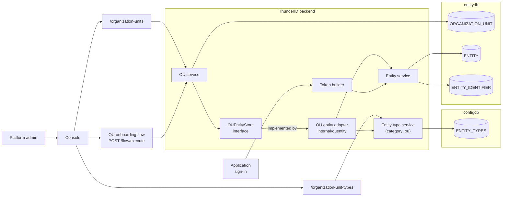
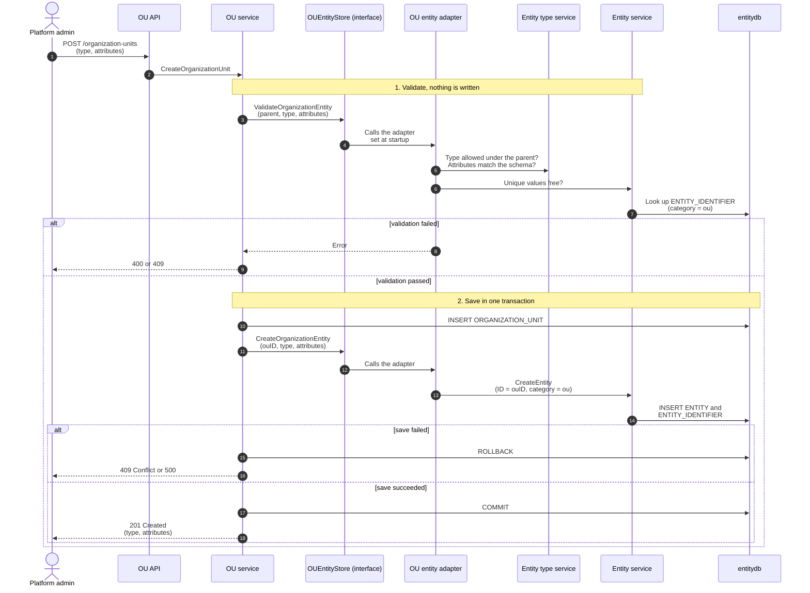
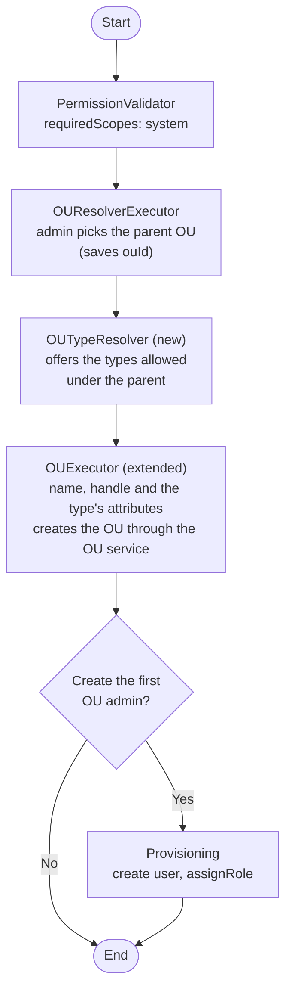
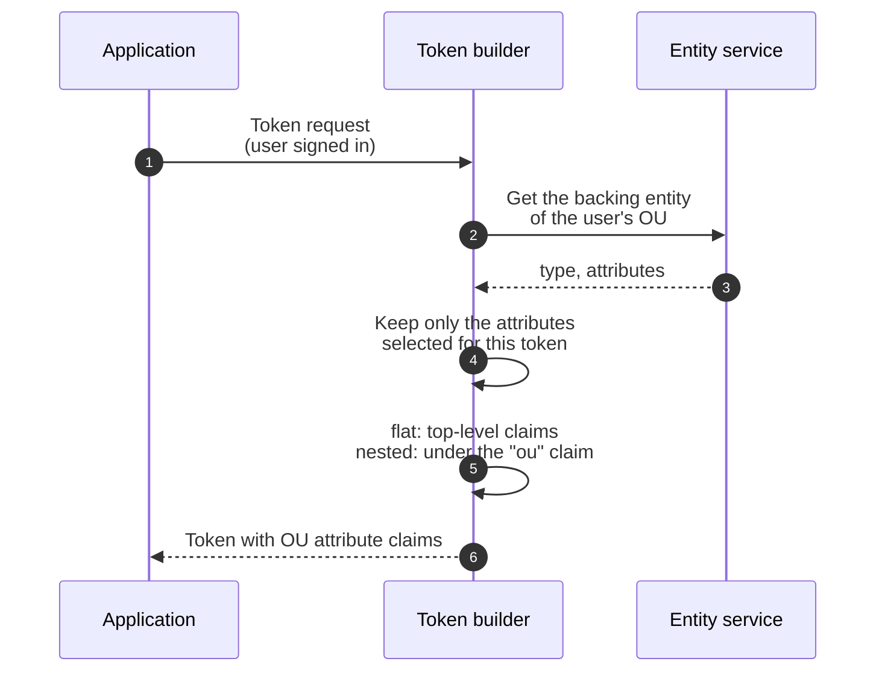
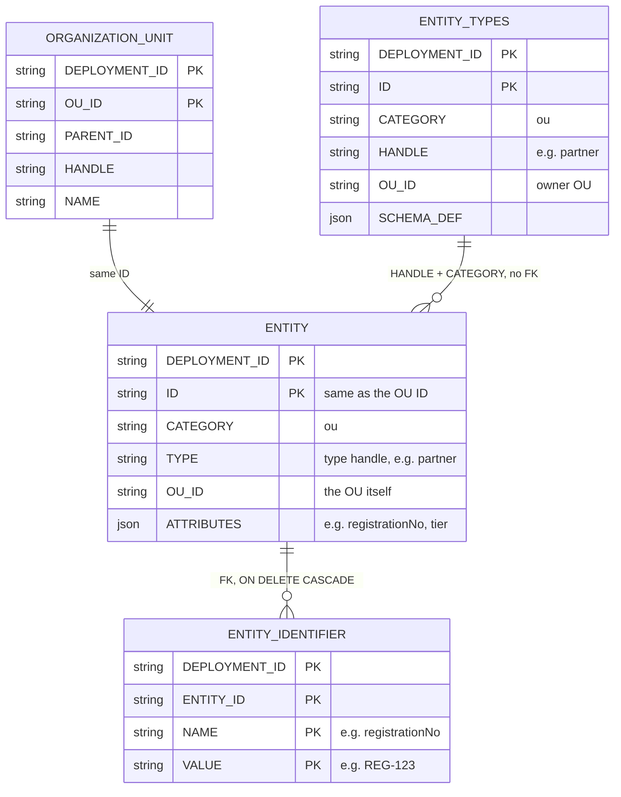

# Organization Unit Attributes Specification

- **Status:** Draft
- **Version:** 0.1
- **Related documents:** [Issue #5465: Attribute supports for OUs](https://github.com/thunder-id/thunderid/issues/5465), [Issue #6213](https://github.com/thunder-id/thunderid/issues/6213), [Issue #2645](https://github.com/thunder-id/thunderid/issues/2645), [Issue #2156](https://github.com/thunder-id/thunderid/issues/2156), [Discussion #948: Entity model](https://github.com/thunder-id/thunderid/discussions/948)

## Summary

Organization units (OUs) in ThunderID store only a name, a handle, a description and a parent. A platform administrator has no way to keep business data on an organization, such as a registration number, a tier or a region. Users and agents get typed, validated attributes through entity types, but OUs don't. Organization data therefore can't be validated, made unique, filtered or released in tokens, and it ends up living outside ThunderID.

This feature adds **organization unit types** (OU types): attribute schemas that a parent OU defines for the OUs below it. Each OU is assigned one OU type and stores attribute values validated against that type's schema. OUs with attributes can be created through the API or an onboarding flow, filtered, imported in bulk and released in tokens.

The governing design decision is to reuse the entity model instead of building a second one. Each OU gets a backing entity in the existing `ENTITY` table, with category `ou` and the same ID as the OU. OU types are entity types with category `ou`. The existing schema engine, identifier index and display logic then work for OUs without a parallel implementation.

This specification covers the first phase (MVP). In this phase every operation needs the platform administrator permission, and every attribute is public, not inherited, and editable only by platform administrators. Later work is listed under [Future work](#future-work).

## Architecture

| Component | New or existing | Role |
|---|---|---|
| Entity type service | Existing, extended | Stores and validates OU types (category `ou`). Serves `/organization-unit-types`. |
| OU service | Existing, extended | Validates the type and attributes, then saves the OU and its backing entity in one transaction. |
| `OUEntityStore` interface | New, in `ou` | What the OU service needs from the backing entity: validate, create, update, delete and get. |
| OU entity adapter | New, `internal/ouentity` | Implements `OUEntityStore` using the entity type service and the entity service. It is wired at startup with `SetOUEntityStore`, which avoids an import cycle between `ou` and `entity`. |
| Entity service and store | Existing, extended | Stores the backing entity. Identifier lookups gain a category filter. |
| `OUTypeResolver` executor | New | Offers the OU types allowed under the chosen parent. |
| `OUExecutor` | Existing, extended | Reads the parent from the runtime data `ouId`, asks for the type's attributes and saves through the OU service. |
| Token builder | Existing, extended | Releases the selected OU attributes as top-level claims or under the `ou` claim. |
| Console | Existing, extended | OU type pages, type and attribute fields on OU pages, the onboarding launch and the token attribute picker. |



`ORGANIZATION_UNIT` keeps the hierarchy and flow configuration and is unchanged. The backing entity holds only the type and the attribute values.

## Detailed design

### OU types

An OU type is an entity type with category `ou`. It has a handle, a display name, an owning OU and a schema. The schema supports what user types support today: string, number, boolean, `email`, `mobile`, nested objects, arrays, enums, `required`, `regex` and `unique`. OU types also support `searchable`, which marks an attribute that can be used in `GET /organization-units` filters.

```json
{
  "handle": "partner",
  "displayName": "Partner",
  "ouId": "<ID of the Acme OU>",
  "schema": {
    "registrationNo": { "type": "string", "required": true, "unique": true },
    "tier": { "type": "string", "enum": ["silver", "gold"], "searchable": true },
    "region": { "type": "string" }
  }
}
```

- The category constants are `providers.EntityCategoryOU` and `entitytype.TypeCategoryOU`, both with the value `ou`.
- Declarative OU types load from the existing entity type directory with `category: ou`.
- OU types reject credential attributes, because an OU entity can never sign in.

**Ownership and the strict-ancestor rule.** An OU type is the set of rules a parent OU defines for the OUs below it. An OU can use a type only if the type's owner is a strict ancestor of that OU. The OU that owns a type can't use the type itself, so an OU never sets the rules for its own data. The built-in `default` type is the only exception: any OU can use it, including root OUs and the default OU itself.

The owner of an OU type can't be changed after the type is created. An update that changes `ouId` is rejected with `OUT-1014`. Otherwise, moving a type to a different owner could leave the OUs that already use it under an owner that isn't their strict ancestor. This differs from user and agent types, whose owner can be changed today.

**The built-in `default` type.** A type with the handle `default`, the display name "Default" and an empty schema is owned by the default OU. The schema engine rejects empty schemas today, so it is extended to accept an empty schema for category `ou`. An OU of a type with an empty schema accepts no attributes: any attribute in the request is rejected with `OU-1020`. OUs created without a type get it, including root OUs, so existing behavior keeps working. A root OU has no ancestor to own a custom type for it, so root OUs can only use the `default` type. The `default` type can't be deleted.

**Deletion.** An OU that owns OU types can't be deleted while those types exist (`ResourceTypeOUType`). An OU type can't be deleted while OUs use it.

**Schema changes.** Updating an OU type's schema doesn't revalidate existing OUs, in the same way as user types today. This includes removing an enum value, adding `required`, tightening a `regex` and changing an attribute's type. Each OU's stored values are checked against the new schema on its next update, and attributes the new schema no longer declares are removed at that point. Until then, reads and tokens return the stored values.

Two changes are checked when the schema is saved:

- Marking an attribute `unique` fails with `OUT-1012` when existing values clash.
- Marking an attribute `searchable` indexes the existing values so they can be filtered.

**Security:** OU types have their own permissions for list, create, read, update and delete, separate from user and agent types. The entity type service's per-category action helpers return the OU type actions for category `ou` instead of falling back to the user type actions.

### OU storage

Every OU has a backing entity with:

- `ID` equal to the OU's ID.
- `CATEGORY` set to `ou`.
- `TYPE` set to the OU type handle.
- `OU_ID` set to the OU itself.
- The attribute values in `ATTRIBUTES`.

Creating an OU follows **validate first, then write**. Nothing is written until every check passes.



- Omitted `attributes` are validated as an empty object (`{}`), so `required` attributes are still enforced. The existing validator returns success for empty input before it checks `required`, so the adapter normalizes the input before calling it.
- Updating an OU's type or attributes validates the new values before the update transaction.
- **Supplied IDs:** OU create, import and declarative files can supply an OU's ID. The ID is also the backing entity's ID, so a supplied ID that is already used by another entity (a user, an agent or an application) is rejected with `409` and `OU-1028`, before anything is written.
- Deleting an OU deletes its backing entity in the same transaction. Its `ENTITY_IDENTIFIER` rows are removed by the existing cascade.
- **Uniqueness enforcement:** unique values are checked by the application before the write, using the category-filtered lookup, in the same way as for users and agents. `ENTITY_IDENTIFIER` has no uniqueness constraint across entities (its primary key includes `ENTITY_ID`, and the `(NAME, VALUE)` index is not unique), so no new index or migration is added. A value already used by another OU is rejected with `409` and `OU-1025`.
- **Known limitation:** two creates that use the same unique value at the same moment can both pass the check and both be stored. This matches the existing behavior for users and agents. See [Open questions](#open-questions).
- **Existing OUs:** OUs created before this feature are backfilled with a backing entity of the `default` type and no attributes. If an existing OU's ID is already used by another entity, the backfill stops the upgrade and reports the colliding IDs, so an administrator can resolve them. No OU is left without a backing entity.
- **Audit:** creating, updating and deleting OU attributes emits audit events.

### OU entities in the entity model

[Discussion #948](https://github.com/thunder-id/thunderid/discussions/948) defines an entity as the directory record that holds all identity-related aspects, with the categories user, app and agent, and notes that a subject or an actor is always an entity. This feature adds a fourth category, `ou`.

An OU entity holds the attributes of an OU and is **never a subject or an actor**: it has no credentials, can't sign in and can't be a group member. After this change every subject and actor is still an entity, but not every entity is a subject or an actor.

To keep that boundary safe:

- Identifier lookups filter by category, so sign-in and uniqueness checks for users and agents never see OU entities.
- OU types reject credential attributes.
- OU entities are rejected as group members and in authentication paths.

### Moving an OU

Changing an OU's parent through `PUT /organization-units/{id}` can break the strict-ancestor rule. Before the move, the OU service checks that:

- The OU's own type is still owned by a strict ancestor at the new position.
- The types of all descendant OUs are still owned by strict ancestors at their new positions.
- The caller has permission on the destination parent.

An OU of the `default` type always passes the type checks, because `default` is allowed under any parent.

If a check fails, the move is refused with `OU-1026` and nothing changes. The administrator must reassign the affected types first.

### Category-filtered identifier lookups

Attributes marked `unique` are indexed in `ENTITY_IDENTIFIER` under their plain names, as for users and agents. Identifier values are not prefixed.

`ENTITY_IDENTIFIER` has no category column, so lookups join it to `ENTITY` and keep only the requested category:

```sql
SELECT DISTINCT ia1.ENTITY_ID AS id
FROM "ENTITY_IDENTIFIER" ia1
INNER JOIN "ENTITY" e
    ON e.ID = ia1.ENTITY_ID AND e.DEPLOYMENT_ID = ia1.DEPLOYMENT_ID
WHERE ia1.NAME = $1 AND ia1.VALUE = $2
  AND ia1.DEPLOYMENT_ID = $3
  AND e.CATEGORY = $4
```

This applies to `buildIdentifyQueryFromIdentifiers`, `buildIdentifyQueryHybrid` and `QueryResolveIdentifier`. A user and an OU can therefore hold the same unique value, and a sign-in never resolves to an OU.

### OU onboarding flow

OUs can be created through an `ADMINISTRATION` flow, run through the existing `POST /flow/execute`. It follows the agent onboarding pattern, because `USER_ONBOARDING` and `REGISTRATION` flows require provisioning and a `UserTypeResolver`, which don't fit creating an OU.



The Console's "Create organization unit" action launches this flow, as it does for agent onboarding. The direct `POST /organization-units` API remains available.

### Filtering and bulk import

`GET /organization-units` accepts filters on the OU type and on attributes marked `searchable`:

```
GET /organization-units?filter=type eq "partner"
GET /organization-units?filter=attributes.tier eq "gold"
```

`POST /organization-units/import` creates many OUs with attributes in one request, as a JSON array or a CSV file.

- Each item is validated and saved on its own, in the same way as a single create. An invalid item doesn't stop the valid items from being created.
- The response is `200` with a result for every item, including when some items fail:

  ```json
  {
    "totalRows": 2,
    "succeeded": 1,
    "failed": 1,
    "results": [
      { "row": 1, "id": "<new OU ID>" },
      { "row": 2, "error": { "code": "OU-1020", "message": { "key": "...", "defaultValue": "..." }, "description": { "key": "...", "defaultValue": "..." } } }
    ]
  }
  ```

- `OU-1024` (`400`) applies only when the document itself is malformed: it isn't a valid JSON array or CSV file. In that case nothing is created.

### Token claims

Applications choose, per token (ID token, user access token and userinfo), which attributes of the signed-in user's OU to release. Each attribute is released either as a top-level claim (`flat`) or under the fixed `ou` claim (`nested`):

```json
"idToken":     { "userAttributes": ["email"], "ouAttributes": { "region": "flat", "tier": "nested" } },
"accessToken": { "userConfig": { "attributes": ["email"], "ouAttributes": { "tier": "nested" } } },
"userInfo":    { "userAttributes": ["email"], "ouAttributes": { "region": "flat" } }
```

Resulting ID token claims:

```json
{ "sub": "...", "email": "alice@acme.com", "region": "EU", "ou": { "tier": "gold" } }
```



- OU attributes are released only when an application selects them for that token.
- A flat claim name that clashes with a user or standard claim is rejected when the application is saved, with `APP-1063`.
- The `ou` claim name is reserved for nested OU attributes. When a token releases any nested OU attribute, an application that also releases a user attribute named `ou` or a flat OU attribute named `ou` in the same token is rejected with `APP-1063`.

### Data model

No new tables and no schema changes. The OU and its backing entity are linked by sharing the same ID.



- `ORGANIZATION_UNIT` and `ENTITY` are both in entitydb, so one transaction covers both writes.
- `ENTITY_TYPES` is in configdb, so the type is matched by handle and category, not by a foreign key.
- `ENTITY.CATEGORY` and `ENTITY_TYPES.CATEGORY` are `VARCHAR(50)` columns with no value constraint, so the `ou` category needs no schema change.
- Deleting a backing entity removes its `ENTITY_IDENTIFIER` rows through the existing cascade.

### API

All endpoints in this phase require the platform administrator (`system`) permission.

**OU types.** `/organization-unit-types` provides the same operations as `/user-types` and `/agent-types`, registered through `registerSchemaRoutes`:

| Method | Path | Purpose |
|---|---|---|
| `GET` | `/organization-unit-types` | List OU types |
| `POST` | `/organization-unit-types` | Create an OU type |
| `GET` | `/organization-unit-types/{id}` | Get an OU type |
| `PUT` | `/organization-unit-types/{id}` | Update an OU type |
| `DELETE` | `/organization-unit-types/{id}` | Delete an OU type |

**Organization units.** `POST /organization-units`, `GET` and `PUT /organization-units/{id}`, and `GET` and `PUT /organization-units/tree/{path}` accept and return `type` and `attributes`:

```json
{
  "handle": "partner-a",
  "name": "Partner A",
  "parent": "<ID of the Acme OU>",
  "type": "partner",
  "attributes": { "registrationNo": "REG-123", "tier": "gold", "region": "EU" }
}
```

- `type` is the OU type handle. On create, it defaults to `default` when omitted. On update, an omitted `type` keeps the OU's existing type, so a client that doesn't send `type` never resets it.
- `attributes` are validated against the type's schema.

New endpoint:

| Method | Path | Purpose |
|---|---|---|
| `POST` | `/organization-units/import` | Bulk create OUs with attributes (JSON or CSV) |

`GET /organization-units` gains the `filter` parameter described in [Filtering and bulk import](#filtering-and-bulk-import).

**Errors.**

| Code | When |
|---|---|
| `OU-1020` | Attributes don't match the type's schema |
| `OU-1022` | The type isn't allowed under this parent |
| `OU-1024` | Invalid import payload |
| `OU-1025` | An attribute value conflicts with another OU (unique) |
| `OU-1026` | Moving the OU would put it, or a descendant, under a parent where its type isn't allowed |
| `OU-1028` | A supplied OU ID is already used by another entity |
| `OUT-1012` | Making an attribute unique fails because existing values clash |
| `OUT-1014` | An update tries to change an OU type's owner |
| `APP-1063` | A flat OU attribute claim clashes with a user or standard claim |

`OUT-` codes are provisional until open question 4 is resolved. If the existing `USRS-` codes are chosen instead, this table, AC2.3 and AC2.5 are updated before implementation.

### UI

- **Organization unit types:** list and editor pages, matching the user type pages.
- **Organization unit pages:** a type field and an attributes form generated from the type's schema.
- **Create organization unit:** launches the OU onboarding flow.
- **Application token settings:** the OU attribute picker per token, with a flat or nested choice per attribute.

### Configuration

| Key | Level | Purpose |
|---|---|---|
| `flow.organizationOnboardingFlow.defaultHandle` | Deployment | The default flow the Console launches to create an OU |

## Requirements

### R1. Define OU types

**Requirement:** As a platform administrator, I can define OU types with an attribute schema.

**Acceptance criteria:**

- **AC1.1:** Given a valid schema, when I create an OU type, then it is stored with category `ou` and returned by `GET /organization-unit-types`.
- **AC1.2:** Given a caller without the platform administrator permission, when they create an OU type, then the request is rejected.
- **AC1.3:** Given a schema with a credential attribute, when I create an OU type, then the request is rejected.
- **AC1.4:** Given a fresh deployment, when the server starts, then the `default` type exists and is owned by the default OU.
- **AC1.5:** Given the `default` type, when I delete it, then the deletion is rejected.
- **AC1.6:** Given an OU of the `default` type, when I send any attribute for it, then the request fails with `OU-1020`.

### R2. Protect OU types from unsafe deletion

**Requirement:** OU types can't be deleted while in use, their owner can't be changed, and an attribute can't be made unique while existing values clash.

**Acceptance criteria:**

- **AC2.1:** Given an OU that owns an OU type, when I delete the OU, then the deletion is blocked.
- **AC2.2:** Given an OU type used by an OU, when I delete the type, then the deletion is blocked.
- **AC2.3:** Given existing OUs with duplicate values for an attribute, when I mark that attribute `unique`, then the update fails with `OUT-1012`.
- **AC2.4:** Given an OU whose `tier` is `silver`, when I remove `silver` from the type's enum, then the schema update succeeds, and the OU's next update fails with `OU-1020` unless it sets a valid `tier`.
- **AC2.5:** Given an OU type, when I update it with a different `ouId`, then the update fails with `OUT-1014` and the owner is unchanged.

### R3. Store attributes on an OU

**Requirement:** As a platform administrator, I can assign an OU type to an OU and set its attribute values.

**Acceptance criteria:**

- **AC3.1:** Given valid attributes, when I create an OU, then the OU and its backing entity are stored, and `GET /organization-units/{id}` returns the type and attributes.
- **AC3.2:** Given no type in the request, when I create an OU, then it gets the `default` type.
- **AC3.3:** Given attributes that fail the schema, when I create an OU, then the request fails with `OU-1020` and no OU row or entity is stored.
- **AC3.4:** Given a custom type whose owner isn't a strict ancestor of the new OU, when I create the OU with it, then the request fails with `OU-1022`.
- **AC3.5:** Given a unique value already used by another OU, when I create an OU with it, then the request fails with `OU-1025`.
- **AC3.6:** Given an OU whose unique value is already used by a user, when I create the OU, then the check finds no conflict, because it only looks at OU entities.
- **AC3.7:** Given an OU created before this feature, when the server is upgraded, then the OU has a backing entity of the `default` type.
- **AC3.8:** Given a root OU, when I create it without a type, then it gets the `default` type.
- **AC3.9:** Given a root OU, when I create it with a custom type, then the request fails with `OU-1022`.
- **AC3.10:** Given the `partner` type with a required `registrationNo`, when I create a `partner` OU without `attributes`, then the request fails with `OU-1020`.
- **AC3.11:** Given an OU of the `partner` type, when I update it without `type`, then it keeps the `partner` type.
- **AC3.12:** Given a supplied ID that a user already has, when I create an OU with that ID, then the request fails with `OU-1028` and nothing is stored.

### R4. Keep OU entities out of identity paths

**Requirement:** An OU entity is never treated as a subject or an actor.

**Acceptance criteria:**

- **AC4.1:** Given a user and an OU with the same unique value, when the user signs in with that value, then the user is resolved, not the OU.
- **AC4.2:** Given a user and an OU, when both use the same unique value, then both are stored.
- **AC4.3:** Given an OU entity, when it is added to a group, then the request is rejected.

### R5. Move OUs safely

**Requirement:** Moving an OU never puts it or its descendants under a parent where their type isn't allowed.

**Acceptance criteria:**

- **AC5.1:** Given a move that breaks the strict-ancestor rule for the OU or a descendant, when I update the OU's parent, then the request fails with `OU-1026` and nothing changes.
- **AC5.2:** Given a move that keeps every type allowed, when I update the OU's parent, then the move succeeds.

### R6. Onboard OUs through a flow

**Requirement:** As a platform administrator, I can create an OU with its type and attributes, and optionally its first administrator, through the OU onboarding flow.

**Acceptance criteria:**

- **AC6.1:** Given a chosen parent, when the flow reaches the type step, then only the types allowed under that parent are offered.
- **AC6.2:** Given the default flow, when I complete it, then the OU is created under the chosen parent with the chosen type and attributes.
- **AC6.3:** Given I choose to create the first OU admin, when the flow completes, then the user is created and assigned their role.
- **AC6.4:** Given a caller without the platform administrator permission, when they start the flow, then it is rejected at the first step.

### R7. Filter and import OUs

**Requirement:** As a platform administrator, I can filter OUs by type or attribute and create many OUs at once.

**Acceptance criteria:**

- **AC7.1:** Given OUs of several types, when I filter with `type eq "partner"`, then only OUs of that type are returned.
- **AC7.2:** Given a `searchable` attribute, when I filter with `attributes.tier eq "gold"`, then only the matching OUs are returned.
- **AC7.3:** Given an import in JSON or CSV with one invalid item, when I submit it, then the response is `200`, the valid items are created, and the invalid item's result holds its error.
- **AC7.4:** Given a document that isn't a valid JSON array or CSV file, when I submit it, then the request fails with `400` and `OU-1024`, and nothing is created.

### R8. Release OU attributes in tokens

**Requirement:** As an application owner, I can choose per token which OU attributes to release, flat or under the `ou` claim.

**Acceptance criteria:**

- **AC8.1:** Given an attribute selected as `flat` for the ID token, when an ID token is issued, then the attribute is a top-level claim.
- **AC8.2:** Given an attribute selected as `nested` for the access token, when an access token is issued, then the attribute is under the `ou` claim.
- **AC8.3:** Given an attribute selected only for userinfo, when an ID token is issued, then the attribute isn't in the ID token.
- **AC8.4:** Given a flat attribute whose name clashes with a user or standard claim, when I save the application, then the request fails with `APP-1063`.
- **AC8.5:** Given a nested OU attribute selected for the ID token, when I also select a user attribute named `ou` for that token, then saving the application fails with `APP-1063`.

### R9. Audit attribute changes

**Requirement:** Changes to OU attributes are auditable.

**Acceptance criteria:**

- **AC9.1:** Given an OU, when its attributes are created, updated or deleted, then an audit event is emitted.

## Open questions

1. **Filtering.** Should every attribute be filterable, or only attributes marked `searchable` or `unique` (proposed for the MVP)?
2. **#2156.** Should `ouId`, `ouHandle` and `ouName` also be released under the `ou` claim as part of this work, or stay in #2156?
3. **Token selection syntax.** Is the JSON selection object (`{"region": "flat", "tier": "nested"}`) the right shape, compared with a list of dotted paths?
4. **Error code prefix.** Should OU type errors use a new `OUT-` prefix, or the existing `USRS-` codes the entity type service uses today?
5. **Concurrent unique values.** Should the race between two concurrent creates with the same unique value be closed, for example with a category-aware unique index or a transactional check scoped to category `ou`? This would also apply to users and agents.
6. **Revalidation on schema change.** Should schema changes that make existing values invalid be rejected, or should all OUs of the type be revalidated? Neither user types nor OU types do this today.

## Future work

These are out of scope for this specification and will be covered in a later one:

- **Governance:** per-attribute `editableBy`, `private` attributes that are never released in tokens, `inheritable` attributes with effective values, and OU administrator self-service through `GET` and `PUT /organization-units/me`. The scope names (`ou:profile:read` and `ou:profile:write` proposed) are still open.
- **Schema engine:** `default`, `format`, length, range and item limits, and per-field errors.
- **Token extensions:** sub-field selection and OU attributes in client credentials tokens.
- **Limits:** an import row limit.
- **Phase 2 error codes:** `OU-1021` (not editable), `OU-1023` (import row limit), `OU-1027` (a move leaves an inherited value missing), `OUT-1013` (schema limit) and `APP-1064` (private attribute selected).

## Change log

| Version | Date | Change |
|---|---|---|
| 0.1 | 2026-11-05 | Initial specification. |
