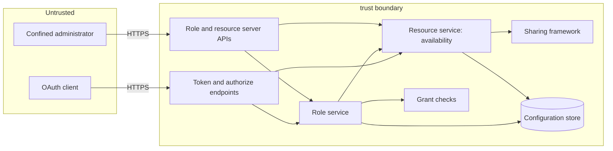

# Resource Server Sharing Threat Model

This model covers how a resource server's sharing bounds the use of its permissions: role writes, what a role confers where it is assigned, tokens issued for an organization unit, confined reads of resource servers, and delegated administration grant checks.

## Overview

A resource server's permissions are what roles grant and tokens carry. Sharing decides which organization units may use them. If the bound is missing or bypassable, an organization unit's administrator can build roles, and obtain tokens, carrying permissions of resource servers another organization unit owns and never shared, including the System resource server's `org` and `system`.

Cross-cutting concerns covered elsewhere: the sharing framework's policy evaluation and authorization of policy writes ([Resource sharing](../../../docs/content/key-concepts/resource-sharing.mdx)), the organization-unit-qualified token endpoint and client admission ([M2M access across organization units](../m2m-access-across-ous/spec.md)), and token revocation on unsharing.

## Scope

This model covers:

- Validation of a role's permissions in its organization unit on create, update, move, import and declared load
- Narrowing of what a role confers to the resource servers its assignment unit can use, in token issuance and role reads
- Target resource server resolution and scope downscoping for a request acting for an organization unit
- Listing and reading resource servers by a caller confined to an organization unit
- The delegated administration grant checks
- The refusal of a sharing change or move that takes a resource server from an organization unit whose roles use it

Out of scope (see the referenced companion models):

- Who may create or change a sharing policy (sharing framework)
- Client authentication and admission on `/ou/{ouId}/oauth2/token` (M2M access)
- Revoking tokens already issued when a resource server is unshared (token revocation)

## Architecture

### Components

| Component | Task |
| --- | --- |
| Resource service | Answers whether an organization unit may use a resource server, from its owner and its policies. Reads without the caller's authorization, and fails closed. |
| Role service | Refuses a role holding permissions its organization unit cannot use, and drops them from what a role confers in an assignment unit that cannot use them. |
| Grant checks | Compare what a grant confers with what the administrator may use. |
| Token and authorize endpoints | Resolve the target resource server and downscope scopes for the accessing organization unit. |

### Actors

#### Actors

| Actor | Description | Roles or permissions |
| --- | --- | --- |
| Deployment administrator | Administers the default organization unit and the System resource server | `system` |
| Confined administrator | Administers one organization unit | `org` or its children in that organization unit |
| OAuth client | Requests tokens for an organization unit | Shared with that organization unit |

#### Entitlement matrix

| Actor | Share a resource server | Use an unshared resource server's permissions in a role | Read an unshared resource server of a unit above |
| --- | --- | --- | --- |
| Deployment administrator | [Yes] | [Yes], in the owner's organization unit only | [Yes] |
| Confined administrator | [Yes], onward, for one it may reshare | [No] | [No] |
| OAuth client | [No] | [No] | [No] |

### External Dependencies (not owned)

| Dependency | Description (usage, purpose, authentication, authorization, security) |
| --- | --- |
| AuthZEN policy service | Receives evaluation requests that name no assignment unit, so its decisions are not narrowed by this feature |

## Threats and mitigations

### Out-of-scope interactions and risks

- Writing a policy that reaches organization units the writer may not reach (sharing framework)
- A client obtaining a token for an organization unit it is not shared with (M2M access)

### Interactions

#### [01]: Role write in an organization unit

**Description**

An administrator creates, updates, moves or imports a role. Every resource server the role names is checked for availability in the role's organization unit after the write.

**Assets involved**

| Initiator | Intermediate | Target |
| --- | --- | --- |
| Confined administrator | Role service, resource service | Role |

**Security considerations**

| Area | Response | Comments |
| --- | --- | --- |
| Data confidentiality | [C-Medium] | Role definitions |
| Communication medium | [M-NT] | |
| Transport security | [TLS] | |
| Authentication | Bearer token | |
| Accessibility | [Restricted] | `role` permissions in the organization unit |
| Authorization and Access Control | Organization unit confinement, grant check, availability | |

**Threat assessment**

| ID | Category | Threat | Materializable | Mitigation / comment |
| --- | --- | --- | --- | --- |
| 1 | [Elevation of Privilege] | A confined administrator creates a role holding `system` or another unshared resource server's permissions, and assigns it to itself. | [No] | `ValidatePermissionsInOU` refuses with `ROL-1047`. Declared and imported roles are checked the same way. |
| 2 | [Information Disclosure] | `ROL-1047` tells an administrator that a resource server with the ID it named exists, where a resource server that does not exist answers as undefined permissions. | [No] | Resource server IDs are random UUIDs, so the refusal confirms only an ID the caller already has, and it names no organization unit, permission or detail of the resource server. |

#### [02]: Token issuance for an organization unit

**Description**

A client requests a token at `/ou/{ouId}/oauth2/token` or `/ou/{ouId}/oauth2/authorize`. The target resource server must be available in the accessing organization unit, scopes of one that is not are dropped, and what each role confers is narrowed to its assignment unit.

**Assets involved**

| Initiator | Intermediate | Target |
| --- | --- | --- |
| OAuth client | Token endpoint, resource service, role service | Access token |

**Security considerations**

| Area | Response | Comments |
| --- | --- | --- |
| Data confidentiality | [C-High] | Access tokens |
| Communication medium | [M-NT] | |
| Transport security | [TLS] | |
| Authentication | Client authentication | |
| Accessibility | [Public] | |
| Authorization and Access Control | Client admission, availability, assignment unit | |

**Threat assessment**

| ID | Category | Threat | Materializable | Mitigation / comment |
| --- | --- | --- | --- | --- |
| 3 | [Elevation of Privilege] | A token for an organization unit carries permissions of a resource server not shared with it, through a shared role assigned there. | [No] | The assignment unit's availability narrows what the role confers, and downscoping drops what the accessing unit cannot use. |
| 4 | [Information Disclosure] | A client tells a resource server it may not use from one that does not exist, and maps the deployment's resource servers. | [No] | Both answer `invalid_target` with the same description. |
| 5 | [Security Risk] | An availability lookup failure lets the request through. | [No] | A failure answers `server_error`. |

#### [03]: Confined read of resource servers

**Description**

A caller confined to an organization unit lists or reads resource servers.

**Assets involved**

| Initiator | Intermediate | Target |
| --- | --- | --- |
| Confined administrator | Resource service, sharing framework | Resource server, resources, actions |

**Security considerations**

| Area | Response | Comments |
| --- | --- | --- |
| Data confidentiality | [C-Medium] | Permission catalogs |
| Communication medium | [M-NT] | |
| Transport security | [TLS] | |
| Authentication | Bearer token | |
| Accessibility | [Restricted] | `rs:view`, `rs:list` |
| Authorization and Access Control | Owner, or sharing into the caller's organization unit | |

**Threat assessment**

| ID | Category | Threat | Materializable | Mitigation / comment |
| --- | --- | --- | --- | --- |
| 6 | [Information Disclosure] | A confined administrator reads the permission catalogs of the organization units above its own. | [No] | `rs:view` and `rs:list` left the inheritance policy. Only owned and shared resource servers are read. |
| 7 | [Tampering] | A confined administrator edits a resource server shared with it. | [No] | A shared resource server is read only in the organization unit it is shared with, and its writes are checked against its owner. |

#### [04]: Delegated administration grants

**Description**

An administrator assigns a role, adds a group member or takes control of an entity. What the grant confers is compared with what the administrator may use.

**Assets involved**

| Initiator | Intermediate | Target |
| --- | --- | --- |
| Confined administrator | Grant checks, permission resolver | Role assignment, group membership, entity |

**Security considerations**

| Area | Response | Comments |
| --- | --- | --- |
| Data confidentiality | [C-Medium] | |
| Communication medium | [M-NT] | |
| Transport security | [TLS] | |
| Authentication | Bearer token | |
| Accessibility | [Restricted] | |
| Authorization and Access Control | Grant coverage | |

**Threat assessment**

| ID | Category | Threat | Materializable | Mitigation / comment |
| --- | --- | --- | --- | --- |
| 8 | [Elevation of Privilege] | An administrator counts, as held, permissions its roles confer nothing of where they are assigned, and grants them to others. | [No] | What the administrator holds is narrowed per assignment unit. |
| 9 | [Elevation of Privilege] | An administrator assigns a shared role whose unusable permissions it does not hold, and AuthZEN, which names no assignment unit, grants them to the assignee. | [No] | What a grant confers is not narrowed: the administrator must hold every permission the role, group or entity holds. |

#### [05]: Taking a resource server from an organization unit

**Description**

A sharing change or a move stops a resource server reaching an organization unit.

**Threat assessment**

| ID | Category | Threat | Materializable | Mitigation / comment |
| --- | --- | --- | --- | --- |
| 10 | [Operational Risk] | An organization unit's roles silently confer nothing after a narrowing. | [No] | The API refuses with `RES-1039`, and a move with `RES-1037` then `RES-1039`. A declared policy narrowed in its file, and an import or deploy that narrows and edits roles together, are not refused; see the residual risks. |
| 11 | [Elevation of Privilege] | Tokens issued before the narrowing keep the resource server's permissions. | [No] | Bounded by token lifetime. Revocation on unsharing is tracked separately. |

## Security Review Checklist

### Security considerations

| # | Consideration | State | Comments |
| --- | --- | --- | --- |
| 1 | Are all inputs and outputs validated (syntactic and semantic)? | [Yes] | Every resource server a role names is checked |
| 2 | Are rate limits in place where necessary? | [N/A] | |
| 3 | Are permissions, roles, and entitlements defined on the principle of least privilege and business need? | [Yes] | Strict availability, nothing shared by default |
| 4 | Are authentication and authorization validated at both the UI and API layers, front end and back end, before granting access to resources? | [Yes] | The Console marks shared resource servers; the server enforces |
| 5 | Are proper isolations in place between components to ensure least-privilege access and reduce the blast radius against lateral movement? | [Yes] | |
| 6 | Have any default credentials been changed, and are default superuser or root accounts not in use (when using third-party components)? | [N/A] | |
| 7 | Has the implementation followed best-practice guidelines (OWASP, Kubernetes, vendor, or technology provider)? | [Yes] | RFC 8707 `invalid_target` |
| 8 | Are secrets, credentials, and internal-only material kept out of the public source tree and its git history? | [Yes] | |
| 9 | Was a security-focused code review conducted for this change, and have the findings been addressed? | [Yes] | #7091 |
| 10 | Is Static Analysis (SAST) or IaC scanning conducted, and are findings addressed? | [Yes] | CI |
| 11 | Is Software Composition Analysis (SCA) conducted or integrated into the repository, and are findings addressed (for example FOSSA, Trivy)? | [N/A] | No new dependencies |
| 12 | Is Dynamic (DAST) or API scanning conducted on a non-production setup, and are findings addressed? | [N/A] | |
| 13 | Are audit logs generated in a standardized format for critical functionality, and available to authorized users to trace critical events and aid incident response? Note the retention period in Comments. | [Yes] | Role and sharing policy writes are audited |
| 14 | Do audit logs for critical configuration changes record the difference between the old and new versions? | [No] | Existing audit events |
| 15 | Are data in transit and at rest encrypted? | [Yes] | |
| 16 | Are sensitive values such as credentials and keys stored in a secret store or vault? | [N/A] | |
| 17 | Is personal, sensitive, or confidential data kept out of logs? | [Yes] | |
| 18 | Have users been given clear instructions for secure usage? | [Yes] | Resource servers and manage roles guides |

## Residual risks (open items)

| Risk | Description | Current Status | Recommendation |
| --- | --- | --- | --- |
| AuthZEN not narrowed | AuthZEN evaluation names no assignment unit, so it counts permissions tokens leave out | Open | Grant checks compare against everything a grant confers, so no administrator can widen it. Narrow AuthZEN per assignment unit (tracking: #5634) |
| Narrowing outside the API | A declared policy narrowed in its file, and an import or deploy that narrows a policy and edits roles together, are not refused or are refused out of order | Open | Documented in the specification. Split the change, roles first |
| Sharing approves existing assignments | Sharing a resource server makes every assignment of a role in the reached organization unit confer its permissions at once | Accepted | The share is the approval. The guide tells operators to review the organization unit's roles before sharing |
| Tokens after unsharing | Tokens issued before an unshare keep their permissions until they expire | Open | Revoke on unsharing (tracking: #5634) |

## Appendix

- References: [Specification](spec.md), [RFC 8707](https://www.rfc-editor.org/rfc/rfc8707)

## Change log

| Version | Date | Change |
|---|---|---|
| 0.1 | 2026-11-27 | Initial threat model. |
