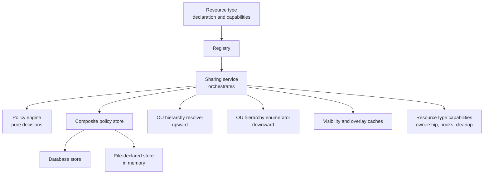
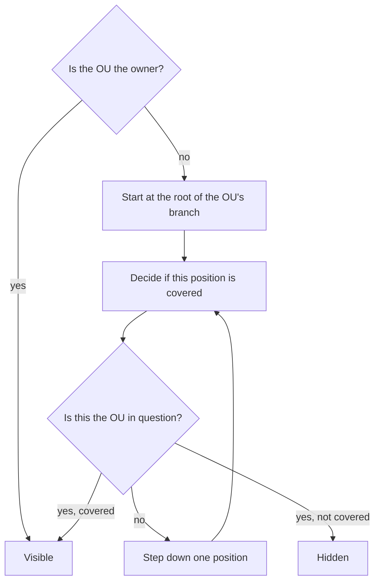

# Resource sharing across OUs

- **Status:** Draft
- **Version:** 0.4
- **Related documents:** [Discussion #3310: Architectural First Principles for Resource Modeling in B2B Context](https://github.com/thunder-id/thunderid/discussions/3310), [Issue #3346: Build core modules to support the common resource architecture in B2B context](https://github.com/thunder-id/thunderid/issues/3346)

## Summary

ThunderID models organizations as a forest of OU trees. B2B SaaS, multi-division enterprises, partners, resellers and multi-brand companies ([Discussion #2719](https://github.com/thunder-id/thunderid/discussions/2719)) all need one OU to own a resource that other OUs use.

Copying the resource into each OU duplicates configuration and lets copies drift. Sharing gives a resource **reach** instead: one resource, one owner, and policies that record which OUs see it and on what terms. A receiving OU gets permission to use the resource and to set a few templated fields within bounds. It never gets the owner's core configuration.

Sharing is a resource-type-agnostic framework. A resource type onboards by declaring its templated fields.

## Architecture



| Component | Responsibility |
|---|---|
| Policy engine | Every decision: visibility, effective terms, whether an edit is allowed. Plain functions over plain values, with no I/O, so the rules are table-testable. |
| Sharing service | Fetches policies, asks the hierarchy, opens transactions, clears caches, calls resource type capabilities. Decides nothing itself. |
| Registry | One declaration per onboarded resource type. Optional capabilities are detected on the declaration, not registered separately. |
| Composite policy store | One store to ask. Reads the database first, then declarations. Writes go to the database only. |
| Database store | Policies, named OUs, overlay rules and OU overlay values. No resource rows. |
| File-declared store | Policies declared in resource files, held in memory. The file is their source of truth. |
| OU hierarchy resolver | Ancestors of an OU. |
| OU hierarchy enumerator | OUs beneath an OU. Kept apart from the resolver because walking a subtree is not an access decision. |
| Caches | Visibility and resolved overlay rules. Cleared on every policy write, after commit or rollback. |

Composite store rules:

- A stored row wins over a declaration for the same OU, so one OU is never answered by two policies.
- A database read failure is a failure. It never falls back to the declared half alone.

## Detailed design

### Core rules

- **Sharing is chained.** Coverage starts at an entry point (the owner, or a root the owner reached) and travels down a branch through grants that reach into a subtree. Removing what covered a position removes everything reached through it.
- **Reach is granted one step at a time.** A policy names only direct children of its issuer, or roots of other trees. Going deeper needs `reach: subtree` or a policy from the named OU.
- **Terms only narrow, and only a frontier OU may narrow them.** Nobody passes on more than they hold. Exactly one policy covers any OU, so resolving terms is a lookup.

### Policies and sections

A **policy** is one OU's decision about one resource. Each OU holds at most one policy per resource. A second create is refused and names the existing policy.

A policy's **stage** is `share` when the owner issues it and `reshare` when an OU the resource reached issues it. A reshare needs its issuer to see the resource and to be a frontier OU.

A policy states up to three **sections**. Reach can only be stated inside a section.

| Section | Covers | Who may state it |
|---|---|---|
| `allUnits` | Every OU in the deployment | Owner only, cross-tree gated; from a resource file or an import |
| `childUnits` | OUs beneath the issuer, in its own tree | Owner or sharee |
| `otherTreeRoots` | Roots of other trees, never the issuer's own root | Owner only, cross-tree gated |

`allUnits` stands alone. `childUnits` and `otherTreeRoots` cover disjoint groups and may be stated together.

| Section | `mode: all` | `mode: selected` |
|---|---|---|
| `childUnits` | Every OU beneath the issuer, any depth | The listed direct children, each with its own `reach` |
| `otherTreeRoots` | Every other tree's root, each root alone | The listed roots, each alone |

- A named child carries `reach: unit` (that OU only) or `reach: subtree` (that OU and everything beneath).
- A named root always stops at the root. The receiving tree decides who inside it sees the resource.
- Naming the issuer's own tree root is refused. `otherTreeRoots` in `mode: all` always withholds it.

`mode: all` covers its group on one set of terms:

```yaml
sharingPolicies:
  - id: customers
    childUnits:
      mode: all
      excludedOuIds: [ acme-trial ]
      overlayRules:
        isRecoveryFlowEnabled: { editable: false }
```

`mode: selected` gives each named OU its own reach and terms. Here `acme-customer-a` is a frontier OU and carries the resource one hop further:

```yaml
sharingPolicies:
  - id: customers
    childUnits:
      mode: selected
      units:
        - ouId: acme-customer-a
          reach: unit
          overlayRules:
            isRecoveryFlowEnabled: { editable: true }
        - ouId: acme-customer-b
          reach: subtree
  - id: customer-a-branch
    initiatingOuId: acme-customer-a
    childUnits:
      mode: selected
      units:
        - ouId: acme-customer-a-emea
          reach: unit
```

Shape rules, checked when a policy is built:

- At least one section.
- `mode: selected` carries `units` with their own rules, and no section-level exclusions or rules.
- `mode: all` carries exclusions and rules, and no `units`.
- An OU is named at most once per policy, across both sections.

A **grant** is what a rule and a coverage answer point at: a section's whole group, or one OU the section names. A grant is identified by its section and OU, so it survives edits unchanged.

### Exclusions and rule narrowing

Two separate ways make a policy smaller:

| | Rule narrowing | Exclusion |
|---|---|---|
| Changes | What a covered OU may do with a field | Which OUs a section covers |
| How | Lower `editable`, or shrink the values on offer | List the OU in the section's `excludedOuIds` |
| Effect | The OU still holds the resource | The OU and its subtree lose it |
| Triggers cleanup | No | Yes |

Exclusion rules:

- Only a section in `mode: all`, or `allUnits`, carries exclusions. In `mode: selected`, leaving an OU out of `units` withholds it.
- An exclusion must name an OU the section reaches. Under `childUnits` it must name a direct child of the issuer, so the issuer never decides over a child's head. Under `otherTreeRoots` it must name a root.
- Only the policy's issuer can exclude. An OU cannot withhold a resource from a child that a policy above it already reaches.

### Frontier OUs

A **frontier OU** holds the resource with nothing beneath it granted. Only a frontier OU may issue a policy (reshare).

| The OU was covered by | The OU is |
|---|---|
| A named child with `reach: unit`, or a named root | Frontier |
| `otherTreeRoots` in `mode: all` | Frontier |
| A named child with `reach: subtree`, or `childUnits` in `mode: all` | Inside someone else's reach |
| `allUnits` | Inside someone else's reach |

An OU inside someone else's reach cannot exclude or retighten its children; its policy is refused. An owner who wants each child to set its own terms names them in `mode: selected` with `reach: unit`.

### Visibility resolution

The OU's branch is walked from the root down. Each position is covered or not, and the OU is visible when its own position is covered.



A position is covered by:

- **Entry point.** The owner's own position, or a root reached by the owner's `otherTreeRoots`.
- **Descendant coverage**, from a covered position above. `childUnits` in `mode: all` and a named child with `reach: subtree` cover any depth below their anchor. A named child with `reach: unit` covers only that child.
- **Deployment-wide coverage.** `allUnits` covers every position, roots included.

Exclusions are checked only on the grant doing the covering, and remove the excluded OU's whole subtree. The policy fetch is narrowed to the branch, so cost grows with branch depth, not with how widely the resource is shared.

### Overlay rules

An **overlay rule** says what a covered OU may do with one templated field.

| Field | Meaning |
|---|---|
| `editable` | Whether the OU may write the field |
| `value` | The starting value, or the pinned value when not editable |
| `allowedValues` | What the OU may choose from. Absent means the field's whole value space |
| `excludedValues` | Removed from both of the above, last |

For the list fields, absent and empty differ: absent means "whatever my issuer allowed", empty means "nothing". They stay distinct in storage.

A rule is resolved against what the issuer holds when it is written, and both the request and the result are stored. A write is **refused, not trimmed**, when it:

- sets `editable: true` while the issuer holds `editable: false`;
- allows or pins a value the issuer's rule does not cover;
- pins a `value` outside its own `allowedValues`;
- combines `editable: false` with `allowedValues`.

`excludedValues` composes: the request's exclusions are added to the issuer's, so an issuer's exclusion can never be dropped.

Members are compared by the field's **kind**:

| Kind | Members | Compared by |
|---|---|---|
| `scalar` | One opaque value | Equality |
| `referenceSet` | A set of ids | Set membership |
| `hierarchy` | Delimiter-joined paths | Prefix containment on the type's separator |

A field declaration can also set:

- `fallbackKey`: a coarser field whose rule applies when no rule names this one. A lock on the coarse field therefore reaches the fine one.
- `dynamicKeys`: the key is a prefix, so `key.<id>` is valid without enumerating members. A member falls back to its prefix first.
- `editableOnly`: a rule for the field may state `editable` and nothing else.
- `default`: the rule that applies when no policy names the field.

When a policy above changes, rules beneath are recalculated from their stored requests and **clamped**, not refused. A request replayed this way was accepted once, and the change above it is what must win.

### Rule resolution

- **Covered OU:** the rule of the one grant that covers it, with that policy named as the contributor.
- **Field no policy names:** the type's declared default, marked as `default` rather than `policy`.
- **Owner:** no policy covers the owner, so every field resolves to its declared default and no contributor is named.
- **OU that cannot see the resource:** empty rules. Defaults describe an OU that holds the resource.

The result also reports whether the OU owns the resource. If a future section ever let two grants cover one OU, resolution intersects their rules per field (`editable` only if all agree, values intersect, exclusions union) rather than picking one.

### OU overlay values

An OU's own value for a templated field is stored per resource, OU and field.

- **Write:** refused when the OU cannot see the resource, the field is unknown, the rule is not editable, or the value is outside the rule. Values are refused, never clamped, on write.
- **Delete:** returns the field to the rule's value. Refused when the field is not editable.
- **Replace:** sets several fields for one OU in one transaction. A refusal names the field and undoes the rest.
- **Read:** the effective value per field, after the rule's bounds, marked as the OU's own (`overlay`) or the rule's (`rule`), with whether it is still editable.
- **Obsolete values:** a policy write that pins a field or stops governing it deletes the values OUs saved for it.
- **Removed field:** when a resource stops declaring a field (for example a flow variable), every rule and value for that field is removed.

A type that implements `OverlayCleaner` keeps its values in its own storage. The framework then neither stores nor serves values for that type.

### Editing a policy

Every edit carries the version it read. A stale version is refused.

A section is **blanket** (`allUnits`, or `mode: all`) or **selective** (`mode: selected`). Each section is checked on its own.

| Edit | Allowed |
|---|---|
| Switch a section between blanket and selective | No (scope family change) |
| Add a blanket section | No (scope family change) |
| Drop a blanket section | No (widening) |
| Widen or omit a blanket section's rule | No (widening). Omitting falls back to the default |
| Tighten a blanket section's rule | Yes |
| Add or remove exclusions | Yes, both ways |
| Add, drop or change named OUs and their rules | Yes, both ways |
| Widen a named OU from `unit` to `subtree` after it has reshared | No. It would cover the reshare twice; the OU must withdraw its policy first |

An edit then, in one transaction:

1. Recalculates every reshare of the resource, shallowest issuer first, skipping ones that come out unchanged so their versions do not move.
2. Runs cleanup for OUs that lost the resource (new exclusion, dropped section or dropped named OU).
3. Drops overlay values the new rules no longer allow.

### Deletion and cleanup

Cleanup runs when a policy is deleted, or an edit takes reach away. Rule narrowing alone never triggers it.

1. Candidate OUs are what the old policy reached, enumerated downward.
2. Each candidate's visibility is checked **after** the change. An OU still covered is untouched.
3. For each OU that lost the resource:
   - its overlay values are deleted (or the type's `OverlayCleaner` is called);
   - the type's `PolicyHooks.OnVisibilityLost` runs once, for the whole resource, with no field list;
   - every policy it issued is deleted, and what those reached joins the candidates.

Hooks name no fields because loss is total, and a field the policy never named (an editable default, a dynamic key) can still hold state.

Cascade follows visibility, not the stored parent link, inside the same transaction as the change. A declared policy cannot be deleted through the API.

Lifecycle events from outside the framework:

| Event | Behaviour |
|---|---|
| A resource is deleted | The type must call the framework to delete its stored policies, with cleanup. Otherwise a resource reusing the id would come back shared |
| An OU that issued a policy is deleted | Refused. The framework reports the policy as a dependency |
| An OU a policy names is deleted | Treated as having lost the resource. The naming policy stays editable and deletable |

### Sharing into a direct child

A resource type that implements `ShareAuthorizer` can be shared into a direct child of its owner on the owner's behalf, for example when an invitation flow brings a user into a child OU.

- The type first authorizes the caller for the target OU. The target must be a direct child of the owner.
- If the child already sees the resource, nothing changes.
- Otherwise the child is added to the owner's `childUnits` in `mode: selected` with `reach: unit`, or a new owner policy naming it is created.
- If the owner's policy is blanket (`allUnits` or `childUnits` in `mode: all`) and still leaves the child out, the child was excluded on purpose, and the share is refused.
- A concurrent edit of the owner's policy is retried once.

### Declarative policies

A resource defined in a file declares its policies in that file.

- They pass the same validation as stored policies and are held in memory, never written to the database.
- `allUnits` and `otherTreeRoots` in `mode: all` come only from files or imports, subject to the cross-tree gate.
- Each declaration carries its own id. Reshares beneath it store that id as their parent. Authors must keep the id stable: changing it leaves reshares pointing at the old id. That only affects export order, because visibility, recalculation and cleanup do not use the link.
- A declared id may not match a stored policy's id, or another declaration's id for a different resource and issuer.
- Re-applying a file replaces the declaration for the same resource and issuer, whatever its id, so replays are idempotent.
- A declaration that conflicts with a stored policy for the same resource and issuer is refused.
- Declared policies cannot be edited or deleted through an API. An OU a declaration reaches may still reshare through the API.
- Removing a declaration from its file removes the policy on the next start. Nothing prunes per-OU state before then.

### Import, replay and removal

Export lists a resource's policies so that the policy covering an OU always comes before the policy that OU issued. The owner's policy carries no `initiatingOuId`, so a replay gives it to the resource's owner where it lands. Export is deterministic and round-trips: replaying an unchanged export rewrites nothing.

A replay of one resource's policies:

- matches each policy by its issuing OU, not by id;
- creates a missing policy at version 1, keeping its id unless another resource's policy holds it;
- skips a policy that is unchanged, or that a declaration governs (reported as skipped);
- edits a changed policy under the normal edit rules;
- applies as a whole or not at all, and reports every policy it removed, including reshares removed by cleanup.

Two import options cover a control plane publishing to a data plane:

- **Removals** are explicit. The import names the policies a document no longer carries, and they are deleted with normal cleanup. Missing policies are never inferred from what a document leaves out. An owner written as an id in one version and blank in another is not read as a removal.
- **Forced edits** apply an edit the API would refuse (for example a different reach) as a rewrite. Reshares that lose their standing are removed by the normal cleanup.

### Listing by OU

- **Resources shared into an OU:** the ids of a type's resources an OU sees through a policy, sorted. Owned resources are left out; ownership is the type's own state.
- **OUs a resource reaches:** the reverse, owner excluded. A root grant stops at its root.

Resource types use these for OU-filtered listings, owned first and then shared.

### Resource type onboarding

A type registers one declaration: its identifier and its templated fields (see [Overlay rules](#overlay-rules)). A type with no per-OU state declares no fields and onboards for visibility alone.

| Capability | Required | Purpose |
|---|---|---|
| `OwnerResolver` | Always | Resolves the owning OU. Registration refuses a type without it |
| `FieldDelimiterResolver` | When a field is `hierarchy` | Supplies the separator. An empty separator is refused |
| `MemberValidator` | Optional | Checks that the issuer may name the values a rule lists |
| `PolicyWriteHooks` | Optional | Acts inside the transaction whenever a policy is written or removed |
| `PolicyHooks` | Optional | Clears the type's own per-OU state when an OU loses the resource |
| `OverlayCleaner` | Optional | Owns the type's overlay values and deletes them on loss |
| `ShareAuthorizer` | Optional | Enables [sharing into a direct child](#sharing-into-a-direct-child) |

Why the required ones are required:

- **Ownership.** The policy fetch is scoped to the asking OU's branch, so an owner's own question fetches nothing to read ownership from.
- **Separator.** Without one, `billing` would cover `billingx`. There is no default.

Capability error handling:

- **`MemberValidator`:** a client error refuses the members without saying why, so the API cannot be used to probe what exists in other OUs. Any other error is an internal failure.
- **`PolicyWriteHooks`:** a client error refuses the whole change and reaches the caller as given. Any other error rolls back as an internal failure. Declared policies are reported to the hook in their own transaction when loaded. For example, a user share uses it to apply the roles it mandates in each named OU.

### Data model

Four tables in the configuration database. Every table leads its keys with `DEPLOYMENT_ID VARCHAR(255) NOT NULL`. Child tables cascade on delete from their policy. Declared policies have no rows. The SQLite script matches, with `JSONB` as `TEXT` and `TIMESTAMPTZ DEFAULT NOW()` as `TIMESTAMP DEFAULT CURRENT_TIMESTAMP`.

#### `RESOURCE_SHARING_POLICY`

| Column | Type | Notes |
|---|---|---|
| `DEPLOYMENT_ID` | `VARCHAR(255) NOT NULL` | |
| `ID` | `VARCHAR(36) NOT NULL` | UUID v7 |
| `RESOURCE_TYPE` | `VARCHAR(64) NOT NULL` | Registered type |
| `RESOURCE_ID` | `VARCHAR(36) NOT NULL` | Not a foreign key |
| `OWNING_OU_ID` | `VARCHAR(36) NOT NULL` | |
| `INITIATING_OU_ID` | `VARCHAR(36) NOT NULL` | The issuing OU |
| `POLICY_STAGE` | `VARCHAR(16) NOT NULL` | `CHECK (POLICY_STAGE IN ('share', 'reshare'))` |
| `PARENT_POLICY_ID` | `VARCHAR(36)` | The policy covering the issuer. Plain value, no foreign key |
| `SECTIONS` | `JSONB NOT NULL` | Sections with modes and exclusions, e.g. `{"childUnits":{"mode":"all","excludedOuIds":["acme-trial"]}}` |
| `VERSION` | `INTEGER NOT NULL DEFAULT 1` | Optimistic concurrency |
| `CREATED_AT`, `UPDATED_AT` | `TIMESTAMPTZ DEFAULT NOW()` | |

`PRIMARY KEY (DEPLOYMENT_ID, ID)`, `UNIQUE (DEPLOYMENT_ID, RESOURCE_TYPE, RESOURCE_ID, INITIATING_OU_ID)`. Index `idx_rsp_parent (DEPLOYMENT_ID, PARENT_POLICY_ID)`.

- Sections live in one document because each is read with its policy, never looked up by excluded OU, and new sections need no new column.
- `PARENT_POLICY_ID` has no foreign key because a parent may be a declared policy with no row. It is used to order exports; cleanup follows visibility.

#### `RESOURCE_SHARING_POLICY_UNIT`

One row per OU a selective section names.

| Column | Type | Notes |
|---|---|---|
| `DEPLOYMENT_ID` | `VARCHAR(255) NOT NULL` | |
| `POLICY_ID` | `VARCHAR(36) NOT NULL` | `FOREIGN KEY (DEPLOYMENT_ID, POLICY_ID)`, `ON DELETE CASCADE` |
| `SECTION` | `VARCHAR(16) NOT NULL` | `CHECK (SECTION IN ('childUnits', 'otherTreeRoots'))` |
| `OU_ID` | `VARCHAR(36) NOT NULL` | |
| `REACH` | `VARCHAR(16) NOT NULL` | `CHECK (REACH IN ('unit', 'subtree'))` |

`PRIMARY KEY (DEPLOYMENT_ID, POLICY_ID, OU_ID)`, so one policy names an OU once. `CHECK (SECTION = 'childUnits' OR REACH = 'unit')`, so a named root stops at the root. Index `idx_rspu_ou (DEPLOYMENT_ID, OU_ID)`.

#### `RESOURCE_SHARING_POLICY_OVERLAY_RULE`

One row per grant and field.

| Column | Type | Notes |
|---|---|---|
| `DEPLOYMENT_ID` | `VARCHAR(255) NOT NULL` | |
| `ID` | `VARCHAR(36) NOT NULL` | |
| `POLICY_ID` | `VARCHAR(36) NOT NULL` | `FOREIGN KEY (DEPLOYMENT_ID, POLICY_ID)`, `ON DELETE CASCADE` |
| `SECTION` | `VARCHAR(16) NOT NULL` | `CHECK (SECTION IN ('allUnits', 'childUnits', 'otherTreeRoots'))` |
| `OU_ID` | `VARCHAR(36)` | The named OU, or null for a blanket section's rule |
| `FIELD_KEY` | `VARCHAR(255) NOT NULL` | |
| `RESOLVED` | `JSONB NOT NULL` | The rule after narrowing |
| `REQUESTED` | `JSONB NOT NULL` | The rule as requested |

`PRIMARY KEY (DEPLOYMENT_ID, ID)`, `UNIQUE (DEPLOYMENT_ID, POLICY_ID, SECTION, OU_ID, FIELD_KEY)`. Index `idx_rspor_policy (DEPLOYMENT_ID, POLICY_ID)`.

Nulls are distinct in a `UNIQUE`, so a partial index keeps a blanket rule once per field:

```sql
CREATE UNIQUE INDEX idx_rspor_blanket_once
    ON "RESOURCE_SHARING_POLICY_OVERLAY_RULE" (DEPLOYMENT_ID, POLICY_ID, SECTION, FIELD_KEY)
    WHERE OU_ID IS NULL;
```

A rule arrives inside the grant it applies to, and the service replaces a policy's units and rules together, so a rule cannot name an OU its policy does not.

#### `RESOURCE_OVERLAY_VALUE`

An OU's own value for one field of a shared resource.

| Column | Type | Notes |
|---|---|---|
| `DEPLOYMENT_ID` | `VARCHAR(255) NOT NULL` | |
| `RESOURCE_TYPE` | `VARCHAR(64) NOT NULL` | |
| `RESOURCE_ID` | `VARCHAR(36) NOT NULL` | |
| `OU_ID` | `VARCHAR(36) NOT NULL` | |
| `FIELD_KEY` | `VARCHAR(255) NOT NULL` | |
| `VALUE` | `JSONB NOT NULL` | |
| `CREATED_AT`, `UPDATED_AT` | `TIMESTAMPTZ DEFAULT NOW()` | |

`PRIMARY KEY (DEPLOYMENT_ID, RESOURCE_TYPE, RESOURCE_ID, OU_ID, FIELD_KEY)`, also the upsert target.

### API

The framework mounts no routes. Each resource type that exposes sharing nests endpoints under its own resource. Applications, roles, users, flows and connections do this today.

| Method | Path | Purpose |
|---|---|---|
| `POST` | `/{resources}/{id}/sharing-policies` | Create a policy |
| `GET` | `/{resources}/{id}/sharing-policies` | List policies, paged |
| `GET` | `/{resources}/{id}/sharing-policies/{policyId}` | Get a policy |
| `PUT` | `/{resources}/{id}/sharing-policies/{policyId}` | Replace a policy's sections |
| `DELETE` | `/{resources}/{id}/sharing-policies/{policyId}` | Delete a policy |
| `GET` | `/{resources}/{id}/overlay-rules?ouId={ouId}` | Resolve an OU's rules |

Each resource type's API adds these rules:

- Decode strictly. Unknown fields are refused.
- Refuse `allUnits`, and `otherTreeRoots` in `mode: all`, on create. An edit may restate them to change exclusions.
- Take no `initiatingOuId` on edit.
- For a declared resource, refuse an owner policy (it comes from the file). When the type loads from files only, refuse every sharing write.
- Answer in the type's own error codes, carrying the framework's description.

A type may add its own rules, such as refusing to move a shared resource to another OU.

### Configuration

Deployment level. Absent from the shipped deployment file, so it defaults to `false`.

```yaml
resource_sharing:
  # Lets an OU inside a tree (not a root) reach outside its own tree,
  # through allUnits or otherTreeRoots. A root reaching other roots is never gated.
  allow_child_ou_cross_tree_sharing: false
```

### Future: peer-to-peer sharing

Sharing sideways between OUs that are not parent and child (partners, sibling divisions) is not part of this design. It will come with its own specification, as a section such as `otherUnits`, under these constraints so the one-policy rule still holds:

- Owner only, and off by default behind its own deployment setting. A peer in another tree also needs `allow_child_ou_cross_tree_sharing`.
- Reaches the named OU alone, which becomes a frontier OU. There is no subtree reach and no "all peers" form.
- Never a descendant of the owner, since `childUnits` covers that.
- A peer must not already be covered, and no later policy may reach an OU covered as a peer. This includes a reshare by another peer. Otherwise two policies would cover one OU.
- A peer is an entry point in visibility resolution, so a peer below an uncovered position is still covered.
- A resource bounds which OUs may be named as its peers.

## Requirements

### R1. Share a resource without duplicating it

**Requirement:** An OU can give another OU access to a resource it owns. There is still one resource, its core configuration stays with the owner, and the receiving OU can find out what it may do.

- **AC1.1:** Given a resource owned by OU A, when A creates a policy naming child B, then B can see the resource and no copy exists.
- **AC1.2:** Given B can see the resource, when B resolves its terms, then B receives a rule per declared field and the policy that covered it.
- **AC1.3:** Given a resource nobody has shared, when its owner asks whether it is visible, then the answer is yes.
- **AC1.4:** Given the owner resolves its terms, then every field resolves to the declared default, no policy is named, and the result reports it as owned.

### R2. Reach is granted one step at a time

**Requirement:** A policy names only direct children of its issuer. Reaching deeper takes `reach: subtree` or a policy from the named OU.

- **AC2.1:** Given OU A, child B and grandchild C, when A names C, then the request is refused with a client error.
- **AC2.2:** Given A names B with `reach: unit`, when C is checked, then C cannot see the resource.
- **AC2.3:** Given A names B with `reach: subtree`, when C and everything below it is checked, then all can see the resource.
- **AC2.4:** Given A names B with `reach: unit`, when B writes a policy naming C, then C can see the resource.
- **AC2.5:** Given A names B with `reach: subtree`, when B writes a policy, then the request is refused with a client error.
- **AC2.6:** Given an `allUnits` policy, when any OU it reaches writes a policy, then the request is refused with a client error.
- **AC2.7:** Given A names B with `reach: unit` and B has reshared, when A edits B to `reach: subtree`, then the edit is refused with a client error.

### R3. Coverage is chained, and revocation follows it

**Requirement:** An OU sees a resource because it is an entry point or because a covered position above reaches it. Taking away a share removes whatever depended on it, and nothing more.

- **AC3.1:** Given an OU reachable only through a position above it, when that position is excluded or not covered, then the OU cannot see the resource.
- **AC3.2:** Given C sees the resource only through B's policy, when the policy covering B is deleted, then C loses it and B's policy is deleted.
- **AC3.3:** Given a policy is deleted, when cleanup runs, then every OU it reached loses the resource, and no other OU is touched.
- **AC3.4:** Given an OU loses the resource, then its overlay values are gone and the type's `OnVisibilityLost` ran once for that OU, with no field list.
- **AC3.5:** Given an OU wrote a value for a field no policy named, when it loses the resource, then that value is cleaned up too.
- **AC3.6:** Given an edit adds an exclusion, or drops a named OU or a section, when an OU loses the resource as a result, then the same cleanup runs as for a delete.
- **AC3.7:** Given an edit removes an exclusion, then no cleanup runs for the OUs that regain the resource.
- **AC3.8:** Given a frontier OU, when it excludes or retightens one of its children, then that takes effect.
- **AC3.9:** Given an OU inside someone else's reach, when it tries to exclude or retighten a child, then the request is refused with a client error.
- **AC3.10:** Given a `childUnits` section in `mode: all`, when it excludes an OU that is not a direct child of the issuer, then the request is refused with a client error.
- **AC3.11:** Given a resource with stored policies, when the resource is deleted, then its stored policies are deleted, and a later resource reusing the id is not shared.
- **AC3.12:** Given an OU that issued a policy, when the OU is deleted, then the delete is refused until the policy is withdrawn.
- **AC3.13:** Given a policy naming a deleted OU, when the policy is edited or deleted, then the request succeeds and whatever the deleted OU issued is removed.

### R4. Crossing trees is gated and lands on a root

**Requirement:** A resource leaves its tree only by landing on another tree's root, or through `allUnits`. A root OU may always do that. An OU inside a tree may do it only when `allow_child_ou_cross_tree_sharing` is on.

- **AC4.1:** Given a root OU owns the resource, when it names another root, then the policy is created whatever the setting.
- **AC4.2:** Given the owner has an ancestor and the setting is off, when it names another tree's root, then the request is refused with a client error.
- **AC4.3:** Given a policy reaching another tree's root, when an OU below that root is checked, then it cannot see the resource until the root shares it.
- **AC4.4:** Given an OU with an ancestor, when it names its own tree's root under `otherTreeRoots`, then the request is refused with a client error. `otherTreeRoots` in `mode: all` withholds that root.
- **AC4.5:** Given the owner has an ancestor and the setting is off, when a file declares `allUnits`, or `otherTreeRoots` in `mode: all`, then the declaration is refused. With the setting on, both are accepted.

### R5. Deployment-wide reach comes from files or imports

**Requirement:** `allUnits`, and `otherTreeRoots` in `mode: all`, come from resource files or imports. Resource type APIs refuse them on create.

- **AC5.1:** Given any OU, when it creates either through a resource type's API, then the request is refused with a client error.
- **AC5.2:** Given a file or import carrying either, when it is loaded, then the policy is created, subject to AC4.5.
- **AC5.3:** Given a policy of another shape, when an edit turns it into either, then the edit is refused.
- **AC5.4:** Given a policy naming specific roots, when it is written through an API, then it is created, subject to the cross-tree gate.
- **AC5.5:** Given a file declaring a policy without an id, when it is loaded, then the declaration is refused with a client error naming the resource.
- **AC5.6:** Given a declaration loaded twice, when it is replayed, then it replaces the first for that resource and issuer, even with a different id.
- **AC5.7:** Given a declared policy, when an API edits or deletes it, then the request is refused with a client error and no row is created.
- **AC5.8:** Given a stored policy for a resource and issuer, when a file declares one for the same pair, then the declaration is refused.

### R6. Rule narrowing never widens

**Requirement:** An OU can be given room to change a field only inside the bounds its issuer holds.

- **AC6.1:** Given an OU holding a field as not editable, when it makes that field editable for another OU, then the request is refused with a client error.
- **AC6.2:** Given an OU bounded to a set of values, when it allows a value outside that set, then the request is refused with a client error.
- **AC6.3:** Given an issuer rule with `excludedValues`, when a request omits them, then they still apply to the result.
- **AC6.4:** Given a rule whose value is outside its own allowed values, when it is submitted, then it is refused.
- **AC6.5:** Given a rule naming a value the issuer may not reference, when it is submitted, then it is refused with a client error.
- **AC6.6:** Given an `editableOnly` field, when a rule states anything besides `editable`, then the request is refused with a client error.
- **AC6.7:** Given a reshare clamped by a policy above, when that policy later widens, then the reshare gets back what it originally requested, up to the new bound.

### R7. Exactly one policy covers an OU

**Requirement:** No OU other than the owner is covered by two policies or two grants, so its terms come from one grant.

- **AC7.1:** Given any OU other than the owner that can see the resource, when its terms are resolved, then exactly one policy is named and the terms are its covering grant's.
- **AC7.2:** Given an OU inside someone else's reach, when it writes a policy, then the request is refused.
- **AC7.3:** Given a field no policy mentions, when terms are resolved, then the declared default comes back, marked as default.
- **AC7.4:** Given an OU that cannot see the resource, when its terms are resolved, then it gets empty rules.
- **AC7.5:** Given a policy stating `allUnits`, when it also states another section, then the request is refused with a client error.
- **AC7.6:** Given a section in `mode: all` excluding an OU, when that OU's terms are resolved, then it gets empty rules.
- **AC7.7:** Given a policy naming the same OU twice, in one section or across both, then the request is refused with a client error.
- **AC7.8:** Given a section in `mode: selected`, when it carries exclusions or section-level rules, then the request is refused.

### R8. A blanket section can only be made smaller

**Requirement:** A blanket section cannot be widened, dropped or switched to selective, and an edit cannot add one. Its exclusions may change either way, and its rules may tighten.

- **AC8.1:** Given a blanket section, when an edit changes which group it covers (its section or mode), then the edit is refused. Changing its exclusions is not covered by this rule.
- **AC8.2:** Given any section, when an edit switches it between blanket and selective, or adds a blanket section, then the edit is refused with a scope family error, distinct from the widening error.
- **AC8.3:** Given a blanket section with a rule, when an edit omits or widens that rule, then the edit is refused.
- **AC8.4:** Given a blanket section, when an edit tightens its rule, then the edit succeeds.
- **AC8.5:** Given a blanket section with an exclusion, when an edit adds another or removes it, then the edit succeeds.
- **AC8.6:** Given a policy with a blanket section and a named OU, when an edit widens that OU's rule, names another OU, or drops one, then the edit succeeds.
- **AC8.7:** Given a policy read at one version, when an edit carries an older version, then it is refused with a client error.

### R9. A resource type onboards without the framework knowing its shape

**Requirement:** A type gets sharing by registering one declaration, and uses the same engine, storage and resolution as every other type.

- **AC9.1:** Given a registered type, when a policy names a declared field, then the rule is stored; for an undeclared key, the request is refused with a client error.
- **AC9.2:** Given a hierarchy field with a separator, when containment is checked, then a path covers itself and its descendants, not a sibling with the same prefix.
- **AC9.3:** Given a dynamic-key prefix, when a rule names a key under it, then it resolves to the declared field.
- **AC9.4:** Given a type with no optional capabilities, when policies are created and resolved, then everything not needing one works.
- **AC9.5:** Given a declaration without `OwnerResolver`, when it is registered, then registration is refused and the first call naming the type says it is not registered.
- **AC9.6:** Given a hierarchy field with no separator or an empty one, when it is used, then the operation is refused.
- **AC9.7:** Given a `MemberValidator` refusing members, then the caller is refused without the reason; when the validator itself fails, then the caller gets an internal failure.
- **AC9.8:** Given an unregistered type, when a policy is created for it, then the request is refused with a client error.
- **AC9.9:** Given a type with `OverlayCleaner`, when an OU loses a resource, then the type deletes its values and the framework's table is untouched.
- **AC9.10:** Given a type with `PolicyWriteHooks`, when its hook refuses a write with a client error, then the whole change rolls back and the caller gets that error.

### R10. Policies export, import and replay deterministically

**Requirement:** A resource's sharing can be exported, kept in version control and replayed to reproduce it.

- **AC10.1:** Given an owner policy and reshares, when exported, then the policy covering an OU comes before the policy that OU issued.
- **AC10.2:** Given an export of one resource, when replayed on its own, then a policy whose parent is not in the export is placed first, and a reshare among them is still refused unless its issuer can see the resource when it is replayed.
- **AC10.3:** Given the same policies, when exported twice, then both exports have the same order.
- **AC10.4:** Given an unchanged export replayed onto its source, then no policy is rewritten and no version moves.
- **AC10.5:** Given a document with a policy the OU does not hold, when replayed, then the policy is created at version 1 under the document's id, unless another resource's policy holds it.
- **AC10.6:** Given a document that switches a section between blanket and selective, when replayed without forced edits, then the whole document is refused and nothing is written.
- **AC10.7:** Given the same document replayed with forced edits, then the policy is rewritten and reshares that lose their standing are removed and reported.
- **AC10.8:** Given an import naming a policy as removed, when it is applied, then that policy is deleted with normal cleanup, and a policy the document still names is kept.
- **AC10.9:** Given an export, when the owner's policy is read, then it has no `initiatingOuId`.

### R11. An OU sets its own values within its rule

**Requirement:** An OU that can see a resource can set its own value for a field its rule makes editable, and only inside that rule.

- **AC11.1:** Given an editable field, when the OU writes a value inside the rule, then the value is stored and read back as `overlay`.
- **AC11.2:** Given a field the rule pins, or a value outside the rule, when the OU writes it, then the request is refused with a client error.
- **AC11.3:** Given an OU that cannot see the resource, when it writes a value, then the request is refused.
- **AC11.4:** Given a replace of several fields with one refused, then no field changes and the refusal names the field.
- **AC11.5:** Given a value an OU saved, when a policy write pins that field or stops governing it, then the value is deleted.
- **AC11.6:** Given a resource stops declaring a field, when the field is removed, then every rule and value for it is deleted.

### R12. A resource can be shared into a direct child on the owner's behalf

**Requirement:** A type with `ShareAuthorizer` can add a direct child of the owner to the owner's policy without the caller writing a policy.

- **AC12.1:** Given a caller the type authorizes, when it shares a resource into a direct child of the owner, then the child can see the resource through the owner's policy.
- **AC12.2:** Given a target that is not a direct child of the owner, then the request is refused with a client error.
- **AC12.3:** Given a child that already sees the resource, then nothing changes.
- **AC12.4:** Given an owner policy that is blanket and leaves the child out, then the request is refused with a client error.
- **AC12.5:** Given a type without `ShareAuthorizer`, then the request is refused with a client error.

## Change log

| Version | Date | Change |
|---|---|---|
| 0.1 | 2026-09-22 | Initial specification. |
| 0.2 | 2026-10-08 | Targets become a flat list, each carrying its own exclusions and terms. Drops the three selector groups, the policy-level overlay rules and the policy-wide exclusion list. Scope values are camelCase; `ou` and `ou_subtree` become `child` and `childSubtree`, the old names reserved for peer targets. Adds the no-overlap rule. `RESOURCE_SHARING_POLICY_EXCLUSION` becomes `RESOURCE_SHARING_POLICY_TARGET_EXCLUSIONS` with `TARGET_ID`; `..._OVERLAY_RULE.TARGET_ID` becomes `NOT NULL`. |
| 0.3 | 2026-10-13 | A policy states sections, `allUnits`, `childUnits` and `otherTreeRoots`, in place of a target list. A section reaches a whole group (`mode: all`, which may carry exclusions) or names OUs (`mode: selected`, a child carrying `reach: unit` or `subtree`). Sections are stored in a `SECTIONS` document, named OUs and rules are keyed by section, and every table is keyed per deployment. Adds import replay and the resource and OU lifecycle rules. |
| 0.4 | 2026-11-16 | Condensed to the current design. Adds OU overlay values, sharing into a direct child, `ShareAuthorizer`, `PolicyWriteHooks`, `editableOnly` fields, import removals and forced edits, and listing by OU. Exclusions under `childUnits` name direct children, and a named OU that has reshared cannot be widened to its subtree. Cleanup cascades by visibility; the parent link only orders exports. Peer sharing moves to future work. |
