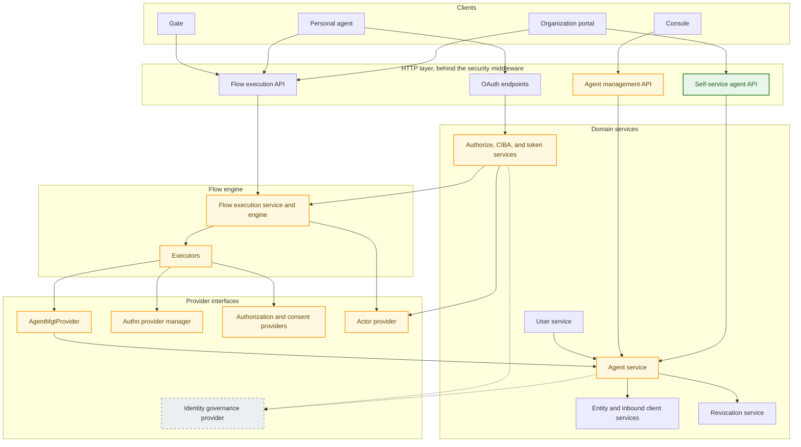

# Personal Assistant Agents Specification

- **Status:** Draft
- **Version:** 0.1
- **Related documents:** [#4468](https://github.com/thunder-id/thunderid/issues/4468) ([use cases](https://github.com/thunder-id/thunderid/issues/4468#issuecomment-5927025887)), [#4469](https://github.com/thunder-id/thunderid/discussions/4469) ([requirements](https://github.com/thunder-id/thunderid/discussions/4469#discussioncomment-18829357)), [#5368 account locking and disablement](https://github.com/thunder-id/thunderid/discussions/5368), [#5712 agent lifespan](https://github.com/thunder-id/thunderid/discussions/5712), [#5778 fixed flow values](https://github.com/thunder-id/thunderid/issues/5778), [Agent onboarding flow specification](../agent-onbaording-flow/spec.md), [RFC 8693 §4.1 `act` claim](https://datatracker.ietf.org/doc/html/rfc8693#section-4.1), [RFC 7523 private key JWT](https://datatracker.ietf.org/doc/html/rfc7523), [OpenID Connect CIBA Core 1.0](https://openid.net/specs/openid-client-initiated-backchannel-authentication-core-1_0.html)

## Summary

ThunderID models agents as organization-owned. An administrator registers them, and they act on their own authority with client credentials or on behalf of a user through the authorization code flow. A personal assistant agent is different. A customer of the organization brings it, from a vendor the organization has no relationship with. It belongs to that one customer and may only ever act for them. An agent's owner is recorded today, but nothing enforces it. The owner can be changed on update. Any user can sign in through an agent's authorization code flow. The agent can always fall back to client credentials. There is no surface where a user can manage the agents they own.

This feature makes the personal assistant agent a first-class kind of agent. A signed-in user registers their own agent through a configurable registration flow and becomes its permanent owner. Every token the agent receives names the owner as the subject and the agent as the actor, and is refused for any other subject. The owner consents for each authorization, choosing a subset of what they may delegate. The owner manages their agents through self-service APIs: pause and resume, rotate credentials, set the agent's grant types, revoke tokens, and delete. The organization sets the limits for the whole category, can see every personal agent, and can suspend one agent or a whole set. Neither the owner nor an administrator can cross to the other's side.

The governing decision is that **an agent's authority derives from its owner and is re-evaluated at every issuance**. A token is obtained through an authorization in which the owner signs in and consents: the authorization code flow, or CIBA for an agent that cannot reach them through a browser. An agent with the refresh token grant may then refresh that token. Personal agents cannot use client credentials. A personal agent gets its tokens through the same grants as any other agent acting on behalf of a user. The personal-agent rules are checks added where each concern already lives: the owner is enforced at sign-in, so a token can only carry the owner as its subject, and no token is issued while the owner is inactive.

This specification only covers the initial phase. A later version will let an agent obtain tokens from the owner's saved consent without the owner signing in each time, give owners consent management, including editing consent such as the token lifetime at the consent screen, and add further organization controls, such as requiring a credential rotation when a suspension is lifted. How issued credentials reach the agent is also outside this specification's scope. The organization documents this itself. ThunderID will only ship a reference guide and a sample agent skill for it with this iteration.

## Architecture

The feature adds no new layer. Its new parts, a flow type, fixed flow values, and the self-service routes, sit in the existing layers and follow their rules: each domain keeps its `handler → service → store` shape, flows run in the flow engine with behavior in executors, and executors reach other domains only through provider interfaces. The personal agent rules are placed in the components that already own each concern.



Green is new, yellow is changed, and dashed is planned by other work: identity governance in #5368. Unmarked components are used as they are.

| Component | Role in this feature | Change |
|---|---|---|
| Organization portal | The organization's own customer surface, registered in ThunderID as an application. Starts that application's personal agent registration flow for a signed-in user and calls the self-service agent API. ThunderID does not ship it. | Not part of ThunderID |
| Gate | Renders the owner's sign-in and consent during an agent's authorization. | Consent screen names the agent |
| Console | Administrator oversight: the personal agent inventory and suspension. It has no registration surface. | Changed/new screens (see UI) |
| Flow execution API, flow engine | Run the `PERSONAL_AGENT_REGISTRATION` flow and the personal agent login flow. The engine attaches the subject constraints, now including the owner, to authentication flows, and passes the flow type and the registering user down to the services. Flows can carry values fixed by their author (#5778). | New flow type, owner in the subject constraints, flow context passed down, fixed flow values |
| Executors | `AgentTypeResolver` accepts the new flow type. `ProvisioningExecutor` passes the flow context's agent category to `AgentMgtProvider`. `ConsentExecutor` always prompts for a personal agent. | Three changed |
| `AgentMgtProvider` | The executors' only way into the agent domain. | `agentCategory` parameter on `CreateAgent`, with the personal setup and credential choice behind it |
| Authn provider manager | Enforces the subject constraints below the flow graph, so only the owner can sign in for a personal agent. | Owner constraint |
| Authorization and consent providers | Evaluate the owner's permissions and record partial consent. | None |
| Actor provider | Builds `providers.Application` from the agent for the OAuth services and the engine. | Carries the owner and agent category |
| Authorize, CIBA, and token services | Run the existing grants. They apply the organization setting, resolve the owner for CIBA, run the agent's login flow, check that every token's subject is the owner, and add reason codes to refusals. | Personal agent checks in place |
| Self-service agent API (`/users/me/agents`) | Owner-scoped operations, handled in the agent domain. Refuses delegated tokens. | New |
| Agent management API (`/agents`) | Inventory, suspension, and the administrator restrictions. | Changed |
| Agent service | Owns the personal agent: agent category, permanent owner, credentials, holds, and revocation. Enforces that a personal agent's owner is the registering user. | Changed |
| User service | Deleting a user reaches the agent service through the resource dependency registry. Personal agents are disabled instead of blocking the deletion. | Unchanged. The agent service's dependency behavior changes. |
| Entity and inbound client services | Store the agent, its system attributes, its identifier index rows, and its OAuth client. | None |
| Revocation service | Revokes an agent's tokens by its client ID, or one token family. | New revocation reasons only |
| Identity governance (#5368) | Holds and enforces agent and owner state: pause, suspension, active. | Planned |

Within that structure:

- **Registration** reaches the agent domain only through the flow execution API, the executors, and `AgentMgtProvider`. The agent service, not the flow, enforces who owns the agent, so organizations can compose the registration flow however they need. It is started from the organization's portal by the user (owner) or by the agent itself.
- **Sign-in and token issuance** keep the existing OAuth path. The only-the-owner rule lives in the authn provider manager, through subject constraints that the engine builds from the application the actor provider supplies in the runtime. The token builder still writes the `act` claim.
- **Entity state** belongs to identity governance (#5368), reached through its provider interface. That covers the agent's own state and whether the owner is active.
- **Management** is two sets of routes in the agent domain, one per caller, over the same agent service. The agent service revokes tokens through the revocation service.

The existing seams carry most of the work. The `act` claim is already written for the authorization code, CIBA and refresh token grants. Consent already supports partial approval. Client authentication already supports `private_key_jwt`. Revocation by client ID (`app.key`) is already enforced at validation. This feature adds the ownership rules and the surfaces on top.

## Detailed design

### Identifying a personal agent

A personal agent is an agent entity (`CATEGORY = 'agent'`) whose system attributes hold `category: personal-assistant`. The agent category is a system attribute, not a schema attribute or an entity type. It is separate from the entity's `CATEGORY` column, which is `agent` for every agent. Only one agent entity type exists today (`default`), so a type cannot carry this distinction, and a schema attribute could be edited by whoever manages the schema.

The agent service sets the agent category to `personal-assistant` only when the agent is created through a personal agent registration flow. The agent management API does not accept an agent category on create. The service never changes or clears it on update. Its update path already rebuilds system attributes from the request. Like `credentialUpdatedAt`, the agent category and the other personal-agent keys below are carried forward on every write and cannot be supplied by a caller.

The service also writes the agent category and the owner as `ENTITY_IDENTIFIER` rows with source `system`. That makes "agents owned by user X" and "all personal agents" indexed lookups. Today owned agents are found by scanning every agent in memory (`getAgentsByOwner`, `internal/agent/service.go`).

### Permanent ownership

The owner of a personal agent is the authenticated user from the registration flow's context, and nothing else. The agent service enforces this, not the flow. Flows are meant to be customized freely by organization administrators, so no flow structure, executor choice, or node property is relied on to set or protect the owner.

The registering user is one of two people, in this order:

1. The user signed in by a login step inside the flow, if the flow has one. The flow engine already records such a sign-in as the flow's authenticated user (`EngineContext.AuthUser`).
2. Otherwise, the caller of the request: the subject of the validated bearer token on the flow request (`security.GetSubject`), provided the token is not a delegated token (see Delegated token restriction). The agent service already defaults an agent's owner to this caller today.

The flow engine passes the flow type, and the user from a login step when there is one, down with every executor call on the request context. It sets them from its own state, the same way it carries the subject constraints today, so no executor, input, or flow definition can supply or change them. The caller is already on the request context. `AgentMgtProvider` forwards the context to the agent service unchanged.

The engine also records the agent category on the flow context: `personal-assistant` when the flow type is `PERSONAL_AGENT_REGISTRATION`, and nothing otherwise. Like the flow type, it comes from the engine's own state, never from a node property or an input, so a flow author cannot make another flow create a personal agent. `ProvisioningExecutor` reads it and passes it to `AgentMgtProvider.CreateAgent` as a new `agentCategory` parameter:

```go
CreateAgent(ctx context.Context, agent *Agent, delegated bool, agentCategory string) (*Agent, *common.ServiceError)
```

An empty `agentCategory` keeps today's behavior. With `personal-assistant`, the provider applies the personal setup (see Credentials), and the agent service applies the rules below, checking `agentCategory` against the flow type on the context.

When the agent service creates an agent, it applies these rules:

- **A personal agent's owner is the registering user.** The service sets the owner itself. If there is no registering user, or that user is not of category `user`, creation is refused. If the request carries an owner that differs, for example a runtime `ownerId` from an `OwnerResolver` the flow author added, creation is refused rather than silently corrected.
- **A personal agent is created only in a `PERSONAL_AGENT_REGISTRATION` flow.** A request carrying `category: personal-assistant` from any other flow type, from the agent management API, or from an administration flow is refused.
- **A `PERSONAL_AGENT_REGISTRATION` flow creates only personal agents.** An agent creation in that flow type always creates an agent whose `category` value is set to `personal-assistant`, so an end user cannot use the flow to create any other agent.

`AgentMgtProvider` wraps the context as a runtime caller, which skips the administrative authorization check. That stays as it is. These rules do not depend on the caller's permissions, so they apply regardless.

The owner of a personal agent never changes after creation. Other agents keep today's behavior, where an administrator can change the owner on update.

- `resolveUpdateOwner` today accepts any existing entity as a new owner. For a personal agent, it rejects any requested owner that differs from the stored one with 403 (`AGT` error "owner of a personal agent cannot be changed").
- An empty owner on update keeps the stored one, as today.
- No self-service or administrative operation can clear or reassign the owner. This holds while the owner is suspended and after the owner is deleted. A deleted owner's agents are disabled with their owner left in place (see Owner suspension and deletion).
- For a personal agent, the owner must be a user. `validateOwnerExists` accepts any entity today, and keeps doing so for other agents.

### Delegated token restriction

A token issued to a client acting for a user carries the user as `sub` and the client as `act.sub`. Every token a personal agent receives is such a token. ThunderID's own APIs accept any token it issued unless `server.security.rest.audience` is set, and the self-service paths need no permission. Such a token rightly represents the user to the resources the user delegated it for. Without a rule, though, it would also be accepted for the owner's agent management on `/flow/execute` and on `/users/me/agents`. A personal agent could then register further agents for its owner, widen its own grant types, resume itself after a pause, or delete the owner's other agents.

A delegated token, one carrying an `act` claim, is therefore not accepted for managing personal agents:

- **Registration.** The agent service takes the caller as the registering user only when the caller's token has no `act` claim. A delegated token supplies no caller, so the creation is refused unless a user signs in during the flow.
- **Self-service.** Every `/users/me/agents` route refuses a delegated token with 403 before any agent is loaded.

The security context already holds the verified token's claims. A new helper, `security.IsDelegated(ctx)`, reports whether the token carries an `act` claim, and the agent service's registering-user resolution and the self-service handlers call it. It reads only the verified claims, so a request cannot supply or hide the answer.

### Registration flow

#### Flow type and caller rules

Personal agents are registered through a new flow type, `PERSONAL_AGENT_REGISTRATION`, rather than an existing one:

- `REGISTRATION` creates users. It refuses agent provisioning (`ErrSelfRegNotSupportedForAgents`) and requires `UserTypeResolver`.
- `ADMINISTRATION` requires the root `system` permission at every step (`validateAdministrationCaller`). An end user must never hold that permission.

A personal agent registration flow is configured per application, the same way user self-registration is. An application can have two separate registration flows: the existing user registration flow and a new personal assistant registration flow. The inbound client gains a personal agent registration flow and an enable flag, next to the existing registration flow and flag:

| Setting | Behavior |
|---|---|
| `personalAgentRegistrationFlowId` (or `personalAgentRegistrationFlowHandle`) | The application's `PERSONAL_AGENT_REGISTRATION` flow. Resolved like the other flow settings: the application's value, then the OU default, then the server default (`flow.personalAgentRegistrationFlow.defaultHandle`). |
| `isPersonalAgentRegistrationFlowEnabled` | Off by default. While off, the application refuses personal agent registration with a "personal agent registration disabled" error, as it does for a disabled user registration flow. |

A user or an agent starts it through the flow execution API with the application's `applicationId` and `flowType: PERSONAL_AGENT_REGISTRATION`, and the flow needs no administrative permission. If personal agents are disabled for the organization, starting or continuing the flow fails with a "personal agents are disabled" error.

Flow validation places no ownership or composition rules on this flow type. Organization administrators can arrange, add, and remove nodes as they need. The rules that matter are enforced by the agent service at creation (see Permanent ownership), so a flow that is composed differently, or saved before this feature, cannot bypass them. `ProvisioningExecutor` in agent mode and `AgentTypeResolver` gain `PERSONAL_AGENT_REGISTRATION` as a supported flow type.

The agent's credential type follows from what the flow collects (see Credentials). `private_key_jwt` is the recommended choice: the agent generates its own key pair and registers only the public key, so no secret is created or passes through the flow. With a client secret, the generated secret is returned in the flow response to whoever is driving the flow (see Credentials). ThunderID will ship a default personal assistant registration flow as a reference, which uses `private_key_jwt` as the authentication method.

#### Bringing the user into context

The agent service makes the registering user the owner (see Permanent ownership), so a user must be known by the time the flow creates the agent. There are two ways:

1. **The caller's token.** If the user already has a valid user token, they can attach it to the flow execution request. This can also be achieved by the portal, which can make sure each flow request carries that user's access token. The security middleware already validates it and puts its subject on the request context, and the agent service takes that caller as the owner. A delegated token never supplies a caller (see Delegated token restriction), so an agent's own token cannot register another agent.
2. **A login step in the flow.** Admin can configure the registration flow for personal agents in such a way that it embeds authentication through a `CALL` node to an authentication flow, or uses authentication executors directly. A `CALL` node already keeps `AuthUser` across the call.

**Who becomes the owner.** A registration runs over several requests, and each carries its own token. The flow does not record who started it. If a user signed in during the flow, that user is the owner, whoever drives the remaining steps. A user can sign in mid-flow and leave the agent to complete it, and the agent is still theirs. Only when no one signed in during the flow is the owner the caller of the request that runs the creation step.

**Agent-started registration.** An agent has no user token, so a registration flow that agents can start must include a login step. Configuring the flow that way is the responsibility of the organization's administrators. ThunderID does not check the flow's structure, but a flow without one fails at creation, because the agent service finds no registering user (see Permanent ownership).

The provisioning executor today authenticates the newly created entity after creation and overwrites `AuthUser` with it. For the personal agents it should skip that step. Otherwise the agent would become the flow's subject.

#### Collected information

The flow collects information the same way as the administration onboarding flow:

- The agent name is a system attribute and gets its own prompt.
- Software, version, device, and any other details are schema attributes of the resolved agent type, so each organization decides what it collects.

Any party driving the flow can submit these values, including the agent itself.

#### Values fixed by the flow author

Some values belong to the organization, not to the entity running the flow. An example would be the login flow (OBO) the agent's authorizations will run. An organization can also fix values such as the agent type, the OU, or redirect URIs, depending on how it runs registration.

The registration flow carries them as fixed values, the generic capability tracked in #5778. The flow author defines named input values as part of the flow:

- When the flow runs, the fixed values are available throughout it in the same way as collected or supplied values, so the provisioning executor reads them as it reads any other input.
- A prompt does not ask for an input the flow already provides, so the person or agent running the flow is never asked for them.
- Flow authors view and update them wherever they manage the rest of the flow, and they stay with the flow when it is saved, copied, exported, or imported.
- If a fixed value is missing or not valid where it is used, for example a login flow that is not an `AUTHENTICATION` flow, the flow fails with a clear error instead of silently using a different value.

Existing flows keep working unchanged. A registration flow that defines no login flow value gives the agent the organization default, `personalAgent.authFlow.defaultHandle`. This is not the missing-value error above, which applies when the flow uses a fixed value it does not define.

#### Credentials

`AgentMgtProvider` today hardcodes `client_secret_basic` and discards every other inbound setting. For a personal agent, it picks the credential from what the flow collected, as an input or a fixed value:

| The flow supplies | Inbound configuration | Returned on success |
|---|---|---|
| A `publicKey` (JWKS) or a `jwksUri` (recommended) | `token_endpoint_auth_method = private_key_jwt`, certificate of type `JWKS` or `JWKS_URI`, no secret | `agentId`, `clientId` |
| Neither | `client_secret_basic` | `agentId`, `clientId`, `clientSecret` |

The agent service already validates `private_key_jwt`, so the provider passes the configuration through rather than validating it again.

The provider has two setups today, chosen by the flow's `delegated` input. An agent that is not delegated gets `client_credentials`. A delegated agent gets `client_credentials`, `authorization_code`, and `refresh_token`. Neither fits a personal agent: both grant `client_credentials`, so the agent could act on its own authority, and the delegated setup also grants refresh tokens from the start. The provider therefore applies a third setup for personal agents, selected by the `agentCategory` parameter. The `delegated` input has no effect on a personal agent.

In this setup the agent gets the `authorization_code` grant by default, with response type `code` and PKCE required. The redirect URIs that grant needs are required, collected by the flow as an input or a fixed value. The registration flow can also set CIBA and `refresh_token`, and the owner can change the agent's grant types later (see Owner self-service). The agent's login flow is the registration flow's fixed value, or the organization default when the flow fixes none. `client_credentials`, token exchange, and jwt-bearer are never set for a personal agent. The agent service rejects them at creation and on update.

#### Failure and abandonment

Creation is the flow's last side effect. The agent service already deletes the entity if creating the inbound client fails. With the post-creation authentication skipped, and no group or role assignment for personal agents (see Administrator boundaries), nothing runs after creation that can fail and leave a partial agent. Abandoning the flow before provisioning creates nothing, and the stored flow context expires.

### Token issuance

#### Same path as other agents

A personal agent obtains tokens through the same grants as any agent acting on behalf of a user: authorization code, CIBA, and refresh token. There is no separate issuance path. Each personal-agent rule is a check placed where that concern is already handled:

| Rule | Where it is enforced |
|---|---|
| Only the owner can be the subject | During sign-in, through the subject constraints below the flow graph, and again at token issuance for every grant (see The owner is the only subject). |
| No `client_credentials`, token exchange, or jwt-bearer | The existing per-client grant check (`IsAllowedGrantType`) at the token endpoint. A personal agent's configuration never holds these grants, and the agent service refuses them at creation and on update. |
| Personal agents are enabled for the organization | The token service, next to the per-client grant check. It is also checked when an authorization or CIBA request starts, so the owner is not asked to sign in for a request that will be refused. |
| The owner is active | See The owner is active. |
| The agent itself is not blocked or expired | ships with #5368 |

A refusal carries a stable reason code, `personal_agents_disabled` or `not_owner`, so the agent can tell its owner why. A refusal because the owner or the agent is not active comes from identity governance (#5368), with the reason it discloses. The token and CIBA endpoints return it as an `error_reason`. For an authorization code request, the refusal is redirected to the agent's redirect URI as `error=access_denied` with an `error_reason` parameter. Every such refusal publishes a `DELEGATION_DENIED` event (see Observability).

#### The owner is active

A token for a personal agent is issued only while its owner is active. With #5368, identity governance blocks token issuance for any user who is not active as the subject, and the owner is the `sub` of every personal-agent token, so no token is issued for an inactive owner through any grant, including refresh. Until #5368 lands, ThunderID users have no state other than `ACTIVE`, and a token request is refused only when the owner entity no longer exists.

#### The owner is the only subject

A user other than the owner must be refused after authentication and before an authorization code is issued, and no token may be issued for anyone but the owner. Neither check depends on the flow, so a flow author cannot remove them:

- `SubjectTypeConstraints` gains `RequiredSubjectID`. The flow engine already attaches constraints from the application for authentication flows (`flowexec/engine.go`). For a personal agent it also sets the owner's entity ID. `PermitsSubject` refuses any resolved subject whose ID differs, and `checkSubjectAllowed` returns `ErrorSubjectNotAllowed`. The flow then fails with an end-user error, which the authorization callback already maps to `access_denied`.
- For this, `providers.Application` carries `Owner` and `AgentCategory`. `actorprovider/utils.go` today copies only `name` and `clientId` out of the agent's system attributes. It will copy these two as well.
- As a backstop that does not depend on the flow, the authorization callback (`handleSuccessCallback`) and the CIBA callback compare the asserted user with the owner before issuing a code or marking the request authenticated.
- At token issuance, the token service compares the subject the grant resolved with the agent's owner before the token is built, for every grant: authorization code, CIBA, and refresh token. A mismatch is refused with `not_owner`. The checks above apply only where the owner signs in, during authorization code and CIBA requests. This issuance check is the one that holds for every grant the agent uses, including refresh. The actor provider supplies the owner with the OAuth client, as it does for `providers.Application`.

#### Tokens carry the owner and the agent

Every token issued to a personal agent has `sub` = owner and `act.sub` = agent. This already holds for agents on the authorization code, CIBA, and refresh token grants. The refresh token grant replays the actor recorded at issuance. No grant returns a token for the owner without the actor claim, or a token for the agent alone. `client_credentials` is never in a personal agent's configuration, and the agent service refuses it at creation and on update.

#### Owner signs in and consents

Each authorization requires the owner to authenticate and consent:

- **Authorization code.** The agent authenticates with its own credential at the token endpoint. `private_key_jwt` is already verified against the registered JWKS or JWKS URI.
- **CIBA.** For a personal agent the request needs no `login_hint`, `id_token_hint`, or `login_hint_token`. The CIBA service resolves the user from the agent's owner and seeds the flow with that user, so the identifying step is skipped. A hint that is present and resolves to anyone else is refused with `not_owner`. The existing CIBA delivery reaches the owner.

#### The organization's login flow for personal agents

The sign-in and consent steps follow the login flow on the agent's inbound profile, as for any other client. That login flow is set when the agent is registered, from the registration flow's fixed value, or from organization's default value when the registration flow fixes none. Agents registered through the same registration flow therefore share a login flow, and an organization can configure different registration flows with different login flows.

Which login flow an agent gets at registration is decided by how the flow author builds the registration flow. After registration, neither the owner nor the agent can change it. The self-service API neither returns nor accepts any flow setting, and administrators cannot update a personal agent. Only administrators with flow and server-configuration permissions can change the registration flow's fixed value or the organization default. A change applies to agents registered afterwards.

ThunderID does not specifically validate which executors a personal agent's login flow contains. Building it is the flow author's responsibility: a personal agent's login flow should include `AuthorizationExecutor` followed by `ConsentExecutor`, and the product documentation states this requirement. ThunderID ships `default-personal-agent-auth-flow`, the default authentication flow with those two nodes added, as the organization default. A flow without `AuthorizationExecutor` grants no permission scopes, because the callback clears them when the assertion carries no authorized permissions. A flow without `ConsentExecutor` issues tokens for every requested permission the owner holds, without asking the owner, so the consent step depends on the flow author including it.

### Permissions offered and consent

The permissions offered at consent are the owner's current effective permissions intersected with those requested. ThunderID already computes this at authorization, drops anything outside it without failing the request, and returns what was granted in the token response's `scope`.

#### Consent screen

`ConsentExecutor` already prompts per permission and records partial approval. For a personal agent it changes in two ways:

- **It always prompts.** `RuntimeKeyForceConsentReprompt` is set for every personal-agent authorization, as CIBA already does. Consent is never satisfied silently from an earlier record.
- **It names the agent.** The prompt carries the agent's name and whichever details the registration flow recorded, such as a description or the software and version. What is recorded depends on how the flow author built the registration flow. The consent adapter shows what is there, so the owner can confirm which agent they are approving.

The owner may approve any subset of what is offered. Anything not selected is not granted. If the owner approves nothing, the authorization ends with `access_denied`.


### Agent lifecycle

#### Pause and suspension

Pausing and suspending are holds on the agent applied through identity governance (#5368), which stores them and refuses token issuance while one is in force. This feature decides who may apply and lift each hold: only the owner pauses and resumes an agent, and only an administrator suspends it and lifts the suspension. The two holds are independent, so lifting one leaves the other in force. Credentials and settings are untouched while a hold is in force, and lifting it needs no re-registration. The agent's read model shows each hold with who applied it, when, and for a suspension, the reason.

#### Revocation

The revocation service already supports revoking tokens by criteria. This feature adds the triggers: on each event below, the agent service revokes the agent's outstanding tokens through that service, using the `app.key` criterion (the agent's client ID) in `revoke_before_action` mode. The revocations on owner suspension and deletion come with the owner cascade, after #5368. An organization suspension revokes the agent's tokens on the identity governance side, as part of suspending it.

| Event | New revocation reason |
|---|---|
| Owner pauses the agent | `agent_paused` |
| Owner revokes the agent's tokens | `agent_tokens_revoked` |
| Agent is deleted | `agent_deleted` |
| Owner is suspended or disabled | `owner_suspended`, on each owned personal agent |
| Owner is deleted | `owner_deleted`, on each owned personal agent |

Revocation must be keyed by the agent's client ID. A personal agent's tokens carry the owner as `sub`, so revoking by the agent as subject would not reach them, and revoking by the owner as subject would also end the owner's own tokens and their other agents' tokens. `revoke_before_action` bounds each revocation at the time of the action, so a token issued after a resume or a lifted suspension is unaffected.

The agent service does not revoke tokens on delete today. This feature adds that for every agent, not only personal agents, so the personal agent path needs no separate revocation step on delete.

#### Permissions change with the owner

Each authorization runs `AuthorizationExecutor` against the owner's current permissions, and each refresh re-evaluates them. A permission the owner has lost is absent from the next token.

#### Owner suspension and deletion

When an owner is suspended, disabled, or deleted, their personal agents are disabled with them, and their tokens are revoked. The agents' records are kept with the owner in place, so they stay attributable. Today, deleting a user who owns agents is blocked by the `restrict` dependency; for personal agents the agent service instead takes part in the user's deletion as a cascade, while organization-provisioned agents keep the existing behavior.

This cascade behaviour directly depends on #5368, which introduces user states and the governance actions that apply them, and will be delivered after those efforts are complete.

### Owner self-service

New routes under `/users/me/agents` act only on personal agents owned by the caller. They use the same authentication as `/users/me`: any valid user access token, with the caller taken from the token subject. The security permission map gains `POST /users/me/agents/**` and `DELETE /users/me/agents/**` as self-service paths, alongside the existing `/users/me` entries. Each operation loads the agent and compares its owner with the subject. An agent that does not exist, is not personal, or is owned by someone else returns 404, so the API does not reveal other users' agents.

The owner can:

- List their agents with name, registered details, status and holds, registration time, and last activity.
- Update the name, description, and editable schema attributes. The owner, agent category, flow settings, and inbound configuration other than grant types are not editable through this surface.
- Set the agent's grant types to any combination of `authorization_code`, CIBA, and `refresh_token`. Any other grant is refused. The inbound client service validates the result as it does for any client: against the deployment's allowed grant types and the grant combination rules, so `authorization_code` still needs redirect URIs. A grant the owner removes is refused from then on by the existing per-client grant check, including a CIBA request in progress and any outstanding refresh token.
- Rotate the credential. For `private_key_jwt` that means replacing the public key; for a secret, regenerating it.
- Pause or resume one agent, or pause all their agents in one action.
- Revoke one agent's tokens, or revoke the tokens of all their agents in one action. The agents stay registered.
- Delete an agent.

The owner cannot lift an organization suspension. The response carries the suspension with its reason, so a portal can show it instead of offering a resume action that would fail.

Each agent has its own credential, holds, and token configuration. Nothing is shared between two agents of the same owner. An agent cannot register another agent, because registration needs a user in context and an agent's token is not accepted for registration (see Delegated token restriction). It cannot consent for one either, because the only accepted subject is the owner. Actions on one agent leave the owner's other agents and the owner's own SSO sessions alone. Revocation is keyed by the agent's client ID, never by the owner's subject.

**Last activity** is the time of the agent's last token issuance, the latest point ThunderID observes. Calls the agent makes to resource servers do not pass through ThunderID.

### Administrator boundaries

An administrator can never register a personal agent for someone else. But they can observe and stop other users' personal agents. They never use or widen them:

- **Create.** The agent management API and the administration onboarding flow cannot create a personal agent.
- **Update.** `PUT /agents/{id}` on a personal agent is refused with 403. Every editable field of a personal agent belongs to the owner.
- **Roles and groups.** The role and group services refuse a personal agent as an assignee or member. A delegated token does not use the agent's own permissions, and the client credentials grant is disabled, so such assignments would be meaningless.
- **Credentials.** No read returns a credential. The secret is already stored hashed. Only the owner can rotate the credential.
- **Tokens.** An administrator cannot get a token as or through another user's personal agent. The only subject accepted is the owner, and `client_credentials` is disabled.
- **Stopping.** An administrator can suspend an agent and lift the suspension. Suspending revokes the agent's tokens through identity governance, so administrators have no separate token revocation.

The separation runs the other way too. Owning a personal agent gives the user no system permission and no access to other agents.

A user's usages (`GET /users/{id}/usages`) list the personal agents they own, and an agent's details show its owner, so an administrator can trace in both directions.

### Organization oversight and suspension

The inventory is the existing agent list with personal-agent filters. Its filter grammar today accepts one `attribute eq "value"` term. It is extended with `and`, and with the system keys `category`, `owner`, and `status`. For example, every personal agent reporting a given software and version is:

```
category eq "personal-assistant" and software eq "assistant-x" and version eq "2.3"
```

`category` and `owner` are served from the identifier index. `status` and schema attributes are filtered within that set. Listing requires the `system` permission and is OU-scoped like the rest of the agent API.

Suspension takes a single agent or a filter:

- A single suspension applies the hold and revokes the agent's tokens.
- A bulk suspension applies the same to every match of the filter in one request and reports how many agents it suspended. It is idempotent: agents already suspended keep their original hold.
- Neither touches the owner's account, the owner's sessions, or other agents.

### Organization policy

Two organization-level settings in the server configuration govern the category:

- `personalAgent.enabled` turns personal agents on or off. While off, registration and every personal agent token request is refused. Existing agents are kept and work again when the setting is turned back on.
- `personalAgent.maxAccessTokenValidity` caps the lifetime of every access token issued to a personal agent.

### Observability

A new event type, `DELEGATION_DENIED`, is the first event mapped to the existing `observability.authorization` category. It is published whenever a personal agent's request is refused by one of the checks under Token issuance: the owner checks at sign-in and at issuance, or the organization setting. It carries the agent ID, the owner ID, the subject ID when known, the reason code, the grant or endpoint, and the correlation ID.

Successful issuance already publishes `TOKEN_ISSUED` with the subject and `act_sub`. Together these keep what the agent did separate from what the owner did directly.

### Data model

`INBOUND_CLIENT` (`configdb`) gains two columns next to `REGISTRATION_FLOW_ID` and `IS_REGISTRATION_FLOW_ENABLED`:

- `PERSONAL_AGENT_REGISTRATION_FLOW_ID VARCHAR(100)`
- `IS_PERSONAL_AGENT_REGISTRATION_FLOW_ENABLED CHAR(1) DEFAULT '0'`

These columns go in both the PostgreSQL and SQLite scripts. Existing applications get personal agent registration disabled.

No other tables or columns change. The personal agent keys are carried in `ENTITY.SYSTEM_ATTRIBUTES`: `category` and `lastTokenIssuedAt`. Pause and suspension are stored by identity governance (#5368), not by this feature.

`ENTITY_IDENTIFIER` gets two rows per personal agent with `SOURCE = 'system'`: `NAME = 'owner'` and `NAME = 'category'`. The existing `(NAME, VALUE)` index serves the lookups, and the existing `ON DELETE CASCADE` removes the rows if the agent is deleted.

### API

#### Self-service

All routes require a user access token. Every operation acts only on agents owned by the token's subject and returns 404 for any other agent.

| Method and path | Purpose |
|---|---|
| `GET /users/me/agents` | List the caller's personal agents. |
| `GET /users/me/agents/{id}` | Read one agent, including  status and holds. |
| `PATCH /users/me/agents/{id}` | Update name, description, editable schema attributes, and `grantTypes`. Any other field is rejected with 400. |
| `DELETE /users/me/agents/{id}` | Delete the agent and revoke its tokens. |
| `POST /users/me/agents/{id}/update-credentials` | Rotate. Body `{ "publicKey": <JWKS> }` or `{ "jwksUri": "..." }` for `private_key_jwt`; an empty body for a secret, returning the new `clientSecret` once. |
| `POST /users/me/agents/{id}/pause` | Pause and revoke tokens. |
| `POST /users/me/agents/{id}/resume` | Lift the owner's pause. Does not lift a suspension. |
| `POST /users/me/agents/pause` | Pause all of the caller's agents. |
| `POST /users/me/agents/{id}/revoke-tokens` | Revoke one agent's tokens. |
| `POST /users/me/agents/revoke-tokens` | Revoke the tokens of all the caller's agents. |

An agent read returns:

```json
{
  "id": "0199...",
  "name": "Spending assistant",
  "description": "Answers questions about my spending",
  "category": "personal-assistant",
  "attributes": { "software": "assistant-x", "version": "2.3", "device": "work laptop" },
  "grantTypes": ["authorization_code"],
  "status": "suspended",
  "holds": [
    { "type": "suspension", "appliedBy": "organization", "at": "2026-10-12T08:00:00Z", "reason": "Security advisory for assistant-x 2.3" }
  ],
  "registeredAt": "2026-10-01T10:00:00Z",
  "lastActivityAt": "2026-10-11T17:42:00Z"
}
```

`status` and `holds` follow the state model of #5368. On this surface a suspension's `appliedBy` is always `organization`, and the administrator's identity is not disclosed to the owner.

#### Agent management (admin endpoints)

| Method and path | Change |
|---|---|
| `GET /agents` | Filter grammar gains `and` and the keys `category`, `owner`, `status`. Responses include `category` and holds. |
| `POST /agents` | Rejects `category`. |
| `PUT /agents/{id}` | 403 for a personal agent. Other agents are unchanged. |
| `POST /agents/{id}/suspend` | Body `{ "reason": "..." }`. |
| `POST /agents/{id}/lift-suspension` | Lift an organization suspension. |
| `POST /agents/suspend` | Body `{ "filter": "...", "reason": "..." }`. Returns `{ "suspended": 1342 }`. |
| `POST /agents/{id}/roles`, `POST /agents/{id}/groups` | 403 for a personal agent. |

#### Applications

The application API gains `personalAgentRegistrationFlowId`, `personalAgentRegistrationFlowHandle`, and `isPersonalAgentRegistrationFlowEnabled`, with the same validation as the user registration flow settings: enabling requires a flow, and the flow must be of type `PERSONAL_AGENT_REGISTRATION`. Declarative application resources accept the same fields.

#### OAuth

- `/oauth2/authorize` and `/oauth2/bc-authorize` check the organization setting before the flow starts.
- `/oauth2/bc-authorize` makes the hint parameters optional for a personal agent.
- `/oauth2/token` and `/oauth2/bc-authorize` add an `error_reason` member to personal-agent refusals, and `/oauth2/authorize` adds an `error_reason` parameter to the error redirect.

### UI

#### Consent screen (Gate)

The consent step for a personal agent has a header naming the agent, followed by whichever registration details were recorded for it, such as a description or the software and version. Below it is the permission list with per-permission selection. The actions are **Allow** and **Deny**.

#### Console

- **Agents list.** A Personal filter, an Owner column, and a Status column for personal agents. Row actions: Suspend, Lift suspension.
- **Bulk suspension.** From a filtered list, a Suspend matching agents action. It asks for a reason and shows the number of agents affected before confirming. Mockup: `assets/console-bulk-suspend.png`.
- **Agent details.** Personal agents show the owner, agent category, and holds. Editing is disabled, with a note that the owner manages them. The Roles and Groups tabs are hidden.
- **User details.** Owned personal agents are listed with links.
- **Application settings.** A personal agent registration toggle and flow selector.
- **Server configuration.** The personal agent settings, and the default registration and login flow handles, alongside the existing flow handles.
- **Flow builder.** Fixed values are viewed and edited on the flow, with the rest of its configuration (#5778).

### Configuration

| Key | Default | Scope | Validation and behavior |
|---|---|---|---|
| `personalAgent.enabled` | `false` | Organization (server configuration, writable) | While false, registration and every personal-agent token request is refused. |
| `personalAgent.maxAccessTokenValidity` | `3600` seconds | Organization | Greater than zero. Caps every personal-agent access token. |
| `flow.personalAgentRegistrationFlow.defaultHandle` | `default-personal-agent-registration-flow` | Organization | Server default for an application that sets no personal agent registration flow. Must reference a `PERSONAL_AGENT_REGISTRATION` flow. |
| Application `isPersonalAgentRegistrationFlowEnabled` | `false` | Application | Enables personal agent registration for that application. |
| `personalAgent.authFlow.defaultHandle` | `default-personal-agent-auth-flow` | Organization | The login flow for a personal agent whose registration flow fixes none. Must reference an `AUTHENTICATION` flow. The shipped default contains `AuthorizationExecutor` and `ConsentExecutor`. |

The settings follow the existing server-configuration model: a read-only declarative layer merged with a writable layer, as `FlowSectionConfig` does for flow handles. The default flows are bootstrap resources. Existing deployments receive them through the bootstrap process on upgrade.

## Requirements

### R1. Allow personal agents and set their limits

**Requirement:** As an org admin, I want to allow personal assistant agents in my org and configure limits for them.

**Acceptance criteria:**

- **AC1.1:** Given `personalAgent.enabled` is false, when a registration flow is started or continued, or a personal agent requests a token through any endpoint, then the request is refused with `personal_agents_disabled`.
- **AC1.2:** Given `personalAgent.maxAccessTokenValidity` is set, when a personal agent's access token is issued, then its lifetime does not exceed that value.

### R2. Register an agent from the portal

**Requirement:** As a user, I want to register my assistant from the org's portal after signing in, without an admin and without gaining any admin access.

**Acceptance criteria:**

- **AC2.1:** Given an application with personal agent registration enabled, when either a signed-in user's portal or an agent without a token starts `PERSONAL_AGENT_REGISTRATION` for that application, then the application's flow runs without administrative permission. Given personal agent registration is disabled for the application, then the request is refused, and the application's user registration flow is unaffected.
- **AC2.2:** Given a flow request with a valid user access token, when the agent is created, then that caller is the owner. Given a delegated token carrying an `act` claim, then it supplies no caller. Given a flow with a login step, when the user signs in through any supported authentication flow, then that user is the owner.
- **AC2.3:** Given a successful registration, when the agent is created, then its owner is the registering user. Given the creation request carries a different owner, such as an `ownerId` from a node the flow author added, or there is no registering user, then the agent service refuses the creation and nothing is created.
- **AC2.4:** Given a flow collecting name, description, and schema attributes such as software and device, when the flow runs, then those values are stored on the agent as in the administration onboarding flow.
- **AC2.5:** Given a flow that supplies a public key or JWKS URI, when registration succeeds, then the result carries the agent and client IDs and no secret, and the agent can authenticate with `private_key_jwt`. Given a flow that supplies neither, then the result also carries a generated client secret.
- **AC2.6:** Given a flow abandoned before provisioning, or a provisioning failure, when the execution ends, then no agent entity, inbound client, or credential exists.
- **AC2.7:** Given a `PERSONAL_AGENT_REGISTRATION` flow composed in any way, when it creates an agent, then the agent is a personal agent. Given any other flow type or the agent management API, when a creation carries the personal agent category, then it is refused.
- **AC2.8:** Given an agent driving the flow, when it submits values for the collected fields, then they are accepted as from any other caller.
- **AC2.9:** Given a registration flow that sets fixed values, when it runs, then the created agent carries them. Given a registration flow that sets no login flow, then the agent gets `personalAgent.authFlow.defaultHandle`.

### R3. Permanent ownership

**Requirement:** As an org, I want a personal agent's owner to be permanent, so the link between agent and owner always proves the user consented.

**Acceptance criteria:**

- **AC3.1:** Given a personal agent, when any self-service or administrative operation attempts to change or clear its owner, including while the owner is suspended or after the owner is deleted, then the operation fails and the owner is unchanged.
- **AC3.2:** Given a personal agent, when an update carries a different owner, then it is rejected with 403. Through the self-service API, any agent the caller does not own returns 404.

### R4. Tell personal agents apart

**Requirement:** As an org admin, I want personal assistant agents to be distinguishable from other agents.

**Acceptance criteria:**

- **AC4.1:** Given an agent created by a `PERSONAL_AGENT_REGISTRATION` flow, when it is read, then it carries `category: personal-assistant`. Given an agent created any other way, then it carries no agent category.
- **AC4.2:** Given a personal agent, when an update omits, changes, or clears the agent category, then the stored value is unchanged.

### R5. Offer only delegable permissions

**Requirement:** As a portal developer, I want to request permissions for an agent without working out which ones the user may delegate, and rely on ThunderID to enforce it.

**Acceptance criteria:**

- **AC5.1:** Given a user and a set of requested permissions, when consent is prompted, then the offered set is the user's current effective permissions intersected with the requested set.
- **AC5.2:** Given a request for permissions the user does not hold, when authorization runs, then those permissions are dropped without failing the request and are not shown on the consent screen.
- **AC5.3:** Given a token issued for fewer permissions than requested, when the token response is returned, then its `scope` lists only what was granted.

### R6. Grant a chosen subset after signing in

**Requirement:** As a user, I want to grant my agent a specific subset of what I'm offered, after signing in.

**Acceptance criteria:**

- **AC6.1:** Given a personal agent's authorization through a login flow that includes `ConsentExecutor`, such as the shipped default, when the owner authenticates, then a consent prompt is always shown.
- **AC6.2:** Given the consent prompt, when it renders, then it names the agent and shows the details recorded for it at registration, whichever the registration flow collected.
- **AC6.3:** Given offered permissions, when the owner approves a subset, then the token carries only that subset.

### R7. Act only for the owner

**Requirement:** As an owner, I want my agent to act only on my behalf.

**Acceptance criteria:**

- **AC7.1:** Given a personal agent, when anyone other than its owner completes consent, then no consent is recorded and no code is issued.
- **AC7.2:** Given a different user signs in during a personal agent's authorization, when authentication completes, then the authorization ends with `access_denied` before a code is issued, and a `DELEGATION_DENIED` event records the agent, owner, and subject.

### R8. Never on the agent's own authority

**Requirement:** As an org, I want a personal agent to only ever act on behalf of its owner, and never on its own authority.

**Acceptance criteria:**

- **AC8.1:** Given any token issued to a personal agent, when it is decoded, then `sub` is the owner and `act.sub` is the agent.
- **AC8.2:** Given a personal agent, when it requests a token through any grant, then no token is issued that represents the owner without an `act` claim.
- **AC8.3:** Given any grant, when a personal agent's token would carry a subject other than its owner, then no token is issued, the refusal carries `not_owner`, and a `DELEGATION_DENIED` event is published.
- **AC8.4:** Given a personal agent, when it requests `client_credentials`, or a creation or update adds that grant, then the request is refused.

### R9. Token through the owner's sign-in

**Requirement:** As an agent, I want a token for my owner through the on-behalf-of flow, where my owner signs in and consents, and to refresh it when I have the refresh token grant.

**Acceptance criteria:**

- **AC9.1:** Given a personal agent with valid credentials, when it needs a new authorization, then it obtains a token only through an authorization in which the owner signs in and consents.
- **AC9.2:** Given a personal agent, when it uses the authorization code flow, then it receives a token after the owner's sign-in and consent. Given an agent with the CIBA grant, when it starts a CIBA request with no hint, then the owner is reached and, on approval, the agent receives a token.
- **AC9.3:** Given an issued token, when its permissions are inspected, then they are the owner's current effective permissions intersected with the requested and approved permissions.
- **AC9.4:** Given a registration flow that fixes a login flow, when an agent registered through it starts an authorization, then that login flow runs. Given a registration flow that fixes none, then `personalAgent.authFlow.defaultHandle` runs.
- **AC9.5:** Given an owner, when they use the self-service API, then no flow setting is returned or accepted. Only administrators with flow and configuration permissions can change the personal agent flows.
- **AC9.6:** Given an agent with the refresh token grant, when it refreshes, then the new token has `sub` = owner and `act.sub` = agent. Given the grant is removed from the agent, then the next refresh is refused.
- **AC9.7:** Given a refresh token issued to a personal agent, when any other client presents it, then it is refused. Only the agent it was issued to, authenticating with its own credentials, can use it.

### R10. Access depends on current state

**Requirement:** As an org, I want a personal agent's access to depend on its owner and its own state at the moment each token is issued, not at the moment of consent.

**Acceptance criteria:**

- **AC10.1:** Given an agent that is paused or suspended, when it requests a token through any grant, then the request is refused by identity governance (#5368). Given the owner is not active, then the request is refused by identity governance (#5368), because the owner is the token's subject.
- **AC10.2:** Given an agent with outstanding tokens, when it is paused or suspended, then those tokens fail validation. Given it is then resumed or the suspension is lifted, then it obtains new tokens without re-registering.
- **AC10.3:** Given the owner loses a permission, when the agent's next token is issued or refreshed, then that permission is absent.
- **AC10.4:** Given an agent with outstanding tokens, when it is deleted, then those tokens fail validation.
- **AC10.5:** Given an owner who is not active, when any of their agents requests a token, then it is refused. Given the owner is suspended, disabled, or deleted, then their personal agents are disabled with them, their outstanding tokens fail validation, and their records are kept with the owner in place.

### R11. Owner sees and manages their agents

**Requirement:** As a user, I want to see and manage every agent I own and what each one can do, from the portal.

**Acceptance criteria:**

- **AC11.1:** Given an owner, when they list their agents, then each entry shows name, registered details, status and holds, registration time, and last activity.
- **AC11.2:** Given a personal agent, when a user other than its owner reads, updates, deletes, or acts on it through the self-service API, then the response is 404. Through the agent management API without the `system` permission, it is 403. Given a delegated token carrying an `act` claim, including the agent's own token for its owner, when it calls any self-service agent route, then the response is 403.
- **AC11.3:** Given an owner, when they rotate an agent's credential, then the agent keeps its identity and settings, and the old credential no longer authenticates.
- **AC11.4:** Given two agents of the same owner, when one is registered, consented, or changed, then the other's credentials, holds, and settings are unaffected. Neither agent can register or consent for another.
- **AC11.5:** Given an owner with several agents and an active SSO session, when they act on one agent, then their other agents and their session are unaffected.
- **AC11.6:** Given an owner, when they set an agent's grant types from `authorization_code`, CIBA, and `refresh_token`, then the agent uses only those grants afterwards. Given they include any other grant, or a combination the inbound client rules reject, then the update is refused.

### R12. Pause, resume, and stop everything

**Requirement:** As a user, I want to pause an agent and resume it later with its settings intact, and to stop all my agents at once when I think something is wrong.

**Acceptance criteria:**

- **AC12.1:** Given an active agent, when the owner pauses and later resumes it, then its credentials and settings are unchanged and it can obtain tokens again.
- **AC12.2:** Given an owner with several agents, when they pause all, then every one of their agents is paused. When they revoke all, then every token of every one of their agents fails validation, and the agents stay registered.
- **AC12.3:** Given a paused agent, when the owner reads it, then it shows as paused with when and by whom.
- **AC12.4:** Given an agent suspended by the organization, when the owner reads it, then it shows as suspended by the organization with the reason. When the owner calls resume, then the suspension stays in force.
- **AC12.5:** Given an agent both paused and suspended, when either hold is lifted, then the other stays in force and token requests are still refused.

### R13. Organization visibility without use

**Requirement:** As an org security team, I want to see all personal agents and their owners, without being able to use them or widen their access.

**Acceptance criteria:**

- **AC13.1:** Given an admin, when they list agents filtered by agent category, owner, status, or registered details, then matching personal agents are returned with owner, registered details, status, and last activity.
- **AC13.2:** Given an admin, when they try to create a personal agent for another user, update another user's personal agent, assign one a role or group, read its credential, or obtain a token as or through it, then each attempt is refused.
- **AC13.3:** Given an admin, when they suspend a personal agent, then the operation succeeds and the agent's outstanding tokens fail validation. No admin operation revokes a personal agent's tokens on its own.
- **AC13.4:** Given a user who owns personal agents, when an admin reads the user's usages, then those agents are listed. When an admin reads a personal agent, then its owner is shown.

### R14. Suspend one or many

**Requirement:** As an org security team, I want to suspend one agent, or every agent matching a filter, in one action, without affecting the owners, and be the only one who can lift that suspension.

**Acceptance criteria:**

- **AC14.1:** Given an admin who does not own the agent, when they suspend a personal agent, then it is suspended.
- **AC14.2:** Given a filter such as a software and version, when an admin suspends by filter, then every matching agent is suspended in one request and the count is returned.
- **AC14.3:** Given a suspension, when it is applied, then only the targeted agents are affected. The owners' accounts, sessions, and other agents keep working.
- **AC14.4:** Given a suspended agent, when it requests a token, then it is refused, with the reason disclosed as identity governance (#5368) allows.
- **AC14.5:** Given a suspended agent, when an admin lifts the suspension, then the agent can obtain tokens again. Only an admin can lift a suspension.

## Change log

| Version | Date | Change |
|---|---|---|
| 0.1 | 2026-10-13 | Initial specification. |
