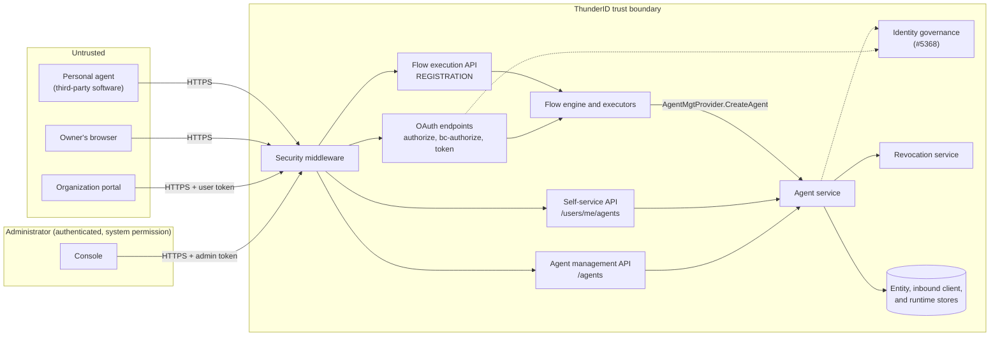
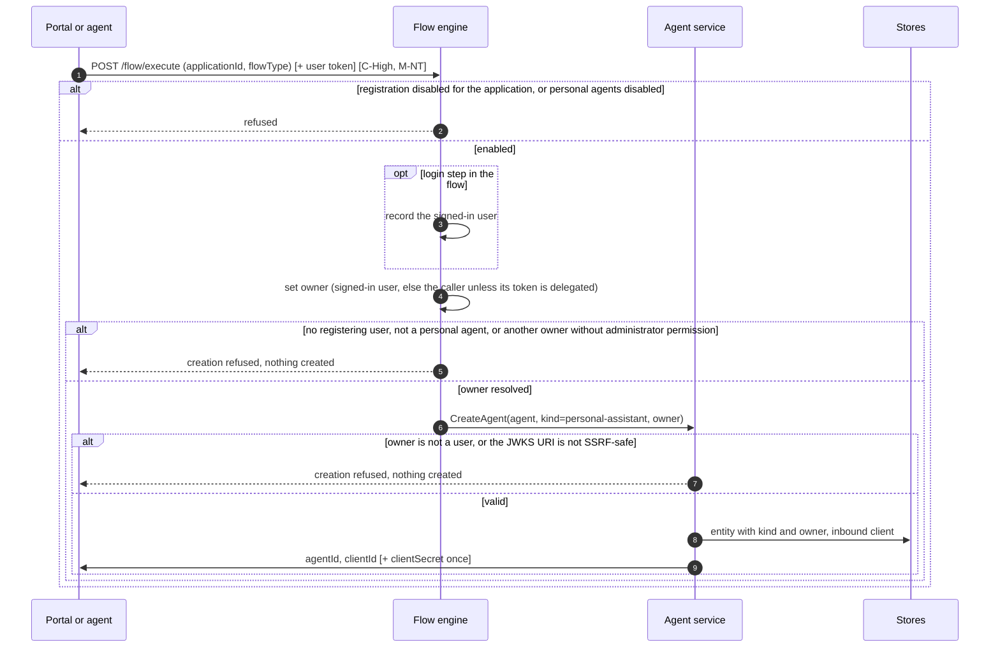
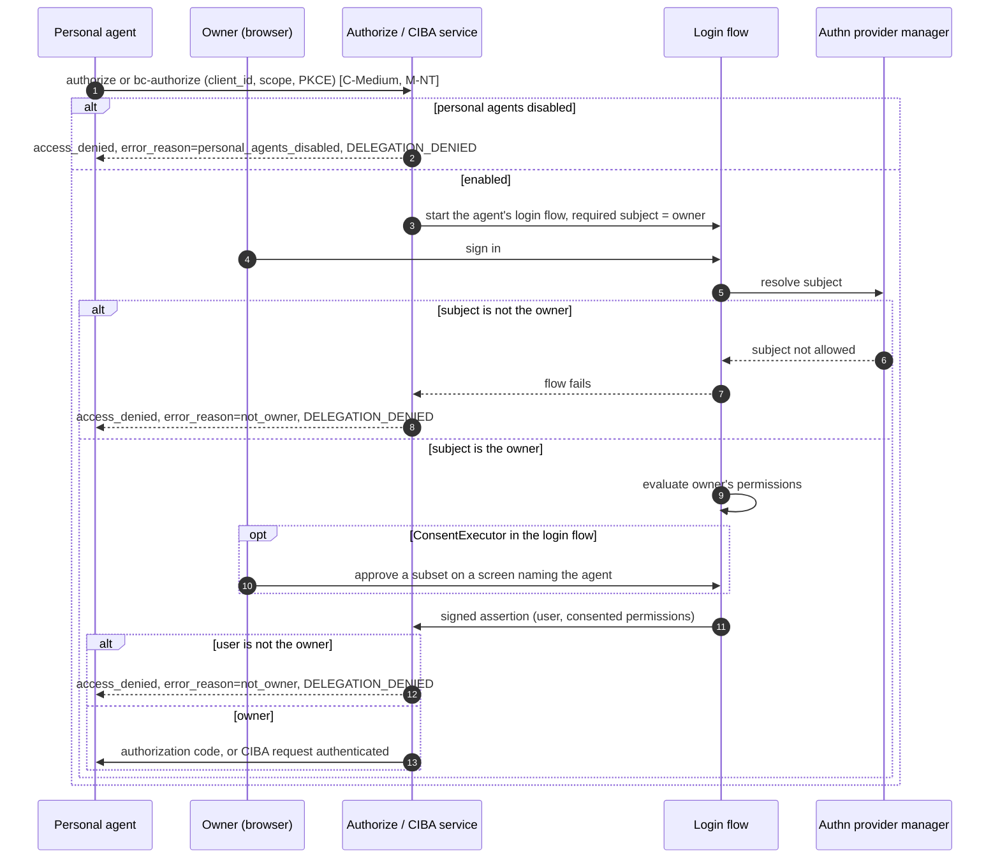
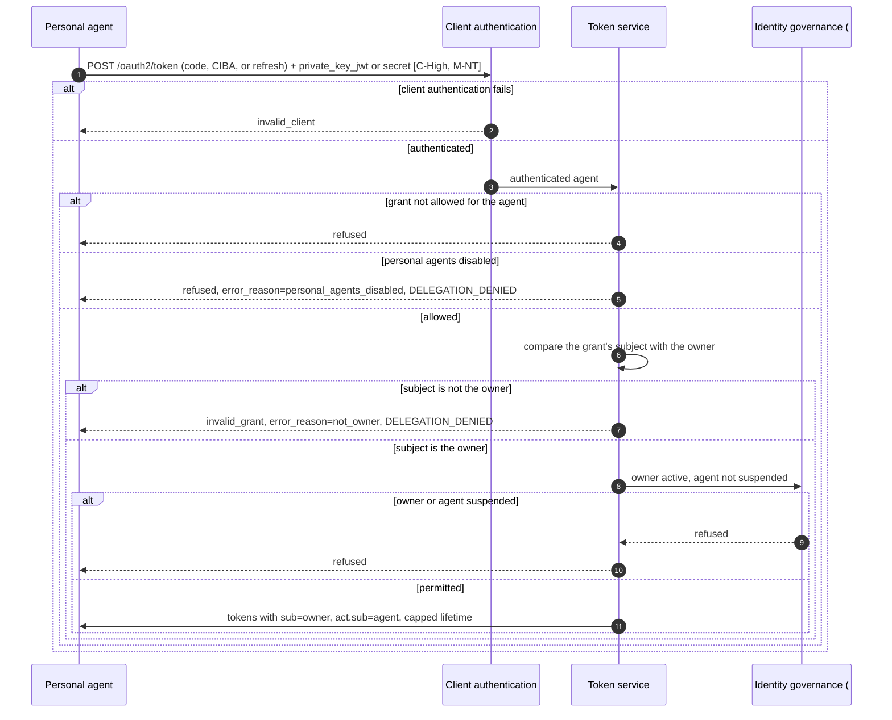
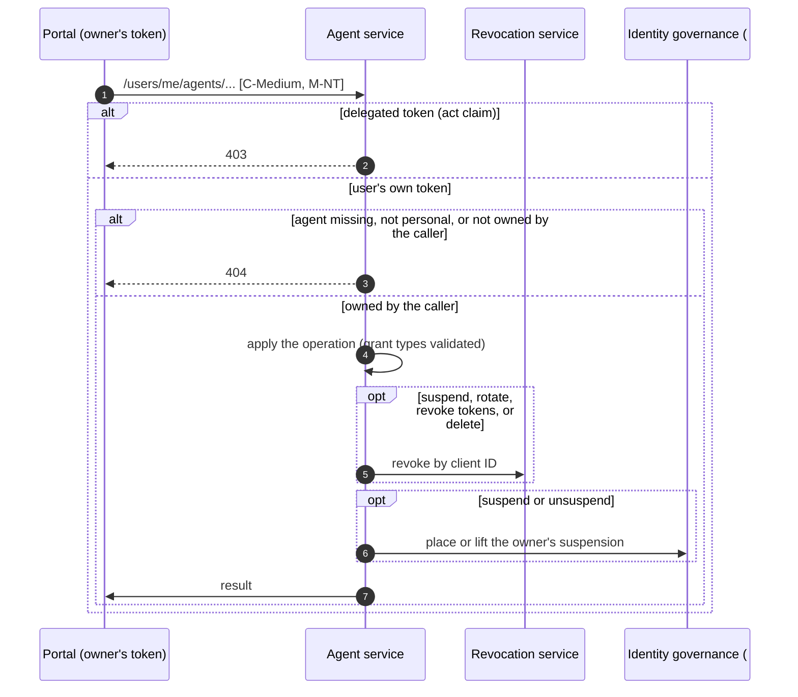
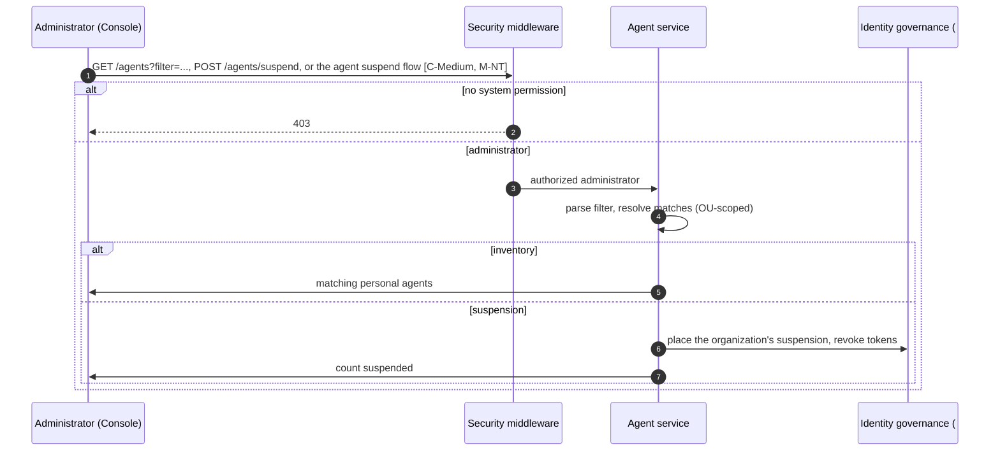
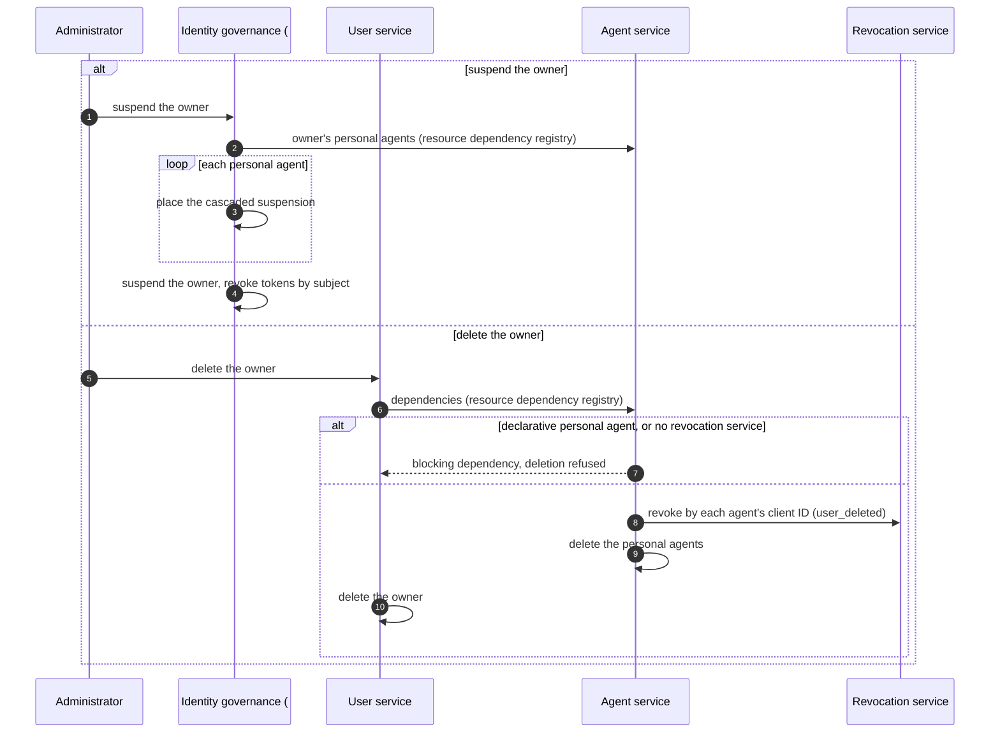

# Personal Assistant Agents Threat Model

This model covers personal assistant agents as specified in [spec.md](spec.md): their registration through a `REGISTRATION` flow, the on-behalf-of authorizations and token issuance for their owner, owner self-service, and organization oversight and suspension.

## Overview

A personal assistant agent is third-party software that a customer brings to the organization. It is registered by the customer, bound permanently to that customer as its owner, and may only obtain access and refresh tokens that carry the owner as the subject and itself as the actor, after the owner signs in and, where the login flow asks for it, consents. The agent is untrusted: the organization does not control its code, its vendor, or the device it runs on. The security of the feature rests on four properties: the owner is bound once and cannot change, no token is issued for any subject other than the owner, the agent cannot act on its own authority, and neither the owner nor an administrator can cross into the other's side.

Entry points: `POST /flow/execute` with `flowType: REGISTRATION`, `GET /oauth2/authorize`, `POST /oauth2/bc-authorize`, `POST /oauth2/token`, the self-service routes under `/users/me/agents`, and the agent management routes under `/agents`.

Cross-cutting concerns covered elsewhere: grant processing for `authorization_code` and `refresh_token` ([OAuth 2.0 Authorization and Core Grants Threat Model](../oauth/authorization-and-core-grants/threat-model.md)); client authentication including `private_key_jwt`, CIBA, and token signing (Token and Protocol Features model); the flow engine and the login flows it runs (Flow Execution model); revocation enforcement (Token Revocation model); account states, locks, and suspension enforcement (identity governance, #5368). These are trust inputs here, not re-analysed.

## Scope

This model covers:
- Personal agent registration: flow selection per application, resolution of the registering user, owner and kind enforcement at creation, credential issuance
- The owner's sign-in and consent for a personal agent's authorization code and CIBA requests, including the owner-only rule
- Token issuance and refresh for personal agents: the grant restrictions, the issuance-time owner check, the organization setting, and the access token lifetime cap
- Owner self-service under `/users/me/agents`, including the owner's suspension of their agents
- Administrator registration for a user, inventory, single and bulk suspension, and the administrator restrictions on personal agents
- The owner lifecycle cascade when an owner is suspended or deleted

Out of scope (see the referenced companion models):
- Generic processing of the `authorization_code` and `refresh_token` grants (PKCE, code binding, refresh rotation), covered by the OAuth 2.0 Authorization and Core Grants Threat Model
- `private_key_jwt` verification, CIBA request handling and delivery, and token signing, covered by the Token and Protocol Features model
- The authentication steps inside login flows (credentials, MFA, federation), covered by the Flow Execution model
- Enforcement of revocation at ThunderID and at resource servers, covered by the Token Revocation model
- How account states are stored and enforced, including the token revocation that an organization suspension performs, covered by identity governance (#5368).
- Items deferred to V2: issuance from saved consent, consent management, session listing, per-user agent caps, and grant-type policy for the category

## Architecture



### Components

The personal-agent rules sit in the components that already own each concern, so no new path bypasses the existing layers.

| Component | Task |
| --- | --- |
| Security middleware | Validates bearer tokens on every request and puts the verified subject and claims on the request context. |
| Flow engine and executors | Runs the application's `REGISTRATION` flow and the agent's login flow. Records the user signed in during the flow from its own state, so no input or node can supply it. `ProvisioningExecutor` sets the owner to the registering user, refuses another owner unless the request's token may create agents for others, and in a `REGISTRATION` flow creates only personal agents. Attaches the owner as a required subject to authentication flows for a personal agent. |
| `AgentMgtProvider` | The executors' only way into the agent domain. Passes the agent to the agent service as the executor built it. |
| Agent service | Applies the personal-agent client setup on every creation path: `authorization_code` with PKCE by default, `private_key_jwt` when a public key or JWKS URI is supplied, never `client_credentials`, token exchange, or jwt-bearer. Checks that the owner is a user, keeps the owner and kind immutable, places and lifts the owner's suspension through identity governance, deletes a deleted owner's personal agents, and triggers revocation by the agent's client ID. |
| Authorize, CIBA, and token services | Run the existing grants. They apply the organization setting, resolve the owner for CIBA, compare the signed-in user and the token's subject with the owner, and add reason codes to refusals. |
| Authn provider manager | Enforces the subject constraints below the flow graph, refusing any signed-in subject other than the owner. |
| Consent executor | Prompts on every authorization when the client's `loginConsent.alwaysPrompt` is set, which a personal agent gets by default, names the agent, and records the owner's chosen subset. |
| Self-service API | Owner-scoped operations on the caller's own personal agents. |
| Agent management API | Administrator inventory, bulk suspension, and registration of a personal agent for a user, with updates and role and group assignment refused. |
| Identity governance (#5368) | Holds an agent's suspensions by the organization, by the owner, and with the owner's account, each apart from the others, and enforces agent and owner state at client authentication, authorization, and token issuance. Runs the agent suspend and unsuspend administration flows. |
| User service | Deleting a user reaches the agent service through the resource dependency registry. |
| Revocation service | Existing criteria-based revocation; personal-agent events revoke by the agent's client ID (`app.key`). |

### Actors

#### Actors

| Actor | Description | Roles or permissions |
| --- | --- | --- |
| Owner | A customer of the organization who registers a personal agent, approves its authorizations, and manages it. | Authenticated user, no administrative permission |
| Personal agent | Third-party software registered by the owner. Authenticates with its own credential and requests tokens on the owner's behalf. Untrusted. | OAuth client limited to `authorization_code`, CIBA, and `refresh_token` |
| Administrator | Organization staff who configure registration and login flows, view the personal agent inventory, and suspend agents. Can register a personal agent for a user, who becomes its owner. | `system` permission, or the agent management permission in the agent's OU |
| Flow author | Organization staff who build the registration flows and the login flows personal agents run. Their choices decide whether consent is shown, which login flow an agent gets, which values are fixed and which are collected from whoever drives the flow, and whether agent-started registration is possible. | Flow management permission |
| Compromised agent vendor | The vendor of a personal agent's software, or an attacker who has compromised that software. Holds what the software holds on every device it runs on, so it affects every owner running it at once. | Each agent's own credential and tokens |
| Malicious actor | Another user, a compromised or malicious agent, or an external attacker trying to bind an agent to a victim, obtain tokens for someone other than the agent's owner, widen an agent's grants, or keep an agent working after it should stop. | N/A |

#### Entitlement matrix

| Actor | Register a personal agent | Sign in and consent for an agent | Obtain a token through an agent | Manage an agent (self-service) | View inventory | Suspend or lift suspension | Change an agent's owner |
| --- | --- | --- | --- | --- | --- | --- | --- |
| Owner | [Yes], becomes the owner | [Yes], only for their own agents | [No], the agent obtains it | [Yes], own agents only | [No] | [No], suspends their own agents with a separate suspension | [No] |
| Personal agent | [No], can start the flow but a user must sign in or be the caller | [No] | [Yes], for its owner only, after the owner's sign-in | [No] | [No] | [No] | [No] |
| Administrator | [Yes], for themselves or for a user, who becomes the owner | [Yes], for their own agents only | [No], for others' agents | [Yes], own agents only | [Yes] | [Yes] | [No] |
| Flow author | [No], decides how registration runs | [No], decides whether consent is shown | [No] | [No] | [No] | [No] | [No] |
| Compromised agent vendor | Only through owners who register the software | [No] | [Yes], through each owner's agent, for that owner only and within what they approved | [No] | [No] | [No] | [No] |
| Malicious actor | Only by having a victim complete the flow | [No] | [No], without the owner's sign-in | [No] | [No] | [No] | [No] |

### External Dependencies (not owned)

| Dependency | Description (usage, purpose, authentication, authorization, security) |
| --- | --- |
| OAuth grant handlers | Authorization code exchange, PKCE, refresh rotation, and the binding of a refresh token to the client it was issued to. Covered by the OAuth 2.0 Authorization and Core Grants Threat Model. |
| Client authentication and CIBA | `private_key_jwt` verification with `jti` replay protection and `iat`/`exp` bounds; CIBA request handling, `binding_message`, and expiry clamping. Covered by the Token and Protocol Features model. |
| Flow engine and login flows | Authenticates the owner at registration and at each authorization, and returns a signed assertion. Covered by the Flow Execution model. |
| Identity governance (#5368) | Stores an agent's suspensions by the organization, by the owner, and with the owner's account, refuses a suspended agent or owner at client authentication, authorization, and token issuance, and runs the agent suspend and unsuspend administration flows. Specified in the account lock and suspension specification (#5442). |
| Fixed flow values (#5778) | Lets a flow author fix values such as the agent's login flow on the registration flow. Planned. |
| Revocation service | Writes and enforces revocation criteria. Covered by the Token Revocation model. |
| Runtime and identity stores | Hold agent entities and their system attributes, inbound clients, flow contexts, and revocation records. Encryption and access control are managed at the infrastructure layer. |

## Threats and mitigations

### Out-of-scope interactions and risks

- PKCE, authorization code binding, and refresh token rotation and replay detection, covered by the OAuth 2.0 Authorization and Core Grants Threat Model.
- `private_key_jwt` assertion verification and CIBA request processing, covered by the Token and Protocol Features model.
- The strength of the authentication steps in a login flow, covered by the Flow Execution model. This model relies only on the subject the flow resolves and the signed assertion it returns.
- Resource servers that validate tokens locally without consulting revocation, covered by the Token Revocation model. Their exposure is bounded here by `personalAgent.maxAccessTokenValidity`.
- Resource servers recording the `act` claim to attribute actions to the agent: the responsibility of the resource server.
- How the agent stores its private key, secret, and tokens on its own device: the responsibility of the agent and its vendor.
- How issued credentials reach the agent: documented by the organization; outside this feature.
- Rate limiting, lockout, and bot detection: outside the product's core, applied at the deployment or gateway layer.

### Interactions

#### [01]: Personal agent registration

**Description**

The organization's portal, carrying the signed-in user's token, or the agent itself, starts the application's `REGISTRATION` flow through `POST /flow/execute`. The application must have registration enabled, and personal agents must be enabled for the organization. The flow collects the agent's details and either a public key or JWKS URI (`private_key_jwt`) or nothing (a generated client secret). `ProvisioningExecutor` sets the owner to the registering user: the user signed in during the flow, otherwise the validated caller of the creation request, unless the caller's token is delegated. In a `REGISTRATION` flow it creates only personal agents. It passes the agent to `AgentMgtProvider.CreateAgent`, and the agent service applies the personal setup, checks that the owner is a user, and checks that a JWKS URI is SSRF-safe. The flow returns the agent and client IDs, and the client secret once when one was generated.

**Assets involved**

| Initiator | Intermediate | Target |
| --- | --- | --- |
| Organization portal (with the user's token) or personal agent | Flow engine, `ProvisioningExecutor`, `AgentMgtProvider` | Agent service, entity and inbound client stores |

**Data flow**



**Security considerations**

| Area | Response | Comments |
| --- | --- | --- |
| Data confidentiality | [C-High] | A generated client secret and the agent's registered key material pass through this interaction. |
| Communication medium | [M-NT] | |
| Transport security | [TLS] | |
| Authentication | User token or a login step in the flow | The registering user comes from a sign-in during the flow or from the caller's validated token, when that token is not delegated. |
| Accessibility | [Public] | `/flow/execute` is a public path; the flow needs no administrative permission. |
| Authorization and Access Control | Ownership enforced at creation | The application must enable registration and the organization setting must be on. Who owns the agent is decided at creation from the engine's state and the request's token, not by the flow's composition, so a custom flow composition cannot change it. |

**Threat assessment**

| ID | Category | Threat | Materializable | Mitigation / comment |
| --- | --- | --- | --- | --- |
| 1 | [Elevation of Privilege] | A client holding a delegated token for the user, including a personal agent holding an on-behalf-of token for its owner (`sub` = owner, `act.sub` = agent), runs the registration flow with that token and registers further agents owned by the user without the user taking part. | [No] | `ProvisioningExecutor` takes the caller as the registering user only when the caller's token has no `act` claim (`security.IsDelegated`), so a delegated token supplies no caller and the creation is refused unless a user signs in during the flow. See the specification's "Delegated token restriction". |
| 2 | [Tampering] | A flow author or a submitted input sets a different owner (for example through an `OwnerResolver`), or a registration flow creates an agent that acts on its own authority. | [Yes] | The owner is the registering user. Another owner is accepted only when the request's token carries the `system` permission or the agent management permission in the agent's OU and is not delegated; otherwise creation is refused. An owner selection is read from runtime data, which submitted inputs cannot set. In a `REGISTRATION` flow only personal agents are created, and an agent of any other kind or with no kind is refused. The agent service checks that the owner is a user. These checks read the request's token, not the runtime context the provider uses, so that context does not bypass them. |
| 3 | [Elevation of Privilege] | Flow inputs or fixed values give a personal agent `client_credentials`, token exchange, or jwt-bearer, so it can obtain tokens on its own authority or outside the owner's sign-in. | [No] | The agent service applies the personal setup on every creation path regardless of the `delegated` input, and rejects these grants at creation and on update. |
| 4 | [Spoofing] | An agent registers with a self-asserted name, software, or version that imitates a trusted assistant, and the owner approves authorizations believing it is that assistant. | [Yes] | The consent screen, in a login flow that includes it, names the agent and shows its registered details, but these are supplied by whoever drives the flow and are not verified. The owner sees every agent in self-service and can delete it. Bounded residual; see Residual risks. |
| 5 | [Spoofing] | An attacker starts an agent-initiated registration with their own key and hands the continuation to a victim, who signs in and becomes the owner of an attacker-controlled agent. | [Yes] | The attacker's agent still needs the victim to sign in, and to consent where the login flow includes it, for every authorization. A new agent holds only `authorization_code`; CIBA must be added by the owner through self-service, which the agent's own token cannot do, so the attacker cannot send CIBA requests unless the victim enables them. The victim sees the agent in self-service and can delete it. How the registration flow guards against this, for example by showing the agent and asking the user to confirm before creation, is the flow author's responsibility. The trade-off is explicit: agent-started registration needs a login step in the flow, and that login step is what makes this attack possible. An organization that leaves the login step out removes this attack, and with it agent-started registration: only a caller with a user token, such as the portal, can then register an agent. Bounded residual; see Residual risks. |
| 6 | [Information Disclosure] | A generated client secret is exposed to whoever drives the flow, or retained in the flow's runtime state for the rest of the run. | [No] | `private_key_jwt` is the recommended credential and the reference flow uses it, so no secret is created or passes through the flow. A generated secret is returned once, stored hashed, never returned by any read, and not logged. |
| 7 | [Tampering] | A failed creation leaves a partial agent, or the post-creation authentication makes the agent the flow's subject. | [No] | The agent service deletes the entity if creating the inbound client fails. For agents the provisioning executor skips the post-creation authentication, and no group or role assignment runs after creation. |
| 8 | [Denial of Service] | A user, or an automated agent working through a user's session, registers a large number of agents for one owner. | [Yes] | Each registration needs a registering user, signed in during the flow or the caller, the application must enable registration, and abandoned flow contexts expire. There is no per-user agent cap in V1. Request rate limiting belongs at the gateway. Bounded residual; see Residual risks. |
| 9 | [Information Disclosure] | A user registers an agent, or rotates its credential, with a JWKS URI pointing at an internal address, so that ThunderID fetches from inside its network. | [No] | The agent service accepts a JWKS URI only when it is SSRF-safe, at registration and at rotation, as for client ID metadata documents: it must be an HTTPS URL whose host is not a loopback, link-local, or private IP address. |

#### [02]: Owner sign-in and consent for an agent's authorization

**Description**

The agent sends the owner to `GET /oauth2/authorize`, or calls `POST /oauth2/bc-authorize` for CIBA. The organization setting is checked before the flow starts. The agent's login flow runs, with the owner attached as the only permitted subject. The owner signs in; `AuthorizationExecutor` evaluates the owner's current permissions against those requested; when the login flow includes `ConsentExecutor`, it prompts on every authorization through the agent's `loginConsent.alwaysPrompt`, names the agent, and records the subset the owner approves. A login flow reuses an SSO session only when the session's subject is the owner. The callback compares the signed-in user with the owner before issuing a code or marking the CIBA request authenticated.

**Assets involved**

| Initiator | Intermediate | Target |
| --- | --- | --- |
| Personal agent | Owner's browser, flow engine and login flow, consent executor | Authorize and CIBA services, authorization code |

**Data flow**



**Security considerations**

| Area | Response | Comments |
| --- | --- | --- |
| Data confidentiality | [C-Medium] | The code and the owner's identity claims pass through the browser; consent shows the agent's registered details to the owner. |
| Communication medium | [M-NT] | |
| Transport security | [TLS] | |
| Authentication | Owner sign-in through the agent's login flow | The agent is authenticated later, at the token endpoint. |
| Accessibility | [Public] | |
| Authorization and Access Control | Owner-only subject, enforced below the flow and at the callback | The owner is a required subject in the subject constraints, which a flow author cannot remove, and an SSO session of anyone else is not reused. The callback checks the owner again. Consent depends on the login flow including `ConsentExecutor`. |

**Threat assessment**

| ID | Category | Threat | Materializable | Mitigation / comment |
| --- | --- | --- | --- | --- |
| 1 | [Elevation of Privilege] | A user other than the owner signs in through a personal agent's authorization, so the agent obtains a token for someone it does not belong to. | [No] | The engine attaches the owner as a required subject and the authn provider manager refuses any other subject before consent. An SSO session whose subject is not the owner is not reused, so the flow asks for a fresh sign-in. The callback compares the asserted user with the owner before issuing a code or marking the CIBA request authenticated. The refusal is `access_denied` with `not_owner`, and a `DELEGATION_DENIED` event is published. |
| 2 | [Tampering] | A login flow without `ConsentExecutor` issues a code without the owner's consent, covering every requested permission the owner holds. | [Yes] | Consent is not enforced outside the flow; building the login flow is the flow author's responsibility. The shipped default login flow contains `AuthorizationExecutor` and `ConsentExecutor`, and the documentation states the requirement. The token still never exceeds the owner's own permissions, and the owner-only rule still applies. Bounded residual; see Residual risks. |
| 3 | [Elevation of Privilege] | The agent over-requests permissions, or a login flow drops `AuthorizationExecutor`, so the token carries permissions the owner does not hold or did not approve. | [No] | The offered set is the owner's effective permissions intersected with those requested, and, where the login flow includes consent, the owner approves a subset. Without an authorization decision the assertion carries no authorized permissions and the callback clears permission scopes, so the request fails closed. |
| 4 | [Elevation of Privilege] | Consent is satisfied silently from an earlier record, so the owner never sees what a later request asks for. | [No] | A personal agent is created with `loginConsent.alwaysPrompt` on unless its registration sets it otherwise, so whenever the login flow includes `ConsentExecutor`, consent is prompted for every authorization and an earlier record never satisfies it. Neither the owner nor the agent can change the setting through self-service. Flows without consent are covered by [02]-2. |
| 5 | [Spoofing] | A CIBA request for a personal agent names another user in `login_hint`, `id_token_hint`, or `login_hint_token`. | [No] | The CIBA service resolves the user from the agent's owner; a hint that resolves to anyone else is refused with `not_owner`. Hints are optional for a personal agent, a deliberate deviation from CIBA Core §7.1, which requires exactly one; other clients still need one. |
| 6 | [Spoofing] | A compromised or malicious agent, or an attacker whose agent a victim was led to own ([01]-5), sends repeated CIBA requests. Each one delivers an organization-branded message to the owner carrying the agent's self-chosen name and `binding_message`, so the attacker can send the owner messages with their own text and links, hope the owner approves one by mistake, and run up delivery cost. | [Yes] | CIBA is not enabled for a new agent; only the owner can add it, through self-service. Each request needs the agent's own client authentication. Approving needs the owner's sign-in, and consent on a screen naming the agent where the login flow includes it, and the request expires. The owner can remove the CIBA grant, suspend, or delete the agent, which refuses requests in progress. The product does not limit the number of requests per agent or owner, and the message content is supplied by the agent. Request rate limiting belongs at the gateway. Bounded residual; see Residual risks. |
| 7 | [Repudiation] | Refused delegations leave no trace, so attempts to use an agent for another user go unnoticed. | [No] | Every refusal by the owner checks or the organization setting publishes `DELEGATION_DENIED` with the agent, owner, subject, reason, and endpoint. The event belongs to the `observability.authorization` category, and observability is off by default, so refusals leave a trace only where the organization turns observability on and includes that category. The operator guidance recommends it. |

#### [03]: Token issuance and refresh for a personal agent

**Description**

The agent authenticates at `POST /oauth2/token`, with `private_key_jwt` or its secret, and exchanges an authorization code, completes a CIBA request, or presents a refresh token. The per-client grant check admits only the agent's configured grants. The token service checks the organization setting and, before building any token, that the subject is the agent's owner. Identity governance (#5368) refuses a suspended agent at client authentication and authorization, and issuance for a suspended owner. Tokens carry `sub` = owner and `act.sub` = agent, and the access token lifetime is capped by `personalAgent.maxAccessTokenValidity`.

**Assets involved**

| Initiator | Intermediate | Target |
| --- | --- | --- |
| Personal agent | Client authentication, grant handlers | Token service, identity governance, issued tokens |

**Data flow**



**Security considerations**

| Area | Response | Comments |
| --- | --- | --- |
| Data confidentiality | [C-High] | Agent credentials, refresh tokens, and issued tokens transit this endpoint. |
| Communication medium | [M-NT] | |
| Transport security | [TLS] | |
| Authentication | `private_key_jwt` (recommended) or client secret | Covered by the Token and Protocol Features model. |
| Accessibility | [Public] | Client-authenticated. |
| Authorization and Access Control | Grant allowlist, issuance-time owner check, governance state | The agent can only use `authorization_code`, CIBA, and `refresh_token`. The owner check runs for every grant, including refresh. |

**Threat assessment**

| ID | Category | Threat | Materializable | Mitigation / comment |
| --- | --- | --- | --- | --- |
| 1 | [Elevation of Privilege] | The agent obtains a token on its own authority through `client_credentials`, or outside the owner's sign-in through token exchange or jwt-bearer. | [No] | These grants are never set for a personal agent and are rejected at creation and on update; the per-client grant check refuses any grant the agent does not hold. |
| 2 | [Elevation of Privilege] | A token is issued with a subject other than the owner on any grant. | [No] | The token service compares the grant's subject with the agent's owner before building any token and refuses a mismatch with `not_owner`. This holds whatever happened earlier in the request. |
| 3 | [Spoofing] | A stolen agent credential is used to obtain tokens for the owner. | [No] | A credential alone yields no token: authorization code and CIBA need the owner's sign-in, and consent where the login flow includes it, and refresh needs a valid refresh token as well. With `private_key_jwt` the private key stays with the agent and assertions are replay-protected. The owner can rotate the credential, which revokes the agent's tokens, remove grants, suspend, or delete the agent. |
| 4 | [Spoofing] | A refresh token stolen from the agent is used by another client. | [No] | A refresh token is accepted only from the client it was issued to, authenticating with its own credential. |
| 5 | [Elevation of Privilege] | Tokens are still issued after the owner is suspended or deleted, or while the agent is suspended by its owner, by the organization, or with its owner's account. | [No] | Identity governance refuses a suspended agent at client authentication and authorization, whichever party suspended it, and refuses issuance for a suspended subject, which the owner always is, through every grant including refresh. Placing a suspension revokes outstanding tokens: the agent's own suspensions by its client ID, and the owner's account suspension by subject, which covers every personal-agent token. A deleted owner's personal agents are deleted with them ([06]). |
| 6 | [Elevation of Privilege] | A permission the owner has lost is still carried in new tokens. | [No] | The owner's current permissions are evaluated on every authorization and every refresh. An already issued access token keeps its scopes until it expires, bounded by the lifetime cap. |
| 7 | [Information Disclosure] | Long-lived access tokens extend the exposure of a leaked token. | [No] | `personalAgent.maxAccessTokenValidity` caps every personal-agent access token, so the exposure lasts only as long as the organization allows. Refresh tokens follow the existing rotation and validity rules. |
| 8 | [Repudiation] | Actions taken by the agent cannot be told apart from actions the owner took directly. | [No] | Every token carries `act.sub` = agent, and `TOKEN_ISSUED` records the subject and `act_sub`. Recording `act` at resource servers is their responsibility. |
| 9 | [Operational Risk] | Turning `personalAgent.enabled` off is expected to stop all personal agents, but tokens already issued keep working. | [Yes] | The setting refuses every new registration, authorization, CIBA, and token request, including refresh. Outstanding access tokens remain valid until they expire, bounded by the lifetime cap; suspending agents also revokes their tokens. Revoking outstanding tokens when the setting is turned off is planned for the next phase; see Residual risks. |

#### [04]: Owner self-service

**Description**

The owner manages their agents through `/users/me/agents`: list and read, replace the description, attributes, grant types, and redirect URIs, rotate the credential, suspend and unsuspend, revoke tokens, and delete. A declaratively managed agent cannot be changed or deleted. A delegated token is refused before any agent is loaded. Each operation loads the agent, checks that it is a personal agent owned by the caller, and asks system authorization, which accepts the agent's stored owner as the caller for a token that is not delegated. A read returns the same agent object as `GET /agents/{id}`, as user self-service returns the user's own record. The security permission map adds `POST` and `DELETE` on `/users/me/agents/**` as self-service paths.

**Assets involved**

| Initiator | Intermediate | Target |
| --- | --- | --- |
| Owner, through the organization portal | N/A | Agent service, revocation service, identity governance |

**Data flow**



**Security considerations**

| Area | Response | Comments |
| --- | --- | --- |
| Data confidentiality | [C-Medium] | The agent as an administrator reads it: its details, OU, login and registration flow IDs, login consent and assertion settings, and OAuth configuration, never a secret; and its status, including which parties hold it suspended. A regenerated secret is returned once. |
| Communication medium | [M-NT] | |
| Transport security | [TLS] | |
| Authentication | User access token | A delegated token (with an `act` claim) is refused. |
| Accessibility | [Restricted] | Owner only. |
| Authorization and Access Control | Ownership check per operation | System authorization accepts the agent's stored owner, read from the agent and never from the request, for a token that is not delegated. 404 for an agent that does not exist, is not personal, or belongs to someone else. |

**Threat assessment**

| ID | Category | Threat | Materializable | Mitigation / comment |
| --- | --- | --- | --- | --- |
| 1 | [Information Disclosure] | A user reads or changes another user's agent by guessing its ID, or probes which agents exist. | [No] | Every operation compares the agent's owner with the caller and returns 404 otherwise, so other users' agents are indistinguishable from missing ones. |
| 2 | [Elevation of Privilege] | A client holding a delegated token for the owner, including the personal agent itself, calls these routes to widen its own grant types, lift the owner's suspension of it, rotate its credential, or revoke or delete the owner's other agents. | [No] | Every self-service agent route refuses a token carrying an `act` claim with 403 before any agent is loaded. Setting `server.security.rest.audience` further limits ThunderID's APIs to tokens issued for them, as hardening. |
| 3 | [Elevation of Privilege] | The owner sets a grant that lets the agent act on its own authority. | [No] | Only `authorization_code`, CIBA, and `refresh_token` are accepted, and the inbound client service validates the combination as for any client. A removed grant is refused from then on by the per-client grant check, and an empty list removes every grant. |
| 4 | [Spoofing] | An attacker with the owner's session rotates an agent's credential to their own key. | [No] | The blast radius is that of an owner account compromise. The rotated agent still cannot obtain tokens without the owner's sign-in. Account protection is covered by identity governance (#5368). |
| 5 | [Privacy Risk] | The status shown to the owner exposes internal investigation details of an organization suspension. | [No] | The owner's read shows only which parties hold the agent suspended (`appliedBy`), the reason code, and since when. The operator note and the administrator's identity are shown only on administrator reads, never to the owner. |
| 6 | [Security Risk] | The new self-service entries in the permission map open other `/users/me` paths to any authenticated caller. | [No] | The entries are scoped to `/users/me/agents/**` and each operation enforces ownership; no broader wildcard is added. |

#### [05]: Administrator oversight and suspension

**Description**

Administrators list personal agents with filters on kind, owner, status, and registered details, register a personal agent for a user, and suspend one agent, through identity governance's agent suspend flow, or every agent matching a filter. The organization's suspension is held by identity governance apart from the owner's, revokes the agent's tokens, and only an administrator lifts it. Administrators cannot update, assign roles or groups to, read the credential of, or obtain a token through another user's personal agent.

**Assets involved**

| Initiator | Intermediate | Target |
| --- | --- | --- |
| Administrator, through the Console | Security middleware, flow engine | Agent service, identity governance |

**Data flow**



**Security considerations**

| Area | Response | Comments |
| --- | --- | --- |
| Data confidentiality | [C-Medium] | Owner identifiers and registered agent details, which can include personal data such as device names. |
| Communication medium | [M-NT] | |
| Transport security | [TLS] | |
| Authentication | Administrator access token | |
| Accessibility | [Restricted] | |
| Authorization and Access Control | `system` permission, OU-scoped listing | Updates, role and group assignment on personal agents return 403. Registering for a user needs the `system` permission or the agent management permission in the agent's OU. |

**Threat assessment**

| ID | Category | Threat | Materializable | Mitigation / comment |
| --- | --- | --- | --- | --- |
| 1 | [Elevation of Privilege] | An administrator changes a personal agent's owner, widens it with roles or groups, reads its credential, or obtains a token through it, including one they registered for a user. | [No] | `PUT /agents/{id}` and role or group assignment return 403 for a personal agent, and an import that would update an existing personal agent is refused the same way; no read returns a credential; the only subject a personal agent can obtain a token for is its owner. An agent an administrator registers for a user is owned by that user from creation, and the owner must be a user. |
| 2 | [Elevation of Privilege] | A non-administrator lists or suspends personal agents. | [No] | The agent management API requires the `system` permission. |
| 3 | [Tampering] | A crafted inventory filter injects into the underlying query. | [No] | The filter is parsed as `attribute eq "value"` terms joined by `and`; `kind` and `owner` are matched against the system attributes with bound parameters. |
| 4 | [Operational Risk] | An over-broad bulk suspension stops agents of many owners. | [No] | The Console shows the number of matching agents and asks for confirmation. Suspension is idempotent, leaves the owners' accounts working, and is lifted without re-registration. |
| 5 | [Elevation of Privilege] | The owner lifts a suspension the organization applied. | [No] | The owner's and the organization's suspensions are held apart; only an administrator lifts the organization's, and the owner's unsuspend leaves it in force. |
| 6 | [Operational Risk] | An administrator deletes another user's personal agent. | [No] | Intended: deletion is one of the ways the organization stops an agent, and it revokes the agent's tokens. It needs the agent management permission, and a declarative personal agent cannot be deleted at runtime. The owner keeps their account and can register a new agent. |
| 7 | [Elevation of Privilege] | Compromised software from one vendor acts for every owner running it. | [Yes] | Each agent can act only for its own owner, within the permissions that owner approved, and only after the owner's sign-in for every authorization. Administrators can suspend every agent matching the software's registered details in one bulk suspension, which revokes their tokens, and each owner can suspend or delete their own agent. Registered details are self-asserted ([01]-4), so a filter can miss an agent registered with other values. |

#### [06]: Owner suspension and deletion

**Description**

When an administrator suspends the owner, identity governance also places a cascaded suspension on each of the owner's personal agents, apart from the owner's and the organization's suspension of the agent. The agents are found through the resource dependency registry, declarative ones included. Identity governance places the agents' suspensions before the owner's, and lifts them before the owner's when the owner is unsuspended, so a failed step leaves the owner's account as it was. Unsuspending the owner lifts only the cascaded suspension. The owner's suspension revokes every token whose subject is the owner, which covers the agents' tokens.

When the owner is deleted, the agent service takes part in the deletion through the resource dependency registry, on every deletion path: it revokes each personal agent's tokens by client ID, then deletes the agents. A failure stops the user's deletion. Declarative personal agents, which cannot be deleted at runtime, keep blocking the owner's deletion, as do personal agents where ThunderID runs without a revocation service.

**Assets involved**

| Initiator | Intermediate | Target |
| --- | --- | --- |
| Administrator | Identity governance, user service, resource dependency registry | Agent service, revocation service |

**Data flow**



**Security considerations**

| Area | Response | Comments |
| --- | --- | --- |
| Data confidentiality | [C-Low] | Internal state change; no secrets transit. |
| Communication medium | [M-IN] | |
| Transport security | N/A | In-process. |
| Authentication | Trusted internal call | Initiated by an authorized administrator, through identity governance or user deletion. |
| Accessibility | [Internal] | |
| Authorization and Access Control | Governed by the initiating operation | |

**Threat assessment**

| ID | Category | Threat | Materializable | Mitigation / comment |
| --- | --- | --- | --- | --- |
| 1 | [Elevation of Privilege] | An agent keeps acting after its owner is suspended or deleted. | [No] | Identity governance refuses issuance for a suspended owner through every grant, including refresh, and the cascaded suspension refuses the agent at client authentication and authorization. The owner's suspension revokes every token whose subject is the owner. On deletion, the agent service revokes each personal agent's tokens by client ID before deleting it, on every deletion path, and a failure stops the user's deletion. |
| 2 | [Tampering] | A deleted owner's agent is reassigned to another user or reused. | [No] | The owner is immutable; no operation changes or clears it. A deleted owner's personal agents are deleted with them, and those that cannot be deleted block the owner's deletion, so no agent is left without its owner. Entity identifiers are UUIDs and are not reused. |
| 3 | [Elevation of Privilege] | Unsuspending the owner also lifts a suspension the owner or the organization placed on one of the agents. | [No] | The cascaded suspension is held apart from the others, and unsuspending the owner lifts only it. |
| 4 | [Privacy Risk] | A deleted owner's identifier and their agents' registered details are kept after the owner is gone. | [No] | The owner's personal agents are deleted with them, so their records do not outlive the owner. A declarative personal agent blocks the owner's deletion until its file is changed. |

## Security Review Checklist

A review aid that complements the threat models and the self-assessment. Guidance follows the [OWASP Top 10 Proactive Controls](https://top10proactive.owasp.org/).

### Security considerations

| # | Consideration | State | Comments |
| --- | --- | --- | --- |
| 1 | Are all inputs and outputs validated (syntactic and semantic)? | [Yes] | Grant types against an allowlist and the inbound client rules; owner set from the engine's state and the request's token, not inputs; only personal agents in a `REGISTRATION` flow; JWKS URI checked as SSRF-safe; fixed login flow must be an `AUTHENTICATION` flow; inventory filter parsed against a fixed grammar. |
| 2 | Are rate limits in place where necessary? | [N/A] | Outside the product's core; applied at the deployment or gateway layer. Relevant to registration ([01]-8) and CIBA requests ([02]-6). |
| 3 | Are permissions, roles, and entitlements defined on the principle of least privilege and business need? | [Yes] | The agent holds only the grants it needs to act for its owner; it can never act on its own authority. Owners act only on their own agents; administrators register agents for users, observe, and suspend, but cannot use or widen agents. |
| 4 | Are authentication and authorization validated at both the UI and API layers, front end and back end, before granting access to resources? | [Yes] | Ownership and the owner-only rule are enforced in the agent service, the authn provider manager, the callbacks, and the token service, not in the flow or the UI. |
| 5 | Are proper isolations in place between components to ensure least-privilege access and reduce the blast radius against lateral movement? | [Yes] | Each agent has its own credential and revocation key; actions on one agent do not affect the owner's other agents or sessions. Delegated tokens are refused as the registration caller and on the self-service agent routes ([01]-1, [04]-2). |
| 6 | Have any default credentials been changed, and are default superuser or root accounts not in use (when using third-party components)? | [N/A] | |
| 7 | Has the implementation followed best-practice guidelines (OWASP, Kubernetes, vendor, or technology provider)? | [Yes] | RFC 8693 `act` claim for delegation, `private_key_jwt` (RFC 7523) as the recommended credential, PKCE required, CIBA for decoupled approval. |
| 8 | Are secrets, credentials, and internal-only material kept out of the public source tree and its git history? | [Yes] | No credentials are introduced in source. |
| 9 | Was a security-focused code review conducted for this change, and have the findings been addressed? | [No] | Design stage; to be done with the implementation. |
| 10 | Is Static Analysis (SAST) or IaC scanning conducted, and are findings addressed? | [No] | Design stage; covered by the product scan once implemented. |
| 11 | Is Software Composition Analysis (SCA) conducted or integrated into the repository, and are findings addressed (for example FOSSA, Trivy)? | [Yes] | Covered by the product's dependency scanning; this feature adds no new dependencies. |
| 12 | Is Dynamic (DAST) or API scanning conducted on a non-production setup, and are findings addressed? | [No] | Design stage; covered by the product scan once implemented. |
| 13 | Are audit logs generated in a standardized format for critical functionality, and available to authorized users to trace critical events and aid incident response? Note the retention period in Comments. | [Yes] | `DELEGATION_DENIED` and `TOKEN_ISSUED` (with `act_sub`) are published as observability events where the organization turns observability on, with the `authorization` category for `DELEGATION_DENIED`, and owner and administrator changes to agents are logged. Retention is set by the deployment. |
| 14 | Do audit logs for critical configuration changes record the difference between the old and new versions? | [Yes] | Changes to personal agents and their configuration are logged. |
| 15 | Are data in transit and at rest encrypted? | [Partial] | TLS in transit. A generated secret is stored hashed; at-rest encryption of the stores is managed at the infrastructure layer. |
| 16 | Are sensitive values such as credentials and keys stored in a secret store or vault? | [Partial] | With `private_key_jwt` only the public key is stored. A generated secret is stored hashed in the entity store; no secrets-manager integration. |
| 17 | Is personal, sensitive, or confidential data kept out of logs? | [Yes] | Secrets, keys, and tokens are not logged. Events carry entity identifiers, not profile data. |
| 18 | Have users been given clear instructions for secure usage? | [Partial] | To document: prefer `private_key_jwt` with an inline public key over a JWKS URI, fix the agent's login flow and OU as fixed values rather than letting the user choose them, include `AuthorizationExecutor` and `ConsentExecutor` in personal agents' login flows, include a login step only when agent-started registration is needed, set `server.security.rest.audience`, keep `personalAgent.maxAccessTokenValidity` short, and turn on observability with the `authorization` category to record `DELEGATION_DENIED`. ThunderID ships a reference guide and sample agent skill for credential handover. |

### Business impact and resilience

For an open-source component, most of these are shared with the operator who deploys it. This section captures the project's defaults and recommendations; the rest is left to the deployer.

| # | Consideration | State | Comments |
| --- | --- | --- | --- |
| 1 | Has a business impact analysis been done to identify resilience requirements (maximum tolerable downtime, uptime, RPO, RTO)? | [N/A] | Left to the deploying organization. |

Resilience details to record:
- High availability requirements: not defined at the project level
- Disaster recovery requirements: not defined at the project level
- Backups, frequency, and retention: deployer-owned
- Health checks: not defined at the project level
- User banners: not defined at the project level

### Dependency and component health

| # | Consideration | State | Comments |
| --- | --- | --- | --- |
| 1 | Are dependencies, base images, and runtimes monitored for known vulnerabilities and kept current (for example automated dependency scanning), and are findings addressed? | [Yes] | Covered by the product's dependency scanning; this feature adds no dependencies. |
| 2 | Are any End-of-Life or End-of-Service components in use? | [No] | |
| 3 | Is hardening guidance published for operators who deploy the project (optional)? | [No] | See Security considerations item 18 for the guidance to publish. |

### Privacy considerations

| # | Consideration | State | Comments |
| --- | --- | --- | --- |
| 1 | Is the purpose and legal basis for processing personal data clearly defined? | [Partial] | The owner link, registered agent details, and last activity are processed to bind and govern the agent. The legal basis is the deploying organization's to define. |
| 2 | Are the collection, storage, processing, sharing, archival, and disposal of personal data aligned with the data minimization principle? | [Yes] | What the registration flow collects is decided by the flow author; nothing beyond the name is required. |
| 3 | Is personal data stored securely? | [Partial] | Stored in the entity store with its existing protections; at-rest encryption is managed at the infrastructure layer. |
| 4 | Are privacy notices updated to reflect any new processing or changes to purpose and legal basis? | [N/A] | The deploying organization's responsibility. |
| 5 | Is access to personal data granted on a need-to-know basis? | [Yes] | Owners see only their own agents; the inventory requires the `system` permission and is OU-scoped. |
| 6 | Are data retention requirements considered? | [Partial] | A deleted owner's personal agents are deleted with them ([06]-4). Retention of events and logs is the operator's to set. |
| 7 | Is there a process to dispose of personal data on request in a timely manner while meeting retention requirements? | [Yes] | The owner can delete their agents, and deleting the owner deletes their personal agents. |
| 8 | Are records of personal-data processing maintained in the project's data inventory or records of processing? | [Partial] | Not yet confirmed against a data inventory. |

## Residual risks (open items)

| Risk | Description | Current status | Recommendation |
| --- | --- | --- | --- |
| Self-asserted agent details and consent phishing | Registered details are supplied by whoever drives the flow and are not verified, and an agent-started registration can be completed by a deceived user ([01]-4, [01]-5). | Accepted for V1. | Every authorization still needs the owner's sign-in, and consent where the login flow includes it, and the owner can delete the agent. V2 adds user confirmation of agent-supplied values (A2.9). Organizations that do not need agent-started registration should not include a login step. |
| Unsolicited CIBA messages | A malicious agent with the CIBA grant can send its owner repeated organization-branded messages with its own name and `binding_message`, and run up delivery cost ([02]-6). | Accepted for V1. | CIBA is off for a new agent and only the owner can add it. The owner can remove the grant, suspend, or delete the agent. Rate limit CIBA requests at the gateway. |
| Consent depends on the login flow | A personal agent's login flow that omits `ConsentExecutor` issues tokens for every requested permission the owner holds, without asking ([02]-2). | Accepted; the flow author's responsibility. | Ship the default login flow with `AuthorizationExecutor` and `ConsentExecutor`, document the requirement, and have flow authors keep both in every login flow used by personal agents. |
| No per-user agent cap | One owner can hold any number of agents ([01]-8). | Deferred to V2 (A1.3). | Rate limit registration at the gateway until the cap ships. |
| Turning personal agents off does not revoke outstanding tokens | Turning `personalAgent.enabled` off refuses new requests, but access tokens already issued keep working until they expire ([03]-9). | Planned for the next phase: turning the setting off will also revoke outstanding personal-agent tokens. | Until then, keep `personalAgent.maxAccessTokenValidity` short, and suspend agents to stop them immediately, which revokes their tokens. |

## Appendix

- References: [spec.md](spec.md); RFC 6749 (OAuth 2.0); RFC 7523 (JWT client authentication); RFC 7636 (PKCE); RFC 8693 §4.1 (`act` claim); OpenID Connect CIBA Core 1.0. Companion models: OAuth 2.0 Authorization and Core Grants, Token and Protocol Features, Flow Execution, Token Revocation; identity governance (#5368); fixed flow values (#5778).

A personal agent's inbound client after registration with a public key:

```json
{
  "client_id": "pa-0199...",
  "grant_types": ["authorization_code"],
  "response_types": ["code"],
  "pkce_required": true,
  "token_endpoint_auth_method": "private_key_jwt",
  "certificate": { "type": "JWKS", "value": "{\"keys\":[...]}" },
  "redirect_uris": ["https://assistant.example.com/callback"]
}
```

The claims of an access token issued to that agent:

```json
{
  "sub": "<owner user ID>",
  "act": { "sub": "<agent ID>" },
  "client_id": "pa-0199...",
  "scope": "accounts:read",
  "exp": 1792000000
}
```

## Change log

| Version | Date | Change |
|---|---|---|
| 0.1 | 2026-10-15 | Initial threat model. |
| 0.2 | 2026-10-25 | Registration uses the `REGISTRATION` flow type and the `kind` system attribute; `ProvisioningExecutor` resolves the owner and the agent service applies the personal setup on every creation path. Administrators can register a personal agent for a user. A JWKS URI is checked as SSRF-safe ([01]-9). Removed the identifier-row threat. Stated the agent-started registration trade-off ([01]-5). SSO sessions are reused only for the owner. Consent prompting follows `loginConsent.alwaysPrompt`. CIBA message abuse is materializable, with a residual risk ([02]-6). `DELEGATION_DENIED` is recorded only where observability and its category are on. Identity governance (#5368) holds the organization's, the owner's, and the cascaded suspension apart; pause is replaced by the owner's suspension. The owner replaces description, attributes, grant types, and redirect URIs. Owner deletion deletes their personal agents ([06]); updated the privacy considerations. Removed the residual risk for the #5368 dependency. Added the flow author and a compromised agent vendor as actors ([05]-7). Administrator deletion and import refusal ([05]-1, [05]-6). Optional CIBA hints are a stated deviation ([02]-5). Tokens carrying the actor are access and refresh tokens. Hardening guidance covers fixed OU and inline keys. SCA is covered by the product scan. The owner's read returns the administrator's agent object, and system authorization accepts the agent's stored owner ([04]). |
