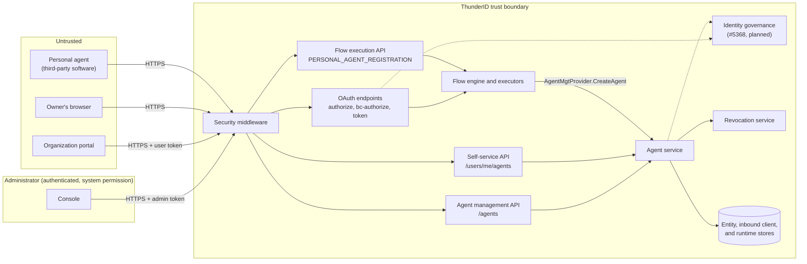
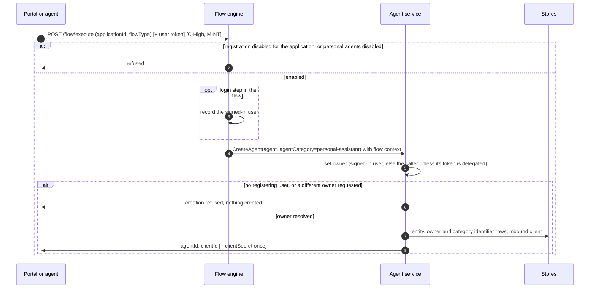
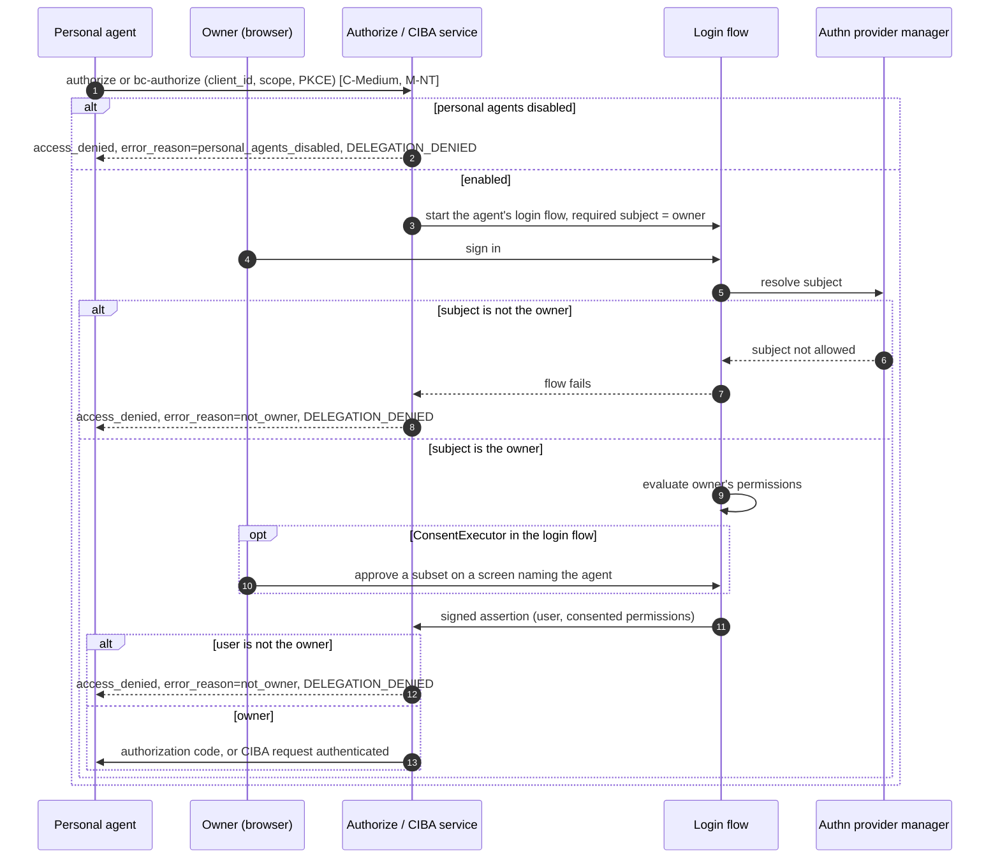
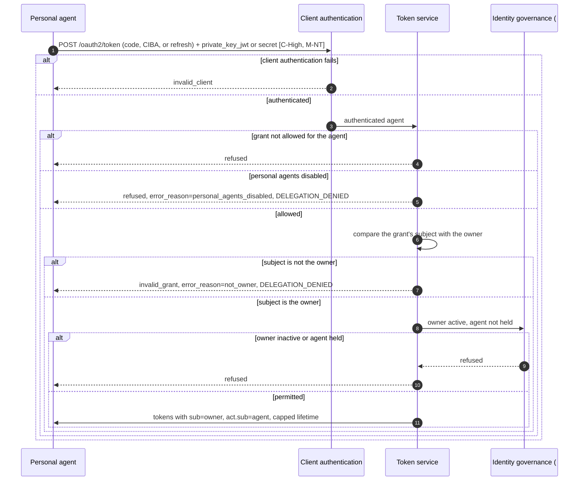
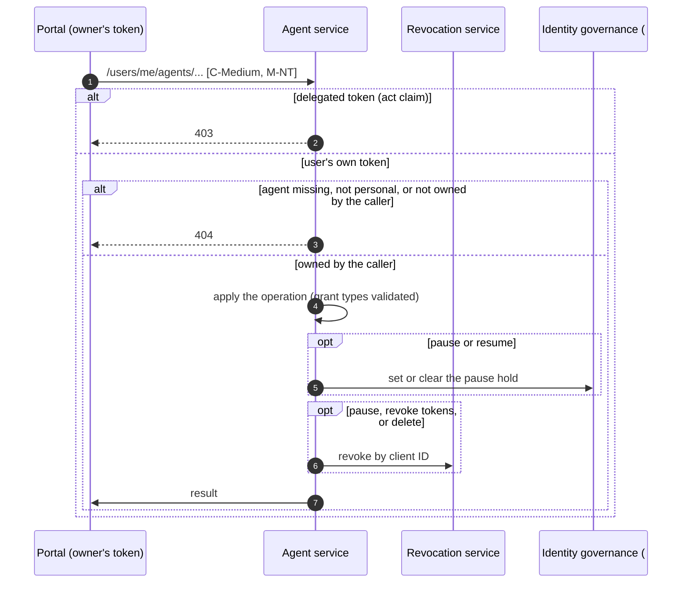
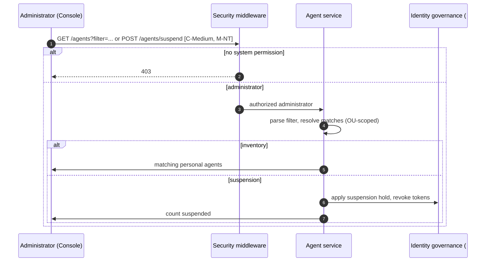
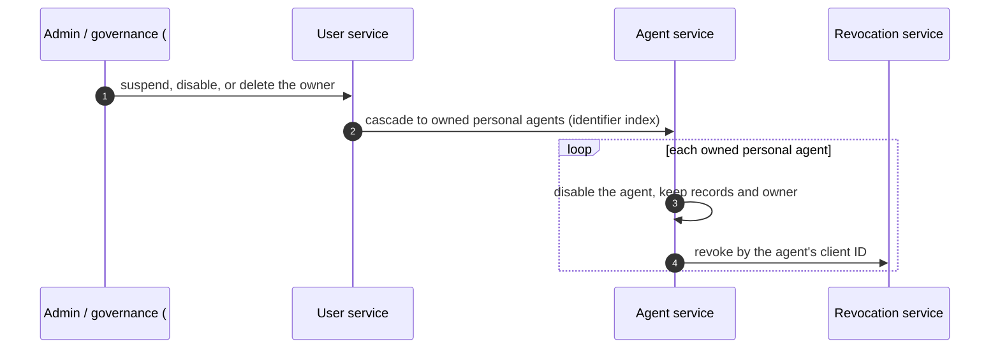

# Personal Assistant Agents Threat Model

This model covers personal assistant agents as specified in [spec.md](spec.md): their registration through a `PERSONAL_AGENT_REGISTRATION` flow, the on-behalf-of authorizations and token issuance for their owner, owner self-service, and organization oversight and suspension.

## Overview

A personal assistant agent is third-party software that a customer brings to the organization. It is registered by the customer, bound permanently to that customer as its owner, and may only obtain tokens that carry the owner as the subject and itself as the actor, after the owner signs in and, where the login flow asks for it, consents. The agent is untrusted: the organization does not control its code, its vendor, or the device it runs on. The security of the feature rests on four properties: the owner is bound once and cannot change, no token is issued for any subject other than the owner, the agent cannot act on its own authority, and neither the owner nor an administrator can cross into the other's side.

Entry points: `POST /flow/execute` with `flowType: PERSONAL_AGENT_REGISTRATION`, `GET /oauth2/authorize`, `POST /oauth2/bc-authorize`, `POST /oauth2/token`, the self-service routes under `/users/me/agents`, and the agent management routes under `/agents`.

Cross-cutting concerns covered elsewhere: grant processing for `authorization_code` and `refresh_token` ([OAuth 2.0 Authorization and Core Grants Threat Model](../oauth/authorization-and-core-grants/threat-model.md)); client authentication including `private_key_jwt`, CIBA, and token signing (Token and Protocol Features model); the flow engine and the login flows it runs (Flow Execution model); revocation enforcement (Token Revocation model); account states, locks, and suspension enforcement (identity governance, #5368). These are trust inputs here, not re-analysed.

## Scope

This model covers:
- Personal agent registration: flow selection per application, resolution of the registering user, owner and agent category enforcement in the agent service, credential issuance
- The owner's sign-in and consent for a personal agent's authorization code and CIBA requests, including the owner-only rule
- Token issuance and refresh for personal agents: the grant restrictions, the issuance-time owner check, the organization setting, and the access token lifetime cap
- Owner self-service under `/users/me/agents`
- Administrator inventory, single and bulk suspension, and the administrator restrictions on personal agents
- The owner lifecycle cascade when an owner is suspended, disabled, or deleted

Out of scope (see the referenced companion models):
- Generic processing of the `authorization_code` and `refresh_token` grants (PKCE, code binding, refresh rotation), covered by the OAuth 2.0 Authorization and Core Grants Threat Model
- `private_key_jwt` verification, CIBA request handling and delivery, and token signing, covered by the Token and Protocol Features model
- The authentication steps inside login flows (credentials, MFA, federation), covered by the Flow Execution model
- Enforcement of revocation at ThunderID and at resource servers, covered by the Token Revocation model
- How account states are stored and enforced, including the token revocation that suspension performs, covered by identity governance (#5368). Because a personal agent's tokens carry the owner as `sub`, suspending a personal agent has to revoke them by the agent's client ID (`app.key`) rather than by subject; that belongs to #5368's suspension work.
- Items deferred to V2: issuance from saved consent, consent management, session listing, per-user agent caps, and grant-type policy for the category

## Architecture



### Components

The personal-agent rules sit in the components that already own each concern, so no new path bypasses the existing layers.

| Component | Task |
| --- | --- |
| Security middleware | Validates bearer tokens on every request and puts the verified subject and claims on the request context. |
| Flow engine and executors | Runs the application's `PERSONAL_AGENT_REGISTRATION` flow and the agent's login flow. Records the flow type, the agent category, and the user signed in during the flow from its own state, so no input or node can supply them. Attaches the owner as a required subject to authentication flows for a personal agent. |
| `AgentMgtProvider` | The executors' only way into the agent domain. Applies the personal-agent client setup when `agentCategory` is `personal-assistant`: `authorization_code` with PKCE by default, `private_key_jwt` when a public key is supplied, never `client_credentials`, token exchange, or jwt-bearer. |
| Agent service | Sets the owner to the registering user and refuses any other owner, creates personal agents only in a personal agent registration flow, keeps the owner and agent category immutable, and triggers revocation by the agent's client ID. |
| Authorize, CIBA, and token services | Run the existing grants. They apply the organization setting, resolve the owner for CIBA, compare the signed-in user and the token's subject with the owner, and add reason codes to refusals. |
| Authn provider manager | Enforces the subject constraints below the flow graph, refusing any signed-in subject other than the owner. |
| Consent executor | Always prompts for a personal agent, names the agent, and records the owner's chosen subset. |
| Self-service API | Owner-scoped operations on the caller's own personal agents. |
| Agent management API | Administrator inventory and suspension, with updates, role and group assignment, and creation of personal agents refused. |
| Identity governance (#5368) | Holds and enforces agent and owner state at token issuance. Planned. |
| Revocation service | Existing criteria-based revocation; personal-agent events revoke by the agent's client ID (`app.key`). |

### Actors

#### Actors

| Actor | Description | Roles or permissions |
| --- | --- | --- |
| Owner | A customer of the organization who registers a personal agent, approves its authorizations, and manages it. | Authenticated user, no administrative permission |
| Personal agent | Third-party software registered by the owner. Authenticates with its own credential and requests tokens on the owner's behalf. Untrusted. | OAuth client limited to `authorization_code`, CIBA, and `refresh_token` |
| Administrator | Organization staff who configure registration and login flows, view the personal agent inventory, and suspend agents. Can register a personal agent only for themselves, as a user. | `system` permission |
| Malicious actor | Another user, a compromised or malicious agent, or an external attacker trying to bind an agent to a victim, obtain tokens for someone other than the agent's owner, widen an agent's grants, or keep an agent working after it should stop. | N/A |

#### Entitlement matrix

| Actor | Register a personal agent | Sign in and consent for an agent | Obtain a token through an agent | Manage an agent (self-service) | View inventory | Suspend or lift suspension | Change an agent's owner |
| --- | --- | --- | --- | --- | --- | --- | --- |
| Owner | [Yes], becomes the owner | [Yes], only for their own agents | [No], the agent obtains it | [Yes], own agents only | [No] | [No], can only pause their own agents | [No] |
| Personal agent | [No], can start the flow but a user must sign in or be the caller | [No] | [Yes], for its owner only, after the owner's sign-in | [No] | [No] | [No] | [No] |
| Administrator | [Yes], for themselves only | [Yes], for their own agents only | [No], for others' agents | [Yes], own agents only | [Yes] | [Yes] | [No] |
| Malicious actor | Only by having a victim complete the flow | [No] | [No], without the owner's sign-in | [No] | [No] | [No] | [No] |

### External Dependencies (not owned)

| Dependency | Description (usage, purpose, authentication, authorization, security) |
| --- | --- |
| OAuth grant handlers | Authorization code exchange, PKCE, refresh rotation, and the binding of a refresh token to the client it was issued to. Covered by the OAuth 2.0 Authorization and Core Grants Threat Model. |
| Client authentication and CIBA | `private_key_jwt` verification with `jti` replay protection and `iat`/`exp` bounds; CIBA request handling, `binding_message`, and expiry clamping. Covered by the Token and Protocol Features model. |
| Flow engine and login flows | Authenticates the owner at registration and at each authorization, and returns a signed assertion. Covered by the Flow Execution model. |
| Identity governance (#5368) | Stores pause and suspension holds and refuses issuance for an inactive owner or a held agent. Planned; the account lock and suspension specification is in review. |
| Fixed flow values (#5778) | Lets a flow author fix values such as the agent's login flow on the registration flow. Planned. |
| Revocation service | Writes and enforces revocation criteria. Covered by the Token Revocation model. |
| Runtime and identity stores | Hold agent entities, identifier rows, inbound clients, flow contexts, and revocation records. Encryption and access control are managed at the infrastructure layer. |

## Threats and mitigations

### Out-of-scope interactions and risks

- PKCE, authorization code binding, and refresh token rotation and replay detection, covered by the OAuth 2.0 Authorization and Core Grants Threat Model.
- `private_key_jwt` assertion verification and CIBA request processing, covered by the Token and Protocol Features model.
- The strength of the authentication steps in a login flow, covered by the Flow Execution model. This model relies only on the subject the flow resolves and the signed assertion it returns.
- Resource servers that validate tokens locally without consulting revocation, covered by the Token Revocation model. Their exposure is bounded here by `personalAgent.maxAccessTokenValidity`.
- Resource servers recording the `act` claim to attribute actions to the agent: the responsibility of the resource server.
- How the agent stores its private key, secret, and tokens on its own device: the responsibility of the agent and its vendor.
- How issued credentials reach the agent: documented by the organization; outside this feature.
- Rate limiting, lockout, and bot detection: outside the product's core, applied at the deployment or gateway layer.

### Interactions

#### [01]: Personal agent registration

**Description**

The organization's portal, carrying the signed-in user's token, or the agent itself, starts the application's `PERSONAL_AGENT_REGISTRATION` flow through `POST /flow/execute`. The application must have personal agent registration enabled, and personal agents must be enabled for the organization. The flow collects the agent's details and either a public key (`private_key_jwt`) or nothing (a generated client secret). `ProvisioningExecutor` passes the engine-recorded agent category to `AgentMgtProvider.CreateAgent`, and the agent service sets the owner to the registering user: the user signed in during the flow, otherwise the validated caller of the creation request, unless the caller's token is delegated. The flow returns the agent and client IDs, and the client secret once when one was generated.

**Assets involved**

| Initiator | Intermediate | Target |
| --- | --- | --- |
| Organization portal (with the user's token) or personal agent | Flow engine, `AgentMgtProvider` | Agent service, entity and inbound client stores |

**Data flow**



**Security considerations**

| Area | Response | Comments |
| --- | --- | --- |
| Data confidentiality | [C-High] | A generated client secret and the agent's registered key material pass through this interaction. |
| Communication medium | [M-NT] | |
| Transport security | [TLS] | |
| Authentication | User token or a login step in the flow | The registering user comes from a sign-in during the flow or from the caller's validated token, when that token is not delegated. |
| Accessibility | [Public] | `/flow/execute` is a public path; the flow needs no administrative permission. |
| Authorization and Access Control | Ownership enforced by the agent service | The application must enable personal agent registration and the organization setting must be on. Who owns the agent is enforced by the agent service, not by the flow, so a custom flow composition cannot change it. |

**Threat assessment**

| ID | Category | Threat | Materializable | Mitigation / comment |
| --- | --- | --- | --- | --- |
| 1 | [Elevation of Privilege] | A client holding a delegated token for the user, including a personal agent holding an on-behalf-of token for its owner (`sub` = owner, `act.sub` = agent), runs the registration flow with that token and registers further agents owned by the user without the user taking part. | [No] | The agent service takes the caller as the registering user only when the caller's token has no `act` claim (`security.IsDelegated`), so a delegated token supplies no caller and the creation is refused unless a user signs in during the flow. See the specification's "Delegated token restriction". |
| 2 | [Tampering] | A flow author or a submitted input sets a different owner (for example an `ownerId` from an `OwnerResolver`), a personal registration flow creates an ordinary agent, or another flow type creates a personal agent. | [No] | The agent service sets the owner itself and refuses a request carrying a different owner. The agent category comes from the engine's own state based on the flow type, never from a node or input. The agent service refuses the personal agent category outside a `PERSONAL_AGENT_REGISTRATION` flow, and a creation in that flow is always a personal agent. These rules do not depend on the caller's permissions, so the runtime context the provider uses does not bypass them. |
| 3 | [Elevation of Privilege] | Flow inputs or fixed values give a personal agent `client_credentials`, token exchange, or jwt-bearer, so it can obtain tokens on its own authority or outside the owner's sign-in. | [No] | The provider applies the personal setup regardless of the `delegated` input, and the agent service rejects these grants at creation and on update. |
| 4 | [Spoofing] | An agent registers with a self-asserted name, software, or version that imitates a trusted assistant, and the owner approves authorizations believing it is that assistant. | [Yes] | The consent screen, in a login flow that includes it, names the agent and shows its registered details, but these are supplied by whoever drives the flow and are not verified. The owner sees every agent in self-service and can delete it. Bounded residual; see Residual risks. |
| 5 | [Spoofing] | An attacker starts an agent-initiated registration with their own key and hands the continuation to a victim, who signs in and becomes the owner of an attacker-controlled agent. | [Yes] | The attacker's agent still needs the victim to sign in, and to consent where the login flow includes it, for every authorization, including a CIBA request naming the agent. The victim sees the agent in self-service and can delete it. Organizations that do not need agent-started registration can rely on the portal path only by not including a login step. Bounded residual; see Residual risks. |
| 6 | [Information Disclosure] | A generated client secret is exposed to whoever drives the flow, or retained in the flow's runtime state for the rest of the run. | [No] | `private_key_jwt` is the recommended credential and the reference flow uses it, so no secret is created or passes through the flow. A generated secret is returned once, stored hashed, never returned by any read, and not logged. |
| 7 | [Tampering] | A failed creation leaves a partial agent, or the post-creation authentication makes the agent the flow's subject. | [No] | The agent service deletes the entity if creating the inbound client fails. For personal agents the provisioning executor skips the post-creation authentication, and no group or role assignment runs after creation. |
| 8 | [Denial of Service] | A user, or an automated agent working through a user's session, registers a large number of agents for one owner. | [Yes] | Each registration needs a registering user, signed in during the flow or the caller, the application must enable registration, and abandoned flow contexts expire. There is no per-user agent cap in V1. Request rate limiting belongs at the gateway. Bounded residual; see Residual risks. |
| 9 | [Spoofing] | The `owner` and `category` identifier rows written for personal agents are matched as login identifiers. | [No] | The rows are written with `SOURCE = 'system'`, and identification queries match only `SOURCE = 'attribute'`. |

#### [02]: Owner sign-in and consent for an agent's authorization

**Description**

The agent sends the owner to `GET /oauth2/authorize`, or calls `POST /oauth2/bc-authorize` for CIBA. The organization setting is checked before the flow starts. The agent's login flow runs, with the owner attached as the only permitted subject. The owner signs in; `AuthorizationExecutor` evaluates the owner's current permissions against those requested; when the login flow includes `ConsentExecutor`, it always prompts, names the agent, and records the subset the owner approves. The callback compares the signed-in user with the owner before issuing a code or marking the CIBA request authenticated.

**Assets involved**

| Initiator | Intermediate | Target |
| --- | --- | --- |
| Personal agent | Owner's browser, flow engine and login flow, consent executor | Authorize and CIBA services, authorization code |

**Data flow**



**Security considerations**

| Area | Response | Comments |
| --- | --- | --- |
| Data confidentiality | [C-Medium] | The code and the owner's identity claims pass through the browser; consent shows the agent's registered details to the owner. |
| Communication medium | [M-NT] | |
| Transport security | [TLS] | |
| Authentication | Owner sign-in through the agent's login flow | The agent is authenticated later, at the token endpoint. |
| Accessibility | [Public] | |
| Authorization and Access Control | Owner-only subject, enforced below the flow and at the callback | The owner is a required subject in the subject constraints, which a flow author cannot remove. The callback checks the owner again. Consent depends on the login flow including `ConsentExecutor`. |

**Threat assessment**

| ID | Category | Threat | Materializable | Mitigation / comment |
| --- | --- | --- | --- | --- |
| 1 | [Elevation of Privilege] | A user other than the owner signs in through a personal agent's authorization, so the agent obtains a token for someone it does not belong to. | [No] | The engine attaches the owner as a required subject and the authn provider manager refuses any other subject before consent. The callback compares the asserted user with the owner before issuing a code or marking the CIBA request authenticated. The refusal is `access_denied` with `not_owner`, and a `DELEGATION_DENIED` event is published. |
| 2 | [Tampering] | A login flow without `ConsentExecutor` issues a code without the owner's consent, covering every requested permission the owner holds. | [Yes] | Consent is not enforced outside the flow; building the login flow is the flow author's responsibility. The shipped default login flow contains `AuthorizationExecutor` and `ConsentExecutor`, and the documentation states the requirement. The token still never exceeds the owner's own permissions, and the owner-only rule still applies. Bounded residual; see Residual risks. |
| 3 | [Elevation of Privilege] | The agent over-requests permissions, or a login flow drops `AuthorizationExecutor`, so the token carries permissions the owner does not hold or did not approve. | [No] | The offered set is the owner's effective permissions intersected with those requested, and, where the login flow includes consent, the owner approves a subset. Without an authorization decision the assertion carries no authorized permissions and the callback clears permission scopes, so the request fails closed. |
| 4 | [Elevation of Privilege] | Consent is satisfied silently from an earlier record, so the owner never sees what a later request asks for. | [No] | Whenever the login flow includes `ConsentExecutor`, consent is re-prompted for every personal-agent authorization, so an earlier record never satisfies it. Flows without consent are covered by [02]-2. |
| 5 | [Spoofing] | A CIBA request for a personal agent names another user in `login_hint`, `id_token_hint`, or `login_hint_token`. | [No] | The CIBA service resolves the user from the agent's owner; a hint that resolves to anyone else is refused with `not_owner`. |
| 6 | [Spoofing] | A compromised or malicious agent sends repeated CIBA requests hoping the owner approves one by mistake. | [No] | Each request needs the agent's own client authentication. The owner must sign in, and consent on a screen naming the agent where the login flow includes it, optionally with a `binding_message`, and the request expires. The owner can remove the CIBA grant, pause, or delete the agent. Request rate limiting belongs at the gateway. |
| 7 | [Repudiation] | Refused delegations leave no trace, so attempts to use an agent for another user go unnoticed. | [No] | Every refusal by the owner checks or the organization setting publishes `DELEGATION_DENIED` with the agent, owner, subject, reason, and endpoint. |

#### [03]: Token issuance and refresh for a personal agent

**Description**

The agent authenticates at `POST /oauth2/token`, with `private_key_jwt` or its secret, and exchanges an authorization code, completes a CIBA request, or presents a refresh token. The per-client grant check admits only the agent's configured grants. The token service checks the organization setting and, before building any token, that the subject is the agent's owner. Identity governance (#5368) refuses issuance for an inactive owner or a held agent. Tokens carry `sub` = owner and `act.sub` = agent, and the access token lifetime is capped by `personalAgent.maxAccessTokenValidity`.

**Assets involved**

| Initiator | Intermediate | Target |
| --- | --- | --- |
| Personal agent | Client authentication, grant handlers | Token service, identity governance, issued tokens |

**Data flow**



**Security considerations**

| Area | Response | Comments |
| --- | --- | --- |
| Data confidentiality | [C-High] | Agent credentials, refresh tokens, and issued tokens transit this endpoint. |
| Communication medium | [M-NT] | |
| Transport security | [TLS] | |
| Authentication | `private_key_jwt` (recommended) or client secret | Covered by the Token and Protocol Features model. |
| Accessibility | [Public] | Client-authenticated. |
| Authorization and Access Control | Grant allowlist, issuance-time owner check, governance state | The agent can only use `authorization_code`, CIBA, and `refresh_token`. The owner check runs for every grant, including refresh. |

**Threat assessment**

| ID | Category | Threat | Materializable | Mitigation / comment |
| --- | --- | --- | --- | --- |
| 1 | [Elevation of Privilege] | The agent obtains a token on its own authority through `client_credentials`, or outside the owner's sign-in through token exchange or jwt-bearer. | [No] | These grants are never set for a personal agent and are rejected at creation and on update; the per-client grant check refuses any grant the agent does not hold. |
| 2 | [Elevation of Privilege] | A token is issued with a subject other than the owner on any grant. | [No] | The token service compares the grant's subject with the agent's owner before building any token and refuses a mismatch with `not_owner`. This holds whatever happened earlier in the request. |
| 3 | [Spoofing] | A stolen agent credential is used to obtain tokens for the owner. | [No] | A credential alone yields no token: authorization code and CIBA need the owner's sign-in, and consent where the login flow includes it, and refresh needs a valid refresh token as well. With `private_key_jwt` the private key stays with the agent and assertions are replay-protected. The owner can rotate the credential, remove grants, or delete the agent. |
| 4 | [Spoofing] | A refresh token stolen from the agent is used by another client. | [No] | A refresh token is accepted only from the client it was issued to, authenticating with its own credential. |
| 5 | [Elevation of Privilege] | Tokens are still issued after the owner becomes inactive, or while the agent is paused or suspended. | [Yes] | With #5368, identity governance refuses issuance for an inactive subject, which the owner always is, and for a held agent. Until #5368 lands there are no pause or suspension holds and no user states; a deleted owner is still refused because the owner entity no longer exists. See Residual risks. |
| 6 | [Elevation of Privilege] | A permission the owner has lost is still carried in new tokens. | [No] | The owner's current permissions are evaluated on every authorization and every refresh. An already issued access token keeps its scopes until it expires, bounded by the lifetime cap. |
| 7 | [Information Disclosure] | Long-lived access tokens extend the exposure of a leaked token. | [No] | `personalAgent.maxAccessTokenValidity` caps every personal-agent access token, so the exposure lasts only as long as the organization allows. Refresh tokens follow the existing rotation and validity rules. |
| 8 | [Repudiation] | Actions taken by the agent cannot be told apart from actions the owner took directly. | [No] | Every token carries `act.sub` = agent, and `TOKEN_ISSUED` records the subject and `act_sub`. Recording `act` at resource servers is their responsibility. |
| 9 | [Operational Risk] | Turning `personalAgent.enabled` off is expected to stop all personal agents, but tokens already issued keep working. | [Yes] | The setting refuses every new registration, authorization, CIBA, and token request, including refresh. Outstanding access tokens remain valid until they expire, bounded by the lifetime cap; suspending agents also revokes their tokens. Revoking outstanding tokens when the setting is turned off is planned for the next phase; see Residual risks. |

#### [04]: Owner self-service

**Description**

The owner manages their agents through `/users/me/agents`: list and read, update details and grant types, rotate the credential, pause and resume, revoke tokens, and delete. A delegated token is refused before any agent is loaded. Each operation loads the agent and compares its owner with the caller. The security permission map adds `POST` and `DELETE` on `/users/me/agents/**` as self-service paths.

**Assets involved**

| Initiator | Intermediate | Target |
| --- | --- | --- |
| Owner, through the organization portal | N/A | Agent service, revocation service, identity governance |

**Data flow**



**Security considerations**

| Area | Response | Comments |
| --- | --- | --- |
| Data confidentiality | [C-Medium] | Agent details, status, and holds; a regenerated secret is returned once. |
| Communication medium | [M-NT] | |
| Transport security | [TLS] | |
| Authentication | User access token | A delegated token (with an `act` claim) is refused. |
| Accessibility | [Restricted] | Owner only. |
| Authorization and Access Control | Ownership check per operation | 404 for an agent that does not exist, is not personal, or belongs to someone else. |

**Threat assessment**

| ID | Category | Threat | Materializable | Mitigation / comment |
| --- | --- | --- | --- | --- |
| 1 | [Information Disclosure] | A user reads or changes another user's agent by guessing its ID, or probes which agents exist. | [No] | Every operation compares the agent's owner with the caller and returns 404 otherwise, so other users' agents are indistinguishable from missing ones. |
| 2 | [Elevation of Privilege] | A client holding a delegated token for the owner, including the personal agent itself, calls these routes to widen its own grant types, resume itself after the owner paused it, rotate its credential, or revoke or delete the owner's other agents. | [No] | Every self-service agent route refuses a token carrying an `act` claim with 403 before any agent is loaded. Setting `server.security.rest.audience` further limits ThunderID's APIs to tokens issued for them, as hardening. |
| 3 | [Elevation of Privilege] | The owner sets a grant that lets the agent act on its own authority. | [No] | Only `authorization_code`, CIBA, and `refresh_token` are accepted, and the inbound client service validates the combination as for any client. A removed grant is refused from then on by the per-client grant check. |
| 4 | [Spoofing] | An attacker with the owner's session rotates an agent's credential to their own key. | [No] | The blast radius is that of an owner account compromise. The rotated agent still cannot obtain tokens without the owner's sign-in. Account protection is covered by identity governance (#5368). |
| 5 | [Privacy Risk] | The suspension reason shown to the owner exposes internal investigation details. | [No] | The administrator's identity is never shown to the owner. Guidance: administrators write suspension reasons meant for the owner. |
| 6 | [Security Risk] | The new self-service entries in the permission map open other `/users/me` paths to any authenticated caller. | [No] | The entries are scoped to `/users/me/agents/**` and each operation enforces ownership; no broader wildcard is added. |

#### [05]: Administrator oversight and suspension

**Description**

Administrators list personal agents with filters on agent category, owner, status, and registered details, and suspend one agent or every agent matching a filter. Suspension is a hold in identity governance that revokes the agent's tokens; only an administrator lifts it. Administrators cannot create, update, assign roles or groups to, read the credential of, or obtain a token through another user's personal agent.

**Assets involved**

| Initiator | Intermediate | Target |
| --- | --- | --- |
| Administrator, through the Console | Security middleware | Agent service, identity governance |

**Data flow**



**Security considerations**

| Area | Response | Comments |
| --- | --- | --- |
| Data confidentiality | [C-Medium] | Owner identifiers and registered agent details, which can include personal data such as device names. |
| Communication medium | [M-NT] | |
| Transport security | [TLS] | |
| Authentication | Administrator access token | |
| Accessibility | [Restricted] | |
| Authorization and Access Control | `system` permission, OU-scoped listing | Updates, role and group assignment on personal agents return 403. |

**Threat assessment**

| ID | Category | Threat | Materializable | Mitigation / comment |
| --- | --- | --- | --- | --- |
| 1 | [Elevation of Privilege] | An administrator registers a personal agent for another user, changes its owner, widens it with roles or groups, reads its credential, or obtains a token through it. | [No] | The management API and administration flows cannot create personal agents; updates and role or group assignment return 403; no read returns a credential; the only subject a personal agent can obtain a token for is its owner. |
| 2 | [Elevation of Privilege] | A non-administrator lists or suspends personal agents. | [No] | The agent management API requires the `system` permission. |
| 3 | [Tampering] | A crafted inventory filter injects into the underlying query. | [No] | The filter is parsed as `attribute eq "value"` terms joined by `and`; `category` and `owner` are served from the identifier index with bound parameters. |
| 4 | [Operational Risk] | An over-broad bulk suspension stops agents of many owners. | [No] | The Console shows the number of matching agents and asks for confirmation. Suspension is idempotent, leaves the owners' accounts working, and is lifted without re-registration. |
| 5 | [Elevation of Privilege] | The owner lifts a suspension the organization applied. | [No] | Pause and suspension are independent holds; only an administrator lifts a suspension, and the owner's resume leaves it in force. |

#### [06]: Owner suspension, disablement, and deletion

**Description**

When an owner is suspended, disabled, or deleted, their personal agents are disabled with them and their tokens revoked by client ID. The agents' records are kept with the owner in place. User deletion reaches the agent service through the resource dependency registry. This cascade is delivered after #5368.

**Assets involved**

| Initiator | Intermediate | Target |
| --- | --- | --- |
| Administrator or identity governance | User service, resource dependency registry | Agent service, revocation service |

**Data flow**



**Security considerations**

| Area | Response | Comments |
| --- | --- | --- |
| Data confidentiality | [C-Low] | Internal state change; no secrets transit. |
| Communication medium | [M-IN] | |
| Transport security | N/A | In-process. |
| Authentication | Trusted internal call | Initiated by an authorized administrator or by identity governance. |
| Accessibility | [Internal] | |
| Authorization and Access Control | Governed by the initiating operation | |

**Threat assessment**

| ID | Category | Threat | Materializable | Mitigation / comment |
| --- | --- | --- | --- | --- |
| 1 | [Elevation of Privilege] | An agent keeps acting after its owner is suspended, disabled, or deleted. | [No] | Issuance is refused for an inactive owner (#5368) and for a deleted owner, whose entity no longer exists. User deletion already revokes tokens by subject, which covers personal-agent tokens. The cascade disables the agents and revokes by client ID. Depends on #5368; see Residual risks. |
| 2 | [Tampering] | A deleted owner's agent is reassigned to another user or reused. | [No] | The owner is immutable and is kept on the disabled agent; no operation changes or clears it. Entity identifiers are UUIDs and are not reused. |
| 3 | [Privacy Risk] | Agent records keep a deleted owner's identifier and registered details after the owner is gone. | [No] | Kept deliberately so actions stay attributable. Operators align retention with their erasure obligations; see the Privacy considerations. |

## Security Review Checklist

A review aid that complements the threat models and the self-assessment. Guidance follows the [OWASP Top 10 Proactive Controls](https://top10proactive.owasp.org/).

### Security considerations

| # | Consideration | State | Comments |
| --- | --- | --- | --- |
| 1 | Are all inputs and outputs validated (syntactic and semantic)? | [Yes] | Grant types against an allowlist and the inbound client rules; owner and agent category set by the agent service, not inputs; fixed login flow must be an `AUTHENTICATION` flow; inventory filter parsed against a fixed grammar. |
| 2 | Are rate limits in place where necessary? | [N/A] | Outside the product's core; applied at the deployment or gateway layer. Relevant to registration ([01]-8) and CIBA requests ([02]-6). |
| 3 | Are permissions, roles, and entitlements defined on the principle of least privilege and business need? | [Yes] | The agent holds only the grants it needs to act for its owner; it can never act on its own authority. Owners act only on their own agents; administrators observe and suspend but cannot use or widen agents. |
| 4 | Are authentication and authorization validated at both the UI and API layers, front end and back end, before granting access to resources? | [Yes] | Ownership and the owner-only rule are enforced in the agent service, the authn provider manager, the callbacks, and the token service, not in the flow or the UI. |
| 5 | Are proper isolations in place between components to ensure least-privilege access and reduce the blast radius against lateral movement? | [Yes] | Each agent has its own credential and revocation key; actions on one agent do not affect the owner's other agents or sessions. Delegated tokens are refused as the registration caller and on the self-service agent routes ([01]-1, [04]-2). |
| 6 | Have any default credentials been changed, and are default superuser or root accounts not in use (when using third-party components)? | [N/A] | |
| 7 | Has the implementation followed best-practice guidelines (OWASP, Kubernetes, vendor, or technology provider)? | [Yes] | RFC 8693 `act` claim for delegation, `private_key_jwt` (RFC 7523) as the recommended credential, PKCE required, CIBA for decoupled approval. |
| 8 | Are secrets, credentials, and internal-only material kept out of the public source tree and its git history? | [Yes] | No credentials are introduced in source. |
| 9 | Was a security-focused code review conducted for this change, and have the findings been addressed? | [No] | Design stage; to be done with the implementation. |
| 10 | Is Static Analysis (SAST) or IaC scanning conducted, and are findings addressed? | [No] | Design stage; covered by the product scan once implemented. |
| 11 | Is Software Composition Analysis (SCA) conducted or integrated into the repository, and are findings addressed (for example FOSSA, Trivy)? | [N/A] | No new dependencies. |
| 12 | Is Dynamic (DAST) or API scanning conducted on a non-production setup, and are findings addressed? | [No] | Design stage; covered by the product scan once implemented. |
| 13 | Are audit logs generated in a standardized format for critical functionality, and available to authorized users to trace critical events and aid incident response? Note the retention period in Comments. | [Yes] | `DELEGATION_DENIED` and `TOKEN_ISSUED` (with `act_sub`) are published as observability events, and owner and administrator changes to agents are logged. Retention is set by the deployment. |
| 14 | Do audit logs for critical configuration changes record the difference between the old and new versions? | [Yes] | Changes to personal agents and their configuration are logged. |
| 15 | Are data in transit and at rest encrypted? | [Partial] | TLS in transit. A generated secret is stored hashed; at-rest encryption of the stores is managed at the infrastructure layer. |
| 16 | Are sensitive values such as credentials and keys stored in a secret store or vault? | [Partial] | With `private_key_jwt` only the public key is stored. A generated secret is stored hashed in the entity store; no secrets-manager integration. |
| 17 | Is personal, sensitive, or confidential data kept out of logs? | [Yes] | Secrets, keys, and tokens are not logged. Events carry entity identifiers, not profile data. |
| 18 | Have users been given clear instructions for secure usage? | [Partial] | To document: prefer `private_key_jwt`, fix the agent's login flow as a fixed value, include `AuthorizationExecutor` and `ConsentExecutor` in personal agents' login flows, include a login step only when agent-started registration is needed, set `server.security.rest.audience`, keep `personalAgent.maxAccessTokenValidity` short, and write suspension reasons for the owner. ThunderID ships a reference guide and sample agent skill for credential handover. |

### Business impact and resilience

For an open-source component, most of these are shared with the operator who deploys it. This section captures the project's defaults and recommendations; the rest is left to the deployer.

| # | Consideration | State | Comments |
| --- | --- | --- | --- |
| 1 | Has a business impact analysis been done to identify resilience requirements (maximum tolerable downtime, uptime, RPO, RTO)? | [N/A] | Left to the deploying organization. |

Resilience details to record:
- High availability requirements: not defined at the project level
- Disaster recovery requirements: not defined at the project level
- Backups, frequency, and retention: deployer-owned
- Health checks: not defined at the project level
- User banners: not defined at the project level

### Dependency and component health

| # | Consideration | State | Comments |
| --- | --- | --- | --- |
| 1 | Are dependencies, base images, and runtimes monitored for known vulnerabilities and kept current (for example automated dependency scanning), and are findings addressed? | [Yes] | Covered by the product's dependency scanning; this feature adds no dependencies. |
| 2 | Are any End-of-Life or End-of-Service components in use? | [No] | |
| 3 | Is hardening guidance published for operators who deploy the project (optional)? | [No] | See Security considerations item 18 for the guidance to publish. |

### Privacy considerations

| # | Consideration | State | Comments |
| --- | --- | --- | --- |
| 1 | Is the purpose and legal basis for processing personal data clearly defined? | [Partial] | The owner link, registered agent details, and last activity are processed to bind and govern the agent. The legal basis is the deploying organization's to define. |
| 2 | Are the collection, storage, processing, sharing, archival, and disposal of personal data aligned with the data minimization principle? | [Yes] | What the registration flow collects is decided by the flow author; nothing beyond the name is required. |
| 3 | Is personal data stored securely? | [Partial] | Stored in the entity store with its existing protections; at-rest encryption is managed at the infrastructure layer. |
| 4 | Are privacy notices updated to reflect any new processing or changes to purpose and legal basis? | [N/A] | The deploying organization's responsibility. |
| 5 | Is access to personal data granted on a need-to-know basis? | [Yes] | Owners see only their own agents; the inventory requires the `system` permission and is OU-scoped. |
| 6 | Are data retention requirements considered? | [Partial] | Agent records are kept after the owner is deleted so actions stay attributable ([06]-3); retention is the operator's to set. |
| 7 | Is there a process to dispose of personal data on request in a timely manner while meeting retention requirements? | [Partial] | The owner can delete their agents. Records kept after owner deletion need an operator process for erasure requests. |
| 8 | Are records of personal-data processing maintained in the project's data inventory or records of processing? | [Partial] | Not yet confirmed against a data inventory. |

## Residual risks (open items)

| Risk | Description | Current status | Recommendation |
| --- | --- | --- | --- |
| Self-asserted agent details and consent phishing | Registered details are supplied by whoever drives the flow and are not verified, and an agent-started registration can be completed by a deceived user ([01]-4, [01]-5). | Accepted for V1. | Every authorization still needs the owner's sign-in, and consent where the login flow includes it, and the owner can delete the agent. V2 adds user confirmation of agent-supplied values (A2.9). Organizations that do not need agent-started registration should not include a login step. |
| Consent depends on the login flow | A personal agent's login flow that omits `ConsentExecutor` issues tokens for every requested permission the owner holds, without asking ([02]-2). | Accepted; the flow author's responsibility. | Ship the default login flow with `AuthorizationExecutor` and `ConsentExecutor`, document the requirement, and have flow authors keep both in every login flow used by personal agents. |
| No per-user agent cap | One owner can hold any number of agents ([01]-8). | Deferred to V2 (A1.3). | Rate limit registration at the gateway until the cap ships. |
| Turning personal agents off does not revoke outstanding tokens | Turning `personalAgent.enabled` off refuses new requests, but access tokens already issued keep working until they expire ([03]-9). | Planned for the next phase: turning the setting off will also revoke outstanding personal-agent tokens. | Until then, keep `personalAgent.maxAccessTokenValidity` short, and suspend agents to stop them immediately, which revokes their tokens. |
| Dependency on identity governance (#5368) | Pause, suspension, inactive-owner refusal, and the owner cascade all depend on #5368 ([03]-5, [06]-1). Until it lands, owners can revoke tokens, remove grants, and delete agents, and administrators can turn personal agents off for the organization, but no hold exists. | Planned; delivered after #5368. | Keep `personalAgent.maxAccessTokenValidity` short until holds are available. |

## Appendix

- References: [spec.md](spec.md); RFC 6749 (OAuth 2.0); RFC 7523 (JWT client authentication); RFC 7636 (PKCE); RFC 8693 §4.1 (`act` claim); OpenID Connect CIBA Core 1.0. Companion models: OAuth 2.0 Authorization and Core Grants, Token and Protocol Features, Flow Execution, Token Revocation; identity governance (#5368); fixed flow values (#5778).

A personal agent's inbound client after registration with a public key:

```json
{
  "client_id": "pa-0199...",
  "grant_types": ["authorization_code"],
  "response_types": ["code"],
  "pkce_required": true,
  "token_endpoint_auth_method": "private_key_jwt",
  "certificate": { "type": "JWKS", "value": "{\"keys\":[...]}" },
  "redirect_uris": ["https://assistant.example.com/callback"]
}
```

The claims of an access token issued to that agent:

```json
{
  "sub": "<owner user ID>",
  "act": { "sub": "<agent ID>" },
  "client_id": "pa-0199...",
  "scope": "accounts:read",
  "exp": 1792000000
}
```

## Change log

| Version | Date | Change |
|---|---|---|
| 0.1 | 2026-10-15 | Initial threat model. |
