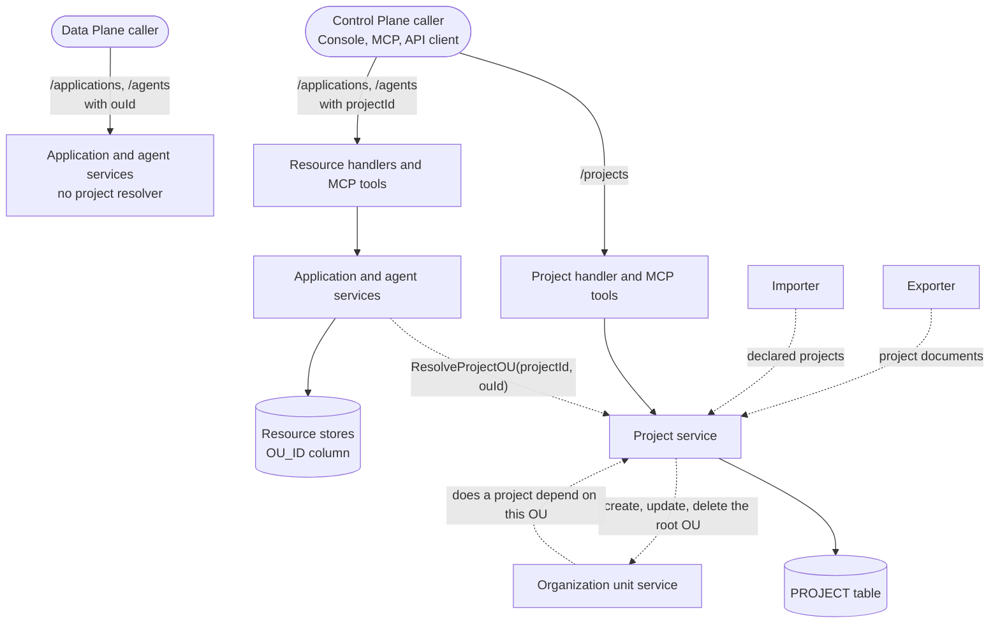

# Projects Specification

- **Status:** Draft
- **Version:** 0.1
- **Related documents:** [Discussion #5862: Projects in ThunderID](https://github.com/thunder-id/thunderid/discussions/5862), [Issue #5861: Projects in ThunderID](https://github.com/thunder-id/thunderid/issues/5861), [#3310: Resource modeling first principles](https://github.com/thunder-id/thunderid/issues/3310), [#3346: Common resource architecture](https://github.com/thunder-id/thunderid/issues/3346), [#5511: Resource sharing](https://github.com/thunder-id/thunderid/issues/5511)

## Summary

Inside one ThunderID deployment, every application, agent, resource server, role, and connection sits in one pool. A team that builds several products cannot manage, promote, or later delegate them separately. A platform that organizes work as organization, then project, then environment has nowhere to put the identities it creates for a project, so it falls back on the default organization unit and encodes the project in resource names.

This feature adds projects to the Control Plane. A project is a first-class record backed by exactly one root organization unit. Creating a project creates its root organization unit, and deleting a project deletes it.

The governing design decision is that **resources never store a project**. A resource belongs to a project because its organization unit is the project's root organization unit or one below it. Ownership stays the existing `ouId`, so every organization-unit-bound resource, current and future, joins projects without a schema change.

Projects are a Control Plane concept only:

- The Control Plane serves the project management API, and its resource management APIs accept a `projectId` that resolves to an organization unit inside the project. A caller that never uses sub-organization units works with project IDs alone.
- The Data Plane has no project API and does not read the project table. At runtime a project is a root organization unit, and authentication, tokens, and authorization behave as they do today.
- The project boundary is a configuration-time grouping, not runtime isolation. Hard isolation remains a deployment (environment) concern, separated by `DEPLOYMENT_ID`.

A project that holds resources directly, or holds several root organization units, is the long-term direction and is out of scope (see [R9](#r9-a-project-holds-resources-directly-or-several-root-organization-units-out-of-scope)).

The feature is delivered in steps:

| Part | State |
|---|---|
| Project management API, MCP tools, `PROJECT` table (#6065) | Merged |
| Projects in export and import, and the Default project in the bootstrap (#6141) | Merged |
| `projectId` on the application API and MCP tools (#6189) | In review |
| `projectId` on the agent API | Implemented, not yet raised |
| Root organization units created only through projects | Not started |
| Console project screens | Designed, not started |
| `projectId` on the remaining organization-unit-bound resources | Not started, see [Open questions](#open-questions) |

## Architecture

A solid arrow is a request moving to the next step. A dotted arrow is a step consulting a service for an answer.



| Component | Responsibility |
|---|---|
| Project service | Owns the project lifecycle. Creates and deletes the root organization unit with the project in one transaction, keeps the project's handle, display name, and description on the root organization unit, and resolves a `projectId` and optional `ouId` to the organization unit a resource belongs to |
| Project store | Persists the `PROJECT` table in the entity database: project ID, root organization unit ID, and creation time, scoped by `DEPLOYMENT_ID`. Only the database store mode is implemented |
| Organization unit service | Keeps ownership of organization units. Consults the project service as a resource dependency provider, so a project's root organization unit cannot be deleted outside the project API |
| Application and agent services | Accept a `projectId` on create, update, and list. Resolve it through a `projectOUResolver` interface they declare themselves, then continue with the existing organization unit logic. The resolver is nil on the Data Plane |
| Project exporter and importer | Export a project as a document of its own, beside its root organization unit document. The Control Plane imports declared projects. The all-in-one server and the Data Plane skip them |
| MCP tools | `list_projects`, `get_project_by_id`, `create_project`, and `update_project` on the Control Plane MCP server. The application MCP tools accept `projectId` |
| Console | Export selects projects, and the import and export summaries list them. Project screens are designed (see [UI](#ui)) |

The resource services match the project service's error codes by value (`PRJ-1002`, `PRJ-1013`) rather than importing the project package, so the all-in-one server never links it. Surface tests enforce this: the Control Plane build must link `internal/project`, and the all-in-one build must not.

## Detailed design

### Project model

| Field | Source | Notes |
|---|---|---|
| `id` | `PROJECT.ID` | UUID. Supplied by the caller on create, or generated as UUIDv7 |
| `rootOuId` | `PROJECT.ROOT_OU_ID` | The root organization unit that backs the project. Never changes |
| `handle` | Root organization unit handle | Set on create. Cannot change |
| `displayName` | Root organization unit name | Required, at most 100 characters |
| `description` | Root organization unit description | Optional, at most 255 characters |
| `createdAt` | `PROJECT.CREATED_AT` | UTC, microsecond precision, the finest every supported database keeps |

The project record holds only its ID, its root organization unit, and its creation time. Handle, display name, and description are read from the root organization unit and updated through it, so nothing is stored twice and the two cannot disagree. Handle uniqueness and handle rules are the organization unit's.

The project ID and the root organization unit ID are different values. The two concepts stay apart from the start, so a caller that never uses sub-organization units only ever sees the project ID, and a later move to several root organization units per project does not have to undo a shared ID.

A caller-supplied project ID lets a system that manages projects across several products, such as a central projects service, use one ID everywhere and keep it the same in every environment.

### Project lifecycle

- **Create.** Validates the optional ID (a UUID that no project uses), the display name, and the description. In one transaction, creates a root organization unit from the handle, display name, and description, then the project record. A failure in either step rolls back both. A handle that another root organization unit already uses is refused with the organization unit's conflict error.
- **Read and list.** Returns the project with its root organization unit's details. Lists are paged with `limit` and `offset`, oldest first.
- **Update.** Replaces the display name and description, which renames the root organization unit. A request that sends a different handle is refused. A request that omits the handle, or sends the current one, succeeds.
- **Delete.** In one transaction, deletes the project record and then its root organization unit. The organization unit service refuses to delete a unit that still holds child organization units, users, groups, or other resources, and the refusal rolls the project record back. A project that is not empty therefore cannot be deleted. Deleting a project that does not exist succeeds.

The project service is a resource dependency provider. A root organization unit that backs a project reports the project as a restricting dependency, so the organization unit API refuses to delete it (`OU-1006`).

### The Default project

The bootstrap resources declare a **Default** project beside the default organization unit:

```yaml
resource_type: project
id: 01900000-0000-7000-8000-000000000002
rootOuId: 01900000-0000-7000-8000-000000000001
handle: default
displayName: Default
description: Default organization unit
```

On a Control Plane, the import links the project to the existing default organization unit, so a new deployment starts with one project that holds the default resources. The all-in-one server skips the document.

### Placing a resource in a project

A Control Plane create or update request may carry a `projectId`, with or without an `ouId` or `ouHandle`:

| Request | Organization unit the resource is stored in |
|---|---|
| `projectId` only | The project's root organization unit |
| `projectId` and an organization unit in the project | That organization unit |
| `projectId` and an organization unit outside the project | Refused, organization unit not in project |
| `projectId` that does not exist | Refused, invalid project |
| Organization unit only | That organization unit, as before projects |

`ResolveProjectOU(projectId, ouId)` makes the decision in one place. An organization unit is in the project when it is the root organization unit or a descendant of it. The resolution runs in the service layer, not only at the HTTP edge, so the MCP tools and any service that creates a resource through another service apply the same rule.

The resolved organization unit is what the resource stores. No resource stores the `projectId`.

This iteration covers applications and agents.

### Listing the resources of a project

A list request with a `projectId` lists the resources owned by the project's root organization unit, followed by the resources shared into it. With an `ouId` filter as well, it lists the same for that organization unit when it is in the project. A project that does not exist, or an organization unit outside it, lists nothing rather than failing, so a list never reveals whether a project exists.

### Control Plane and Data Plane

Both planes are built from the same code. Behavior differs per build, not per deployment setting:

- The Control Plane initializes the project service, registers the project API and MCP tools, passes the project service to the application and agent services as their resolver, and passes it to the importer.
- The all-in-one server, which also runs as the Data Plane, initializes none of these. The application and agent services get a nil resolver, so a request carrying a `projectId` is refused as an invalid project. Requests that carry an `ouId` behave as before.

Root organization units created on the Control Plane reach the Data Plane as ordinary organization units, and are not modified there.

### Root organization units are created only through projects

A root organization unit is where an organization unit tree starts, and in this design every tree is a project. The organization unit API on the Control Plane will therefore refuse to create an organization unit without a parent; it keeps creating child organization units. Creating a project is the only way to create a root.

This is not enforced yet. Today the organization unit API still creates a root organization unit, which then belongs to no project. What happens to such units in existing deployments is an [open question](#open-questions).

### Export and import

A project is exported as its own document. Its root organization unit is exported as a separate `organization_unit` document, which carries the rest of its settings:

```yaml
resource_type: project
id: 0199f2a8-6c1e-7d42-9b8a-1f4e2c3d5a6b
rootOuId: 0199f2a8-6c1e-7d42-9b8a-2a5f3d4e6b7c
handle: billing
displayName: Billing
description: Identity configuration for the billing product
```

The export request takes a `projects` selector: a list of project IDs, or `["*"]` for every project.

Import processes organization units before projects, and projects before everything placed in an organization unit. On a Control Plane:

- A project that does not exist is created with the declared ID. When its `rootOuId` already exists as a root organization unit without a project, for example because the same import declared it, the project is linked to it and the organization unit takes the declared display name and description. Otherwise the root organization unit is created with the declared ID.
- An existing project, with upsert, takes the declared display name and description. Without upsert, the import is refused with `PRJ-1006`.
- A different `rootOuId` for an existing project (`PRJ-1010`), a `rootOuId` that has a parent (`PRJ-1011`), a `rootOuId` that already backs another project (`PRJ-1012`), or a different handle (`PRJ-1007`) is refused.
- Only a declared project is imported. A root `organization_unit` document without a `project` document is imported as a plain organization unit.

The all-in-one server and the Data Plane skip `project` documents with the `skip` operation and import the root organization unit from its own document, so a Control Plane export applies to them unchanged.

### Data model

New table `PROJECT` in the entity database, for PostgreSQL and SQLite:

| Column | Type | Notes |
|---|---|---|
| `DEPLOYMENT_ID` | `VARCHAR(255)` | Part of the primary key |
| `ID` | `VARCHAR(36)` | Project ID. Part of the primary key |
| `ROOT_OU_ID` | `VARCHAR(36)` | Foreign key to `ORGANIZATION_UNIT (DEPLOYMENT_ID, OU_ID)` |
| `CREATED_AT` | `TIMESTAMPTZ` | Defaults to the insert time |

A unique index on `(DEPLOYMENT_ID, ROOT_OU_ID)` ensures that each root organization unit backs at most one project, and serves lookups by root organization unit.

No resource table changes. Resources keep their `OU_ID` column.

### API

The project management API is defined in `api/project.yaml` and served by the Control Plane only. Every operation requires the root permission, because creating a project creates a root organization unit.

| Operation | Purpose | Success |
|---|---|---|
| `POST /projects` | Create a project and its root organization unit | `201` with the project |
| `GET /projects?limit=&offset=` | List projects, oldest first | `200` with a page |
| `GET /projects/{id}` | Get a project | `200` with the project |
| `PUT /projects/{id}` | Replace the display name and description | `200` with the project |
| `DELETE /projects/{id}` | Delete an empty project and its root organization unit | `204` |

Request body for create and update. `id` is honored on create only:

```json
{
  "id": "0199f2a8-6c1e-7d42-9b8a-1f4e2c3d5a6b",
  "handle": "billing",
  "displayName": "Billing",
  "description": "Identity configuration for the billing product"
}
```

Errors:

| Code | Status | Meaning |
|---|---|---|
| `PRJ-1001` | `400` | Malformed request body |
| `PRJ-1002` | `404` | Project not found |
| `PRJ-1003` | `400` | Display name missing or longer than 100 characters |
| `PRJ-1004` | `400` | Description longer than 255 characters |
| `PRJ-1005` | `400` | Supplied project ID is not a UUID |
| `PRJ-1006` | `409` | Supplied project ID already exists |
| `PRJ-1007` | `400` | The request changes the handle |
| `PRJ-1008`, `PRJ-1009` | `400` | Invalid `limit` or `offset` |
| `PRJ-1010` to `PRJ-1012` | Import outcome | Root organization unit mismatch, not a root, or already in use |
| `PRJ-1013` | Not returned | Organization unit outside the project. Each resource API returns its own error for it |
| `OU-1008` | `409` | Handle already used by another root organization unit |
| `OU-1006` | `400` | Delete refused, the root organization unit is not empty |

Resource API changes:

- `api/application.yaml`: `projectId` on the create and update request bodies and as a list query parameter. Errors `APP-1063` (invalid project) and `APP-1064` (organization unit not in project).
- `api/agent.yaml`: the same, with errors `AGT-1045` and `AGT-1046`.
- `api/export.yaml`: the `projects` selector.

### UI

Built: the Console export page selects projects, and the import and export summaries list them.

Designed, not built. The Control Plane Console gains:

- **Project list:** every project with its display name, handle, and creation time, and an action to create one.
- **Project switcher:** in the header. The selected project scopes resource lists and create flows, which send its `projectId`.
- **Project creation wizard:** the full-screen wizard used to create other resources, with the content, placeholder text, and layout agreed in the design review.
- **Project details:** display name, handle, description, project ID, and root organization unit ID, with edit and delete actions.
- **Delete confirmation:** explains that a project that still holds organization units or resources cannot be deleted, and shows the refusal when it is.

The screens use Oxygen UI components once the project components are finalized. The mockups are in [Discussion #5862](https://github.com/thunder-id/thunderid/discussions/5862), and are to be added under `assets/` with the final design.

## Requirements

### R1. A project groups configuration under one root organization unit

**Requirement:** A Control Plane administrator can create, read, list, update, and delete projects, each backed by exactly one root organization unit that is created and deleted with it.

**Acceptance criteria:**

- **AC1.1:** Given a valid handle and display name, when an administrator creates a project, then a project and a root organization unit with that handle and name are created, and the response carries the project ID and the root organization unit ID.
- **AC1.2:** Given a UUID that no project uses, when an administrator creates a project with it as `id`, then the project has that ID.
- **AC1.3:** Given a UUID that a project already uses, when an administrator creates a project with it, then the request is refused with `PRJ-1006` and nothing is created.
- **AC1.4:** Given a handle that another root organization unit uses, when an administrator creates a project with it, then the request is refused with `409` and nothing is created.
- **AC1.5:** Given a project, when an administrator updates its display name and description, then the root organization unit carries them and the project reads them back.
- **AC1.6:** Given a project, when an administrator updates it with a different handle, then the request is refused with `PRJ-1007`.
- **AC1.7:** Given an empty project, when an administrator deletes it, then the project and its root organization unit are gone.
- **AC1.8:** Given a project whose root organization unit holds a child organization unit or a resource, when an administrator deletes it, then the request is refused and the project still exists.
- **AC1.9:** Given a project, when an administrator deletes its root organization unit through the organization unit API, then the request is refused with `OU-1006`.
- **AC1.10:** Given a caller without the root permission, when it calls any project operation, then the request is refused.

### R2. A new deployment starts with a Default project

**Requirement:** The default organization unit is the root of a Default project from the first start of a Control Plane.

**Acceptance criteria:**

- **AC2.1:** Given a new Control Plane, when it starts, then project `01900000-0000-7000-8000-000000000002` exists with handle `default` and the default organization unit as its root.
- **AC2.2:** Given a new all-in-one server, when it starts, then the project document is skipped and the default organization unit exists.

### R3. A caller can place a resource in a project by its project ID

**Requirement:** A Control Plane caller that does not use sub-organization units creates and updates applications and agents with only a project ID, and one that does targets an organization unit inside the project.

**Acceptance criteria:**

- **AC3.1:** Given a project, when a caller creates an application or agent with only its `projectId`, then the resource is stored in the project's root organization unit.
- **AC3.2:** Given a project and an organization unit below its root, when a caller creates a resource with both, then the resource is stored in that organization unit.
- **AC3.3:** Given an organization unit outside the project, when a caller creates a resource with the project and that organization unit, then the request is refused with `APP-1064` or `AGT-1046`.
- **AC3.4:** Given a project ID that does not exist, when a caller creates a resource with it, then the request is refused with `APP-1063` or `AGT-1045`.
- **AC3.5:** Given the application MCP tools, when an agent creates an application with a `projectId`, then the same rules apply.

### R4. A caller can list a project's resources without knowing its organization units

**Requirement:** A Control Plane caller lists the applications and agents of a project by its project ID.

**Acceptance criteria:**

- **AC4.1:** Given resources in a project's root organization unit, when a caller lists with its `projectId`, then those resources are listed, followed by the resources shared into the root organization unit.
- **AC4.2:** Given a `projectId` and an `ouId` in the project, when a caller lists, then the resources of that organization unit are listed.
- **AC4.3:** Given a `projectId` that does not exist, or an `ouId` outside the project, when a caller lists, then the list is empty.

### R5. The Data Plane is unchanged

**Requirement:** A Data Plane has no project API and behaves at runtime as it did before projects existed.

**Acceptance criteria:**

- **AC5.1:** Given an all-in-one server, when a caller requests `/projects`, then the route does not exist.
- **AC5.2:** Given an all-in-one server, when a resource request carries a `projectId`, then it is refused as an invalid project.
- **AC5.3:** Given an all-in-one build, when its surface test runs, then it fails if `internal/project` is linked.
- **AC5.4:** Given a resource in a project, when a user authenticates against it at runtime, then the tokens carry the same organization unit claims as before projects existed.

### R6. A project keeps its ID across environments

**Requirement:** An operator exports projects and imports them into another environment with the same project IDs.

**Acceptance criteria:**

- **AC6.1:** Given a project, when an operator exports with its ID in `projects`, then a `project` document carries its ID, root organization unit ID, handle, display name, and description, and the root organization unit is exported as its own document.
- **AC6.2:** Given a project and its root organization unit document, when an operator imports them into a Control Plane where neither exists, then the project and its root organization unit exist with the declared IDs.
- **AC6.3:** Given an existing project, when an operator imports it with upsert, then it takes the declared display name and description; and without upsert, the import is refused with `PRJ-1006`.
- **AC6.4:** Given an existing project, when an operator imports a document that names a different root organization unit, then the import is refused with `PRJ-1010`.
- **AC6.5:** Given a root `organization_unit` document without a `project` document, when an operator imports it into a Control Plane, then it is imported as an organization unit and no project is created.
- **AC6.6:** Given a Control Plane export, when an operator imports it into an all-in-one server, then the project documents are skipped and the root organization units are imported.

### R7. AI agents manage projects through MCP

**Requirement:** An AI agent using the Control Plane MCP server lists, reads, creates, and updates projects, and works across several projects in one session.

**Acceptance criteria:**

- **AC7.1:** Given the Control Plane MCP server, when an agent lists its tools, then `list_projects`, `get_project_by_id`, `create_project`, and `update_project` are present, and no tool deletes a project.
- **AC7.2:** Given an agent that creates two projects, when it creates an application with each project's `projectId`, then each application is stored in its project's root organization unit.

### R8. A root organization unit exists only as the root of a project

**Requirement:** On a Control Plane, a root organization unit comes into existence only by creating or importing a project.

**Acceptance criteria:**

- **AC8.1:** Given a Control Plane, when a caller creates an organization unit without a parent through the organization unit API, then the request is refused.
- **AC8.2:** Given a Control Plane, when a caller creates an organization unit with a parent, then it is created as before.

### R9. A project holds resources directly or several root organization units (out of scope)

A project as its own construct, which holds resources directly as well as several root organization units, remains the long-term target. Keeping the project in its own table keeps that path open: moving to it changes how projects relate to organization units, not how resources are stored. It is to be specified separately.

## Open questions

1. **Existing root organization units.** When root creation is restricted (R8), what happens to root organization units that already exist without a project: are they linked to generated projects, or left as they are?
2. **Project access.** A management token does not carry a project, and one caller may act across several projects. The agreed direction is a per-request, pluggable decision point that a deployment can delegate to an external authorization service. Until then every project operation needs the root permission. What is the local policy when no external service is configured, for example role assignments scoped to a project?
3. **Remaining resource types.** Which other organization-unit-bound resources take a `projectId` next: resource servers, roles, groups, users, connections, flows?
4. **Resources that are not organization-unit-bound.** Notification senders, translations, and server configuration stay at deployment level. Can a project administrator view or edit them?
5. **Cross-project references.** Should management APIs refuse a reference from a resource in one project to a resource in another, for example an application in project A using a role of project B, until a sharing model covers it?
6. **Runtime exposure.** Root organization unit names surface in the `ouId`, `ouName`, and `ouHandle` token claims and in sign-up flows that let a user pick an organization unit. Should deployments that do not use B2B features be able to hide them?

## Change log

| Version | Date | Change |
|---|---|---|
| 0.1 | 2026-10-30 | Initial specification, recording the project management API (#6065), projects in export, import, and the bootstrap (#6141), and `projectId` on the application (#6189) and agent APIs. |
