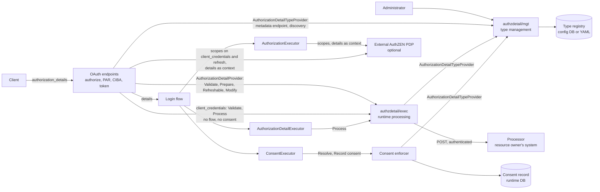
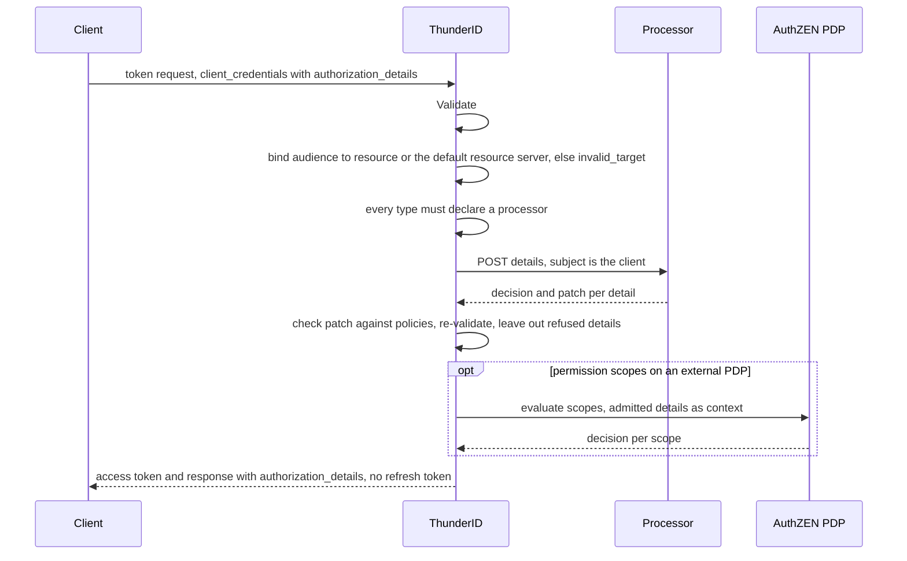

# Rich Authorization Requests (RFC 9396) Specification

- **Status:** Draft
- **Version:** 1.0
- **Related documents:** [Discussion #5604: Rich Authorization Requests (RFC 9396)](https://github.com/thunder-id/thunderid/discussions/5604), Issues #5153, #5155, #5159, [RFC 9396](https://www.rfc-editor.org/rfc/rfc9396), [Threat model](threat-model.md), [SDK specification](../sdk-development/spec.md#authorization-details), [Discussion #5552: Shared outbound authentication module](https://github.com/thunder-id/thunderid/discussions/5552)

## Summary

Scopes grant broad capabilities, so users approve more than a task needs and resource servers cannot check a call against what was approved. RFC 9396 lets a client request `authorization_details`: structured objects such as "pay 35.00 EUR to Merchant A from my account".

An administrator registers the **authorization details types** the deployment understands, in a registry of its own that is not tied to a resource server. A type is a JSON Schema for the detail, a **policy** on each field saying who supplies it and how it may change after the request, a consent summary template, a **reuse** setting, and optionally a **processor**: an endpoint of the resource owner's system that approves or refuses each detail and fills in values only it knows.

Each detail is validated against its type, decided on by the processor, and approved or denied by the user. The approved details are carried in the access token, the token response and introspection, and approvals are recorded in the user's existing consent record. **Nothing in a token can exceed what was requested and approved**: every later change, whether a processor's patch, a value the user lowers at consent, a client's modification at the token endpoint, or the reuse of an earlier approval, goes through one comparator driven by the field policies.

## Architecture



| Component | Ownership |
|---|---|
| `internal/authzdetail/mgt` | Type management: the type registry (database, file and composite stores), the management API, declarative types and the exporter. Provides the registered types to runtime processing as `providers.AuthorizationDetailTypeProvider`, as flow management provides flow definitions through `providers.FlowProvider`. |
| `internal/authzdetail/exec` | Runtime processing, the built-in implementation of `providers.AuthorizationDetailProvider` over the type registry, wired once and used by both the OAuth endpoints and the flow executors. The provider carries the whole runtime contract: `ValidateAuthorizationDetails` (validate a client's details), `PrepareAuthorizationDetails` (stamp validated details with their `detailId` and the type identifier and version for a flow), `ProcessAuthorizationDetails` (the processor call), `RefreshableAuthorizationDetails` (the granted details a refresh token may carry) and `ModifyAuthorizationDetails` (check a modification at the token endpoint against the grant). |
| `internal/authzdetail/common` | What the others share: schema compiling, field policies, detail parsing, the comparator, the checked application of a change to a detail, and the consent helpers (the coverage check and the prompt purpose of a detail). |
| Consent enforcer | The existing `providers.ConsentProvider` implementation (`internal/authn/consent`) takes the details beside the attributes and permissions it already resolves. It decides which details earlier approvals cover, adds an element for each of the others to the prompt's authorization details purpose, applies and checks any value the user changed, records the approvals a later request may reuse in the same consent record write, and returns the granted details from `RecordConsent`. It reads types through `providers.AuthorizationDetailTypeProvider`. |
| OAuth endpoints | `/oauth2/authorize`, PAR, the CIBA backchannel endpoint and the token endpoint accept `authorization_details` and depend only on providers: `providers.AuthorizationDetailProvider` for validation, preparation, processing, refresh and modification, and `providers.AuthorizationDetailTypeProvider` for the registered types the metadata endpoint and discovery list. On `client_credentials` the token endpoint validates the details and has them processed itself, with no flow and no consent. Token issuance and introspection carry the result. |
| Flow executors | An **authorization detail executor** runs the processors after authentication, in authentication flows only, through `providers.AuthorizationDetailProvider`. The existing authorization executor passes the requested details to the authorization service as AuthZEN evaluation context for the permission scopes. The existing consent executor fails the flow (`FET-1130`) before calling `providers.ConsentProvider` when a detail skipped the processor its type declares, and otherwise passes the details to it with the attributes and permissions. When `ResolveConsent` needs no prompt it grants every requested detail; after a prompt it grants the details `RecordConsent` returns, which hold both the covered and the approved details with any value the user modified applied, and only orders them as requested. |
| Shared value comparison package | `internal/system/valuecompare`, shared with the IdP authorization rules of federated authorization mapping, orders numbers, dates and instants. Numbers are compared exactly; an IdP authorization rule compares a number longer than 1024 characters, or with an exponent beyond ±400, as a double. |

Existing seams are reused rather than duplicated:

- **Details travel by value, as permissions do.** The authorization request validates the details and prepares them: each gets an internal `detailId` and the identifier and version of the type the request starts with. They travel in the flow's server-side runtime data, and each step that changes them writes the result back: the processor's patch and admission, then the details consent granted. The flow's signed assertion carries the granted details to the authorization callback, which issues the code with them; an assertion without them means the flow did not decide, and the request is refused with `access_denied`. Executors in a flow are trusted with these values, as they are with the authorized permissions. Processing, the consent prompt and the decision each check that a detail's type is still the one the request started with (the decision checks every detail of the prompt, approved or denied), and a type changed or deleted in between fails the request (`RAR-5002`), so a detail is never processed, shown or approved under a definition the request did not start with. The grant carries the same identifiers and versions on.
- **Consent uses the existing record and prompt.** Details are a third purpose of the prompt and a third namespace of the consent record, beside attributes and permissions, and the prompt's existing approve or deny channel carries each detail's decision, with any values the user modified.
- **The control plane links no runtime code.** It initializes only `authzdetail/mgt`: the registry, management API and declarative loading. The processor call is made only by `authzdetail/exec`, and the consent record is written only by the consent enforcer, both of which only the runtime server builds.
- **Processor authentication is the shared outbound authentication module** of [discussion #5552](https://github.com/thunder-id/thunderid/discussions/5552), as for other outbound integrations.

## Detailed design

### Authorization details types

A type stands on its own in the registry, not under a resource server: RFC 9396 defines a type at the authorization server and lets a detail name where it applies in `locations`, so one type can serve several resource servers and one request can carry types of different owners. It is addressed in the management API by an id rather than its value, because type values may be URIs. The server assigns a UUID; a type that is imported or declared in a file keeps the id it carries, which need not be a UUID and is at most 36 characters. Its `type` value is printable ASCII without spaces, at most 512 characters, unique across the deployment, and immutable. Its `name` (at most 100 characters, counted as characters rather than bytes, and not blank) is its display name in the Console.

- **Schema.** A supported subset of JSON Schema 2020-12 describing an object; the keywords are listed below, `policy` is a ThunderID extension keyword, and any other keyword, `$ref`, `$defs`, `additionalProperties` and a misspelled one included, is refused. A declared `$schema` must be the 2020-12 dialect, and patterns must compile. `type` names a single type, never a list: `string`, `number`, `boolean`, `object` or `array`. `integer` and `null` are not supported; a whole number is a `number` with `multipleOf: 1`. A list must declare `items`. `required` names only properties the object declares. An `enum` lists at least one value, none twice, and no text value that starts or ends with whitespace; a `title` is not empty; and a number in a schema keyword must be within the range of a double. Limits must be satisfiable: no lower bound above the upper bound of the same kind (`minimum` and `maximum`, `exclusiveMinimum` and `exclusiveMaximum`, `minLength` and `maxLength`, `minItems` and `maxItems`), no negative length or item count, and a `multipleOf` greater than 0, which a detail is checked against exactly rather than as a double. A `const` or `enum` on the `type` member must include the type's registered value, and the `type` member may not declare a `format`. The schema is at most 64 KiB. `type`, the only member RFC 9396 defines for every detail, is required and is accepted as a string when the schema omits it. Every other member, the RFC 9396 common fields (`locations`, `actions`, `datatypes`, `privileges`, `identifier`) included, is accepted only when the schema declares it, so a type decides which common fields it uses and how they are limited. Every object is closed to undeclared fields, recursively, as RFC 9396 section 5 requires, and every property and list item schema constrains its value with `type`, `const` or `enum`. Rules that span fields, such as requiring one field when another has a value, belong to the type's processor.

  | Applies to | Keywords |
  |---|---|
  | Every schema | `type`, `title`, `description`, `enum`, `const` |
  | The root | `$schema` |
  | A property, other than under a list's `items` | `policy` |
  | Objects | `properties`, `required` |
  | Strings | `minLength`, `maxLength`, `pattern`, `format` (`date` or `date-time` only, which ThunderID checks, since 2020-12 treats `format` as an annotation) |
  | Numbers | `minimum`, `maximum`, `exclusiveMinimum`, `exclusiveMaximum`, `multipleOf` |
  | Arrays | `items` (required), `minItems`, `maxItems`, `uniqueItems` |
- **Property names** may not start or end with whitespace. A property reachable from the root through nested `properties`, which field paths, policies and template placeholders name by joining names with a dot, has a name that is not empty and contains no dot; properties of objects under a list's `items` are not named by field paths and are not limited this way.
- **`title`** on a property labels that field on the consent screen; without one the path is shown.
- **`consentTemplate`** (at most 1000 bytes) is the consent summary. Every `{{...}}` in it must be a `{{path}}` placeholder naming a declared property or `type`, with whitespace inside the braces allowed (`{{ path }}`), and it may not carry a control character other than tab, line feed and carriage return, or a bidirectional formatting character. When a placeholder's value in a detail is missing, null or empty (`""` or `[]`), the summary is left out for that detail rather than shown with a gap; the detail's fields are still listed. A type without a template has no summary: the prompt element carries no `summary`, and the login UI shows the type value instead.
- **`reuse`** (boolean, default `false`). With `false`, every request prompts and the detail is granted to the code exchange's access token only; a type for an authorization that must be approved each time, such as a single payment, uses it. With `true`, a still-valid earlier approval that covers the request skips the prompt, and the refresh token keeps the detail. Such an approval is a standing permission rather than a count: it covers every requested detail no wider than it, several in one request included.
- **`processor`** names the endpoint that decides on the type's details. A type whose fields the processor supplies or may change must have one.
- **`version`** is assigned by the server, as a flow's version is. It starts at 1 and increments only when an update changes the schema to one that is not equivalent, changes the consent template other than in leading or trailing whitespace, adds or removes the processor, or changes `reuse`, since earlier approvals count only for the version they were given on and the processor is told the version it is answering for. A schema is equivalent when it differs only in property order, in the order of `required` or `modifiableBy` names, or in policy settings written at their defaults; an equivalent schema written differently is saved without a version bump, since its property order sets the order of the fields on the consent screen. Changing the name, the description, or the processor endpoint or credential keeps the version. An update that changes nothing is not saved. An update applies only while the type is still on the version it read, so one made while another moved the version fails with `RAR-1016`. A declarative type is always version 1.
- **`isReadOnly`** is `true` for a type loaded from a declarative file.

Which resource servers understand which types is a deployment concern: a type names no resource server, and the types do not block deleting a resource server.

### Field policy

The `policy` keyword on a schema property says who supplies the field's value, how the value may change after the request, and who may change it. A property without a policy is supplied by the client and cannot change, so a gap in a definition tightens rather than loosens, and adding a policy later is not a breaking change.

| Setting | Values | Meaning |
|---|---|---|
| `suppliedBy` | `client` (default), `processor` | With `processor`, the client must not send the field and only the processor sets it. Cannot be set on `type`, and cannot be combined with a modification. |
| `modification` | `none` (default), `decrease`, `increase`, `removeItems`, `addItems` | The only change allowed after the request. `decrease` and `increase` need an ordered value; `removeItems` and `addItems` need an array. `addItems` is for a list whose items take permission away, such as excluded merchants. The modification names the direction that narrows the field (an allow list `removeItems`, a block list `addItems`, a maximum `decrease`, a minimum `increase`), and every party in `modifiableBy`, and the reuse check, treat it as granting no more. Any other field, text included, cannot change. |
| `modifiableBy` | any of `processor`, `user`, `client`, without repeats | Who may make that change. Required with a modification, and not allowed without one. A field the user may change is editable on the consent screen; the user cannot be named for a `date-time` field, which the consent screen does not edit. |
| `minimum`, `maximum` | a date or an instant | Limits for a string in the `date` or `date-time` format, checked on every request and after every change. The minimum may not be greater than the maximum. |

Settings are matched by their exact names, so any other setting, a misspelled one included, is refused.

Values are ordered with the shared value types, inferred from the property's schema; there is no value type setting:

| Schema | Ordered as | Value must be | Compared |
|---|---|---|---|
| `"type": "number"` | number | a JSON number | exactly, so `45` equals `45.00`, without floating-point rounding |
| `"type": "string", "format": "date"` | date | a JSON string, `YYYY-MM-DD` | by calendar date |
| `"type": "string", "format": "date-time"` | instant | a JSON string, RFC 3339 | by instant |
| anything else, numbers written as text included | not ordered | | equality only |

A number is limited with the schema's own `minimum` and `maximum` keywords, which are checked at the same points as policy limits; setting them in a policy is refused, and so is a schema minimum greater than its maximum. Text is limited with the standard `maxLength`, since the client's values are shown on the consent screen. A `required` field the processor supplies is not required in the client's request; it is required once the processor has answered, so it means the processor must fill it in.

Policies are read from properties reachable through nested `properties`, so a `policy` on the root or anywhere under a list's `items` is refused. A field inside one the processor supplies cannot be modifiable.

### The comparator

One function compares a changed detail with its baseline and allows only the changes the policies give the party making them. An allowed modification never grants more than the detail it modifies.

| Where | Party | Baseline |
|---|---|---|
| Processor patch | `processor` | the detail as requested |
| Consent, a value the user changed | `user` | the detail after the processor |
| Token endpoint: code exchange, CIBA token poll and refresh | `client` | the granted detail |
| Reuse check before prompting | the direction of each field's modification | an earlier approved detail |

| `modification` | The new value must be |
|---|---|
| `none` | equal to the baseline |
| `decrease` | less than or equal to it |
| `increase` | greater than or equal to it |
| `removeItems` | a subset of the baseline array; an array absent from the baseline counts as empty, and an array the baseline has may not be left out (an empty array is the narrowest value) |
| `addItems` | a superset of the baseline array; an array absent from the baseline counts as empty, and an array the baseline has may not be left out |

A field the party may not modify must be equal. A field the processor supplies is free for the processor and fixed for everyone else. Field sets must match, apart from an array absent from the baseline as above: a field left out is not assumed to grant less, since omitting a cap may mean no cap. An empty object holds no field, so a processor can fill one in. At the token endpoint an entry may leave out the fields the processor supplied, which the client has not seen before its first token response; they are taken from the granted detail the entry is compared with. A value the user changed at consent is likewise unknown to the client until a token response returns the granted details, so a client narrows it on refresh. Strings are compared as decoded JSON strings and are equal only when identical, with no case folding or Unicode normalization, as RFC 9396 section 12 requires. Because `removeItems` keeps each of `actions`, `locations` and `datatypes` within the baseline, their product (RFC 9396 section 2.2) stays within it too.

A processor's patch and a user's change are applied as values keyed by field path. Each path must name a field of the type, two changes whose paths lie one inside the other are refused, and each value must pass the text checks a request does (step 1 below). The changed detail must match the schema before it is compared with its baseline, and then its limits. A client's entries at the token endpoint are likewise matched against the type's schema, without its processor-supplied fields, before they are compared with the grant.

### Requesting authorization details

`authorization_details` is accepted on `/oauth2/authorize`, on PAR, on the CIBA backchannel authentication request, and on the token endpoint for `client_credentials`. **Validate** runs before the user is involved:

1. The parameter is a JSON array of 1 to 50 objects, so an empty array is refused, each with a string `type`. The text must be valid UTF-8, an object may not repeat a member name, and a string may not carry a lone surrogate escape, a control character other than tab, line feed and carriage return, or a bidirectional formatting character, so every component, and the consent screen, reads the same detail.
2. Each type is registered.
3. Each detail matches its type's request schema and limits, and carries no field the processor supplies. A number a double cannot hold exactly, longer than 1024 characters, or with an exponent beyond ±1000 is refused, here and wherever a detail is checked against its schema again, since the schema compares numbers as doubles while the detail keeps their text.

A detail's `locations` are checked only as its type's schema says. A failure is `invalid_authorization_details`. Scope-only requests are unaffected. Any client may request any registered type, and details of several types may share one request.

The details do not decide the token's audience, so there is one rule for it. A request that carries `authorization_details` binds to a resource server as one with permission scopes does (RFC 8707): to the `resource` parameter when sent, otherwise to the configured default resource server, and fails with `invalid_target` when there is neither. The access token's `aud` is that resource server, which must enforce the details in the tokens it receives.

With PAR, validation and the audience binding run when the request is pushed, and the pushed request holds the validated details for the authorization request that redeems it, which validates them again against the current types. A CIBA request is validated and bound before the user is notified.

### The processor

The processor is where the resource owner's system decides, which RFC 9396 leaves to the authorization server (section 11.2). It runs after authentication, since it may disclose the subject's data (RFC 9396 section 13), and before consent, so a refusal ends the flow before the user is asked. A flow needs the authorization detail executor only when a requested type declares a processor, and the executor is supported only in authentication flows: flow validation refuses it in any other flow type. Details of types without a processor go straight to consent; details that skipped the processor their type declares are refused at consent: the consent executor fails the flow with `FET-1130` before calling the consent provider, and the login is denied.

- **Batching.** ThunderID posts every detail served by one endpoint with one credential in one call, which also allows rules across details; a type's credential is never sent with another type's details. Where the requested types declare different endpoints or credentials, the calls are made one after another and the first failed call ends the request without calling the rest. A failed call is not retried. The request names the subject (in a login the signed-in `user` or `agent`; on `client_credentials` the client itself, `application` or `agent`), the client (`application` or `agent`), the resource server the token is issued for, by its identifier, so the processor can refuse a detail it does not decide for that resource server, and each detail with its internal `detailId`, type and type version.
- **Decision.** `decision: false` is the only refusal. A refused detail is left out and the others go on. When the refusals leave no detail, the request fails: the user, or a `client_credentials` client, is told `context.reason_user`, and `reason_admin` is only logged. A reason carrying a control or bidirectional formatting character is dropped, distinct reasons are joined with `; ` and cut to 200 characters, and the result is wrapped in the error description ("The requested authorization details were refused: ..." in a login, "Refused by the resource owner's domain system: ..." on `client_credentials`). In an OAuth `error_description` it is further limited to the characters RFC 6749 allows, so non-ASCII characters are removed, and to 256 characters.
- **Patch.** Values keyed by JSON Pointer (RFC 6901). The processor may set fields it supplies and make the changes their policies allow it. Any other change makes the answer unusable, and the patched detail is validated against the full schema and its limits again.
- **Failing closed.** An error status, a redirect, a timeout (5 seconds by default, at most 30), a body over 1 MiB or that cannot be decoded, or a result that is missing, repeated, without a decision or for a detail the call did not carry, means the processor could not decide, and the request fails. Details are never let through unchecked.
- **Authentication.** ThunderID authenticates to the processor through the shared outbound authentication module of [discussion #5552](https://github.com/thunder-id/thunderid/discussions/5552), with the mechanisms it defines: none, a bearer token, an API key and Basic, with OAuth 2.0 client credentials and mutual TLS to follow. The credential is configured on the type's processor as `processor.authentication`, stored encrypted and returned masked as that module defines. An update that leaves the credential out, sends it masked, or passes back the stored credential unchanged keeps the stored one while the endpoint is unchanged, and one that sends `type: none` clears it; an update that moves the processor to another endpoint must send the credential again, and a stored credential passed back unchanged does not count as sent (`RAR-1009`). An API key's header name may not contain a dot. Export writes each credential value as a secret template variable rather than in the file, and an imported file may put a secret reference in any processor authentication property except a field the module does not treat as a credential, such as Basic `username`. In the embedded engine, the type registry the embedder supplies gives each processor's authentication with its type.
- **Transport.** HTTPS only, with HTTP accepted on a loopback host for development. The endpoint is an absolute URL with a valid host and port and no user information, parsed with `httpauth.ParseEndpointURL` of the outbound authentication module. Redirects are not followed, so the details reach only the configured endpoint.

| Outcome | Login flow | `client_credentials` |
|---|---|---|
| Some details refused | refused ones left out | refused ones left out of the token |
| Every detail refused | `FET-1127` with the reasons; the client receives `access_denied` with the same description, or on CIBA the generic denial description | `400 invalid_authorization_details` with the reasons |
| No usable answer | `FET-1128`; the client receives `access_denied` | `500 server_error` |

### Consent and its record

A login that requests details needs the consent executor (User Consent): without it the flow ends without a decision on the details, and the request is refused with `access_denied` ("Authorization details were not approved"). The default authentication flows have no consent step, so an application that requests details uses a flow that adds one, with the authorization detail executor before it when a requested type declares a processor.

The details are one consent purpose of the application, `authorization_details:<appID>`, beside its attribute and permission purposes. Each detail is an optional element of that purpose, named by its `detailId` and shown as a card with the summary rendered from its type's template (the type value when there is none) and one row per field, in the order the schema declares its properties. The user approves or denies each detail. Granted details are always taken from server-side flow state, and the consent session token holds each prompted detail and each detail earlier approvals cover, so the values recorded are the ones that were shown, or a modification of them the user made under the field's policy.

A field is fixed at consent unless its policy lets the user change it. The user may then modify it in the policy's direction, bounded by the value shown: a number or a date, or the items of a list of plain values; for a list whose items the user may add, the row carries the schema's allowed item values as `options`. The decision carries only the changed fields, keyed by field path. Each change is applied to the detail held in the consent session token and checked by the comparator with the user as the party, and the result must still match the schema and its limits; a change that fails either check fails the login (`RAR-1019`) before anything is recorded. The modified detail is what is granted and issued, and an approval of a type that allows reuse is recorded with the modified value as granted, so a later request is covered only when it stays within what the user approved.

Approvals that a later request may reuse are stored in the user's consent record for the application, in the `authorization_detail` namespace, and behave as permission consent does:

- the application's purpose `authorization_details:<appID>`, with one element per approved detail, named by its `detailId`, holding the type identifier and version and the detail as granted;
- only what the reuse check reads is kept: denials and approvals of types with `reuse: false` are never consulted again and are not recorded, and recording an approval drops the type's elements of other versions, or of an earlier type deleted and created again under the same value, which no longer count, and those on the same version that the new approval covers, which the reuse check never needs;
- approvals are written in the same consent record write as attribute and permission consent, and a prompt that keeps nothing writes nothing;
- a recorded approval resets the record's validity from the application's login consent validity period;
- a detail is **covered**, and not prompted, when the user's active record holds an approved element of the same type, type identifier and type version that the new request stays within, in each field's allowed direction, with everything else equal; covered details are granted and nothing is written for them. When no prompt is needed, every requested detail is covered and granted. When the prompt is shown for other details or purposes, the covered details are granted only if the prompt is approved, and each is checked again when the decision is recorded: its type must still have the identifier and version the request started with (`RAR-5002` otherwise), and the user's current consent record must still cover it, so a detail whose approval was revoked while the prompt was open is left out. `RecordConsent` returns the whole grant, the covered and the approved details, and the consent executor only orders it as requested;
- `prompt=consent` forces the prompt, a type with `reuse: false` is never covered, and a denied or timed-out prompt grants nothing, covered details included. `prompt=none` cannot show the prompt, so a request that needs one, for details as for attributes and permissions, fails with `login_required`.

In CIBA, the backchannel authentication request carries the details, and the user's login flow on their authentication device runs the processor and the consent prompt as above. A CIBA request always prompts, so an earlier approval never covers its details. The callback saves the granted details, with the identifier and version of each type, on the CIBA request, and the client's token poll issues them and may modify them as a code exchange can. When the flow denies the request, for example because the processor refused every detail, the poll returns `access_denied` with the generic denial description ("The user denied the authentication request"), as for every other CIBA denial: the flow's reason is not forwarded, since the client chose the user with `login_hint` and the flow's failure text could disclose that user's account state. The only description specific to details is "Authorization details were not approved", when the flow ended without a decision on them.

### Tokens, refresh and modification

The access token, the token response and introspection carry the granted details as plain RFC 9396 objects; the internal `detailId` is never part of them. A detail is authorization in its own right: a resource server treats an action whose detail is missing from the token as unauthorized, and does not fall back to a broader scope. It is seen only by the processor and, inside the flow's signed assertion, by the login UI. Discovery advertises `authorization_details_types_supported` and `authorization_details_types_endpoint`, a ThunderID metadata parameter (RFC 8414 allows additional parameters, and no standard defines how type schemas are published). `GET /oauth2/authorization-details-types` returns every registered type's request view as `{"types": [...]}` and `GET /oauth2/authorization-details-types/{type}` returns one, with the type value URL-encoded since it may be a URI. Each entry carries `type`, `name`, `description`, `version`, `schema` (the fields a client may send, with their constraints and allowed values; processor-supplied fields and the `policy` keyword are left out, so a limit set in a policy, such as a date minimum or maximum, is not shown) and `modifications`, a list of `{field, modification}` naming the changes a client may make to a granted detail at the token endpoint; processor configuration and credentials, the user and processor modification rules, the consent template, the reuse setting and internal identifiers are never exposed. The endpoint is public and read-only like discovery, and cacheable: each response carries an ETag of its content, and a request whose `If-None-Match` matches it gets `304 Not Modified`. When a deployment turns it off, it is not served and discovery does not advertise it.

The grant also keeps, per type, the type identifier and version its details were approved on: on the authorization code and the CIBA request record, and on the refresh token as the private claims `access_token_authorization_details` (the details) and `access_token_authorization_detail_versions` (the identifiers and versions). Neither reaches the access token or the token response.

On the code exchange, the CIBA token poll or a refresh, a client may send `authorization_details` to obtain a token carrying less than the grant (RFC 9396 section 6). Each entry is a whole detail object that must modify a distinct granted detail of its type, making only the changes the policies allow the client, and must still match the schema and its limits. Entries are paired with granted details so that every entry is matched whenever some pairing exists, and one approval cannot be claimed twice. Granted details no entry modifies are left out of that token. A request that widens the grant, names nothing granted, or is sent for a grant that holds no details, is `invalid_authorization_details`. The grant keeps, for each type, the type's identifier and version its details were approved on. Modification reads the type's current fields and policies, so an entry is refused with `invalid_authorization_details` when its type has moved to another version, or been deleted (even if created again under the same value), since the grant. On the code exchange and the CIBA token poll the grant itself is unaffected: a request without `authorization_details` still returns the details as granted. A refresh starts from the details the refresh token renews (below), so there a detail of such a type is no longer granted, and an entry of it matches nothing.

The refresh token keeps the granted details of types that allow reuse; a detail of a type with `reuse: false`, or of a type deleted, recreated or moved to another version since the approval, is not renewed, which the code exchange and the CIBA token poll check when they issue the refresh token, and every refresh checks again. It keeps all of them even when the access token issued with it carries a modified part, so a modification limits one access token and never the grant. A refresh returns the details the refresh token keeps that are still renewed, or a modification of them, and the refresh token issued with it keeps the same details. `client_credentials` issues no refresh token. Every other grant, token exchange and JWT bearer included, refuses `authorization_details` with `invalid_authorization_details` and does not propagate details, so nothing widens through it.

### Client credentials

On `client_credentials`, `authorization_details` on the token request is a request in its own right, not a modification. It is validated as any request is, and then binds to the `resource` parameter or the default resource server, failing with `invalid_target` with neither, before any processor is called. With no user to consent, the processor is the only party that decides, so the request is refused with `invalid_authorization_details` (`RAR-1024`) unless every requested type declares a processor. The processor sees the client itself as the subject (`application` or `agent`) and decides which clients may have which details. Refused details are left out; when every detail is refused the response is `invalid_authorization_details` with the processor's reason, and a processor that gives no usable answer is `server_error`. There is no flow and no consent step: approved details go into the access token and the token response, nothing is recorded in a consent record, and the grant issues no refresh token. Permission scopes on the request are evaluated as usual, with the admitted details, as the processor patched them, as AuthZEN context, so a scope is not granted on the strength of a detail the token does not carry.



### Scope authorization and the policy engine

Permission scopes are evaluated by the authorization service, either the built-in role-based engine or the external AuthZEN PDP configured for the resource server. When the request carries `authorization_details`, ThunderID adds them to the `context` of every AuthZEN evaluation under `authorization_details`, as RFC 9396 objects in the form ThunderID validated them, without the internal `detailId` or the type version. The authorization executor sends the details the flow holds when it runs, so a flow whose PDP uses details places the authorization detail executor before it, and the PDP then receives only the details the processor admitted. The PDP decides only the permission; the details are context for that decision. The PDP does not grant, refuse or modify a detail, which stays with the type's processor and the user's consent. The built-in role-based engine ignores context.

- **Login** (authorization code, PAR, CIBA): the flow's authorization executor sends each detail in the flow as requested, which the flow keeps beside the processed value, so the values are not patched. The authorization executor and the authorization detail executor do not depend on each other and may run in either order; both run before consent. When the authorization detail executor runs first, the details the processor refused are no longer in the flow and are not sent.
- **`client_credentials`:** the details the processor admitted, with its patch applied, as the token carries them, so a scope is not granted on the strength of a detail the token does not carry.
- **`refresh_token`:** when the scopes are authorized again, the details the refresh token renews.

```json
{
  "subject": {"type": "user", "id": "<user-id>"},
  "resource": {"type": "https://bank.example.com", "id": "<resource-server-id>"},
  "action": {"name": "payments:write"},
  "context": {
    "authorization_details": [
      {"type": "payment_initiation", "actions": ["initiate", "status"], "instructedAmount": {"amount": 45.00, "currency": "EUR"}, "creditorName": "Merchant A"}
    ]
  }
}
```

### Declarative types, import and export

Types follow the resource server pattern for declarative resources. A YAML file per type under the `authorization_detail_types` directory (`resource_type: authorization_detail_type` in a combined file) holds `id`, `type`, `name`, `description`, `schema` (a mapping or JSON text), `consentTemplate`, `processor` and `reuse` (default `false`). As for declarative flows, a declarative type is always version 1 and its file carries no version. Editing a declarative type's schema, policies or consent template therefore does not void earlier approvals or grants; to void them, give the type a new `id`, which earlier approvals and grants no longer match. Loading applies the management API's validation and refuses an id or a type value either store already holds. The `id` need not be a UUID and is at most 36 characters.

Types have a store mode of their own, `authorization_detail_type.store`, `composite` in the shipped configuration; when it is unset, `declarative_resources.enabled` chooses `declarative` or `mutable`, as for resource servers. In `mutable` mode the registry is the database only. In `declarative` mode the registry is the files only, and creating a type through the API fails with `RAR-1014`. In `composite` mode reads merge both stores, writes go to the database, and a file-defined type is read-only (`isReadOnly`), so updating or deleting it fails with `RAR-1013`; a listing whose merged types exceed the composite mode limit of 1000 fails with `RAR-1017`.

Export takes `authorizationDetailTypes`, leaves declarative types out, writes no version, and writes each processor credential value as a secret template variable. A processor that authenticates nothing is exported with `authentication: {type: none}`, so importing it clears a credential the target stores; a document without `authentication` keeps the stored one under the update rules. Import has no ordering dependency on other resources. With upsert, the default, a type whose id exists is updated under the update rules, so its version moves only under those rules and importing the same file twice changes nothing; a type whose id does not exist is created with the exported id and starts at version 1. Without upsert every type is created, so a type whose type value exists is refused with `RAR-1003`, and a type whose id exists under another type value with `RAR-1015`. A dry run applies the same checks, the processor credential's included, in the order the import would, and saves nothing.

### Data model

A new configuration table holds the registry. The runtime database is unchanged. The PostgreSQL form is shown; SQLite stores the JSON columns as text. `backend/dbscripts/configdb` holds both.

```sql
CREATE TABLE "AUTHORIZATION_DETAIL_TYPE" (
    DEPLOYMENT_ID      VARCHAR(255) NOT NULL,
    ID                 VARCHAR(36) NOT NULL,  -- a UUID, or the id an imported or declarative type carries
    TYPE               VARCHAR(512) NOT NULL,
    NAME               VARCHAR(100) NOT NULL,
    DESCRIPTION        TEXT,
    VERSION            INTEGER NOT NULL DEFAULT 1,
    SCHEMA_DEFINITION  TEXT NOT NULL,  -- kept as written, so the declared property order survives
    PROPERTIES         JSONB,         -- {consentTemplate, processor, reuse}
    CREATED_AT         TIMESTAMPTZ DEFAULT NOW(),
    UPDATED_AT         TIMESTAMPTZ DEFAULT NOW(),
    PRIMARY KEY (DEPLOYMENT_ID, ID)
);
CREATE UNIQUE INDEX uq_authorization_detail_type ON "AUTHORIZATION_DETAIL_TYPE"(DEPLOYMENT_ID, TYPE);
```

The existing `CONSENT` table is reused without a schema change. Its `PURPOSES` document gains a purpose named `authorization_details:<appID>` whose elements carry `namespace: authorization_detail`, `isUserApproved` (always `true`), `typeId`, `typeVersion` and `granted`, for approvals of reusable types on the type's current version.

### API

Two APIs are introduced. The full definitions are `api/authorization-detail-type.yaml` and `api/extensions/authorization-details-processor.yaml`; the schemas below are the contract.

#### Authorization details type management

| Method | Path | Success | Errors |
|---|---|---|---|
| `GET` | `/authorization-detail-types?limit&offset` | `200` page | `400 RAR-1012, 1017` |
| `POST` | `/authorization-detail-types` | `201` type | `400 RAR-1001, 1004, 1005, 1006, 1007, 1008, 1011, 1014`, `409 RAR-1003` |
| `GET` | `/authorization-detail-types/{id}` | `200` type | `404 RAR-1002` |
| `PUT` | `/authorization-detail-types/{id}` | `200` type | `400 RAR-1001, 1004, 1005, 1006, 1007, 1008, 1009, 1010, 1011, 1013`, `404 RAR-1002`, `409 RAR-1016` |
| `DELETE` | `/authorization-detail-types/{id}` | `204` | `400 RAR-1013` |

An unknown type id answers `RAR-1002` on `GET` and `PUT`; deleting a type that does not exist succeeds with `204`.

The endpoints require the root system administration permission (`system`), as the other top-level management APIs (`/resource-servers`, `/applications`, `/flows`) do. `limit` is 1 to 100 (default 30) and `offset` zero or more. A create or update request body is at most 1 MiB. It may carry the read-only members a read returns (`id`, `version`, `isReadOnly`), which are ignored, so a type that was read can be written back.

The ThunderID MCP server offers the same operations, except deletion as for other resources, as the tools `list_authorization_detail_types`, `get_authorization_detail_type_by_id`, `create_authorization_detail_type` and `update_authorization_detail_type`. They call the same service under the same `system` permission, so a type is validated the same way, and they carry the schema as the JSON the client sent, so its property order and numbers are kept.

`api/authorization-detail-type.yaml` is the contract for these schemas (`AuthorizationDetailTypeRequest`, `AuthorizationDetailTypeResponse`, `AuthorizationDetailTypeListResponse`, `AuthorizationDetailProcessor`). In summary:

| Field | Request | Response | Rules |
|---|---|---|---|
| `type` | required | yes | RFC 9396 type value; printable ASCII without spaces, at most 512 characters, unique across the deployment, immutable |
| `name` | required | yes | at most 100 characters, not blank |
| `description` | optional | when set | free text |
| `schema` | required | yes | a JSON Schema 2020-12 object schema, at most 64 KiB; properties may carry `title` and `policy` (see Field policy); names of properties that field paths reach may not contain a dot |
| `consentTemplate` | optional | when set | at most 1000 bytes; every `{{...}}` is a placeholder naming a declared property or `type`; no control or bidirectional formatting characters |
| `processor` | optional | when set | `{endpoint, authentication}`: an absolute HTTPS URL, or HTTP on a loopback host, with a valid host and port and without user information; and the credential, in the form of the outbound authentication module, masked in responses |
| `reuse` | optional, default `false` | always | whether earlier approvals are reused and the refresh token keeps the detail |
| `id` | no | always | addresses the type in the API; a UUID the server assigns, or the id an imported or declarative type carries, at most 36 characters |
| `version` | no | always | assigned by the server; starts at 1 and increments when the schema changes to one that is not equivalent, the consent template changes, the processor is added or removed, or `reuse` changes |
| `isReadOnly` | no | always | `true` for a declarative type |

The `policy` keyword is documented in the `schema` description of `api/authorization-detail-type.yaml` rather than as a separate schema, since it sits inside an arbitrary JSON Schema.


Error catalogue:

| Code | HTTP | Meaning |
|---|---|---|
| `RAR-1001` | 400 | Malformed request body, a body over 1 MiB, or an imported id over 36 characters |
| `RAR-1002` | 404 | Type not found |
| `RAR-1003` | 409 | A type with the same type value exists |
| `RAR-1004` | 400 | Invalid type value |
| `RAR-1005` | 400 | Invalid name |
| `RAR-1006` | 400 | Invalid schema or policy; the description carries the reason, and the `path` parameter names the field at fault, empty for the schema itself |
| `RAR-1007` | 400 | Invalid processor endpoint |
| `RAR-1008` | 400 | Invalid processor authentication |
| `RAR-1009` | 400 | The processor endpoint changes without its credential being sent again; a stored credential passed back unchanged does not count |
| `RAR-1010` | 400 | The type value cannot be changed |
| `RAR-1011` | 400 | Invalid consent template; the description carries the reason |
| `RAR-1012` | 400 | Invalid `limit` or `offset` |
| `RAR-1013` | 400 | The type is declarative and cannot be modified |
| `RAR-1014` | 400 | Types cannot be created in declarative-only mode |
| `RAR-1015` | 409 | An imported type is created with an id that a type of another type value holds |
| `RAR-1016` | 409 | The type moved to another version while it was being updated; read it again and reapply the change |
| `RAR-1017` | 400 | In `composite` mode, the merged list of types exceeds the limit of 1000 |
| `RAR-1029` | 404 | No type is registered under the value asked of the type metadata endpoint |

Runtime codes are not returned by the management API. They are raised inside a login or a token request and reach the client as an OAuth error:

| Code | Meaning | What the client receives |
|---|---|---|
| `RAR-1020` to `RAR-1028` | The requested details are malformed, name an unknown type, do not conform to their type, carry a field the client may not supply, need a user on `client_credentials`, or, on a token request, are not an allowed modification of a granted detail on the type it was granted on | `invalid_authorization_details` with the reason |
| `RAR-1018` | The processor refused every detail | `access_denied` in a login (the flow fails with `FET-1127`); `invalid_authorization_details` with the processor's reason on `client_credentials` |
| `RAR-1019` | A change the user made to a detail on the consent screen is not one the field's policy allows the user, or leaves the detail outside its schema or limits | `access_denied` (the flow fails with `FET-1129`); nothing is granted or recorded |
| `RAR-5001` | The processor could not be reached or gave no usable answer | `access_denied` in a login (the flow fails with `FET-1128`); `server_error` on `client_credentials` |
| `RAR-5002` | A type was changed or deleted while the request was in progress | `access_denied` in a login (the flow fails with `FET-1128`, and the user may try again under the current type); `server_error` on `client_credentials` |

#### Processor

The processor is the endpoint configured on the type, so `/process` stands for that URL.

```yaml
ProcessRequest:            # POST {processor.endpoint}, application/json
  type: object
  required: [subject, client, resource, details]
  properties:
    subject:
      type: object
      required: [type, id]
      properties:
        type: {type: string, enum: [user, application, agent]}
        id: {type: string}
    client:
      type: object
      required: [type, id]
      properties:
        type: {type: string, enum: [application, agent]}
        id: {type: string, description: The client's client_id.}
    resource: {type: string, description: The identifier of the resource server the token is issued for.}
    details:
      type: array
      minItems: 1
      items:
        type: object
        required: [detailId, type, typeVersion, detail]
        properties:
          detailId: {type: string, description: Internal; the same on every call for one authorization request.}
          type: {type: string}
          typeVersion: {type: integer}
          detail: {type: object, additionalProperties: true}

ProcessResponse:           # 200 only; anything else means the processor could not decide
  type: object
  required: [results]
  properties:
    results:
      type: array
      items:
        type: object
        required: [detailId, decision]
        properties:
          detailId: {type: string}
          decision: {type: boolean}
          patch:
            type: object
            additionalProperties: true
            description: Values keyed by JSON Pointer (RFC 6901).
          context:
            type: object
            properties:
              reason_user: {type: string, description: Shown when every detail is refused; cut to 200 characters.}
              reason_admin: {type: string, description: Only logged.}
```

#### Changes to existing APIs

| API | Change |
|---|---|
| `/oauth2/authorize`, PAR, CIBA backchannel authentication | `authorization_details` request parameter |
| Token endpoint | `authorization_details` on `authorization_code`, the CIBA grant and `refresh_token` (modification) and `client_credentials` (request); refused on every other grant, token exchange and JWT bearer included. `authorization_details` in the token response. |
| Access token, introspection | `authorization_details` claim |
| Discovery | `authorization_details_types_supported`, `authorization_details_types_endpoint` |
| `GET /oauth2/authorization-details-types`, `GET /oauth2/authorization-details-types/{type}` | Type metadata: each registered type's request view only; public, cacheable, with an ETag of the content; an unknown type value is `404 RAR-1029` |
| Flow execution | `FET-1127` (the processor refused every detail, with its reason), `FET-1128` (the processor could not be reached or answered with a change it may not make, or a type changed while the flow was in progress), `FET-1129` (a change the user made to a detail is not allowed) and `FET-1130` (details reached consent without the processor their type declares). `FET-1128` and `FET-1130` are server errors, but like the others they end the authorization request with `access_denied`. The consent decision of a detail may carry `modified`: the fields the user changed, keyed by field path. The application's authorization details purpose has `type: "authorization_details"` and one optional element per detail, which carries `detailType`, `summary` and `rows`. A row carries `modification` and `as` when the user may change the field, `options` for a list whose items the user may add, and `origin: "server"` for a field the processor supplies. |
| Export | `authorizationDetailTypes` |
| AuthZEN evaluation sent to an external PDP | `context.authorization_details`, when the request carries details: the requested details in a login, the admitted details on `client_credentials`, and the granted details on a refresh |

The OAuth errors follow RFC 9396: `invalid_authorization_details`, and `invalid_target` (RFC 8707) when a request carrying details has neither a `resource` parameter nor a default resource server.

### UI

The Console calls authorization details types **Intent Templates**; this specification and the API keep the RFC 9396 term. The management API enforces every rule in this specification. The Console editor, which applies the server's validation and shows declarative types read-only, is a follow-up change, and the server remains the authority.

The [SDK specification](../sdk-development/spec.md#authorization-details) covers the client side: the `authorizationDetails` configuration key, rendering the consent element and the `modified` decision.

### Configuration

Three configuration keys are introduced: two under `oauth.authorization_details` set the processor timeout and turn off the type metadata endpoint, and `authorization_detail_type.store` sets the store mode for types; every other setting is existing configuration or fixed.

| Setting | Source | Level |
|---|---|---|
| Store mode for types | `authorization_detail_type.store` (`mutable`, `declarative` or `composite`; `composite` in the shipped configuration), falling back to `declarative_resources.enabled` when unset, as for resource servers | Deployment |
| Declarative files | the `authorization_detail_types` directory of the declarative resources | Deployment |
| Validity of approvals | the application's login consent validity period | Application |
| Processor timeout | `oauth.authorization_details.processor_timeout`, in seconds, default 5, at most 30 | Deployment |
| Processor call limits | fixed: endpoints called one after another, 1 MiB response (a larger one fails the request), no redirects, no retry | Not configurable |
| Processor credentials | `processor.authentication`, through the shared outbound authentication module ([#5552](https://github.com/thunder-id/thunderid/discussions/5552)) | Type |
| Embedded engine | `WithAuthorizationDetailTypeProvider` supplies the type registry, processor authentication included; without it no type is registered, requested details are refused as unknown types, and the type metadata endpoint lists none. `WithAuthorizationDetailProvider` replaces the whole runtime provider, the same one for login flows and `client_credentials`; the default is the built-in provider over the supplied registry, which calls the processor each type declares. A replacement owns validation, preparation, processing, refresh filtering and modification at the token endpoint, and must keep their invariants: on `client_credentials` no user consents, so it must refuse a type without a processor (`RAR-1024`) and return only requested, admitted details; it narrows a detail only within its field policies; and its refusal reasons must be safe to show the client. The embedder's consent provider decides on details as on attributes and permissions: `ResolveConsent` takes the requested details, and returning no prompt grants every one of them, so it must prompt for or refuse any detail no earlier approval covers; `RecordConsent` returns the granted details with the record | Engine |
| Details per request | fixed: at most 50 | Not configurable |
| Type metadata endpoint | `oauth.authorization_details.type_metadata_enabled`, default `true`; when `false`, the endpoint is not served and discovery does not advertise `authorization_details_types_endpoint` | Deployment |
| Policy engine for permission scopes | the resource server's authorization engine: the built-in role-based engine, or an AuthZEN PDP connection with its own transport and authentication | Resource server |

## Requirements

### R1. Defining what can be requested

**Requirement:** An administrator defines the kinds of authorization the deployment understands, in one registry independent of resource servers, so that every request can be checked before anyone acts on it, and clients can learn what they may request.

**Acceptance criteria:**

- **AC1.1:** Given an administrator defines a type, when they save it, then it states the allowed values with a JSON Schema, which fields its processor supplies, which fields may change after the request and by whom, any limits, the consent summary, and whether an approval is asked every time or reused.
- **AC1.2:** Given a definition that is not valid (an invalid schema or policy, an unsupported keyword, a policy under a list's `items`, a modifiable field inside one the processor supplies, a property name with a dot, a summary placeholder that names no field, processor rules without a processor, or a minimum above its maximum), when it is saved through the API, then it is refused with the reason; once the Console editor ships, the Console does not allow saving it either.
- **AC1.3:** Given a type is registered, when a client reads the discovery document, then the type is listed in `authorization_details_types_supported`.
- **AC1.4:** Given a client requests only scopes, when this capability is introduced, then the request works as before.
- **AC1.5:** Given an update changes the schema to one that is not equivalent, changes the consent summary, adds or removes the processor, or changes `reuse`, when it is saved, then the type's version increments; any other change, an equivalent schema written in another order included, is saved without changing the version, an unchanged update is not saved, and an update made while another moved the version is refused with `RAR-1016`. A declarative type is always version 1.
- **AC1.6:** Given types are registered, when an administrator deletes a resource server, then the types do not block the deletion.
- **AC1.7:** Given a login is in progress for details of a type, when an administrator moves the type to another version (its schema, consent template, processor presence or `reuse`) or deletes it, before the user's decision is recorded, then the login fails without granting or recording anything, whether the user approved or denied the detail; when the type is deleted or moves to another version after the decision, the code exchange still succeeds and the detail is left out of the refresh token, and a later refresh leaves it out the same way.
- **AC1.8:** Given a registered type, when a client reads the type metadata endpoint advertised in discovery, then it gets the type's request schema and the changes it may make at the token endpoint, and no processor, consent or user and processor rule configuration; when the setting is off, the endpoint and the discovery parameter are absent.
- **AC1.9:** Given an administrator's agent connected to the MCP server, when it creates or updates a type through the MCP tools, then the type is validated, versioned and stored as through the management API, with its schema's property order kept.

### R2. Authorizing a specific action

**Requirement:** A client requests authorization for specific actions; the request is checked, decided by the resource owner's system, and approved by the user, and the client receives only what was approved.

**Acceptance criteria:**

- **AC2.1:** Given a client sends `authorization_details` on the authorization request, PAR or a CIBA request, when it carries no details or more than 50, a detail names an unknown type, carries a field the type does not declare or a field the processor supplies, breaks a limit, or has neither a `resource` parameter nor a default resource server, then the request is refused before the user is involved.
- **AC2.2:** Given a valid request and an authenticated subject, when a requested type declares a processor, then ThunderID calls it with authentication, and applies the processor's patch only within the field policies.
- **AC2.3:** Given the processor refuses some details, when the flow continues, then the refused details are left out; when it refuses every detail, the user is told the processor's reason and the client receives `access_denied`.
- **AC2.4:** Given the processor cannot be reached or gives no usable answer, when the request is processed, then it fails and no detail is granted unchecked.
- **AC2.5:** Given the processed details, when the user is asked, then they see each detail with its summary and values, and approve or deny each one.
- **AC2.6:** Given the user approves some details and denies others, when the token is issued, then the access token, the token response and introspection carry only the approved details, without internal identifiers.
- **AC2.7:** Given a field's policy lets the user change it, when the user is asked, then they can modify the value in the direction the policy allows, bounded by what is shown, before approving, and the token carries the modified detail; a change the policy does not allow fails the login and grants nothing.
- **AC2.8:** Given a client requests details of one or more registered types, when the request is accepted, then any client may request any registered type, and the token's audience is the `resource` parameter or, when none is sent, the default resource server, as for permission scopes.
- **AC2.9:** Given a resource server whose authorization engine is an external AuthZEN PDP, when a request for its permission scopes carries `authorization_details` (in a login, on `client_credentials`, or on a refresh), then every evaluation sent to the PDP carries the details in `context.authorization_details` as RFC 9396 objects without internal identifiers or type versions, on `client_credentials` only the details the processor admitted, and the PDP's decision affects only the permission, never which details are granted or their values.
- **AC2.10:** Given a flow in which details reach consent without the processor their type declares having admitted them, for example because the flow has no authorization detail executor, or a flow that ends without a consent decision on the requested details, when the login completes, then the client receives `access_denied` and nothing is granted or recorded.
- **AC2.11:** Given a CIBA request with details, when the user completes the flow on their authentication device, then the processor and the consent prompt run as in a login, the prompt is shown even when an earlier approval covers the details, and the token poll returns the approved details; when the flow refuses the details, the poll returns `access_denied` with the generic denial description rather than the flow's reason, and when it ends without a decision on them, `access_denied` with "Authorization details were not approved".

### R3. Reusing and limiting approvals

**Requirement:** An approval is either asked for every time or reused while valid, and a renewed credential never carries more than was approved.

**Acceptance criteria:**

- **AC3.1:** Given a type allows reuse and the user's approval is still valid on the same type identifier and version, when the client requests a detail that stays within it, then the user is not asked again and nothing is recorded; the approval covers every such detail, several in one request included.
- **AC3.2:** Given a type allows reuse, when the request goes beyond the earlier approval, the type version changed, the type was deleted and created again, or the client sends `prompt=consent`, then the user is asked.
- **AC3.3:** Given a type with `reuse: false`, when a detail is requested, then the user is asked every time, and the detail is not carried in the refresh token.
- **AC3.4:** Given the user approves a detail of a type that allows reuse, when the approval is saved, then it is kept in the user's consent record for the application, replaces the type's approvals on earlier versions and those it covers, and resets the record's validity; denials and approvals of `reuse: false` types are not recorded.
- **AC3.5:** Given the user modifies a detail of a type that allows reuse before approving it, when the approval is saved, then it is kept with the modified value as granted, and a later request is covered only when it stays within the modified value.
- **AC3.6:** Given a prompt is shown while an earlier approval covers one of the requested details, when the user approves the prompt, then the covered detail is granted only if the user's consent record still covers it when the decision is recorded, and a change to its type meanwhile fails the login; when the prompt is denied or times out, nothing is granted, the covered detail included.

### R4. Modification at the token endpoint

**Requirement:** A client obtains a token for part of its approved details, never more.

**Acceptance criteria:**

- **AC4.1:** Given granted details, when the client sends `authorization_details` on the code exchange, the CIBA token poll or a refresh, then the token carries only the entries it sent, each modifying a distinct granted detail within the changes its policy allows the client.
- **AC4.2:** Given an entry widens a granted detail, changes a field that may not change, claims the same approval twice, or matches no granted detail, when the token is requested, then the request is refused with `invalid_authorization_details`.
- **AC4.3:** Given a token exchange request carries `authorization_details`, when it is processed, then it is refused, and no details are propagated to the exchanged token.
- **AC4.4:** Given a type moved to another version, or was deleted or deleted and created again, after details of it were granted, when the client sends an entry of that type on the code exchange, the CIBA token poll or a refresh, then the request is refused with `invalid_authorization_details`; a code exchange or CIBA token poll without `authorization_details` still returns the granted details, and a refresh leaves the detail out.
- **AC4.5:** Given a token request of any grant other than `authorization_code`, CIBA, `refresh_token` and `client_credentials`, the JWT bearer grant included, when it carries `authorization_details`, then it is refused with `invalid_authorization_details`, and no details are propagated to the issued token.
- **AC4.6:** Given a client obtained an access token carrying a modified part of its granted details, when it later refreshes without `authorization_details`, then the token carries every detail the refresh token keeps, as granted.

### R5. Authorizing a client for itself

**Requirement:** A client acting under its own identity requests details with `client_credentials`, and the resource owner's system decides.

**Acceptance criteria:**

- **AC5.1:** Given a `client_credentials` request with details, when a requested type has no processor, then the request is refused with `invalid_authorization_details`.
- **AC5.2:** Given every requested type has a processor, when the request is processed, then the processor is told the client itself is the subject, and the token carries only the details it approves.
- **AC5.3:** Given the processor refuses every detail, when the token is requested, then the response is `invalid_authorization_details` with the processor's reason, filtered and limited as in The processor.
- **AC5.4:** Given the processor cannot be reached or gives no usable answer, when the token is requested, then the response is `server_error` and no token is issued.
- **AC5.5:** Given the processor approves some details and refuses others, when the token is issued, then the access token and the token response carry only the approved details, the token's audience is the `resource` parameter or the default resource server (`invalid_target` with neither), nothing is recorded in a consent record, and no refresh token is issued.

### R6. Managing types as code

**Requirement:** An administrator manages types through the Console, the API, declarative files, and import and export, consistently.

**Acceptance criteria:**

- **AC6.1 (pending the Console editor):** Given the Console, when an administrator defines a type, then every setting the API accepts can be set, and a schema is saved as the administrator defined it.
- **AC6.2:** Given a type defined in a declarative file, when the server starts, then it is validated as the API would validate it, and refused if its id or type value is already used.
- **AC6.3:** Given a declarative type in composite mode, when an administrator updates or deletes it through the API, then the change is refused with `RAR-1013`; once the Console editor ships, the Console shows the type read-only.
- **AC6.4:** Given types exported from one deployment, when the export is imported into another, then the types are created with their ids at version 1, or updated when the id exists, independently of resource servers; importing again with upsert changes nothing, and importing again without upsert is refused with `RAR-1003`.
- **AC6.5:** Given types defined in declarative files, when the store mode is `declarative`, then creating a type through the API is refused with `RAR-1014`; when types are exported, then declarative types are left out.

## Change log

| Version | Date | Change |
|---|---|---|
| 1.0 | 2026-10-07 | Initial specification. |
