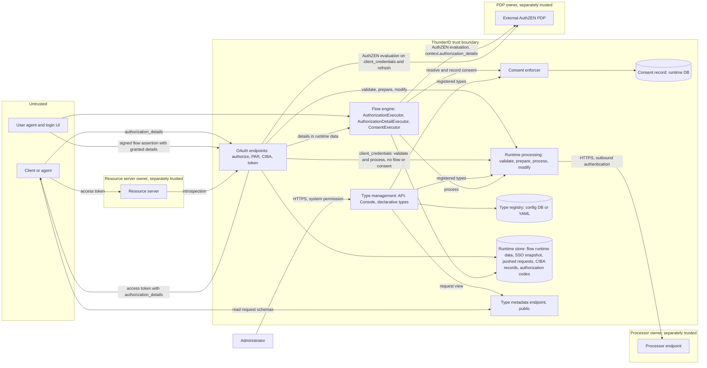
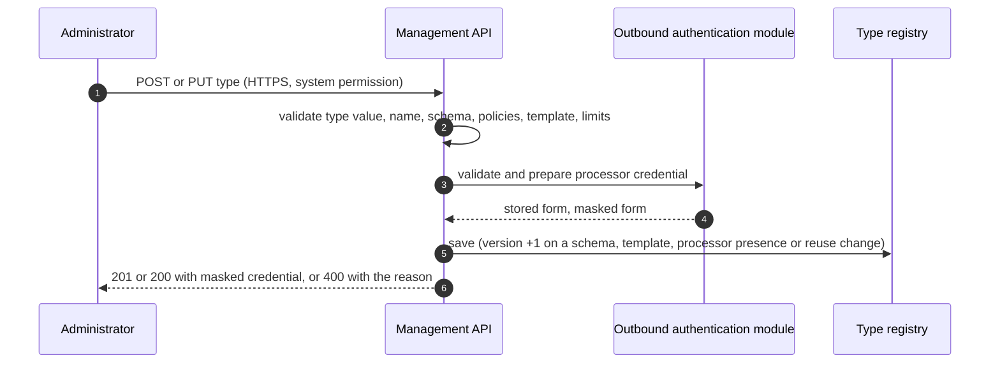
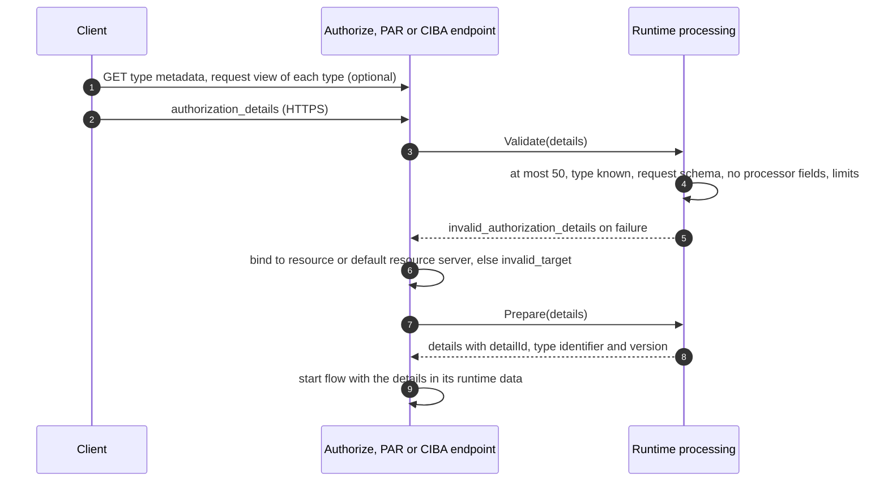
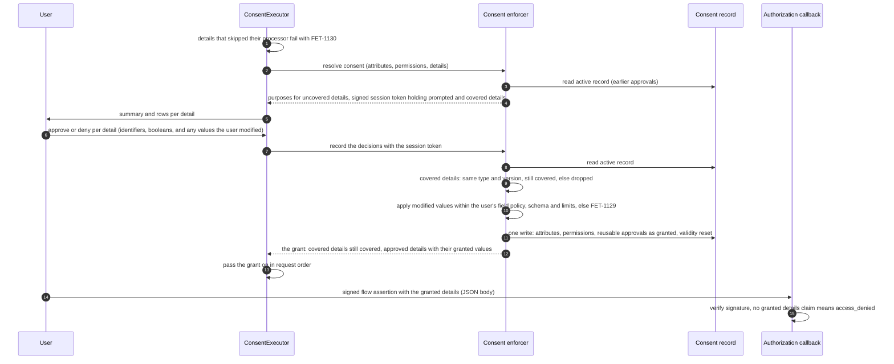
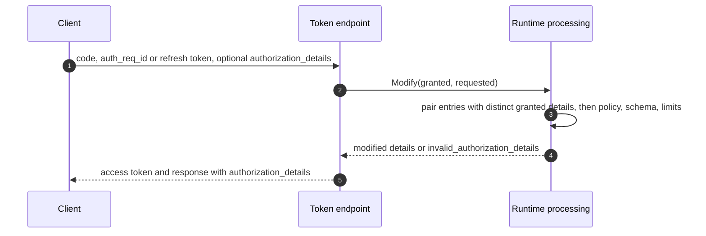
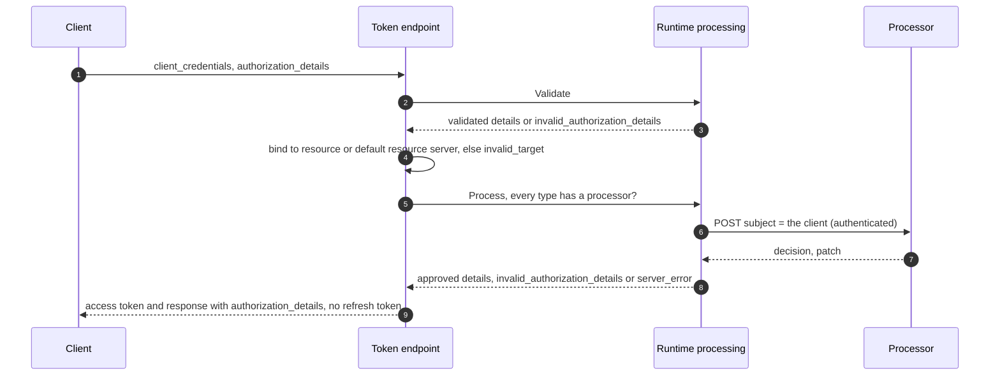
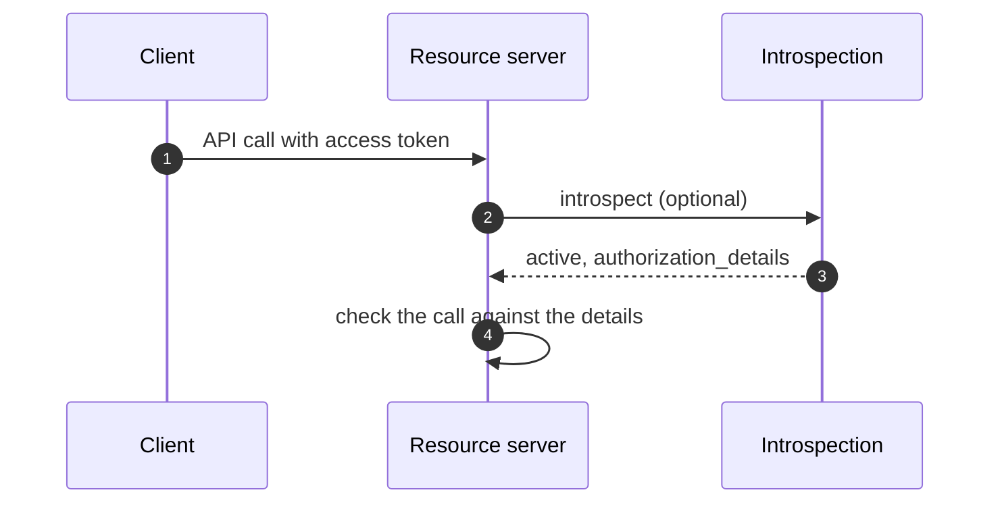
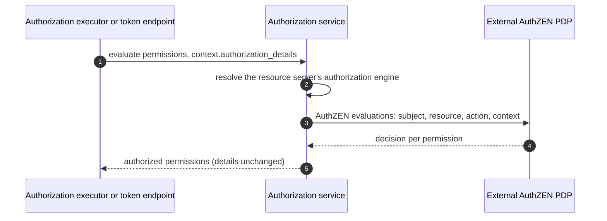

# Rich Authorization Requests Threat Model

This model covers RFC 9396 Rich Authorization Requests: the registry of authorization details types and its management API, the `authorization_details` parameter on the authorization, PAR, CIBA and token endpoints, the outbound call to a type's processor, consent and its record, and the authorization details carried in tokens and introspection.

## Overview

`ThunderID` lets a client request `authorization_details`, structured objects such as "pay 35.00 EUR to Merchant A", instead of, or alongside, broad scopes. An administrator registers the types the deployment understands, in a registry not tied to any resource server. Each requested detail is validated against its type, decided on by the type's processor (the resource owner's own system, reached over HTTPS), and approved or denied by the user, and the approved details are carried in the access token for the resource server to enforce. Because a type is not tied to a resource server, which resource servers understand which types is a deployment concern: the token is always audience-bound to one resource server, the explicit `resource` or the configured default, consent and the processor still decide every detail, and the resource server must enforce the details in the token it receives.

The security-relevant behaviour is that a token carries only details that pass validation against their type, the type's processor when it declares one, and the user's consent when there is a user. The processor may add only the values its fields' policies let it supply; every other value is the client's. A detail left out of a token narrows the grant only when the resource server treats a missing detail as no authorization, which it must. Validation refuses unknown types and fields, the processor's answer is accepted only within each field's policy, every later change goes through one comparator under which an allowed modification never grants more than the detail it modifies, and any failure to obtain a decision fails the request rather than letting details through. The entry points are the management API, the OAuth endpoints, the processor call, and the consent prompt.

Cross-cutting concerns covered elsewhere: client authentication, the authorization code, refresh token and `client_credentials` grants, PKCE, DPoP and token signing (the OAuth 2.0 Authorization and Core Grants model and the Token and Protocol Features model); the authentication flow and login UI (the Flow Execution model); credential storage and request authentication for outbound calls (the shared outbound authentication module, [discussion #5552](https://github.com/thunder-id/thunderid/discussions/5552)). These are referenced here as trust inputs, not re-analysed.

## Scope

This model covers:
- The authorization details type management API (`/authorization-detail-types`) and MCP tools, the Console editor, declarative type files, and import and export of types
- Validation of `authorization_details` on `GET /oauth2/authorize`, PAR, the CIBA backchannel authentication request, and the token endpoint for `client_credentials`
- The outbound processor call, and how its answer is applied
- The details sent as context to an external AuthZEN PDP that evaluates the request's permission scopes
- The consent prompt for details, the recording of decisions, and the reuse of earlier approvals
- Authorization details in the token response, access token, refresh token and introspection, and modification at the code exchange, the CIBA token poll and refresh
- Refusal of `authorization_details` on token exchange, the JWT bearer grant and every other grant

Out of scope (see the referenced companion models):
- The grants themselves: client authentication, code, PKCE and refresh token handling, covered by the OAuth 2.0 Authorization and Core Grants model
- Token signing, the token model, DPoP and CIBA polling, covered by the Token and Protocol Features model
- The authentication flow and the login UI's rendering, covered by the Flow Execution model
- How outbound credentials are configured, stored, masked and applied, covered by the shared outbound authentication module ([discussion #5552](https://github.com/thunder-id/thunderid/discussions/5552))
- Token revocation and its enforcement, covered by the Token Revocation model

## Architecture



### Components

Type management (`authzdetail/mgt`) owns the registry and serves the registered types read-only to runtime processing (`authzdetail/exec`), which owns Validate, Prepare, Process, refresh filtering and Modify, and to the consent enforcer, which owns consent for details as it does for attributes and permissions. The OAuth endpoints (authorize, PAR, CIBA, the token grants and refresh) and the flow executors reach runtime processing only through the public `providers.AuthorizationDetailProvider` contract, and the registry only through `providers.AuthorizationDetailTypeProvider`; the built-in runtime service implements the first from the registry and is wired once. The control plane runs only type management. Details move through a login by value in the flow's server-side runtime data, as the authorized permissions do, and the flow's signed assertion carries the granted details to the authorization callback.

| Component | Task |
| --- | --- |
| Management API | CRUD on types in a standalone registry, keyed by an id: a UUID when created through the API, or the id an imported or declarative type carries. Validates the schema, policies, consent template, processor and limits before saving, and refuses changes to declarative types. Requires the root system permission. The MCP tools call the same service under the same permission, so they add no trust boundary. |
| Console editor | Edits types on the Intents page in the Resources section. Applies the same rules as the server; the server remains the authority. |
| Declarative loader, exporter, import adapter | Load types from YAML files with the API's validation, export non-declarative types, and import them by id, with no ordering dependency on resource servers. |
| Validate and Prepare | Parses `authorization_details`, resolves each type, validates each detail against its request schema with objects closed recursively, refuses fields the processor supplies, and checks limits. The request binds to one resource server, the `resource` parameter or the configured default, as for permissions. Prepare gives each detail a server-generated `detailId` and the identifier and version of its type before the details enter the flow. |
| Authorization detail executor (Process) | After authentication, posts each processor endpoint's details in one call, applies `decision` and the JSON Pointer patch within the field policies, re-validates against the full schema, and fails the flow on any unusable answer. |
| Processor client | HTTPS (HTTP only on loopback), no redirects, a timeout (5 s by default, at most 30 s), 1 MiB response cap (a larger response fails the call, it is not truncated), one reused HTTP client; endpoints are called one after another, the first failure ends the request, and no call is retried. Authenticates through the shared outbound authentication module. |
| Authorization executor and authorization service | Evaluate the request's permission scopes with the resource server's authorization engine: the built-in role-based engine, which ignores context, or an external AuthZEN PDP, to which every evaluation carries the details in `context.authorization_details`. The PDP decides only the permission. |
| Consent executor and consent enforcer | The executor refuses details that skipped their type's processor before it calls the enforcer, and passes the rest to the enforcer with the attributes and permissions. The enforcer reads the user's consent record to find earlier approvals that cover a detail, shows each other detail as an element of the application's authorization details purpose in the same prompt, rendered from server-side state, holds the prompted and the covered details in the signed consent session token, applies and checks any change the user made to a detail, and records the approvals later requests may reuse in the same record write. When the decision is recorded, the enforcer checks each covered detail again against its type and the user's current consent record, and returns the whole grant: the covered details still covered and the approved prompted details. The executor passes that grant on in request order. |
| Modify (comparator) | Allows only the changes a field's policy gives the party making them: the processor, the user at consent, the client at the token endpoint, or the reuse check. Changes whose paths overlap are refused, and changed values get the same JSON text checks as a request. Numbers are compared exactly; dates and instants by value. |
| Token issuance and introspection | Carry the granted details as plain objects without internal identifiers; the refresh token keeps only reusable details whose type is still the identifier and version they were granted on. |
| Flow assertion | The signed assertion the flow returns to the login UI, which posts it to the authorization callback in a JSON body. It carries the granted details, and the callback issues the code with them; an assertion without them is refused with `access_denied`. |
| Type metadata endpoint | Public and read-only. Serves each registered type's request view, advertised in discovery; never the processor, consent or modification configuration for other parties. A deployment setting turns it off. |
| Consent record | The user's existing consent record for the application, holding approvals of reusable types in the `authorization_detail` namespace with the requested and granted values. |

### Actors

#### Actors

The OAuth client and the processor are software; they are shown as actors here because each is a separately trusted party in this area.

| Actor | Description | Roles or permissions |
| --- | --- | --- |
| Administrator | Registers and edits types, their policies and processor, and manages declarative files and imports. | Root system permission |
| Client or agent | Requests details, redeems codes, refreshes, and modifies granted details; with `client_credentials`, requests details for itself. | Registered OAuth client |
| User | Authenticates and approves or denies each detail. | N/A |
| Processor | The resource owner's system: decides on each detail and may fill in or lower values within the field policies. | Authenticates the caller as ThunderID through the configured outbound mechanism |
| Resource server | Verifies the token and enforces the granted details, including any counts or caps they describe. | N/A |
| Low-trust client | A registered client trusted for sign-in but not for consequential details, which may still request any registered type, as it may request any permission scope. | Registered OAuth client |
| Client hosting the browser | A native client that runs the authorization page in a browser it controls and can read or drive the consent prompt. App-native authentication cannot carry details. | Registered OAuth client |
| Joining application | A second application that joins an existing sign-in session and starts from its snapshot. | Registered OAuth client |
| Resource server sharing a type | A resource server that accepts the same registered type as another, with the registry's meaning. | N/A |
| Extension service | An external service an HTTP request executor calls during a flow, whose response is mapped into the flow's runtime data by the administrator's configuration. | Configured by the administrator |
| Runtime store operator | An operator or insider who can read the runtime store. Out of scope: runtime store access control and encryption are managed at the infrastructure layer. | Infrastructure access |
| Malicious actor | An adversary, external or an authenticated client or user, attempting to obtain details beyond what was approved, tamper with details or decisions, impersonate ThunderID to a processor or a processor to ThunderID, or exhaust resources. | N/A |

#### Entitlement matrix

| Actor | Manage types | Request details | Decide on details | Approve details | Modify a grant | Read granted details |
| --- | --- | --- | --- | --- | --- | --- |
| Administrator | Yes | No | No | No | No | No |
| Client or agent | No | Yes | No | No | Yes, its own grant | Yes, its own tokens |
| User | No | No | No | Yes, their own | No | No |
| Processor | No | No | Yes, details sent to it | No | No | No |
| Resource server | No | No | No | No | No | Yes, tokens presented to it, and introspection |
| Low-trust client | No | Yes, decided by the processor and consent | No | No | Yes, its own grant | Yes, its own tokens |
| Client hosting the browser | No | Yes | No | Can drive the prompt it hosts | Yes, its own grant | Yes, its own tokens |
| Joining application | No | Yes, its own request only | No | No | Yes, its own grant | Yes, its own tokens |
| Resource server sharing a type | No | No | No | No | No | Yes, tokens presented to it |
| Extension service | No | No | No | No | No | No |
| Runtime store operator | Out of scope | Out of scope | Out of scope | Out of scope | Out of scope | Out of scope |
| Malicious actor | No | Yes, as any client, refused unless valid | No | No | Only with a stolen grant and client credentials | No |

### External Dependencies (not owned)

| Dependency | Description (usage, purpose, authentication, authorization, security) |
| --- | --- |
| Processor endpoint | The resource owner's HTTPS service that decides on and enriches details. ThunderID authenticates to it through the shared outbound authentication module and treats its answer as untrusted input bounded by the field policies. Its availability is required for types that declare it. |
| External AuthZEN PDP | The policy service an administrator binds to a resource server as its authorization engine, through a PDP connection with its own endpoint, transport and authentication. It already receives the subject and configured subject attributes, and receives the details as context when the request carries them. Its decision applies to permissions only. |
| Shared outbound authentication module | Configures, validates, stores, masks and applies the credential ThunderID presents to the processor: none, bearer, API key, Basic, and later OAuth 2.0 client credentials and mutual TLS ([discussion #5552](https://github.com/thunder-id/thunderid/discussions/5552)). |
| OAuth grants and token service | Client authentication, code and refresh token handling, token signing; covered by the OAuth 2.0 Authorization and Core Grants and Token and Protocol Features models. |
| Flow engine and login UI | Runs the executors and renders the consent purposes; covered by the Flow Execution model. |
| Consent service | Stores the consent record and enforces its validity and status. |
| Resource provider | Resolves resource servers and their identifiers; internal access only. |
| Shared value comparison package (`internal/system/valuecompare`) | Exact numeric and date ordering used by the comparator, shared with federated authorization mapping. |
| Config DB, runtime DB | The registry table, the consent record, and the flow's runtime data holding the details during a login. Encryption at rest and access control are managed at the infrastructure layer. |

## Threats and mitigations

### Out-of-scope interactions and risks

- Client authentication, code, PKCE, DPoP and refresh token handling, and token signing, covered by the OAuth 2.0 Authorization and Core Grants and Token and Protocol Features models. This model relies on them to bind a grant to its client.
- The authentication flow, step-up and the login UI, covered by the Flow Execution model. The consent purposes are rendered from server-side state described here.
- How the processor credential is stored, masked, rotated and applied, covered by the shared outbound authentication module ([discussion #5552](https://github.com/thunder-id/thunderid/discussions/5552)).
- The processor's own authorization decisions and data handling, and the resource server's enforcement of the granted details, including use counts and rolling caps a detail describes: the resource owner's responsibility.
- Rate limiting, request body size limits and bot detection on the OAuth and management endpoints: outside the product's core by design; applied at the deployment or gateway layer, see the Production Deployment Guidelines.
- TLS configuration, database encryption at rest and infrastructure access control: managed at the deployment layer.
- A client that renders and answers the consent prompt itself, in app-native authentication or as its own user agent driving the hosted flow: this applies to every consent purpose, attributes and permissions included, and is covered by the Flow Execution model (RFC 6749 section 10.13). Details cannot enter an app-native flow, since only the authorization request, PAR and CIBA seed them.
- An application that embeds the ThunderID engine and replaces the runtime provider (`WithAuthorizationDetailProvider`): the replacement is the embedder's code and is trusted as such. It replaces the whole of runtime processing, in login flows and on `client_credentials` alike, so it owns validation, preparation, processing, refresh filtering and token endpoint narrowing, and meeting every invariant those enforce is the embedder's responsibility: schema validation and the JSON text checks, a processor required on `client_credentials` (`RAR-1024`), returning only requested and admitted details, narrowing only within the field policies and only on an unchanged type, dropping details whose type changed on refresh, and refusal reasons that are safe to show. Whatever the provider, the flow still refuses details the provider did not mark admitted before consent (`FET-1130`) and filters the refusal reason it shows the user as in [03]-6.

### Interactions

#### [01]: Managing authorization details types

**Description**

An administrator creates, updates, lists or deletes a type through the management API, the Console or the MCP server's tools (which do not delete), or supplies it as a declarative YAML file or an import. The server validates the type value, name, JSON Schema (2020-12, objects closed recursively, no dotted property names, ordered limits consistent), each field policy, the consent template's placeholders, the processor endpoint and its outbound credential, and that processor rules have a processor. The version increments when the schema or template changes, the processor is added or removed, or `reuse` changes. Declarative types are read-only. A type names no resource server.

**Assets involved**

| Initiator | Intermediate | Target |
| --- | --- | --- |
| Administrator (Console, API client, declarative files, import) | Management API, declarative loader, import adapter | Type registry |

**Data flow**



**Security considerations**

| Area | Response | Comments |
| --- | --- | --- |
| Data confidentiality | [C-Medium] | Definitions are configuration; the processor credential is confidential and handled by the outbound authentication module. |
| Communication medium | [M-NT] | Declarative files are [M-FS]. |
| Transport security | TLS | |
| Authentication | Bearer access token | Management authentication is cross-cutting. |
| Accessibility | Restricted | |
| Authorization and Access Control | Root system permission | Declarative types cannot be changed through the API; the Console enforces the same rules but is not trusted to. |

**Threat assessment**

| ID | Category | Threat | Materializable | Mitigation / comment |
| --- | --- | --- | --- | --- |
| 1 | Elevation of Privilege | A non-administrator creates or changes a type, for example widening a field's policy so later requests are approved for more. | No | The endpoints require the root system permission. |
| 2 | Tampering | A definition that silently admits more than intended: an open schema, a policy on an unordered field, limits in the wrong place, or a minimum above the maximum. | No | Objects are closed to undeclared fields recursively; a field without a policy cannot change; `decrease` and `increase` are accepted only on `number`, `date` and `date-time`; number limits must use the schema's own keywords; a policy under a list's items, and a modifiable field inside one the processor supplies, are refused; inconsistent limits, dotted names and unknown policy settings are refused with the reason. |
| 3 | Tampering | Processor rules on a type without a processor, leaving processor-supplied fields unset or making every request fail. | No | Refused at save: a type whose fields the processor supplies or may change must declare a processor. A required processor-supplied field is required only after the processor has answered. |
| 4 | Spoofing | A consent template that misleads the user, for example naming a field that does not exist so the summary renders with gaps. | No | Each placeholder must name a declared field; a summary with a missing value is not shown at all. The template is the administrator's text and is trusted as such. |
| 5 | Information Disclosure | The processor credential is exposed through the API, exports or logs, or sent to an endpoint it was not given for. | No | The outbound authentication module stores the credential encrypted with AES-GCM and returns it masked ([discussion #5552](https://github.com/thunder-id/thunderid/discussions/5552)). An export writes the credential as a template variable. Moving the processor to another endpoint requires the credential again (`RAR-1009`), and a stored credential passed back unchanged does not count as sent again, so it cannot follow the move. Calls are batched per endpoint and credential, so a credential reaches only its own endpoint with its own type's details. |
| 6 | Tampering | A processor endpoint pointed at an internal service or over plain HTTP, sending details in clear or to an unintended host. | No | Only administrators set the endpoint, and the processor client does not follow redirects. HTTPS is required except on a loopback host. Hosts on private networks are accepted over HTTPS, since processors commonly run inside the resource owner's network; the endpoint is administrator configuration and is trusted as such, and the Production Deployment Guidelines say not to use a loopback processor in production. When the endpoint changes, the stored credential is dropped and must be supplied again. |
| 7 | Tampering | A changed definition is applied to approvals and processor answers given for the earlier one, including while a login is in progress. | Partial | The version increments when the schema or template changes, the processor is added or removed, or `reuse` changes; earlier approvals count only on their type identifier and version, and the processor is told the version it answers for. A request records each type's identifier and version when it starts; processing, the consent prompt and the decision each check them, and a type changed or deleted in between fails the request (`RAR-5002`, flow `FET-1128`). A detail whose type was deleted or recreated, or moved to another version, after the decision is left out of the refresh token at the code exchange and on every refresh, without failing it. A declarative type is always version 1, as a declarative flow is; see Residual risks. An update applies only while the type is still at the version it was read on, and is otherwise refused (`RAR-1016`), so a concurrent change that moved the version is never overwritten; types are not cached, so every node reads the current version. |
| 8 | Tampering | A declarative type is overwritten or deleted at runtime. | No | Declarative types are read-only (`RAR-1013`). Types name no resource server, so deleting a resource server leaves no type orphaned. Imports and declarative files are validated as the API validates, with duplicate ids and type values refused. |
| 9 | Repudiation | A change to a type cannot be traced to the administrator who made it. | Yes | See Residual risks: no standardized audit logging. |
| 10 | Elevation of Privilege | A field's modification is set against its meaning, for example `increase` on a maximum amount or `addItems` on an allow list, so a party in `modifiableBy` widens the grant and the reuse check counts a wider request as covered. | No | The modification names the field's narrowing direction, which depends on what the field means and only the administrator knows; the spec and the Production Deployment Guidelines state it, and the type is reviewed like any other policy configuration. |

#### [02]: Requesting authorization details

**Description**

A client sends `authorization_details` on `GET /oauth2/authorize`, PAR or a CIBA backchannel authentication request. Validate parses the array, resolves each type, validates each detail against its type's request schema and limits, and refuses fields the processor supplies. The request binds to one resource server, the `resource` parameter or, when none is sent, the configured default (RFC 8707), and fails with `invalid_target` with neither. With PAR, validation and the binding run when the request is pushed, the pushed request holds the validated details until it is redeemed or expires, and the authorization request that redeems it validates them again against the current types, so a type changed or deleted in between is refused; a CIBA request is validated and bound before the user is notified. Valid details are prepared, each with a server-generated `detailId` and its type's identifier and version, and enter the flow in its server-side runtime data. A client may first read the type metadata endpoint advertised in discovery to learn each type's request schema.

**Assets involved**

| Initiator | Intermediate | Target |
| --- | --- | --- |
| Client or agent | Authorization, PAR or CIBA endpoint | Runtime processing, flow runtime data |

**Data flow**



**Security considerations**

| Area | Response | Comments |
| --- | --- | --- |
| Data confidentiality | [C-High] | Details may carry financial or personal values. With PAR they do not pass through the browser. |
| Communication medium | [M-NT] | |
| Transport security | TLS | |
| Authentication | Client authentication where the endpoint requires it | Covered by the OAuth core grants model. |
| Accessibility | Public | |
| Authorization and Access Control | Schema and policy validation | Any client may request any registered type; the processor and the user decide. |

**Threat assessment**

| ID | Category | Threat | Materializable | Mitigation / comment |
| --- | --- | --- | --- | --- |
| 1 | Tampering | A client adds fields the type does not declare to smuggle authority past the resource server. | No | Objects are closed recursively; unknown fields are refused (RFC 9396 section 5). A type's schema is limited to a supported subset of JSON Schema keywords, every one of which the validator enforces and the policies and consent rows read, and every property must constrain its value; a misspelled keyword, `format` other than `date` and `date-time`, references and combinators are refused, so every field is declared once under `properties`, closed and governed by its policy. |
| 2 | Spoofing | A client supplies a value the processor is meant to supply, such as the debtor account. | No | A request carrying a processor-supplied field is refused. A type cannot declare a policy under a list's items, so a processor-supplied field is never nested in a list where this check would miss it. |
| 3 | Elevation of Privilege | A client uses its details to steer the token to more than one audience, or to an audience it did not name. | No | Details do not determine the audience. A request carrying details binds to the `resource` parameter or the configured default resource server, as one with permission scopes does (RFC 8707), and fails with `invalid_target` with neither, so the token has a single audience. |
| 4 | Tampering | A client or user alters the details a flow decides on after validation. | No | The details are held in the flow's server-side runtime data and never accepted from the client or the browser after validation: submitted inputs stay flow inputs, and the raw `authorization_details` parameter is not passed to providers, templates or extensions as a captured query parameter. Among the built-in executors, only the authorization detail executor writes the requested details, and only the consent executor the granted details and the consent session token; an executor the administrator configures to write runtime data under these names is covered in [09]-5. `detailId` values are server-generated. |
| 5 | Denial of Service | A large `authorization_details` array drives validation, processor calls and storage for every entry. | No | A request carries at most 50 details, refused before any validation, processor call or storage; each detail is validated against a closed schema with its limits. The details live in the flow's runtime data and go with the flow, so nothing else grows with them. Every string field should be bounded with `maxLength` (see Production Deployment Guidelines). Request body size limits, rate limiting and bot detection are outside the product's core and belong at the deployment or gateway layer; see the Production Deployment Guidelines. |
| 6 | Information Disclosure | Details sent on the front channel are exposed in browser history or logs. | No | Clients that carry sensitive values should use PAR. Detail values are not written to logs above debug level: a validation failure and the reason a processor patch was refused, which can include the offending value, are logged at debug level, and the refusal itself at warn level without it. |
| 7 | Information Disclosure | The published type schemas reveal business rules or internal field names. | No | Only the request view is published; processor, consent and user and processor rules stay internal, and the endpoint can be turned off. |
| 8 | Denial of Service | The public type metadata endpoint is scraped or flooded. | No | Responses are cacheable with an ETag of their content and bounded in size; rate limiting belongs at the deployment or gateway layer, as for discovery. |
| 9 | Spoofing | A detail is read differently by the components that handle it, or shown on the consent screen differently from the value granted, for example through a repeated member name or a bidirectional override in a payee name. | No | A request whose JSON repeats a member name in an object, or whose strings carry a control character other than tab, line feed and carriage return, or a bidirectional formatting character, is refused. Values the user or the processor change get the same checks. Numbers are kept as their JSON text, and a number with more precision than a double holds is refused, so schema validation and the comparator read the same value. |

#### [03]: The processor call

**Description**

After authentication, the authorization detail executor posts every detail served by one processor endpoint with one credential in one request, naming the subject (in a login the signed-in `user` or `agent`, on `client_credentials` the client itself, `application` or `agent`), the client, the resource server the token is issued for, and each detail with its internal id and type version. ThunderID authenticates the call through the shared outbound authentication module with the mechanism configured on the type ([discussion #5552](https://github.com/thunder-id/thunderid/discussions/5552)). Only `decision: false` refuses a detail; refused details are left out, and the request fails (`FET-1127`) only when every detail is refused. A JSON Pointer patch is applied only within the field policies, and the result is validated against the full schema and limits. Any unusable answer, including a change the processor may not make, fails the request (`FET-1128`).

**Assets involved**

| Initiator | Intermediate | Target |
| --- | --- | --- |
| Authorization detail executor | Processor client, outbound authentication module | Processor endpoint |

**Data flow**

```mermaid
sequenceDiagram
  autonumber
  participant F as AuthorizationDetailExecutor
  participant S as Runtime processing
  participant O as Outbound authentication
  participant P as Processor
  F->>S: Process(details, application, subject)
  loop each processor endpoint, one after another
    S->>O: apply the configured credential
    S->>P: POST subject, client, resource server, that endpoint's details (HTTPS, no redirects, 5 s)
    P-->>S: results: decision, patch, context
    S->>S: one usable result per detail, patch within policy, schema and limits
  end
  S-->>F: admitted details, or FET-1127 (all refused), or FET-1128 (could not be checked, a change it may not make, or a type changed; first failure ends the request)
```

**Security considerations**

| Area | Response | Comments |
| --- | --- | --- |
| Data confidentiality | [C-High] | The call carries the subject's identifier and the details, which may include financial data. |
| Communication medium | [M-NT] | Crosses into the resource owner's domain. |
| Transport security | TLS | HTTP only on a loopback host; mutual TLS when the outbound module offers it. |
| Authentication | Outbound authentication module | Bearer, API key, Basic, and later OAuth 2.0 client credentials and mutual TLS ([discussion #5552](https://github.com/thunder-id/thunderid/discussions/5552)). |
| Accessibility | Restricted | The processor should accept only authenticated calls. |
| Authorization and Access Control | Field policies | The processor is trusted to decide, never to widen. |

**Threat assessment**

| ID | Category | Threat | Materializable | Mitigation / comment |
| --- | --- | --- | --- | --- |
| 1 | Spoofing | An attacker calls the processor pretending to be ThunderID to obtain subject data or approvals. | No | Calls are authenticated through the outbound authentication module; the processor verifies the credential. Choosing the mechanism is the administrator's configuration and accepting callers is the processor owner's: a type configured with `none` relies on ThunderID being authenticated another way, such as mutual TLS at a gateway, and the Production Deployment Guidelines say not to use `none` in production. |
| 2 | Elevation of Privilege | A compromised or faulty processor widens a detail, for example raising an amount or changing the payee. | No | Each change is checked by the comparator with the processor as the party: only fields it supplies, and only the modifications its policies allow in their direction. A patch whose paths overlap, or whose values repeat a member name or carry control or bidirectional formatting characters, is refused. The patched detail is validated against the schema and limits again. |
| 3 | Tampering | A processor answers for the wrong detail, twice, or for another type version. | No | Results are matched by `detailId`; a missing, repeated or undecided result, or one for a detail the call did not carry, fails the request. A processor that does not support the version should answer with an error status. |
| 4 | Elevation of Privilege | An unreachable processor, or one answering an error status meaning "not allowed", lets details through unchecked. | No | Any status other than 200, a redirect, a timeout, an oversized or undecodable body fails the request; only `decision: false` refuses. No setting lets details through unchecked. |
| 5 | Information Disclosure | Details or the credential are sent to another host through a redirect. | No | The processor client does not follow redirects. |
| 6 | Information Disclosure | A processor's refusal reason leaks internal detail to users or clients. | No | `reason_user` is shown cut to 200 characters, and not at all when it carries a control or bidirectional formatting character; the flow applies the same filter to a reason from a provider an embedder supplies, while on the OAuth endpoints a replacement provider's reasons are the embedder's responsibility (see Out-of-scope interactions and risks). In an OAuth error it is further limited to the characters RFC 6749 allows in `error_description`. It is rendered as text and presented as the processor's message; `reason_admin` is only logged. The CIBA poll does not forward it ([05]-12). The processor chooses what each contains. |
| 7 | Denial of Service | A slow or oversized processor answer stalls logins or exhausts memory. | No | A timeout (5 s by default, configurable up to 30 s) and 1 MiB response cap, at most that much is read and a larger response fails the request; one call per endpoint per request. Where the requested types declare different endpoints they are called one after another, and the first failed call ends the request without calling the rest. A processor outage fails only requests for its types. Limiting how often clients can cause processor calls is rate limiting, which belongs at the deployment or gateway layer. |
| 8 | Privacy Risk | The processor receives more about the subject than it needs. | No | Only the subject's identifier and type, the client, the resource server and the requested details are sent, and only after authentication (RFC 9396 section 13). Every processor receives the same subject identifier, consistent with the `public` subject identifier ThunderID issues to every application; pairwise identifiers per processor are a possible enhancement. |
| 9 | Tampering | A processor reserves or allocates on every call, so the same action is reserved more than once. | No | ThunderID does not retry a failed call. Every call for one authorization request carries the same `detailId` values, so a processor called again for that request can recognize it; a new authorization request, including one a client starts after a failure, gets new values. A processor that reserves must expire reservations that are not used, keyed by `detailId`. |
| 10 | Repudiation | A processor's decision on a detail cannot be traced afterwards, for example when a user disputes a refusal. | Partial | The processor's `reason_admin` is logged at debug level only; no standardized audit event records the decision. See Residual risks. |
| 11 | Elevation of Privilege | A processor approves a detail for its own system while the client has the token issued for another resource server that accepts the same type. | No | The processor is told the resource server the token is issued for, its audience, and can refuse a detail it does not decide for it. |

#### [04]: Consent and its record

**Description**

The consent executor refuses details that skipped their type's processor (`FET-1130`) and passes the processed details to the consent enforcer with the attributes and permissions. The enforcer shows each detail no earlier approval covers as an element of the application's authorization details purpose, with the summary rendered from the template and one row per field, all from server-side state, and holds the prompted and the covered details in the signed consent session token. The user approves or denies each detail, and may first lower a value or remove list items on a field whose policy allows the user that change. The enforcer applies those changes to the details the session token holds and checks them against the field policies, the schema and its limits. It checks each covered detail again against its type and the user's current consent record, dropping one whose approval no longer covers it, and returns the whole grant; the executor passes it on in request order, and the flow's signed assertion carries it to the authorization callback. Approvals of reusable types are recorded in the user's consent record for the application, in the `authorization_detail` namespace, with the requested values taken from the session token and the granted values as the user approved them, in the same record write as attribute and permission consent; denials and approvals of `reuse: false` types are not recorded, and an approval replaces the type's elements of earlier versions and those it covers. A detail is covered, and not prompted, when an approved element of the same type and version that the request stays within exists in the active record, unless the type has `reuse: false`, the client sends `prompt=consent`, or the request is a CIBA request, which always prompts. An approval is a standing permission rather than a count, so it covers every requested detail no wider than it, duplicates within one request included; the processor still sees every entry.

**Assets involved**

| Initiator | Intermediate | Target |
| --- | --- | --- |
| User (browser or CIBA device) | Flow engine and login UI | Consent executor, consent enforcer, consent record, authorization callback |

**Data flow**



**Security considerations**

| Area | Response | Comments |
| --- | --- | --- |
| Data confidentiality | [C-High] | The record holds requested and granted values. |
| Communication medium | [M-NT], [M-DB] | |
| Transport security | TLS | |
| Authentication | Authenticated user | From the flow. |
| Accessibility | Restricted | |
| Authorization and Access Control | Server-side state, field policies | The submission names details and decisions; values come from the flow's runtime data and the signed session token. A value the user modified is accepted only within the field's policy. |

**Threat assessment**

| ID | Category | Threat | Materializable | Mitigation / comment |
| --- | --- | --- | --- | --- |
| 1 | Tampering | The browser submission alters the values approved, for example raising an amount. | No | Granted values are taken from server-side state, and recorded values from the signed session token with only the checked changes applied. The submission may carry a changed value only for a field whose policy lets the user change it; the comparator accepts it only in the policy's direction from the value shown, every other field must be unchanged, and the result is validated against the schema and its limits. Changes whose paths overlap, and values that repeat a member name or carry control or bidirectional formatting characters, are refused. Any other submitted value fails the login (`RAR-1019`, flow `FET-1129`) before anything is recorded. |
| 2 | Spoofing | Client-controlled values mislead the user on the consent screen, for example a payee name crafted to look like a refund. | No | Values are rendered as text from the validated detail; administrators bound them with `maxLength`, `pattern` or `enum`, and the Console starts text fields at 100 characters. The text is the client's; see Residual risks. Values, processor-supplied ones included, are shown in full; observing the screen is outside this model, and a policy that masks a sensitive field is a possible enhancement. The prompt does not show the resource server the token is issued for; a type that needs to show where it applies declares `locations`, which the prompt displays, and showing the audience is a planned enhancement. |
| 3 | Elevation of Privilege | An earlier approval is reused for a wider request. | No | Covered only when the request stays within the approval in each field's allowed direction, with every other field equal, on the same type identifier and version (a type deleted and created again does not match), in the active record. `reuse: false` types are never covered, and `prompt=consent` forces a prompt. An approval is a standing permission rather than a count, so duplicates within one request are covered by design; the processor sees and can refuse every entry, and a type whose approval must be given each time uses `reuse: false`. |
| 4 | Elevation of Privilege | A denied or timed-out prompt still grants details an earlier approval covered. | No | A denial or timeout grants nothing, covered details included. |
| 5 | Elevation of Privilege | Details skip the processor and reach consent unchecked. | No | The consent executor refuses details whose type declares a processor unless the authorization detail executor admitted them, before it calls the consent enforcer, and fails the flow with `FET-1130`. |
| 6 | Repudiation | A user disputes approving a detail. | Partial | The consent record keeps reusable approvals with the requested and granted values; denials and one-off approvals are not kept, and standardized audit events are missing, see Residual risks. |
| 7 | Privacy Risk | Approved values are kept longer than needed, or accumulate with every login. | No | Only approvals of reusable types on the type's current version are kept; denials and one-off approvals are not recorded. They live in the consent record with its validity and status, and are removed with it. Recording an approval renews the record's validity from the application's consent validity period, which extends the earlier approvals in it, as it does for scopes and attributes; a period of 0 means the record does not expire, so applications that request details should set one. |
| 8 | Tampering | The user agent alters the granted details in the flow assertion on its way to the authorization callback. | No | The assertion is signed by ThunderID and verified before the request is loaded; an assertion that cannot be read is refused. A missing claim means the flow did not decide, and the request is refused with `access_denied`. |
| 9 | Information Disclosure | The flow assertion exposes the granted details, with their `detailId` and type identifiers, to the user agent, and in app-native authentication to the client. | No | The values are the ones the user was shown and the client receives in the token. The assertion is posted in a JSON body, not a URL, so it does not reach browser history or referrers. `detailId` values identify details only within one authorization request. |
| 10 | Elevation of Privilege | A detail the user modified is recorded at the value shown, so a later, larger request is covered without a prompt. | No | A modified detail is recorded with the value the user approved, after the same checks, so a later request is covered only within it. |
| 11 | Elevation of Privilege | An application joining an existing sign-in session inherits the establishing request's details, prompt or consent session token, and is granted details nobody approved for it. | No | The details, the granted details and the consent session token are request-scoped: the session executor removes them from the runtime data when it saves a snapshot, wherever the node sits in the flow, and a restore replays only what was saved. |
| 12 | Tampering | A type changes, or the consent record holding an earlier approval is revoked, between the prompt and the decision, and the details that approval covered are granted anyway. | No | The signed consent session holds the covered details beside the prompted ones, and when the decision is submitted both are checked against the types the request started on (`RAR-5002`, flow `FET-1128`). Each covered detail is also checked again against the user's current consent record, and one no approval covers any more is left out of the grant. |
| 13 | Elevation of Privilege | A client repeats `prompt=none` authorization requests while the user's session lasts and obtains new tokens for a reusable detail without the user seeing a prompt. | No | That is what `reuse: true` means: a still-valid approval that covers the request stands in for the prompt, as for scopes. A type with `reuse: false` always prompts, and `prompt=none` fails with `login_required` whenever the flow would need to prompt, for details as for attributes and permissions; the Production Deployment Guidelines keep transactional types `reuse: false`. The user withdraws an approval through the consent record. The prompt does not yet say that an approval of a reusable type will be reused; showing it is a planned enhancement. |

#### [05]: Tokens, refresh and modification

**Description**

At the code exchange and the CIBA token poll, the granted details are put in the token response, the access token and introspection, without internal identifiers. The refresh token keeps only details of types that allow reuse and are still on the identifier and version the details were granted on. On the code exchange, the CIBA poll or a refresh, a client may send `authorization_details` to obtain a token with less: each entry must modify a distinct granted detail within the changes its policy allows the client. The grant keeps the type identifier and version its details were approved on, and an entry is refused when its type is no longer that one. The refresh token keeps its details whatever part of them an access token carries, so a modification never reduces the grant. A CIBA flow that refused the details makes the poll return `access_denied` with the generic denial description, and one that ended without a decision on them, `access_denied` with "Authorization details were not approved" ([05]-12). Every other grant, token exchange and JWT bearer included, refuses the parameter and does not propagate details.

**Assets involved**

| Initiator | Intermediate | Target |
| --- | --- | --- |
| Client or agent | Token endpoint | Runtime processing (Modify), token service |

**Data flow**



**Security considerations**

| Area | Response | Comments |
| --- | --- | --- |
| Data confidentiality | [C-High] | Tokens carry the granted details. |
| Communication medium | [M-NT] | |
| Transport security | TLS | |
| Authentication | Client authentication, PKCE, DPoP | Covered by the OAuth core grants model. |
| Accessibility | Public | |
| Authorization and Access Control | The granted set | A token never carries more than the grant. |

**Threat assessment**

| ID | Category | Threat | Materializable | Mitigation / comment |
| --- | --- | --- | --- | --- |
| 1 | Elevation of Privilege | A client widens a granted detail when modifying it, for example a higher amount or an extra action. | No | The comparator allows only the client's permitted modifications in their direction, and the entry must still match the schema and limits. |
| 2 | Elevation of Privilege | A client claims one approval twice by sending two entries that both modify it. | No | Each granted detail serves at most one entry; entries that cannot all be paired are refused. |
| 3 | Elevation of Privilege | A one-off approval is renewed indefinitely through refresh. | No | Details of types with `reuse: false` are left out of the refresh token. |
| 4 | Elevation of Privilege | Details are widened or carried to another party through token exchange. | No | Token exchange refuses `authorization_details` and does not propagate details, and so does the JWT bearer grant. |
| 5 | Information Disclosure | Internal identifiers or processor data reach the client beyond the approved detail. | No | Tokens, responses and introspection carry plain detail objects without `detailId`. Processor-supplied values, such as a debtor account, are part of the granted detail and reach the client, which acts on the grant; RFC 9396 section 7 allows omitting values but does not require it, and withholding a field from the client is a possible enhancement. Who may introspect a token is covered by the Token and Protocol Features model. |
| 6 | Elevation of Privilege | A refresh token keeps reusable details after the approval behind them expires. | Yes | As for scopes, a refresh token is not cut short when the consent record expires, and a refresh does not ask the processor again; bounded by the refresh token's lifetime and revocation. See Residual risks. |
| 7 | Elevation of Privilege | A type's policies are loosened after a grant, and a client modifies the old grant under the new rules, changing a field the user approved as fixed. | No | The authorization code, the CIBA request and the refresh token carry the identifier and version of each granted type. Modification is refused when the type is on another version, deleted, or deleted and created again under the same value; the grant stays usable as granted until a refresh, which leaves such a detail out ([01]-7). |
| 8 | Tampering | A client edits the details or the type identifiers and versions carried on its refresh token. | No | The refresh token is a signed JWT verified before use (Token and Protocol Features model); its claims cannot change without invalidating the signature. |
| 9 | Denial of Service | A large modification request drives the comparator and the pairing of entries. | No | Every request is client-authenticated before any work; a request carries at most 50 entries, each paired against at most 50 granted details. Rate limiting is outside the product's core and belongs at the deployment or gateway layer; see the Production Deployment Guidelines. |
| 10 | Repudiation | The issuance of a token carrying details cannot be traced afterwards. | Yes | Token issuance is not recorded as a standardized audit event, as for scopes. See Residual risks. |
| 11 | Elevation of Privilege | A token keeps its scopes but not a detail: token exchange carries no details, a modification leaves a granted detail out, a refused detail is dropped while its scope is granted, and a detail whose type was deleted, changed or no longer allows reuse is dropped at refresh; a resource server that reads a detail as narrowing a scope then grants more. | No | A detail is authorization in its own right: a resource server treats an action whose detail is missing as unauthorized and does not fall back to the broad scope (see [07] and the Production Deployment Guidelines). |
| 12 | Information Disclosure | A CIBA client learns the target user's account state, or a processor's reason about that user, from the poll's error description. | No | The client chose the user with `login_hint`, so forwarding the flow's failure text would disclose that user's account state to it. The poll returns the generic denial description for every end-user denial, a processor's refusal included; the only description specific to details is "Authorization details were not approved", when the flow ended without a decision on them, which says nothing about the user. The user sees the flow's reason on their authentication device. |

#### [06]: Client credentials with authorization details

**Description**

A client sends `authorization_details` with `client_credentials` to obtain details for itself. The details are validated as in [02]. The request then binds to the `resource` parameter or the default resource server, and fails with `invalid_target` with neither, before any processor is called. With no user to consent, every requested type must declare a processor, which is told the client itself is the subject; a type without one is refused with `invalid_authorization_details`. Refused details are left out; when every detail is refused the response is `invalid_authorization_details` with the processor's reason, and an unusable answer is `server_error`. There is no flow and no consent step: the approved details go into the access token and the token response, nothing is recorded in a consent record, and no refresh token is issued. Permission scopes on the request are evaluated as usual, with the details as context ([08]).

**Assets involved**

| Initiator | Intermediate | Target |
| --- | --- | --- |
| Client or agent | Token endpoint | Runtime processing, processor |

**Data flow**



**Security considerations**

| Area | Response | Comments |
| --- | --- | --- |
| Data confidentiality | [C-Medium] | |
| Communication medium | [M-NT] | |
| Transport security | TLS | |
| Authentication | Client authentication | Covered by the OAuth core grants model. |
| Accessibility | Public | |
| Authorization and Access Control | The processor | The only party that decides without a user. |

**Threat assessment**

| ID | Category | Threat | Materializable | Mitigation / comment |
| --- | --- | --- | --- | --- |
| 1 | Elevation of Privilege | A client grants itself details no one checks, since there is no user to consent. | No | A type without a processor cannot be requested with `client_credentials`. |
| 2 | Elevation of Privilege | An outage lets details through unchecked. | No | An unusable processor answer is `server_error`; nothing is issued. |
| 3 | Spoofing | The processor cannot tell a client acting for itself from a user. | No | The subject's type is `application` or `agent` for `client_credentials`, and otherwise the signed-in subject's type, `user` or `agent`. |
| 4 | Denial of Service | A client drives processor calls with repeated token requests. | No | The client is authenticated before any processor call; each request carries at most 50 details, one call per endpoint, bounded by the 5 s timeout. Rate limiting is outside the product's core and belongs at the deployment or gateway layer; see the Production Deployment Guidelines. |
| 5 | Repudiation | A processor's decision for a client cannot be traced afterwards. | Partial | As for [03]-10. See Residual risks. |

#### [07]: Resource server use of granted details

**Description**

The resource server verifies the access token or introspects it, reads `authorization_details`, and checks each call against them, for example that a payment's amount and payee match. ThunderID observes issuance, not use.

**Assets involved**

| Initiator | Intermediate | Target |
| --- | --- | --- |
| Client or agent | Resource server | Introspection endpoint |

**Data flow**



**Security considerations**

| Area | Response | Comments |
| --- | --- | --- |
| Data confidentiality | [C-High] | |
| Communication medium | [M-NT] | |
| Transport security | TLS | |
| Authentication | Token signature or introspection | Covered by the Token and Protocol Features model. |
| Accessibility | Restricted | |
| Authorization and Access Control | The resource server | Enforcement is the resource server's. |

**Threat assessment**

| ID | Category | Threat | Materializable | Mitigation / comment |
| --- | --- | --- | --- | --- |
| 1 | Elevation of Privilege | A token is used more times, or for more in total, than a detail intends (for example a use count or a rolling cap). | Yes | ThunderID carries the limits in the detail but cannot count uses of a self-contained token; the resource server enforces them. See Residual risks. |
| 2 | Elevation of Privilege | A resource server acts on a token issued for another resource server, or on a detail of a type it does not understand. | No | The token is always audience-bound to one resource server, the explicit `resource` or the configured default, and the resource server checks `aud`. A type is not tied to a resource server, so which resource servers understand which types is a deployment concern; the processor is told the audience and can refuse a detail for it ([03]-11), consent still decides every detail, and the resource server must enforce the details in the token it receives, including a detail's `locations`, which is an ordinary field of the type's schema, and treat an action whose detail is missing as unauthorized ([05]-11). |

#### [08]: Authorization details as policy engine context

**Description**

When the resource server's authorization engine is an external AuthZEN PDP, each evaluation of a permission scope carries the request's `authorization_details` in `context.authorization_details`, as RFC 9396 objects in the form ThunderID validated them, without `detailId` or the type version. In a login the flow's authorization executor sends the requested details, before any processor patch; on `client_credentials`, the details the processor admitted, as the token carries them, so a scope is not granted on the strength of a detail the token does not carry; on a `refresh_token` scope re-authorization, the details granted with the refresh token. The PDP decides only the permission. The built-in role-based engine ignores context.

**Assets involved**

| Initiator | Intermediate | Target |
| --- | --- | --- |
| Authorization executor, token endpoint | Authorization service, AuthZEN PDP connection | External AuthZEN PDP |

**Data flow**



**Security considerations**

| Area | Response | Comments |
| --- | --- | --- |
| Data confidentiality | [C-High] | Details may carry personal or financial values. |
| Communication medium | [M-NT] | Crosses to the PDP's domain. |
| Transport security | As configured on the PDP connection | |
| Authentication | As configured on the PDP connection | |
| Accessibility | Restricted | |
| Authorization and Access Control | Administrator binds the PDP to the resource server | The PDP decides permissions only. |

**Threat assessment**

| ID | Category | Threat | Materializable | Mitigation / comment |
| --- | --- | --- | --- | --- |
| 1 | Information Disclosure | Detail values, which can include personal or financial data, are disclosed to the external PDP. | No | The PDP is configured by an administrator per resource server, a trusted policy service that already receives subject attributes. Details are sent only when the request carries them, only to the PDP bound to the request's resource server, over the PDP connection's configured transport and authentication. That transport, its authentication and its limits are the administrator's configuration of the PDP connection; the Production Deployment Guidelines say to connect it over TLS with authentication. With the authorization detail executor placed first, only the admitted details are sent ([08]-3). Internal identifiers and type versions are not sent. |
| 2 | Elevation of Privilege | A compromised or faulty PDP widens, changes or grants a detail through its decision. | No | The PDP's decision applies only to the permission under evaluation. Details are decided by the type's processor and the user's consent, and every change goes through the comparator; nothing from the PDP's answer is applied to a detail. |
| 3 | Elevation of Privilege | The PDP grants a permission because of a detail the processor then refuses, so the scope is issued without the detail it relied on. | No | The authorization executor sends the details held in the flow when it runs. Placing the authorization detail executor before it, which the Production Deployment Guidelines say to do when the PDP uses details, leaves only the admitted details; the order is flow authoring, the administrator's. On `client_credentials` the PDP receives only the admitted details. |

#### [09]: Flow authoring and lifecycle

**Description**

The administrator builds the login flow, choosing the authentication steps, where step-up sits, and whether the flow includes the authorization detail executor, which flow validation accepts only in authentication flows, and the consent step. Details of a request reach a token only through the consent step's decision, and only after their processor admitted them when their type declares one. Approvals of reusable types live in the user's consent record for the application, with the record's validity and status.

**Assets involved**

| Initiator | Intermediate | Target |
| --- | --- | --- |
| Administrator | Flow definition | Authorization detail executor, consent executor, authorization callback |
| User or application deletion, type deletion | Consent service | Consent record |

**Data flow**

```mermaid
sequenceDiagram
  autonumber
  participant A as Administrator
  participant FM as Flow management
  participant FL as Flow engine
  participant X as Authorization detail executor
  participant CE as Consent executor
  participant CB as Authorization callback or CIBA completion
  participant CS as Consent service
  A->>FM: define the login flow (steps, step-up, executors)
  FL->>X: details whose type declares a processor are admitted
  FL->>CE: consent decides the details; refuses any not admitted
  CE-->>FL: granted details, possibly none
  FL->>CB: signed assertion with the granted details
  CB->>CB: refuse the request when the flow recorded no decision
  A->>CS: delete a user, application or type
  CS-->>CS: approvals stay with the consent record until it expires or is withdrawn
```

**Security considerations**

| Area | Response | Comments |
| --- | --- | --- |
| Data confidentiality | [C-Medium] | The flow definition holds no detail values; the consent record holds approved values ([04]). |
| Communication medium | [M-NT], [M-DB] | Flow definitions through the management API or declarative files; the consent record in the runtime database. |
| Transport security | HTTPS | As for the management API. |
| Authentication | Root system permission | Flow definitions are managed by administrators. |
| Accessibility | Restricted | |
| Authorization and Access Control | Administrator | The administrator owns the flow's step order; a request whose flow records no consent decision on its details, or skips a declared processor, is refused ([09]-1, [09]-2). |

**Threat assessment**

| ID | Category | Threat | Materializable | Mitigation / comment |
| --- | --- | --- | --- | --- |
| 1 | Elevation of Privilege | A flow without a consent step issues details nobody approved. | No | The authorization callback and the CIBA completion require the flow's decision on the details; without it the request is refused with `access_denied` ("Authorization details were not approved"). The default authentication flows have no consent step, so they refuse every request that carries details until the administrator adds one. |
| 2 | Elevation of Privilege | A flow without the authorization detail executor skips a type's processor. | No | The consent step refuses details whose type declares a processor unless they were admitted, and the flow fails with `FET-1130` ([04]-5); with neither step, [09]-1 applies. |
| 3 | Elevation of Privilege | Step-up is placed after consent, so a consequential detail is approved before the stronger sign-in. | No | The administrator configures the flow and places step-up before consent, with the authentication classes and `acr_values` ThunderID supports; flow correctness is owned by the Flow Execution model. A type cannot itself require an assurance level; see Residual risks. |
| 4 | Elevation of Privilege | An approval given for a deleted user, application or type is reused. | No | A deleted user cannot sign in and a deleted application cannot request details, so their approvals cannot be used. An approval of a deleted or recreated type no longer covers a request and is replaced by the next approval of that type value. Retention of the records themselves is recorded in Residual risks. |
| 5 | Tampering | An executor placed after the authorization detail executor, such as one that maps an external service's response into runtime data, writes or replaces the details. | Yes, by administrator configuration | As for the consented attributes and permissions, the flow engine does not restrict which executor writes a runtime key. Among the built-in executors only the authorization detail executor and the consent executor write these keys; an HTTP request executor's response mapping, and authenticators that copy user claims into runtime data, write the keys the administrator names. The administrator configures the flow and must not map a response or a user attribute to these key names (see Production Deployment Guidelines and Residual risks). |

## Security Review Checklist

A review aid that complements the threat models and the self-assessment. Guidance follows the [OWASP Top 10 Proactive Controls](https://top10proactive.owasp.org/).

### Security considerations

| # | Consideration | State | Comments |
| --- | --- | --- | --- |
| 1 | Are all inputs and outputs validated (syntactic and semantic)? | Yes | Type definitions, requested details, processor answers and modification entries are validated against the schema, policies and limits; objects are closed recursively; numbers and dates are compared exactly and by type. The type metadata endpoint outputs only the request view. |
| 2 | Are rate limits in place where necessary? | N/A | Rate limiting and bot detection are outside the product's core by design and are applied at the deployment or gateway layer; see the Production Deployment Guidelines. Relevant to the OAuth endpoints carrying `authorization_details` ([02]-5) and, through them, processor calls ([03]-7). The product bounds each request: at most 50 details, and a 5 s timeout and 1 MiB response per processor call. |
| 3 | Are permissions, roles, and entitlements defined on the principle of least privilege and business need? | Yes | Type management needs the root system permission; a field without a policy cannot change; each change is limited to the party and direction its policy names. |
| 4 | Are authentication and authorization validated at both the UI and API layers, front end and back end, before granting access to resources? | Yes | The Console applies the server's rules, and the server enforces them independently. |
| 5 | Are proper isolations in place between components to ensure least-privilege access and reduce the blast radius against lateral movement? | Yes | The control plane runs only type management and links no runtime processing, processor or consent code; detail payloads stay in the flow's server-side runtime data; a processor sees only its own types' details. |
| 6 | Have any default credentials been changed, and are default superuser or root accounts not in use (when using third-party components)? | N/A | |
| 7 | Has the implementation followed best-practice guidelines (OWASP, Kubernetes, vendor, or technology provider)? | Yes | RFC 9396 sections 5, 6, 7, 9 and 13. Section 12 tamper protection is available through PAR, which `oauth.par.require_par` can enforce. Audience: the processor is told the resource server ([03]-11) and the resource server enforces `locations` ([07]-2). Fail-closed external decisions; no redirects on outbound calls. |
| 8 | Are secrets, credentials, and internal-only material kept out of the public source tree and its git history? | Yes | Processor credentials are configuration, stored by the outbound authentication module. |
| 9 | Was a security-focused code review conducted for this change, and have the findings been addressed? | Yes | The design and the implementation were reviewed, and the findings are addressed in this model and in the implementation pull requests ([#5933](https://github.com/thunder-id/thunderid/pull/5933), [#6009](https://github.com/thunder-id/thunderid/pull/6009)). |
| 10 | Is Static Analysis (SAST) or IaC scanning conducted, and are findings addressed? | Partial | golangci-lint, including gosec, passes on the implementation; the product scan runs on the implementation pull requests. |
| 11 | Is Software Composition Analysis (SCA) conducted or integrated into the repository, and are findings addressed (for example FOSSA, Trivy)? | Partial | No new dependency is added; SCA runs on the implementation pull requests. |
| 12 | Is Dynamic (DAST) or API scanning conducted on a non-production setup, and are findings addressed? | Partial | Runs with the implementation pull requests. |
| 13 | Are audit logs generated in a standardized format for critical functionality, and available to authorized users to trace critical events and aid incident response? Note the retention period in Comments. | No | See Residual risks. |
| 14 | Do audit logs for critical configuration changes record the difference between the old and new versions? | No | See Residual risks. |
| 15 | Are data in transit and at rest encrypted? | Partial | TLS on ThunderID's own endpoints is configurable but optional, as for the OAuth endpoints. Processor calls require HTTPS except on a loopback host ([01]-6). Details are held plaintext in the flow's runtime data for the life of the flow. At-rest encryption of the registry, runtime DB and consent record is managed at the infrastructure layer. |
| 16 | Are sensitive values such as credentials and keys stored in a secret store or vault? | No | The processor credential is stored in the protected form the outbound authentication module defines ([discussion #5552](https://github.com/thunder-id/thunderid/discussions/5552)). As for client secrets, there is no secrets-manager integration. |
| 17 | Is personal, sensitive, or confidential data kept out of logs? | Yes | Processor credentials are not logged. Detail values are not written to logs above debug level; a validation failure and the reason a processor patch was refused, which can include the offending value, are logged only at debug level. Logs otherwise carry the type, the endpoint, and the processor's `reason_admin` at debug level. |
| 18 | Have users been given clear instructions for secure usage? | Yes | The docs and API specs cover using PAR for sensitive values, bounding client text with `maxLength`, authenticating the processor, and enforcing counts at the resource server. |

### Business impact and resilience

For an open-source component, most of these are shared with the operator who deploys it. This section captures the project's defaults and recommendations; the rest is left to the deployer.

| # | Consideration | State | Comments |
| --- | --- | --- | --- |
| 1 | Has a business impact analysis been done to identify resilience requirements (maximum tolerable downtime, uptime, RPO, RTO)? | N/A | Left to the deploying organization. A processor's availability bounds the availability of logins that request its types. |

Resilience details to record:
- High availability requirements: the processor endpoint should be highly available, since an unusable answer fails the request
- Disaster recovery requirements: not defined at the project level
- Backups, frequency, and retention: the registry is configuration (or declarative files under version control); consent records are runtime data (deployer-owned)
- Health checks: not defined at the project level
- User banners: not defined at the project level

### Dependency and component health

| # | Consideration | State | Comments |
| --- | --- | --- | --- |
| 1 | Are dependencies, base images, and runtimes monitored for known vulnerabilities and kept current (for example automated dependency scanning), and are findings addressed? | Yes | Covered by the SCA scanning noted above (see Security considerations item 11). A formal patching-frequency SLA for product and dependency vulnerabilities is not yet defined. |
| 2 | Are any End-of-Life or End-of-Service components in use? | No | No new dependency is added; the area uses the same Go runtime and databases as the rest of `ThunderID`. |
| 3 | Is hardening guidance published for operators who deploy the project (optional)? | No | Deployment guidance exists (see Security considerations item 18); a dedicated hardening guide is not yet published. |

### Privacy considerations

| # | Consideration | State | Comments |
| --- | --- | --- | --- |
| 1 | Is the purpose and legal basis for processing personal data clearly defined? | Yes | Details are processed to obtain the user's authorization for a specific action, and recorded as their consent. |
| 2 | Are the collection, storage, processing, sharing, archival, and disposal of personal data aligned with the data minimization principle? | Yes | The processor receives only the subject's identifier and type, the client, the resource server and the requested details, after authentication. An external AuthZEN PDP receives the details as context only when the request carries them, and only the PDP bound to the request's resource server ([08]-1). The client receives the values of the grant it acts on, processor-supplied values included; RFC 9396 section 7 allows omitting them but does not require it. The consent record keeps only approvals the reuse check reads: reusable types, on their current version. |
| 3 | Is personal data stored securely? | Partial | In the consent record and, for the life of a login, the flow's runtime data; encryption at rest and access controls for both are managed at the infrastructure layer and need verification. |
| 4 | Are privacy notices updated to reflect any new processing or changes to purpose and legal basis? | Partial | Not yet reviewed for this area. |
| 5 | Is access to personal data granted on a need-to-know basis? | Yes | |
| 6 | Are data retention requirements considered? | Yes | Details in a flow go with the flow; recorded approvals follow the consent record's validity and status, and are limited to reusable types on their current version. |
| 7 | Is there a process to dispose of personal data on request in a timely manner while meeting retention requirements? | Partial | Removed with the consent record; withdrawing a single approval is not available yet. |
| 8 | Are records of personal-data processing maintained in the project's data inventory or records of processing? | Partial | Not yet confirmed against the data inventory. |

## Production Deployment Guidelines

The general guidance is in the [Production Deployment Guidelines](../../docs/content/deployment/production-guidelines.mdx). For authorization details:

- Require PAR (`oauth.par.require_par`) for clients that carry sensitive details.
- Keep transactional types `reuse: false`, and set a consent validity period for applications that request details.
- Bound every string field with `maxLength`, `pattern` or `enum`.
- Set each field's `modification` to the direction that narrows it: `removeItems` for an allow list, `addItems` for a block list, `decrease` for a maximum, `increase` for a minimum.
- Never configure the `none` mechanism or a loopback processor in production.
- Connect an external AuthZEN PDP over TLS with authentication.
- When a resource server's external AuthZEN PDP uses details, place the authorization detail executor before the authorization executor in the flow, so the PDP receives only the details the processor admitted.
- Authenticate processors with a credential; prefer mutual TLS or OAuth 2.0 client credentials once the outbound authentication module offers them.
- Turn off the type metadata endpoint (`oauth.authorization_details.type_metadata_enabled`) when type schemas must not be public.
- Do not map an HTTP request executor's response, or a user attribute, to the runtime keys `requested_authorization_details`, `consented_authorization_details` or `consent_session_token`.
- Keep access token lifetimes short.
- Resource servers check `aud`, each detail's `type` and `locations`, and enforce every granted detail.
- Resource servers treat an action whose detail is missing as unauthorized, even when the token carries the scope.

## Residual risks (open items)

| Risk | Description | Current Status | Recommendation |
| --- | --- | --- | --- |
| Use counts and caps are enforced by the resource server | ThunderID observes issuance, not use, so limits such as a use count or a rolling cap in a detail are enforced by the resource server ([07]-1). | Accepted by design. | Resource servers enforce the limits they define, and revoke tokens through the revocation endpoint when exceeded; keep access token lifetimes short. |
| Refresh outlives the approval | As for scopes, a refresh token keeps reusable details after the consent record expires, and a refresh does not ask the processor again, so a detail the resource owner would now refuse keeps renewing ([05]-6). | Accepted; consistent with scope consent. | Use `reuse: false` for one-off details; keep refresh token lifetimes bounded; revoke tokens on withdrawal. |
| Token revocation is incomplete | Criteria-based revocation enforces only the token-family and subject dimensions, so an issued access token keeps its granted details until it expires, as for scopes (see the OAuth 2.0 Authorization and Core Grants model). | Accepted; tracked by the criteria-based revocation plan. | Keep access token lifetimes short and revoke by `jti` where needed (thunder-id/thunderid#4127). |
| No per-detail withdrawal | A user cannot withdraw a single approved detail, and there is no view of outstanding approvals. | Accepted; planned in a later specification. | Revoke tokens and expire the consent record in the meantime. |
| Declarative type edits keep earlier approvals | A declarative type is always version 1, so editing its schema, policies or consent template and redeploying does not void earlier approvals or grants, and a loosened policy then applies to them ([01]-7). | Accepted; declarative types change only through a reviewed redeploy, as declarative flows do. | Give the type a new `id` when a change must void earlier approvals and grants. |
| Client-controlled consent text | A detail's values come from the client and are shown to the user ([04]-2). | Accepted; bounded by the schema. | Bound free text with `maxLength`, `pattern` or `enum`, and keep the summary template to administrator text with field values. |
| No per-client allow list | Any registered client may request any registered type, as it may request any resource server's permission scopes. | Accepted; a per-client allow list covering scopes, resource servers and types is a separate effort. | Give every type with consequential details a processor, which is told the client and can refuse it; consent decides the rest. |
| A type cannot require an assurance level | A stronger sign-in is configured per application flow or requested with `acr_values`, not per type, and `acr` and `auth_time` are not in the access token, so a resource server cannot verify them under RFC 9470 ([09]-3). The second applies to scopes as well. | Accepted; not yet implemented. | Require strong authentication in the flows of applications that request consequential types, before consent (tracking: thunder-id/thunderid#5846). |
| Consent records outlive their user or application | Deleting a user or an application does not remove their consent records, so approvals of details stay until the record expires ([09]-4). This applies to every consent purpose. | Accepted; product-wide. | Set a consent validity period for applications that request details. |
| Exact numbers in a type's schema | A detail's numbers are carried and compared exactly, and a number with more precision than a double holds is refused, so validation reads a detail as it is granted. A schema's own numbers in `enum`, `const`, `minimum` and `maximum` are still read as doubles, so one with more precision than a double holds, such as an integer beyond 2^53, stands for the nearest double rather than the value written. | Accepted; affects only the administrator's schema. | Keep a schema's numbers within 15 significant digits. |
| No standardized audit logging | Type changes, processor decisions, consent decisions and the issuance of tokens carrying details are not emitted as standardized audit events, and the consent record does not keep denials or one-off approvals ([01]-9, [03]-10, [04]-6, [05]-10, [06]-5). | Accepted; not yet implemented. | Add structured audit logging for critical functionality and configuration changes, with a retention policy (tracking: thunder-id/thunderid#5591 and thunder-id/thunderid#4106). |
| Runtime keys are not reserved | The flow engine does not restrict which executor writes a runtime key, so an executor the administrator configures to write under the details' key names could replace them ([09]-5). This applies equally to the consented attributes and permissions. | Deferred; the flow engine reserves no runtime keys for any flow data, and reserved runtime keys are a separate effort across the flow engine. Until then this relies on the administrator's flow configuration. | Do not map responses or user attributes to these key names; a reserved-key check for every system runtime key, not only the details, belongs in the flow engine. |

## Appendix

- Sample requests:

  ```http
  POST /oauth2/par
  client_id=acme-agent&response_type=code&code_challenge=…&code_challenge_method=S256
  &authorization_details=[{"type":"payment_initiation","instructedAmount":{"amount":45.00,"currency":"EUR"},"creditorName":"Merchant A"}]
  ```

  ```http
  POST {processor.endpoint}
  Authorization: <credential applied by the outbound authentication module>
  Content-Type: application/json

  {"subject":{"type":"user","id":"…"},"client":{"type":"agent","id":"acme-agent"},
   "details":[{"detailId":"d-7c20","type":"payment_initiation","typeVersion":3,"detail":{…}}]}
  ```

  ```json
  {"results":[{"detailId":"d-7c20","decision":true,
    "patch":{"/debtorAccount/iban":"DE89…","/instructedAmount/amount":35.00}}]}
  ```

- Sample token request modifying a grant, and its response:

  ```http
  POST /oauth2/token
  grant_type=refresh_token&refresh_token=…&client_id=acme-agent
  &authorization_details=[{"type":"account_information","actions":["read"],"locations":["https://bank.example.com/v1"]}]
  ```

  ```json
  {"access_token":"eyJ…","token_type":"Bearer","expires_in":3600,"refresh_token":"eyJ…",
   "authorization_details":[{"type":"account_information","actions":["read"],
     "locations":["https://bank.example.com/v1"]}]}
  ```

- Sample audit logs: N/A; see Residual risks.

- References: [RFC 9396](https://www.rfc-editor.org/rfc/rfc9396) (Rich Authorization Requests), [RFC 9126](https://www.rfc-editor.org/rfc/rfc9126) (PAR), [RFC 6901](https://www.rfc-editor.org/rfc/rfc6901) (JSON Pointer), [RFC 6749](https://www.rfc-editor.org/rfc/rfc6749) (OAuth 2.0), [RFC 8707](https://www.rfc-editor.org/rfc/rfc8707) (Resource Indicators), [RFC 9470](https://www.rfc-editor.org/rfc/rfc9470) (Step-up Authentication Challenge), [OpenID CIBA Core](https://openid.net/specs/openid-client-initiated-backchannel-authentication-core-1_0.html), [OpenID AuthZEN Authorization API 1.0](https://openid.net/specs/authorization-api-1_0.html), [Rich Authorization Requests specification](spec.md), [discussion #5604](https://github.com/thunder-id/thunderid/discussions/5604), [discussion #5552](https://github.com/thunder-id/thunderid/discussions/5552). Companion models: OAuth 2.0 Authorization and Core Grants, Token and Protocol Features, Flow Execution, Token Revocation.

## Change log

| Version | Date | Change |
|---|---|---|
| 1.0 | 2026-10-24 | Initial threat model. |
