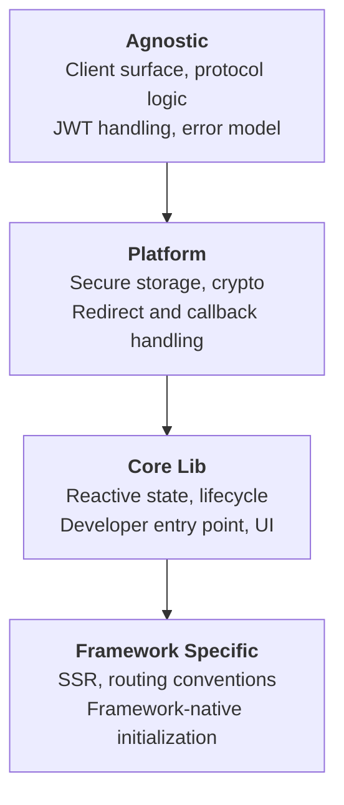
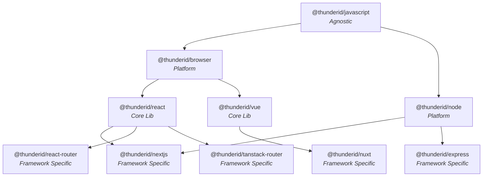
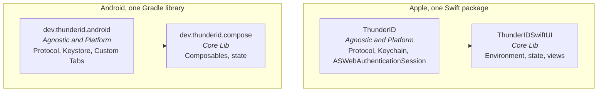
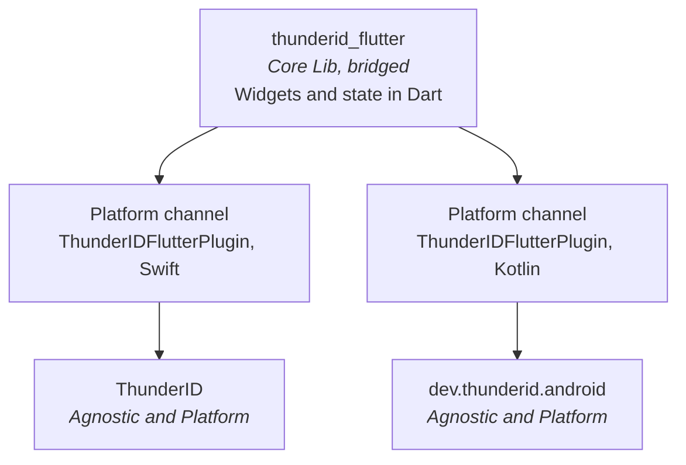

# SDK Development Specification

- **Status:** Draft
- **Version:** 0.9
- **Related documents:**
  [threat-model.md](threat-model.md),
  [#5305](https://github.com/thunder-id/thunderid/issues/5305),
  [#3292](https://github.com/thunder-id/thunderid/discussions/3292),
  [#4065](https://github.com/thunder-id/thunderid/discussions/4065),
  [#5354](https://github.com/thunder-id/thunderid/discussions/5354),
  [#5162](https://github.com/thunder-id/thunderid/issues/5162),
  [#5155](https://github.com/thunder-id/thunderid/issues/5155),
  [RFC 6749](https://datatracker.ietf.org/doc/html/rfc6749),
  [RFC 7636](https://datatracker.ietf.org/doc/html/rfc7636),
  [RFC 9396](https://datatracker.ietf.org/doc/html/rfc9396),
  [RFC 10017](https://www.rfc-editor.org/rfc/rfc10017.html),
  [OpenID Connect Core 1.0](https://openid.net/specs/openid-connect-core-1_0.html),
  [OpenID Connect Back-Channel Logout 1.0](https://openid.net/specs/openid-connect-backchannel-1_0.html),
  [back-channel logout specification](../back-channel-logout/spec.md)

## Summary

ThunderID publishes client SDKs across four repositories and three ecosystems. Nothing today
states what an SDK must implement, so each one is built to the conventions of whoever writes
it. Without a stated contract, a developer moving between platforms cannot predict the
surface, and a reviewer of a change in one repository has no way to tell whether the sibling
repositories need the same change.

This specification is the contract every ThunderID SDK implements. It defines the layering,
the operational modes, the configuration keys, the client surface, the error model, the
security floor, how each platform packages and builds its SDK, what has to be tested, and the
delivery rules that make a change in one SDK visible in the others.

Every SDK change goes through it. That includes writing a new SDK for a platform that has
none, adding or changing a capability in an SDK that already exists, and building an
integration package. The specification is the reference a contributor works from, the
checklist a reviewer works against, and the context an AI coding agent is given before it
writes SDK code.

The contract is behavioural rather than literal. An SDK conforms by exhibiting the specified
behaviour through the idioms of its own platform, so a Swift signature is expected to look
like Swift. Conformance is judged on names, returned concepts, and observable behaviour, not
on transliterated signatures.

Scope is the SDK repositories listed in [Repository topology](#repository-topology) and the
integration packages that adapt ThunderID into third-party auth frameworks. The ThunderID
server, the console, the CLI, and the MCP server are out of scope, as is the documentation
site itself beyond the obligations this document places on SDK authors.

## Architecture

### Layers

A layer is a set of responsibilities, not a package. Every SDK covers at least one layer, and
each layer builds on the one below it, inheriting its contract and extending it with
capabilities that only make sense at that level.

| Layer | Responsibility | Builds on | Ships UI |
|---|---|---|---|
| Agnostic | The full client surface and all protocol logic: authorization requests, token exchange, JWT handling, flow orchestration, the error model. No platform, browser, or framework dependency. | Nothing | No |
| Platform | Platform capabilities: native secure storage, platform crypto, redirect and callback handling, platform session management. | Agnostic | No |
| Core Lib | A framework's reactive primitives (state, lifecycle, context), and the developer-facing entry point. | Platform | Optional |
| Framework Specific | Thin integration for an opinionated or meta framework: server-side rendering, routing conventions, framework-native initialization. | Core Lib | Optional |

One package usually covers one layer, which is how the JavaScript packages are built. It does
not have to: where the lower of two adjacent layers has no consumer that wants it on its own,
one package covers both, which is how the Apple and Android packages are built. The two
ecosystem sections below show each shape concretely, and the table in
[Platform packaging and build](#platform-packaging-and-build) says which packages cover which
layers.

#### JavaScript ecosystem

One package per layer, all four layers present. `@thunderid/javascript` holds the protocol with
no platform dependency, and the two Platform packages take it to the browser and to Node.

#### Mobile ecosystems

The same layers, packaged differently. Apple and Android collapse Agnostic into Platform: there
is no separate language-only SDK, because nothing consumes the protocol implementation without
the platform capabilities that go with it. Splitting them would produce a package nobody
depends on.

Flutter adds no protocol implementation of its own. It sits at Core Lib and bridges to both
native Platform SDKs:

#### Permitted deviations

Two shapes depart from the strict chain and are allowed:

- **Bridged cross-platform SDKs.** A Core Lib SDK may take two parents, one per bridged
  platform, as `thunderid_flutter` does above. A React Native SDK, if built, follows the same
  pattern over native modules.
- **Dependency-injection frameworks.** A framework whose module or injection system makes an
  intermediate reactive layer redundant may sit at Framework Specific directly on a Platform
  SDK. Angular is the expected case.

### Repository topology

SDKs no longer live in the product monorepo. Each ecosystem owns a repository, and a
repository may contain several packages across several layers.

| Repository | Contents | Registry |
|---|---|---|
| [`thunder-id/javascript-sdks`](https://github.com/thunder-id/javascript-sdks) | All JavaScript and TypeScript packages, all four layers, plus integration packages | npm, scope `@thunderid` |
| [`thunder-id/ios-sdks`](https://github.com/thunder-id/ios-sdks) | `ThunderID` (Agnostic and Platform) and `ThunderIDSwiftUI` (Core Lib) | Swift Package Manager and CocoaPods |
| [`thunder-id/android-sdks`](https://github.com/thunder-id/android-sdks) | `dev.thunderid.android` (Agnostic and Platform) and `dev.thunderid.compose` (Core Lib) | Maven coordinates under `dev.thunderid` |
| [`thunder-id/flutter-sdks`](https://github.com/thunder-id/flutter-sdks) | `thunderid_flutter` (Core Lib, bridged) | pub.dev |
| [`thunder-id/thunderid`](https://github.com/thunder-id/thunderid) | This specification, the published documentation under `docs/`, and the minimal use-case samples that ship with the product | Not applicable |
| [`thunder-id/samples`](https://github.com/thunder-id/samples) | Feature demos and showcases, organized by feature area | Not applicable |

The split means a single capability now lands as several pull requests in several
repositories with no shared branch, no shared CI run, and no single reviewer who sees all of
it. [Cross-SDK parity and delivery](#cross-sdk-parity-and-delivery) is the mechanism that
holds those pull requests together, and it is the reason this document exists rather than
being a page in the contributor guide.

## Detailed design

### Layering and dependency rules

1. An SDK MUST declare exactly one parent layer. Two cases take more than one parent package:
   a bridged cross-platform SDK, which takes one per bridged platform, and a Framework Specific
   SDK for a full-stack framework, which takes a Core Lib parent for its client half and a
   Platform parent for its server half. `@thunderid/nextjs` is the second case, building on
   `@thunderid/react` in the browser and `@thunderid/node` on the server. Both parents MUST sit
   at or below the SDK's own layer, and the SDK MUST document which parent serves which half.
2. Two adjacent layers MAY be collapsed into one package where the lower one has no consumer
   of its own, as the Apple and Android packages collapse Agnostic into Platform. The package
   MUST still keep the layers separable in its own structure, and MUST document which layers
   it covers.
3. An SDK MUST NOT skip its immediate parent layer. If a capability is reachable through the
   parent, the SDK uses the parent rather than reaching past it.
4. An SDK MUST NOT reimplement logic already present in its parent, and MUST NOT expose the
   parent's internal types through its own public surface.
5. An SDK MUST declare its parent as a versioned dependency. In JavaScript, a Framework
   Specific package MAY express that dependency as a peer dependency where the ecosystem
   expects the application to own the version, as `@thunderid/react-router` and
   `@thunderid/tanstack-router` do today.
6. A breaking change in a layer requires a major version bump in that layer and in every layer
   above it that is affected.
7. Every SDK MUST record the version of this specification it implements, in its `README.md`.

### Integration packages

An integration adapts ThunderID into a third-party framework that already owns an auth
abstraction, such as Better Auth or Auth.js. An integration implements the target framework's provider or plugin interface instead of the
ThunderID client surface, and sits outside the layer hierarchy.

An integration MUST delegate every protocol operation to a ThunderID SDK, MUST NOT implement
OAuth 2.0 or OIDC logic of its own, MUST follow the target framework's conventions for
configuration, errors, and sessions, and MUST document the SDK version and the framework
version it supports. Integrations live alongside SDKs in the ecosystem repository, under
`packages/`, and are published under the same scope, as `@thunderid/better-auth` is today.

### Platform packaging and build

Each ecosystem packages its SDKs the way that ecosystem expects. An SDK MUST declare its
minimum supported platform version, and MUST NOT raise that minimum in a patch or minor
release.

| Ecosystem | Unit of distribution | Layers per unit | Minimum platform |
|---|---|---|---|
| JavaScript | One npm package per SDK, in a pnpm workspace built with Turborepo | One layer per package | Stated per package |
| Apple | One Swift package exposing two products, plus a CocoaPods podspec for the Platform product | `ThunderID` covers Agnostic and Platform, `ThunderIDSwiftUI` covers Core Lib | iOS 16, macOS 13, Swift 5.9 |
| Android | One Gradle library, consumed through JitPack | `dev.thunderid.android` covers Agnostic and Platform, `dev.thunderid.compose` covers Core Lib | minSdk 26, compileSdk 34, JVM target 17 |
| Flutter | One pub.dev plugin package declaring an Android and an iOS platform implementation | Core Lib only, bridged | Flutter 3.19, Dart 3.3 |

Rules that follow from this shape:

1. An Apple or Android SDK MUST keep the Core Lib product separable from the Platform product,
   so an application that supplies its own UI can depend on the Platform layer alone.
2. A bridged SDK MUST pin the native SDKs it bridges to as versioned dependencies, one per
   platform, and MUST NOT depend on a floating version. The pins are what make a native change
   reach the bridged SDK, so each repository MUST have a mechanism that raises them after a
   native release.
3. A bridged SDK MUST NOT implement protocol logic on the Dart or JavaScript side. A
   capability that is missing from one native SDK is a parity gap in that native SDK, not
   something to work around in the bridge.
4. A platform channel surface MUST mirror the client surface names, so that a capability keeps
   one name from the native SDK through the bridge to the application.
5. Platform capabilities that have no cross-platform equivalent, such as Play Integrity on
   Android and App Attest on Apple platforms, are declared by the Platform SDK that owns them
   and exposed through a single bridged name where a bridged SDK supports both.

### Operational modes

An SDK supports two modes. The mode is chosen at initialization and applies to every operation
for the lifetime of the client.

**Redirect mode** is the default. The SDK runs the OAuth 2.0 authorization code flow with
PKCE, sending the user to the ThunderID authorization endpoint and handling the callback. It
is the mode for anything that can safely redirect and receive a callback, and it is the mode
that keeps the application away from user credentials entirely.

**Embedded mode**, also called app-native, drives the ThunderID Flow Execution API directly and
keeps the user inside the application. The SDK posts to `/flow/execute` with an `applicationId`
and a `flowType`, receives an `executionId` with a `flowStatus` of `INCOMPLETE` and a
description of the inputs or actions the step requires, and submits each step back with the
`executionId`, the chosen action, and the collected inputs. A `flowStatus` of `COMPLETE` carries
the assertion; `ERROR` carries a `failureReason` the SDK surfaces as an authentication failure.
Multi-factor steps arrive as further `INCOMPLETE` steps and are surfaced to the application the
same way. It is the mode for native mobile and for any application that renders its own
authentication UI.

The mode is set through the `mode` configuration key, taking `redirect` or `embedded`. An SDK
MAY additionally infer `embedded` from configuration that only makes sense in that mode, such
as a sign-in path owned by the application, but inference is a convenience and MUST NOT be the
only way to select a mode.

Embedded mode also has a server-side prerequisite: the application has to be configured on the
ThunderID server to permit it. Client configuration alone selects the mode, it does not grant
it, and an application whose server configuration does not allow embedded flows will be refused
at the flow endpoint rather than at initialization.

The mode MUST NOT change the public surface. `signIn()` is `signIn()` in both modes; the SDK
resolves the underlying flow internally.

**Sign-in on a backend.** An SDK MAY additionally support running the whole flow on a backend
the application owns: the Backend for Frontend pattern of
[RFC 10017](https://www.rfc-editor.org/rfc/rfc10017.html). The backend runs redirect mode, keeps
the tokens, and proxies the application's API calls, so the client holds no token at all. For a
browser application it is the answer to the one weakness a browser cannot engineer away, that a
token the page can reach is a token any script on the page can take. For a mobile application
that already has a backend, it keeps the refresh token and the API credentials off the handset.

What the client holds in place of a token differs by platform, and nothing else does:

| | Browser SDKs | Mobile SDKs |
|---|---|---|
| Backend location | The application's own origin | Any origin, pinned in configuration |
| Session held as | An `HttpOnly`, `Secure` cookie the page cannot read | An opaque handle in the platform's secure store, attached to each call |
| Sign-in | A redirect to the backend's sign-in endpoint | The backend's sign-in endpoint in `ASWebAuthenticationSession` or a Custom Tab, returning a one-time code to the application's redirect scheme |
| Cross-site defence | Same-origin calls and a header a cross-origin page cannot set | Not applicable: the backend's base URL is pinned, and the handle is held by the application |

Everything else is identical, including the endpoints and how a `401` from each is read, so one
backend serves an application's web and mobile clients alike.

The backend is a contract, not a package. An SDK MUST NOT assume a particular implementation,
and MUST work against any backend that answers the endpoints in
[Backend endpoints](#backend-endpoints). ThunderID ships no backend of its own; the
application's existing server, or a gateway in front of it, implements them.

It is turned on by setting `endpoints.backend`, never inferred, and it applies for the lifetime
of the client. It is not a third value of `mode`: the backend runs redirect mode on the
application's behalf, and embedded mode through a backend is out of scope for this version. An
SDK that supports it MUST refuse the embedded flows while it is on, rather than running them in
the browser and leaving the result where the backend's tokens are not.

Alongside the two user-facing modes, an SDK MAY support a `client_credentials` grant type for
machine-to-machine use, in which there is no user and no sign-in step, and `getAccessToken()`
fetches and refreshes a token for the service itself.

`client_credentials` is valid only with `mode: redirect`, which in this combination means only
that no embedded flow is driven. Pairing it with `mode: embedded` MUST be rejected at
initialization. It is a confidential-client grant, so an SDK that cannot hold a client secret
safely, which is any SDK running in a browser or a mobile application, MUST reject it outright.

The user-facing operations have no meaning without a user. Under `client_credentials`,
`signIn`, `signUp`, `signInSilently`, `handleRedirectCallback`, `getUser`, `getUserProfile`,
`updateUserProfile`, and `getUserSchema` MUST fail with a single stable unsupported-operation
error rather than returning an empty result. `isSignedIn` reports whether a valid token is
held, and `signOut` discards it.

### Configuration

Configuration is a single object supplied at initialization. Every SDK MUST implement the
required keys and SHOULD implement the optional ones. A key that cannot apply on a platform
MUST be documented as unsupported there rather than silently ignored.

Key names are canonical across SDKs, adapted only for the naming convention of the language.
An SDK MUST NOT rename a canonical key, and MUST NOT introduce a second name for a concept
this table already covers.

**Core**

| Key | Type | Required | Default | Notes |
|---|---|---|---|---|
| `baseUrl` | String | Conditional | None | Base URL of the ThunderID server. MUST be rejected if the scheme is not HTTPS. A non-HTTPS loopback address MAY be accepted for local development only, and MUST be rejected in embedded mode, where credentials cross the wire. Required, except when sign-in runs on a backend: it is then the API base the backend's `proxy` serves, and a browser SDK MAY default it to the page's own origin. |
| `clientId` | String | Conditional | None | Required in redirect mode, unless sign-in runs on a backend (`endpoints.backend`): the backend holds the client then, and an SDK MUST NOT require it. |
| `clientSecret` | String | No | None | Confidential clients only. MUST NOT be accepted by a browser or other public client. |
| `mode` | Enum | No | `redirect` | `redirect` or `embedded`. |
| `grantType` | Enum | No | `authorization_code` | `authorization_code` or `client_credentials`. |
| `applicationId` | String | Conditional | None | Required in embedded mode and for branding resolution. |
| `instanceId` | Integer | No | None | Enables independent authentication contexts in one application. Every piece of per-context state MUST be namespaced by it: storage keys, in-flight callback state, refresh deduplication, and token caches. Two contexts MUST NOT be able to read or overwrite each other's tokens. |

**Redirection**

| Key | Type | Required | Default | Notes |
|---|---|---|---|---|
| `afterSignInUrl` | String | No | Framework default | Must be pre-registered with the application. |
| `afterSignOutUrl` | String | No | Framework default | Must match an allowed post-logout URI. |
| `signInUrl` | String | No | Server-hosted page | Application-owned sign-in page. |
| `signUpUrl` | String | No | Server-hosted page | Application-owned sign-up page. |

**Protocol**

| Key | Type | Required | Default | Notes |
|---|---|---|---|---|
| `scopes` | String or list | No | `openid` | Space-separated string or list. |
| `authorizationDetails` | List | No | None | Authorization details (RFC 9396): a list of objects, each with a string `type`. Sent JSON-encoded as `authorization_details` on the authorization request, silent sign-in included, on the CIBA backchannel authentication request, and on the `client_credentials` token request. A value passed to a single sign-in or CIBA call takes precedence over the configured one. Not sent in embedded mode. A request an SDK does not make, or cannot add it to, is documented as unsupported, as for any key. See [Authorization details](#authorization-details). |
| `signInOptions` | Map | No | Empty | Extra parameters on the authorize request. `state`, `code_challenge`, `code_challenge_method`, `client_id`, and `redirect_uri` are SDK-owned: a caller value for any of them MUST be ignored, and the SDK's own value used. |
| `signOutOptions` | Map | No | Empty | Extra parameters on the sign-out request. |
| `signUpOptions` | Map | No | Empty | Extra parameters on the sign-up request. |
| `discovery` | Object | No | Enabled | OIDC discovery behaviour. Discovered metadata MUST be fetched over HTTPS, and its `issuer` MUST match the expected issuer exactly before any endpoint from it is used. |
| `endpoints` | Object | No | Discovered | Per-endpoint overrides for a server that does not publish discovery. Every override MUST use HTTPS and MUST share the origin of `baseUrl`, unless the application has explicitly allowed the other origin. `endpoints.backend` is not one of them: it names the application's own backend, and MUST NOT be carried into the OIDC provider metadata. See [Backend endpoints](#backend-endpoints). |
| `tokenRequest` | Object | No | Platform default | Token endpoint authentication and request shaping. |
| `http` | Object | No | None | HTTP options. `http.fetcher` replaces the transport for [management operations](#management-operations) only. |

**Session and tokens**

| Key | Type | Required | Default | Notes |
|---|---|---|---|---|
| `storage` | Storage adapter | No | Platform default | See [Security requirements](#security-requirements). |
| `tokenValidation` | Object | No | Validation on | Clock tolerance, and per-claim switches that MUST be rejected when they would disable a check required by [Security requirements](#security-requirements) against a non-loopback `baseUrl`. Disabling a mandatory check is a test affordance, not a deployment option. |
| `tokenLifecycle` | Object | No | Platform default | Refresh timing and lifecycle behaviour. |
| `allowedExternalUrls` | List | No | Empty | Origins the SDK may attach an access token to when tokens are held in isolated storage. Every entry MUST use HTTPS. See [Token attachment](#token-attachment) for how entries are matched. |
| `session` | Object | No | Disabled | Behaviour around the server's SSO session. `checkInterval` (seconds, default `0`, backend sign-in only) polls the backend's check endpoint for a session that ended elsewhere; `0` leaves only the check that runs when the application comes back to the foreground. The rest of the key is browser SDKs only. `silentSignIn.beforeRedirect` (default `false`) makes `signIn` try a silent `prompt=none` sign-in first and continue with the redirect when it fails; it MUST be skipped when the caller sets its own `prompt`. `silentSignIn.timeout` (milliseconds, default `10000`) bounds how long a silent sign-in waits before reporting the user as signed out, including from `signInSilently`. Silent sign-in only finds the session when the browser sends the server's session cookie to the iframe, which needs the application on the same site as the server. |
| `backchannelLogout` | Object | No | Disabled | Server-side SDKs only. For an SDK that mounts the back-channel logout handler itself, turns on [back-channel logout handling](#back-channel-logout-handling): `enabled`, the `path` of the handler, and the `store` that records ended sessions. An SDK that exposes the handler for the application to mount takes the store on the handler instead and does not read this key. An SDK that cannot receive the request MUST document the key as unsupported. |
| `organizationHandle` | String | No | None | Organization identifier, required when a custom domain is configured. |
| `organizationChain` | Object | No | None | Chained authentication across organization contexts. |

**Presentation**

| Key | Type | Required | Default | Notes |
|---|---|---|---|---|
| `preferences` | Object | No | None | Theme, internationalization, and user presentation options. SDKs without bundled UI MAY omit it and MUST say so. |
| `components` | Object | No | None | Per-component overrides for SDKs with bundled UI. |
| `extensions` | Object | No | None | Extension points for SDKs with bundled UI. |

Initialization MUST validate the object and fail before any network call when a required key
is missing or a value is malformed. Any operation invoked before initialization MUST fail with
a distinct, documented error rather than a null dereference.

#### Backend endpoints

`endpoints.backend` holds the paths of the backend that signs the application in. In a browser
each is a path on the application's own origin; on mobile each is a path under
`endpoints.backend.baseUrl`. Each unset entry defaults under `/api/auth`. App developers see
"backend", not "BFF".

| Key | Default | Contract |
|---|---|---|
| `baseUrl` | None | Mobile only, and required there: the backend's origin, which every other entry is resolved against. MUST use HTTPS, and MUST be rejected at initialization otherwise; a loopback address MAY use HTTP for local development only. A browser SDK does not read it, because its backend is the page's own origin. |
| `signIn` | `/api/auth/signin` | Starts sign-in. Takes a `returnTo` same-origin path and redirects to the authorization endpoint. |
| `session` | `/api/auth/session` | Reports `{isSignedIn, user, expiresAt}`. `user` is the ID token's claims without the protocol claims. |
| `checkSession` | `/api/auth/checksession` | Reports `{isSignedIn}` only. Neither refreshes the session nor counts as activity, so it is safe to poll. |
| `refresh` | `/api/auth/refresh` | Refreshes the session. A failure clears it. |
| `signOut` | `/api/auth/signout` | Ends the session and returns the URL that ends it at the authorization server. |
| `proxy` | `/api/auth/proxy` | Prefix the application's API calls are sent through. The backend attaches the access token. See [Proxied requests](#proxied-requests). |

The SDK reads a `401` from the backend by its body. `session_expired` means refresh once and
retry the request once: a refresh that fails means signed out, and so does a retry answered
`session_expired` or `login_required`; the SDK never refreshes twice for one request.
`login_required` means signed out straight away. Any other `401`, including one that answers a
retry, is the API's own answer and MUST be returned to the caller untouched. A backend
that refreshes on the server never answers `session_expired`, so one client works against both
kinds.

**Starting a session on mobile.** A browser carries the backend's cookie by itself. A mobile
application cannot: the browser session it opens for sign-in has its own cookie jar, which the
application is not allowed to read, and that separation is the platform's whole protection. The
session is therefore handed over once, in the open, and the handoff MUST be bound to the
application that started it:

1. The SDK generates a PKCE verifier and opens `signIn` in `ASWebAuthenticationSession` or a
   Custom Tab with `redirect_uri` (the application's registered scheme), `code_challenge` and
   `code_challenge_method=S256`. `returnTo` is the browser SDKs' form of the same parameter.
2. The backend runs the flow, keeps the tokens, and returns to `redirect_uri` with a one-time
   `session_code`, or with `error`.
3. The SDK posts the code and the verifier to `session` and receives
   `{handle, isSignedIn, user, expiresAt}`.

The handle MUST go in the platform's secure store and MUST be attached to every later backend
call in the `X-Session-Handle` header. A backend MUST accept a `session_code` once, MUST bind it
to the `code_challenge` it was issued against, and MUST expire it in minutes, for the same
reason an authorization code is held to those rules: anything handed over through a redirect
scheme can be observed by another application on the device.

**Proxied requests.** The API base is `baseUrl`, or the page's own origin where a browser SDK
defaults it. A request whose URL is the API base, or continues it with `/` or `?`, goes to the
`proxy` prefix with the rest of the URL appended: `{baseUrl}/orders?id=1` is sent to
`{proxy}/orders?id=1`. The whole base is compared, so a URL that merely starts with the same
characters (`https://api.example.com.attacker.example`) does not match. In a browser, a
path-only URL is read as relative to the API base. Any other URL is refused, as
[Security requirements](#security-requirements) states.

Everything after the handoff is the same on both platforms: the five remaining endpoints, the
`401` reading above, and the surface in [Client surface](#client-surface).

### Client surface

Every SDK MUST expose the operations below. Names are canonical; the signature is whatever the
platform makes idiomatic. Return types are stated as the concept returned, and an SDK MUST NOT
return a different concept under the same name.

**Lifecycle**

| Operation | Contract |
|---|---|
| `initialize` | Validates configuration and prepares the client. Returns success. |
| `reInitialize` | Applies a partial configuration change without a full restart. `mode`, `grantType`, `clientId`, `applicationId`, and `instanceId` are immutable for the life of a client: a change to any of them MUST be rejected rather than partially applied. Changing one means constructing a new client. |
| `getConfiguration` | Returns the effective configuration. |
| `isLoading` | Synchronous. True while initializing or refreshing. |

**Authentication and registration**

| Operation | Contract |
|---|---|
| `signIn` | Redirect mode starts the authorization code flow; embedded mode drives one step of the flow. Overloaded, or discriminated by payload, per platform idiom. |
| `signOut` | Terminates the session. Revokes the refresh token server-side, then clears local state. Succeeds silently when no session exists. When revocation cannot be reached, the SDK MUST still clear local state, and MUST report the failed revocation to the caller rather than reporting a clean sign-out. Leaving the user signed in locally because the network was down is not an option. |
| `signUp` | Redirect mode sends the user to registration; embedded mode drives the registration flow. |
| `isSignedIn` | Returns current authentication state. |
| `handleRedirectCallback` | Completes a redirect flow from the callback URL. Required wherever the SDK does not handle the callback implicitly. |

**Tokens and session**

| Operation | Contract |
|---|---|
| `getAccessToken` | Returns a valid access token, refreshing transparently when near expiry. |
| `exchangeToken` | Performs a token exchange (RFC 8693). |
| `decodeJwtToken` | Decodes a JWT payload without verifying its signature. MUST be documented as unsafe for authorization decisions. |
| `setSession`, `clearSession` | Write and clear stored session state. |

When sign-in runs on a backend, the surface stays the same but its source changes. `signIn`,
`signOut`, `isSignedIn`, `getUser` and the profile operations go through the backend, and
`isLoading` MUST report true until the first session read settles: an SDK that reports "not
loading, not signed in" before it knows sends every route guard into a sign-in the SSO session
answers at once, in a loop. The operations that hand a token to the caller (`getAccessToken`,
`getIdToken`, `exchangeToken`, and any token revocation) MUST fail with a single stable
unsupported-operation error, because the client holds no token to give. An SDK
MUST NOT substitute a plausible-looking empty value for one. `setSession` MUST fail with the same
error, since a session the caller writes would put a token in the client. `clearSession` clears
only the client's own session state (the cached session in a browser, the handle on mobile) and
does not end the session at the backend, which is `signOut`'s job.

**User and profile**

| Operation | Contract |
|---|---|
| `getUser` | Returns the authenticated user. |
| `getUserProfile` | Returns the user's profile attributes. |
| `updateUserProfile` | Applies attribute updates server-side. Returns the updated profile. |
| `getUserSchema` | Returns the attribute schema that describes which profile fields exist, their types, and their mutability. |

Operations beyond this set are permitted where a platform needs them, and are the usual origin
of a parity gap. Silent sign-in, CIBA, passkey registration and authentication, platform
attestation, flow metadata retrieval, and account recovery all sit here: each is meaningful on
some platforms and not on others. An SDK adding an operation in this position MUST follow
[Cross-SDK parity and delivery](#cross-sdk-parity-and-delivery).

Organization operations (listing, reading, and switching organizations) are a specification
target and are deliberately not part of the required surface yet. An SDK MUST NOT ship a
partial implementation of them ahead of a specification update.

#### Management operations

Management operations let an application administer ThunderID resources, so that an
organization can build its own console, or embed part of one in its product, without calling
the management API by hand. They are optional: an SDK MAY ship them, and one that does MUST
follow this section.

The resources are applications, users, groups, roles, agents, organization units, and resource
servers. Each exposes the same five operations, named for the resource in the platform's idiom
(`getApplications`, `client.applications.list`, and so on):

| Operation | Contract |
|---|---|
| List | Returns one page of the resource, with the total count. Accepts `limit` and `offset`, and a `filter` where the server supports one. |
| Get | Returns a single resource by identifier. |
| Create | Creates the resource and returns it as the server stored it. |
| Update | Replaces the resource's mutable fields and returns the updated resource. |
| Delete | Deletes the resource. Returns nothing. |

Groups and roles also relate identities to each other. These relationships are operations of
their own, so that a caller never has to rewrite a whole group or role to change who is in it:

| Resource | Operations |
|---|---|
| Group | List members, add members, remove members. A member is a user, a group, or an agent. |
| Role | List assignments, add assignments, remove assignments. An assignee is a user, a group, an app, or an agent. |
| User | List the groups the user belongs to, list the resources that reference the user, replace the user's credentials, list and create users under an organization unit path, manage the user's sharing policies, read its overlay rules, and suspend, unsuspend, or unlock the user. |
| User type | List, get, create, update, and delete. |
| Agent | List the agent's groups and roles, list agent types, regenerate the agent's client secret, and suspend, unsuspend, or unlock the agent. |
| Agent type | List, get, create, update, and delete. |
| Application | Regenerate the client secret or the flow secret, preview a client ID metadata document, manage the application's sharing policies, read its overlay rules, and suspend or unsuspend it. |
| Organization unit | Get, update, and delete by handle path as well as by identifier, and list a unit's child units, users, groups, and roles. |
| Resource server | List, get, create, update, and delete its resources, and its actions, on the server or on a resource. |

Every list operation in this table follows the List contract above: it returns one page with
the total count, and accepts `limit` and `offset`. An operation on a relationship is addressed
under the resource it belongs to, at the path the server's API defines for it (for example the
members of a group under that group), so an `endpoints` override for a collection moves its
relationships with it.

An SDK MAY also expose the server's configuration resources: connections (by connection type),
flows with their versions, notification templates (by channel), design themes and layouts,
gateways with their variables and secrets, server variables and secrets, and configuration
versions, each with the operations its endpoints offer, and the server configuration sections,
translations, and import and export. They follow the same requirements. A secret's value is
write-only: the SDK sends it and MUST NOT log it.

Requirements:

1. Requests are authorized with the signed-in user's access token. The SDK MUST NOT mint,
   widen, or cache a separate credential for them. Whether a call succeeds is the server's
   decision, and the token needs the permissions the server requires for that resource.
2. The management API can run on a different host from the authorization server. The request
   URL for each resource MUST come from, in order: an explicit URL passed to the call, then an
   `endpoints` override for that resource's collection (`applications`, `users`, `groups`,
   `roles`, `agents`, `userTypes`, `agentTypes`, `organizationUnits`, `resourceServers`, and, for
   the configuration resources, `connections`, `flows`, `notificationTemplates`, `design`, `i18n`,
   `serverConfig`, `gateways`, `variables`, `secrets`, `configurationVersions`, `import`, `export`),
   then `baseUrl` followed by the collection path. A single resource is addressed as the
   collection URL followed by its identifier.
3. The transport MUST be replaceable by the application through a `fetcher`. A `fetcher` passed
   to a single call takes precedence over `http.fetcher` supplied at initialization, which takes
   precedence over the SDK's default authenticated transport. `http.fetcher` applies to
   management operations only. Authentication, token, and flow requests MUST keep using the
   SDK's own transport until this specification says otherwise.
4. A Core Lib or Framework Specific SDK MAY wrap these operations in its framework's reactive
   model, such as a hook, an observable object, or a state holder. The wrapper MUST NOT depend
   on a third-party data fetching or caching library, so an application can use its own.
5. The SDK MUST NOT produce a user-visible side effect from a management operation. It does not
   show a notification, translate a message, or write to the application's log. Success and
   failure are reported to the caller, who decides what the user sees.
6. A resource returned by these operations is a server record, not the signed-in user. It MUST
   NOT reuse a type name the SDK already uses for the authenticated user.
7. HTTP 403 and 404 MUST surface as distinct API error codes, so a caller can tell a missing
   permission from a missing resource.
8. An SDK that ships these operations SHOULD also let a caller read the permissions the
   signed-in user's access token carries, and test one against a required permission with the
   server's hierarchy, where `system` satisfies `system:user:view`. The result only decides what
   to show. The server still decides every request.
9. A secret regeneration generates the secret in the SDK from the platform's cryptographically
   secure random source (32 bytes, base64url without padding), saves it on the resource, and
   returns it to the caller, which is the only time it can be read. The SDK MUST NOT retain or
   log it. A resource without an OAuth client MUST be refused before anything is saved, rather
   than returning a secret that was never stored. An agent's update states whether the agent is
   delegated, derived from its grant types (authorization code, CIBA, or token exchange), because
   the server does not store that flag.
10. An operation whose effect reaches beyond the record, such as deleting a user, removing a
    group member or a role assignment, removing a role permission, deleting a group, role, or
    application, or regenerating a client secret, MAY accept an `administrationMode`:
    - `native`, the default, calls the management API directly.
    - `flow` runs the administration flow the server configures for the operation, which can
      revoke grants and end sessions before the record changes. The SDK reads the flow's handle
      from the server's `flow` configuration and resolves it among the `ADMINISTRATION` flows,
      then executes it with the operation's inputs. These requests go to `baseUrl`, so `flow`
      requires it. When no handle is configured, the SDK calls the API directly, since that is
      the deployment's choice. A configured handle that names no flow, a flow that asks for more
      input, and a step that refuses each fail with a documented error, the last carrying the
      step's own error, and none of them falls back to the direct call.

    An SDK that ships `administrationMode` SHOULD also expose the flow operations it is built
    from (resolve the configured flows, execute one), so an application can run an
    administration flow the SDK does not wrap. A console that holds configuration only, with no
    runtime to clean up, uses `native`.

    Suspending, unsuspending, and unlocking an identity have no direct API: they run only
    through their administration flows. With no flow configured, the operation MUST fail with a
    documented error rather than report success.

#### Back-channel logout handling

When a session ends at the ThunderID server, the server notifies every application that took
part in it and registered a back-channel logout URI, by sending a logout token to that URI
([OpenID Connect Back-Channel Logout 1.0](https://openid.net/specs/openid-connect-backchannel-1_0.html);
what the server sends is defined in the
[back-channel logout specification](../back-channel-logout/spec.md)). Handling the notification
lets an application end its own session at once, rather than when its tokens next fail. It is
optional: an SDK MAY ship it, and one that does MUST follow this section.

It applies only where the SDK runs on a server the ThunderID server can reach, which is the Node
Platform SDK and the Framework Specific SDKs built on it. An SDK that runs only in a browser or
in a mobile application has nothing that can receive the request. It MUST NOT expose the
operation, and it relies on revocation instead: the server revokes the session's tokens, so the
next refresh fails.

| Operation | Contract |
|---|---|
| `handleBackchannelLogout` | Takes the raw `logout_token`. Validates it per [Security requirements](#security-requirements), ends every local session it names, and returns the `sid`, the `sub`, and the number of sessions ended. Fails with a documented error when the token is not valid. |

A Framework Specific SDK exposes the operation as a request handler in its framework's idiom,
such as a middleware factory, a route handler, or a server route, mounted at the path the
application registered as its back-channel logout URI.

Requirements:

1. The request is a `POST` with an `application/x-www-form-urlencoded` body carrying one
   `logout_token` parameter. The handler MUST reject any other method or content type and MUST
   cap the size of the body it reads. It MUST NOT require a session cookie or any other
   credential: the token's signature is the authentication.
2. The handler answers `200` when the token is valid, including when it names no session the
   application holds, so that a retried notification is harmless. It answers `400` when the
   request or the token is not valid. It answers a `5xx` only when it could not record the
   logout, which tells the server to retry. Every response carries `Cache-Control: no-store`.
3. A token with a `sid` ends the sessions bound to that `sid`. A token with only a `sub` ends
   every session of that subject that began before the token was issued, so a user who has
   already signed in again is not signed out a second time. The cutoff is extended by the clock
   tolerance the token was validated with, since the clocks may differ by that much and ending a
   session that began just after the logout is the safer mistake. To make the first possible, the SDK
   MUST record the `sid` of the ID token against the session it creates at sign-in.
4. Ending a session here is local. The SDK MUST NOT call the revocation or end session
   endpoint, which the server has already dealt with, and MUST NOT redirect.
5. Where sessions are held on the server, the SDK removes the session's stored state. Where the
   session is held in a cookie, which the server cannot delete, the SDK MUST record the logout
   and refuse every later request that presents a matching session, for at least as long as such
   a session could remain valid.
6. Whatever records the logout, the session store or the list of ended sessions, MUST be
   replaceable by the application. The default MAY be in memory, and the SDK MUST document that a
   deployment with more than one instance needs a shared one, because the notification reaches
   only one of them.
7. Ending the SDK's session does not recall an access token the application already handed to a
   browser or to another service. That token stays usable until it expires, and the SDK MUST
   document this.
8. An SDK that cannot decrypt an encrypted logout token MUST document that back-channel logout
   is unsupported for a client configured for ID token encryption.

#### Authorization details

Authorization details (RFC 9396) let an application ask for a specific grant, such as one
payment of a stated amount, rather than a broad scope. The SDK sends the requested details
from `authorizationDetails`, and surfaces the details the server granted:

1. Where an SDK returns a token response to the caller, it carries the granted details as
   `authorizationDetails`, as the server returned them.
2. The granted details are also readable from the access token's `authorization_details`
   claim, so a caller that holds only the token can read them. The resource server, not the
   SDK, enforces them.
3. The server may grant less than was requested, since the user can deny or narrow a detail.
   The SDK MUST report what was granted, never the request in its place, and MUST NOT treat a
   difference as an error.
4. Detail values can carry personal or financial data, such as an account number, and fall
   under the personal data rules in [Logging](#security-requirements).

**Consent.** Authorization details are decided only in a consent prompt that the
authorization server renders. An embedded-mode flow cannot carry them, because in that mode
the application that requests a detail would also present it for approval. An SDK whose
components render the server's consent step renders each authorization details element:

1. The element's summary, and one row per field.
2. For a field the user may change, an input that permits only the change the row's
   `modification` allows, bounded by the value shown, and limited to the row's `options` where
   it carries them.
3. Approval blocked while a changed field is invalid. Deny is always available.
4. One decision per element, carrying the fields the user changed as `modified`, keyed by
   field path, and nothing else.

An SDK that does not render consent needs only the request and response behaviour above.

### Framework integration

A Core Lib or Framework Specific SDK MUST integrate into its framework's own composition
model, and initialization MUST happen once, at the application root, never inside a child
component. Configuration MUST be validated there, before the application renders.

The expected shapes are a provider component in React, a plugin in Vue, an environment
modifier in SwiftUI, an inherited widget in Flutter, and a module or standalone provider in a
dependency-injection framework.

The SDK MUST provide a single primary entry point that exposes the authentication surface:
one hook, one composable, one service, or one environment object. An application MUST NOT need
to combine several of them to perform a standard flow. Supplementary entry points for optional
concerns such as theming, internationalization, or form state MAY be exported in addition, and
MUST NOT be required for authentication.

### UI

A Core Lib or Framework Specific SDK that targets a UI platform MUST ship components covering
the identity flows, so that an application gets working authentication UI without writing its
own.

Components are grouped by the job they do for the application, and an SDK lays out its source
the same way, so a capability is found in the same place in every SDK:

| Group | Purpose | Components |
|---|---|---|
| Auth | Sign a user in or out, run the server-described identity flows (registration, recovery, invitations), and render on auth state | Sign-in, sign-up, recovery, accept invite, invite user, callback; sign-in, sign-out and sign-up buttons; signed-in, signed-out and loading guards |
| Account | Show and change the signed-in user's own data | User, user avatar, user dropdown, user profile, change credential |
| Admin | Administer the resources of [management operations](#management-operations) | User list, user create, user details, group list, group create, group members, role list, role create, role assignments, role permissions, agent list, agent create, agent details, application list, application create, application details |
| Common | Shared across the groups | Language switcher, attribution, branding |

The pieces that render a server-described flow step, such as the field factory, sit with the
auth group. Primitives, and the operations and state the components read, keep their own
folders.

Requirements:

1. A component MUST work with no configuration beyond what the root provider already has.
2. A component with non-trivial layout MUST ship an unstyled variant alongside the styled one,
   so an application can replace the presentation without forking the logic. The established
   convention is a `Base` prefix.
3. Components MUST be themeable through `preferences`, and MUST support the configured
   internationalization.
4. Components MUST meet WCAG 2.1 AA.
5. In embedded mode, the sign-in and sign-up components MUST render the server-described flow
   step rather than a hard-coded form, so that a change to the server flow does not require an
   SDK release.
6. Admin components are optional, and an SDK that ships them MUST also ship the management
   operations they use. Each one MUST be usable alone, so an application composes its own
   console from them. The application owns navigation between them: no admin component renders
   an app shell, a menu, or routes. Actions that change data, such as delete or edit, MUST be
   off unless the application turns them on, and a delete MUST ask for confirmation. An error
   from the server MUST be shown as a translated message for its kind, never as the server's
   own text.
7. Every component, the unstyled variant and the connected one alike, MUST accept an optional
   custom render that replaces its built-in presentation while the component keeps its data
   loading, state and actions. The mechanism is the platform's idiom: a `children` function in
   React, the default scoped slot in Vue, a trailing `content` lambda in Jetpack Compose, a
   `content` closure in SwiftUI, and a `builder` in Flutter. It MUST receive everything the
   built-in presentation draws from: rows, paging, and selection for a list; values, setters,
   submit, and validity for a form; the record and the actions the application allowed for a
   details view; and loading and error state. What the requirements above guarantee MUST still
   hold under a custom render: data-changing actions stay off unless the application turns them
   on, a delete asks for confirmation, and errors arrive as translated messages.
8. An admin component whose data-changing operation accepts an `administrationMode` (see
   [management operations](#management-operations)) MUST let the application choose it, and
   MUST default to `native`. The details component of a user, an agent, or an application MAY
   offer suspend, unsuspend, and unlock (applications are never locked). When it does, the
   actions are off unless the application turns them on, the component offers only the actions
   the identity's current status allows and whose administration flow the server configures,
   suspending and unsuspending ask for confirmation, a suspension of a user or an agent takes an
   optional operator note, and the identity's status is shown as a translated label. Reading the
   configured flows happens only while the actions are on.

#### Flow element identifiers

A component that renders a server-described flow step MUST tag each element it renders with a
stable identifier derived from the server's own response, exposed through the platform's
accessibility tree:

| Element | Identifier |
|---|---|
| An input rendered from a flow field | `thunderid-field-<field id>` |
| A control rendered from a flow action | `thunderid-action-<action ref>` |

The identifiers track the server's flow definition rather than the SDK's view hierarchy, so
they stay stable when the presentation changes and move with the flow when it does. They are
what the end-to-end suites use to drive authentication without hard-coding native view
structure, and they carry an accessibility benefit on every platform that surfaces them.

Platforms expose this through their own mechanism: an accessibility identifier on Apple
platforms, a test tag or content description on Android, `Semantics.identifier` in Flutter, and
the element id in the browser. The requirement is on the identifier value, not the mechanism.

### Internationalization and theming

An SDK that ships UI MUST ship translations for the strings it renders, and MUST let an
application override them without forking a component.

1. Strings rendered by SDK components MUST come from a translation bundle, never from a
   literal in the component.
2. The SDK MUST ship a default bundle and MUST resolve to the configured fallback language
   when the active language has no translation for a key.
3. An application MUST be able to supply its own bundles through `preferences.i18n.bundles`,
   merged over the shipped ones rather than replacing them wholesale.
4. Language selection MUST be persisted through the configured storage strategy, and an SDK
   that supports a URL parameter override MUST allow it to be disabled.
5. Text rendered from a server response, such as a flow field label, is already localized by
   the server and MUST NOT be translated again by the SDK.

Theming follows the same shape. Components MUST honour the configured mode and direction, MUST
accept partial token overrides without requiring a full theme object, and MUST be able to
resolve branding from the server where the platform supports it, so that an application picks
up organization branding without shipping a new build.

### Error model

Errors are surfaced through a single hierarchy, so an application catches one type and
switches on a code.

| Type | Carries |
|---|---|
| Base error | `message`, `code`, `origin` |
| API error | The base fields, plus HTTP `statusCode` and `statusText`, and `serverError` when the server answered with its error envelope |
| Runtime error | The base fields, for a failure that is not an API response |

`code` is a stable, machine-readable string. `origin` identifies the package that raised the
error, which is what makes a failure traceable across a layered stack.

Requirements:

1. Every SDK MUST use this hierarchy, mapped onto the platform's native error type.
2. An error MUST be catchable through the platform's standard mechanism.
3. The SDK MUST NOT swallow an error silently.
4. An error message MUST NOT contain a credential, a token, or personal data.
5. A code, once shipped, MUST NOT change meaning. Codes for the same condition SHOULD match
   across SDKs, and a new condition SHOULD reuse an existing code rather than coin a synonym.
6. Automatic retry MUST NOT be performed. Two bounded exceptions apply: a token refresh, and
   the single JWKS re-fetch that [Security requirements](#security-requirements) requires after
   a signature verification failure.
7. Input validation MUST fail before any network call is made.
8. When the server answers a failed request with its error envelope, the API error MUST carry
   it as `serverError`: the server's own `code`, and its `message` and `description`, each with
   a translation `key`, a `defaultValue`, and the `params` to interpolate. The SDK's own `code`
   stays the error's code, so `serverError` adds the server's reason without replacing it. A
   body that is not the envelope leaves `serverError` absent.

A shared catalogue of codes covering configuration, authentication, registration, recovery,
and transport failures is a target this specification does not yet define. Until it does, an
SDK MUST document the codes it raises.

### Security requirements

These are the floor. An SDK MUST NOT ship below them, and no configuration key may be
introduced to weaken one without an accompanying threat model update.

**Token storage.** Tokens go in the most secure store the platform offers: Keychain on iOS,
EncryptedSharedPreferences backed by the Keystore on Android, in-memory or worker-isolated
storage in a browser, an OS credential store on desktop, and an OS keyring on a server.
Browser `localStorage` and `sessionStorage` MUST NOT be the default. Environment variables are
not a token store: they are readable by every child process, land in process listings and crash
dumps, and cannot be rotated in place, so an SDK MUST NOT persist a token in one.

Every SDK MUST accept a caller-supplied storage adapter. That adapter is outside the SDK's
control and can be weaker than the platform default, so an SDK MUST document that the secure
default applies only when it is the one in use.

**Sign-in on a backend.** Where an SDK supports it, the client MUST hold no token at any point:
no storage write, no in-memory copy, and nothing in the surface that returns one. A request to a
URL outside the configured [API base](#proxied-requests) MUST be refused rather than sent
without credentials: sending it anyway turns an authenticated call into an anonymous one and
hides the failure from the caller.

In a browser, the application's origin MUST use HTTPS, and a browser SDK MUST refuse to start
backend sign-in on one that does not; a loopback origin MAY use HTTP for local development only.
The backend MUST set its session cookie `Secure` and `HttpOnly`. Every request the SDK sends to
the backend, which is every endpoint except `signIn`, MUST be same-origin, MUST send credentials
so the session cookie goes whenever one exists, and MUST carry `X-Requested-With: XMLHttpRequest`,
a header a cross-origin page cannot set without a preflight the backend never answers. The
backend MUST refuse a request to those endpoints that lacks the header. `signIn` is a top-level
navigation, which cannot carry a custom header: it starts no session on its own, and it MUST
accept only a same-origin `returnTo`. A session read before any cookie exists still carries the
header, and is answered as signed out. On mobile, where the backend is reached
cross-origin by definition, its base URL MUST be configured and MUST use HTTPS, every request
MUST go to that base, and the session handle MUST live in the platform's secure store under
[Token storage](#security-requirements) and MUST NOT be written to a log or a crash report.

**Isolated storage and token attachment.** Where tokens are held in isolated storage and the
SDK proxies outbound requests, it MUST attach the access token only to a URL that matches
`allowedExternalUrls`, and MUST reject a request to anything else.

Matching is by parsed origin, comparing scheme, host, and port, with a path prefix that MUST
end at a path boundary. String prefix matching MUST NOT be used: it authorizes
`https://example.com.attacker.test` from an entry for `https://example.com`. Every entry MUST
use HTTPS, and an entry that does not MUST be rejected at initialization rather than skipped at
request time.

A redirect moves the request to a new URL, so the SDK MUST re-run the same check against every
redirect target before following it, and MUST drop the authorization header rather than carry
it to an origin that does not match.

**PKCE.** Mandatory in redirect mode, regardless of server configuration. The verifier is
cryptographically random, 43 to 128 characters drawn from the RFC 7636 unreserved set
(`A-Z`, `a-z`, `0-9`, `-`, `.`, `_`, `~`), held only in memory, and cleared as soon as the
exchange completes. The challenge method is S256; `plain` MUST NOT be used.

**State.** A cryptographically random `state` on every authorization request, validated on
callback. A mismatch fails authentication.

**Federated redirects in embedded mode.** A `REDIRECTION` step carries a `redirectURL` with a
`state` the server issued. The SDK opens it in a browser session and resubmits the callback's
`code` and `state` to the flow with the step's `executionId` and challenge token. A browser SDK
MUST accept a callback only from the popup it opened, either posted with the application's
origin or read from the popup's same-origin URL. No SDK may submit a callback that lacks a
`code` or a `state`: the server checks the state only when the client sends one, so a callback
submitted without one is checked nowhere. On mobile, the SDK MUST also reject, with
`invalidGrant`, a callback whose `state` differs from the `state` in `redirectURL`. It MUST
likewise reject every callback to a `redirectURL` that has no `state` or an empty one. After a
match, it resubmits the `state` from `redirectURL`. On Android any installed app can open the
callback scheme. On iOS, `ASWebAuthenticationSession` hands the callback straight to the
session, and iOS applies the same rules so the mobile SDKs follow one rule. The server always
issues a state, so neither rule rejects a genuine callback. The response to a submitted callback
MAY be another `REDIRECTION`, and the SDK MUST follow it the same way, in sign-in and sign-up
alike.

**Endpoint trust.** Every endpoint the SDK calls has to be one it trusts before it sends
anything to it. Discovery metadata is fetched over HTTPS, and its `issuer` MUST match the
expected issuer exactly, by string comparison, before any endpoint in the document is used. A
mismatch fails initialization; it MUST NOT fall back to a guessed endpoint. Endpoint overrides
are held to the same bar: HTTPS, and the origin of `baseUrl` unless the application has
explicitly allowed another. This applies to the token, revocation, JWKS, and flow endpoints
alike, because a substituted one of any of them receives credentials, tokens, or the keys used
to judge them.

**Token validation.** An ID token is validated for signature against the server JWKS, issuer,
audience, expiry, and nonce where one was sent. The issuer MUST match exactly, not by prefix or
suffix. JWKS keys are cached, and re-fetched once on a verification failure to tolerate key
rotation.

**Logout token validation.** An SDK that handles back-channel logout accepts a logout token only
when all of these hold: the signature verifies against the server JWKS with an algorithm the SDK
accepts for ID tokens; the `typ` header is `logout+jwt`; the issuer matches exactly and the
audience contains the client identifier; `iat` and `exp` are within the configured clock
tolerance; the `events` claim has a `http://schemas.openid.net/event/backchannel-logout` member;
there is no `nonce`; and a `sid` or a `sub` is present. The `typ`, `events`, and `nonce` checks
are what stop an ID token from being replayed as a logout token, and none of these checks can be
configured off. The endpoint is unauthenticated, so the JWKS re-fetch that a verification failure
allows MUST be bounded in rate: otherwise a token with an unknown key identifier makes the SDK
fetch on every request. A `jti` seen before SHOULD be refused for the lifetime of its token. The
token MUST NOT be logged.

**Credentials.** In embedded mode, credentials are submitted immediately and MUST NOT be
retained beyond the call. Transport is HTTPS with no exception: the loopback allowance that
`baseUrl` carries for local development does not extend to embedded mode, so a client
configured for embedded mode against a non-HTTPS `baseUrl` MUST be rejected at initialization.
Certificate pinning SHOULD be available as an option on platforms that support it.

**Logging.** Access tokens masked; refresh tokens, passwords, one-time codes, and
authorization codes never logged, nor a callback URL that carries a code; email addresses and
phone numbers masked. These rules apply at every log level and before any caller-supplied
logger is invoked. Values that are never logged are also kept out of the error messages and
crash reports the SDK produces.

**Sessions.** Access tokens are refreshed ahead of expiry, refresh tokens are rotated on use
with stored tokens updated atomically, concurrent refreshes are deduplicated to a single
in-flight request, and sign-out revokes server-side before clearing local state. An SDK that
handles back-channel logout binds each session to the `sid` of its ID token, so the session can
be found when the server reports that `sid` ended.

Threats, trust boundaries, and residual risks are analysed in
[threat-model.md](threat-model.md).

### Cross-SDK parity and delivery

A capability counts as delivered once it exists in every SDK where it applies, or once its
absence from an SDK is recorded with a reason. Merging it in one repository is the start of
that, not the end.

**The delivery rule.** A pull request that adds, removes, or changes a capability in the
public surface of one SDK MUST either link the corresponding pull requests in the other SDK
repositories, or state why they are not needed.

**What counts as not needed.** A capability may legitimately stop at one platform. Valid
reasons include a capability with no meaning on the other platforms (a browser worker storage
mode has no mobile equivalent), a platform primitive that does not exist yet, a fix confined
to one platform's implementation of shared behaviour, and a change that does not reach the
public surface at all. "No time" is a deferral, not a reason: it is recorded as a tracked
issue in the repository that lacks the capability, and the issue is linked.

**What is exempt.** Changes that do not touch the public surface: dependency updates,
continuous integration and tooling, documentation, tests, and internal refactors. Exempt means
exempt from porting, not from the decision. The decision is still recorded on the pull request,
because whether a change reaches the other SDKs is a judgement a person makes, not one a file
path can be trusted to make for them.

**Enforcement.** Every SDK repository carries a required check that blocks a pull request until
the parity decision has been made on it. The decision is recorded on the pull request itself, in
a form that survives the merge and can be queried across merged pull requests afterwards, since
an unanswered decision on a merged pull request is what an audit looks for. A maintainer can
record the decision by hand, which is the escape hatch when the check misjudges a change.

How the check reads the decision, and what it records it as, is implementation detail and is not
fixed here. The current implementation is a reusable workflow in this repository,
`.github/workflows/sdk-parity-check.yml`, called by each SDK repository.

**Existing divergences.** The rule applies from the point it is adopted. Capabilities that
already differ between SDKs are reconciled through the normal issue backlog rather than
retroactively through this check, so that adopting the rule does not block unrelated work.

### Repository layout, CI, and release

Each SDK repository owns its own pipelines. There is no shared monorepo pipeline any more, so
the requirement is on behaviour, not on a specific workflow file.

A repository MUST provide:

1. A pull request pipeline that lints, builds, and tests every package the change touches.
2. The parity check described above, as a required check.
3. A release pipeline that publishes to the ecosystem registry on a version tag, and creates a
   release scoped to the package.
4. A nightly or scheduled end-to-end run against a real server.

Packages within a repository are versioned and published independently, and reference each
other through workspace paths in development.

Naming follows each ecosystem rather than a single cross-language pattern: `@thunderid/*` on
npm, PascalCase module names for Swift Package Manager products, reverse-domain coordinates
under `dev.thunderid` for Android, and `snake_case` for Dart packages.

### Testing

An SDK is authentication code running in someone else's application, so its tests are part of
this contract. Three levels are required, using each ecosystem's standard tooling.

| Level | What it covers | Tooling in use |
|---|---|---|
| Unit | Protocol construction and parsing, configuration validation, token and claim handling, error mapping, storage adapters, and the pure logic behind each component | Vitest, XCTest, JUnit, `flutter test` |
| Component | Rendered behaviour of the UI components, including the server-described flow step and the identifiers it emits | The ecosystem's component testing tool |
| End-to-end | A real sign-in and sign-up against a running ThunderID server, driving the quickstart sample as a user would | Playwright for web, Maestro for mobile |

**Unit tests.** Every public operation MUST have unit coverage for its success path and for
each error it can raise. Security behaviour that this specification makes mandatory MUST be
covered by a test that fails if the behaviour is removed: PKCE challenge derivation, state
generation and comparison, ID token validation, the storage default, refresh deduplication,
revocation ordering on sign-out, and, where the SDK handles back-channel logout, each check in
logout token validation. Tests MUST NOT reach the network; server interactions are stubbed at
the transport boundary.

**Reference parity tests.** Where an SDK reimplements behaviour that another SDK already
defines, and the output has to match across platforms, the reimplementation MUST be tested
against fixtures taken from the reference implementation rather than against its own output.
Deterministic rendering such as avatar derivation from a seed is the usual case: the same seed
has to produce the same avatar on every platform, and only a shared fixture proves it.

**End-to-end tests.** Every SDK with a quickstart sample MUST have an end-to-end suite that
runs the sample against a real ThunderID server. The suite MUST cover sign-in and sign-out and
sign-up as a minimum, MUST start from a clean application state, and MUST drive the UI through
the flow element identifiers rather than through view structure or visible text, so that a
copy change does not break a test and a flow change does.

The mobile suites share one shape across the three repositories: a Maestro workspace holding
`signin.yaml`, `signup.yaml`, and a `config.yaml` that keeps shared subflows out of the test
set, with reusable subflows for preconditions such as ensuring a signed-out start. A new
mobile SDK MUST follow the same shape, and a flow that exists in one mobile repository SHOULD
exist in the others.

End-to-end runs need a server configured for the SDK under test, so each repository MUST
provision one as part of the suite rather than depending on a shared environment. The
provisioning MUST live in the repository and MUST be reproducible on a developer machine, not
only in CI.

**Gating.** Unit and component tests MUST run on every pull request. End-to-end suites MUST
run at least nightly, and SHOULD be available on demand for a pull request that changes
authentication behaviour. A pull request that changes behaviour without changing or adding a
test is a review finding.

### Documentation and samples

An SDK without documentation and a runnable sample is not shippable.

**Documentation** is authored in the product repository under `docs/`, and published to
[thunderid.dev](https://thunderid.dev). Every SDK MUST have a quickstart that takes a
developer from nothing to a working sign-in with copy-pasteable code, and a reference covering
every public operation, configuration key, and type.

**Samples** live in [`thunder-id/samples`](https://github.com/thunder-id/samples): a
quickstart per SDK, self-care and B2B samples that show the account and admin capabilities,
and integration samples. Each sample depends on a released SDK version, and an SDK's end-to-end
suite builds its quickstart against the SDK's own checkout.

Every SDK at Core Lib or Framework Specific layer MUST have at least one runnable sample. A sample MUST run against a local server using only its documented
environment variables, MUST NOT hardcode credentials or server URLs, MUST use only the public
SDK surface, and MUST be built in CI.

The minimum a client-side sample demonstrates: an unauthenticated state, a sign-in that
completes, an authenticated state showing display name, email, and picture or an initials
fallback, and a sign-out returning to the unauthenticated state. For a server-side SDK: a
public route that succeeds without credentials, a protected route that rejects a request with
no token, and the same protected route returning claims with a valid token.

Samples move with the SDKs. Because a sample pins a released version, an SDK change cannot
break it until the sample is upgraded, which is also when an application would hit the break.
An SDK pull request MUST therefore check every sample that uses the SDK, and link a samples
pull request when either:

1. The change breaks a sample: a renamed type or package, a changed signature, or a changed
   default. The samples pull request upgrades the SDK and fixes the sample, and waits for the
   release it needs.
2. The change adds a capability a sample exists to demonstrate, such as a self-care capability
   for the self-care sample or a management operation or component for the B2B sample. The
   samples pull request shows the new capability.

When neither applies, the SDK pull request says so.

### Applying this specification

**Writing a new SDK.** A new SDK starts here rather than from another SDK's source. In order:

1. Decide the layer and the parent, per [Layers](#layers). If the platform has no protocol
   implementation, decide whether to write one or to bridge to existing Platform SDKs, per
   [Platform packaging and build](#platform-packaging-and-build).
2. Decide whether the thing being built is an SDK or an integration, per
   [Integration packages](#integration-packages).
3. Implement the configuration object and the client surface, adapting signatures to the
   platform while keeping the canonical names and returned concepts.
4. Implement the error hierarchy and meet the security floor.
5. Add UI components if the layer and platform call for them, with translations and flow
   element identifiers.
6. Add unit, component, and end-to-end tests, per [Testing](#testing).
7. Add the pipelines, the quickstart, the reference, and at least one sample.
8. Record the specification version in the SDK's `README.md`.

A new SDK is proposed through the design discussion process before implementation starts, and
lands with the parity rule already applied. Its arrival usually creates gaps in the other
direction, and those are tracked as issues rather than left implicit.

**Changing an existing SDK.** The same document governs a change to an SDK that already
exists. Before the pull request is opened:

1. Check whether the change touches anything this specification defines. A new operation, a
   configuration key, an error, a component, or a change to security behaviour all do.
2. If the specification does not cover the capability yet, update the specification in the same
   change set. An SDK MUST NOT be the only record of a contract.
3. Answer the parity question on the pull request, per
   [Cross-SDK parity and delivery](#cross-sdk-parity-and-delivery).
4. Add or change the tests that cover the behaviour.

**Reviewing.** A reviewer checks the change against the requirements in this document rather
than against the surrounding code's habits. Where the two disagree, the specification is the
one that holds, and the surrounding code is a separate issue.

## Requirements

### R1. A single stated contract for every SDK

**Requirement:** As an SDK implementor, I want one document that defines the layering,
configuration, client surface, error model, and security floor, so a new SDK is written
against the contract and not copied from whichever SDK was nearest.

**Acceptance criteria:**

- **AC1.1:** Given this specification is merged, when an SDK's `README.md` is read, then it
  names the specification version that SDK implements.
- **AC1.2:** Given a new SDK is proposed, when its design discussion is reviewed, then the
  proposal states the layer it occupies and the parent SDK it builds on.
- **AC1.3:** Given an SDK exposes a configuration key covered by
  [Configuration](#configuration), when its name is compared across SDKs, then the canonical
  name is used, adapted only for the language's naming convention.
- **AC1.4:** Given a platform cannot support a specified configuration key, when its
  documentation is read, then the key is listed as unsupported on that platform.
- **AC1.5:** Given a change adds a capability this specification does not yet cover, when the
  change set is reviewed, then it also updates this specification.

### R2. A predictable client surface across platforms

**Requirement:** As a developer moving between ThunderID SDKs, I want the same operation names
to mean the same thing everywhere, so knowledge of one SDK transfers to another.

**Acceptance criteria:**

- **AC2.1:** Given an SDK implements an operation in [Client surface](#client-surface), when
  its name and returned concept are compared with another SDK's, then both match, allowing for
  platform naming conventions.
- **AC2.2:** Given an SDK is configured in either mode, when an application calls `signIn()`,
  then the call site is identical and the SDK resolves the flow internally.
- **AC2.3:** Given an operation is called before `initialize()`, when it executes, then it
  fails with a distinct documented error rather than an undefined-state failure.
- **AC2.4:** Given `signOut()` is called with no active session, when it executes, then it
  succeeds without raising.
- **AC2.4b:** Given revocation cannot be reached, when `signOut()` completes, then local state
  is cleared and the caller is told revocation failed.
- **AC2.5:** Given a UI framework SDK, when an application performs a standard authentication
  flow, then it needs only the SDK's single primary entry point.

### R3. Errors that can be handled uniformly

**Requirement:** As an application developer, I want one error hierarchy with stable codes and
an identifiable origin, so failures can be handled and traced without platform-specific
branching.

**Acceptance criteria:**

- **AC3.1:** Given any SDK operation fails, when the error is inspected, then it carries a
  message, a code, and the originating package.
- **AC3.2:** Given the failure came from an API response, when the error is inspected, then it
  also carries the HTTP status code and status text.
- **AC3.3:** Given an error is raised, when its message and any log output are inspected, then
  neither contains a credential, a token, or unmasked personal data.
- **AC3.4:** Given an SDK release, when its documentation is read, then every code that SDK can
  raise is listed.
- **AC3.5:** Given the server answered a failed request with its error envelope, when the API
  error is inspected, then `serverError` carries the server's code, message, and description,
  and the error's own code is unchanged.

### R4. A security floor no SDK ships below

**Requirement:** As a maintainer, I want the security behaviour of every SDK to be specified
and identical, so a platform cannot quietly ship a weaker default.

**Acceptance criteria:**

- **AC4.1:** Given an SDK in redirect mode, when it builds an authorization request, then it
  includes a PKCE challenge derived with S256 from a verifier of 43 to 128 unreserved
  characters, and a random state, regardless of server or application configuration.
- **AC4.1b:** Given `signInOptions` supplies `state`, `code_challenge`, `code_challenge_method`,
  `client_id`, or `redirect_uri`, when the authorization request is built, then the SDK's own
  value is used and the caller's is ignored.
- **AC4.2:** Given a callback arrives with a state that does not match the request, when the
  SDK processes it, then authentication fails and no token is stored.
- **AC4.3:** Given an SDK stores tokens with no caller-supplied adapter, when the storage
  location is inspected, then it is the platform's secure store, and never browser
  `localStorage` or `sessionStorage`.
- **AC4.4:** Given an ID token is received, when the SDK accepts it, then signature, issuer,
  audience, expiry, and any nonce have been validated.
- **AC4.5:** Given sign-out is called with an active session, when it completes, then the
  refresh token was revoked server-side before local state was cleared.
- **AC4.6:** Given a `baseUrl` that is not HTTPS and not a loopback address, when
  initialization runs, then it fails before any network call.
- **AC4.6b:** Given `mode` is `embedded` and `baseUrl` is not HTTPS, when initialization runs,
  then it fails, loopback included.
- **AC4.8:** Given discovery metadata whose `issuer` does not match the expected issuer exactly,
  when the SDK processes it, then it fails and uses no endpoint from that document.
- **AC4.9:** Given an `allowedExternalUrls` entry of `https://example.com`, when a request is
  made to `https://example.com.attacker.test`, then no access token is attached and the request
  is rejected.
- **AC4.10:** Given a request to an allowed origin is redirected to an origin that is not
  allowed, when the SDK follows the redirect, then the authorization header is not carried to
  the new origin.
- **AC4.11:** Given a `tokenValidation` setting that would disable a mandatory check against a
  non-loopback `baseUrl`, when initialization runs, then it is rejected.
- **AC4.12:** Given two clients configured with different `instanceId` values, when one signs
  in, then the other's stored tokens and session state are unchanged.
- **AC4.13:** Given an embedded flow returns a `REDIRECTION` step, when its callback lacks a
  `code` or a `state`, then nothing is submitted to the flow and it reports an error.
- **AC4.14:** Given a mobile SDK and a `REDIRECTION` step, when a callback arrives whose `state`
  differs from the `state` in `redirectURL`, or the `redirectURL` has no `state` or an empty one,
  then it fails with `invalidGrant` and nothing is submitted.
- **AC4.15:** Given a submitted callback whose response is another `REDIRECTION`, in sign-in or
  sign-up, when the SDK handles it, then it opens the new `redirectURL` rather than rendering an
  empty step.
- **AC4.7:** Given concurrent calls arrive while a token refresh is in flight, when they are
  served, then only one refresh request was issued.

### R5. Cross-SDK parity decided at review time

**Requirement:** As a maintainer reviewing a change in one SDK repository, I want the parity
question answered on the pull request in front of me, so a capability does not ship in one SDK
and go missing in the others unnoticed.

**Acceptance criteria:**

- **AC5.1:** Given a pull request in an SDK repository, when no parity decision has been
  recorded on it, then the check fails and the pull request cannot merge.
- **AC5.2:** Given the parity decision is then recorded, when the check runs again, then it
  passes, without requiring a push.
- **AC5.3:** Given a pull request whose decision is that the change reaches other SDKs, when any
  sibling repository has no disposition on it, being a linked pull request, a linked tracked
  issue where the port is deferred, or a stated reason the capability does not apply there, then
  the check fails and identifies the repositories still unaccounted for. A partial answer is how
  a gap gets missed, so it fails as no answer does.
- **AC5.4:** Given a change that does not reach the public surface, when the parity decision is
  recorded as not applicable, then the check passes on that basis alone.
- **AC5.5:** Given a set of merged pull requests, when they are queried for their parity
  decision, then one that merged without a decision recorded is identifiable.
- **AC5.6:** Given a capability is deferred rather than ported, when the pull request is read,
  then it links a tracked issue in each repository that lacks the capability.

### R6. Documentation and a runnable sample per SDK

**Requirement:** As a developer adopting an SDK, I want a quickstart, a reference, and a
sample I can run, so I can reach a working sign-in without reading the SDK's source.

**Acceptance criteria:**

- **AC6.1:** Given an SDK release, when the documentation site is checked, then a quickstart
  for that SDK exists with runnable code.
- **AC6.2:** Given an SDK release, when the reference is checked, then every public operation,
  configuration key, and type is covered.
- **AC6.3:** Given an SDK at Core Lib or Framework Specific layer, when
  `thunder-id/samples` is checked, then it contains at least one runnable sample for it.
- **AC6.4:** Given a sample and a local server, when only the documented environment variables
  are set, then the sample runs and completes the flow in
  [Documentation and samples](#documentation-and-samples) with no code change.
- **AC6.5:** Given a sample, when its source is inspected, then it contains no hardcoded
  credential or server URL and uses only the SDK's public surface.
- **AC6.6:** Given an SDK pull request that breaks a sample or adds a capability a sample
  exists to show, when it is reviewed, then it links a samples pull request that upgrades the
  sample, or says why no sample is affected.

### R7. Tested at three levels, with security behaviour pinned

**Requirement:** As a maintainer, I want every SDK covered by unit, component, and end-to-end
tests, so that a regression in authentication behaviour is caught before a release rather than
by an adopter.

**Acceptance criteria:**

- **AC7.1:** Given a public operation, when its SDK's test suite is inspected, then the success
  path and each error it can raise are covered.
- **AC7.2:** Given a mandatory security behaviour in
  [Security requirements](#security-requirements), when that behaviour is removed from the
  implementation, then at least one unit test fails.
- **AC7.3:** Given a unit test run with no network available, when the suite executes, then it
  passes.
- **AC7.4:** Given an SDK that reimplements deterministic behaviour defined by another SDK,
  when its tests are inspected, then they assert against fixtures from the reference
  implementation.
- **AC7.5:** Given an SDK with a quickstart sample, when its end-to-end suite runs against a
  real server, then sign-in, sign-out, and sign-up complete from a clean application state.
- **AC7.6:** Given an end-to-end suite, when its steps are inspected, then elements are
  selected by the identifiers in [Flow element identifiers](#flow-element-identifiers) rather
  than by visible text or view structure.
- **AC7.7:** Given a pull request, when its pipeline runs, then unit and component tests for
  every package it touches have run.
- **AC7.8:** Given an end-to-end suite, when a contributor runs it on a developer machine, then
  the server it needs is provisioned from the repository without access to a shared
  environment.

### R8. Platform packaging that keeps layers separable

**Requirement:** As an application developer, I want each platform's SDK packaged the way that
platform expects, and the UI layer separable from the protocol layer, so I can adopt only what
I need.

**Acceptance criteria:**

- **AC8.1:** Given an SDK, when its package metadata is read, then it declares a minimum
  supported platform version.
- **AC8.2:** Given an application that supplies its own UI, when it depends on an Apple or
  Android SDK, then it can depend on the Platform product without pulling in the Core Lib
  product.
- **AC8.3:** Given a bridged SDK, when its native dependencies are inspected, then each is
  pinned to a specific version rather than a range that floats to the latest release.
- **AC8.4:** Given a native SDK release, when the bridged SDK's repository is checked, then a
  mechanism exists that raises the pinned version.
- **AC8.5:** Given a capability exposed by a bridged SDK, when its name is compared with the
  native SDK's, then both use the canonical name from
  [Client surface](#client-surface).
- **AC8.6:** Given a bridged SDK, when its Dart or JavaScript source is inspected, then it
  contains no OAuth 2.0 or OIDC protocol implementation.

### R9. Back-channel logout handled the same way wherever an SDK can receive it

**Requirement:** As a developer whose application shares a ThunderID session with other
applications, I want the SDK to end my application's session when the server reports that the
session ended, so a user who signs out elsewhere is not left signed in to my application.

**Acceptance criteria:**

- **AC9.1:** Given a valid logout token whose `sid` is bound to a live session, when the handler
  processes it, then that session ends and the next request that presents it is treated as
  unauthenticated.
- **AC9.2:** Given a valid logout token with a `sub` and no `sid`, when the handler processes
  it, then every session of that subject that began before the token was issued, or within the
  clock tolerance after it, ends, and a session that began later is unaffected.
- **AC9.3:** Given a valid logout token that names no session the application holds, when the
  handler processes it, then it answers `200` and nothing changes.
- **AC9.4:** Given a logout token with a signature that does not verify, an issuer or audience
  that does not match, or a lifetime outside the clock tolerance, when the handler processes it,
  then it answers `400` and no session ends.
- **AC9.5:** Given an ID token, or any token without the `logout+jwt` type, without the
  back-channel logout event, or with a `nonce`, when the handler processes it, then it answers
  `400` and no session ends.
- **AC9.6:** Given the handler ends a session, when its outbound calls are inspected, then it
  made no call to the revocation or end session endpoint and sent no redirect.
- **AC9.7:** Given a stream of tokens with a key identifier the SDK does not hold, when the
  handler processes them, then the JWKS endpoint is fetched no more often than the bound allows.
- **AC9.8:** Given an SDK that runs only in a browser or a mobile application, when its public
  surface is inspected, then it does not expose `handleBackchannelLogout`, and its documentation
  says why.
- **AC9.9:** Given the handler processes any request, when its log output is inspected, then it
  contains no logout token.
- **AC9.10:** Given an SDK that holds the session in a cookie, when a logout is recorded and a
  later request presents a matching session, then the request is treated as unauthenticated
  until that session could no longer be valid.

### R10. An application can keep its tokens off the client

**Requirement:** As a developer of an application whose users' sessions are worth stealing, I
want sign-in to run on my own backend, so that nothing that reaches the page or the handset can
read a token, and ending the session on the server ends it for the application.

**Acceptance criteria:**

- **AC10.1:** Given `endpoints.backend` is set, when the application signs in, calls an API,
  restarts, and signs out, then client storage, the SDK's in-memory state, and every value the
  public surface returns contain no access, refresh, or ID token.
- **AC10.2:** Given `endpoints.backend` is not set, when the application runs, then its
  behaviour is unchanged from an SDK without this capability.
- **AC10.3:** Given sign-in runs on a backend, when `getAccessToken`, `getIdToken`,
  `exchangeToken`, `setSession`, or a token revocation is called, then each fails with the documented
  unsupported-operation error and returns no value.
- **AC10.4:** Given the client is initializing, when `isLoading` is read before the first
  session read settles, then it is true, and a route guard that waits on it starts no sign-in.
- **AC10.5:** Given the backend answers `401 session_expired`, when the SDK handles it, then it
  refreshes once and retries once; a failed refresh, or a retry answered `session_expired` or
  `login_required`, is treated as signed out, and any other answer to the retry goes to the
  caller.
- **AC10.6:** Given the backend answers a `401` that is neither `session_expired` nor
  `login_required`, including one that answers a retry, when the SDK handles it, then it is
  returned to the caller unchanged and no further refresh is attempted.
- **AC10.7:** Given a signed-in session ends elsewhere, when the proxy answers `401
  login_required`, when a check on page focus finds it gone, or when a poll does, then the SDK
  reports the user as signed out once, and the framework bindings clear the user.
- **AC10.8:** Given the application signs itself out, when the sign-out completes, then the
  session-ended notification does not fire for it.
- **AC10.9:** Given a request to a URL outside the configured API base, when the application
  sends it through the SDK, then it is refused with a documented error and no request leaves the
  client.
- **AC10.10:** Given a browser SDK and a cross-origin page, when it calls a backend endpoint
  with the user's cookie, then the request is refused for want of the required header.
- **AC10.11:** Given a mobile SDK, when the session is inspected after sign-in, then the handle
  is in the platform's secure store, the backend base URL is pinned and uses HTTPS, and neither
  the handle nor the backend's responses appear in logs or crash reports.
- **AC10.12:** Given a mobile SDK, when the browser session returns a `session_code`, then it is
  exchanged with the verifier the SDK generated for that sign-in, and a callback carrying no code,
  or a code for a sign-in this client did not start, is refused.

## Change log

| Version | Date | Change |
|---|---|---|
| 0.1 | 2026-09-10 | Initial specification. |
| 0.2 | 2026-09-15 | Cross-SDK parity enforcement stated as an outcome. How a check reads and records the decision is left to the implementation. |
| 0.3 | 2026-09-26 | Management operations for applications, users, and agents added as an optional capability. |
| 0.4 | 2026-10-06 | Back-channel logout handling added as an optional capability for SDKs with a server runtime. |
| 0.5 | 2026-10-15 | `syncSession` replaced by a `session` object. The server does not implement OpenID Connect Session Management, so there is no check-session iframe for an SDK to synchronize with. `session.silentSignIn` configures silent sign-in from the SSO session instead. |
| 0.6 | 2026-10-20 | Federated redirects in embedded mode: a callback without a `state` is never submitted, mobile SDKs compare it with the request's `state`, and a chained `REDIRECTION` is followed (AC4.13 to AC4.15). Authorization codes, and the callback URLs that carry them, are never logged. |
| 0.7 | 2026-10-26 | The `backchannelLogout` key applies only to an SDK that mounts the handler itself; an SDK that exposes the handler takes the store on it. A `sub`-only logout token also ends sessions that began within the clock tolerance after it was issued. As reviewed in #5777. |
| 0.8 | 2026-10-26 | `authorizationDetails` configuration key (RFC 9396), sent on the authorization, silent sign-in, CIBA, and `client_credentials` requests. Granted details surfaced on the token response and the access token. Consent rendering of authorization details elements for SDKs that render consent, and decisions only in server-rendered consent. |
| 0.9 | 2026-10-27 | Sign-in on a backend the application owns (RFC 10017) added as an optional capability for browser and mobile SDKs: the `endpoints.backend` contract, what the client holds in place of a token on each platform, the surface that is refused while it is on, and `session.checkInterval` (R10). Management operations extended to groups and roles, with member, assignment, and permission operations. Management operations also cover user types, agent types, user usages and credentials, secret regeneration, and client ID metadata document preview; an API error carries the server's error envelope as `serverError`; and destructive operations may run through the server's administration flows (`administrationMode`). Organization units and resource servers join the management resources, with suspend, unsuspend, and unlock run through flows, and the server's configuration resources (connections, flows, notification templates, design, translations, server configuration, gateways, variables and secrets, configuration versions, import and export) are an optional extension. Application list, create, and details join the admin components. Admin components let the application choose `administrationMode`, and the user, agent, and application details may offer suspend, unsuspend, and unlock through the configured flows. Admin components added as an optional UI category. UI components grouped by function (auth, account, admin, common), and every component accepts a custom render in the platform's idiom. A change that breaks a sample, or adds a capability a sample exists to show, comes with a linked samples pull request (AC6.6). |
