# SDK Development Threat Model

This model covers the ThunderID client SDKs as a trust boundary participant: the code that
runs inside an application the project does not control, on a device the project does not
control, and that holds the user's tokens there.

## Overview

A ThunderID SDK is a public client. It runs in a browser tab, a mobile application, or a
server process belonging to a third party, where it starts an authentication flow, completes
it, holds the resulting tokens, attaches them to outbound requests, and clears them on
sign-out. The runtime it is embedded in can observe everything it does, and on a compromised
device can modify it. The SDK cannot defend its own execution, so its security depends on
getting the protocol right: binding the authorization request to the callback, keeping tokens
in the strongest store the platform offers, and holding no credential longer than the call
that submits it.

The entry points are the client surface in
[spec.md](spec.md#client-surface), the redirect callback the SDK parses, the responses the
ThunderID server returns, and the configuration the host application supplies. An SDK that runs
on a server and handles back-channel logout has one more: an unauthenticated endpoint that
receives a logout token. An SDK that runs on a server can also hold credentials no public client
may: the server's access evaluation secret and the client's own credentials for introspection.

Cross-cutting concerns covered elsewhere: token issuance, signing, and revocation at the
server; the authorization and flow execution endpoints themselves; client registration and
redirect URI allowlisting. These are trust inputs here, not re-analysed.

## Scope

This model covers:

- The redirect authorization request the SDK builds and the callback it processes.
- The authorization code exchange and the storage of the resulting tokens.
- Credential and factor submission in embedded mode.
- A federated redirect step inside an embedded flow, and the callback the SDK resubmits to the
  flow.
- Attachment of access tokens to outbound application requests.
- Sign-out, revocation, and clearing of local state.
- Receipt of a back-channel logout token by an SDK that runs on a server, and the ending of the
  local sessions it names.
- Starting a verification of the signed-in user's own email address or mobile number.
- Access evaluation with the server's `Direct-Auth-Secret`, and token introspection with client
  credentials, in an SDK that runs on a server.
- Device authorization on the device side, and the `deviceCode` it holds.
- Dynamic client registration, and the `client_secret` it returns once.
- Signing in to an organization unit, and switching between units.
- Configuration supplied by the host application, where it can weaken the above.

Out of scope:

- Server-side issuance, signature, introspection, and revocation semantics.
- Server enforcement of redirect URI registration and client authentication.
- The security of the host application's own code, beyond the SDK's obligation not to make it
  worse.
- Physical compromise of an unlocked device, and platform compromise below the SDK such as a
  rooted or jailbroken operating system. These bound the residual risks below rather than
  being defended here.

## Architecture

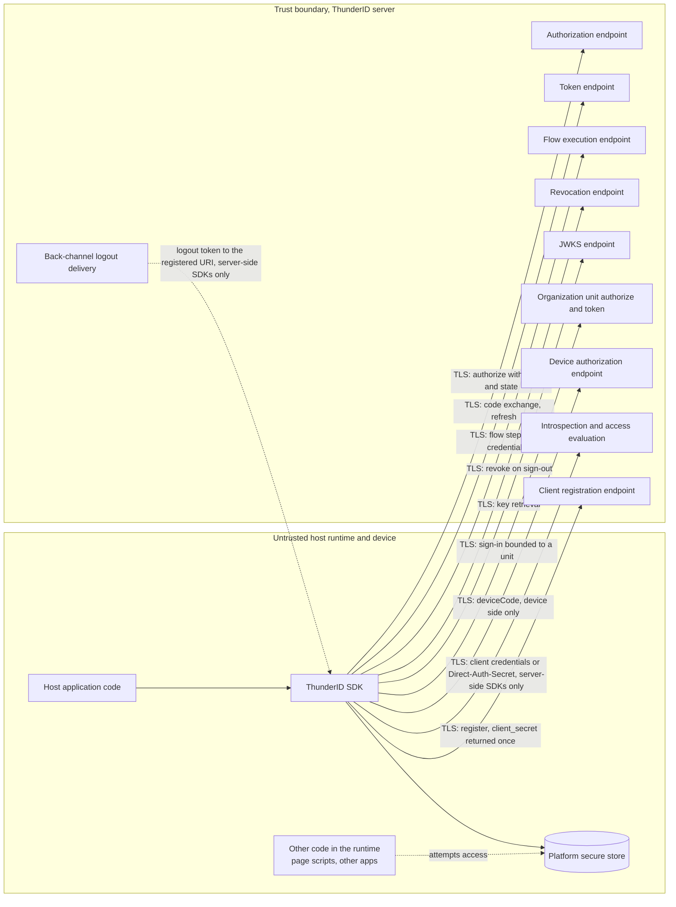

The trust boundary sits between the SDK and the server. Everything on the SDK's side of it is
untrusted from the server's point of view, which is why the SDK is specified as a public
client with PKCE mandatory and no client secret.

### Components

| Component | Task |
| --- | --- |
| SDK client | Builds authorization requests, drives flows, exchanges and refreshes tokens, validates ID tokens, exposes the client surface |
| Storage adapter | Persists tokens and session state in the platform's secure store, or in a caller-supplied backend |
| Isolated storage proxy | Where supported, holds tokens out of reach of the main thread and attaches them to allowlisted outbound requests only |
| Flow driver | Submits credentials and factor responses in embedded mode and surfaces each step to the application |
| Back-channel logout handler | In a server-side SDK, receives a logout token, validates it, and ends the local sessions it names |
| Host application | Supplies configuration, renders UI, decides which requests carry a token |

### Actors

#### Actors

| Actor | Description | Roles or permissions |
| --- | --- | --- |
| End user | Authenticates through the SDK on their own device | Whatever the issued tokens carry |
| Host application | Third-party code embedding the SDK | Full control of the runtime the SDK executes in |
| Co-resident code | Other scripts in the page, other applications on the device, browser extensions | Whatever the platform grants it |
| Network attacker | Positioned between the device and the server | Observation, and modification absent TLS |
| ThunderID server | Issues, validates, and revokes tokens | Authoritative |

#### Entitlement matrix

| Actor | Start a flow | Read stored tokens | Attach a token to a request | Revoke a session |
| --- | --- | --- | --- | --- |
| End user | [Yes] | [No] | [No] | [Yes] |
| Host application | [Yes] | [No] where isolated storage is used, [Yes] otherwise | [Yes], limited to the allowlist under isolated storage | [Yes] |
| Co-resident code | [Yes] | [No] by design, subject to platform isolation | [No] | [No] |
| Network attacker | [No] | [No] | [No] | [No] |

### External Dependencies (not owned)

| Dependency | Description |
| --- | --- |
| Platform secure store | Keychain, Keystore-backed encrypted preferences, OS credential store. Confidentiality of tokens at rest depends on it |
| Platform crypto | Random generation for PKCE verifiers and state, and SHA-256 for the challenge |
| Platform browser or web view | Presents the authorization page and returns the callback. Owns cookie policy and cross-application isolation |
| TLS stack | Transport confidentiality and integrity for every server call |
| Package registries | npm, Swift Package Manager and CocoaPods, Maven coordinates, pub.dev. Distribution integrity of the SDK itself |

## Threats and mitigations

### Out-of-scope interactions and risks

- Server-side validation of the redirect URI against the registered set, owned by the
  authorization endpoint's model.
- Token signature and lifetime policy, owned by the token issuance model.
- Compromise of the platform beneath the SDK, including a rooted or jailbroken device and a
  malicious browser extension with full page access. Bounded as residual risk below.

### Interactions

#### 01: Redirect authorization and callback

**Description**

The SDK generates a PKCE verifier and a state value, builds an authorization request, hands
the user to the authorization endpoint, and later parses the callback. It checks the returned
state against the one it issued before doing anything with the code.

**Assets involved**

| Initiator | Intermediate | Target |
| --- | --- | --- |
| End user through the host application | SDK, platform browser or web view | Authorization endpoint |

**Data flow**

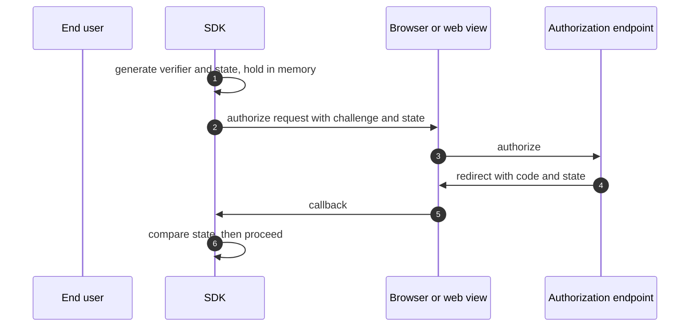

**Security considerations**

| Area | Response | Comments |
| --- | --- | --- |
| Data confidentiality | [C-High] | The code is short-lived but exchangeable |
| Communication medium | [M-NT] | |
| Transport security | [TLS] | Non-HTTPS `baseUrl` rejected at initialization. A loopback address is the one exception, allowed for local development only and refused outright in embedded mode. Traffic over that exception is not TLS protected, and this model does not treat it as such |
| Authentication | None at this step; the user authenticates at the server | |
| Accessibility | [Public] | |
| Authorization and Access Control | Redirect URI must be pre-registered, enforced server-side | |

**Threat assessment**

| ID | Category | Threat | Materializable | Mitigation / comment |
| --- | --- | --- | --- | --- |
| 1 | [Spoofing] | An attacker injects a callback carrying their own authorization code, so the victim's application silently signs in as the attacker's account and subsequent activity is attributed to it | [No] | A random state is required on every request and compared on callback; a mismatch fails authentication and stores nothing (AC4.1, AC4.2) |
| 2 | [Tampering] | An intercepted authorization code is redeemed by an attacker who never issued the request, yielding tokens for the victim's account | [No] | PKCE with S256 is mandatory regardless of server or application configuration; the verifier never leaves memory (AC4.1) |
| 3 | [Information Disclosure] | The PKCE verifier is written to disk or web storage and read later by co-resident code, defeating PKCE | [No] | The specification requires the verifier be held in memory only and cleared immediately after exchange |
| 4 | [Security Risk] | An SDK offers a configuration key that disables PKCE or state, and an application enables it | [No] | Both are specified as mandatory and not configurable. An SDK MUST NOT expose a key that weakens either, and introducing one would require a change to this model |

#### 02: Code exchange, token storage, and refresh

**Description**

The SDK exchanges the code for tokens, validates the ID token against the server JWKS, stores
the token set, and refreshes it before expiry.

**Assets involved**

| Initiator | Intermediate | Target |
| --- | --- | --- |
| SDK | Storage adapter, platform secure store | Token endpoint, JWKS endpoint |

**Data flow**

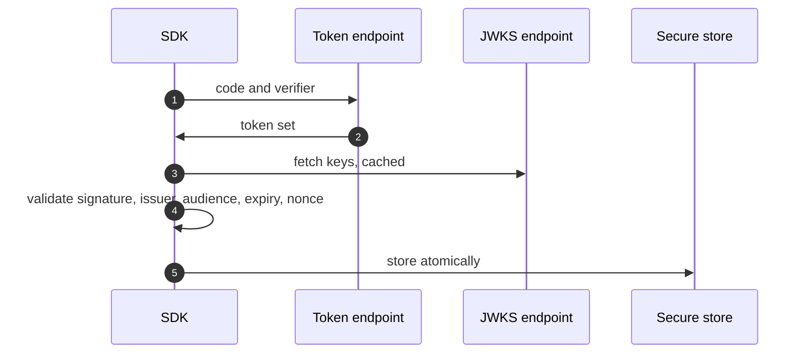

**Security considerations**

| Area | Response | Comments |
| --- | --- | --- |
| Data confidentiality | [C-High] | Access and refresh tokens |
| Communication medium | [M-NT], [M-FS] | Network for exchange, platform store at rest |
| Transport security | [TLS] | |
| Authentication | Public client with PKCE; confidential clients authenticate at the token endpoint | |
| Accessibility | [Restricted] | Reachable only through the SDK surface |
| Authorization and Access Control | Storage isolation is enforced by the platform | |

**Threat assessment**

| ID | Category | Threat | Materializable | Mitigation / comment |
| --- | --- | --- | --- | --- |
| 1 | [Information Disclosure] | Tokens stored in browser web storage are read by any script on the origin, including an injected one, giving the attacker the user's session until the token expires | [Conditional] | Web storage is prohibited as a default; in-memory or worker-isolated storage is specified, with the platform secure store on mobile (AC4.3). The default is only the default: an application may supply its own storage adapter backed by `localStorage`, and the SDK cannot prevent that. The specification requires SDKs to document that the secure default applies only when it is in use. Residual below |
| 2 | [Spoofing] | A forged or substituted ID token is accepted, letting an attacker present arbitrary identity claims to the application | [No] | Signature, issuer, audience, expiry, and nonce validation are required before acceptance; keys are re-fetched once on failure to tolerate rotation (AC4.4) |
| 3 | [Elevation of Privilege] | The application makes an authorization decision from a locally decoded, unverified JWT, so a tampered token grants access it should not | [No] | `decodeJwtToken` is specified as explicitly unsafe for authorization and documented as such; verified claims come from the server |
| 4 | [Tampering] | A refresh interrupted part-way leaves a mixed old and new token set, and the session breaks or a rotated-out refresh token is replayed | [No] | Stored tokens are updated atomically and refresh tokens are rotated on use |
| 5 | [Denial of Service] | Concurrent refreshes stampede the token endpoint, and rotation causes all but one to fail, signing the user out | [No] | Concurrent refreshes are deduplicated to a single in-flight request (AC4.7) |
| 6 | [Information Disclosure] | Tokens or claims are written to platform logs and collected by log aggregation or a co-resident reader | [No] | Access tokens masked, refresh tokens never logged, personal data masked, applied before any caller-supplied logger |

#### 03: Credential submission in embedded mode

**Description**

In embedded mode the application renders the authentication UI and the SDK submits the
collected credentials and factor responses to the flow execution endpoint, step by step.

**Assets involved**

| Initiator | Intermediate | Target |
| --- | --- | --- |
| End user | Host application UI, SDK flow driver | Flow execution endpoint |

**Data flow**

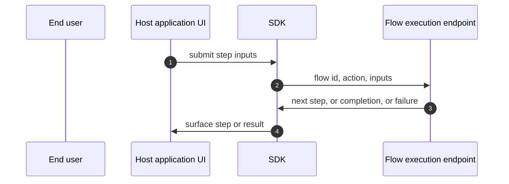

**Security considerations**

| Area | Response | Comments |
| --- | --- | --- |
| Data confidentiality | [C-High] | Passwords and one-time codes pass through the application |
| Communication medium | [M-NT] | |
| Transport security | [TLS] | |
| Authentication | The flow itself; initiation is unauthenticated by design | |
| Accessibility | [Public] | |
| Authorization and Access Control | Server-side flow state machine | |

**Threat assessment**

| ID | Category | Threat | Materializable | Mitigation / comment |
| --- | --- | --- | --- | --- |
| 1 | [Information Disclosure] | The SDK retains a submitted password or one-time code in memory or state beyond the call, widening the window for a memory or crash-dump disclosure | [No] | Credentials are specified as submit-and-discard, never retained beyond the API call |
| 2 | [Information Disclosure] | A credential or one-time code reaches a log or a crash report | [No] | Never logged at any level, enforced before any caller-supplied logger |
| 3 | [Spoofing] | The application renders a hard-coded form rather than the server-described step, so a server-side change to the flow silently downgrades what is actually collected, for example skipping a second factor | [No] | Sign-in and sign-up components are required to render the server-described step, not a fixed form |
| 4 | [Denial of Service] | Automated credential guessing against the flow endpoint, since flow initiation needs no authentication | [Yes] | Rate limiting and lockout are server-side and owned by the flow endpoint's model. The SDK does not retry automatically, which avoids amplifying it. Recorded as a residual |
| 5 | [Privacy Risk] | Embedded mode places the application's own code between the user and their password, which redirect mode does not | [No] | Inherent to the mode. Redirect mode is the specified default, and embedded mode has to be permitted by the application's server-side configuration as well as selected in the client |

#### 04: Attaching access tokens to outbound requests

**Description**

The application asks the SDK for a token, or the SDK proxies the request itself when tokens
are held in isolated storage and attaches the token on the application's behalf.

**Assets involved**

| Initiator | Intermediate | Target |
| --- | --- | --- |
| Host application | SDK, isolated storage proxy | Application and third-party APIs |

**Data flow**

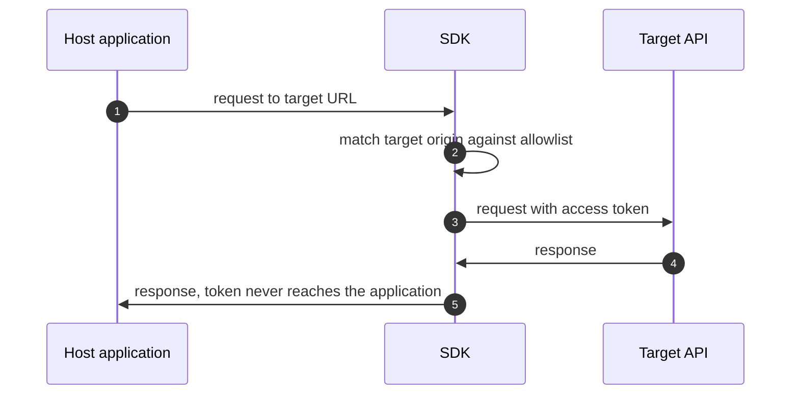

That sequence is the isolated-storage path, and "the token never reaches the application" holds
only there. Where storage is not isolated, which is every platform outside the browser worker
case, the application asks for the token and holds it:

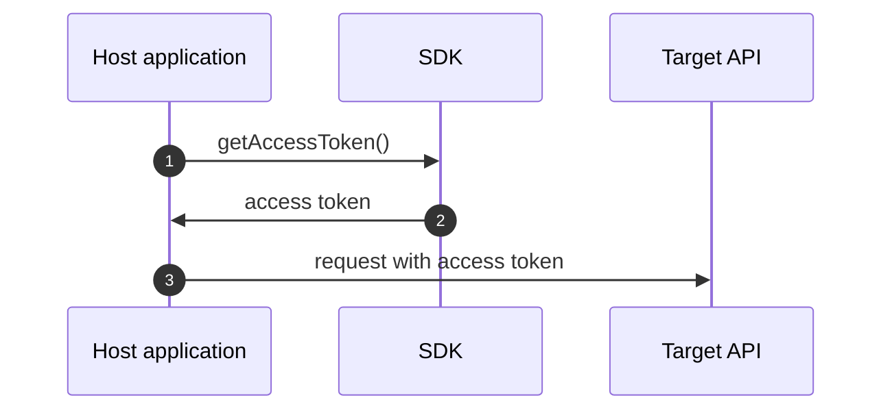

On that path the allowlist does not apply, because the SDK is not the one making the request.
The application decides where the token goes, and the SDK's obligation ends at handing over a
valid one.

**Security considerations**

| Area | Response | Comments |
| --- | --- | --- |
| Data confidentiality | [C-High] | The access token is the asset in transit |
| Communication medium | [M-NT] | |
| Transport security | [TLS] | |
| Authentication | Bearer token | |
| Accessibility | [Restricted] | Allowlisted base URLs only, under isolated storage |
| Authorization and Access Control | `allowedExternalUrls` allowlist | |

**Threat assessment**

| ID | Category | Threat | Materializable | Mitigation / comment |
| --- | --- | --- | --- | --- |
| 1 | [Information Disclosure] | Code in the runtime proxies a request to an attacker-controlled host and the SDK attaches the access token, exfiltrating it | [No] | Under isolated storage the token is attached only to an origin matching `allowedExternalUrls`, and anything else is rejected. Every entry must be HTTPS, so a token is never attached to a cleartext request |
| 1b | [Information Disclosure] | A request to an allowed origin is redirected to an attacker-controlled one, and the authorization header follows it | [No] | The origin check is re-run against every redirect target, and the authorization header is dropped rather than carried to an origin that does not match |
| 2 | [Lateral Movement] | An allowlist entry matching on string prefix lets a token reach an unintended host that shares a textual prefix, such as `https://example.com.attacker.test` matching an entry for `https://example.com` | [No] | Matching is specified by parsed origin, comparing scheme, host, and port, with any path prefix ending at a path boundary. String prefix matching is prohibited (AC4.9) |
| 3 | [Information Disclosure] | A token is placed in a query string and captured in server logs, proxy logs, or a referrer header | [No] | Tokens are carried in the authorization header |

#### 05: Sign-out and session termination

**Description**

The SDK revokes the refresh token at the server, then clears local session state.

**Assets involved**

| Initiator | Intermediate | Target |
| --- | --- | --- |
| End user | SDK, storage adapter | Revocation endpoint |

**Data flow**

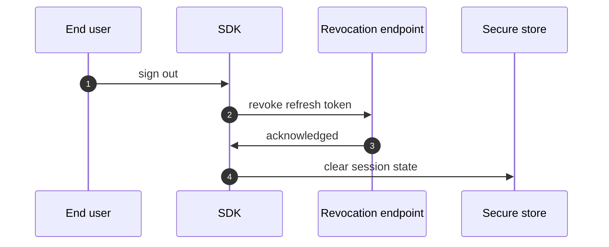

**Security considerations**

| Area | Response | Comments |
| --- | --- | --- |
| Data confidentiality | [C-High] | |
| Communication medium | [M-NT], [M-FS] | |
| Transport security | [TLS] | |
| Authentication | The token being revoked | |
| Accessibility | [Restricted] | |
| Authorization and Access Control | Server-side | |

**Threat assessment**

| ID | Category | Threat | Materializable | Mitigation / comment |
| --- | --- | --- | --- | --- |
| 1 | [Spoofing] | Local state is cleared but the refresh token stays valid server-side, so a copy taken earlier still yields tokens after the user believes they signed out | [No] | Revocation is required before clearing local state (AC4.5) |
| 2 | [Information Disclosure] | Partial clearing leaves cached user claims or a stale token behind for the next user of a shared device | [No] | Sign-out clears session state; the storage adapter contract includes a clear operation |
| 3 | [Operational Risk] | Revocation fails because the device is offline, and the SDK either blocks sign-out or clears state without revoking | [Yes] | The specification requires the attempt before clearing but does not state the offline behaviour. Recorded as a residual |

#### 06: Receiving a back-channel logout token

**Description**

In an SDK that runs on a server, the ThunderID server posts a logout token to the URI the
application registered. The handler validates the token, finds the local sessions it names by
`sid`, or by `sub` when there is no `sid`, and ends them. The request carries no session cookie
and no client credential; the token's signature is the only authentication.

**Assets involved**

| Initiator | Intermediate | Target |
| --- | --- | --- |
| ThunderID server | Network, the application's HTTP stack | Back-channel logout handler, session store |

**Data flow**

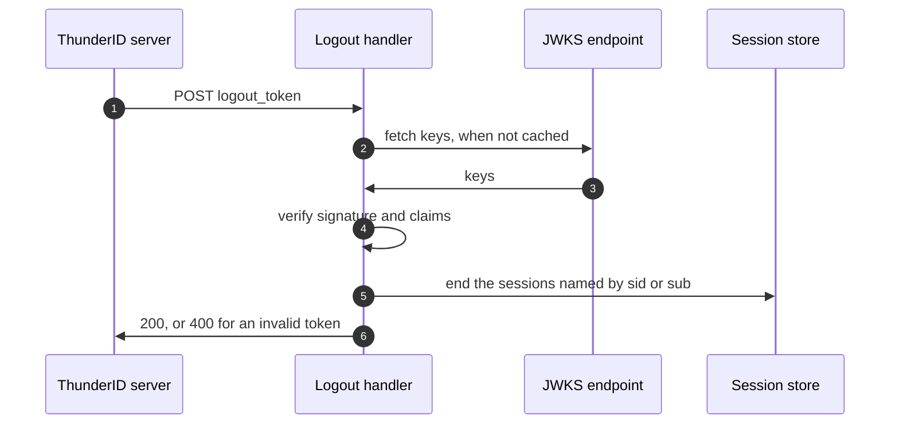

**Security considerations**

| Area | Response | Comments |
| --- | --- | --- |
| Data confidentiality | [C-High] | The token names a subject and a session |
| Communication medium | [M-NT] | |
| Transport security | [TLS] | Plain HTTP is possible for a confidential client on a private network, by server policy |
| Authentication | Signature on the logout token | No cookie, no client credential |
| Accessibility | [Public] | Any party that can reach the application can post to the endpoint |
| Authorization and Access Control | The token's audience must be this client | |

**Threat assessment**

| ID | Category | Threat | Materializable | Mitigation / comment |
| --- | --- | --- | --- | --- |
| 1 | [Spoofing] | An attacker posts a token they made themselves and signs users out at will | [No] | The signature is verified against the server JWKS with the algorithms accepted for ID tokens, and the issuer must match exactly (AC9.4) |
| 2 | [Spoofing] | A genuine logout token issued to another application is replayed to this one | [No] | The audience must contain this client's identifier (AC9.4) |
| 3 | [Spoofing] | A genuine ID token, which the attacker can obtain by signing in, is posted as a logout token to end that user's or another holder's session | [No] | The `typ` header must be `logout+jwt`, the back-channel logout event must be present, and a `nonce` must be absent. None of these can be configured off (AC9.5) |
| 4 | [Tampering] | A captured logout token is replayed later to sign the same user out again after they signed back in | [No] | The token is valid for a short time, a `sid` names a session that no longer exists, and a `sub`-only token ends only sessions that began before it was issued (AC9.2). A `jti` seen before is refused where the SDK tracks it |
| 5 | [Denial of Service] | Tokens with an unknown key identifier are posted in volume, so the SDK fetches the JWKS on every request and is used to load the server | [No] | Keys are cached and the re-fetch after a verification failure is bounded in rate (AC9.7) |
| 6 | [Denial of Service] | Large or slow request bodies exhaust the handler | [No] | The handler accepts one method and one content type and caps the body it reads. Request rate limiting is the application's or its gateway's |
| 7 | [Denial of Service] | The list of ended sessions that a cookie-session SDK keeps grows without bound | [No] | An entry is kept only for as long as a matching session could remain valid, then dropped (AC9.10) |
| 8 | [Information Disclosure] | The logout token, which names a subject and a session, ends up in logs | [No] | The token is never logged (AC9.9) |
| 9 | [Security Risk] | The application runs several instances, the notification reaches one, and the session stays usable on the others | [Yes] | The default store is per process. The specification requires the store to be replaceable and the limit to be documented. Recorded as a residual |
| 10 | [Security Risk] | The SDK's session ends, but an access token already handed to a browser or another service keeps working until it expires | [Yes] | Ending the local session cannot recall a token in circulation. The server revokes the refresh token, so the window is the access token lifetime. Recorded as a residual |
| 11 | [Security Risk] | A client configured for ID token encryption is sent an encrypted logout token the SDK cannot read, so its sessions are never ended | [Yes] | An SDK that cannot decrypt must document that back-channel logout is unsupported for such a client. Recorded as a residual |

#### 07: Federated redirect inside an embedded flow

**Description**

An embedded flow can hand the user to an external identity provider. The flow execution
endpoint returns a `REDIRECTION` step whose `redirectURL` carries a `state` the server issued.
The SDK opens that URL in a browser session (`ASWebAuthenticationSession` on iOS, Custom Tabs
on Android, a popup in a browser), captures the provider's callback, and resubmits its `code`
and `state` to the flow with the step's `executionId` and challenge token. The response can be
another `REDIRECTION`, for example when a federated sign-up leads into an account-linking
verification that signs in at a provider again. The server always issues a `state`, and checks
it only when the client sends one.

**Assets involved**

| Initiator | Intermediate | Target |
| --- | --- | --- |
| Flow execution endpoint | SDK flow driver, platform browser session, external identity provider | Flow execution endpoint |

**Data flow**

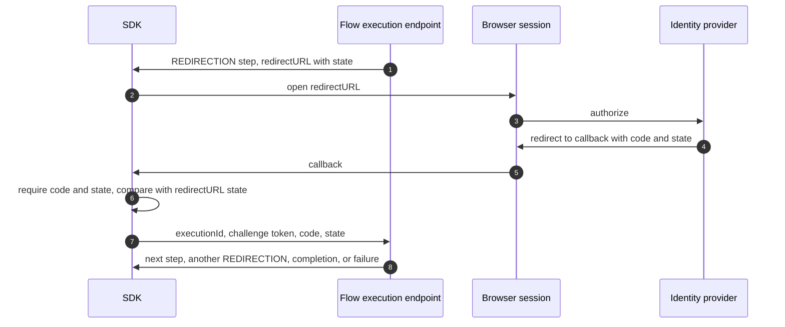

**Security considerations**

| Area | Response | Comments |
| --- | --- | --- |
| Data confidentiality | [C-High] | The provider's code is exchangeable by the server for the user's federated identity |
| Communication medium | [M-NT] | |
| Transport security | [TLS] | |
| Authentication | The flow itself, and the provider's own sign-in | |
| Accessibility | [Public] | On mobile, any installed app can open the callback scheme |
| Authorization and Access Control | Server-side flow state machine and `state` validation | |

**Threat assessment**

| ID | Category | Threat | Materializable | Mitigation / comment |
| --- | --- | --- | --- | --- |
| 1 | [Spoofing] | Another app on the device opens the callback scheme with an authorization code for the attacker's provider account, so the flow continues as, or links the victim's account to, the attacker's identity | [No] | A mobile SDK compares the callback's `state` with the `state` in `redirectURL` and rejects a mismatch with `invalidGrant` before submitting anything (AC4.14). A browser SDK needs no comparison: it accepts a callback only from the popup it opened, either posted with the app's origin or read from the popup's same-origin URL |
| 2 | [Spoofing] | A callback without a `state` is submitted. The server checks the state only when the client sends one, so the injected code is checked nowhere | [No] | No SDK submits a callback that lacks a `code` or a `state`, and a mobile SDK rejects every callback to a `redirectURL` that has no `state` or an empty one. The server always issues a state, so no genuine callback is rejected (AC4.13, AC4.14) |
| 3 | [Tampering] | The SDK sends back the `state` from the callback rather than the one it compared, so a later change to the comparison silently lets a forged value through | [No] | A mobile SDK resubmits the `state` taken from `redirectURL` once the callback matched it |
| 4 | [Denial of Service] | A `REDIRECTION` returned for a submitted callback is rendered as an empty step, so a federated sign-up that leads into account-linking verification cannot finish | [No] | The SDK follows every `REDIRECTION` step, including one returned for a callback it submitted, in sign-in and sign-up alike (AC4.15) |
| 5 | [Information Disclosure] | The provider's authorization code, or the callback URL that carries it, reaches a log or a crash report, where a reader can redeem it before the flow does | [No] | Authorization codes and the callback URLs that carry them are never logged, at any level, and the rule applies before any caller-supplied logger. The same values are kept out of the error messages and crash reports the SDK produces |

#### 08: Starting a self user attribute verification

**Description**

A signed-in user verifies an email address or mobile number in their own profile. The SDK
starts a `SELF` flow on the flow execution endpoint with the user's access token, the
flow handle and the attribute. The server takes the user from the token, binds it to the
execution and sends a code or a link to the stored value. The SDK renders the steps the server
describes and submits the code; the server records the verification, and the SDK reads the
status back from `/users/me`.

**Assets involved**

| Initiator | Intermediate | Target |
| --- | --- | --- |
| Host application | SDK flow driver, authenticated transport | Flow execution endpoint, `/users/me`, the user's mailbox or phone |

**Data flow**

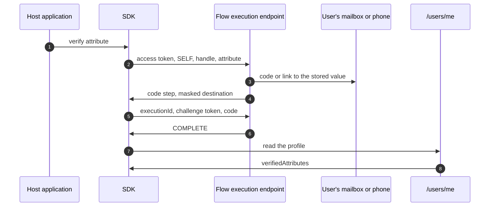

**Security considerations**

| Area | Response | Comments |
| --- | --- | --- |
| Data confidentiality | [C-High] | The access token, and the code that proves control of the contact |
| Communication medium | [M-NT] | |
| Transport security | [TLS] | |
| Authentication | Bearer access token on the start | The server binds the user from it |
| Accessibility | [Restricted] | A signed-in user, for attributes of their own profile |
| Authorization and Access Control | Server-side: the token's subject, and the flow | |

**Threat assessment**

| ID | Category | Threat | Materializable | Mitigation / comment |
| --- | --- | --- | --- | --- |
| 1 | [Elevation of Privilege] | A caller names another user to verify that user's contact | [No] | The SDK sends no user identifier; the server takes the user only from the access token on the start and keeps it for the execution (AC10.1) |
| 2 | [Information Disclosure] | A call that names an explicit URL sends the access token to a host other than the server | [No] | The request goes through the SDK's authenticated transport, so the attachment rules of interaction 04 apply. Where storage is not isolated, the application already holds the token |
| 3 | [Denial of Service] | A component that restarts verification on every render, or a caller holding the token, floods the user's mailbox or phone and uses up paid SMS volume | [Yes] | A component starts once per showing and never retries automatically (AC10.3). The server caps codes per execution, but not new executions. Recorded as a residual |
| 4 | [Tampering] | The application shows an attribute as verified that the server never recorded | [No] | Status comes only from the read-only `verifiedAttributes` of `/users/me`, re-read after `COMPLETE`; the SDK never marks an attribute verified locally, and an absent field shows neither status (AC10.4) |
| 5 | [Information Disclosure] | The code reaches a log or a crash report | [No] | The code is a credential under interaction 03 and is never logged (AC10.5) |

#### 09: Access evaluation with the server secret

**Description**

A server-side SDK asks the server's AuthZEN policy decision point whether a subject may perform
an action on a resource. It reads the endpoints from `/.well-known/authzen-configuration`,
checks that `policy_decision_point` matches the configured server, and posts the evaluation with
a server-level secret in the `Direct-Auth-Secret` header. The secret is not a user's or a
client's credential: it authorizes any evaluation against the deployment, so whoever holds it
can probe every subject's entitlements.

**Assets involved**

| Initiator | Intermediate | Target |
| --- | --- | --- |
| Host application on a server | SDK | AuthZEN metadata, access evaluation endpoints |

**Data flow**

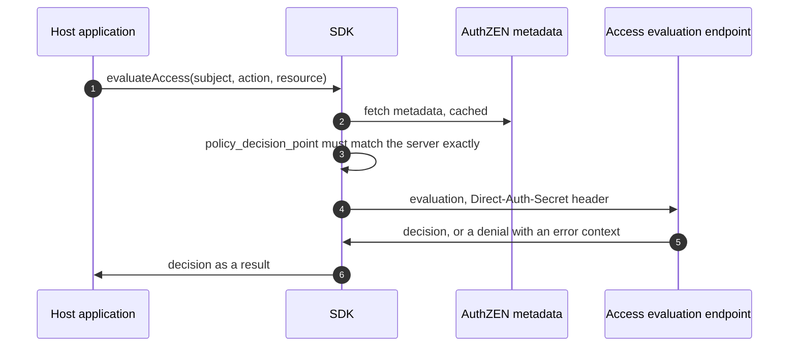

**Security considerations**

| Area | Response | Comments |
| --- | --- | --- |
| Data confidentiality | [C-High] | The server secret, and the subject identifiers in each evaluation |
| Communication medium | [M-NT] | |
| Transport security | [TLS] | |
| Authentication | Server secret in `Direct-Auth-Secret` | |
| Accessibility | [Restricted] | Server-side SDKs only |
| Authorization and Access Control | Server-side, by the secret | |

**Threat assessment**

| ID | Category | Threat | Materializable | Mitigation / comment |
| --- | --- | --- | --- | --- |
| 1 | [Information Disclosure] | A browser or mobile SDK exposes the operations, so the server secret ships inside a public client where anyone can extract it | [No] | The operations exist only in server-side SDKs; a browser or mobile SDK MUST NOT expose them and documents why (AC12.3) |
| 2 | [Information Disclosure] | The secret reaches a log, an error message, or a crash report | [No] | The secret is supplied at initialization or per call and is never logged, before any caller-supplied logger runs |
| 3 | [Spoofing] | Tampered metadata points the evaluation endpoints at another host, which receives the secret and returns the decisions it likes | [No] | `policy_decision_point` must match the configured server exactly, as the discovery `issuer` must, and an explicit endpoint override is held to the endpoint trust bar |
| 4 | [Elevation of Privilege] | A denial for an unknown resource or action is raised as an error, and the application's error path lets the request through | [No] | A denial is always a result, never an error; only a transport failure or a `4xx` or `5xx` answer raises (AC12.6) |

**Per-SDK expectation:** the Node SDK and the Framework Specific SDKs built on it may ship the
operations, with the secret held in the server's own secret handling and never in configuration
the client can read. Browser SDKs, iOS, Android, and Flutter do not ship them.

#### 10: Device authorization on the device side

**Description**

On an input-constrained device or in a command-line tool, the SDK starts a device authorization
(RFC 8628) at `/oauth2/device-authorize` and receives a `deviceCode`, a `userCode`, and the
verification URIs. The user approves on another device with the `userCode`. Meanwhile the SDK
polls the token endpoint with the `deviceCode`, which is the credential that redeems the
approval: whoever holds it before the tokens are issued receives them.

**Assets involved**

| Initiator | Intermediate | Target |
| --- | --- | --- |
| SDK on the device | Platform secure store | Device authorization endpoint, token endpoint |

**Data flow**

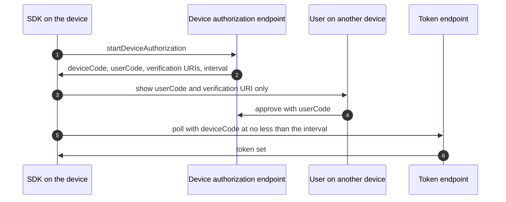

**Security considerations**

| Area | Response | Comments |
| --- | --- | --- |
| Data confidentiality | [C-High] | The `deviceCode` until the tokens are issued, then the tokens |
| Communication medium | [M-NT], [M-FS] | |
| Transport security | [TLS] | |
| Authentication | The user approves on another device | |
| Accessibility | [Public] | The `userCode` is shown on screen by design |
| Authorization and Access Control | Server-side, by the approval | |

**Threat assessment**

| ID | Category | Threat | Materializable | Mitigation / comment |
| --- | --- | --- | --- | --- |
| 1 | [Information Disclosure] | The `deviceCode` is shown, logged, or written to a crash report, and a reader polls with it to collect the tokens | [No] | The `deviceCode` is a credential: it is never shown or logged, and only the `userCode` and verification URIs are handed to the display |
| 2 | [Denial of Service] | The SDK polls faster than the interval, or ignores `slow_down`, and the server throttles or refuses the device | [No] | Polling runs at no less than the interval and slows down on `slow_down`, under the same rules as `pollCIBA` |
| 3 | [Spoofing] | A user is tricked into approving a `userCode` an attacker's device started, signing the attacker's device in as the user | [Yes] | Inherent to the grant. The server's verification page and the user-side `verifyDeviceCode` flow show what is being approved. Recorded as a residual |

**Per-SDK expectation:** the device side ships in Android (TV), on Apple platforms where the
package builds for tvOS, in Flutter, and in the Node SDK for command-line tools, each storing the
tokens as a sign-in does. The user side, `verifyDeviceCode`, runs as an embedded flow in the
browser SDKs, iOS, Android, and Flutter and holds no `deviceCode`.

#### 11: Token introspection with client credentials

**Description**

A server-side SDK posts a token to `/oauth2/introspect` (RFC 7662) to learn whether it is
active and what it carries. The endpoint requires client authentication, so the SDK sends the
client's credentials with every call.

**Assets involved**

| Initiator | Intermediate | Target |
| --- | --- | --- |
| Host application on a server | SDK | Introspection endpoint |

**Data flow**

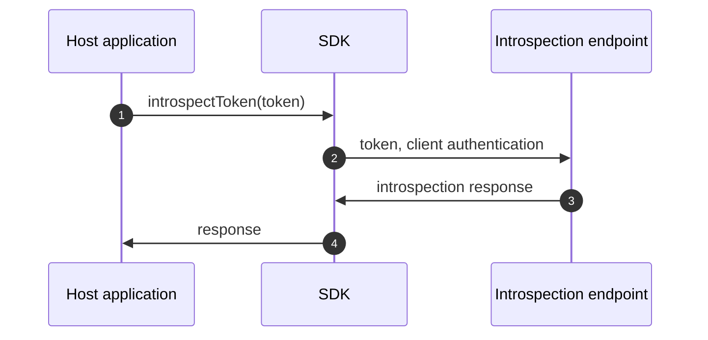

**Security considerations**

| Area | Response | Comments |
| --- | --- | --- |
| Data confidentiality | [C-High] | The client secret and the token being introspected |
| Communication medium | [M-NT] | |
| Transport security | [TLS] | |
| Authentication | Client authentication at the endpoint | |
| Accessibility | [Restricted] | Server-side SDKs only |
| Authorization and Access Control | Server-side, by the client's credentials | |

**Threat assessment**

| ID | Category | Threat | Materializable | Mitigation / comment |
| --- | --- | --- | --- | --- |
| 1 | [Information Disclosure] | A public client ships the operation, so a client secret ends up in a browser bundle or a mobile binary | [No] | `introspectToken` is never exposed where a client secret cannot be held; browser and mobile SDKs do not ship it (AC12.3), and `clientSecret` is refused by a public client |
| 2 | [Information Disclosure] | The client secret or the introspected token reaches a log | [No] | Both fall under the logging rules: the secret is never logged and the token is masked |

**Per-SDK expectation:** the Node SDK and the Framework Specific SDKs built on it may ship
`introspectToken`. Browser SDKs, iOS, Android, and Flutter do not.

#### 12: Dynamic client registration

**Description**

A management caller registers a client by dynamic client registration (RFC 7591), and reads,
replaces, or deletes it (RFC 7592). The server generates the `client_secret`, returns it once in
the registration response, and stores it write-only, so the SDK holds the only readable copy
for the length of that call.

**Assets involved**

| Initiator | Intermediate | Target |
| --- | --- | --- |
| Host application | SDK | Client registration endpoint |

**Data flow**

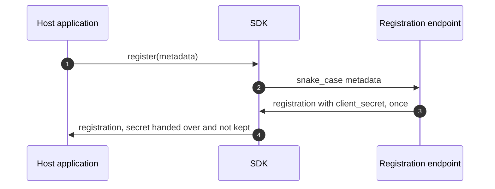

**Security considerations**

| Area | Response | Comments |
| --- | --- | --- |
| Data confidentiality | [C-High] | The `client_secret` |
| Communication medium | [M-NT] | |
| Transport security | [TLS] | |
| Authentication | The signed-in user's access token, as for any management operation | |
| Accessibility | [Restricted] | |
| Authorization and Access Control | Server-side | |

**Threat assessment**

| ID | Category | Threat | Materializable | Mitigation / comment |
| --- | --- | --- | --- | --- |
| 1 | [Information Disclosure] | The `client_secret` is written to a log, or printed through the returned type's debug description | [No] | The secret is handed to the caller once and never retained, logged, or printed, including in a debug description (AC12.4) |
| 2 | [Information Disclosure] | The SDK caches the registration, so the secret outlives the call in memory or storage | [No] | Nothing is retained; a later read returns no secret because the server stores it write-only (AC12.4) |

**Per-SDK expectation:** every SDK that ships client registrations follows the same rules, and
documents that the secret must be stored by the caller at once, since it cannot be read again.

#### 13: Signing in to and switching organization units

**Description**

A sign-in can be bounded to one organization unit, named in a path segment of the authorization
and token endpoints (`/ou/{ouId}/oauth2/authorize`, `/ou/{ouId}/oauth2/token`), in `ouId` on the
request that starts an embedded sign-in flow, or in `ouId` on a backend's sign-in endpoint. The
tokens carry the roles and permissions assigned in that unit, and the refresh token records it.
Switching units is a new bounded sign-in that the server's SSO session usually completes without
credentials, after which the SDK replaces the whole session.

**Assets involved**

| Initiator | Intermediate | Target |
| --- | --- | --- |
| End user through the host application | SDK, platform browser or web view | Organization unit authorization and token endpoints, flow execution endpoint |

**Data flow**

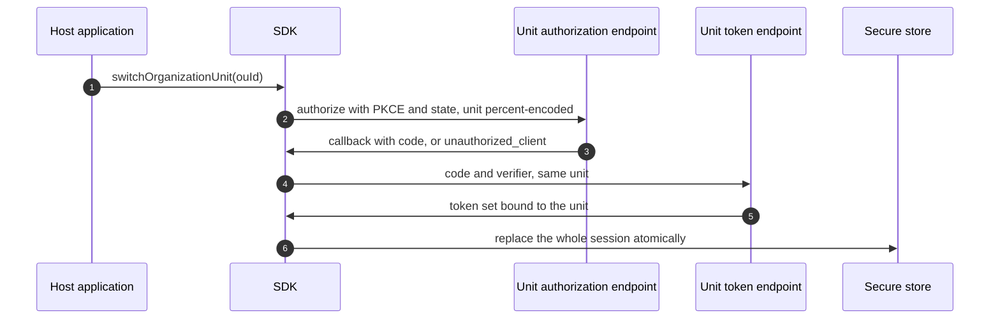

**Security considerations**

| Area | Response | Comments |
| --- | --- | --- |
| Data confidentiality | [C-High] | Tokens issued for the unit |
| Communication medium | [M-NT], [M-FS] | |
| Transport security | [TLS] | |
| Authentication | As for any sign-in, usually completed by the SSO session | |
| Accessibility | [Public] | The organization unit authorization endpoint is reachable without authentication |
| Authorization and Access Control | Server-side: the user and the application must both be found in the unit | |

**Threat assessment**

| ID | Category | Threat | Materializable | Mitigation / comment |
| --- | --- | --- | --- | --- |
| 1 | [Tampering] | A unit identifier carrying `/`, `?`, or `..` addresses a different route than the caller named | [No] | The unit is a single path segment and is percent-encoded (AC12.7, AC12.9) |
| 2 | [Spoofing] | A code from a unit-bounded sign-in is redeemed for another unit, or at the unqualified token endpoint, so tokens come from a unit the user did not sign in to | [No] | The SDK redeems only at `/ou/{ouId}/oauth2/token` for the unit the sign-in started with (AC12.9), and the server answers a code for another unit with `invalid_grant` |
| 3 | [Tampering] | A switch replaces part of the session, leaving an access token from one unit beside a refresh token from another, so later requests act with a mix of entitlements | [No] | A successful switch replaces the whole token set atomically and reads the user again, and a failed one leaves the previous session untouched (AC12.11, AC12.12) |
| 4 | [Elevation of Privilege] | The application decides access from the `ouId`, `ouHandle`, or `ouName` claims, or from the switcher's current unit, which a decoded token or a stale cache can misstate | [No] | The claims are for display only, and the SDK documents that the server decides every request against the unit the token was issued for (AC12.13) |
| 5 | [Information Disclosure] | Probing the unit endpoints, or reading the SDK's errors, reveals which organization units exist | [Conditional] | The server answers an unknown unit and an unusable one with the same `unauthorized_client`, and the SDK does not try to tell them apart. The two answers take measurably different time at the server. Recorded as a residual |
| 6 | [Elevation of Privilege] | A refresh after a switch carries the tokens back into the previous unit, or into every unit | [No] | The refresh token records the unit it was issued for, and the server checks permissions in it again on refresh |
| 7 | [Spoofing] | A bounded sign-in silently falls back to the unqualified endpoints where the deployment does not serve the organization unit routes, signing the user in to another unit | [No] | The SDK reports the failure and never falls back |

**Per-SDK expectation:** every SDK that ships organization operations builds the unit routes
from `baseUrl` with the unit percent-encoded, keeps the unit with the sign-in's state, sends
`ouId` only on the request that starts an `AUTHENTICATION` flow, replaces the session atomically
on a successful switch and leaves it untouched on a failed one, and documents the claims as
display only. In backend mode the backend holds the tokens and carries `ouId` itself, so the
client's part is passing it and reading the session again.

## Security Review Checklist

### Security considerations

| # | Consideration | State | Comments |
| --- | --- | --- | --- |
| 1 | Are all inputs and outputs validated (syntactic and semantic)? | [Partial] | Inputs are covered: configuration is validated at initialization, and operation inputs before any network call. Outputs are covered where it matters most, in callback `state` comparison and full ID token claim validation, but the specification defines no general schema validation contract for every server response. Narrowing that gap is follow-up work |
| 2 | Are rate limits in place where necessary? | [Partial] | Mostly a server-side concern: the SDK does not retry automatically, except for token refresh. The back-channel logout handler bounds its own JWKS re-fetch. Limiting requests to that endpoint is left to the application or its gateway |
| 3 | Are permissions, roles, and entitlements defined on the principle of least privilege and business need? | [Yes] | Public client with no secret, scopes default to `openid`, tokens attached only to allowlisted hosts under isolated storage |
| 4 | Are authentication and authorization validated at both the UI and API layers, front end and back end, before granting access to resources? | [Partial] | API authorization is enforced by the server and is out of the SDK's hands. What the SDK contributes is refusing to look like an authorization layer: `decodeJwtToken` is specified as unsafe for authorization decisions, and verified claims come from the server |
| 5 | Are proper isolations in place between components to ensure least-privilege access and reduce the blast radius against lateral movement? | [Partial] | Isolated storage is available in the browser and the platform secure store on mobile. A host application that supplies its own storage adapter can weaken this by design |
| 6 | Have any default credentials been changed, and are default superuser or root accounts not in use? | [N/A] | The SDK ships no credentials |
| 7 | Has the implementation followed best-practice guidelines? | [Yes] | RFC 6749, RFC 7636, RFC 7009, RFC 8693, OIDC Core, and the OAuth 2.0 security best current practice |
| 8 | Are secrets, credentials, and internal-only material kept out of the public source tree and its git history? | [Yes] | Samples are required to carry no hardcoded credentials or server URLs (AC6.5) |
| 9 | Was a security-focused code review conducted for this change, and have the findings been addressed? | [N/A] | This change introduces documents, not code. It applies to the implementation work that follows |
| 10 | Is Static Analysis (SAST) or IaC scanning conducted, and are findings addressed? | [Partial] | Each SDK repository runs lint and build in its pull request pipeline. Coverage is not uniform across the four repositories |
| 11 | Is Software Composition Analysis (SCA) conducted or integrated into the repository, and are findings addressed? | [Partial] | Dependency scanning is not uniform across the four SDK repositories |
| 12 | Is Dynamic (DAST) or API scanning conducted on a non-production setup, and are findings addressed? | [N/A] | The SDK is a client library. End-to-end suites run against a real server nightly |
| 13 | Are audit logs generated in a standardized format for critical functionality? | [N/A] | Auditing is server-side. The SDK emits diagnostic logs only, sanitized |
| 14 | Do audit logs for critical configuration changes record the difference between the old and new versions? | [N/A] | |
| 15 | Are data in transit and at rest encrypted? | [Yes] | TLS required, non-HTTPS `baseUrl` rejected outside loopback, tokens at rest in the platform secure store |
| 16 | Are sensitive values such as credentials and keys stored in a secret store or vault? | [Yes] | Platform secure store by default; no client secret in a public client. The `Direct-Auth-Secret` and introspection credentials exist only in server-side SDKs, and a registration's `client_secret` is handed to the caller once and not kept |
| 17 | Is personal, sensitive, or confidential data kept out of logs? | [Yes] | Masking rules apply at every level and before any caller-supplied logger |
| 18 | Have users been given clear instructions for secure usage? | [Partial] | The quickstart and reference are required per SDK. A consolidated security guidance page for SDK adopters does not exist yet |

### Business impact and resilience

| # | Consideration | State | Comments |
| --- | --- | --- | --- |
| 1 | Has a business impact analysis been done to identify resilience requirements? | [N/A] | The SDK is a client library with no availability surface of its own. Availability is owned by the deployer of the server and by the application embedding the SDK |

Resilience characteristics that do belong to the SDK: it refreshes tokens ahead of expiry
rather than on failure, deduplicates concurrent refreshes, and re-fetches JWKS once on a
verification failure so that server key rotation does not break running clients.

### Dependency and component health

| # | Consideration | State | Comments |
| --- | --- | --- | --- |
| 1 | Are dependencies, base images, and runtimes monitored for known vulnerabilities and kept current? | [Partial] | Practice differs across the four SDK repositories. Making it uniform is follow-up work |
| 2 | Are any End-of-Life or End-of-Service components in use? | [No] | Each SDK documents its minimum supported runtime |
| 3 | Is hardening guidance published for operators who deploy the project? | [No] | See checklist item 18 |

### Privacy considerations

The SDK processes personal data in transit: identity claims, profile attributes, and the
identifiers a user supplies during authentication and recovery.

| # | Consideration | State | Comments |
| --- | --- | --- | --- |
| 1 | Is the purpose and legal basis for processing personal data clearly defined? | [N/A] | Determined by the application embedding the SDK, which is the controller |
| 2 | Are the collection, storage, processing, sharing, archival, and disposal of personal data aligned with the data minimization principle? | [Yes] | The SDK requests the configured scopes only, and persists the token set and cached claims rather than a copy of the profile |
| 3 | Is personal data stored securely? | [Yes] | Platform secure store |
| 4 | Are privacy notices updated to reflect any new processing or changes to purpose and legal basis? | [N/A] | Owned by the embedding application |
| 5 | Is access to personal data granted on a need-to-know basis? | [Yes] | Scoped tokens, and host allowlisting under isolated storage |
| 6 | Are data retention requirements considered? | [Yes] | Local state is cleared on sign-out |
| 7 | Is there a process to dispose of personal data on request in a timely manner? | [N/A] | Server-side |
| 8 | Are records of personal-data processing maintained? | [N/A] | Owned by the embedding application |

## Residual risks (open items)

- `allowedExternalUrls` matches on base URL prefix, so a badly chosen entry can match a host
  the configurer did not intend. Guidance exists in the specification; origin-level matching
  would remove the footgun.
- Automated credential guessing against the unauthenticated flow execution endpoint is
  mitigated server-side and is not something the SDK can defend. The SDK's contribution is to
  not retry automatically.
- Sign-out with revocation unreachable now clears local state and reports the failure to the
  caller (AC2.4b), so the session is gone locally while the refresh token stays valid at the
  server until it expires. That window is bounded by the refresh token lifetime and is accepted.
- A host application supplying its own storage adapter can place tokens somewhere weaker than
  the platform default, `localStorage` included, which is the conditional in interaction 02
  threat 1. The adapter is a deliberate extension point and the SDK cannot police what it does,
  so the mitigation is documentation: each SDK states that the secure default applies only when
  it is the one in use.
- Platform compromise below the SDK, such as a rooted or jailbroken device or a browser
  extension with full page access, is out of the SDK's control and is accepted.
- The shared error code catalogue referenced in
  [spec.md](spec.md#error-model) is a target rather than a defined artifact, so uniform
  handling by code across SDKs is not yet guaranteed.
- A back-channel logout notification reaches one instance of an application. With the default
  in-memory store, the session stays usable on the other instances until its tokens fail. The
  store is replaceable for this reason, and each SDK documents that more than one instance needs
  a shared one.
- Back-channel logout ends the SDK's own session. An access token the application already gave
  to a browser or another service stays usable until it expires, bounded by the access token
  lifetime, and is accepted.
- An SDK that cannot decrypt an encrypted logout token does not support back-channel logout for
  a client configured for ID token encryption. Each such SDK documents it.
- Each self user attribute verification sends a message to the user's contact. The server caps
  codes per execution, not new executions, so send volume across executions is limited by the
  deployment's rate limits and the provider's quotas.
- A user can be led to approve a device authorization `userCode` that an attacker's device
  started. This is inherent to RFC 8628 and is bounded by what the verification page shows.
- The organization unit endpoints answer an unknown unit and an unusable one with the same
  `unauthorized_client`, but in measurably different time, so the existence of a unit can be
  inferred. This is the server's to close, and is a known limitation of the organization unit
  sign-in work under [#6302](https://github.com/thunder-id/thunderid/issues/6302).
- Registration, recovery, and onboarding flows are not yet bounded to an organization unit, so
  an SDK cannot bound them either. Follow-up work under #6302.

## Appendix

- References: [RFC 6749](https://datatracker.ietf.org/doc/html/rfc6749),
  [RFC 7591](https://datatracker.ietf.org/doc/html/rfc7591),
  [RFC 7636](https://datatracker.ietf.org/doc/html/rfc7636),
  [RFC 7662](https://datatracker.ietf.org/doc/html/rfc7662),
  [RFC 7009](https://datatracker.ietf.org/doc/html/rfc7009),
  [RFC 7519](https://datatracker.ietf.org/doc/html/rfc7519),
  [RFC 8628](https://datatracker.ietf.org/doc/html/rfc8628),
  [RFC 8693](https://datatracker.ietf.org/doc/html/rfc8693),
  [AuthZEN Authorization API 1.0](https://openid.net/specs/authorization-api-1_0.html),
  [OpenID Connect Core 1.0](https://openid.net/specs/openid-connect-core-1_0.html),
  [OpenID Connect Back-Channel Logout 1.0](https://openid.net/specs/openid-connect-backchannel-1_0.html),
  [OAuth 2.0 Security Best Current Practice](https://datatracker.ietf.org/doc/html/rfc9700),
  [OWASP Top 10 Proactive Controls](https://top10proactive.owasp.org/).
- Companion document: [spec.md](spec.md).

## Change log

| Version | Date | Change |
|---|---|---|
| 0.1 | 2026-09-10 | Initial threat model. |
| 0.2 | 2026-10-06 | Interaction 06 added for receiving a back-channel logout token in SDKs with a server runtime. |
| 0.3 | 2026-10-12 | Interaction 07 added for a federated redirect inside an embedded flow. A callback without a `state` is never submitted, and mobile SDKs reject one that does not echo the request's `state`. Authorization codes, and callback URLs that carry one, are never logged. |
| 0.4 | 2026-11-03 | Interaction 08 added for starting a self user attribute verification. |
| 0.5 | 2026-11-04 | Interactions 09 to 13 added for what specification 0.11 introduced: access evaluation with the server's `Direct-Auth-Secret`, the device side of device authorization and its `deviceCode`, token introspection with client credentials, dynamic client registration and its once-returned `client_secret`, and signing in to and switching organization units. Each states what is expected of every SDK. |
