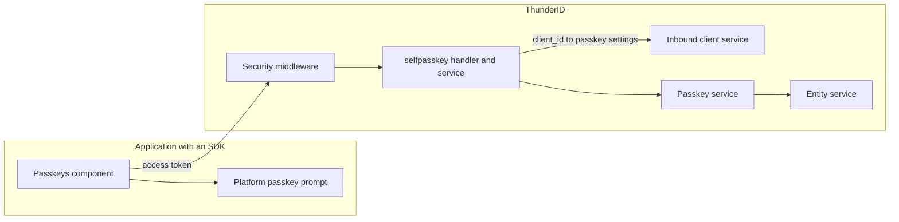

# Self-Service Passkey Management Specification

- **Status:** Draft
- **Version:** 0.1
- **Related documents:** [Feature issue #6239](https://github.com/thunder-id/thunderid/issues/6239),
  [Design discussion #6240](https://github.com/thunder-id/thunderid/discussions/6240),
  [Threat model](threat-model.md), [W3C WebAuthn Level 3](https://www.w3.org/TR/webauthn-3/)

## Summary

A signed-in user cannot add, see, or remove their own passkeys from an application. Passkeys can be
added only during sign-up, during a sign-in flow, or through the Direct API, which is off by default
and needs a server secret.

This specification adds four REST endpoints under `/users/me/passkeys` that act on the user the
access token was issued to: start adding a passkey, finish adding it, list passkeys, and remove one.
Each passkey can carry a name so the user can tell passkeys apart. An application can name the
domain its passkeys belong to, so mobile apps can register passkeys without a web origin.

The governing decision, agreed in the design discussion, is to use REST endpoints now and evaluate a
customizable `SELF_SERVICE` flow later, when a re-authentication step is needed before adding a
passkey. The registration logic stays in the passkey service, so moving it into a flow changes only
the REST layer.

## Architecture



- **Security middleware** validates the access token and sets the subject and claims on the request.
- **`selfpasskey`** (new package) owns the four routes. It reads the user from the token subject,
  refuses delegated tokens, resolves the passkey settings of the token's application, and checks the
  relying party ID.
- **Inbound client service** resolves the token's `client_id` to the application and its
  `passkeyAllowedOrigins` and `passkeyRelyingPartyId`.
- **Passkey service** (existing) runs the WebAuthn registration ceremony, and gains passkey listing,
  removal, naming, and a same-user check on finish.
- **Entity service** stores passkeys in the user's system credentials.

## Detailed design

### Passkey settings of the token's application

The service resolves the access token's `client_id` to the application through
`GetOAuthClientByClientID` and `GetInboundClientByEntityID`.

- **Origins:** the application's `passkeyAllowedOrigins`. When the application sets none, or the
  token has no resolvable application, the server-level `passkey.allowed_origins` apply.
- **Relying party ID:** the application's `passkeyRelyingPartyId`, when set.

The same origins are used for start and finish, so WebAuthn verifies the client data origin of the
new passkey against the application's origins.

### Relying party ID check

At start, the relying party ID is the request's `relyingPartyId`, or the application's
`passkeyRelyingPartyId` when the request leaves it out. The start request is refused with `SPK-1003`
unless the relying party ID:

- equals the application's `passkeyRelyingPartyId`, or
- equals the host, or a parent domain of the host, of one of the origins.

Origins without a host, such as Android `android:apk-key-hash:` origins, never match the second rule.
A mobile-only application therefore sets `passkeyRelyingPartyId`.

### Passkey names

A passkey can carry a name of up to 64 characters, trimmed. The name is stored in a new optional
`metadata` field on the stored credential, next to `value`. A passkey without a name is stored and
listed without one; the SDK shows its own localized label. The name is kept when a sign-in updates
the passkey's sign counter.

### Same-user check on finish

The passkey registration session records the user it was started for. Finish refuses a session
token that another user started with `PSK-1013`, so a session token cannot attach a passkey to a
different account.

### Delegated tokens

The endpoints refuse an access token that carries an `act` claim with `SPK-1002`. A token that an
actor uses on behalf of the user cannot change the user's passkeys.

### Removing passkeys

A user can remove any of their passkeys, including the last one. Removing the last passkey clears
the passkey entry from the user's system credentials. A passkey the user does not have returns
`404` with `PSK-1010`, the same as a missing one.

### Data model

No schema changes. Passkeys stay in the user entity's system credentials JSON column.

The stored credential gains an optional `metadata` map, left out when empty:

```json
{
  "passkey": [
    {
      "storageAlgo": "",
      "storageAlgoParams": {},
      "value": "{\"id\":\"AdC-ff_z-Z1gY2s6e_2A-g\", ...}",
      "metadata": { "name": "Work laptop" }
    }
  ]
}
```

The application's `passkeyRelyingPartyId` is stored in the inbound client properties JSON, next to
`passkeyAllowedOrigins`.

### API

All endpoints need an access token and act only on its subject. They are self-service paths with an
empty permission, listed ahead of the `/users/**` rules. Full schemas are in `api/user.yaml`.

| Method | Path | Success | Errors |
|---|---|---|---|
| `POST` | `/users/me/passkeys/register/start` | `200`: WebAuthn creation options and a session token | `400` `PSK-1002`, `SPK-1003`; `401`; `403` `SPK-1002`, `AUTHN-1012`, `AUTHN-1013` |
| `POST` | `/users/me/passkeys/register/finish` | `201`: `{ "id", "name" }` | `400` `PSK-1011`, `PSK-1013`, `PSK-1014`, `PSK-1016`; `401`; `403` |
| `GET` | `/users/me/passkeys` | `200`: `{ "passkeys": [{ "id", "name" }] }`, not paged | `401`; `403` |
| `DELETE` | `/users/me/passkeys/{id}` | `204` | `401`; `403`; `404` `PSK-1010` |

The passkey `id` is the base64url-encoded WebAuthn credential ID. Adding a passkey for a suspended or expired
account fails with `403`, so a browser SDK does not treat the response as an expired token. Listing and
removing passkeys are not refused, because they give no new way to sign in.

The application API (`api/application.yaml`) gains the optional `passkeyRelyingPartyId` string. It must
be a lowercase domain name with no scheme, port, or path; otherwise the request fails with `APP-1065`.

## Requirements

### R1. Add a passkey

**Requirement:** As a signed-in user, I can add a passkey for a new device from an application.

**Acceptance criteria:**

- **AC1.1:** Given a signed-in user, when they start and finish registration with a relying party
  ID the application allows, then the passkey is saved and returned with `201`.
- **AC1.2:** Given a relying party ID the application does not allow, when the user starts
  registration, then the request fails with `400` `SPK-1003`.
- **AC1.3:** Given a session token started by another user, when a user finishes registration with
  it, then the request fails with `400` `PSK-1013` and no passkey is saved.
- **AC1.4:** Given a name longer than 64 characters, when the user finishes registration, then the
  request fails with `400` `PSK-1016`.

### R2. Add a passkey from a mobile app

**Requirement:** As a mobile app developer, I can let users add passkeys from an Android app whose
only passkey origin is its signing certificate hash.

**Acceptance criteria:**

- **AC2.1:** Given an application with `passkeyRelyingPartyId` and only an `android:apk-key-hash:`
  origin, when the user starts registration without a relying party ID, then the creation options
  use the application's relying party ID.
- **AC2.2:** Given the same application, when the device registers with the Android origin, then the
  passkey is saved.
- **AC2.3:** Given the same application, when the device registers with an origin the application
  does not list, then the request fails with `400` `PSK-1011`.

### R3. List and remove passkeys

**Requirement:** As a signed-in user, I can see my passkeys by name and remove one I no longer use.

**Acceptance criteria:**

- **AC3.1:** Given a user with passkeys, when they list passkeys, then each passkey is returned with
  its ID and its name when it has one.
- **AC3.2:** Given a user with one passkey, when they remove it, then the response is `204` and the
  list is empty.
- **AC3.3:** Given another user's passkey ID, when a user removes it, then the response is `404` and
  the passkey remains.

### R4. Refuse callers that are not the user

**Requirement:** Only the user the token was issued to can manage their passkeys.

**Acceptance criteria:**

- **AC4.1:** Given a request without an access token, when it calls any endpoint, then the response
  is `401`.
- **AC4.2:** Given an access token with an `act` claim, when it calls any endpoint, then the response
  is `403` `SPK-1002`.

## Change log

| Version | Date | Change |
|---|---|---|
| 0.1 | 2026-11-03 | Initial specification. |
