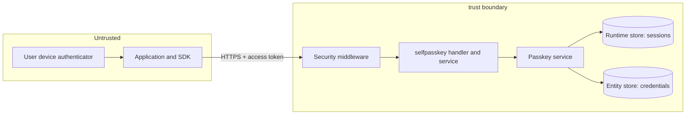
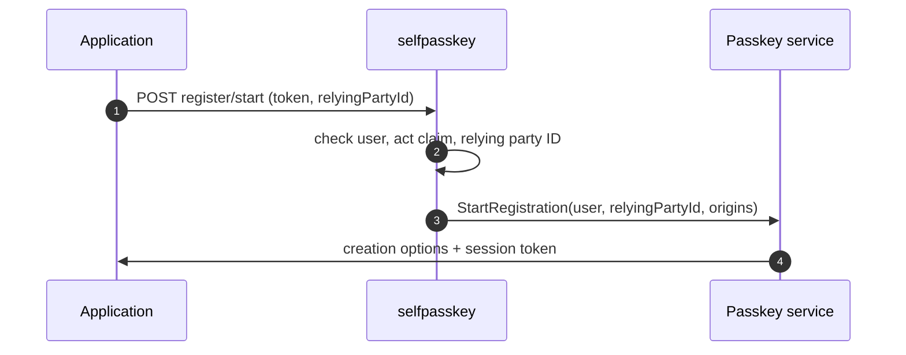
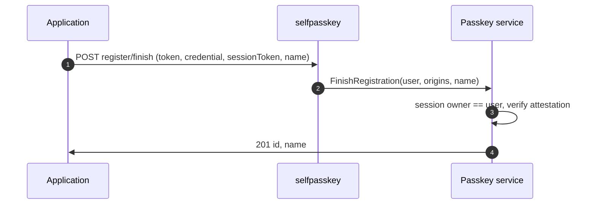
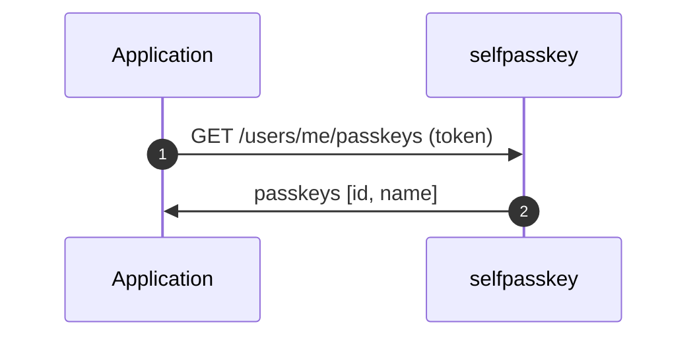
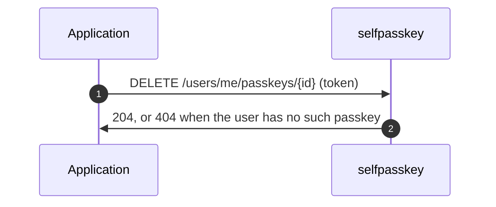
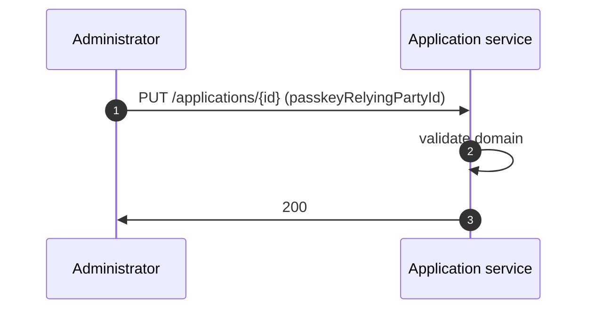

# Self-Service Passkey Management Threat Model

This model covers the `/users/me/passkeys` endpoints that let a signed-in user add, list, and remove
their own passkeys, and the application's `passkeyRelyingPartyId` setting they rely on.

## Overview

The endpoints bind a new sign-in credential to an account, so the main risk is an attacker attaching
their own passkey to someone else's account. Every call takes the user from the access token, and
registration verifies the WebAuthn ceremony against the origins of the application the token was
issued to.

Cross-cutting concerns covered elsewhere: access token validation by the security middleware, token
issuance and revocation in the OAuth service, and the WebAuthn ceremony itself in the passkey service.
These are referenced here as trust inputs, not re-analysed.

## Scope

This model covers:
- `POST /users/me/passkeys/register/start`
- `POST /users/me/passkeys/register/finish`
- `GET /users/me/passkeys`
- `DELETE /users/me/passkeys/{id}`
- Setting `passkeyRelyingPartyId` on an application

Out of scope (see the referenced companion models):
- Passkey sign-in and passkey registration in sign-up and sign-in flows (flow executor)
- The Direct API `/register/passkey/*` endpoints
- Access token issuance, validation, and revocation (OAuth)

## Architecture

### Components

| Component | Task |
| --- | --- |
| Security middleware | Validates the access token and sets the subject and claims. Applies the empty permission rule to the self-service paths. |
| selfpasskey handler | Reads the user from the token subject, refuses tokens with an `act` claim, and maps errors to status codes. |
| selfpasskey service | Resolves the token's application, its passkey origins and relying party ID, and checks the requested relying party ID. |
| Passkey service | Runs the WebAuthn ceremony, binds the session to the user, checks the session owner on finish, and stores, lists, and removes passkeys. |
| Runtime store | Holds registration sessions with a TTL. A session is removed after a successful finish. |
| Entity store | Holds passkeys in the user's system credentials. |

### Actors

#### Actors

| Actor | Description | Roles or permissions |
| --- | --- | --- |
| End user | Signed-in user managing their own passkeys | Valid access token for themselves |
| Application | Calls the endpoints with the user's token | OAuth client the token was issued to |
| Delegated actor | Holds a token with an `act` claim for the user | Token exchange result |
| Administrator | Configures the application's passkey origins and relying party ID | Application management permission |
| Anonymous caller | No access token | None |

#### Entitlement matrix

| Actor | Add own passkey | List own passkeys | Remove own passkey | Change another user's passkeys | Set relying party ID |
| --- | --- | --- | --- | --- | --- |
| End user | [Yes] | [Yes] | [Yes] | [No] | [No] |
| Delegated actor | [No] | [No] | [No] | [No] | [No] |
| Administrator | [No] | [No] | [No] | [No] | [Yes] |
| Anonymous caller | [No] | [No] | [No] | [No] | [No] |

### External Dependencies (not owned)

| Dependency | Description (usage, purpose, authentication, authorization, security) |
| --- | --- |
| go-webauthn | Verifies attestation, challenge, relying party ID hash, and client data origin. Android `android:apk-key-hash:` origins are compared as strings. |
| Platform authenticators | Create the key pair and enforce that the app or site may use the relying party ID (Digital Asset Links on Android, Associated Domains on iOS, origin rules in browsers). |
| Association files | `assetlinks.json` and `apple-app-site-association` hosted by the customer on the relying party domain. |

## Threats and mitigations

### Out-of-scope interactions and risks

- Theft or replay of the access token itself, owned by the OAuth and security middleware models.
- Weak or cloned authenticators. Attestation is not enforced, which matches the existing passkey
  flows.

### Interactions

#### [01]: Start adding a passkey

**Description**

The application sends the user's access token and an optional relying party ID. The service resolves
the token's application, checks the relying party ID against the application's relying party ID and
origins, refuses suspended and expired accounts, and returns WebAuthn creation options and a session token bound
to the user.

**Assets involved**

| Initiator | Intermediate | Target |
| --- | --- | --- |
| Application | Security middleware, selfpasskey service | Passkey service, runtime store |

**Data flow**

**Security considerations**

| Area | Response | Comments |
| --- | --- | --- |
| Data confidentiality | [C-Medium] | The options carry the user handle and display name. |
| Communication medium | [M-NT] | |
| Transport security | [TLS] | |
| Authentication | Access token | |
| Accessibility | [Restricted] | Signed-in users only. |
| Authorization and Access Control | User from the token subject; `act` tokens refused | |

**Threat assessment**

| ID | Category | Threat | Materializable | Mitigation / comment |
| --- | --- | --- | --- | --- |
| 1 | [Spoofing] | A caller supplies another user's ID to start a registration for them. | [No] | The user comes only from the token subject. No user ID is accepted. |
| 2 | [Elevation of Privilege] | An agent holding a delegated token adds a passkey and gains standing access as the user. | [No] | Tokens with an `act` claim are refused with `403`. |
| 3 | [Tampering] | The caller requests a relying party ID for a domain the application does not sign in with, creating passkeys usable elsewhere. | [No] | The relying party ID must equal the application's relying party ID or match a host of its origins. |

#### [02]: Finish adding a passkey

**Description**

The application sends the attestation from the device, the session token, and an optional name. The
passkey service verifies the attestation against the session challenge, the relying party ID, and the
application's origins, checks that the session belongs to the token's user, and stores the passkey.

**Assets involved**

| Initiator | Intermediate | Target |
| --- | --- | --- |
| Application, device | selfpasskey service | Passkey service, entity store |

**Data flow**

**Security considerations**

| Area | Response | Comments |
| --- | --- | --- |
| Data confidentiality | [C-High] | The public key becomes a sign-in credential. |
| Communication medium | [M-NT] | |
| Transport security | [TLS] | |
| Authentication | Access token and session token | |
| Accessibility | [Restricted] | |
| Authorization and Access Control | Session owner must equal the token subject | |

**Threat assessment**

| ID | Category | Threat | Materializable | Mitigation / comment |
| --- | --- | --- | --- | --- |
| 4 | [Spoofing] | An attacker uses a victim's leaked session token with their own access token to attach a passkey to the victim's account. | [No] | Finish refuses a session another user started (`PSK-1013`). |
| 5 | [Spoofing] | A phishing site or an unrelated app completes the ceremony. | [No] | WebAuthn checks the client data origin against the application's origins and the relying party ID hash. Mobile platforms also require the association files. |
| 6 | [Tampering] | A session token is replayed to add a second passkey. | [No] | The session is removed after a successful finish and expires with its TTL. |
| 7 | [Spoofing] | An attacker with a stolen access token adds their own passkey and keeps access after the token expires. | [Yes] | No re-authentication step exists. Bounded by the access token lifetime and revocation. Tracked as the reason to move adding a passkey to a `SELF_SERVICE` flow with a confirm step. |
| 8 | [Denial of Service] | A long name inflates stored credentials. | [No] | Names are limited to 64 characters. |

#### [03]: List passkeys

**Description**

Returns the ID and name of each passkey of the token's user.

**Assets involved**

| Initiator | Intermediate | Target |
| --- | --- | --- |
| Application | selfpasskey service | Entity store |

**Data flow**

**Security considerations**

| Area | Response | Comments |
| --- | --- | --- |
| Data confidentiality | [C-Low] | Credential IDs and names only. Public keys are not returned. |
| Communication medium | [M-NT] | |
| Transport security | [TLS] | |
| Authentication | Access token | |
| Accessibility | [Restricted] | |
| Authorization and Access Control | Own passkeys only | |

**Threat assessment**

| ID | Category | Threat | Materializable | Mitigation / comment |
| --- | --- | --- | --- | --- |
| 9 | [Information Disclosure] | A user reads another user's passkeys. | [No] | The list is read for the token subject only. |

#### [04]: Remove a passkey

**Description**

Removes one passkey of the token's user by credential ID.

**Assets involved**

| Initiator | Intermediate | Target |
| --- | --- | --- |
| Application | selfpasskey service | Entity store |

**Data flow**

**Security considerations**

| Area | Response | Comments |
| --- | --- | --- |
| Data confidentiality | [C-Low] | |
| Communication medium | [M-NT] | |
| Transport security | [TLS] | |
| Authentication | Access token | |
| Accessibility | [Restricted] | |
| Authorization and Access Control | Own passkeys only | |

**Threat assessment**

| ID | Category | Threat | Materializable | Mitigation / comment |
| --- | --- | --- | --- | --- |
| 10 | [Tampering] | A user removes another user's passkey. | [No] | Removal searches only the token subject's passkeys. |
| 11 | [Information Disclosure] | A caller probes credential IDs to learn whether other users have them. | [No] | Another user's passkey returns `404`, the same as a missing one. |
| 12 | [Denial of Service] | An attacker with a stolen token removes all of the user's passkeys. | [Yes] | Bounded by the token lifetime. The user can still sign in with other credentials or recover the account. Covered by the same future confirm step as threat 7. |

#### [05]: Set the application's passkey relying party ID

**Description**

An administrator sets `passkeyRelyingPartyId` on an application through the application API or
declarative resources. The value must be a lowercase domain name.

**Assets involved**

| Initiator | Intermediate | Target |
| --- | --- | --- |
| Administrator | Application service | Inbound client store |

**Data flow**

**Security considerations**

| Area | Response | Comments |
| --- | --- | --- |
| Data confidentiality | [C-Low] | |
| Communication medium | [M-NT] | |
| Transport security | [TLS] | |
| Authentication | Access token | |
| Accessibility | [Restricted] | |
| Authorization and Access Control | Application management permission | |

**Threat assessment**

| ID | Category | Threat | Materializable | Mitigation / comment |
| --- | --- | --- | --- | --- |
| 13 | [Security Risk] | An administrator sets a relying party ID the application does not control. | [No] | Platforms and browsers refuse to create passkeys for a domain that does not declare the app or match the page origin, so the setting cannot be used to create passkeys for a foreign domain. |

## Security Review Checklist

A review aid that complements the threat models and the self-assessment. Guidance follows the [OWASP Top 10 Proactive Controls](https://top10proactive.owasp.org/).

### Security considerations

| # | Consideration | State | Comments |
| --- | --- | --- | --- |
| 1 | Are all inputs and outputs validated (syntactic and semantic)? | [Yes] | Relying party ID, name length, session token, attestation, and the application relying party ID are validated. |
| 2 | Are rate limits in place where necessary? | [No] | No endpoint-specific limits, as for the other `/users/me` endpoints. |
| 3 | Are permissions, roles, and entitlements defined on the principle of least privilege and business need? | [Yes] | Own passkeys only; delegated tokens refused. |
| 4 | Are authentication and authorization validated at both the UI and API layers, front end and back end, before granting access to resources? | [Yes] | Enforced in the backend. |
| 5 | Are proper isolations in place between components to ensure least-privilege access and reduce the blast radius against lateral movement? | [Yes] | |
| 6 | Have any default credentials been changed, and are default superuser or root accounts not in use (when using third-party components)? | [N/A] | |
| 7 | Has the implementation followed best-practice guidelines (OWASP, Kubernetes, vendor, or technology provider)? | [Yes] | W3C WebAuthn. |
| 8 | Are secrets, credentials, and internal-only material kept out of the public source tree and its git history? | [Yes] | |
| 9 | Was a security-focused code review conducted for this change, and have the findings been addressed? | [No] | Pending pull request review. |
| 10 | Is Static Analysis (SAST) or IaC scanning conducted, and are findings addressed? | [Yes] | golangci-lint in CI. |
| 11 | Is Software Composition Analysis (SCA) conducted or integrated into the repository, and are findings addressed (for example FOSSA, Trivy)? | [Yes] | No new dependencies. |
| 12 | Is Dynamic (DAST) or API scanning conducted on a non-production setup, and are findings addressed? | [No] | |
| 13 | Are audit logs generated in a standardized format for critical functionality, and available to authorized users to trace critical events and aid incident response? Note the retention period in Comments. | [No] | Adding and removing passkeys is not audited yet. |
| 14 | Do audit logs for critical configuration changes record the difference between the old and new versions? | [N/A] | |
| 15 | Are data in transit and at rest encrypted? | [Yes] | TLS in transit. Passkeys hold public keys only. |
| 16 | Are sensitive values such as credentials and keys stored in a secret store or vault? | [N/A] | No secrets are stored. |
| 17 | Is personal, sensitive, or confidential data kept out of logs? | [Yes] | User IDs are masked. |
| 18 | Have users been given clear instructions for secure usage? | [Yes] | Passkeys documentation covers the endpoints and mobile setup. |

### Business impact and resilience

| # | Consideration | State | Comments |
| --- | --- | --- | --- |
| 1 | Has a business impact analysis been done to identify resilience requirements (maximum tolerable downtime, uptime, RPO, RTO)? | [N/A] | Uses the existing entity and runtime stores. |

### Dependency and component health

| # | Consideration | State | Comments |
| --- | --- | --- | --- |
| 1 | Are dependencies, base images, and runtimes monitored for known vulnerabilities and kept current (for example automated dependency scanning), and are findings addressed? | [Yes] | |
| 2 | Are any End-of-Life or End-of-Service components in use? | [No] | |
| 3 | Is hardening guidance published for operators who deploy the project (optional)? | [N/A] | |

### Privacy considerations

| # | Consideration | State | Comments |
| --- | --- | --- | --- |
| 1 | Is the purpose and legal basis for processing personal data clearly defined? | [Yes] | Passkeys are sign-in credentials the user adds. |
| 2 | Are the collection, storage, processing, sharing, archival, and disposal of personal data aligned with the data minimization principle? | [Yes] | Only an optional name is added. |
| 3 | Is personal data stored securely? | [Yes] | |
| 4 | Are privacy notices updated to reflect any new processing or changes to purpose and legal basis? | [N/A] | |
| 5 | Is access to personal data granted on a need-to-know basis? | [Yes] | |
| 6 | Are data retention requirements considered? | [Yes] | Passkeys are removed with the user or on request. |
| 7 | Is there a process to dispose of personal data on request in a timely manner while meeting retention requirements? | [Yes] | The user can remove passkeys. |
| 8 | Are records of personal-data processing maintained in the project's data inventory or records of processing? | [N/A] | |

## Residual risks (open items)

- A stolen access token can add or remove passkeys until it expires, because no re-authentication
  step exists (threats 7 and 12). Planned mitigation: move adding a passkey to a customizable
  `SELF_SERVICE` flow with a confirm step (tracking: [#6240](https://github.com/thunder-id/thunderid/discussions/6240)).
- Adding and removing passkeys is not audited (tracking: [#6239](https://github.com/thunder-id/thunderid/issues/6239)).

## Appendix

- References: [W3C WebAuthn Level 3](https://www.w3.org/TR/webauthn-3/),
  [Specification](spec.md), [Design discussion #6240](https://github.com/thunder-id/thunderid/discussions/6240)

## Change log

| Version | Date | Change |
|---|---|---|
| 0.1 | 2026-11-03 | Initial threat model. |
