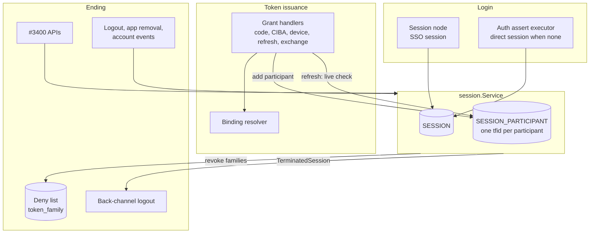
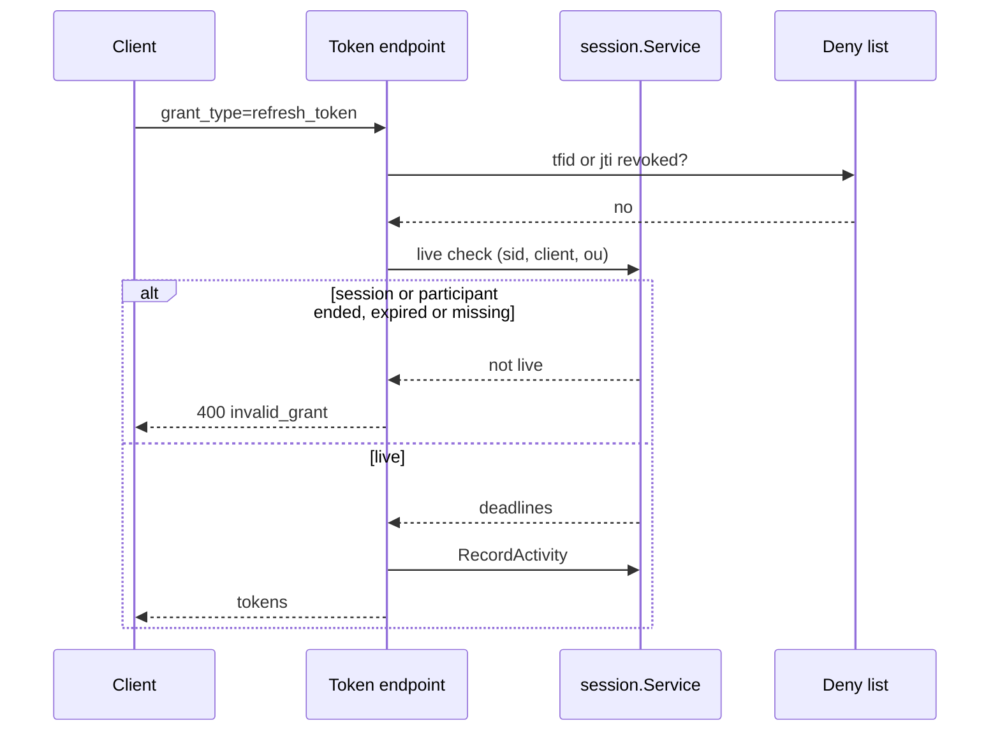

# Session Tracking and Token Lifecycle Specification

- **Status:** Draft
- **Version:** 0.2
- **Related documents:** [threat-model.md](threat-model.md), [Feature issue #3403: Session and token lifecycle dependencies](https://github.com/thunder-id/thunderid/issues/3403), [Design discussion #6322: Session tracking, token lifecycle and session management](https://github.com/thunder-id/thunderid/discussions/6322), [Requirements: Proposal V4 in #5587](https://github.com/thunder-id/thunderid/discussions/5587#discussioncomment-19367566), [SSO session management specification](../sso-session-management/spec.md) (#3400), [Session expiry and token lifetimes #6919](https://github.com/thunder-id/thunderid/issues/6919), [Stable token family #6780](https://github.com/thunder-id/thunderid/issues/6780), [RFC 8693: OAuth 2.0 Token Exchange](https://www.rfc-editor.org/rfc/rfc8693), [RFC 7009: OAuth 2.0 Token Revocation](https://www.rfc-editor.org/rfc/rfc7009)

## Summary

A session exists today only when a login flow runs the Session node. Every other login has none: a flow without that node, the atomic authentication APIs, and CIBA or the device grant when their flow has no Session node. Their tokens carry no `sid`, and most carry no token family, so nothing can list them, end them or tie them to a logout. Where a session does exist, its tokens outlive it: a refresh records activity on the session but never checks that it is still live, so a refresh token keeps working for up to 16 hours after an 8 hour session expires. Tokens from token exchange get no token family by default, so ending the user's session doesn't stop an agent acting for the user.

This specification gives every tracked login a session and binds every grant to it:

- **One session model.** A session is `SSO` (reusable) or `DIRECT` (never reused). Both live in `SESSION`, have a `sid` and participants, and are listed and ended by the same code, including the #3400 APIs.
- **A session belongs to its subject, a user or an agent.** Users and agents share one ID space, so an agent that signs in as itself owns a session exactly as a user does.
- **A participant is a client the subject signed in to.** It is recorded when the login completes, as the Session node already does for SSO sessions. Token exchange adds no participant. An exchanged token inherits the subject token's token family, so it ends whenever the grant it came from ends, including when the session ends. Who acted is in the token: the requesting client in `client_id`, and the actor in `act` when the request or the client supplies one.
- **Refresh checks the binding.** A refresh needs a live session and a live participant.
- **One termination path.** Logout, the #3400 revocation APIs, app removal and account events all go through `session.Service`, which revokes the participants' token families and triggers back-channel logout.

One decision governs the rest:

> Every grant belongs to exactly one participant, and the participant's token family is the only handle needed to end it. Nothing that derives from a grant, including an exchanged token, is recorded separately.

Out of scope:
- How access tokens and exchanged tokens end when a session expires, including capping their `exp` at the session's deadlines or at the subject token's `exp` (V4 R2.5, R2.7, R8.3). These are decided in [#6919](https://github.com/thunder-id/thunderid/issues/6919). This specification changes only refresh: a refresh token stops working as soon as its session expires.
- Offline sessions (V4 R4), detached delegation, expiry notifications, SSF and CAEP, a session extend API (V4 R3.6), SDK presence detection (V4 R3.7), and self-service for an agent's owner. They are later phases of #6322.
- Atomic authentication API logins, a later phase of #6322. Until then they get no session, and their tokens carry no `sid` or `tfid`. They aren't flows and don't know the app until it redeems the assertion, so tracking them means a direct session created at redemption, with `FLOW_ID` nullable. AC1.3 moves with them.
- Removing one app from a live SSO session (V4 R10.12). The app could sign in again silently through the same session, so removal wouldn't end its access. A removal that sticks needs the app's consent withdrawn, which belongs to the authorized apps work.
- Console and My Account screens for agents' sessions. They are specified with their mockups in a later version of this specification, on top of the #3400 screens.
- Consent. None of the actions here withdraws an app's stored consent.

## Architecture

The feature extends existing components. It adds no package.

| Component | Responsibility |
|---|---|
| `session.Service` (`internal/flow/session`) | Owns `SESSION` and `SESSION_PARTICIPANT`. Gains `CreateDirect`, an internal `RemoveParticipant` and a live check used by refresh. `TerminateBySubject` revokes token families itself. |
| Session node (`SessionExecutor`) | Creates or joins an SSO session, as today. Fails the login when it can't generate a token family. |
| Auth assert executor | When the flow established no session, generates a `sid` and `tfid`, puts them on the assertion, then records the direct session with the app as its participant. |
| Binding resolver (`internal/oauth/oauth2/tokenservice`) | Decides, for every credential, whether it is bound and to which session and participant. The grant handlers call it instead of deciding on their own. |
| Grant handlers (`internal/oauth/oauth2/granthandlers`) | Code exchange, CIBA and device code put the assertion's `tfid` on the tokens. Refresh checks the session and participant. Token exchange inherits the subject token's family. |
| Session management (`internal/flow/session/mgt`, `api/session.yaml`) | The #3400 APIs, extended with an agent filter, session type and subject type. |
| Back-channel logout (`internal/oauth/oauth2/logout/backchannel`) | Gains a bulk path that doesn't drop notifications, and a notification on detach. |



The feature uses these existing seams without changing their contracts:

| Seam | Use |
|---|---|
| Criteria revoker | Writes `token_family` criteria to the deny list. Every termination path revokes through it. |
| Token validator and the Resource Server cache | Check the deny list by `tfid`. No new dimension is added. |
| Session termination topic | `TerminatedSession` events drive back-channel logout, as specified in [the back-channel logout specification](../back-channel-logout/spec.md). |
| Revocation executors (`CriteriaRevocationExecutor`, `SessionRevocationExecutor`) | Run the non-session triggers as system flows. |
| `ENTITY` | Resolves a `SUBJECT_ID` to a user or an agent, and an `APP_ID` to an application or an agent. |

## Detailed design

### Session types and ownership

A session is `SSO` or `DIRECT`:

| Type | Created by | Reusable | Handle and checkpoints |
|---|---|---|---|
| `SSO` | The Session node | Yes, through its cookie or `device_secret` handle | Yes |
| `DIRECT` | The auth assert executor | No. `Resolve` returns SSO sessions only. | No |

`SUBJECT_ID` is the entity that authenticated: a user, or an agent that signed in as itself. Users and agents share the `ENTITY` ID space, so the session stores no subject category; a view that needs it reads it from `ENTITY`.

A participant is a client the subject signed in to: one row per session, client and organization unit, holding the participant's token family. `APP_ID` is an application or an agent's OAuth client.

### Creating the session

Every tracked login has a session before any token is issued.

| Login | Session created by | Type |
|---|---|---|
| Flow with the Session node | Session node (create or join) | SSO, as today |
| Flow without the Session node | Auth assert executor, when no `sid` is in the flow's runtime data | Direct |
| CIBA, device grant | As for any flow: the Session node when the flow has one, otherwise the auth assert executor | SSO with a Session node, otherwise direct |
| Native SSO, `prompt=none` | Session node (join) | SSO, as today |
| Atomic authentication APIs | None yet (see Out of scope) | Not tracked |

When the flow's runtime data has no `sid`, the auth assert executor generates the session's `sid` and a new `tfid`, builds the assertion with them, and only then calls `session.Service.CreateDirect(sid, subject, client, tfid, ou)`. That writes the session row and the client's participant row in one transaction. A login whose assertion fails records nothing. The ids never enter the runtime data, so a retry or a later assertion in the same execution records its own. The participant is recorded when the login completes, as the Session node already does for SSO sessions. The code exchange, the CIBA and device token responses, and the token exchange of an app-native flow's assertion then only carry the assertion's `tfid` onto the tokens; none of them writes a participant.

A Session node save skipped because the session belongs to another subject leaves no `sid`, so that login gets a direct session too. Its `tfid` is always new: the family the Session node offered may already be the other subject's. Like `sid`, `tfid` is a reserved assertion claim, so a user attribute with that name can't replace it in an app-native assertion.

A login whose tokens are never issued, for example an abandoned redirect or an app that never redeems its assertion, leaves the app listed in the session until the idle deadline, when the session expires and leaves the list, as SSO sessions do today. No credential exists for it, and cleanup removes the session at its absolute deadline.

For CIBA and the device grant, the flow runs in the browser where the user approves, under the requesting client's application, so the polling client is recorded as the participant like any other login: of the SSO session when the flow has a Session node, otherwise of a direct session. Signing out in that browser therefore also ends the polling client's tokens. Today those tokens carry the `sid` but no `tfid`, so sign-out misses them. When `device_sso` is authorized, the device grant also returns a device secret carrying the approving browser's SSO session (#6906). The device can later exchange it through Native SSO, which joins it to that session as a participant like any other Native SSO login.

```mermaid
sequenceDiagram
  participant G as Gate or app
  participant F as Flow engine
  participant S as session.Service
  participant O as OAuth (authorize, token)
  G->>F: run login flow (no Session node)
  F->>F: authenticate subject
  F->>F: generate sid and tfid, build the assertion
  F->>S: CreateDirect(sid, subject, client, tfid, ou)
  S-->>F: session and participant written
  F-->>G: assertion (sub, sid, tfid)
  G->>O: callback with assertion
  O->>O: authorization code keeps sid, tfid
  G->>O: code exchange
  O-->>G: tokens (tfid; sid on ID and refresh tokens)
```

A failure to generate a `tfid`, in the Session node or the auth assert executor, or to record the direct session, fails the login. A grant without a family or a session couldn't be ended on its own.

### Binding decision at issuance

One resolver decides the binding for every credential:

```
ResolveBinding(request, client, subject, actor, assertion) -> binding
  1. subject is the client (client_credentials, the client's own token) -> none
  2. login through a flow (code, CIBA, device code, Native SSO)        -> participant of assertion.sid
  3. redeemed atomic API assertion                                    -> none (not tracked yet)
  4. refresh                                                          -> same session and participant
  5. other token exchange                                             -> the subject token's family
  6. subject asserted by another issuer (JWT bearer)                  -> none locally; the issuer holds it
```

The binding (`sid` and `tfid`) is fixed at issuance. Changing configuration never rebinds tokens already issued.

| Subject / Client | App | Agent |
|---|---|---|
| **User** | Login: participant of the user's session. Token exchange: inherits the subject token's family. | Token exchange: inherits the subject token's family, with `act` naming the agent. |
| **Agent** | Login: participant of the agent's session (the agent signed in to the app). | Itself: not tracked. Another agent acting for it: inherits the subject token's family. |
| **App** | Not tracked (machine to machine) | Not tracked |

**Tracking switch.** With `session.tracking.enabled: false`, no direct session is recorded. A flow with a Session node still records its SSO session, since the admin added the node to get one, so SSO keeps working. The switch applies to new logins only. The configuration documentation says what is given up: a login through a flow without a Session node gets no session, so it can't be listed or ended, and its tokens carry no `sid`.

### Stable token families

Each participant has one token family while that family is live. A rejoin of the same client in the same session reuses it, so logout covers every grant the client holds in the session. If the stored family was already revoked (RFC 7009, refresh replay or code replay), the rejoin takes the new `tfid` with a compare-and-swap; the revoked family's tokens are already dead, so nothing is lost. This lands as the fix for [#6780](https://github.com/thunder-id/thunderid/issues/6780) in #6786 and is a prerequisite here.

CIBA and device-code tokens get a `tfid`, which they lack today.

### Refresh enforcement

| Step | Behaviour |
|---|---|
| Live check | Refresh loads the session by `sid`, and the participant by `sid`, client and OU from the refresh token's claims, using the deadlines from before this request. A session that has ended, expired or is missing, or a missing participant, returns `invalid_grant`. |
| Activity | Only a refresh of a participant's own grant moves the session's idle deadline, at most once per activity refresh interval. Exchanged tokens get no refresh token, so an agent acting for the user can't keep the session alive. |
| Activity write failure | The refresh proceeds when `RecordActivity` fails, as today. A lost write can only make the session expire early, never late. |
| Store outage | If the session store can't be reached, the refresh fails with `server_error`. The deny list is in the same database, so there is no deny-list-only fallback. |
| Introspection | No session lookup. Deny list and `exp`, as today. |

The participant is looked up by `sid`, client and OU, not by `tfid`. A refresh token whose family was overwritten before the upgrade (#6780) has a `tfid` no row holds, and tokens issued before the upgrade keep working until they expire.



Ended, expired and unknown sessions all return the same `invalid_grant`, so the response reveals nothing about the session.

### Session expiry

A session ends at whichever deadline comes first. Expiry fires no event; it is enforced where a deadline is checked.

| Rule | Default | Set or moved by | What happens then |
|---|---|---|---|
| Idle deadline (`IDLE_EXPIRES_AT`) | 2 h after the last activity | Set at login. Moved by a sign-in through the session (SSO reuse) and by a refresh of a participant's own grant, at most once per activity refresh interval (60 s). Not moved by access token use, token exchange, or a refresh whose activity write fails. | The session is expired: refresh returns `invalid_grant`, SSO reuse asks for credentials, and the session leaves the list. Cleanup deletes the row at the absolute deadline. |
| Absolute deadline (`ABSOLUTE_EXPIRES_AT`) | 24 h after login, from #6796 | Set at login. Never moved. | Same as idle. |
| Access token `exp` | 1 h | Set at issuance: the app's lifetime, as today. | Rejected once `exp` passes. Until then it stays valid, even after its session expires ([#6919](https://github.com/thunder-id/thunderid/issues/6919)). |
| Refresh token `exp` | 24 h, kept on rotation | Set at login. A rotated refresh token keeps the original `exp`. | `invalid_grant`. The refresh check also rejects it as soon as the session expires. |
| Exchanged token `exp` | The client's access token lifetime | Set at issuance, as today. No refresh token. | Rejected once `exp` passes. |

Ending a session early (logout, the #3400 APIs, account events) doesn't wait for a deadline: it revokes the participants' token families at once, which also stops the tokens exchanged from them.

Each session keeps the deadlines it was given at login. A timeout change, including one made through the server configuration API, applies to new sessions.

### Token exchange

Token exchange never adds a participant and never creates a session. An exchanged token stays inside the grant it came from: it inherits the subject token's token family and gets no refresh token. The requesting client, and whether the request carries an `actor_token`, decide only what goes in `act`, not how the token is bound. A client can't choose its way out of the user's session.

`oauth.token_exchange.token_family` is removed. Every exchange of a subject token that carries a `tfid` inherits it. With `none`, an exchanged token kept working after logout or after the app's grant was revoked, until its own `exp`. No use case needs that, and RFC 8693 leaves revocation propagation to the implementation (section 2.1). Configuration keys are decoded strictly, so a configuration that still sets it fails to start with an unknown key error. The release notes list the removal as a breaking change.

| Case | Detected by | Binding |
|---|---|---|
| Native SSO | Subject token is a `device_secret` | A login: participant of the SSO session, with a refresh token |
| Exchange of a tracked token (the app's own backend, another app, or an agent acting for the subject) | Subject token carries a `tfid` | Inherits the subject token's `tfid`. No refresh token. An agent gets `act` naming it, as does an application with `includeActClaim` on. |
| No session behind the subject token | External issuer, or a token with no `tfid` | Not tracked. No refresh token. |
| Atomic API assertion | Self-issued, with an `assurance` claim and no `sid` | Not tracked yet (see Out of scope). No `sid` or `tfid`. |

An app-native flow's assertion falls in the second row: it carries the participant's `tfid`, which the exchanged token inherits, and the flow already recorded the participant.

V4 R8.0 detects delegation by the `actor_token` to decide the binding. That is amended: every exchange of a tracked token is bound the same way, and the actor is recorded only in `act`.

An exchanged token ends with everything that revokes the source grant's family:
- ending the session (logout, the #3400 APIs, sign out everywhere, account events);
- deleting or suspending the app the user signed in through;
- the app revoking its own token (RFC 7009), or a refresh or code replay on its grant.

That is V4 R2.10's cascade, with no link to store. To keep acting, an agent needs a fresh subject token, which only the app can get by refreshing its own grant.

An agent acting for the user isn't listed on its own. Its access is contained in the app's grant, so the app's entry in the session list covers it, and ending the session stops the agent.

**Scopes.** Exchange keeps or reduces scopes, as today: a requested scope outside the subject token's, or outside the subject's authorization when the app maps it, is left out of the exchanged token. The resolver adds no path that widens them. Up-scoping needs step-up, which is a new login.

### Ending sessions

Every entry point goes through `session.Service`, the same path #3400's revoke API and sign-out use: revoke the participants' token families (reason `session_logout`), delete the rows, then publish `TerminatedSession` for back-channel logout. Termination fails if the deny list can't be written.

| Action | Service call | Sessions |
|---|---|---|
| Logout, end one session | `Terminate` | That one ends |
| Sign out everywhere (else) | `TerminateBySubject`, optionally keeping the current `sid`. It revokes the families itself instead of relying on a subject criterion, which would also kill the kept session. | All (others) end |
| App or agent deleted | `DetachApplication` (exists), now also notifying | Continue without it |
| App or agent suspended | `DetachApplication`, new for suspend | Continue without it |
| Agent's own sessions, agent suspended or deleted | `TerminateBySubject` for the agent | End |
| Last grant revoked (RFC 7009) in a direct session | The family is revoked (as today) and the participant removed through the internal `RemoveParticipant`. A direct session with no participant left ends. | Direct: may end. SSO: continues. |

**Non-session triggers.** Most already run as system flows for user delete, credential update, and user, agent and app suspend. This specification maps them and adds what is missing:

| Trigger | Effect | Wired through |
|---|---|---|
| Forgotten password | End all sessions | Existing revocation executors |
| Voluntary credential change | End the other sessions | Existing revocation executors |
| Account disabled or deleted | `TerminateBySubject`, and every grant revoked | Existing revocation plan, for users and agents |
| Credential compromise (admin or inbound signal) | End everything and revoke every grant. Mandatory, and not a flow step, so a flow can't remove it. | New: `TerminateBySubject` plus a subject criterion |

**Results.** Every termination records a result per participant in the audit trail:

- `credentials` is `revoked` or `none_held`.
- `notification` is `delivered`, `failed`, or `not_supported` when the client has no back-channel logout URI. Delivery is asynchronous, so the outcome is recorded when it finishes.

The API doesn't return these results. A termination that couldn't revoke the credentials fails, so a successful response already means every participant's access was revoked, and the notification outcome isn't known when the response is sent.

**Bulk termination.** The back-channel queue drops a notification when it is full, and `TerminateBySubject` enqueues one per live session, so a large bulk termination can overflow it. Bulk calls use a path that waits for queue space instead of dropping. A drop that still happens is recorded as `failed`.

Expiry sends no notification, and a session that had already expired when it is ended is deleted without one. Token-based clients find out at their next refresh.

### Data model

SSO and direct sessions share one table, so storage, the refresh check, termination and listing each have one code path. The participant table keeps its shape: no role, no link between participants.

```sql
CREATE TABLE "SESSION" (
    SESSION_ID VARCHAR(36) NOT NULL,         -- the sid
    DEPLOYMENT_ID VARCHAR(255) NOT NULL,
    TYPE VARCHAR(10) NOT NULL CHECK (TYPE IN ('SSO', 'DIRECT')),
    SUBJECT_ID VARCHAR(36) NOT NULL,         -- a user or an agent (one ENTITY id space)
    FLOW_ID VARCHAR(36) NOT NULL,
    FLOW_VERSION INTEGER NOT NULL,
    FLOW_EXECUTION_ID VARCHAR(255),          -- SSO only
    HANDLE_ID VARCHAR(255),                  -- SSO only: the cookie or device_secret handle
    AUTHENTICATED_AT TIMESTAMP NOT NULL,
    CREATED_AT TIMESTAMP NOT NULL DEFAULT CURRENT_TIMESTAMP,
    LAST_ACTIVE_AT TIMESTAMP NOT NULL,
    IDLE_EXPIRES_AT TIMESTAMP NOT NULL,
    ABSOLUTE_EXPIRES_AT TIMESTAMP NOT NULL,
    PROPERTIES JSONB,                        -- user agent and IPs (#3400)
    STATE VARCHAR(50) NOT NULL,
    VERSION INTEGER NOT NULL,
    UPDATED_AT TIMESTAMP NOT NULL DEFAULT CURRENT_TIMESTAMP,
    PRIMARY KEY (SESSION_ID, DEPLOYMENT_ID),
    CHECK (TYPE <> 'SSO' OR (FLOW_EXECUTION_ID IS NOT NULL AND HANDLE_ID IS NOT NULL))
);

CREATE TABLE "SESSION_PARTICIPANT" (
    SESSION_ID VARCHAR(36) NOT NULL,
    DEPLOYMENT_ID VARCHAR(255) NOT NULL,
    APP_ID VARCHAR(36) NOT NULL,             -- the client: an app, or an agent
    OU_ID VARCHAR(36) NOT NULL DEFAULT '',
    TFID VARCHAR(36) NOT NULL,               -- stable while the family is live (#6786)
    FIRST_JOINED_AT TIMESTAMP NOT NULL,
    LAST_ACTIVE_AT TIMESTAMP NOT NULL,
    PRIMARY KEY (SESSION_ID, DEPLOYMENT_ID, APP_ID, OU_ID)
);
```

| Table | Change | Why |
|---|---|---|
| `SESSION` | `HANDLE_ID` and `FLOW_EXECUTION_ID` nullable, with a CHECK | A direct session has no handle and no checkpoints. It records no flow execution, since one execution can sign in more than one subject, as a linking flow does. The CHECK keeps both required for `SSO`. |
| `SESSION` | `FLOW_ID` and `FLOW_VERSION` stay `NOT NULL` | Every tracked login runs a flow, direct ones too. `FLOW_ID` becomes nullable when atomic API logins are tracked. |
| `SESSION` | `IDLE_EXPIRES_AT` and `ABSOLUTE_EXPIRES_AT` `NOT NULL` | The service already sets both on every write. A row without one would never be cleaned up. The `IS NULL` guards in the slide query go. |
| `SESSION_PARTICIPANT` | `TFID` `NOT NULL` | Every participant can be revoked on its own. A row without a `tfid` is deleted on upgrade, since its tokens carry none either. |
| `SSO_SESSION_CONTEXT` | No change | Checkpoints belong to SSO sessions only |

**Migration.**
- ThunderID doesn't migrate schemas, so the release notes carry the SQL. Existing rows are kept, so live sessions survive the upgrade.
- **Before the change:** delete sessions without both deadlines, with their checkpoints and participants, and participants without a `TFID`. Current versions write neither, so this only removes leftovers.
- **Postgres:** drop `NOT NULL` from `FLOW_EXECUTION_ID` and `HANDLE_ID`, set it on the deadlines and `TFID`, and add the CHECK.
- **SQLite:** can't change `NOT NULL` in place, so it rebuilds both tables (create, copy, drop). There are no foreign keys, so the rebuild is self-contained.
- **Full-stop upgrade.** Mixed versions can't share the schema. A cluster stops every node, applies the SQL, then starts the new version. v1 deployments also apply the `SSO_*` rename from #6331 first, and replace any copy of `postgres-cleanup.sql` they schedule themselves.

**Cleanup** keeps removing sessions past their absolute deadline, with their checkpoints and participants. An idle-expired session is already rejected by refresh and SSO reuse and left out of the session list, so its rows can wait for that sweep. `IDLE_EXPIRES_AT` stays unindexed, so the activity update remains an in-place (HOT) update in PostgreSQL.

**Row volume.** Every tracked login writes a session row, kept until its absolute deadline. Size the table as logins per day times the absolute timeout.

**Device data.** `PROPERTIES` stays as the #3400 specification defines it. Direct sessions record it the same way, so they show the same details in the session list.

### API

The #3400 endpoints stay as that specification defines them and cover direct sessions and agents' sessions without a new route. This specification adds an agent filter.

| Endpoint | Purpose | Status |
|---|---|---|
| `GET /sessions?userId=` or `?appId=` | Admin: a user's sessions, or the sessions an app or agent participates in | #3400 |
| `GET /sessions?agentId=` | Admin: an agent's own sessions | New filter |
| `DELETE /sessions/{sessionId}`, `DELETE /sessions?userId=` or `?agentId=` | Admin: end one session, or all of a subject's | #3400, plus the agent filter |
| `GET /users/me/sessions`, `DELETE /users/me/sessions[/{sessionId}]` (`exceptCurrent=true`) | Self-service: list and end the caller's sessions | #3400 |

- **Session response.** #3400's `Session` gains `type` (`SSO` or `DIRECT`) and `subjectType` (`user` or `agent`). The handle and token family IDs are never returned.
- **Current session.** Found from the caller's access token `tfid`, as #3400 does. With stable families, a token from an earlier grant now finds its session.
- **Permissions.** The admin routes use `system:session:view` and `system:session:delete`, with OU confinement. The self-service routes act only on the caller's own sessions, and return the same `404` for another user's session as for a missing one.
- **Responses.** The `DELETE` routes return `204`, as #6152 and every other `DELETE` route in the API do. Per-participant results go to the audit trail (see [Ending sessions](#ending-sessions)).
- **Agent owners.** An agent's sessions are admin-only until owner self-service is added in a later phase.

### Configuration

```yaml
session:
  tracking:
    enabled: true          # deployment-wide; false = no direct sessions, SSO unaffected
  idleTimeoutSeconds: 7200
  absoluteTimeoutSeconds: 86400
  activityRefreshIntervalSeconds: 60
```

| Key | Default | Level | Notes |
|---|---|---|---|
| `session.tracking.enabled` | `true` | Deployment | New. `false` records no direct sessions; a flow with a Session node still records its SSO session. Applies to new logins only. There is no per-app setting. |
| `session.idleTimeoutSeconds`, `session.absoluteTimeoutSeconds`, `session.activityRefreshIntervalSeconds` | 7200, 86400, 60 | Deployment | The absolute default rises from 8 h to 24 h in #6796, matching the 24 h refresh token, so the refresh check doesn't force a sign-in at 8 h. The idle and absolute timeouts are also editable through the server configuration API once #6796 lands. A change applies to new sessions. |
| `oauth.token_exchange.token_family` | n/a | n/a | Removed, as a breaking change. Exchanged tokens always inherit the subject token's family. A configuration that still sets it fails to start. |

## Requirements

### R1. Every tracked login has a session

**Requirement:** As an administrator, I want every login a subject makes through a flow to have a session, so that I can see and end all of the subject's access, not only SSO logins.

**Acceptance criteria:**

- **AC1.1:** Given a login flow without a Session node, when the flow completes, then a `DIRECT` session exists for the subject with the app as its participant, and the assertion carries the `sid` and the participant's `tfid`.
- **AC1.2:** Given a flow with a Session node, when the flow completes, then the session is `SSO`, as today.
- **AC1.3:** Moved to a later phase with atomic API logins (see Out of scope).
- **AC1.4:** Given a CIBA or device grant whose flow has no Session node, when the client receives its tokens, then a `DIRECT` session exists with that client as its participant.
- **AC1.5:** Given a CIBA or device grant whose flow has a Session node, when the client receives its tokens, then the client is a participant of the SSO session in the approving browser, and its tokens carry a `tfid`.
- **AC1.6:** Given a direct session, when a later login presents its `sid`, then `Resolve` doesn't return it and the login doesn't reuse it.
- **AC1.7:** Given the Session node or the auth assert executor can't generate a `tfid`, or the direct session can't be recorded, when the login runs, then the login fails and no token is issued.
- **AC1.8:** Given a login whose tokens are never issued, when the idle timeout passes, then the session leaves the list, and cleanup removes it at the absolute deadline; until the idle timeout the session lists the app.
- **AC1.9:** Given an app-native login through a flow without a Session node, when the app exchanges its assertion and the session is later ended, then the exchanged tokens carry the participant's `tfid` and are rejected at introspection.
- **AC1.10:** Given a Session node save skipped because the session belongs to another subject, when the login completes, then a `DIRECT` session exists for the subject who signed in, with a `tfid` of its own.
- **AC1.11:** Given a login through a flow without a Session node whose assertion can't be built, when the login fails, then no session is recorded.
- **AC1.12:** Given an app-native login whose subject has an attribute named `tfid`, when the assertion is built, then its `tfid` claim is the participant's.

### R2. A session belongs to its subject, user or agent

**Requirement:** As an administrator, I want an agent that signs in as itself to own a session like a user does, so that I can list and end an agent's sessions the same way.

**Acceptance criteria:**

- **AC2.1:** Given an agent that signs in to an app as itself, when the login completes, then the session's subject is the agent and the app is its participant.
- **AC2.2:** Given an agent with sessions, when an administrator calls `GET /sessions?agentId=<id>`, then the response lists the agent's sessions with `subjectType` `agent`.
- **AC2.3:** Given an agent is suspended or deleted, when the change commits, then every session the agent owns ends.
- **AC2.4:** Given a client authenticating as itself (`client_credentials`), when it gets a token, then no session or participant is written.

### R3. Refresh needs a live session and participant

**Requirement:** As an end user, I want my refresh tokens to stop working when my session ends or expires, so that a session I left can't be continued.

**Acceptance criteria:**

- **AC3.1:** Given a session past its idle or absolute deadline, when a participant refreshes, then the response is `invalid_grant`.
- **AC3.2:** Given a terminated session, or a participant detached from a live session because its app was deleted or suspended, when that participant refreshes, then the response is `invalid_grant`.
- **AC3.3:** Given a live session, when a participant refreshes, then tokens are issued and the idle deadline moves, at most once per activity refresh interval.
- **AC3.4:** Given a refresh after the idle deadline, when it is checked, then it fails, and the late refresh doesn't move the deadline.
- **AC3.5:** Given the session store can't be reached, when a client refreshes, then the response is `server_error` and no token is issued.
- **AC3.6:** Given an ended session, an expired session and an unknown `sid`, when each is refreshed, then all three responses are identical.
- **AC3.7:** Given a refresh token issued before the upgrade whose family was overwritten (#6780), when it is refreshed while its session and participant are live, then tokens are issued.

### R4. Every grant can be revoked on its own

**Requirement:** As an end user signed in to several apps, I want each app's grant to be revocable without signing me out of the others, and every grant to be covered when my session ends.

**Acceptance criteria:**

- **AC4.1:** Given an app that signs in twice in the same session, when the session ends, then the tokens from both grants are rejected.
- **AC4.2:** Given an app whose family was revoked by RFC 7009, a refresh replay or a code replay, when the app signs in again through the session, then it gets a new family and the login succeeds.
- **AC4.3:** Given two apps in one session, when one app's refresh token is replayed, then only that app's tokens are rejected.
- **AC4.4:** Given any participant, when it is read, then it holds a `tfid`.

### R5. Exchanged tokens end with the grant they came from

**Requirement:** As an end user, I want an agent or service acting for me through token exchange to lose access when I sign out, or when the app it acts through is deleted or suspended, so that no access outlives my session.

**Acceptance criteria:**

- **AC5.1:** Given a subject token carrying a `tfid`, when it is exchanged, then the exchanged token carries the same `tfid`, whether or not the request has an `actor_token`.
- **AC5.2:** Given an exchanged token, when the session it came from is terminated, then the token is rejected at introspection.
- **AC5.3:** Given an exchanged token, when the app whose grant it came from is deleted or suspended, revokes its own token through RFC 7009, or has its refresh token replayed, then the exchanged token is rejected at introspection.
- **AC5.4:** Given any exchange of a tracked token, when the response is issued, then it has no refresh token and no participant row is written.
- **AC5.5:** Given an exchange with no `actor_token` by an agent, or by an application with `includeActClaim` on, when the token is issued, then `act` names the requesting client.
- **AC5.6:** Given a configuration that sets `oauth.token_exchange.token_family`, when the server starts, then startup fails with an error naming the unknown key.
- **AC5.7:** Given an exchange that requests scopes beyond the subject token's, when it is processed, then the exchanged token carries none of them.
- **AC5.8:** Given a subject token with no `tfid`, when it is exchanged, then the exchanged token has no `tfid`.

### R6. One termination path

**Requirement:** As an administrator, I want every way of ending a session to revoke the same credentials and notify the same apps, so that the outcome doesn't depend on how the session was ended.

**Acceptance criteria:**

- **AC6.1:** Given logout, a #3400 revoke call, or an account event, when it ends a session, then every participant's family is revoked and `TerminatedSession` is published.
- **AC6.2:** Given a user with three sessions, when they sign out everywhere else from one of them, then the other two end, their families are revoked, and the current session keeps working.
- **AC6.3:** Given the deny list can't be written, when a termination runs, then the termination fails and no session row is deleted.
- **AC6.4:** Given a direct session whose last grant is revoked through RFC 7009, when the revocation commits, then the session ends.
- **AC6.5:** Given an app or agent is suspended, when the change commits, then it is detached from every session, each session continues, and the detached client is notified.
- **AC6.6:** Given a subject with a live session and an expired one, when all of the subject's sessions are ended, then both are deleted and only the live one is notified.

### R7. Account events end sessions

**Requirement:** As a security administrator, I want account events to end the right sessions, and a compromise to end everything, so that changed or exposed credentials can't keep old sessions alive.

**Acceptance criteria:**

- **AC7.1:** Given a user resets a forgotten password, when the reset completes, then all of the user's sessions end.
- **AC7.2:** Given a user changes their credential while signed in, when the change completes, then the user's other sessions end and the current one continues.
- **AC7.3:** Given a user or agent is disabled or deleted, when the change commits, then all of its sessions end and every grant is revoked.
- **AC7.4:** Given a credential compromise is recorded by an administrator or an inbound signal, when it is processed, then every session ends and every grant is revoked, and no flow configuration can skip it.

### R8. Report what each termination did

**Requirement:** As an administrator, I want to see, per app, whether access was revoked and whether the app was told, so that I know what "ended" means for each one.

**Acceptance criteria:**

- **AC8.1:** Given a session with two participants, one with a back-channel logout URI and one without, when it is ended through the API, then the response is `204`, and the audit trail records `credentials: revoked` for both and `notification: not_supported` for the second.
- **AC8.2:** Given a queued notification, when delivery finishes, then the audit trail records `delivered` or `failed` for that participant.
- **AC8.3:** Given a subject with many sessions, when they are all ended at once, then no notification is dropped for a full queue, and any drop that still happens is recorded as `failed`.

### R9. List direct and agent sessions with the #3400 APIs

**Requirement:** As an administrator or end user, I want the existing session APIs to show every session, so that direct sessions and agents' sessions aren't invisible.

**Acceptance criteria:**

- **AC9.1:** Given a user with an SSO session and a direct session, when the sessions are listed, then both appear, each with its `type`.
- **AC9.2:** Given any session response, when it is returned, then it holds no handle and no token family ID.
- **AC9.3:** Given a caller whose access token comes from an earlier grant of the same app in the session, when they list their sessions, then the current session is identified.

### R10. Tracking can be switched off

**Requirement:** As an operator, I want to switch tracking off for the deployment, knowing what it costs.

**Acceptance criteria:**

- **AC10.1:** Given `session.tracking.enabled: false`, when a login through a flow without a Session node completes, then no session or participant is written.
- **AC10.2:** Given tracking is switched off, when existing sessions are used, then they keep working until they end; the switch applies to new logins.
- **AC10.3:** Given `session.tracking.enabled: false`, when a login through a flow with a Session node completes, then its SSO session is recorded and later logins reuse it, as with tracking on.

### R11. Upgrade keeps live sessions

**Requirement:** As an operator, I want to upgrade without signing every user out.

**Acceptance criteria:**

- **AC11.1:** Given a deployment with live SSO sessions, when the release SQL is applied and the new version starts, then those sessions keep working.
- **AC11.2:** Given a participant row without a `tfid`, when the release SQL is applied, then the row is deleted.

### R12. Every session change is audited

**Requirement:** As a security administrator, I want every session creation, termination and participant change recorded, so that I can trace who ended what and why.

**Acceptance criteria:**

- **AC12.1:** Given a session is created, ended, or loses a participant, when the change commits, then an audit event records the trigger, the actor, the participants and the per-participant result.
- **AC12.2:** Given any session audit event, when it is written, then it holds no device data, handle or token.

## Open questions

1. When SAML is added, does a `SessionIndex` column on `SESSION_PARTICIPANT` cover its single logout needs?

## Change log

| Version | Date | Change |
|---|---|---|
| 0.1 | 2026-11-18 | Initial specification, from design discussion #6322. |
| 0.2 | 2026-11-25 | Aligned with #6985: `FLOW_ID` and `FLOW_VERSION` stay `NOT NULL`, and a direct session is recorded once its assertion is built. Atomic API logins move to a later phase, and the tracking switch no longer stops SSO. |
