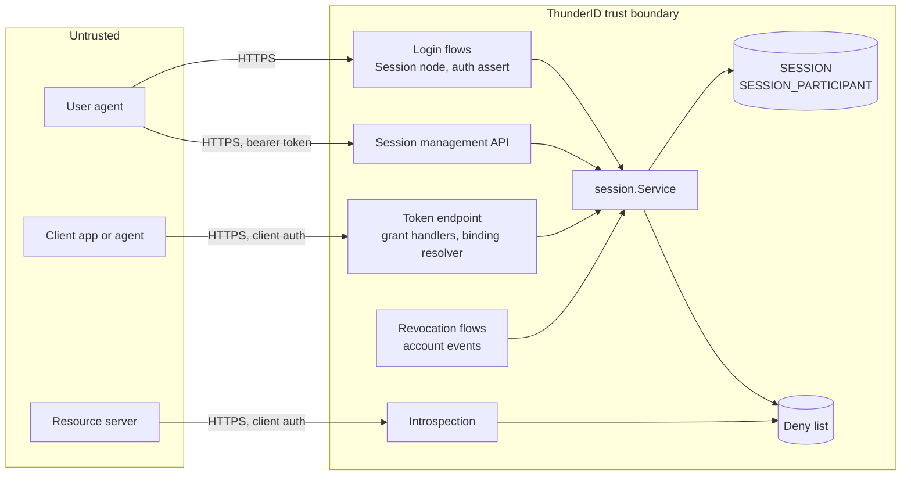
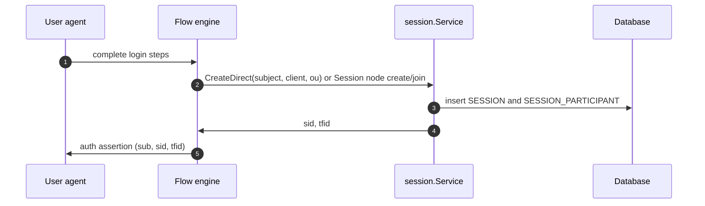
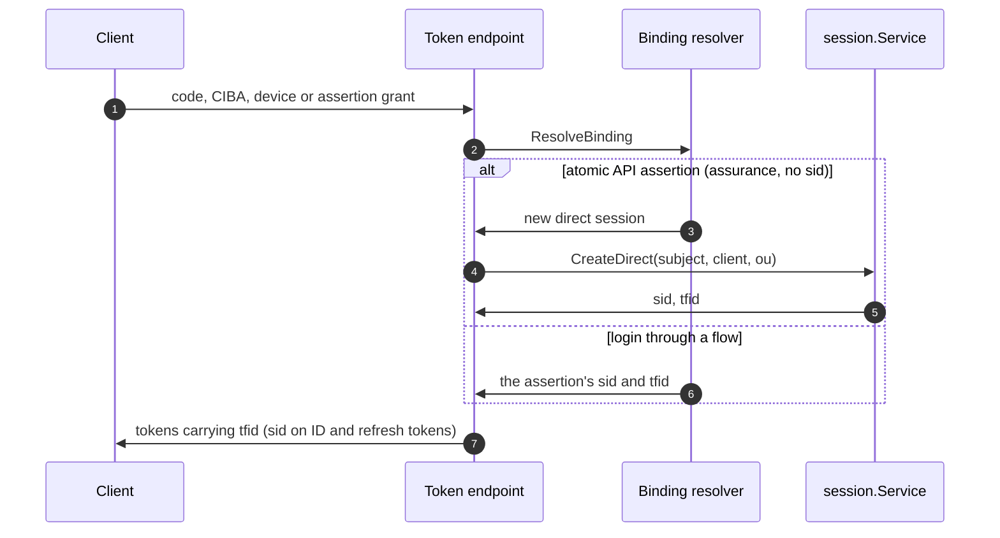
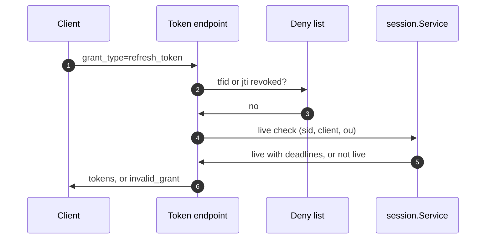
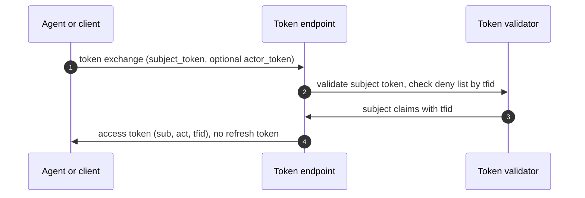
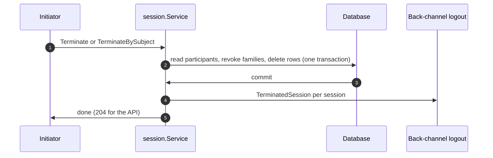
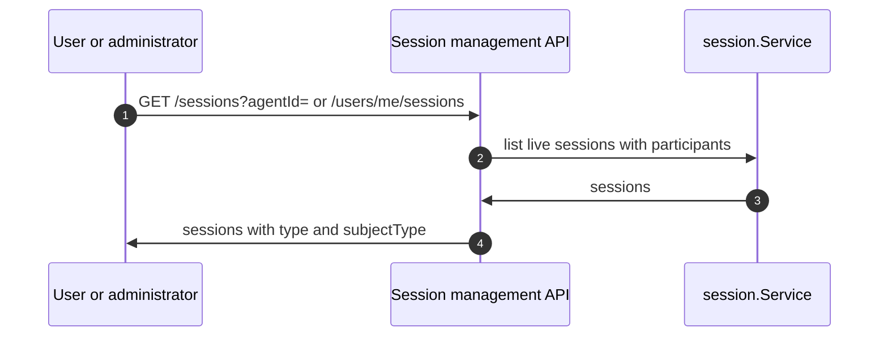

# Session Tracking and Token Lifecycle Threat Model

This model covers session creation for every tracked login, the binding of grants to sessions, the refresh check, token exchange binding, and the paths that end sessions or remove participants, as specified in [spec.md](spec.md).

## Overview

Every tracked login gets a session, and every grant issued in it belongs to one participant with one token family. That binding is what lets ThunderID end a subject's access: a refresh token stops when its session or participant is gone, and ending a session revokes the participants' token families, which also stops the tokens exchanged from them. A gap in the binding is access the user and the administrator can't see or end.

Entry points: the login flows (Session node and auth assert executor), the token endpoint (code exchange, CIBA, device code, refresh, token exchange), the session management APIs from #3400 with the additions here, and the revocation flows for account events.

Cross-cutting concerns covered elsewhere: client authentication at the token endpoint, token signing and validation, the deny list and its Resource Server cache, the login flow engine, back-channel logout delivery ([back-channel logout threat model](../back-channel-logout/threat-model.md)), and session listing and device data (#3400 and its threat model in #6364). These are trust inputs here, not re-analysed.

## Scope

This model covers:
- creating an SSO or direct session at login, and carrying `sid` and `tfid` on the assertion;
- recording the client as a participant when the login completes, and binding the issued tokens to it;
- the refresh check against the session and participant;
- binding an exchanged token to its subject token's family;
- ending sessions: logout, the #3400 revoke APIs, sign out everywhere, account events and compromise;
- listing sessions with the session type and subject type.

Out of scope (see the referenced companion models):
- delivering logout tokens, owned by the [back-channel logout threat model](../back-channel-logout/threat-model.md);
- client IP resolution, device data and the listing permissions, owned by the #3400 threat model (#6364);
- token signature, `exp` and deny-list enforcement in the validator, owned by the token service;
- how access tokens and exchanged tokens end when a session expires, decided in [#6919](https://github.com/thunder-id/thunderid/issues/6919) and recorded here as a residual.

## Architecture

### Components

| Component | Task |
| --- | --- |
| Session node | Creates or joins an SSO session and records the participant with a stable token family. Fails the login when it can't generate a family. |
| Auth assert executor | Creates a direct session with the app as its participant when the flow established none, and puts `sid` and `tfid` on the assertion. |
| Binding resolver | Decides whether a credential is bound, and to which session and participant. The single place that decides, so grant handlers can't diverge. |
| Grant handlers | Carry the assertion's `tfid` onto the tokens at code exchange, CIBA and device code. Create the direct session and participant when an atomic API assertion is redeemed. Check the session and participant on refresh. Copy the subject token's `tfid` on token exchange. |
| `session.Service` | Owns the session tables. Every termination and participant detach revokes token families through the criteria revoker before deleting rows. |
| Deny list | Holds revoked token families. Checked by the validator, introspection and the Resource Server cache. |
| Session management API | The #3400 routes plus the agent filter, under `system:session:view` and `system:session:delete`, and self-service routes scoped to the caller. |

### Actors

#### Actors

| Actor | Description | Roles or permissions |
| --- | --- | --- |
| End user | Signs in, lists and ends their own sessions | Authenticated; self-service routes only |
| Administrator | Lists and ends any subject's sessions in their OU scope | `system:session:view`, `system:session:delete` |
| Client app | Gets tokens for a subject, refreshes, exchanges, revokes its own tokens | Client authentication; its own grants only |
| Agent | Signs in as itself (owns a session), or acts for a user through token exchange | As a subject: like a user. As an actor: like a client app |
| Resource server | Validates access tokens locally or by introspection | Introspection needs client authentication |
| Attacker | Holds a stolen refresh, access or subject token, or a user's session handle | None |

#### Entitlement matrix

| Actor | Create a session | Refresh a grant | Exchange a token | End own sessions | End another subject's sessions |
| --- | --- | --- | --- | --- | --- |
| End user | [Yes] by signing in | [No] | [No] | [Yes] | [No] |
| Administrator | [No] | [No] | [No] | [Yes] | [Yes] in OU scope |
| Client app | [No] | [Yes] own grant | [Yes] with the grant type | [No] | [No] |
| Agent (as actor) | [No] | [No] | [Yes] with the grant type | [No] | [No] |
| Resource server | [No] | [No] | [No] | [No] | [No] |

### External Dependencies (not owned)

| Dependency | Description (usage, purpose, authentication, authorization, security) |
| --- | --- |
| Runtime persistent database | Holds the session tables and the deny list in one database, so termination writes both in one transaction. Reached over the deployment's database connection. |
| Back-channel logout dispatcher | Receives `TerminatedSession` and delivers logout tokens. Owned by the [back-channel logout threat model](../back-channel-logout/threat-model.md). |
| Token validator and Resource Server cache | Enforce the deny list by `tfid`. Owned by the token service. |

## Threats and mitigations

### Out-of-scope interactions and risks

- Logout token forgery, delivery failures and SSRF through the back-channel logout URI: [back-channel logout threat model](../back-channel-logout/threat-model.md).
- Spoofed client IPs in the session's device data, and who may list sessions: the #3400 threat model (#6364).
- Tokens accepted after their session expires, until their own `exp`: [#6919](https://github.com/thunder-id/thunderid/issues/6919). Recorded below as a residual.

### Interactions

#### 01: Creating a session and its participant at login

**Description**

When a login flow completes, the Session node creates or joins an SSO session, or, when the flow has no Session node, the auth assert executor calls `CreateDirect(subject, client, ou)`, which writes the session and the app's participant row in one transaction. Either path records the app the flow runs under as a participant with a `tfid`, and puts `sid` and `tfid` on the auth assertion. A failure to generate the `tfid` fails the login. A direct session has no handle, so it can never be resumed.

**Assets involved**

| Initiator | Intermediate | Target |
| --- | --- | --- |
| User agent through a login flow | Session node or auth assert executor | `SESSION`, `SESSION_PARTICIPANT`, the auth assertion |

**Data flow**

**Security considerations**

| Area | Response | Comments |
| --- | --- | --- |
| Data confidentiality | [C-Medium] | `sid` and `tfid` are opaque identifiers, not credentials |
| Communication medium | [M-NT] | The assertion travels to the client through the user agent |
| Transport security | [TLS] | |
| Authentication | The flow's own authentication steps | |
| Accessibility | [Public] | Login endpoints |
| Authorization and Access Control | The session belongs to the subject the flow authenticated | |

**Threat assessment**

| ID | Category | Threat | Materializable | Mitigation / comment |
| --- | --- | --- | --- | --- |
| 1 | [Spoofing] | A direct session is resumed by a later login that presents its `sid`, so another login reuses a session that was never meant to be shared | [No] | Direct sessions have no handle, and `Resolve` returns SSO sessions only. A `sid` alone never resumes a session |
| 2 | [Security Risk] | A login completes without a `tfid`, so its grant can't be revoked on its own and survives logout | [No] | A `tfid` generation failure fails the login. `TFID` is `NOT NULL` on the participant |
| 3 | [Denial of Service] | Logins whose tokens are never issued pile up session and participant rows, and list an app the user never got tokens for | [No] | Each leaves one session and one participant row, which leave the session list at the idle deadline and are deleted by cleanup at the absolute deadline. No credential exists for that participant, and ending the session revokes a family with no tokens. Row volume is sized in the specification |
| 4 | [Tampering] | The assertion's `sid` or `tfid` is altered on its way through the user agent, binding the grant to another session | [No] | The assertion is signed by ThunderID, so a changed claim fails signature validation |

#### 02: Binding tokens at issuance

**Description**

When tokens are issued for a login (code exchange, the CIBA or device token response, or token exchange of an app-native flow's assertion), the grant handler asks the binding resolver for the binding and puts the assertion's `tfid` on the tokens; the flow already recorded the participant. When an atomic API assertion is redeemed, which the token endpoint recognises as a self-issued token with an `assurance` claim and no `sid`, it creates a direct session with the redeeming client as its participant and a new `tfid`. A rejoin keeps the stored family while it is live, and takes a new one with a compare-and-swap when it was revoked. Client credentials and other machine-to-machine grants are not bound.

**Assets involved**

| Initiator | Intermediate | Target |
| --- | --- | --- |
| Client app or agent | Grant handler, binding resolver | Issued tokens, and `SESSION` and `SESSION_PARTICIPANT` for atomic API logins |

**Data flow**

**Security considerations**

| Area | Response | Comments |
| --- | --- | --- |
| Data confidentiality | [C-High] | Issued tokens are credentials |
| Communication medium | [M-NT] | |
| Transport security | [TLS] | |
| Authentication | Client authentication at the token endpoint | |
| Accessibility | [Public] | Token endpoint |
| Authorization and Access Control | The client must hold the grant (code, `auth_req_id`, device code, assertion) issued to it | |

**Threat assessment**

| ID | Category | Threat | Materializable | Mitigation / comment |
| --- | --- | --- | --- | --- |
| 1 | [Security Risk] | A CIBA or device client's tokens carry a `sid` but no `tfid`, so signing out in the approving browser leaves them alive | [No] | The flow records the polling client as a participant, and the token response stamps the participant's `tfid` on its tokens. This closes a gap on `main` |
| 2 | [Repudiation] | An app that signs in twice in one session overwrites its first family, so logout revokes only the second grant (#6780) | [No] | The family stays stable while it is live (#6786). A revoked family is replaced only through compare-and-swap, so a live family is never lost |
| 3 | [Elevation of Privilege] | A client classifies its own grant as untracked, for example by how it shapes the request, to keep access hidden from the user | [No] | One resolver decides from the subject, client, grant and assertion. Nothing in the request selects the binding |
| 4 | [Security Risk] | A revoked family is reused for a new grant, so the new grant's tokens are rejected at once or an old grant comes back | [No] | A rejoin over a revoked family takes a new `tfid`. A revoked family is never reused |
| 5 | [Elevation of Privilege] | A self-issued token that isn't an atomic API assertion, such as an ID token, is taken for one, so the requesting client gets a new session in the subject's name | [No] | Only auth assertions carry an `assurance` claim, and ID and access tokens never do. While tracking is on, every flow assertion carries a `sid`. A token that doesn't match is bound as an exchange, which writes no session |
| 6 | [Spoofing] | An atomic API assertion is redeemed twice, creating two sessions for one login | [No] | The validator spends an auth assertion on its first redemption, so the second is rejected |

#### 03: Refreshing a token

**Description**

A refresh checks the deny list, then loads the session by `sid` and the participant by `sid`, client and OU, using the deadlines from before the request. An ended, expired or missing session, or a missing participant, returns `invalid_grant`. A live one records activity, throttled, and issues tokens.

**Assets involved**

| Initiator | Intermediate | Target |
| --- | --- | --- |
| Client app | Refresh grant handler | `SESSION`, `SESSION_PARTICIPANT`, deny list |

**Data flow**

**Security considerations**

| Area | Response | Comments |
| --- | --- | --- |
| Data confidentiality | [C-High] | Refresh tokens are long-lived credentials |
| Communication medium | [M-NT] | |
| Transport security | [TLS] | |
| Authentication | Client authentication, and the refresh token itself | |
| Accessibility | [Public] | Token endpoint |
| Authorization and Access Control | The refresh token must belong to the authenticated client | |

**Threat assessment**

| ID | Category | Threat | Materializable | Mitigation / comment |
| --- | --- | --- | --- | --- |
| 1 | [Elevation of Privilege] | A refresh token keeps issuing tokens after its session expired or ended, so access continues for up to the refresh token's lifetime after the user left | [No] | Every refresh checks the session and participant and fails with `invalid_grant`. This closes a gap on `main` |
| 2 | [Tampering] | A late refresh moves the idle deadline of an expired session, reviving it | [No] | The check reads the deadlines from before the request, and a refresh after the deadline fails before activity is written |
| 3 | [Denial of Service] | The session store is unreachable, and refresh falls back to the deny list only, so ended sessions keep refreshing | [No] | Refresh fails closed with `server_error`. The deny list is in the same database, so there is no partial fallback |
| 4 | [Information Disclosure] | The refresh response tells an attacker holding a stolen refresh token whether the session ended, expired or never existed | [No] | All three return the same `invalid_grant` |
| 5 | [Elevation of Privilege] | An agent acting for the user keeps the user's session alive through its own activity | [No] | Exchanged tokens get no refresh token, and only a refresh of a participant's own grant moves the session |
| 6 | [Security Risk] | A refresh token whose family was overwritten before the upgrade can't be revoked by family | [Yes] | The participant is looked up by `sid`, client and OU, so the refresh check still stops it when the session or participant ends. Its access tokens already issued live until `exp`. Bounded by the refresh token lifetime of tokens issued before the upgrade; recorded as a residual |

#### 04: Exchanging a token

**Description**

A token exchange whose subject token carries a `tfid` issues a token with the same `tfid`, no refresh token, and `act` naming the actor (the `actor_token`'s subject, or the requesting client). No participant row is written. Scopes are kept or reduced. `oauth.token_exchange.token_family` is removed.

**Assets involved**

| Initiator | Intermediate | Target |
| --- | --- | --- |
| Client app or agent | Token exchange grant handler | Exchanged access token |

**Data flow**

**Security considerations**

| Area | Response | Comments |
| --- | --- | --- |
| Data confidentiality | [C-High] | The exchanged token is a credential for the user |
| Communication medium | [M-NT] | |
| Transport security | [TLS] | |
| Authentication | Client authentication, the subject token, and the actor token when present | |
| Accessibility | [Public] | Token endpoint |
| Authorization and Access Control | The client must be allowed the token exchange grant. Scopes never widen | |

**Threat assessment**

| ID | Category | Threat | Materializable | Mitigation / comment |
| --- | --- | --- | --- | --- |
| 1 | [Elevation of Privilege] | An agent's exchanged token keeps working after the user signs out or the app is deleted, so delegated access outlives the user's consent to it | [No] | The exchanged token inherits the source grant's family, so every revocation of that family rejects it at introspection and in the Resource Server cache |
| 2 | [Elevation of Privilege] | A client leaves out `actor_token` to get an exchanged token that isn't bound | [No] | `actor_token` changes only `act`. Every exchange of a token with a `tfid` inherits it |
| 3 | [Security Risk] | An operator's `token_family: none` keeps exchanged tokens alive after logout | [No] | The setting is removed as a breaking change. A configuration that still sets it fails to start, so it can't silently keep the old behaviour |
| 4 | [Elevation of Privilege] | An exchange widens the scopes of the subject token | [No] | Requested scopes must be within the subject token's, or within the subject's authorization when the app maps it |
| 5 | [Elevation of Privilege] | An agent chains exchanges to stay active after the app's grant ends | [No] | Each exchange needs a live subject token, and every token in the chain carries the same family, so revoking it stops the whole chain |
| 6 | [Security Risk] | An exchanged token outlives the session's expiry, or its subject token, because its `exp` is the client's own lifetime | [Yes] | Bounded by the client's access token lifetime and stopped at once by any family revocation. Capping it is decided in [#6919](https://github.com/thunder-id/thunderid/issues/6919); recorded as a residual |

#### 05: Ending sessions

**Description**

Logout, the #3400 revoke APIs, sign out everywhere, and account events (forgotten password, credential change, disable, delete, suspend, compromise) all call `Terminate` or `TerminateBySubject`. In one transaction they revoke every participant's token family (reason `session_logout`) and delete the rows, then publish `TerminatedSession` for back-channel logout. `TerminateBySubject` revokes the families itself and can keep the caller's current session. Compromise also writes a subject criterion and can't be removed by flow configuration. The API returns `204`, and a result per participant goes to the audit trail.

**Assets involved**

| Initiator | Intermediate | Target |
| --- | --- | --- |
| End user, administrator, or a revocation flow | `session.Service`, criteria revoker | `SESSION`, `SESSION_PARTICIPANT`, deny list, back-channel logout |

**Data flow**

**Security considerations**

| Area | Response | Comments |
| --- | --- | --- |
| Data confidentiality | [C-Medium] | Results name the apps a subject was signed in to |
| Communication medium | [M-NT] | API calls; [M-IN] for revocation flows |
| Transport security | [TLS] | |
| Authentication | Bearer token for the APIs; the triggering flow for account events | |
| Accessibility | [Restricted] | Admin routes need `system:session:delete`; self-service routes act on the caller's sessions only |
| Authorization and Access Control | OU confinement for administrators | |

**Threat assessment**

| ID | Category | Threat | Materializable | Mitigation / comment |
| --- | --- | --- | --- | --- |
| 1 | [Security Risk] | Sign out everywhere else relies on a subject criterion, which also kills the session the user kept, or doesn't revoke families at all, leaving the other sessions' tokens alive | [No] | `TerminateBySubject` revokes each ended session's families itself and writes no subject criterion for this action |
| 2 | [Repudiation] | A session is reported as ended while its tokens still work, because the deny list write failed | [No] | Termination fails when the deny list can't be written, and no row is deleted |
| 3 | [Security Risk] | A flow or extension skips the revocation step on a session event, leaving tokens alive after a compromise | [No] | Revocation is part of the service call, not a flow step. Compromise always ends every session and revokes every grant |
| 4 | [Denial of Service] | A bulk termination overflows the back-channel queue and drops notifications, so some apps keep their local sessions | [No] | Bulk calls wait for queue space instead of dropping. A drop that still happens is recorded as `failed` in the result and the audit trail |
| 5 | [Repudiation] | The UI tells the user "signed out" for an app that was never reached | [No] | Results separate `credentials` from `notification`, and the UI wording follows them |
| 6 | [Elevation of Privilege] | An administrator ends sessions of subjects outside their OU | [No] | The #3400 routes apply OU confinement; the agent filter uses the same check |
| 7 | [Operational Risk] | A participant joins between the participant read and the delete, so its family isn't revoked | [Yes] | The read happens inside the terminating transaction. A participant that commits in that window joins a session whose row is being deleted; its next refresh fails the session check. Bounded by the access token lifetime; recorded as a residual |

#### 06: Listing sessions

**Description**

The #3400 listing routes return direct sessions and agents' sessions as well, with `type` and `subjectType`. `GET /sessions?agentId=` lists an agent's own sessions. Sessions with no participant yet are hidden.

**Assets involved**

| Initiator | Intermediate | Target |
| --- | --- | --- |
| End user or administrator | Session management API | `SESSION`, `SESSION_PARTICIPANT` |

**Data flow**

**Security considerations**

| Area | Response | Comments |
| --- | --- | --- |
| Data confidentiality | [C-Medium] | The apps a subject is signed in to |
| Communication medium | [M-NT] | |
| Transport security | [TLS] | |
| Authentication | Bearer token | |
| Accessibility | [Restricted] | |
| Authorization and Access Control | `system:session:view` with OU confinement, or the caller's own sessions | |

**Threat assessment**

| ID | Category | Threat | Materializable | Mitigation / comment |
| --- | --- | --- | --- | --- |
| 1 | [Information Disclosure] | A session response exposes the SSO handle or a token family ID, which an attacker could use to resume a session or target revocation | [No] | Neither is ever returned, as in #3400 |
| 2 | [Information Disclosure] | An administrator lists an agent's sessions outside their OU | [No] | The agent filter applies the same OU confinement as the user filter |

## Security Review Checklist

A review aid that complements the threat models and the self-assessment. Guidance follows the [OWASP Top 10 Proactive Controls](https://top10proactive.owasp.org/).

### Security considerations

| # | Consideration | State | Comments |
| --- | --- | --- | --- |
| 1 | Are all inputs and outputs validated (syntactic and semantic)? | [Yes] | Path IDs are validated by the #3400 routes. Assertions are checked by signature and type |
| 2 | Are rate limits in place where necessary? | [N/A] | No new public endpoint beyond the token endpoint and the authenticated session APIs, which follow the deployment's existing limits |
| 3 | Are permissions, roles, and entitlements defined on the principle of least privilege and business need? | [Yes] | Reuses `system:session:view` and `system:session:delete`; self-service is limited to the caller |
| 4 | Are authentication and authorization validated at both the UI and API layers, front end and back end, before granting access to resources? | [Yes] | Enforced in the API; the UI only calls it |
| 5 | Are proper isolations in place between components to ensure least-privilege access and reduce the blast radius against lateral movement? | [Yes] | Session code has no dependency on OAuth; binding is decided in one resolver |
| 6 | Have any default credentials been changed, and are default superuser or root accounts not in use (when using third-party components)? | [N/A] | |
| 7 | Has the implementation followed best-practice guidelines (OWASP, Kubernetes, vendor, or technology provider)? | [Yes] | RFC 7009 and RFC 8693 |
| 8 | Are secrets, credentials, and internal-only material kept out of the public source tree and its git history? | [Yes] | |
| 9 | Was a security-focused code review conducted for this change, and have the findings been addressed? | [N/A] | Design stage; applies to the implementation PRs |
| 10 | Is Static Analysis (SAST) or IaC scanning conducted, and are findings addressed? | [N/A] | Design stage |
| 11 | Is Software Composition Analysis (SCA) conducted or integrated into the repository, and are findings addressed (for example FOSSA, Trivy)? | [N/A] | No new dependency |
| 12 | Is Dynamic (DAST) or API scanning conducted on a non-production setup, and are findings addressed? | [N/A] | Design stage |
| 13 | Are audit logs generated in a standardized format for critical functionality, and available to authorized users to trace critical events and aid incident response? Note the retention period in Comments. | [Yes] | Session creation, termination and participant removal are audited with trigger, actor and per-participant result. Retention follows the deployment's audit configuration |
| 14 | Do audit logs for critical configuration changes record the difference between the old and new versions? | [N/A] | No new configuration change path |
| 15 | Are data in transit and at rest encrypted? | [Yes] | TLS in transit; at rest follows the deployment's database |
| 16 | Are sensitive values such as credentials and keys stored in a secret store or vault? | [N/A] | No new secret |
| 17 | Is personal, sensitive, or confidential data kept out of logs? | [Yes] | Audit events hold no device data, handle or token |
| 18 | Have users been given clear instructions for secure usage? | [Yes] | Docs cover the tracking switch, the full-stop upgrade, and that tokens validated locally stay usable until `exp` |

### Business impact and resilience

| # | Consideration | State | Comments |
| --- | --- | --- | --- |
| 1 | Has a business impact analysis been done to identify resilience requirements (maximum tolerable downtime, uptime, RPO, RTO)? | [N/A] | Left to the deployer |

Resilience details to record:
- High availability: refresh now depends on the session store and fails closed when it is unreachable, so the runtime database's availability bounds refresh availability.
- Disaster recovery: restoring the runtime database restores sessions and the deny list together.
- Backups: as for the runtime database.
- Health checks: unchanged.

### Dependency and component health

| # | Consideration | State | Comments |
| --- | --- | --- | --- |
| 1 | Are dependencies, base images, and runtimes monitored for known vulnerabilities and kept current (for example automated dependency scanning), and are findings addressed? | [Yes] | Repository-wide scanning; no new dependency |
| 2 | Are any End-of-Life or End-of-Service components in use? | [No] | |
| 3 | Is hardening guidance published for operators who deploy the project (optional)? | [Yes] | The configuration docs say what switching tracking off gives up |

### Privacy considerations

| # | Consideration | State | Comments |
| --- | --- | --- | --- |
| 1 | Is the purpose and legal basis for processing personal data clearly defined? | [Yes] | Sessions record which apps a subject signed in to, so access can be shown and ended |
| 2 | Are the collection, storage, processing, sharing, archival, and disposal of personal data aligned with the data minimization principle? | [Yes] | No new personal data beyond #3400's device data; direct sessions record the same fields |
| 3 | Is personal data stored securely? | [Yes] | Runtime database |
| 4 | Are privacy notices updated to reflect any new processing or changes to purpose and legal basis? | [N/A] | Same purpose as #3400 |
| 5 | Is access to personal data granted on a need-to-know basis? | [Yes] | Permissions and OU confinement |
| 6 | Are data retention requirements considered? | [Yes] | Rows are deleted at session end and by cleanup at the absolute deadline |
| 7 | Is there a process to dispose of personal data on request in a timely manner while meeting retention requirements? | [Yes] | Ending a subject's sessions or deleting the subject removes the rows |
| 8 | Are records of personal-data processing maintained in the project's data inventory or records of processing? | [N/A] | |

## Residual risks (open items)

| Risk | Description | Current Status | Recommendation |
| --- | --- | --- | --- |
| Tokens after session expiry | Expiry fires no event, so access tokens and exchanged tokens issued in an expired session stay valid until their own `exp` (1 h by default). Refresh tokens stop at once. | Accepted for this specification | Decide caps, an introspection check or a sweeper (tracking: [#6919](https://github.com/thunder-id/thunderid/issues/6919)) |
| Exchanged token outlives its subject token | The exchanged token's `exp` is the client's own lifetime, not capped at the subject token's, so it can outlive the subject token and the session's expiry. Any family revocation still stops it at once. | Accepted for this specification | Decide the cap with V4 R8.3 (tracking: [#6919](https://github.com/thunder-id/thunderid/issues/6919)) |
| Locally validated tokens after termination | A resource server that validates tokens locally without the deny-list cache accepts a revoked token until its `exp`. | Documented | Resource servers use introspection or the Resource Server cache; keep access token lifetimes short |
| Families overwritten before the upgrade | Grants whose family was overwritten before #6786 can't be revoked by family. | Bounded | The refresh check stops their refresh tokens when the session or participant ends. Their access tokens expire within one lifetime |
| Participant joining during termination | A participant that commits between the termination's participant read and its delete isn't revoked by family. | Bounded | Its next refresh fails the session check. A locking read would close the window if it proves needed |
| ID tokens carry no `tfid` | An ID token isn't revoked with its participant's family, so after logout it can still be presented where an ID token is accepted, for example as the subject of an ID-JAG request, until it expires. | Open | Put the participant's `tfid` on ID tokens in a follow-up |

## Appendix

- References: [RFC 7009](https://www.rfc-editor.org/rfc/rfc7009), [RFC 8693](https://www.rfc-editor.org/rfc/rfc8693), [OpenID Connect Back-Channel Logout 1.0](https://openid.net/specs/openid-connect-backchannel-1_0.html), the [back-channel logout threat model](../back-channel-logout/threat-model.md), the [SSO session management specification](../sso-session-management/spec.md).

## Change log

| Version | Date | Change |
|---|---|---|
| 0.1 | 2026-11-18 | Initial threat model, from design discussion #6322. |
